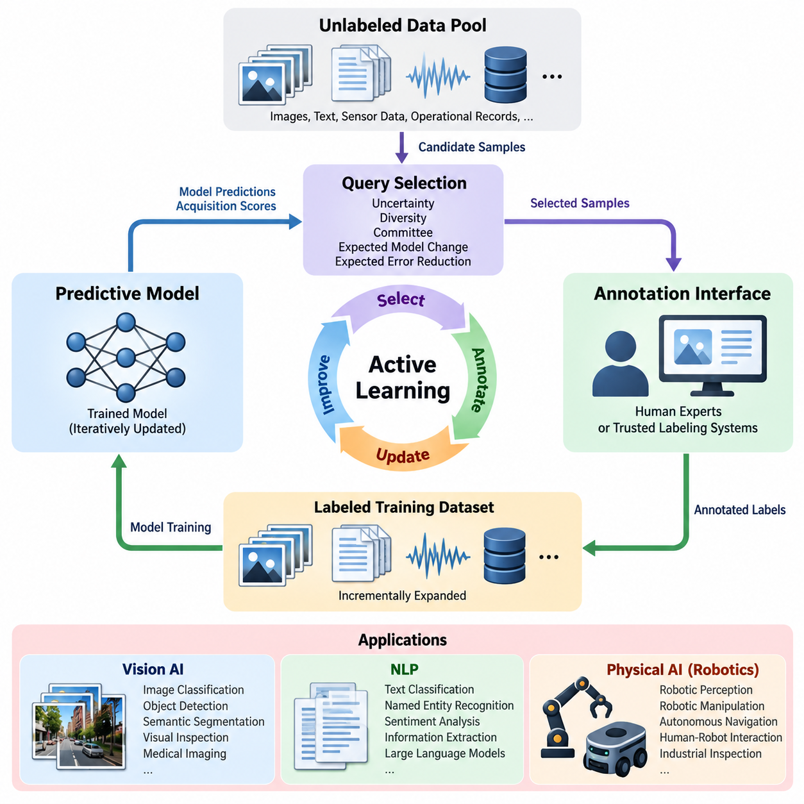
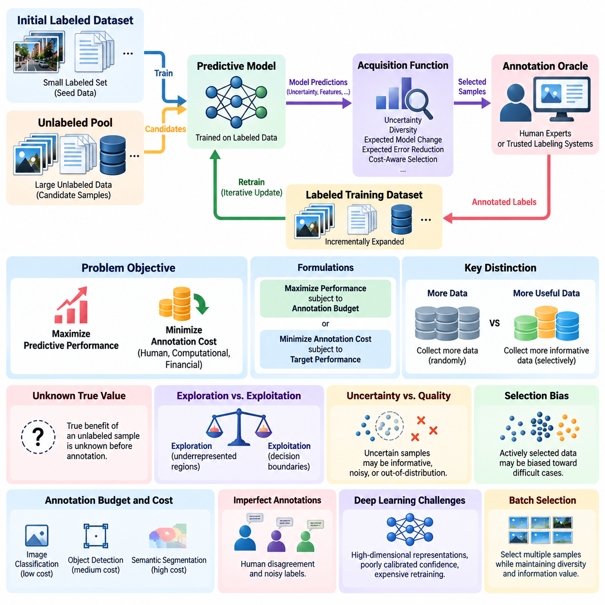
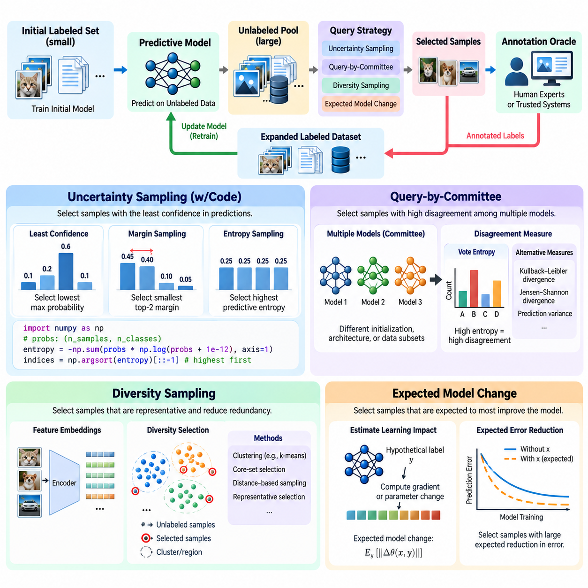
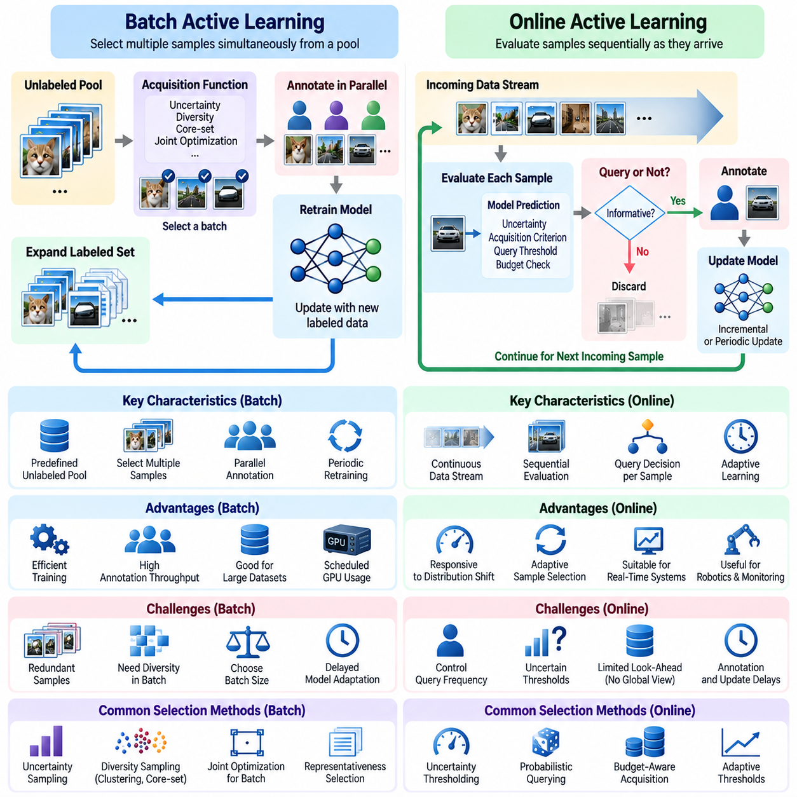
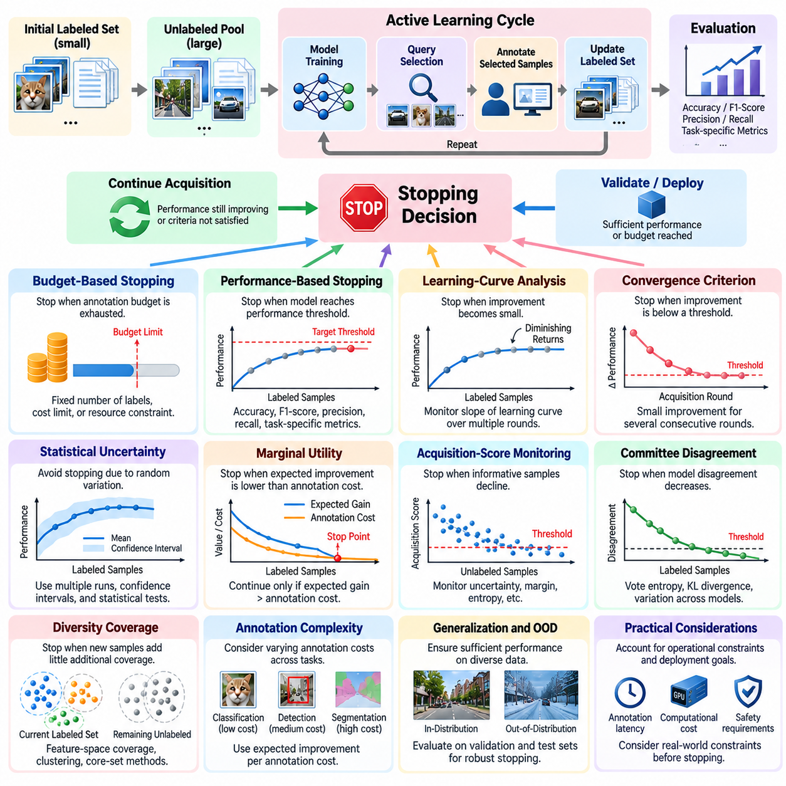
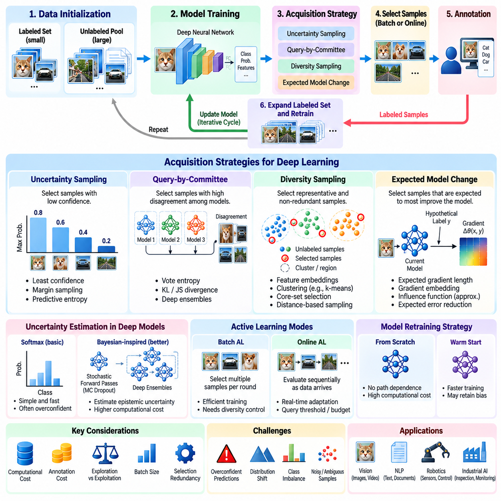
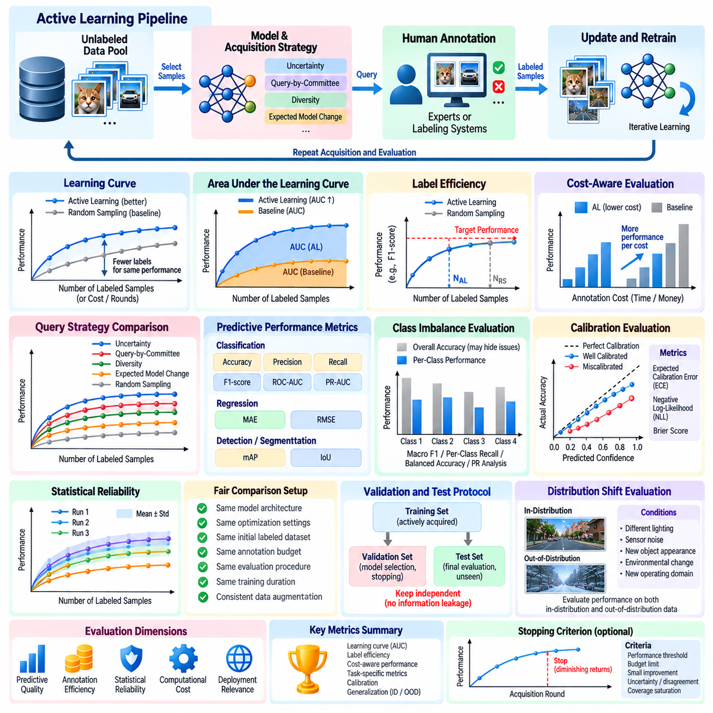
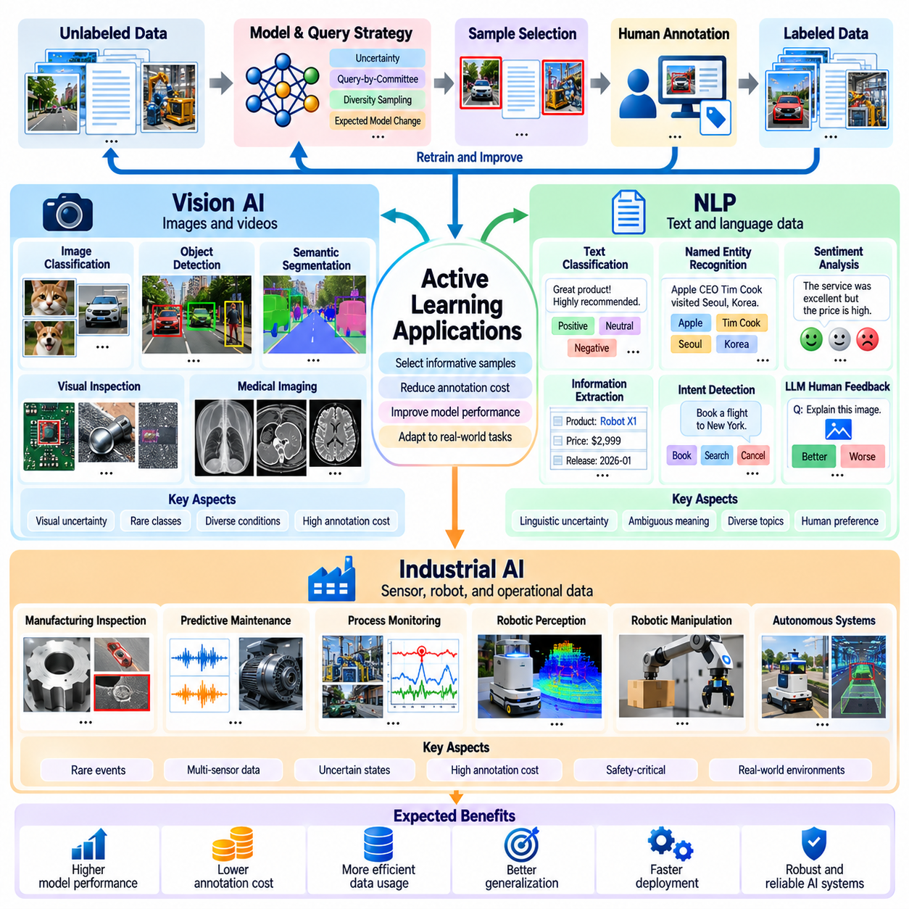

**Volume 41. Human in the Loop Learning**

# 01. Active Learning

## 01.00 Overview

{width="7.268055555555556in" height="7.268055555555556in"}

Active Learning is a machine learning paradigm in which an intelligent system selectively identifies the most informative data samples for human annotation, rather than relying entirely on randomly collected and labeled datasets. Its primary objective is to maximize model performance while minimizing annotation cost, computational overhead, and human effort. This approach is especially valuable when unlabeled data is abundant but obtaining reliable labels requires specialized knowledge, expensive experiments, or substantial manual inspection.

Traditional supervised learning assumes that a sufficiently large labeled dataset is available before model training begins. Active Learning replaces this static assumption with an iterative process in which the model participates in selecting its future training examples. By examining uncertainty, diversity, representativeness, and expected learning value, the system prioritizes samples that are likely to improve its predictive capabilities. Consequently, data acquisition becomes an adaptive component of the overall learning process.

The fundamental architecture of Active Learning consists of a predictive model, an unlabeled data pool, a query selection mechanism, an annotation interface, and a continuously updated training dataset. The model evaluates candidate samples and assigns acquisition scores according to a predefined strategy. Selected samples are submitted to human experts or trusted labeling systems, and their annotations are incorporated into subsequent training cycles. This feedback mechanism establishes a closed-loop learning framework.

Pool-based Active Learning is among the most widely adopted configurations because many organizations possess extensive repositories of unlabeled images, documents, sensor measurements, and operational records. The system repeatedly selects informative samples from this repository and requests their labels. Stream-based approaches instead evaluate incoming observations individually, while membership query synthesis generates candidate inputs for annotation. Each configuration introduces different assumptions concerning data availability and annotation accessibility.

Uncertainty sampling represents a foundational query selection strategy. The model prioritizes observations for which its predictions are least confident, using measures such as predictive entropy, classification margin, or confidence scores. For example, an object detection model may request annotations for images containing ambiguous object boundaries or unfamiliar appearances. However, uncertainty alone may favor noisy observations or outliers, making additional selection criteria necessary for reliable performance.

Diversity-based sampling addresses the limitations of uncertainty-driven selection by encouraging coverage across different regions of the data distribution. Feature embeddings, clustering algorithms, and distance-based methods can identify representative examples that reduce redundancy within annotation batches. Combining uncertainty and diversity allows the system to prioritize samples that are both difficult and informative, improving the efficiency of dataset expansion and reducing repeated annotation of nearly identical observations.

Query-by-Committee introduces multiple models or model configurations that independently evaluate the same unlabeled observations. Samples producing substantial disagreement among committee members are considered informative because they reveal uncertainty within the learned hypothesis space. Disagreement can be quantified through vote entropy, predictive divergence, or variation across ensemble outputs. Although this approach increases computational requirements, it can reveal ambiguities that single-model confidence estimates fail to capture.

Expected model change and expected error reduction provide more direct approaches to estimating the educational value of candidate samples. These strategies attempt to predict how much incorporating a new annotation would alter model parameters or improve generalization performance. Their theoretical appeal comes from connecting sample selection with measurable learning progress. In practice, approximations are often required because evaluating every possible annotation and retraining outcome would be computationally prohibitive.

Active Learning becomes particularly important in Physical AI systems, where data originates from robots operating in dynamic, uncertain, and potentially hazardous environments. Cameras, LiDAR sensors, force sensors, tactile devices, and proprioceptive measurements generate continuous streams of observations. Labeling every frame or sensor sequence is rarely practical. Active Learning identifies informative events such as unusual obstacles, localization failures, unexpected contacts, and unfamiliar manipulation conditions.

Robotic perception applications can use Active Learning to improve object detection, semantic segmentation, depth estimation, and environmental understanding. A mobile robot encountering an unfamiliar industrial object may assign high uncertainty to its classification and submit the observation for expert review. Once verified, the labeled example can support model refinement and improve future recognition. Similar procedures can address difficult lighting conditions, partial occlusion, reflective surfaces, and previously unseen operating environments.

In robotic manipulation, informative samples frequently involve ambiguous grasp configurations, uncertain object properties, contact transitions, and unsuccessful execution attempts. Active Learning can prioritize these situations for human assessment, enabling more efficient improvement of grasp prediction and manipulation policies. However, selecting informative demonstrations or corrective actions requires additional consideration of temporal dependencies, task objectives, and physical safety constraints that are less prominent in conventional image classification.

Active Learning also supports Human-in-the-Loop systems by establishing a structured relationship between autonomous prediction and expert judgment. Human annotators provide semantic interpretation, resolve uncertain cases, and identify errors that automated evaluation cannot reliably determine. The effectiveness of this interaction depends on annotation interface quality, task clarity, expert availability, and consistent labeling standards. Human feedback must be treated as valuable but potentially imperfect information rather than unquestionable ground truth.

Annotation quality is a critical consideration because incorrectly labeled samples can undermine the benefits of intelligent query selection. Difficult observations are often selected precisely because they are ambiguous, increasing the likelihood of disagreement among annotators. Quality assurance mechanisms may include multiple independent annotations, expert adjudication, confidence recording, and consistency checks. Maintaining annotation provenance allows developers to distinguish model uncertainty from labeling uncertainty during subsequent analysis.

Cost-sensitive Active Learning extends the conventional framework by recognizing that annotation effort varies significantly across samples and tasks. Labeling a simple image category may require only seconds, whereas annotating a robotic manipulation trajectory or three-dimensional point cloud may require extensive expert work. Acquisition functions can therefore incorporate expected annotation time, financial cost, and operational risk. The resulting optimization seeks the greatest expected learning benefit per unit of annotation expenditure.

Batch-mode Active Learning is particularly relevant to practical training pipelines because modern neural networks are typically updated using collections of labeled samples rather than individual observations. Selecting an effective batch requires balancing informativeness with redundancy. If many highly uncertain samples represent the same underlying phenomenon, their combined learning value may be limited. Batch acquisition methods therefore consider relationships among candidates and attempt to maximize complementary information within each annotation cycle.

Model calibration significantly influences Active Learning performance because acquisition decisions frequently depend on predictive confidence. Deep neural networks may produce highly confident predictions even when their outputs are incorrect, particularly under distribution shift. Calibration techniques, probabilistic ensembles, and uncertainty estimation methods can improve acquisition reliability. Nevertheless, confidence calibration should be evaluated separately from predictive accuracy because strong classification performance does not automatically imply trustworthy uncertainty estimates.

Distribution shift presents another important challenge when Active Learning systems encounter environments that differ from their original training conditions. Changes in illumination, terrain, object appearance, sensor characteristics, or operational procedures may invalidate previously learned representations. An adaptive acquisition strategy should detect emerging data distributions and prioritize observations that expose weaknesses in existing models. This capability connects Active Learning with continual learning, domain adaptation, and long-term autonomous operation.

Active Learning must also address sampling bias introduced by its own selection mechanism. Because queried examples are deliberately chosen rather than randomly sampled, the labeled dataset may not accurately represent the deployment distribution. This imbalance can distort performance estimates and create unexpected weaknesses in frequently encountered situations. Maintaining representative validation datasets, tracking acquisition distributions, and periodically incorporating randomly sampled observations can help reduce these risks.

Evaluation of Active Learning requires more than comparing final model accuracy. Important measurements include annotation efficiency, learning curves, acquisition cost, sample diversity, model calibration, and performance under distribution shift. A common experimental procedure compares multiple acquisition strategies using identical initial datasets, model architectures, annotation budgets, and evaluation conditions. Performance should be measured across repeated trials because acquisition decisions can be sensitive to initialization and stochastic training behavior.

The integration of Active Learning with simulation and digital twins introduces additional opportunities for data-efficient Physical AI development. Simulation environments can generate candidate scenarios involving rare failures, difficult terrain, unexpected obstacles, and unusual object interactions. Acquisition strategies can prioritize scenarios that reveal significant model weaknesses before real-world deployment. However, simulated observations must be evaluated for realism because highly informative synthetic examples may not transfer effectively to physical environments.

Operational deployment requires a coordinated infrastructure connecting data ingestion, model inference, acquisition scoring, annotation management, dataset versioning, training, evaluation, and model release. Each annotation cycle should preserve the relationship between the selected observation, acquisition rationale, human decision, and resulting model update. Reproducible records support performance auditing and systematic improvement. Deployment gates should prevent inadequately validated model updates from reaching safety-critical robotic systems.

The long-term significance of Active Learning lies in transforming data collection from a passive accumulation process into a targeted learning strategy. Instead of treating all observations as equally valuable, intelligent systems identify knowledge gaps and allocate human expertise where it can produce meaningful improvements. When combined with reliable uncertainty estimation, disciplined annotation, robust evaluation, and continuous operational feedback, Active Learning provides a foundation for scalable, data-efficient, and progressively adaptable Physical AI systems.

## 01.01 Active Learning Problem

{width="7.268055555555556in" height="7.268055555555556in"}

The Active Learning problem concerns how a machine learning system can achieve high predictive performance while acquiring as few labeled examples as possible. Unlike conventional supervised learning, where training data is assumed to be fully labeled, Active Learning introduces a decision process that determines which observations should receive annotation. The central challenge is identifying samples whose labels provide the greatest expected improvement in model quality under limited human, computational, and financial resources.

A typical Active Learning setting begins with a small labeled dataset and a substantially larger collection of unlabeled observations. The labeled subset supports initial model training, while the unlabeled pool provides candidate examples for future acquisition. At each iteration, the learning system evaluates these candidates and selects a subset for annotation. Newly labeled observations are incorporated into the training dataset, allowing the model to improve through repeated cycles of selection, annotation, and retraining.

The fundamental optimization objective is to maximize predictive performance subject to an annotation budget. Alternatively, the problem can be formulated as minimizing annotation expenditure while achieving a specified performance threshold. These formulations reveal an important distinction between collecting more data and collecting more useful data. Active Learning assumes that examples differ in their potential contribution to learning, making sample selection a central optimization problem rather than a passive preprocessing operation.

The learning environment is commonly described through a labeled dataset, an unlabeled pool, a predictive model, an acquisition function, and an annotation oracle. The oracle represents a human expert or another trusted mechanism capable of supplying labels for selected observations. The acquisition function estimates the usefulness of each candidate sample based on the current model and available information. Its design determines how annotation resources are allocated throughout the learning process.

An essential difficulty is that the true value of an unlabeled sample cannot be known directly before its label is obtained. The system must therefore estimate potential learning benefits using incomplete information. Predictive uncertainty, model disagreement, feature-space coverage, and expected parameter changes provide practical approximations. However, these indicators do not guarantee that a selected sample will improve generalization, creating a fundamental gap between estimated informativeness and actual learning value.

The exploration and exploitation tradeoff is an important aspect of the Active Learning problem. Exploitation prioritizes samples near the model\'s current decision boundaries, where additional labels may improve existing predictions. Exploration seeks observations from poorly represented regions of the input space, potentially revealing previously unknown patterns. An effective acquisition strategy balances these objectives to avoid concentrating exclusively on familiar ambiguities or excessively unusual observations.

Another challenge arises from the relationship between uncertainty and sample quality. Highly uncertain observations may contain useful decision-boundary information, but they may also represent corrupted measurements, mislabeled phenomena, or observations outside the intended application domain. Selecting such examples without additional safeguards can waste annotation resources. Consequently, practical Active Learning systems must distinguish informative uncertainty from irreducible noise and irrelevant distributional anomalies.

The Active Learning problem also depends on the statistical relationship between the labeled dataset and the target deployment distribution. Because examples are selected according to an acquisition policy, the resulting training set may become systematically biased toward difficult or unusual cases. This selection bias can affect both model optimization and performance estimation. Representative validation and test datasets are therefore necessary to determine whether improvements on acquired samples translate into broader generalization.

Annotation budgets introduce additional complexity because labeling costs are rarely uniform. A simple image classification label may require minimal effort, whereas semantic segmentation, three-dimensional annotation, or robotic trajectory assessment can demand substantial expertise. The acquisition objective should therefore consider expected information gain relative to annotation cost. Under this formulation, the most uncertain sample is not necessarily the most economical choice for improving the model.

The problem becomes more complex when annotations are imperfect. Human experts may disagree about ambiguous observations, and labeling consistency may vary with experience, fatigue, or task complexity. An Active Learning system must account for annotation noise and potentially request repeated assessments for difficult samples. Distinguishing uncertainty caused by insufficient model knowledge from ambiguity inherent in the data is essential for allocating human attention effectively.

In deep learning, Active Learning faces additional challenges associated with high-dimensional representations, large model capacity, and expensive retraining. Neural networks may exhibit poorly calibrated confidence estimates, making uncertainty-based acquisition unreliable. Their learned feature spaces also evolve during training, changing the relative informativeness of unlabeled samples. Efficient acquisition therefore requires methods that remain computationally practical while adapting to evolving model representations.

Batch selection introduces a further optimization challenge because modern training pipelines generally acquire multiple samples simultaneously. Selecting the highest-scoring examples independently may produce batches containing redundant observations. Effective batch acquisition must consider interactions among candidates, balancing uncertainty with diversity and representativeness. The objective is to maximize the collective learning value of a batch rather than simply combining individually attractive samples.

The stopping problem determines when additional annotation is no longer economically justified. A learning system may continue requesting labels even after marginal performance improvements become negligible. Conversely, stopping prematurely may leave important knowledge gaps unresolved. Practical stopping criteria can consider validation performance, acquisition-score trends, remaining annotation budgets, and estimated marginal learning gains. Reliable decisions require acknowledging that performance improvements may fluctuate across acquisition rounds.

In Physical AI, the Active Learning problem extends beyond static datasets to continuous streams of observations generated by robots and autonomous systems. Cameras, LiDAR, tactile sensors, and motion measurements capture operational situations with varying degrees of uncertainty. The system must identify events that justify human review without overwhelming annotators. Safety-critical failures, unfamiliar environmental conditions, and unexpected interactions may deserve priority even when their statistical frequency is low.

Active Learning in robotic systems must also distinguish selecting existing observations for annotation from selecting physical actions to generate new information. Pool-based selection operates on previously collected data, while interactive exploration may require the robot to perform additional sensing or experiments. The latter introduces physical costs and safety constraints. A potentially informative action may be unacceptable if it creates excessive collision risk, equipment damage, or operational disruption.

Evaluating solutions to the Active Learning problem requires controlled comparisons against random sampling and alternative acquisition strategies. Learning curves should relate predictive performance to the number or cost of acquired annotations. Experiments must use consistent initialization, model architectures, evaluation datasets, and annotation budgets. Repeated trials help reveal sensitivity to random sampling, model training variability, and acquisition decisions, supporting more reliable conclusions about practical efficiency.

Ultimately, the Active Learning problem is a resource allocation problem under uncertainty. The system must decide which missing information is worth acquiring, how much human effort should be invested, and when further learning is justified. Its success depends on the interaction among acquisition strategies, annotation reliability, model calibration, data distribution, and evaluation methodology. Solving these challenges enables more efficient learning systems that improve through selective, measurable, and strategically directed human supervision.

## 01.02 Query Strategies

{width="7.268055555555556in" height="7.268055555555556in"}

Query strategies are the decision mechanisms that determine which unlabeled samples should be submitted for annotation during Active Learning. Their primary purpose is to identify observations that offer the greatest potential improvement in predictive performance under limited annotation budgets. Rather than selecting data randomly, acquisition strategies estimate the information value of candidate samples using model uncertainty, disagreement, distributional coverage, or expected learning impact.

Uncertainty Sampling is one of the simplest and most widely used Active Learning strategies. It prioritizes samples for which the current predictive model expresses the least confidence. The underlying assumption is that uncertain observations reveal weaknesses in learned decision boundaries or insufficient knowledge about particular regions of the input space. Annotating these samples can help refine predictions, although uncertainty does not always correspond directly to useful learning information.

Least Confidence Sampling selects observations with the lowest maximum predicted class probability. Margin Sampling instead examines the difference between the two highest class probabilities, prioritizing samples with small margins. Entropy Sampling measures uncertainty across the complete predictive distribution, making it useful when multiple classes receive comparable probabilities. These methods provide different interpretations of uncertainty and may produce different acquisition rankings for the same dataset.

A practical Uncertainty Sampling implementation begins by training a classifier on a small labeled dataset. The classifier predicts class probabilities for unlabeled observations, and an acquisition function computes uncertainty scores. The highest-scoring samples are selected for annotation and subsequently added to the labeled dataset. After retraining, the acquisition process repeats. This implementation can use standard probability outputs from machine learning frameworks without requiring modifications to the model architecture.

For example, a Python implementation using NumPy can calculate predictive entropy with the expression entropy = -np.sum(probs \\\* np.log(probs + 1e-12), axis=1). Here, probs contains class probability distributions for candidate observations, while the numerical constant prevents undefined logarithms. Samples can be ranked using np.argsort(entropy)[::-1], and the highest-ranked indices can be submitted for annotation. The resulting procedure provides a compact baseline for uncertainty-driven acquisition.

Despite its simplicity, Uncertainty Sampling has several limitations. Neural networks may generate overconfident predictions, especially for observations outside their training distribution. Noisy or inherently ambiguous examples may also receive high uncertainty scores without offering meaningful learning benefits. Consequently, practical implementations often combine uncertainty estimates with confidence calibration, outlier filtering, diversity constraints, or annotation-cost considerations to improve acquisition reliability.

Query-by-Committee approaches Active Learning through disagreement among multiple predictive models. Instead of relying on uncertainty estimates from a single model, the system maintains a committee of models trained using different initializations, architectures, data subsets, or stochastic procedures. Each committee member predicts labels for the same unlabeled observations. Samples producing substantial disagreement are considered informative because they expose uncertainty about the appropriate predictive hypothesis.

Vote Entropy is a common disagreement measure for classification committees. Each model votes for its preferred class, and the distribution of votes determines the acquisition score. A sample receiving nearly identical votes from every committee member has low disagreement, whereas one receiving widely distributed votes has high disagreement. Alternative measures include Kullback--Leibler divergence, Jensen--Shannon divergence, and variation across predictive probabilities.

Committee diversity is essential because disagreement becomes uninformative when all models make nearly identical predictions. Training multiple copies of the same architecture with identical parameters may provide little additional information. Diversity can be introduced through bootstrap sampling, independent random initialization, architectural variation, or different training objectives. However, committee members must remain sufficiently competent for disagreement to reflect meaningful uncertainty rather than arbitrary prediction errors.

Query-by-Committee can be particularly useful when individual model confidence scores are unreliable. Ensemble disagreement provides an approximate indication of epistemic uncertainty, representing uncertainty associated with incomplete model knowledge. Nevertheless, computational costs increase with committee size, and disagreement does not guarantee that acquiring a particular label will improve generalization. Practical systems therefore balance committee diversity, prediction quality, acquisition efficiency, and available computational resources.

Diversity Sampling addresses the problem of selecting redundant observations from densely populated regions of the dataset. Rather than focusing exclusively on uncertain predictions, it seeks samples that represent different portions of the input distribution. This approach is particularly valuable when unlabeled repositories contain many nearly identical images, repeated sensor measurements, or highly correlated operational records. Representative selection can improve dataset coverage while reducing unnecessary annotation effort.

Feature-space representations provide a foundation for Diversity Sampling. A trained neural network can transform raw observations into embeddings that capture semantic or structural relationships. Distance measures such as Euclidean distance or cosine distance then quantify similarity among candidates. Samples located far from existing labeled observations may reveal underrepresented regions, while clustering methods can identify representative examples from distinct groups within the unlabeled pool.

Core-set selection is a representative diversity-oriented approach that attempts to cover the data distribution using a limited number of selected examples. A common greedy approximation repeatedly chooses the candidate farthest from the nearest previously selected or labeled sample. This strategy encourages broad coverage of the feature space. However, its effectiveness depends on embedding quality, distance metrics, and whether geometric coverage corresponds to meaningful variation in the target task.

Diversity Sampling can be combined with uncertainty estimates to balance exploration and exploitation. Uncertainty identifies observations near ambiguous decision regions, while diversity prevents acquisition batches from concentrating on nearly identical examples. Hybrid acquisition functions may use weighted scores, clustering followed by uncertainty ranking, or uncertainty filtering followed by representative selection. These combinations are especially useful for batch-mode Active Learning with large unlabeled datasets.

Expected Model Change selects samples according to their estimated ability to modify the predictive model after annotation. The central assumption is that observations producing substantial learning updates may be more valuable than samples that leave the model nearly unchanged. This strategy connects acquisition decisions with the training optimization process. Rather than measuring uncertainty alone, it evaluates the potential influence of candidate observations on model parameters or learned representations.

Expected Gradient Length is a common approximation to Expected Model Change. For each unlabeled candidate, the system estimates the magnitude of the gradient that would result from training on that sample under possible labels. Because the true label is unknown, gradient magnitudes can be averaged using predicted label probabilities. Candidates with larger expected gradients receive higher acquisition scores, indicating greater potential influence on the current model.

Gradient-based acquisition introduces computational challenges because evaluating hypothetical labels and parameter gradients for every candidate can be expensive. Modern deep networks may contain millions or billions of parameters, making full-gradient comparisons impractical. Efficient approximations can focus on final-layer gradients, low-dimensional gradient embeddings, or selected parameter subsets. These methods reduce computational requirements while preserving information about potential training impact.

Expected Model Change must also distinguish large parameter updates from genuinely beneficial learning. A noisy sample or an extreme outlier may produce a large gradient without improving generalization. Similarly, gradient magnitude depends on model parameterization, loss scaling, and optimization settings. Therefore, expected change should be interpreted as a proxy for learning value rather than a guaranteed measure of performance improvement.

The four strategies emphasize complementary aspects of sample informativeness. Uncertainty Sampling examines prediction ambiguity, Query-by-Committee measures disagreement across hypotheses, Diversity Sampling improves distributional coverage, and Expected Model Change estimates potential training impact. No strategy is universally optimal because acquisition effectiveness depends on dataset structure, model calibration, annotation costs, and the characteristics of the deployment environment.

In Physical AI applications, query strategies can prioritize unfamiliar objects, uncertain terrain classifications, unusual sensor observations, and difficult manipulation events. Uncertainty can identify ambiguous perception outputs, committee disagreement can expose model instability, diversity can improve environmental coverage, and gradient-based methods can identify influential training examples. Safety constraints and annotation reliability must remain central considerations when these strategies guide real-world robotic learning.

Evaluating query strategies requires comparing learning performance under equivalent annotation budgets and controlled experimental conditions. Random sampling provides an essential baseline, while repeated acquisition trials reveal sensitivity to initialization and stochastic training. Useful measurements include accuracy, annotation cost, acquisition runtime, calibration, and performance on previously unseen environments. These evaluations establish whether sophisticated selection methods provide meaningful benefits beyond additional computational complexity.

Ultimately, query strategy design determines how effectively Active Learning converts limited human supervision into improved model capability. Reliable systems rarely depend on a single acquisition signal under every operating condition. Instead, they combine uncertainty, disagreement, diversity, and expected learning impact according to task requirements and resource constraints. This adaptive selection process enables more efficient dataset development and supports scalable Human-in-the-Loop learning across conventional AI and Physical AI systems.

## 01.03 Batch vs Online AL

{width="7.268055555555556in" height="7.268055555555556in"}

Batch Active Learning and Online Active Learning represent two operational approaches to selecting informative training examples under limited annotation resources. Batch Active Learning acquires multiple samples simultaneously before updating the predictive model, whereas Online Active Learning evaluates observations sequentially as they become available. Both approaches seek to improve learning efficiency, but they differ in acquisition timing, computational requirements, feedback latency, and adaptation to changing data distributions.

Batch Active Learning typically operates on a predefined pool of unlabeled observations. The system evaluates candidate samples using an acquisition function and selects a group for annotation during each learning round. Human annotators can process these samples in parallel, after which the labeled dataset is expanded and the model is retrained. This approach is particularly suitable for large offline datasets, centralized annotation services, and training environments where model updates are computationally expensive.

The principal advantage of batch acquisition is operational efficiency. Selecting multiple samples at once reduces the frequency of model retraining and allows annotation tasks to be distributed among several workers. GPU resources can be scheduled for periodic training cycles, while annotation platforms can organize selected examples into manageable workloads. These characteristics make Batch Active Learning attractive for industrial AI projects involving extensive image repositories, sensor recordings, or archived robotic observations.

However, batch selection introduces redundancy because acquisition scores are often calculated using a model that remains unchanged throughout the selection process. Several highly ranked samples may represent nearly identical observations or closely related decision boundaries. Annotating all of them can provide limited additional information. Effective batch acquisition therefore requires strategies that consider diversity, representativeness, and interactions among candidate samples rather than relying exclusively on individual uncertainty scores.

A common solution is to combine uncertainty sampling with diversity-aware selection. The system first identifies uncertain candidates and then chooses a representative subset using clustering, embedding distances, or core-set methods. Alternative approaches jointly optimize acquisition utility across the entire batch. These mechanisms attempt to maximize collective information gain while preventing excessive concentration in densely populated regions of the feature space.

Batch size is a critical design parameter because it influences annotation throughput, training frequency, and learning efficiency. Small batches allow the model to incorporate feedback more frequently and adjust subsequent acquisition decisions. Large batches improve parallel processing efficiency but may contain redundant samples and delay model adaptation. The optimal batch size depends on annotation capacity, retraining cost, dataset characteristics, and the rate at which useful information becomes available.

Online Active Learning processes observations sequentially and makes acquisition decisions as data arrives. For each incoming sample, the system determines whether requesting its label is worthwhile based on current model uncertainty, acquisition criteria, and remaining annotation resources. If the sample is selected, its label may be incorporated into subsequent model updates. This approach supports adaptive learning in environments where observations arrive continuously rather than being collected into a fixed repository.

Stream-based Active Learning is a common form of Online Active Learning in which observations are evaluated individually and may not remain available for future selection. The system must decide whether to request an annotation before the opportunity disappears or storage constraints become relevant. Unlike pool-based methods, which can compare candidates globally, stream-based methods often rely on thresholds, probabilistic querying, or adaptive budget allocation to determine whether an incoming observation deserves attention.

The primary advantage of Online Active Learning is its responsiveness to changing environments. When the input distribution evolves, the acquisition policy can identify unfamiliar or uncertain observations and prioritize them for annotation. This capability is valuable for autonomous robots, industrial monitoring systems, and continuously operating perception platforms. However, rapid acquisition decisions do not necessarily imply immediate model retraining, particularly when human annotation or computational resources introduce delays.

Online acquisition requires careful management of annotation frequency because requesting labels too often can overwhelm human experts. Fixed uncertainty thresholds may behave poorly when confidence distributions change over time. Adaptive thresholds, query-rate constraints, and budget-aware acquisition policies can regulate annotation demand. These mechanisms help maintain a balance between collecting useful information and preserving sufficient resources for future observations.

Another important consideration is the distinction between sequential acquisition and incremental model learning. Online Active Learning determines which incoming observations should be labeled, while online learning describes how model parameters are updated using newly available training data. The two processes can operate together but are not identical. A system may select observations continuously while retraining periodically, or it may update a lightweight model incrementally after receiving each annotation.

Computational architecture strongly influences the choice between batch and online acquisition. Batch systems can perform large-scale uncertainty estimation, embedding extraction, and diversity optimization using centralized GPU infrastructure. Online systems often require lightweight acquisition functions capable of evaluating observations under latency constraints. Edge devices may perform initial uncertainty screening, while more expensive annotation management and model training occur on centralized servers.

The distinction becomes especially important in Physical AI systems that generate continuous multimodal sensor data. A mobile robot may capture camera images, LiDAR measurements, localization estimates, and control feedback during operation. Batch acquisition can analyze archived mission recordings to identify representative failure cases. Online acquisition can detect unusual events during execution and flag them for subsequent expert review, allowing operational experience to guide future learning.

Safety considerations impose additional constraints on online acquisition in robotics. A robot encountering an unfamiliar obstacle cannot necessarily wait for a human annotation before making a control decision. Safety-critical behavior must remain governed by validated control policies, operational limits, and fallback mechanisms. Active Learning can request labels for uncertain observations, but annotation requests should not be confused with authorization to execute unsafe actions or deploy unvalidated model updates.

Hybrid Active Learning architectures combine the advantages of batch and online selection. Incoming observations can be screened continuously using lightweight uncertainty or novelty measures, while selected candidates are stored in an acquisition buffer. Periodic batch optimization then removes redundant examples and chooses representative samples for annotation. This design separates immediate event detection from computationally intensive selection and training, improving scalability across distributed systems.

Annotation latency also affects system design. Batch workflows can coordinate large groups of annotators and tolerate scheduled feedback cycles, whereas online workflows may require rapid responses for time-sensitive applications. Nevertheless, real-time observation processing does not guarantee real-time human feedback. Systems must explicitly manage pending annotations, delayed labels, duplicate requests, and model versions to prevent inconsistent acquisition decisions.

Data distribution characteristics further influence the appropriate acquisition mode. Stable datasets with substantial redundancy often benefit from batch selection because global diversity optimization can reduce unnecessary labeling. Rapidly changing environments may favor online acquisition because informative observations can emerge unexpectedly. When distribution shifts are gradual, periodic batch updates may be sufficient. Sudden operational changes may require faster detection and more adaptive annotation policies.

Evaluation should compare batch and online approaches under equivalent annotation budgets, computational constraints, and target performance requirements. Useful measurements include learning curves, annotation efficiency, acquisition latency, model update frequency, computational cost, and robustness to distribution shift. Online systems should also be evaluated for query rates and delayed-feedback behavior, while batch systems should be examined for redundancy and sensitivity to batch size.

A rigorous comparison must distinguish the benefits of acquisition strategy from differences in training schedules and available information. Batch methods may access an entire unlabeled pool, while streaming methods only observe candidates sequentially. These unequal information conditions can influence experimental outcomes independently of acquisition quality. Fair evaluation therefore requires clearly defined data access assumptions, consistent model architectures, and transparent accounting of annotation and computation costs.

Ultimately, Batch Active Learning emphasizes coordinated acquisition and efficient resource utilization, while Online Active Learning emphasizes sequential decision-making and responsiveness to incoming information. Neither approach is universally superior. The appropriate design depends on data availability, annotation latency, model retraining cost, deployment constraints, and operational risk. Combining continuous observation screening with periodic diversity-aware batch acquisition offers a practical foundation for scalable Human-in-the-Loop and Physical AI learning systems.

## 01.04 Stopping Criteria

{width="7.268055555555556in" height="7.268055555555556in"}

Stopping criteria in Active Learning determine when a learning system should stop requesting additional annotations and transition toward model validation or deployment. The central challenge is identifying the point at which further labeling provides insufficient improvement relative to its cost. Because annotation resources are limited and learning gains are uncertain, stopping decisions must balance predictive performance, operational requirements, statistical confidence, and the expected value of additional information.

A fundamental distinction exists between budget-based stopping and performance-based stopping. Budget-based stopping terminates acquisition when a predefined annotation allowance, financial limit, or computational allocation has been exhausted. Performance-based stopping ends the process when the model achieves a specified quality threshold. Although straightforward to implement, neither approach independently guarantees efficient resource utilization or sufficient generalization to unseen observations.

Budget-based criteria are particularly common in industrial projects where annotation contracts, personnel availability, and training infrastructure impose fixed constraints. The system may stop after acquiring a specified number of labels or consuming an allocated annotation budget. However, exhausting available resources does not demonstrate that the model has converged. A budget limit should therefore be interpreted as an operational constraint rather than evidence that further learning would be unnecessary.

Performance-based stopping relies on evaluation metrics such as accuracy, F1-score, precision, recall, or task-specific error rates. The acquisition process can terminate when validation performance reaches an acceptable threshold. This approach connects stopping decisions to measurable application requirements. However, evaluation results depend on the representativeness and quality of the validation dataset, making independent and sufficiently diverse evaluation data essential.

Learning-curve analysis provides another foundation for stopping decisions. A learning curve describes predictive performance as a function of acquired annotations or annotation expenditure. During early acquisition rounds, additional labels may produce substantial improvements, while later rounds often exhibit diminishing returns. When performance improvements remain consistently small across several rounds, the system may infer that further annotation has limited immediate value.

A practical convergence criterion examines changes in validation performance between consecutive acquisition rounds. If the observed improvement remains below a predefined threshold for several evaluations, the learning process may be considered sufficiently stable. However, isolated plateaus can occur because of stochastic optimization, difficult acquisition batches, or temporary representation limitations. Reliable stopping therefore requires repeated measurements rather than a single comparison.

Statistical uncertainty must be considered when interpreting learning curves. Small performance differences may reflect random initialization, validation sampling variability, or training instability rather than genuine learning progress. Confidence intervals, repeated training runs, and statistical comparisons can help distinguish meaningful improvement from noise. A stopping rule should avoid treating statistically inconclusive changes as definitive evidence that additional annotations have no value.

Marginal utility provides an economic interpretation of stopping criteria. The system estimates the expected performance improvement associated with acquiring additional labeled samples and compares that benefit with annotation expenditure. When the anticipated value of improvement falls below its cost, continued acquisition may no longer be justified. This framework is particularly useful when labeling tasks require expensive expert judgment or substantial manual effort.

Cost-sensitive stopping becomes important when annotation complexity varies among samples. Labeling a simple classification image may require seconds, while evaluating a robotic manipulation failure or producing detailed segmentation masks may require extensive expert analysis. The system should consider expected improvement per unit of annotation cost rather than merely counting acquired labels. Such evaluation supports more rational resource allocation across heterogeneous annotation tasks.

Acquisition-score monitoring offers an alternative when frequent validation is expensive. Uncertainty-based methods can track predictive entropy, confidence margins, or other acquisition scores across the unlabeled pool. If the number of informative candidates declines consistently, the system may consider stopping. However, low uncertainty does not necessarily indicate high accuracy, especially when neural networks produce overconfident predictions or encounter unfamiliar data distributions.

Query-by-Committee methods can use declining model disagreement as an additional stopping signal. When independently trained models increasingly agree on unlabeled observations, uncertainty about competing predictive hypotheses may be decreasing. Nevertheless, agreement does not guarantee correctness because committee members may share systematic biases. Disagreement-based stopping should therefore be combined with independent performance evaluation and distributional coverage analysis.

Diversity-based stopping examines whether remaining unlabeled observations contribute meaningful coverage beyond the existing labeled dataset. Feature-space distances, clustering statistics, and core-set coverage measures can indicate whether important regions remain underrepresented. When additional samples provide minimal improvements in coverage, acquisition may become less valuable. However, rare but operationally important observations can remain significant even when their contribution to overall geometric coverage is small.

Expected Model Change offers another stopping perspective by estimating whether additional samples are likely to produce substantial parameter updates. Declining expected gradient magnitudes may indicate that candidate observations have limited influence on the current optimization process. Yet small parameter changes do not always imply sufficient model performance, and large changes do not guarantee beneficial learning. Gradient-based signals are therefore supporting indicators rather than definitive stopping conditions.

Stopping decisions become more difficult under class imbalance and rare-event distributions. Overall accuracy may stabilize while performance on uncommon but critical categories remains inadequate. In safety-sensitive applications, a model that performs well on ordinary observations may still fail under unusual conditions. Stopping criteria should therefore consider per-class recall, worst-case performance, rare-event coverage, and task-specific safety requirements instead of relying exclusively on aggregate metrics.

In Physical AI systems, stopping criteria must account for the consequences of perception and control errors. A robotic system may achieve acceptable average detection accuracy while remaining unreliable around reflective surfaces, unfamiliar obstacles, or unusual lighting conditions. Annotation acquisition should continue when critical operational scenarios lack sufficient evidence of reliable behavior. Safety-oriented stopping requires scenario-based evaluation, explicit risk thresholds, and validation under representative operating conditions.

Online Active Learning introduces additional challenges because the data distribution may evolve after acquisition appears complete. A stopping decision suitable for a static dataset may become invalid when new environments, equipment configurations, or operating conditions emerge. Consequently, online systems often replace permanent stopping with temporary suspension of annotation requests. Distribution-shift detection and performance monitoring can trigger renewed acquisition when meaningful changes occur.

Hybrid stopping policies combine multiple signals to improve decision reliability. A system may require acceptable validation performance, stable learning curves, adequate distributional coverage, and sufficiently low expected marginal utility before terminating acquisition. Budget constraints can serve as hard operational limits, while performance and uncertainty indicators provide evidence about learning completeness. Such combinations reduce dependence on any single potentially misleading measurement.

The choice of stopping criteria also depends on the intended deployment lifecycle. Research prototypes may prioritize demonstrating sample efficiency, while industrial systems require documented acceptance thresholds and predictable operating costs. Continuously deployed models may use periodic reevaluation instead of permanent termination. Stopping rules should therefore reflect the relationship between annotation operations, model release procedures, maintenance schedules, and the consequences of prediction errors.

Evaluating stopping strategies requires measuring both final model quality and the resources consumed before termination. Useful indicators include annotation cost, number of acquisition rounds, training expenditure, achieved performance, and the gap between stopping performance and performance attainable with additional labels. Retrospective experiments can compare stopping decisions against complete learning curves to determine whether acquisition ended prematurely or continued unnecessarily.

Ultimately, stopping criteria transform Active Learning from an open-ended annotation process into a controlled optimization workflow. Effective stopping does not mean that the model has learned everything or that uncertainty has disappeared. It means that available evidence supports ending or suspending acquisition under defined performance, cost, and risk constraints. Combining statistical evaluation, marginal utility, distributional coverage, and operational safety enables disciplined learning decisions and more sustainable Human-in-the-Loop AI systems.

## 01.05 AL for Deep Learning [w/Code]

{width="7.268055555555556in" height="7.268055555555556in"}

Active Learning for Deep Learning addresses the challenge of training high-capacity neural networks with limited labeled data while exploiting large collections of unlabeled observations. Deep models typically require extensive supervision to learn reliable representations, yet annotation can be expensive and time-consuming. Active Learning reduces this burden by selecting samples expected to improve model performance, enabling more efficient allocation of human labeling effort across successive training cycles.

Unlike traditional Active Learning with relatively simple classifiers, deep learning introduces complex feature representations, nonlinear decision boundaries, and substantial computational requirements. Acquisition strategies must operate on models whose predictions and internal representations change throughout training. Consequently, selecting informative samples requires attention to predictive uncertainty, representation quality, optimization dynamics, and the interaction between data acquisition and neural network training.

A typical deep Active Learning pipeline begins with a small labeled dataset and a larger unlabeled pool. A neural network is trained on the labeled examples, then used to evaluate unlabeled candidates through an acquisition function. Selected observations are annotated and incorporated into the training set before the next optimization cycle. Repeating this procedure gradually expands supervised knowledge while directing annotation resources toward samples considered most useful.

Uncertainty Sampling remains a common baseline for deep Active Learning because neural classifiers naturally produce predictive probabilities. Least confidence, margin sampling, and predictive entropy can rank candidate observations according to estimated ambiguity. However, softmax probabilities are not inherently reliable measures of epistemic uncertainty. Deep networks may assign high confidence to incorrect predictions, particularly under distribution shift or when encountering observations unlike those represented during training.

Bayesian-inspired methods attempt to improve uncertainty estimation by approximating uncertainty over neural network parameters. Monte Carlo Dropout performs multiple stochastic forward passes with dropout enabled and measures variation across predictions. Deep ensembles train multiple independently initialized networks and compare their outputs. These methods can provide useful estimates of predictive uncertainty, although their computational requirements increase with the number of stochastic passes or ensemble members.

Predictive uncertainty can be separated conceptually into epistemic uncertainty and aleatoric uncertainty. Epistemic uncertainty reflects incomplete model knowledge and may decrease when informative labeled examples are acquired. Aleatoric uncertainty arises from noise or ambiguity inherent in observations and may remain even after additional labeling. Effective acquisition strategies seek samples whose uncertainty can realistically be reduced through learning rather than repeatedly selecting inherently ambiguous examples.

Representation-based acquisition exploits intermediate neural network features to measure similarity and coverage. Images, text, or sensor observations are transformed into embeddings using pretrained or task-specific encoders. Clustering, nearest-neighbor distances, and core-set selection can identify representative samples from different regions of the embedding space. This approach is particularly valuable when uncertainty-based ranking repeatedly selects redundant observations with similar semantic content.

Self-supervised pretraining can substantially change the deep Active Learning problem. Models pretrained on unlabeled data may already possess useful representations before supervised annotation begins. Active acquisition can then focus on examples that refine task-specific decision boundaries or expose gaps in pretrained knowledge. However, strong representations do not guarantee reliable uncertainty estimates, and acquisition strategies must still account for differences between pretraining and deployment distributions.

Gradient-based acquisition estimates the influence that candidate samples may exert on model optimization. Expected Gradient Length considers the magnitude of hypothetical training gradients under possible labels. More scalable methods construct gradient embeddings from selected network layers and combine gradient information with diversity-aware sampling. These approaches connect sample acquisition to learning dynamics, but their effectiveness depends on gradient quality, model architecture, and computational approximations.

Batch Active Learning is especially important for deep neural networks because retraining after every newly labeled example is usually impractical. Instead, the system selects multiple observations for annotation before updating model parameters. Large batches reduce retraining frequency and improve annotation throughput, but they may contain redundant samples. Diversity constraints, clustering, and joint batch optimization help preserve information value when many examples are acquired simultaneously.

Model retraining strategy significantly influences Active Learning performance. Training from scratch after every acquisition round can reduce dependence on earlier optimization trajectories, but it requires substantial computational resources. Warm-start training continues from previously learned parameters and can be faster, although it may introduce path dependence or reinforce existing biases. Experimental comparisons should distinguish improvements caused by acquisition strategies from those caused by retraining procedures.

Class imbalance creates additional difficulties because deep models may learn dominant categories while performing poorly on rare classes. Uncertainty-based acquisition can identify difficult observations, but it does not automatically guarantee balanced class coverage. Class-aware sampling, minority-class performance monitoring, and representative feature-space selection can help address this limitation. Because labels are initially unknown, acquisition systems must estimate class-related priorities without assuming access to true unlabeled categories.

Deep Active Learning also faces challenges involving noisy annotations and unstable training. Neural networks can memorize mislabeled examples, causing acquisition policies to repeatedly prioritize confusing or corrupted observations. Human disagreement may further complicate interpretation of uncertainty scores. Annotation verification, repeated labeling of selected cases, robust loss functions, and data-quality monitoring can reduce the risk of using limited annotation resources on examples that provide little reliable supervision.

In computer vision, deep Active Learning supports image classification, object detection, semantic segmentation, and instance segmentation. Annotation costs vary considerably because assigning an image-level label is generally simpler than drawing bounding boxes or producing pixel-level masks. Acquisition functions may therefore operate at image, object, region, or pixel level. Cost-aware selection is essential when different annotation types require substantially different amounts of human effort.

For object detection, acquisition strategies can consider classification uncertainty, localization uncertainty, and disagreement among predicted bounding boxes. A detector may recognize an object category confidently while remaining uncertain about its position or extent. Selecting images based on combined uncertainty can improve both recognition and localization. Nevertheless, acquisition scores should account for crowded scenes, overlapping objects, and the varying annotation costs associated with complex images.

In Physical AI, deep Active Learning can improve perception models using observations collected from robots operating in changing environments. Camera images, LiDAR point clouds, tactile measurements, and multimodal sensor streams provide candidates for selective annotation. Unfamiliar obstacles, unusual lighting, difficult terrain, and unexpected manipulation outcomes may reveal important weaknesses. Acquisition policies must consider operational relevance and safety rather than relying exclusively on numerical uncertainty.

Practical deployment requires separating real-time robotic control from computationally expensive acquisition and training operations. Edge models can identify uncertain or novel observations during execution and store selected events for later review. Centralized GPU systems can perform embedding analysis, batch selection, annotation management, and periodic model retraining. Updated models should undergo independent validation before deployment, ensuring that Active Learning does not bypass established safety and reliability requirements.

Evaluation of deep Active Learning should compare acquisition strategies under consistent annotation budgets, model architectures, initialization procedures, and training schedules. Learning curves reveal performance as labeled data accumulates, while random sampling provides an essential baseline. Multiple experimental seeds help measure variability caused by stochastic optimization. Computational cost, annotation effort, calibration, and generalization to unseen conditions should accompany conventional predictive metrics.

A further challenge is that sophisticated acquisition methods may consume more computation than the annotation savings justify. Large ensembles, repeated inference, gradient estimation, and embedding optimization can become expensive for massive unlabeled datasets. Practical systems must compare the complete cost of acquisition, annotation, and retraining rather than focusing only on label counts. Efficient approximations and hierarchical candidate filtering can improve scalability without requiring exhaustive evaluation.

Ultimately, Active Learning for Deep Learning combines selective supervision with representation learning, uncertainty estimation, and computational optimization. Its effectiveness depends not only on choosing informative observations but also on maintaining reliable annotations, robust training procedures, and representative evaluation datasets. By integrating uncertainty-aware acquisition, diversity preservation, cost-sensitive selection, and controlled model updates, deep Active Learning supports scalable Human-in-the-Loop learning for modern AI and Physical AI systems.

## 01.06 Evaluation Methods

{width="7.268055555555556in" height="7.268055555555556in"}

Evaluation methods in Active Learning determine whether selective annotation improves predictive performance more efficiently than conventional data acquisition. Unlike standard supervised learning evaluation, which primarily measures final model accuracy, Active Learning evaluation must examine the relationship between model quality and annotation expenditure. A reliable framework considers learning efficiency, generalization, acquisition cost, computational overhead, and the consistency of results across repeated experiments.

The learning curve is the central instrument for evaluating Active Learning performance. It represents predictive quality as a function of the number of labeled examples, annotation expenditure, or acquisition rounds. A successful acquisition strategy should achieve a given performance level using fewer annotations than competing methods. Learning curves also reveal diminishing returns, unstable training behavior, and differences between early-stage and late-stage acquisition effectiveness.

Random Sampling provides the most important baseline because it measures performance when unlabeled examples are selected without an informativeness criterion. Uncertainty Sampling, Query-by-Committee, Diversity Sampling, and Expected Model Change should be compared against this baseline under equivalent conditions. If a sophisticated strategy fails to outperform random selection consistently, its additional computational and implementation complexity may not be justified.

Area Under the Learning Curve provides a compact summary of performance across annotation budgets. Instead of comparing models only at the final acquisition round, this metric integrates predictive quality over a specified labeling range. Higher values generally indicate better performance throughout the acquisition process. Comparisons must use identical budget intervals and consistent numerical integration procedures to avoid misleading conclusions.

Label efficiency measures how many annotations are required to reach a predefined performance threshold. For example, one acquisition strategy may achieve a target F1-score after labeling substantially fewer images than another strategy. The relative reduction in required annotations provides an intuitive measure of efficiency. However, label counts alone can be misleading when annotation complexity varies significantly among selected observations.

Cost-aware evaluation replaces simple label counts with actual or estimated annotation expenditure. Image classification, object detection, semantic segmentation, and robotic trajectory assessment require different levels of human effort. Evaluation should therefore consider annotation time, expert labor costs, verification requirements, and repeated labeling. A strategy that selects fewer examples may still be less economical if those examples require disproportionately expensive annotations.

Predictive performance metrics must reflect the underlying learning task. Classification systems commonly use accuracy, precision, recall, F1-score, and area under the receiver operating characteristic curve. Regression systems may use mean absolute error or root mean squared error. Object detection and segmentation require task-specific measures such as mean average precision and intersection over union. Metric selection should reflect operational objectives rather than convenience alone.

Class imbalance requires particular attention because aggregate performance may conceal poor predictions on rare categories. Macro-averaged F1-score, per-class recall, balanced accuracy, and precision-recall analysis can reveal weaknesses that overall accuracy fails to capture. Active Learning may disproportionately acquire difficult examples, but this does not automatically guarantee improved minority-class performance. Evaluation should explicitly examine whether rare and important categories benefit from selective annotation.

Experimental reproducibility is essential because Active Learning combines stochastic model training with adaptive sample selection. Different initial labeled subsets, random seeds, and acquisition batches can produce substantially different learning curves. Reliable studies should repeat experiments using multiple seeds and report variation across runs. Confidence intervals and statistical comparisons help determine whether observed improvements reflect systematic advantages rather than experimental randomness.

Fair comparisons require consistent model architectures, optimization settings, initial labeled datasets, annotation budgets, and evaluation procedures. Retraining from scratch and warm-start training can produce different results even when acquisition strategies are identical. Likewise, differences in data augmentation, learning-rate schedules, or training duration can distort comparisons. Evaluation protocols should isolate acquisition quality from unrelated changes in model training.

Validation and test datasets must remain independent of acquisition decisions. Using test performance to select samples, adjust acquisition hyperparameters, or determine stopping conditions introduces information leakage and invalidates generalization estimates. A separate validation dataset can support model selection and stopping decisions, while an untouched test dataset provides final evaluation. Representative sampling is necessary because actively acquired training data may not reflect the deployment distribution.

Calibration evaluation examines whether predicted confidence corresponds to actual correctness. Expected Calibration Error, negative log-likelihood, and Brier score provide complementary measures of probabilistic reliability. Calibration is particularly relevant when uncertainty estimates guide sample acquisition. A model may achieve high classification accuracy while producing misleading confidence scores, causing an acquisition strategy to overlook informative observations or repeatedly select unproductive examples.

Distribution-shift evaluation measures whether Active Learning improves robustness beyond the original training environment. Test conditions may include unfamiliar lighting, sensor noise, new object appearances, environmental changes, or altered operating configurations. Performance should be measured separately under in-distribution and out-of-distribution conditions. This distinction reveals whether acquisition strategies improve generalization or merely optimize predictions for familiar examples.

Acquisition diversity can be evaluated through feature-space coverage, nearest-neighbor distances, clustering statistics, and redundancy measurements. These indicators describe how selected samples represent the available data distribution. However, geometric diversity does not necessarily imply improved predictive performance. Diversity metrics should therefore complement learning curves rather than replace task-level evaluation, especially when feature representations are imperfect.

Computational efficiency is another essential evaluation dimension. Acquisition methods may require repeated neural network inference, ensemble predictions, gradient calculations, or large-scale embedding comparisons. These operations consume GPU time, memory, and energy. Total computational expenditure should include acquisition scoring, sample selection, retraining, and evaluation. A method that saves annotations but requires excessive computation may provide limited practical value.

Online Active Learning requires additional measurements because acquisition decisions occur as observations arrive. Query rate, decision latency, annotation backlog, and adaptation speed become important operational metrics. Evaluation should examine how effectively the system responds to distribution changes while respecting annotation budgets. Delayed labels and temporary annotation unavailability should also be considered because they influence the relationship between sample selection and model improvement.

In Physical AI, evaluation must incorporate task execution and safety-related outcomes. Improvements in image classification accuracy do not necessarily translate into better robotic navigation, manipulation, or inspection performance. Relevant measurements may include task success rate, localization error, collision frequency, intervention rate, and failure recovery performance. Active Learning should demonstrate measurable improvements in operational behavior rather than relying exclusively on offline perception benchmarks.

Safety-critical evaluation should emphasize rare failures and difficult operating conditions. A model may perform well on average while remaining unreliable in situations involving unexpected obstacles, reflective surfaces, or unusual sensor configurations. Scenario-based testing, worst-case performance analysis, and targeted failure evaluation help identify these weaknesses. Annotation strategies should be assessed according to their ability to reduce meaningful operational risks, not merely aggregate prediction errors.

Stopping-rule evaluation determines whether acquisition terminates at an appropriate point. Retrospective analysis can compare the selected stopping point with performance achieved through additional annotation rounds. Premature stopping leaves potentially valuable improvements unrealized, while delayed stopping wastes annotation resources. Effective evaluation should consider final performance, marginal improvement, stopping stability, and the economic consequences of continuing or terminating acquisition.

Ultimately, evaluating Active Learning requires a multidimensional perspective combining predictive quality, annotation efficiency, statistical reliability, computational cost, and deployment relevance. No single metric adequately captures the effectiveness of an acquisition strategy. Standardized experimental protocols, strong baselines, repeated trials, and representative testing provide the evidence needed to identify genuinely useful methods. These principles support reliable Human-in-the-Loop learning and scalable Active Learning systems for modern AI and Physical AI applications.

## 01.07 Applications

{width="7.268055555555556in" height="7.268055555555556in"}

Active Learning applications extend across Vision AI, Natural Language Processing, and Industrial AI, where large volumes of unlabeled data coexist with limited annotation resources. Although these domains differ in data structure, model architecture, and operational constraints, they share a common objective: selecting observations that provide the greatest learning benefit. Effective application requires adapting acquisition strategies to annotation complexity, uncertainty characteristics, deployment requirements, and the consequences of prediction errors.

In Vision AI, Active Learning reduces the annotation burden associated with image classification, object detection, semantic segmentation, and visual inspection. Modern vision models require diverse examples to recognize objects across changes in appearance, viewpoint, lighting, and background. Rather than labeling every collected image, acquisition systems identify uncertain, representative, or previously unseen observations. This approach directs human effort toward visual conditions that remain insufficiently represented in the training dataset.

Image classification provides a straightforward application of uncertainty-based acquisition. A classifier evaluates unlabeled images and ranks them using predictive entropy, confidence margins, or disagreement among models. Images near decision boundaries are frequently selected because their labels may clarify distinctions between competing categories. However, selection must also consider diversity because repeated acquisition of visually similar uncertain images can provide diminishing improvements in classification performance.

Object detection introduces additional complexity because each image may contain multiple objects, categories, and bounding boxes. Acquisition strategies can combine classification uncertainty with localization uncertainty and object-level disagreement. Images containing crowded scenes, partially occluded objects, or unfamiliar object configurations may be particularly informative. Annotation cost must also be considered because labeling numerous objects within a single image can require substantially more effort than assigning an image-level class.

Semantic segmentation requires pixel-level annotations, making labeling substantially more expensive than ordinary classification. Active Learning can operate at image, region, or pixel level to identify areas where additional supervision is most valuable. Boundary uncertainty, rare semantic classes, and inconsistent segmentation predictions provide useful acquisition signals. Region-based selection may reduce annotation effort, although incomplete contextual information can complicate human interpretation and model training.

Medical imaging demonstrates the importance of expert annotation and uncertainty-aware selection. Radiological images, pathology slides, and other clinical observations often require specialized knowledge to interpret correctly. Active Learning can prioritize ambiguous findings, underrepresented conditions, and cases where multiple models disagree. Nevertheless, clinical evaluation must account for rare diseases, annotation disagreement, dataset shifts, and patient safety rather than assuming that improved aggregate accuracy establishes clinical reliability.

Natural Language Processing presents a different acquisition environment because annotations may involve sentences, documents, tokens, semantic relationships, or complex judgments. Text classification, named entity recognition, sentiment analysis, information extraction, and intent detection can benefit from selective labeling. Active Learning identifies linguistic examples that expose uncertain interpretations, unfamiliar expressions, or gaps in existing training coverage, reducing the need to annotate entire text collections uniformly.

In text classification, acquisition functions can rank documents according to predictive entropy, classification margins, or ensemble disagreement. Examples containing ambiguous terminology, overlapping categories, or unfamiliar domain-specific language may improve decision boundaries. However, document length and annotation complexity vary significantly. A short sentence may require a simple category assignment, while a lengthy technical document may demand substantial contextual analysis before a reliable label can be produced.

Named entity recognition requires identifying both entity boundaries and semantic categories within text. Uncertainty may arise when the model cannot determine whether a phrase represents a person, organization, location, product, or specialized technical entity. Token-level and span-level acquisition can target these ambiguities. Sequence-level selection must also consider interactions between neighboring tokens, since isolated uncertain words may become unambiguous when their surrounding context is examined.

Large Language Models introduce opportunities for preference annotation, response evaluation, instruction classification, and human feedback collection. Active Learning can prioritize prompts or generated responses where evaluators are likely to provide informative judgments. Model disagreement, reward-model uncertainty, and diversity across user requests can guide selection. However, subjective preferences and inconsistent human judgments require careful quality control, and uncertainty alone does not establish which feedback will improve downstream behavior.

Embedding-based acquisition is particularly useful in Natural Language Processing because pretrained language models produce representations that capture semantic relationships. Clustering and diversity sampling can identify documents covering different topics, linguistic styles, and specialized terminology. Combining semantic coverage with uncertainty helps avoid repeatedly selecting near-duplicate examples. This approach is valuable when large text collections contain substantial redundancy or highly uneven topic distributions.

Industrial AI applies Active Learning to manufacturing inspection, predictive maintenance, quality assurance, process monitoring, and robotic automation. Industrial systems continuously generate images, sensor measurements, equipment logs, and operational events, but expert annotation is often expensive. Acquisition strategies can prioritize unusual defects, uncertain operating states, and previously unseen process conditions. The objective is to improve reliability while limiting disruptions to production workflows.

Visual quality inspection illustrates the importance of rare-event learning. Manufacturing datasets frequently contain many normal samples but relatively few defective products. Random sampling may therefore acquire large quantities of redundant normal observations. Active Learning can prioritize uncertain surface patterns, unusual geometries, and suspected defects for expert review. However, rare defects may receive confident incorrect predictions, making anomaly detection and diversity-based acquisition important complementary mechanisms.

Predictive maintenance uses vibration signals, temperature measurements, acoustic observations, current profiles, and equipment logs to identify emerging failures. Active Learning can request expert interpretation of unusual sensor patterns or operating transitions. Because confirmed failure labels are scarce, acquisition strategies should consider temporal context and equipment operating regimes. Evaluation must distinguish genuinely informative degradation events from harmless variations caused by load changes or environmental conditions.

Robotic applications combine visual perception, spatial reasoning, control, and interaction with physical environments. Mobile robots may collect unfamiliar terrain images, obstacle observations, or localization failures, while manipulators encounter uncertain grasps and unexpected object configurations. Active Learning can select these experiences for annotation and subsequent retraining. However, acquisition must respect safety constraints, and uncertainty-driven exploration should not encourage hazardous actions merely to obtain informative data.

Multimodal Industrial AI integrates camera images, LiDAR point clouds, force measurements, thermal observations, and machine telemetry. Acquisition decisions may depend on uncertainty within individual modalities or disagreement between sensor-derived predictions. For example, visual inspection may indicate a possible defect while geometric measurements remain inconclusive. Selecting such cases for expert analysis can improve sensor fusion, although synchronization, calibration, and annotation consistency are essential.

Human-in-the-Loop workflows connect acquisition algorithms with domain experts who provide labels, corrections, and contextual explanations. Annotation interfaces should present selected observations together with relevant metadata, model predictions, and uncertainty indicators. Experts may correct classifications, identify missing objects, or reject ambiguous samples. Feedback quality must be monitored because inconsistent labels and poorly defined annotation guidelines can undermine the expected benefits of selective data acquisition.

Operational deployment introduces constraints that differ from offline experimentation. Production systems may require low-latency inference, predictable annotation budgets, controlled model releases, and traceable training data. Active Learning should therefore separate sample monitoring from safety-critical execution and schedule computationally intensive retraining outside essential control loops. Newly trained models require independent validation, version management, and rollback procedures before replacing deployed systems.

Evaluation must reflect the objectives of each application domain. Vision AI may emphasize detection accuracy, segmentation quality, and annotation cost, while Natural Language Processing considers semantic accuracy, sequence-level performance, and human evaluation consistency. Industrial AI additionally requires failure detection reliability, false alarm rates, operational downtime, and safety outcomes. Learning curves and random sampling baselines remain essential, but domain-specific measures determine whether improvements are practically meaningful.

Across Vision AI, Natural Language Processing, and Industrial AI, Active Learning is most effective when acquisition strategies reflect the structure and consequences of the target task. Uncertainty estimation identifies potentially informative observations, diversity sampling expands coverage, and cost-sensitive selection improves annotation efficiency. Integrating these mechanisms with expert feedback, robust evaluation, and controlled deployment enables scalable Human-in-the-Loop learning systems that continuously improve while maintaining operational reliability.
