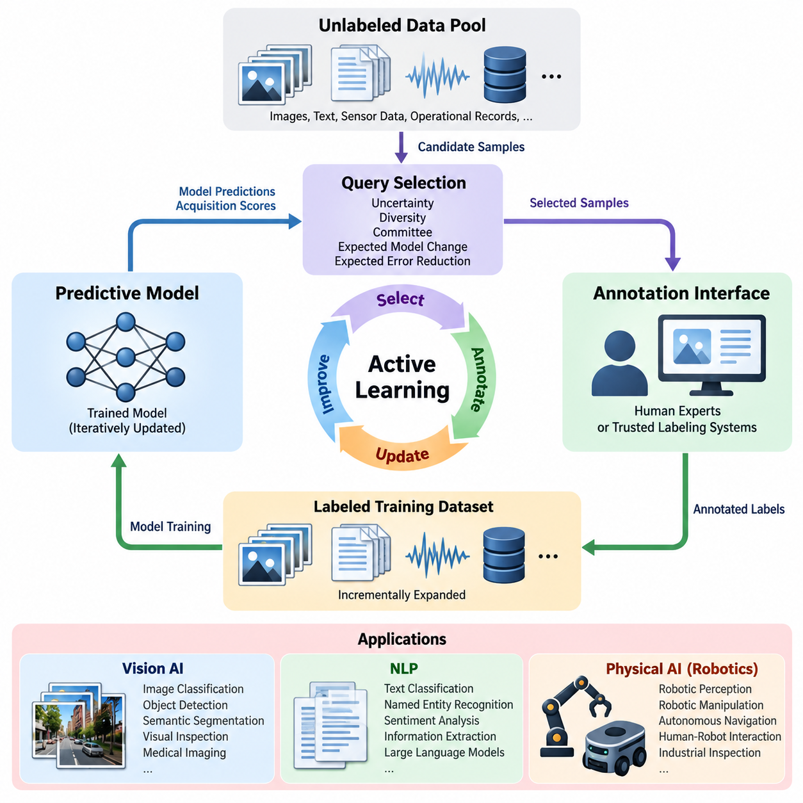
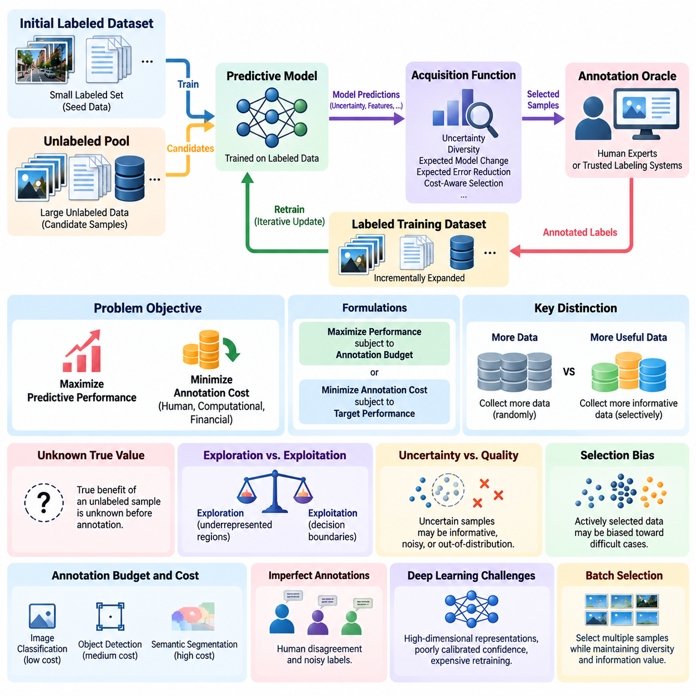
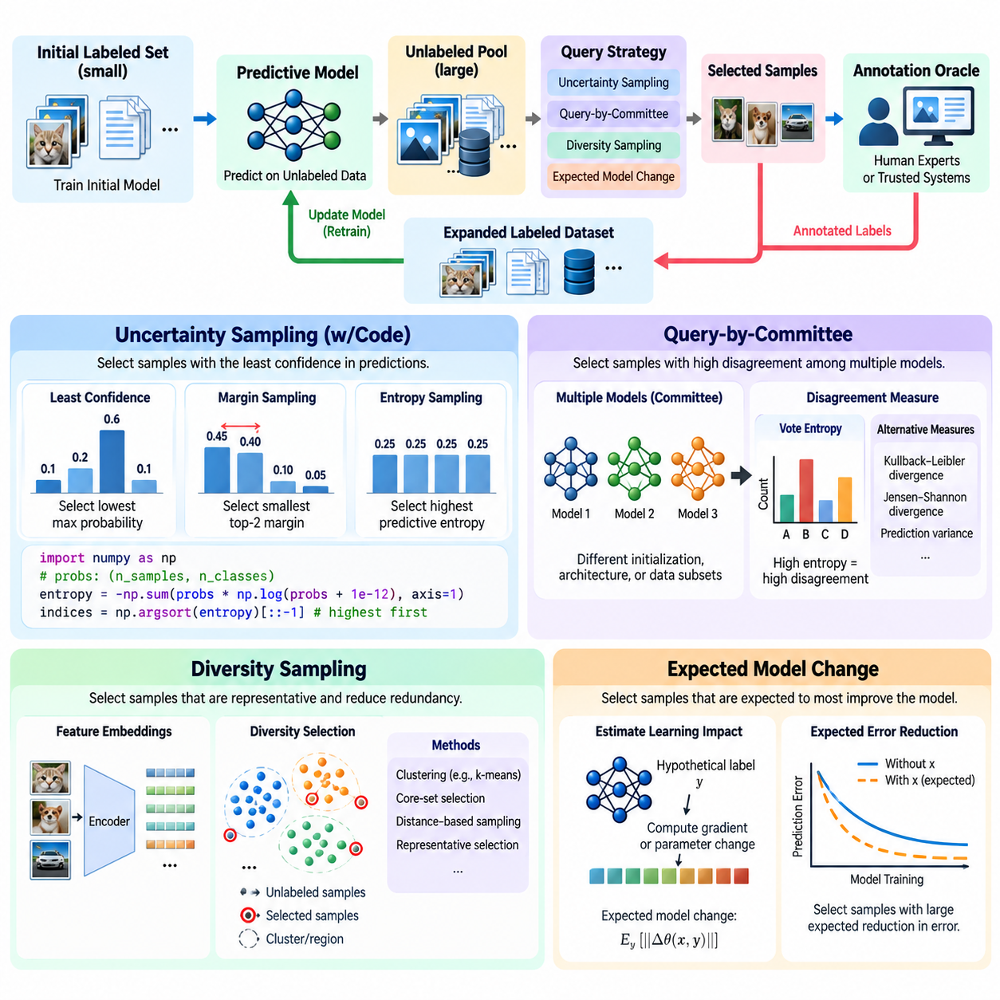
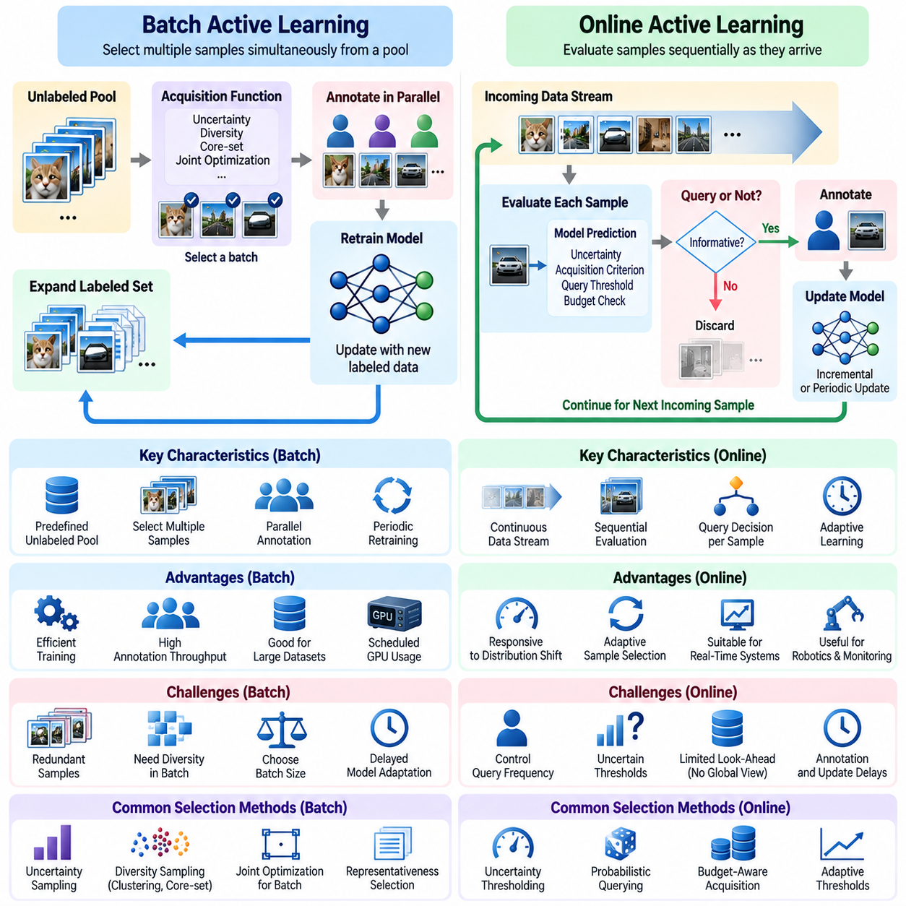
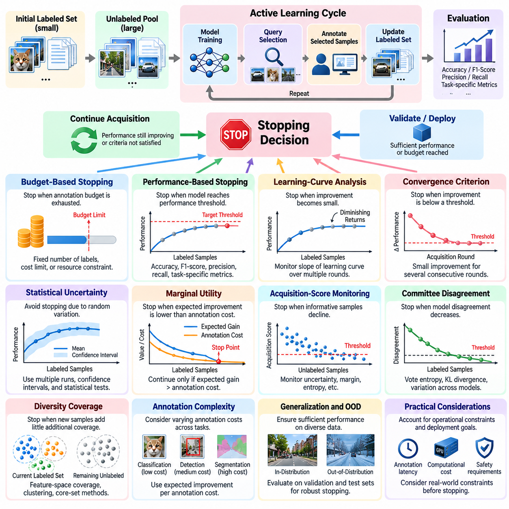
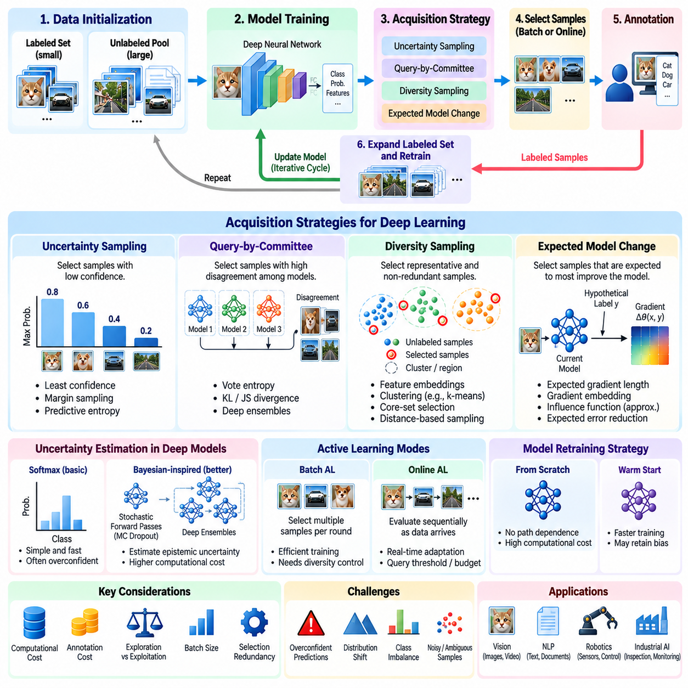
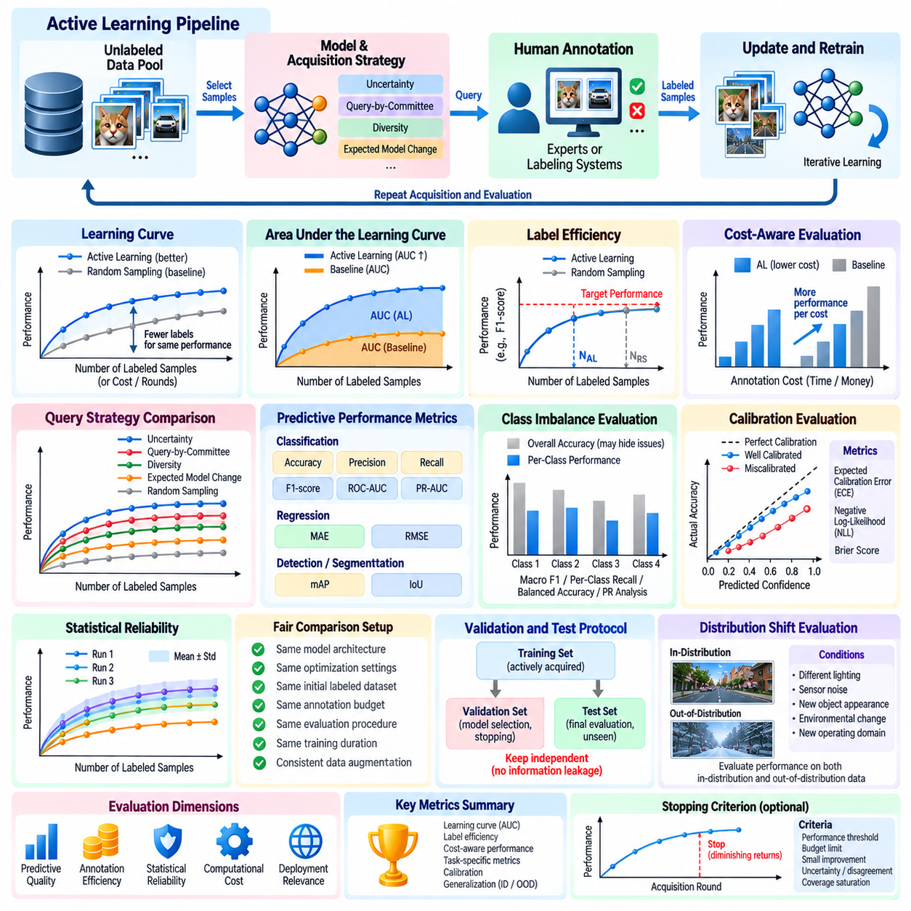
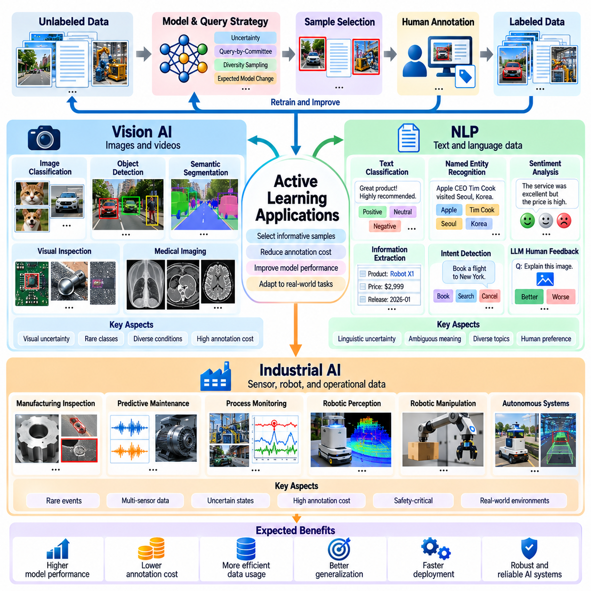

**Volume 41. Human in the Loop Learning**

# 01. Active Learning

## 01.00 Overview

{width="7.268055555555556in" height="7.268055555555556in"}

능동 학습(Active Learning)은 지능형 시스템(Intelligent System)이 무작위로 수집하고 레이블이 지정된 데이터셋(Dataset)에 전적으로 의존하는 대신, 인간의 어노테이션(Annotation)이 필요한 가장 유익한 데이터 샘플(Data Sample)을 선택적으로 식별하는 기계학습(Machine Learning) 패러다임이다. 주요 목표는 어노테이션 비용(Annotation Cost), 계산 오버헤드(Computational Overhead), 인간의 작업량(Human Effort)을 최소화하면서 모델 성능(Model Performance)을 극대화하는 것이다. 이러한 접근법은 레이블이 없는 데이터(Unlabeled Data)는 풍부하지만 신뢰할 수 있는 레이블(Label)을 확보하는 데 전문 지식, 고비용 실험 또는 상당한 수작업 검사가 필요한 환경에서 특히 유용하다.

전통적인 지도 학습(Supervised Learning)은 모델 학습(Model Training)이 시작되기 전에 충분히 큰 레이블 데이터셋(Labeled Dataset)이 준비되어 있다고 가정한다. 능동 학습(Active Learning)은 이러한 정적인 가정을 모델이 향후 학습 예제를 선택하는 과정에 직접 참여하는 반복적 프로세스(Iterative Process)로 대체한다. 시스템은 불확실성(Uncertainty), 다양성(Diversity), 대표성(Representativeness), 예상 학습 가치(Expected Learning Value)를 분석하여 예측 능력(Predictive Capability)을 향상시킬 가능성이 높은 샘플을 우선적으로 선택한다. 결과적으로 데이터 획득(Data Acquisition)은 전체 학습 과정의 적응형 구성 요소(Adaptive Component)가 된다.

능동 학습(Active Learning)의 기본 아키텍처(Architecture)는 예측 모델(Predictive Model), 레이블이 없는 데이터 풀(Unlabeled Data Pool), 질의 선택 메커니즘(Query Selection Mechanism), 어노테이션 인터페이스(Annotation Interface), 지속적으로 갱신되는 학습 데이터셋(Training Dataset)으로 구성된다. 모델은 후보 샘플(Candidate Sample)을 평가하고 사전에 정의된 전략에 따라 획득 점수(Acquisition Score)를 부여한다. 선택된 샘플은 인간 전문가 또는 신뢰할 수 있는 레이블링 시스템(Labeling System)에 전달되며, 생성된 어노테이션은 후속 학습 주기(Training Cycle)에 통합된다. 이러한 피드백 메커니즘(Feedback Mechanism)은 폐루프 학습 프레임워크(Closed-Loop Learning Framework)를 형성한다.

풀 기반 능동 학습(Pool-Based Active Learning)은 많은 조직이 레이블이 없는 이미지, 문서, 센서 측정값, 운영 기록으로 구성된 대규모 저장소를 보유하고 있기 때문에 가장 널리 사용되는 구성 방식 중 하나이다. 시스템은 저장소에서 정보 가치가 높은 샘플을 반복적으로 선택하고 해당 레이블을 요청한다. 반면 스트림 기반 접근법(Stream-Based Approach)은 유입되는 관측값을 개별적으로 평가하며, 멤버십 질의 합성(Membership Query Synthesis)은 어노테이션을 위한 후보 입력을 생성한다. 각 구성 방식은 데이터 가용성(Data Availability)과 어노테이션 접근성(Annotation Accessibility)에 대해 서로 다른 가정을 가진다.

불확실성 샘플링(Uncertainty Sampling)은 대표적인 질의 선택 전략(Query Selection Strategy)이다. 모델은 예측 신뢰도가 가장 낮은 관측값을 우선적으로 선택하며, 이를 위해 예측 엔트로피(Predictive Entropy), 분류 마진(Classification Margin), 신뢰도 점수(Confidence Score) 등의 측정값을 활용한다. 예를 들어 객체 탐지 모델(Object Detection Model)은 객체 경계가 모호하거나 익숙하지 않은 외형을 포함하는 이미지에 대한 어노테이션을 요청할 수 있다. 그러나 불확실성만을 기준으로 선택하면 잡음이 많은 관측값이나 이상치(Outlier)가 과도하게 선택될 수 있으므로, 신뢰할 수 있는 성능을 확보하기 위해서는 추가적인 선택 기준이 필요하다.

다양성 기반 샘플링(Diversity-Based Sampling)은 데이터 분포(Data Distribution)의 여러 영역을 폭넓게 포함하도록 유도함으로써 불확실성 중심 선택의 한계를 보완한다. 특징 임베딩(Feature Embedding), 군집화 알고리즘(Clustering Algorithm), 거리 기반 방법(Distance-Based Method)은 어노테이션 배치(Annotation Batch) 내부의 중복을 줄이는 대표적인 예제를 식별할 수 있다. 불확실성과 다양성을 결합하면 시스템은 어렵고 정보 가치가 높은 샘플을 동시에 우선시할 수 있으며, 데이터셋 확장(Dataset Expansion)의 효율성을 높이고 거의 동일한 관측값에 대한 반복적인 어노테이션을 줄일 수 있다.

위원회 기반 질의(Query-by-Committee)는 여러 모델 또는 모델 구성이 동일한 레이블 없는 관측값을 독립적으로 평가하도록 한다. 위원회 구성원 사이에서 상당한 예측 불일치(Disagreement)가 발생하는 샘플은 학습된 가설 공간(Hypothesis Space)의 불확실성을 드러내므로 정보 가치가 높은 것으로 간주된다. 불일치는 투표 엔트로피(Vote Entropy), 예측 발산(Predictive Divergence), 앙상블 출력(Ensemble Output)의 변동을 통해 정량화할 수 있다. 이 접근법은 계산 요구량을 증가시키지만, 단일 모델의 신뢰도 추정(Confidence Estimation)만으로는 발견하기 어려운 모호성을 식별할 수 있다.

예상 모델 변화(Expected Model Change)와 예상 오류 감소(Expected Error Reduction)는 후보 샘플의 학습 가치를 보다 직접적으로 추정하는 접근법이다. 이러한 전략은 새로운 어노테이션을 추가했을 때 모델 매개변수(Model Parameter)가 얼마나 변화하거나 일반화 성능(Generalization Performance)이 얼마나 향상될지를 예측한다. 이론적인 장점은 샘플 선택을 측정 가능한 학습 진전(Learning Progress)과 연결한다는 데 있다. 그러나 가능한 모든 어노테이션과 재학습 결과를 평가하려면 막대한 계산 비용이 필요하므로 실제 구현에서는 근사 기법(Approximation Method)이 자주 사용된다.

능동 학습(Active Learning)은 로봇이 동적이고 불확실하며 잠재적으로 위험한 환경에서 데이터를 생성하는 피지컬 AI(Physical AI) 시스템에서 특히 중요하다. 카메라(Camera), 라이다(LiDAR), 힘 센서(Force Sensor), 촉각 장치(Tactile Device), 고유수용감각 측정(Proprioceptive Measurement)은 연속적인 관측 데이터 스트림(Observation Data Stream)을 생성한다. 모든 프레임이나 센서 시퀀스(Sensor Sequence)에 레이블을 지정하는 것은 현실적으로 어렵다. 능동 학습은 비정상적인 장애물, 위치 추정 실패(Localization Failure), 예상하지 못한 접촉, 익숙하지 않은 조작 조건과 같은 정보 가치가 높은 사건을 식별한다.

로봇 인지(Robotic Perception) 응용에서는 능동 학습(Active Learning)을 활용하여 객체 탐지(Object Detection), 의미론적 분할(Semantic Segmentation), 깊이 추정(Depth Estimation), 환경 이해(Environmental Understanding)를 개선할 수 있다. 이동 로봇(Mobile Robot)이 익숙하지 않은 산업용 객체를 발견하면 해당 객체의 분류에 높은 불확실성을 부여하고 전문가 검토(Expert Review)를 요청할 수 있다. 검증된 레이블 예제는 모델 개선(Model Refinement)에 활용되어 향후 인식 성능을 높인다. 유사한 절차는 어려운 조명 조건, 부분 가림(Partial Occlusion), 반사 표면, 이전에 경험하지 못한 운영 환경에도 적용할 수 있다.

로봇 조작(Robotic Manipulation)에서 정보 가치가 높은 샘플은 모호한 파지 구성(Grasp Configuration), 불확실한 객체 속성(Object Property), 접촉 전이(Contact Transition), 작업 실행 실패(Execution Failure)와 관련되는 경우가 많다. 능동 학습(Active Learning)은 이러한 상황을 인간 평가(Human Assessment)의 우선 대상으로 선정하여 파지 예측(Grasp Prediction)과 조작 정책(Manipulation Policy)을 효율적으로 개선할 수 있다. 다만 정보 가치가 높은 시연(Demonstration)이나 교정 동작(Corrective Action)을 선택할 때는 일반적인 이미지 분류보다 시간적 의존성(Temporal Dependency), 작업 목표(Task Objective), 물리적 안전 제약(Physical Safety Constraint)을 더욱 신중하게 고려해야 한다.

능동 학습(Active Learning)은 자율 예측(Autonomous Prediction)과 전문가 판단(Expert Judgment) 사이에 구조화된 관계를 형성함으로써 인간 참여형 시스템(Human-in-the-Loop System)을 지원한다. 인간 어노테이터(Human Annotator)는 의미적 해석(Semantic Interpretation)을 제공하고 모호한 사례를 해결하며 자동화된 평가만으로는 신뢰성 있게 판단하기 어려운 오류를 식별한다. 이러한 상호작용의 효과는 어노테이션 인터페이스 품질, 작업의 명확성, 전문가 가용성, 일관된 레이블링 표준(Labeling Standard)에 따라 달라진다. 인간 피드백(Human Feedback)은 가치가 있지만 오류 가능성이 존재하는 정보로 취급해야 하며, 무조건적인 정답(Ground Truth)으로 간주해서는 안 된다.

어노테이션 품질(Annotation Quality)은 잘못된 레이블이 지능적인 질의 선택(Query Selection)의 이점을 약화시킬 수 있기 때문에 중요한 고려 사항이다. 어려운 관측값은 모호하다는 이유로 선택되는 경우가 많으므로 어노테이터 간 의견 불일치가 발생할 가능성도 높아진다. 품질 보증 메커니즘(Quality Assurance Mechanism)에는 다수의 독립적인 어노테이션, 전문가 조정(Expert Adjudication), 신뢰도 기록(Confidence Recording), 일관성 검사(Consistency Check)가 포함될 수 있다. 어노테이션 출처 추적(Annotation Provenance)을 유지하면 개발자는 후속 분석에서 모델 불확실성(Model Uncertainty)과 레이블링 불확실성(Labeling Uncertainty)을 구분할 수 있다.

비용 민감형 능동 학습(Cost-Sensitive Active Learning)은 샘플과 작업에 따라 어노테이션 작업량이 크게 달라진다는 점을 반영하여 기존 프레임워크를 확장한다. 단순한 이미지 범주에 레이블을 지정하는 데는 몇 초만 필요할 수 있지만, 로봇 조작 궤적(Robotic Manipulation Trajectory)이나 3차원 포인트 클라우드(3D Point Cloud)를 어노테이션하는 데는 상당한 전문가 작업이 필요할 수 있다. 따라서 획득 함수(Acquisition Function)는 예상 어노테이션 시간, 재정적 비용, 운영 위험(Operational Risk)을 반영할 수 있다. 이러한 최적화(Optimization)는 단위 어노테이션 비용당 최대의 예상 학습 효과를 얻는 것을 목표로 한다.

배치 모드 능동 학습(Batch-Mode Active Learning)은 현대 신경망(Neural Network)이 일반적으로 개별 관측값이 아닌 레이블이 지정된 샘플 집합을 이용하여 갱신되기 때문에 실제 학습 파이프라인(Training Pipeline)에서 특히 중요하다. 효과적인 배치를 선택하려면 정보 가치(Informativeness)와 중복성(Redundancy) 사이의 균형을 고려해야 한다. 불확실성이 높은 여러 샘플이 동일한 현상을 나타낸다면 이들을 함께 선택했을 때의 학습 가치는 제한적일 수 있다. 따라서 배치 획득 방법(Batch Acquisition Method)은 후보 간 관계를 고려하여 각 어노테이션 주기에서 상호 보완적인 정보(Complementary Information)를 최대화하려고 한다.

모델 보정(Model Calibration)은 획득 결정(Acquisition Decision)이 예측 신뢰도(Predictive Confidence)에 의존하는 경우가 많기 때문에 능동 학습(Active Learning) 성능에 큰 영향을 미친다. 심층 신경망(Deep Neural Network)은 특히 분포 이동(Distribution Shift)이 발생한 상황에서 잘못된 예측에도 높은 신뢰도를 출력할 수 있다. 보정 기법(Calibration Technique), 확률적 앙상블(Probabilistic Ensemble), 불확실성 추정 방법(Uncertainty Estimation Method)은 획득 과정의 신뢰성을 개선할 수 있다. 그러나 높은 분류 성능이 반드시 신뢰할 수 있는 불확실성 추정을 의미하지는 않으므로 신뢰도 보정은 예측 정확도(Predictive Accuracy)와 별도로 평가해야 한다.

분포 이동(Distribution Shift)은 능동 학습(Active Learning) 시스템이 기존 학습 환경과 다른 환경을 경험할 때 발생하는 또 다른 중요한 과제이다. 조명, 지형, 객체 외형, 센서 특성(Sensor Characteristic), 운영 절차(Operational Procedure)의 변화는 기존에 학습된 표현(Representation)의 유효성을 떨어뜨릴 수 있다. 적응형 획득 전략(Adaptive Acquisition Strategy)은 새로운 데이터 분포의 출현을 감지하고 기존 모델의 약점을 드러내는 관측값을 우선적으로 선택해야 한다. 이러한 능력은 능동 학습을 지속 학습(Continual Learning), 도메인 적응(Domain Adaptation), 장기 자율 운영(Long-Term Autonomous Operation)과 연결한다.

능동 학습(Active Learning)은 자체 선택 메커니즘으로 인해 발생하는 샘플링 편향(Sampling Bias)도 해결해야 한다. 질의 대상 예제는 무작위가 아니라 의도적으로 선택되므로 레이블 데이터셋(Labeled Dataset)이 실제 배포 환경의 데이터 분포(Deployment Distribution)를 정확하게 반영하지 못할 수 있다. 이러한 불균형은 성능 추정(Performance Estimation)을 왜곡하고 자주 발생하는 상황에서 예상하지 못한 취약점을 만들 수 있다. 대표성 있는 검증 데이터셋(Validation Dataset)을 유지하고 획득 분포(Acquisition Distribution)를 추적하며 무작위로 선택한 관측값을 주기적으로 포함하면 이러한 위험을 완화할 수 있다.

능동 학습(Active Learning)의 평가는 최종 모델 정확도(Model Accuracy)를 비교하는 것만으로 충분하지 않다. 중요한 측정 항목에는 어노테이션 효율성(Annotation Efficiency), 학습 곡선(Learning Curve), 획득 비용(Acquisition Cost), 샘플 다양성(Sample Diversity), 모델 보정(Model Calibration), 분포 이동 상황에서의 성능이 포함된다. 일반적인 실험 절차(Experimental Procedure)는 동일한 초기 데이터셋, 모델 아키텍처(Model Architecture), 어노테이션 예산(Annotation Budget), 평가 조건(Evaluation Condition)을 사용하여 여러 획득 전략을 비교한다. 획득 결정은 초기화(Initialization)와 확률적 학습(Stochastic Training)에 민감할 수 있으므로 반복 실험(Repeated Trial)을 통해 성능을 측정해야 한다.

능동 학습(Active Learning)을 시뮬레이션(Simulation) 및 디지털 트윈(Digital Twin)과 통합하면 데이터 효율적인 피지컬 AI(Physical AI) 개발을 위한 추가적인 기회를 확보할 수 있다. 시뮬레이션 환경은 희귀한 실패(Rare Failure), 어려운 지형, 예상하지 못한 장애물, 비정상적인 객체 상호작용(Object Interaction)을 포함하는 후보 시나리오(Candidate Scenario)를 생성할 수 있다. 획득 전략은 실제 환경에 배포하기 전에 모델의 중요한 약점을 드러내는 시나리오를 우선적으로 선택할 수 있다. 그러나 정보 가치가 높은 합성 예제(Synthetic Example)라도 실제 물리적 환경으로 효과적으로 전이되지 않을 수 있으므로 시뮬레이션 관측값의 현실성(Realism)을 평가해야 한다.

운영 환경 배포(Operational Deployment)에는 데이터 수집 및 유입(Data Ingestion), 모델 추론(Model Inference), 획득 점수 계산(Acquisition Scoring), 어노테이션 관리(Annotation Management), 데이터셋 버전 관리(Dataset Versioning), 학습, 평가, 모델 배포(Model Release)를 연결하는 통합 인프라(Infrastructure)가 필요하다. 각 어노테이션 주기에서는 선택된 관측값, 획득 근거(Acquisition Rationale), 인간의 판단, 결과적인 모델 갱신(Model Update) 사이의 관계를 보존해야 한다. 재현 가능한 기록(Reproducible Record)은 성능 감사(Performance Auditing)와 체계적인 개선을 지원한다. 배포 승인 절차(Deployment Gate)는 충분히 검증되지 않은 모델 갱신이 안전 필수 로봇 시스템(Safety-Critical Robotic System)에 적용되지 않도록 해야 한다.

능동 학습(Active Learning)의 장기적인 중요성은 데이터 수집(Data Collection)을 수동적인 축적 과정에서 목표 지향적인 학습 전략(Targeted Learning Strategy)으로 전환한다는 데 있다. 모든 관측값을 동일한 가치로 취급하는 대신 지능형 시스템(Intelligent System)은 지식 격차(Knowledge Gap)를 식별하고 의미 있는 성능 개선이 가능한 영역에 인간의 전문성을 집중적으로 배분한다. 신뢰할 수 있는 불확실성 추정(Uncertainty Estimation), 체계적인 어노테이션, 견고한 평가(Robust Evaluation), 지속적인 운영 피드백(Operational Feedback)이 결합되면 능동 학습은 확장 가능하고 데이터 효율적이며 점진적으로 적응하는 피지컬 AI(Physical AI) 시스템을 위한 핵심 기반을 제공한다.

## 01.01 Active Learning Problem

{width="7.268055555555556in" height="7.268055555555556in"}

능동 학습 문제(Active Learning Problem)는 기계학습(Machine Learning) 시스템이 가능한 한 적은 수의 레이블이 지정된 예제(Labeled Example)를 확보하면서 높은 예측 성능(Predictive Performance)을 달성하는 방법에 관한 것이다. 학습 데이터에 이미 모든 레이블이 지정되어 있다고 가정하는 기존 지도 학습(Supervised Learning)과 달리, 능동 학습(Active Learning)은 어떤 관측값에 어노테이션(Annotation)을 수행할 것인지 결정하는 의사결정 과정(Decision Process)을 도입한다. 핵심 과제는 제한된 인적 자원, 계산 자원, 재정적 자원 내에서 모델 품질(Model Quality)을 가장 크게 향상시킬 것으로 예상되는 샘플을 식별하는 것이다.

일반적인 능동 학습(Active Learning) 환경은 소규모 레이블 데이터셋(Labeled Dataset)과 훨씬 큰 규모의 레이블 없는 관측값(Unlabeled Observation) 집합으로 시작한다. 레이블이 지정된 부분집합은 초기 모델 학습(Initial Model Training)에 사용되며, 레이블이 없는 데이터 풀(Unlabeled Data Pool)은 향후 획득할 후보 예제(Candidate Example)를 제공한다. 각 반복 단계에서 학습 시스템은 이러한 후보를 평가하고 어노테이션 대상 부분집합을 선택한다. 새롭게 레이블이 지정된 관측값은 학습 데이터셋에 통합되며, 모델은 선택, 어노테이션, 재학습(Retraining)의 반복 주기를 통해 점진적으로 개선된다.

기본적인 최적화 목표(Optimization Objective)는 어노테이션 예산(Annotation Budget)의 제약 아래 예측 성능(Predictive Performance)을 극대화하는 것이다. 반대로 특정 성능 임계값(Performance Threshold)을 달성하면서 어노테이션 비용을 최소화하는 문제로도 정식화할 수 있다. 이러한 두 가지 정식화(Formulation)는 더 많은 데이터를 수집하는 것과 더 유용한 데이터를 수집하는 것 사이의 중요한 차이를 보여준다. 능동 학습은 각 예제가 학습에 기여할 수 있는 잠재적 가치가 서로 다르다고 가정하며, 샘플 선택(Sample Selection)을 수동적인 전처리 작업이 아닌 핵심 최적화 문제로 취급한다.

학습 환경(Learning Environment)은 일반적으로 레이블 데이터셋(Labeled Dataset), 레이블 없는 데이터 풀(Unlabeled Pool), 예측 모델(Predictive Model), 획득 함수(Acquisition Function), 어노테이션 오라클(Annotation Oracle)로 설명된다. 오라클(Oracle)은 선택된 관측값에 레이블을 제공할 수 있는 인간 전문가 또는 신뢰할 수 있는 다른 메커니즘을 의미한다. 획득 함수는 현재 모델과 이용 가능한 정보를 기반으로 각 후보 샘플의 유용성을 추정한다. 획득 함수의 설계는 전체 학습 과정에서 어노테이션 자원이 어떻게 배분되는지를 결정한다.

핵심적인 어려움은 레이블이 없는 샘플의 실제 가치를 해당 레이블을 확보하기 전에 직접 알 수 없다는 점이다. 따라서 시스템은 불완전한 정보를 이용하여 잠재적인 학습 효과(Learning Benefit)를 추정해야 한다. 예측 불확실성(Predictive Uncertainty), 모델 간 불일치(Model Disagreement), 특징 공간 포괄성(Feature-Space Coverage), 예상 매개변수 변화(Expected Parameter Change)는 실용적인 근사 지표를 제공한다. 그러나 이러한 지표가 선택된 샘플의 일반화 성능(Generalization Performance) 향상을 보장하지는 않으므로, 추정된 정보 가치(Estimated Informativeness)와 실제 학습 가치(Actual Learning Value) 사이에는 근본적인 차이가 존재한다.

탐색과 활용의 절충(Exploration and Exploitation Tradeoff)은 능동 학습 문제(Active Learning Problem)의 중요한 측면이다. 활용(Exploitation)은 모델의 현재 결정 경계(Decision Boundary) 근처에 있는 샘플을 우선적으로 선택하여 기존 예측을 개선하는 데 집중한다. 반면 탐색(Exploration)은 입력 공간(Input Space)에서 충분히 표현되지 않은 영역의 관측값을 찾아 이전에 알려지지 않은 패턴을 발견하려고 한다. 효과적인 획득 전략(Acquisition Strategy)은 익숙한 모호성에만 집중하거나 지나치게 특이한 관측값만 선택하는 문제를 방지하기 위해 두 목표 사이의 균형을 유지해야 한다.

또 다른 과제는 불확실성(Uncertainty)과 샘플 품질(Sample Quality) 사이의 관계에서 발생한다. 불확실성이 높은 관측값에는 결정 경계(Decision Boundary)에 관한 유용한 정보가 포함될 수 있지만, 손상된 측정값(Corrupted Measurement), 잘못 레이블링된 현상(Mislabeled Phenomenon), 의도된 응용 도메인(Application Domain)을 벗어난 관측값일 수도 있다. 추가적인 보호 장치 없이 이러한 예제를 선택하면 어노테이션 자원이 낭비될 수 있다. 따라서 실제 능동 학습 시스템은 정보 가치가 높은 불확실성(Informative Uncertainty)을 제거할 수 없는 잡음(Irreducible Noise) 및 관련성이 낮은 분포 이상(Distributional Anomaly)과 구별해야 한다.

능동 학습 문제(Active Learning Problem)는 레이블 데이터셋(Labeled Dataset)과 목표 배포 분포(Target Deployment Distribution) 사이의 통계적 관계에도 영향을 받는다. 예제가 획득 정책(Acquisition Policy)에 따라 선택되기 때문에 결과적으로 생성된 학습 데이터셋은 어렵거나 특이한 사례에 체계적으로 편향될 수 있다. 이러한 선택 편향(Selection Bias)은 모델 최적화(Model Optimization)와 성능 추정(Performance Estimation) 모두에 영향을 미칠 수 있다. 따라서 획득된 샘플에서의 성능 개선이 더 넓은 범위의 일반화(Generalization)로 이어지는지 확인하려면 대표성 있는 검증 데이터셋(Validation Dataset)과 테스트 데이터셋(Test Dataset)이 필요하다.

어노테이션 예산(Annotation Budget)은 레이블링 비용(Labeling Cost)이 일반적으로 균일하지 않기 때문에 추가적인 복잡성을 발생시킨다. 단순한 이미지 분류(Image Classification) 레이블은 적은 노력으로 생성할 수 있지만, 의미론적 분할(Semantic Segmentation), 3차원 어노테이션(Three-Dimensional Annotation), 로봇 궤적 평가(Robotic Trajectory Assessment)에는 상당한 전문 지식이 필요할 수 있다. 따라서 획득 목표(Acquisition Objective)는 어노테이션 비용 대비 예상 정보 이득(Expected Information Gain)을 고려해야 한다. 이러한 정식화에서는 불확실성이 가장 높은 샘플이 반드시 모델 개선을 위한 가장 경제적인 선택은 아니다.

어노테이션이 완벽하지 않을 때 문제는 더욱 복잡해진다. 인간 전문가는 모호한 관측값에 대해 서로 다른 판단을 내릴 수 있으며, 레이블링 일관성(Labeling Consistency)은 경험, 피로도, 작업 복잡성에 따라 달라질 수 있다. 능동 학습 시스템은 어노테이션 잡음(Annotation Noise)을 고려해야 하며, 어려운 샘플에 대해서는 반복적인 평가를 요청할 수도 있다. 모델 지식의 부족으로 발생하는 불확실성과 데이터 자체에 내재된 모호성(Inherent Ambiguity)을 구분하는 것은 인간의 주의와 작업 시간을 효과적으로 배분하는 데 필수적이다.

딥러닝(Deep Learning)에서 능동 학습(Active Learning)은 고차원 표현(High-Dimensional Representation), 대규모 모델 용량(Model Capacity), 높은 재학습 비용(Expensive Retraining)과 관련된 추가적인 문제에 직면한다. 신경망(Neural Network)은 보정이 충분하지 않은 신뢰도 추정(Poorly Calibrated Confidence Estimate)을 나타낼 수 있으며, 이로 인해 불확실성 기반 획득(Uncertainty-Based Acquisition)의 신뢰성이 떨어질 수 있다. 또한 학습된 특징 공간(Feature Space)은 학습 과정에서 지속적으로 변화하므로 레이블이 없는 샘플의 상대적인 정보 가치도 달라진다. 따라서 효율적인 획득 방식은 변화하는 모델 표현에 적응하면서도 계산 측면에서 실용적이어야 한다.

배치 선택(Batch Selection)은 현대 학습 파이프라인(Training Pipeline)이 일반적으로 여러 샘플을 동시에 획득하기 때문에 또 다른 최적화 과제를 발생시킨다. 점수가 가장 높은 예제를 독립적으로 선택하면 중복된 관측값이 포함된 배치(Batch)가 생성될 수 있다. 효과적인 배치 획득(Batch Acquisition)은 후보 간 상호작용을 고려하면서 불확실성(Uncertainty), 다양성(Diversity), 대표성(Representativeness) 사이의 균형을 유지해야 한다. 목표는 개별적으로 매력적인 샘플을 단순히 결합하는 것이 아니라 배치 전체의 집합적 학습 가치(Collective Learning Value)를 극대화하는 것이다.

중단 문제(Stopping Problem)는 추가적인 어노테이션이 더 이상 경제적으로 정당화되지 않는 시점을 결정하는 문제이다. 학습 시스템은 한계 성능 향상(Marginal Performance Improvement)이 거의 사라진 이후에도 계속 레이블을 요청할 수 있다. 반대로 지나치게 일찍 중단하면 중요한 지식 격차(Knowledge Gap)가 해결되지 않은 상태로 남을 수 있다. 실제 중단 기준(Stopping Criteria)은 검증 성능(Validation Performance), 획득 점수 추세(Acquisition-Score Trend), 남은 어노테이션 예산, 추정 한계 학습 이득(Estimated Marginal Learning Gain)을 고려할 수 있다. 신뢰할 수 있는 의사결정을 위해서는 획득 주기(Acquisition Round)에 따라 성능 개선이 변동할 수 있다는 점을 인정해야 한다.

피지컬 AI(Physical AI)에서 능동 학습 문제(Active Learning Problem)는 정적인 데이터셋을 넘어 로봇과 자율 시스템(Autonomous System)이 생성하는 연속적인 관측 데이터 스트림(Observation Stream)으로 확장된다. 카메라(Camera), 라이다(LiDAR), 촉각 센서(Tactile Sensor), 동작 측정(Motion Measurement)은 다양한 수준의 불확실성을 가진 운영 상황을 포착한다. 시스템은 어노테이터(Annotator)에게 과도한 작업 부담을 주지 않으면서 인간 검토(Human Review)가 필요한 사건을 식별해야 한다. 안전 필수 실패(Safety-Critical Failure), 익숙하지 않은 환경 조건, 예상하지 못한 상호작용은 통계적 발생 빈도가 낮더라도 우선적으로 처리할 가치가 있다.

로봇 시스템의 능동 학습(Active Learning)은 기존 관측값을 선택하여 어노테이션하는 과정과 새로운 정보를 생성하기 위한 물리적 행동(Physical Action)을 선택하는 과정을 구분해야 한다. 풀 기반 선택(Pool-Based Selection)은 이전에 수집된 데이터를 대상으로 수행되지만, 상호작용적 탐색(Interactive Exploration)은 로봇이 추가적인 센싱(Sensing)이나 실험을 수행하도록 요구할 수 있다. 후자의 경우 물리적 비용(Physical Cost)과 안전 제약(Safety Constraint)이 추가된다. 정보 가치가 높은 행동이라도 충돌 위험(Collision Risk), 장비 손상(Equipment Damage), 운영 중단(Operational Disruption)을 과도하게 유발한다면 허용할 수 없다.

능동 학습 문제(Active Learning Problem)의 해결 방법을 평가하려면 무작위 샘플링(Random Sampling) 및 대안적인 획득 전략(Alternative Acquisition Strategy)과의 통제된 비교(Controlled Comparison)가 필요하다. 학습 곡선(Learning Curve)은 예측 성능(Predictive Performance)을 획득한 어노테이션의 수 또는 비용과 연결하여 나타내야 한다. 실험에서는 일관된 초기화(Initialization), 모델 아키텍처(Model Architecture), 평가 데이터셋(Evaluation Dataset), 어노테이션 예산(Annotation Budget)을 사용해야 한다. 반복 실험(Repeated Trial)은 무작위 샘플링, 모델 학습 변동성(Training Variability), 획득 결정(Acquisition Decision)에 대한 민감도를 드러내어 실제 효율성에 관한 보다 신뢰할 수 있는 결론을 도출하도록 지원한다.

궁극적으로 능동 학습 문제(Active Learning Problem)는 불확실성 아래에서 수행되는 자원 배분 문제(Resource Allocation Problem)이다. 시스템은 어떤 누락된 정보를 획득할 가치가 있는지, 얼마나 많은 인간의 노력을 투입해야 하는지, 추가적인 학습이 언제까지 정당화되는지를 결정해야 한다. 성공 여부는 획득 전략(Acquisition Strategy), 어노테이션 신뢰성(Annotation Reliability), 모델 보정(Model Calibration), 데이터 분포(Data Distribution), 평가 방법론(Evaluation Methodology) 사이의 상호작용에 달려 있다. 이러한 과제를 해결하면 선택적이고 측정 가능하며 전략적으로 설계된 인간 감독(Human Supervision)을 통해 개선되는 더욱 효율적인 학습 시스템을 구축할 수 있다.

## 01.02 Query Strategies

{width="7.268055555555556in" height="7.268055555555556in"}

질의 전략(Query Strategy)은 능동 학습(Active Learning) 과정에서 어떤 레이블 없는 샘플(Unlabeled Sample)을 어노테이션(Annotation) 대상으로 제출할 것인지 결정하는 의사결정 메커니즘(Decision Mechanism)이다. 주요 목적은 제한된 어노테이션 예산(Annotation Budget) 내에서 예측 성능(Predictive Performance)을 가장 크게 향상시킬 가능성이 있는 관측값을 식별하는 것이다. 무작위로 데이터를 선택하는 대신, 획득 전략(Acquisition Strategy)은 모델 불확실성(Model Uncertainty), 모델 간 불일치(Model Disagreement), 분포 포괄성(Distributional Coverage), 예상 학습 영향(Expected Learning Impact)을 활용하여 후보 샘플의 정보 가치(Information Value)를 추정한다.

불확실성 샘플링(Uncertainty Sampling)은 가장 단순하면서도 널리 사용되는 능동 학습(Active Learning) 전략 중 하나이다. 이 방법은 현재 예측 모델(Predictive Model)의 신뢰도가 가장 낮은 샘플을 우선적으로 선택한다. 기본 가정은 불확실한 관측값이 학습된 결정 경계(Decision Boundary)의 약점이나 입력 공간(Input Space)의 특정 영역에 대한 지식 부족을 드러낸다는 것이다. 이러한 샘플에 어노테이션을 수행하면 예측을 개선하는 데 도움이 될 수 있지만, 불확실성이 항상 유용한 학습 정보와 직접적으로 연결되는 것은 아니다.

최소 신뢰도 샘플링(Least Confidence Sampling)은 예측된 클래스 확률(Class Probability) 중 최댓값이 가장 낮은 관측값을 선택한다. 마진 샘플링(Margin Sampling)은 가장 높은 두 클래스 확률 사이의 차이를 분석하고 마진이 작은 샘플을 우선적으로 선택한다. 엔트로피 샘플링(Entropy Sampling)은 전체 예측 확률 분포(Predictive Distribution)의 불확실성을 측정하므로 여러 클래스가 비슷한 확률을 갖는 경우에 유용하다. 이러한 방법은 불확실성을 서로 다른 관점에서 해석하며, 동일한 데이터셋(Dataset)에 대해서도 서로 다른 획득 순위(Acquisition Ranking)를 생성할 수 있다.

실용적인 불확실성 샘플링(Uncertainty Sampling) 구현은 소규모 레이블 데이터셋(Labeled Dataset)을 사용하여 분류기(Classifier)를 학습하는 것으로 시작한다. 분류기는 레이블이 없는 관측값에 대한 클래스 확률을 예측하고, 획득 함수(Acquisition Function)는 불확실성 점수(Uncertainty Score)를 계산한다. 점수가 가장 높은 샘플을 어노테이션 대상으로 선택한 후 레이블 데이터셋에 추가한다. 재학습(Retraining)이 완료되면 획득 과정이 반복된다. 이러한 구현은 모델 아키텍처(Model Architecture)를 수정하지 않고도 일반적인 기계학습 프레임워크(Machine Learning Framework)의 확률 출력을 활용할 수 있다.

예를 들어 넘파이(NumPy)를 사용하는 파이썬(Python) 구현에서는 entropy = -np.sum(probs \\\* np.log(probs + 1e-12), axis=1) 표현식으로 예측 엔트로피(Predictive Entropy)를 계산할 수 있다. 여기서 probs는 후보 관측값의 클래스 확률 분포(Class Probability Distribution)를 포함하며, 작은 수치 상수(Numerical Constant)는 정의되지 않은 로그 연산을 방지한다. np.argsort(entropy)[::-1]을 사용하면 샘플의 순위를 정할 수 있으며, 가장 높은 순위의 인덱스(Index)를 어노테이션 대상으로 제출할 수 있다. 이러한 절차는 불확실성 기반 획득(Uncertainty-Driven Acquisition)을 위한 간결한 기준선(Baseline)을 제공한다.

불확실성 샘플링(Uncertainty Sampling)은 단순하지만 여러 한계가 존재한다. 신경망(Neural Network)은 특히 학습 분포(Training Distribution)를 벗어난 관측값에 대해 과도하게 높은 예측 신뢰도(Overconfident Prediction)를 생성할 수 있다. 잡음이 많거나 본질적으로 모호한 예제도 의미 있는 학습 효과 없이 높은 불확실성 점수를 받을 수 있다. 따라서 실제 구현에서는 획득 신뢰성(Acquisition Reliability)을 개선하기 위해 불확실성 추정(Uncertainty Estimation)에 신뢰도 보정(Confidence Calibration), 이상치 필터링(Outlier Filtering), 다양성 제약(Diversity Constraint), 어노테이션 비용(Annotation Cost) 등을 결합하는 경우가 많다.

위원회 기반 질의(Query-by-Committee)는 여러 예측 모델(Predictive Model) 사이의 불일치를 통해 능동 학습(Active Learning)에 접근한다. 단일 모델의 불확실성 추정에 의존하는 대신, 시스템은 서로 다른 초기화(Initialization), 아키텍처(Architecture), 데이터 부분집합(Data Subset), 확률적 학습 절차(Stochastic Training Procedure)를 사용하여 학습한 모델 위원회(Model Committee)를 유지한다. 각 위원회 구성원은 동일한 레이블 없는 관측값에 대한 레이블을 예측한다. 상당한 불일치가 발생하는 샘플은 적절한 예측 가설(Predictive Hypothesis)에 대한 불확실성을 드러내므로 정보 가치가 높은 것으로 간주된다.

투표 엔트로피(Vote Entropy)는 분류 위원회(Classification Committee)에서 일반적으로 사용하는 불일치 측정 방법(Disagreement Measure)이다. 각 모델은 자신이 가장 적합하다고 판단하는 클래스에 투표하며, 투표 분포(Vote Distribution)에 따라 획득 점수(Acquisition Score)가 결정된다. 모든 위원회 구성원이 거의 동일하게 투표한 샘플은 불일치가 낮지만, 투표가 여러 클래스에 넓게 분산된 샘플은 불일치가 높다. 대안적인 측정 방법에는 쿨백-라이블러 발산(Kullback--Leibler Divergence), 젠슨-섀넌 발산(Jensen--Shannon Divergence), 예측 확률의 변동(Variation Across Predictive Probabilities)이 포함된다.

위원회 다양성(Committee Diversity)은 모든 모델이 거의 동일한 예측을 수행하면 불일치가 정보 가치를 잃기 때문에 필수적이다. 동일한 매개변수(Parameter)를 가진 동일 아키텍처의 모델을 여러 개 학습하는 것은 추가적인 정보를 거의 제공하지 못할 수 있다. 다양성은 부트스트랩 샘플링(Bootstrap Sampling), 독립적인 무작위 초기화(Independent Random Initialization), 아키텍처 변형(Architectural Variation), 서로 다른 학습 목표(Training Objective)를 통해 도입할 수 있다. 그러나 불일치가 임의적인 예측 오류가 아닌 의미 있는 불확실성을 반영하려면 위원회 구성원들이 충분한 예측 능력을 유지해야 한다.

위원회 기반 질의(Query-by-Committee)는 개별 모델의 신뢰도 점수(Confidence Score)가 신뢰하기 어려운 경우 특히 유용할 수 있다. 앙상블 불일치(Ensemble Disagreement)는 불완전한 모델 지식에서 발생하는 불확실성을 의미하는 인식론적 불확실성(Epistemic Uncertainty)의 근사적인 지표를 제공한다. 그러나 위원회 규모가 증가하면 계산 비용(Computational Cost)도 증가하며, 불일치가 특정 레이블의 획득을 통한 일반화 성능(Generalization Performance) 향상을 보장하지는 않는다. 따라서 실제 시스템은 위원회 다양성, 예측 품질(Prediction Quality), 획득 효율성(Acquisition Efficiency), 사용 가능한 계산 자원(Computational Resource) 사이의 균형을 고려해야 한다.

다양성 샘플링(Diversity Sampling)은 데이터셋(Dataset)의 밀집된 영역에서 중복 관측값(Redundant Observation)이 선택되는 문제를 해결한다. 불확실한 예측에만 집중하는 대신 입력 분포(Input Distribution)의 서로 다른 부분을 대표하는 샘플을 찾는다. 이러한 접근법은 레이블이 없는 저장소(Unlabeled Repository)에 거의 동일한 이미지, 반복적인 센서 측정값(Sensor Measurement), 높은 상관관계를 가진 운영 기록(Operational Record)이 다수 포함된 경우 특히 유용하다. 대표성 있는 선택(Representative Selection)은 불필요한 어노테이션 작업을 줄이면서 데이터셋 포괄성(Dataset Coverage)을 개선할 수 있다.

특징 공간 표현(Feature-Space Representation)은 다양성 샘플링(Diversity Sampling)의 기반을 제공한다. 학습된 신경망(Neural Network)은 원시 관측값(Raw Observation)을 의미적 또는 구조적 관계를 표현하는 임베딩(Embedding)으로 변환할 수 있다. 이후 유클리드 거리(Euclidean Distance)나 코사인 거리(Cosine Distance)와 같은 거리 측정 방법(Distance Measure)을 사용하여 후보 간 유사도를 정량화한다. 기존 레이블 관측값에서 멀리 떨어진 샘플은 충분히 표현되지 않은 영역을 드러낼 수 있으며, 군집화 방법(Clustering Method)은 레이블 없는 데이터 풀(Unlabeled Pool)의 서로 다른 그룹에서 대표적인 예제를 식별할 수 있다.

코어셋 선택(Core-Set Selection)은 제한된 수의 선택 예제를 이용하여 데이터 분포(Data Distribution)를 포괄하려는 대표적인 다양성 중심 접근법(Diversity-Oriented Approach)이다. 일반적인 탐욕적 근사 방법(Greedy Approximation)은 이미 선택되었거나 레이블이 지정된 샘플 중 가장 가까운 샘플과의 거리가 최대인 후보를 반복적으로 선택한다. 이러한 전략은 특징 공간(Feature Space)의 광범위한 포괄성을 유도한다. 그러나 효과는 임베딩 품질(Embedding Quality), 거리 측정 기준(Distance Metric), 기하학적 포괄성(Geometric Coverage)이 목표 작업의 의미 있는 변동을 얼마나 잘 반영하는지에 따라 달라진다.

다양성 샘플링(Diversity Sampling)은 불확실성 추정(Uncertainty Estimation)과 결합하여 탐색(Exploration)과 활용(Exploitation) 사이의 균형을 유지할 수 있다. 불확실성은 모호한 결정 영역(Decision Region) 근처의 관측값을 식별하며, 다양성은 획득 배치(Acquisition Batch)가 거의 동일한 예제에 집중되는 것을 방지한다. 하이브리드 획득 함수(Hybrid Acquisition Function)는 가중 점수(Weighted Score), 군집화 후 불확실성 순위화(Clustering Followed by Uncertainty Ranking), 불확실성 필터링 후 대표 샘플 선택(Representative Selection) 등을 활용할 수 있다. 이러한 조합은 대규모 레이블 없는 데이터셋을 사용하는 배치 모드 능동 학습(Batch-Mode Active Learning)에서 특히 유용하다.

예상 모델 변화(Expected Model Change)는 어노테이션 이후 예측 모델(Predictive Model)을 얼마나 변화시킬 수 있는지를 추정하여 샘플을 선택한다. 핵심 가정은 상당한 학습 갱신(Learning Update)을 유발하는 관측값이 모델을 거의 변화시키지 않는 샘플보다 더 가치 있을 수 있다는 것이다. 이러한 전략은 획득 결정(Acquisition Decision)을 학습 최적화 과정(Training Optimization Process)과 연결한다. 불확실성만을 측정하는 대신 후보 관측값이 모델 매개변수(Model Parameter) 또는 학습된 표현(Learned Representation)에 미칠 잠재적 영향을 평가한다.

예상 그래디언트 길이(Expected Gradient Length)는 예상 모델 변화(Expected Model Change)를 근사하는 일반적인 방법이다. 시스템은 레이블이 없는 각 후보에 대해 가능한 레이블을 가정하고, 해당 샘플로 학습할 때 발생할 그래디언트(Gradient)의 크기를 추정한다. 실제 레이블은 알려져 있지 않으므로 예측된 레이블 확률(Predicted Label Probability)을 사용하여 그래디언트 크기의 가중 평균을 계산할 수 있다. 예상 그래디언트가 큰 후보는 더 높은 획득 점수(Acquisition Score)를 받으며, 이는 현재 모델에 더 큰 영향을 미칠 가능성을 나타낸다.

그래디언트 기반 획득(Gradient-Based Acquisition)은 모든 후보에 대해 가상의 레이블과 매개변수 그래디언트(Parameter Gradient)를 평가하는 과정에서 상당한 계산 비용이 발생할 수 있다. 현대의 심층 신경망(Deep Neural Network)은 수백만 개에서 수십억 개의 매개변수를 포함할 수 있으므로 전체 그래디언트 비교(Full-Gradient Comparison)는 현실적으로 어려울 수 있다. 효율적인 근사 방법(Efficient Approximation)은 최종 계층 그래디언트(Final-Layer Gradient), 저차원 그래디언트 임베딩(Low-Dimensional Gradient Embedding), 선택된 매개변수 부분집합(Selected Parameter Subset)에 집중할 수 있다. 이러한 방법은 잠재적인 학습 영향에 관한 정보를 유지하면서 계산 요구량을 줄인다.

예상 모델 변화(Expected Model Change)는 큰 매개변수 갱신(Parameter Update)과 실제로 유익한 학습(Beneficial Learning)을 구별해야 한다. 잡음이 많은 샘플이나 극단적인 이상치(Extreme Outlier)는 일반화 성능을 개선하지 않으면서도 큰 그래디언트를 생성할 수 있다. 또한 그래디언트 크기(Gradient Magnitude)는 모델 매개변수화(Model Parameterization), 손실 스케일링(Loss Scaling), 최적화 설정(Optimization Setting)에 따라 달라진다. 따라서 예상 변화는 성능 향상을 보장하는 측정값이 아니라 학습 가치를 추정하기 위한 대리 지표(Proxy Measure)로 해석해야 한다.

네 가지 전략은 샘플 정보 가치(Sample Informativeness)의 상호 보완적인 측면을 강조한다. 불확실성 샘플링(Uncertainty Sampling)은 예측의 모호성(Prediction Ambiguity)을 분석하고, 위원회 기반 질의(Query-by-Committee)는 여러 가설 사이의 불일치를 측정하며, 다양성 샘플링(Diversity Sampling)은 분포 포괄성(Distributional Coverage)을 개선하고, 예상 모델 변화(Expected Model Change)는 잠재적인 학습 영향을 추정한다. 획득 효과(Acquisition Effectiveness)는 데이터셋 구조(Dataset Structure), 모델 보정(Model Calibration), 어노테이션 비용(Annotation Cost), 배포 환경(Deployment Environment)의 특성에 따라 달라지므로 모든 상황에서 최적인 단일 전략은 존재하지 않는다.

피지컬 AI(Physical AI) 응용에서 질의 전략(Query Strategy)은 익숙하지 않은 객체, 불확실한 지형 분류(Terrain Classification), 비정상적인 센서 관측값(Sensor Observation), 어려운 조작 사건(Manipulation Event)을 우선적으로 선택할 수 있다. 불확실성은 모호한 인지 출력(Perception Output)을 식별하고, 위원회 불일치는 모델 불안정성(Model Instability)을 드러내며, 다양성은 환경 포괄성(Environmental Coverage)을 개선하고, 그래디언트 기반 방법은 학습에 큰 영향을 미치는 예제를 식별할 수 있다. 이러한 전략이 실제 로봇 학습(Real-World Robotic Learning)을 안내할 때는 안전 제약(Safety Constraint)과 어노테이션 신뢰성(Annotation Reliability)을 핵심 고려 사항으로 유지해야 한다.

질의 전략(Query Strategy)을 평가하려면 동일한 어노테이션 예산(Annotation Budget)과 통제된 실험 조건(Controlled Experimental Condition)에서 학습 성능(Learning Performance)을 비교해야 한다. 무작위 샘플링(Random Sampling)은 필수적인 기준선(Baseline)을 제공하며, 반복적인 획득 실험(Repeated Acquisition Trial)은 초기화(Initialization)와 확률적 학습(Stochastic Training)에 대한 민감도를 드러낸다. 유용한 측정 항목에는 정확도(Accuracy), 어노테이션 비용(Annotation Cost), 획득 실행 시간(Acquisition Runtime), 보정(Calibration), 이전에 경험하지 못한 환경에서의 성능이 포함된다. 이러한 평가는 정교한 선택 방법이 추가적인 계산 복잡성(Computational Complexity)을 넘어 실질적인 이점을 제공하는지 판단하는 근거가 된다.

궁극적으로 질의 전략 설계(Query Strategy Design)는 능동 학습(Active Learning)이 제한된 인간 감독(Human Supervision)을 얼마나 효과적으로 향상된 모델 능력(Model Capability)으로 전환할 수 있는지를 결정한다. 신뢰할 수 있는 시스템은 모든 운영 조건에서 단일 획득 신호(Acquisition Signal)에만 의존하는 경우가 드물다. 대신 작업 요구사항(Task Requirement)과 자원 제약(Resource Constraint)에 따라 불확실성(Uncertainty), 불일치(Disagreement), 다양성(Diversity), 예상 학습 영향(Expected Learning Impact)을 결합한다. 이러한 적응형 선택 과정(Adaptive Selection Process)은 더욱 효율적인 데이터셋 개발(Dataset Development)을 가능하게 하며, 기존 AI와 피지컬 AI 전반에서 확장 가능한 인간 참여형 학습(Human-in-the-Loop Learning)을 지원한다.

## 01.03 Batch vs Online AL

{width="7.268055555555556in" height="7.268055555555556in"}

배치 능동 학습(Batch Active Learning)과 온라인 능동 학습(Online Active Learning)은 제한된 어노테이션 자원(Annotation Resource) 내에서 정보 가치가 높은 학습 예제(Informative Training Example)를 선택하는 두 가지 운영 방식이다. 배치 능동 학습은 예측 모델(Predictive Model)을 갱신하기 전에 여러 샘플을 동시에 획득하는 반면, 온라인 능동 학습은 관측값이 들어오는 순서에 따라 순차적으로 평가한다. 두 방식 모두 학습 효율성(Learning Efficiency)을 개선하려는 목적을 갖지만, 획득 시점(Acquisition Timing), 계산 요구사항(Computational Requirement), 피드백 지연(Feedback Latency), 변화하는 데이터 분포(Data Distribution)에 대한 적응 능력에서 차이가 있다.

배치 능동 학습(Batch Active Learning)은 일반적으로 미리 정의된 레이블 없는 관측값 풀(Unlabeled Observation Pool)을 대상으로 작동한다. 시스템은 획득 함수(Acquisition Function)를 사용하여 후보 샘플을 평가하고 각 학습 주기(Learning Round)에서 어노테이션할 샘플 그룹을 선택한다. 인간 어노테이터(Human Annotator)는 이러한 샘플을 병렬로 처리할 수 있으며, 이후 레이블 데이터셋(Labeled Dataset)이 확장되고 모델이 재학습(Retraining)된다. 이 접근법은 대규모 오프라인 데이터셋(Offline Dataset), 중앙집중식 어노테이션 서비스(Centralized Annotation Service), 모델 갱신에 높은 계산 비용이 필요한 학습 환경에 특히 적합하다.

배치 획득(Batch Acquisition)의 주요 장점은 운영 효율성(Operational Efficiency)이다. 여러 샘플을 한 번에 선택하면 모델 재학습(Model Retraining) 빈도를 줄일 수 있으며, 어노테이션 작업을 여러 작업자에게 분산할 수 있다. GPU 자원(GPU Resource)은 주기적인 학습 사이클(Training Cycle)에 맞춰 할당할 수 있고, 어노테이션 플랫폼(Annotation Platform)은 선택된 예제를 관리 가능한 작업 단위로 구성할 수 있다. 이러한 특성은 대규모 이미지 저장소(Image Repository), 센서 기록(Sensor Recording), 보관된 로봇 관측 데이터(Archived Robotic Observation)를 활용하는 산업용 AI(Industrial AI) 프로젝트에서 배치 능동 학습을 매력적인 선택지로 만든다.

그러나 배치 선택(Batch Selection)은 선택 과정에서 모델이 변경되지 않은 상태로 획득 점수(Acquisition Score)가 계산되는 경우가 많기 때문에 중복성(Redundancy) 문제를 발생시킨다. 높은 순위를 받은 여러 샘플이 거의 동일한 관측값이나 밀접하게 관련된 결정 경계(Decision Boundary)를 나타낼 수 있다. 이러한 샘플을 모두 어노테이션하더라도 추가적인 정보 획득 효과는 제한적일 수 있다. 따라서 효과적인 배치 획득은 개별 불확실성 점수(Individual Uncertainty Score)에만 의존하지 않고 후보 샘플 간 다양성(Diversity), 대표성(Representativeness), 상호작용(Interaction)을 고려하는 전략이 필요하다.

일반적인 해결 방법은 불확실성 샘플링(Uncertainty Sampling)과 다양성 인식 선택(Diversity-Aware Selection)을 결합하는 것이다. 시스템은 먼저 불확실성이 높은 후보를 식별한 다음 군집화(Clustering), 임베딩 거리(Embedding Distance), 코어셋 방법(Core-Set Method)을 사용하여 대표적인 부분집합(Representative Subset)을 선택한다. 다른 접근법은 전체 배치에 걸친 획득 효용(Acquisition Utility)을 공동으로 최적화한다. 이러한 메커니즘은 특징 공간(Feature Space)의 밀집된 영역에 샘플이 과도하게 집중되는 것을 방지하면서 집합적 정보 이득(Collective Information Gain)을 극대화하려고 한다.

배치 크기(Batch Size)는 어노테이션 처리량(Annotation Throughput), 학습 빈도(Training Frequency), 학습 효율성(Learning Efficiency)에 영향을 미치는 중요한 설계 매개변수(Design Parameter)이다. 작은 배치는 모델이 피드백(Feedback)을 더 자주 반영하고 이후의 획득 결정을 조정할 수 있게 한다. 큰 배치는 병렬 처리 효율성(Parallel Processing Efficiency)을 높이지만 중복 샘플을 포함하거나 모델 적응(Model Adaptation)을 지연시킬 수 있다. 최적의 배치 크기는 어노테이션 처리 능력(Annotation Capacity), 재학습 비용(Retraining Cost), 데이터셋 특성(Dataset Characteristic), 유용한 정보가 생성되는 속도에 따라 달라진다.

온라인 능동 학습(Online Active Learning)은 관측값을 순차적으로 처리하고 데이터가 도착할 때마다 획득 결정을 수행한다. 시스템은 새롭게 들어오는 각 샘플에 대해 현재 모델 불확실성(Model Uncertainty), 획득 기준(Acquisition Criterion), 남아 있는 어노테이션 자원을 기반으로 레이블을 요청할 가치가 있는지 판단한다. 샘플이 선택되면 해당 레이블은 이후 모델 갱신(Model Update)에 반영될 수 있다. 이 접근법은 관측값이 고정된 저장소에 수집되는 대신 지속적으로 도착하는 환경에서 적응형 학습(Adaptive Learning)을 지원한다.

스트림 기반 능동 학습(Stream-Based Active Learning)은 관측값을 개별적으로 평가하고 향후 선택을 위해 계속 보관하지 않을 수도 있는 온라인 능동 학습의 일반적인 형태이다. 시스템은 어노테이션 기회가 사라지거나 저장 공간 제약(Storage Constraint)이 발생하기 전에 레이블 요청 여부를 결정해야 한다. 후보를 전체적으로 비교할 수 있는 풀 기반 방법(Pool-Based Method)과 달리, 스트림 기반 방법은 들어오는 관측값이 주의를 기울일 가치가 있는지 판단하기 위해 임계값(Threshold), 확률적 질의(Probabilistic Querying), 적응형 예산 배분(Adaptive Budget Allocation)에 의존하는 경우가 많다.

온라인 능동 학습(Online Active Learning)의 주요 장점은 변화하는 환경에 대한 신속한 대응 능력(Responsiveness)이다. 입력 분포(Input Distribution)가 변화하면 획득 정책(Acquisition Policy)은 익숙하지 않거나 불확실한 관측값을 식별하고 어노테이션 우선순위를 높일 수 있다. 이러한 능력은 자율 로봇(Autonomous Robot), 산업 모니터링 시스템(Industrial Monitoring System), 지속적으로 운영되는 인지 플랫폼(Perception Platform)에서 유용하다. 그러나 신속한 획득 결정이 반드시 즉각적인 모델 재학습을 의미하는 것은 아니며, 특히 인간 어노테이션이나 계산 자원으로 인한 지연이 존재하는 경우에는 더욱 그렇다.

온라인 획득(Online Acquisition)은 레이블 요청이 지나치게 빈번하면 인간 전문가에게 과도한 부담을 줄 수 있으므로 어노테이션 빈도(Annotation Frequency)를 신중하게 관리해야 한다. 고정된 불확실성 임계값(Fixed Uncertainty Threshold)은 신뢰도 분포(Confidence Distribution)가 시간에 따라 변화할 때 적절하게 작동하지 않을 수 있다. 적응형 임계값(Adaptive Threshold), 질의율 제약(Query-Rate Constraint), 예산 인식 획득 정책(Budget-Aware Acquisition Policy)은 어노테이션 요청량을 조절할 수 있다. 이러한 메커니즘은 유용한 정보를 수집하면서 미래의 관측값을 위해 충분한 자원을 보존하도록 지원한다.

또 다른 중요한 고려 사항은 순차적 획득(Sequential Acquisition)과 점진적 모델 학습(Incremental Model Learning)의 차이이다. 온라인 능동 학습(Online Active Learning)은 들어오는 관측값 중 어떤 것에 레이블을 지정할지 결정하는 반면, 온라인 학습(Online Learning)은 새롭게 확보된 학습 데이터를 사용하여 모델 매개변수(Model Parameter)를 갱신하는 방법을 의미한다. 두 과정은 함께 작동할 수 있지만 동일한 개념은 아니다. 시스템은 관측값을 지속적으로 선택하면서 주기적으로 재학습하거나, 각 어노테이션을 받은 후 경량 모델(Lightweight Model)을 점진적으로 갱신할 수도 있다.

계산 아키텍처(Computational Architecture)는 배치 획득과 온라인 획득 중 어떤 방식을 선택할지에 큰 영향을 미친다. 배치 시스템(Batch System)은 중앙집중식 GPU 인프라(Centralized GPU Infrastructure)를 활용하여 대규모 불확실성 추정(Uncertainty Estimation), 임베딩 추출(Embedding Extraction), 다양성 최적화(Diversity Optimization)를 수행할 수 있다. 온라인 시스템(Online System)은 지연 시간 제약(Latency Constraint) 내에서 관측값을 평가할 수 있는 경량 획득 함수(Lightweight Acquisition Function)가 필요한 경우가 많다. 엣지 장치(Edge Device)는 초기 불확실성 선별(Uncertainty Screening)을 수행하고, 계산 비용이 높은 어노테이션 관리와 모델 학습은 중앙 서버(Centralized Server)에서 처리할 수 있다.

이러한 차이는 연속적인 다중모달 센서 데이터(Multimodal Sensor Data)를 생성하는 피지컬 AI(Physical AI) 시스템에서 특히 중요해진다. 이동 로봇(Mobile Robot)은 작동 중 카메라 이미지(Camera Image), 라이다 측정값(LiDAR Measurement), 위치 추정값(Localization Estimate), 제어 피드백(Control Feedback)을 수집할 수 있다. 배치 획득은 보관된 임무 기록(Mission Recording)을 분석하여 대표적인 실패 사례(Failure Case)를 식별할 수 있다. 온라인 획득은 실행 중 비정상적인 사건을 탐지하고 이후 전문가 검토(Expert Review)를 위해 표시함으로써 운영 경험(Operational Experience)이 향후 학습을 안내하도록 지원한다.

안전 고려 사항(Safety Consideration)은 로봇의 온라인 획득(Online Acquisition)에 추가적인 제약을 부과한다. 익숙하지 않은 장애물(Unfamiliar Obstacle)을 만난 로봇이 제어 결정을 내리기 전에 반드시 인간의 어노테이션을 기다릴 수 있는 것은 아니다. 안전 필수 동작(Safety-Critical Behavior)은 검증된 제어 정책(Validated Control Policy), 운영 한계(Operational Limit), 대체 안전 메커니즘(Fallback Mechanism)에 따라 유지되어야 한다. 능동 학습은 불확실한 관측값에 대한 레이블을 요청할 수 있지만, 어노테이션 요청을 위험한 행동의 실행이나 검증되지 않은 모델 갱신(Unvalidated Model Update)의 배포를 승인하는 것으로 혼동해서는 안 된다.

하이브리드 능동 학습 아키텍처(Hybrid Active Learning Architecture)는 배치 선택과 온라인 선택의 장점을 결합한다. 들어오는 관측값은 경량 불확실성 측정(Lightweight Uncertainty Measure) 또는 신규성 측정(Novelty Measure)을 통해 지속적으로 선별되며, 선택된 후보는 획득 버퍼(Acquisition Buffer)에 저장된다. 이후 주기적인 배치 최적화(Periodic Batch Optimization)를 통해 중복 예제를 제거하고 어노테이션을 위한 대표 샘플을 선택한다. 이러한 설계는 즉각적인 사건 탐지(Event Detection)를 계산 집약적인 선택 및 학습 과정과 분리하여 분산 시스템(Distributed System) 전반의 확장성(Scalability)을 개선한다.

어노테이션 지연(Annotation Latency) 역시 시스템 설계에 영향을 미친다. 배치 작업 흐름(Batch Workflow)은 대규모 어노테이터 그룹을 조정하고 계획된 피드백 주기(Feedback Cycle)를 허용할 수 있는 반면, 온라인 작업 흐름(Online Workflow)은 시간 민감형 응용(Time-Sensitive Application)에서 빠른 응답이 필요할 수 있다. 그러나 실시간 관측 처리(Real-Time Observation Processing)가 실시간 인간 피드백(Real-Time Human Feedback)을 보장하지는 않는다. 시스템은 일관성 없는 획득 결정을 방지하기 위해 대기 중인 어노테이션(Pending Annotation), 지연된 레이블(Delayed Label), 중복 요청(Duplicate Request), 모델 버전(Model Version)을 명시적으로 관리해야 한다.

데이터 분포 특성(Data Distribution Characteristic)도 적절한 획득 방식(Acquisition Mode)에 영향을 미친다. 중복성이 높은 안정적인 데이터셋(Stable Dataset)은 전역 다양성 최적화(Global Diversity Optimization)를 통해 불필요한 레이블링을 줄일 수 있으므로 배치 선택의 이점을 얻는 경우가 많다. 빠르게 변화하는 환경에서는 정보 가치가 높은 관측값이 예상하지 못한 시점에 나타날 수 있으므로 온라인 획득이 유리할 수 있다. 분포 변화(Distribution Shift)가 점진적이라면 주기적인 배치 갱신(Periodic Batch Update)으로 충분할 수 있지만, 갑작스러운 운영 변화에는 더 빠른 탐지와 적응형 어노테이션 정책(Adaptive Annotation Policy)이 필요할 수 있다.

평가(Evaluation)에서는 동일한 어노테이션 예산(Annotation Budget), 계산 제약(Computational Constraint), 목표 성능 요구사항(Target Performance Requirement) 아래 배치 방식과 온라인 방식을 비교해야 한다. 유용한 측정 항목에는 학습 곡선(Learning Curve), 어노테이션 효율성(Annotation Efficiency), 획득 지연(Acquisition Latency), 모델 갱신 빈도(Model Update Frequency), 계산 비용(Computational Cost), 분포 변화에 대한 강건성(Robustness to Distribution Shift)이 포함된다. 온라인 시스템은 질의율(Query Rate)과 지연 피드백 동작(Delayed-Feedback Behavior)을 평가해야 하며, 배치 시스템은 중복성(Redundancy)과 배치 크기에 대한 민감도(Batch-Size Sensitivity)를 검토해야 한다.

엄격한 비교(Rigorous Comparison)를 위해서는 획득 전략(Acquisition Strategy)의 이점을 학습 일정(Training Schedule)과 이용 가능한 정보의 차이에서 발생하는 효과와 구분해야 한다. 배치 방법(Batch Method)은 레이블 없는 전체 데이터 풀(Unlabeled Pool)에 접근할 수 있지만, 스트리밍 방법(Streaming Method)은 후보를 순차적으로만 관측할 수 있다. 이러한 정보 접근 조건(Information Access Condition)의 불균형은 획득 품질(Acquisition Quality)과 독립적으로 실험 결과에 영향을 미칠 수 있다. 따라서 공정한 평가(Fair Evaluation)를 위해서는 명확하게 정의된 데이터 접근 가정(Data Access Assumption), 일관된 모델 아키텍처(Model Architecture), 어노테이션 및 계산 비용에 대한 투명한 산정(Transparent Cost Accounting)이 필요하다.

궁극적으로 배치 능동 학습(Batch Active Learning)은 조정된 샘플 획득(Coordinated Acquisition)과 효율적인 자원 활용(Resource Utilization)을 강조하는 반면, 온라인 능동 학습(Online Active Learning)은 순차적 의사결정(Sequential Decision-Making)과 새롭게 들어오는 정보에 대한 대응 능력을 강조한다. 어느 한 방식이 모든 상황에서 우월한 것은 아니다. 적절한 설계는 데이터 가용성(Data Availability), 어노테이션 지연(Annotation Latency), 모델 재학습 비용(Model Retraining Cost), 배포 제약(Deployment Constraint), 운영 위험(Operational Risk)에 따라 달라진다. 지속적인 관측값 선별(Continuous Observation Screening)과 주기적인 다양성 인식 배치 획득(Diversity-Aware Batch Acquisition)을 결합하면 확장 가능한 인간 참여형 학습(Human-in-the-Loop Learning) 및 피지컬 AI 학습(Physical AI Learning)을 위한 실용적인 기반을 구축할 수 있다.

## 01.04 Stopping Criteria

{width="7.268055555555556in" height="7.268055555555556in"}

능동 학습(Active Learning)의 중단 기준(Stopping Criteria)은 학습 시스템이 추가적인 어노테이션(Annotation) 요청을 중단하고 모델 검증(Model Validation) 또는 배포(Deployment) 단계로 전환해야 하는 시점을 결정한다. 핵심 과제는 추가적인 레이블링(Labeling)이 비용 대비 충분한 성능 향상을 제공하지 못하는 시점을 식별하는 것이다. 어노테이션 자원(Annotation Resource)은 제한되어 있고 학습 이득(Learning Gain)은 불확실하므로, 중단 결정(Stopping Decision)은 예측 성능(Predictive Performance), 운영 요구사항(Operational Requirement), 통계적 신뢰도(Statistical Confidence), 추가 정보의 기대 가치(Expected Value of Additional Information) 사이의 균형을 고려해야 한다.

예산 기반 중단(Budget-Based Stopping)과 성능 기반 중단(Performance-Based Stopping) 사이에는 근본적인 차이가 존재한다. 예산 기반 중단은 미리 정의된 어노테이션 허용량(Annotation Allowance), 재정적 한도(Financial Limit), 계산 자원 할당량(Computational Allocation)이 소진되면 획득 과정(Acquisition Process)을 종료한다. 성능 기반 중단은 모델이 지정된 품질 임계값(Quality Threshold)에 도달하면 학습을 종료한다. 두 접근법 모두 구현하기 쉽지만, 어느 하나만으로는 효율적인 자원 활용(Resource Utilization)이나 경험하지 못한 관측값(Unseen Observation)에 대한 충분한 일반화(Generalization)를 보장할 수 없다.

예산 기반 기준(Budget-Based Criteria)은 어노테이션 계약(Annotation Contract), 인력 가용성(Personnel Availability), 학습 인프라(Training Infrastructure)에 고정된 제약이 존재하는 산업 프로젝트(Industrial Project)에서 특히 일반적이다. 시스템은 지정된 수의 레이블을 획득하거나 할당된 어노테이션 예산을 소진한 후 중단할 수 있다. 그러나 사용 가능한 자원이 모두 소진되었다는 사실이 모델의 수렴(Model Convergence)을 입증하지는 않는다. 따라서 예산 한도(Budget Limit)는 추가 학습이 불필요하다는 증거가 아니라 운영 제약(Operational Constraint)으로 해석해야 한다.

성능 기반 중단(Performance-Based Stopping)은 정확도(Accuracy), F1 점수(F1-Score), 정밀도(Precision), 재현율(Recall), 작업별 오류율(Task-Specific Error Rate)과 같은 평가 지표(Evaluation Metric)에 의존한다. 검증 성능(Validation Performance)이 허용 가능한 임계값에 도달하면 획득 과정을 종료할 수 있다. 이러한 접근법은 중단 결정을 측정 가능한 응용 요구사항(Application Requirement)과 연결한다. 그러나 평가 결과는 검증 데이터셋(Validation Dataset)의 대표성(Representativeness)과 품질에 영향을 받으므로, 독립적이고 충분한 다양성을 갖춘 평가 데이터(Evaluation Data)가 필수적이다.

학습 곡선 분석(Learning-Curve Analysis)은 중단 결정을 위한 또 다른 기반을 제공한다. 학습 곡선(Learning Curve)은 획득한 어노테이션 수 또는 어노테이션 비용에 따른 예측 성능(Predictive Performance)의 변화를 나타낸다. 초기 획득 주기(Acquisition Round)에서는 추가 레이블이 상당한 성능 향상을 가져올 수 있지만, 후기 단계에서는 수익 체감(Diminishing Returns)이 나타나는 경우가 많다. 여러 주기에 걸쳐 성능 향상이 지속적으로 작게 나타나면 시스템은 추가적인 어노테이션의 즉각적인 가치가 제한적이라고 추론할 수 있다.

실용적인 수렴 기준(Convergence Criterion)은 연속된 획득 주기 사이의 검증 성능(Validation Performance) 변화를 분석한다. 관측된 성능 향상이 여러 평가에서 미리 정의된 임계값(Predefined Threshold)보다 낮게 유지되면 학습 과정이 충분히 안정화되었다고 판단할 수 있다. 그러나 확률적 최적화(Stochastic Optimization), 어려운 획득 배치(Difficult Acquisition Batch), 일시적인 표현 능력의 한계(Representation Limitation) 때문에 일시적인 성능 정체(Performance Plateau)가 발생할 수도 있다. 따라서 신뢰할 수 있는 중단 판단에는 단일 비교가 아닌 반복적인 측정(Repeated Measurement)이 필요하다.

학습 곡선(Learning Curve)을 해석할 때는 통계적 불확실성(Statistical Uncertainty)을 고려해야 한다. 작은 성능 차이는 실제 학습 진전이 아니라 무작위 초기화(Random Initialization), 검증 샘플링 변동성(Validation Sampling Variability), 학습 불안정성(Training Instability)을 반영할 수 있다. 신뢰구간(Confidence Interval), 반복 학습 실험(Repeated Training Run), 통계적 비교(Statistical Comparison)는 의미 있는 개선과 잡음을 구분하는 데 도움이 된다. 중단 규칙(Stopping Rule)은 통계적으로 결론을 내리기 어려운 변화를 추가 어노테이션에 가치가 없다는 확정적인 증거로 해석하지 않아야 한다.

한계 효용(Marginal Utility)은 중단 기준(Stopping Criteria)에 대한 경제적 해석을 제공한다. 시스템은 추가적인 레이블 샘플을 획득했을 때 예상되는 성능 향상을 추정하고, 그 이득을 어노테이션 비용(Annotation Expenditure)과 비교한다. 예상되는 개선 가치(Expected Value of Improvement)가 비용보다 낮아지면 획득을 계속하는 것이 더 이상 정당화되지 않을 수 있다. 이러한 프레임워크(Framework)는 레이블링 작업에 비용이 높은 전문가 판단(Expert Judgment)이나 상당한 수작업(Manual Effort)이 필요한 경우 특히 유용하다.

비용 민감형 중단(Cost-Sensitive Stopping)은 샘플마다 어노테이션 복잡성(Annotation Complexity)이 다른 경우 중요해진다. 단순한 분류 이미지(Classification Image)에 레이블을 지정하는 작업은 몇 초면 완료될 수 있지만, 로봇 조작 실패(Robotic Manipulation Failure)를 평가하거나 상세한 분할 마스크(Segmentation Mask)를 생성하는 작업에는 상당한 전문가 분석이 필요할 수 있다. 시스템은 단순히 획득한 레이블 수를 계산하기보다 단위 어노테이션 비용당 예상 성능 향상(Expected Improvement per Unit Annotation Cost)을 고려해야 한다. 이러한 평가는 이질적인 어노테이션 작업(Heterogeneous Annotation Task) 전반에서 더욱 합리적인 자원 배분(Resource Allocation)을 지원한다.

획득 점수 모니터링(Acquisition-Score Monitoring)은 빈번한 검증에 높은 비용이 필요한 경우 대안적인 방법을 제공한다. 불확실성 기반 방법(Uncertainty-Based Method)은 레이블 없는 데이터 풀(Unlabeled Pool) 전반에서 예측 엔트로피(Predictive Entropy), 신뢰도 마진(Confidence Margin), 기타 획득 점수(Acquisition Score)를 추적할 수 있다. 정보 가치가 높은 후보의 수가 지속적으로 감소하면 시스템은 중단을 고려할 수 있다. 그러나 낮은 불확실성(Low Uncertainty)이 반드시 높은 정확도(High Accuracy)를 의미하지는 않으며, 특히 신경망(Neural Network)이 과도하게 높은 신뢰도의 예측(Overconfident Prediction)을 생성하거나 익숙하지 않은 데이터 분포(Data Distribution)를 접하는 경우에는 더욱 그렇다.

위원회 기반 질의(Query-by-Committee) 방법은 모델 간 불일치(Model Disagreement)의 감소를 추가적인 중단 신호(Stopping Signal)로 활용할 수 있다. 독립적으로 학습된 모델들이 레이블 없는 관측값에 대해 점점 더 일치된 예측을 수행하면 경쟁하는 예측 가설(Predictive Hypothesis)에 대한 불확실성이 감소하고 있을 가능성이 있다. 그러나 위원회 구성원들이 공통된 체계적 편향(Systematic Bias)을 공유할 수 있으므로 예측 일치(Agreement)가 정확성(Correctness)을 보장하지는 않는다. 따라서 불일치 기반 중단(Disagreement-Based Stopping)은 독립적인 성능 평가(Independent Performance Evaluation) 및 분포 포괄성 분석(Distributional Coverage Analysis)과 결합해야 한다.

다양성 기반 중단(Diversity-Based Stopping)은 남아 있는 레이블 없는 관측값이 기존 레이블 데이터셋(Labeled Dataset)에 비해 의미 있는 포괄성(Coverage)을 추가로 제공하는지 분석한다. 특징 공간 거리(Feature-Space Distance), 군집화 통계(Clustering Statistics), 코어셋 포괄성 측정(Core-Set Coverage Measure)은 중요한 영역이 충분히 표현되지 않았는지 판단하는 데 도움이 된다. 추가 샘플이 포괄성을 거의 개선하지 못하면 획득의 가치가 낮아질 수 있다. 그러나 드물게 발생하더라도 운영상 중요한 관측값은 전체 기하학적 포괄성(Geometric Coverage)에 대한 기여도가 작더라도 여전히 중요할 수 있다.

예상 모델 변화(Expected Model Change)는 추가 샘플이 상당한 매개변수 갱신(Parameter Update)을 유발할 가능성이 있는지 추정함으로써 또 다른 중단 관점을 제공한다. 예상 그래디언트 크기(Expected Gradient Magnitude)의 감소는 후보 관측값이 현재 최적화 과정(Optimization Process)에 미치는 영향이 제한적이라는 것을 나타낼 수 있다. 그러나 작은 매개변수 변화가 반드시 충분한 모델 성능(Model Performance)을 의미하지는 않으며, 큰 변화도 유익한 학습(Beneficial Learning)을 보장하지 않는다. 따라서 그래디언트 기반 신호(Gradient-Based Signal)는 확정적인 중단 조건이 아니라 보조적인 지표(Supporting Indicator)로 활용해야 한다.

클래스 불균형(Class Imbalance)과 희귀 사건 분포(Rare-Event Distribution)가 존재하면 중단 결정은 더욱 어려워진다. 전체 정확도(Overall Accuracy)가 안정화되더라도 드물지만 중요한 범주에 대한 성능은 여전히 부족할 수 있다. 안전 민감형 응용(Safety-Sensitive Application)에서는 일반적인 관측값에 대해 높은 성능을 보이는 모델도 비정상적인 조건에서 실패할 수 있다. 따라서 중단 기준은 집계 지표(Aggregate Metric)에만 의존하지 않고 클래스별 재현율(Per-Class Recall), 최악 조건 성능(Worst-Case Performance), 희귀 사건 포괄성(Rare-Event Coverage), 작업별 안전 요구사항(Task-Specific Safety Requirement)을 고려해야 한다.

피지컬 AI(Physical AI) 시스템에서 중단 기준(Stopping Criteria)은 인지 오류(Perception Error)와 제어 오류(Control Error)가 초래하는 결과를 고려해야 한다. 로봇 시스템은 평균 탐지 정확도(Average Detection Accuracy)가 허용 가능한 수준에 도달하더라도 반사 표면(Reflective Surface), 익숙하지 않은 장애물(Unfamiliar Obstacle), 비정상적인 조명 조건(Unusual Lighting Condition)에서는 여전히 신뢰성이 부족할 수 있다. 중요한 운영 시나리오(Operational Scenario)에 대해 신뢰할 수 있는 동작을 입증할 충분한 증거가 없다면 어노테이션 획득을 계속해야 한다. 안전 지향 중단(Safety-Oriented Stopping)에는 시나리오 기반 평가(Scenario-Based Evaluation), 명시적인 위험 임계값(Risk Threshold), 대표적인 운영 조건(Operating Condition)에서의 검증이 필요하다.

온라인 능동 학습(Online Active Learning)은 획득 과정이 완료된 것으로 보인 이후에도 데이터 분포(Data Distribution)가 변화할 수 있기 때문에 추가적인 어려움을 발생시킨다. 정적 데이터셋(Static Dataset)에 적합했던 중단 결정은 새로운 환경, 장비 구성(Equipment Configuration), 운영 조건(Operating Condition)이 나타나면 더 이상 유효하지 않을 수 있다. 따라서 온라인 시스템은 영구적인 중단(Permanent Stopping) 대신 어노테이션 요청의 일시적인 중지(Temporary Suspension)를 사용하는 경우가 많다. 분포 변화 탐지(Distribution-Shift Detection)와 성능 모니터링(Performance Monitoring)은 의미 있는 변화가 발생했을 때 획득 과정을 다시 시작하도록 유도할 수 있다.

하이브리드 중단 정책(Hybrid Stopping Policy)은 여러 신호를 결합하여 의사결정 신뢰성(Decision Reliability)을 개선한다. 시스템은 획득을 종료하기 전에 허용 가능한 검증 성능(Validation Performance), 안정적인 학습 곡선(Stable Learning Curve), 충분한 분포 포괄성(Distributional Coverage), 충분히 낮은 예상 한계 효용(Expected Marginal Utility)을 동시에 요구할 수 있다. 예산 제약(Budget Constraint)은 엄격한 운영 한계(Hard Operational Limit)로 작용하며, 성능 및 불확실성 지표는 학습 완성도(Learning Completeness)에 관한 근거를 제공한다. 이러한 조합은 잠재적으로 오해를 유발할 수 있는 단일 측정값에 대한 의존도를 줄인다.

중단 기준(Stopping Criteria)의 선택은 의도된 배포 수명주기(Deployment Lifecycle)에 따라서도 달라진다. 연구용 프로토타입(Research Prototype)은 샘플 효율성(Sample Efficiency)을 입증하는 데 우선순위를 둘 수 있지만, 산업 시스템(Industrial System)은 문서화된 수용 임계값(Acceptance Threshold)과 예측 가능한 운영 비용(Operating Cost)을 요구한다. 지속적으로 배포되는 모델(Continuously Deployed Model)은 영구적인 종료 대신 주기적인 재평가(Periodic Reevaluation)를 사용할 수 있다. 따라서 중단 규칙은 어노테이션 운영(Annotation Operation), 모델 출시 절차(Model Release Procedure), 유지보수 일정(Maintenance Schedule), 예측 오류의 결과(Consequences of Prediction Errors) 사이의 관계를 반영해야 한다.

중단 전략(Stopping Strategy)을 평가하려면 최종 모델 품질(Final Model Quality)과 종료 전까지 소비한 자원을 모두 측정해야 한다. 유용한 지표에는 어노테이션 비용(Annotation Cost), 획득 주기 수(Number of Acquisition Rounds), 학습 비용(Training Expenditure), 달성 성능(Achieved Performance), 중단 시점의 성능과 추가 레이블을 통해 달성 가능한 성능 사이의 차이(Performance Gap)가 포함된다. 회고적 실험(Retrospective Experiment)은 중단 결정을 전체 학습 곡선(Complete Learning Curve)과 비교하여 획득이 너무 일찍 종료되었는지 또는 불필요하게 지속되었는지 판단할 수 있다.

궁극적으로 중단 기준(Stopping Criteria)은 능동 학습(Active Learning)을 종료 시점이 정해지지 않은 어노테이션 과정(Open-Ended Annotation Process)에서 통제된 최적화 작업 흐름(Controlled Optimization Workflow)으로 전환한다. 효과적인 중단(Effective Stopping)은 모델이 모든 것을 학습했거나 불확실성이 완전히 사라졌다는 의미가 아니다. 정의된 성능(Performance), 비용(Cost), 위험(Risk) 제약 아래에서 획득을 종료하거나 일시적으로 중지할 충분한 근거가 확보되었다는 의미이다. 통계적 평가(Statistical Evaluation), 한계 효용(Marginal Utility), 분포 포괄성(Distributional Coverage), 운영 안전(Operational Safety)을 결합하면 체계적인 학습 의사결정(Disciplined Learning Decision)과 더욱 지속 가능한 인간 참여형 AI 시스템(Human-in-the-Loop AI System)을 구현할 수 있다.

## 01.05 AL for Deep Learning [w/Code]

{width="7.268055555555556in" height="7.268055555555556in"}

딥러닝을 위한 능동 학습(Active Learning for Deep Learning)은 대규모 레이블 없는 관측값(Unlabeled Observation)을 활용하면서 제한된 레이블 데이터(Labeled Data)로 높은 모델 용량(High-Capacity)을 가진 신경망(Neural Network)을 학습하는 문제를 다룬다. 딥러닝 모델(Deep Learning Model)은 신뢰할 수 있는 표현(Representation)을 학습하기 위해 일반적으로 광범위한 지도 정보(Supervision)를 필요로 하지만, 어노테이션(Annotation)에는 많은 비용과 시간이 소요될 수 있다. 능동 학습(Active Learning)은 모델 성능(Model Performance)을 개선할 것으로 예상되는 샘플을 선택하여 이러한 부담을 줄이고, 연속적인 학습 주기(Training Cycle) 전반에서 인간의 레이블링 작업(Labeling Effort)을 더욱 효율적으로 배분할 수 있도록 한다.

상대적으로 단순한 분류기(Classifier)를 사용하는 기존 능동 학습(Active Learning)과 달리, 딥러닝(Deep Learning)은 복잡한 특징 표현(Feature Representation), 비선형 결정 경계(Nonlinear Decision Boundary), 상당한 계산 요구사항(Computational Requirement)을 수반한다. 획득 전략(Acquisition Strategy)은 학습 과정에서 예측 결과와 내부 표현(Internal Representation)이 지속적으로 변화하는 모델을 대상으로 작동해야 한다. 따라서 정보 가치가 높은 샘플(Informative Sample)을 선택하려면 예측 불확실성(Predictive Uncertainty), 표현 품질(Representation Quality), 최적화 동역학(Optimization Dynamics), 데이터 획득(Data Acquisition)과 신경망 학습(Neural Network Training) 사이의 상호작용을 고려해야 한다.

일반적인 심층 능동 학습(Deep Active Learning) 파이프라인(Pipeline)은 소규모 레이블 데이터셋(Labeled Dataset)과 더 큰 규모의 레이블 없는 데이터 풀(Unlabeled Pool)로 시작한다. 신경망(Neural Network)은 레이블이 지정된 예제를 사용하여 학습된 후, 획득 함수(Acquisition Function)를 통해 레이블 없는 후보를 평가하는 데 사용된다. 선택된 관측값은 어노테이션을 거쳐 다음 최적화 주기(Optimization Cycle) 전에 학습 데이터셋에 통합된다. 이러한 절차를 반복하면 지도 학습 지식(Supervised Knowledge)이 점진적으로 확장되며, 가장 유용하다고 판단되는 샘플에 어노테이션 자원(Annotation Resource)을 집중할 수 있다.

불확실성 샘플링(Uncertainty Sampling)은 신경망 분류기(Neural Classifier)가 자연스럽게 예측 확률(Predictive Probability)을 생성하기 때문에 심층 능동 학습(Deep Active Learning)에서 일반적인 기준선(Baseline)으로 사용된다. 최소 신뢰도(Least Confidence), 마진 샘플링(Margin Sampling), 예측 엔트로피(Predictive Entropy)는 추정된 모호성(Ambiguity)에 따라 후보 관측값의 순위를 결정할 수 있다. 그러나 소프트맥스 확률(Softmax Probability)이 본질적으로 인식론적 불확실성(Epistemic Uncertainty)을 신뢰성 있게 측정하는 것은 아니다. 심층 신경망(Deep Neural Network)은 특히 분포 변화(Distribution Shift)가 발생하거나 학습 데이터에 포함되지 않은 관측값을 접할 때 잘못된 예측에 높은 신뢰도를 부여할 수 있다.

베이지안 기반 방법(Bayesian-Inspired Method)은 신경망 매개변수(Neural Network Parameter)에 대한 불확실성을 근사하여 불확실성 추정(Uncertainty Estimation)을 개선하려고 한다. 몬테카를로 드롭아웃(Monte Carlo Dropout)은 드롭아웃(Dropout)을 활성화한 상태에서 여러 번의 확률적 순전파(Stochastic Forward Pass)를 수행하고 예측 간 변동을 측정한다. 심층 앙상블(Deep Ensemble)은 독립적으로 초기화된 여러 신경망을 학습하고 출력 결과를 비교한다. 이러한 방법은 유용한 예측 불확실성 추정값(Predictive Uncertainty Estimate)을 제공할 수 있지만, 확률적 순전파 횟수나 앙상블 구성원(Ensemble Member)의 수가 증가할수록 계산 요구량도 증가한다.

예측 불확실성(Predictive Uncertainty)은 개념적으로 인식론적 불확실성(Epistemic Uncertainty)과 우연적 불확실성(Aleatoric Uncertainty)으로 구분할 수 있다. 인식론적 불확실성은 불완전한 모델 지식(Incomplete Model Knowledge)을 반영하며, 정보 가치가 높은 레이블 예제를 획득하면 감소할 수 있다. 우연적 불확실성은 관측값 자체에 내재된 잡음(Noise)이나 모호성(Ambiguity)에서 발생하며, 추가적인 레이블링 이후에도 남아 있을 수 있다. 효과적인 획득 전략(Acquisition Strategy)은 본질적으로 모호한 예제를 반복적으로 선택하기보다 학습을 통해 실제로 감소시킬 수 있는 불확실성을 가진 샘플을 찾는다.

표현 기반 획득(Representation-Based Acquisition)은 신경망의 중간 특징(Intermediate Feature)을 활용하여 유사도(Similarity)와 포괄성(Coverage)을 측정한다. 이미지(Image), 텍스트(Text), 센서 관측값(Sensor Observation)은 사전 학습된 인코더(Pretrained Encoder) 또는 작업별 인코더(Task-Specific Encoder)를 통해 임베딩(Embedding)으로 변환된다. 군집화(Clustering), 최근접 이웃 거리(Nearest-Neighbor Distance), 코어셋 선택(Core-Set Selection)은 임베딩 공간(Embedding Space)의 서로 다른 영역에서 대표 샘플(Representative Sample)을 식별할 수 있다. 이 접근법은 불확실성 기반 순위화(Uncertainty-Based Ranking)가 의미적으로 유사한 중복 관측값(Redundant Observation)을 반복적으로 선택할 때 특히 유용하다.

자기지도 사전학습(Self-Supervised Pretraining)은 심층 능동 학습(Deep Active Learning) 문제를 상당히 변화시킬 수 있다. 레이블 없는 데이터로 사전학습된 모델(Pretrained Model)은 지도 어노테이션(Supervised Annotation)이 시작되기 전부터 유용한 표현(Representation)을 보유할 수 있다. 이후 능동적 획득(Active Acquisition)은 작업별 결정 경계(Task-Specific Decision Boundary)를 정교화하거나 사전학습된 지식의 공백(Knowledge Gap)을 드러내는 예제에 집중할 수 있다. 그러나 강력한 표현이 신뢰할 수 있는 불확실성 추정(Uncertainty Estimation)을 보장하지는 않으며, 획득 전략은 사전학습 분포(Pretraining Distribution)와 배포 분포(Deployment Distribution) 사이의 차이를 계속 고려해야 한다.

그래디언트 기반 획득(Gradient-Based Acquisition)은 후보 샘플이 모델 최적화(Model Optimization)에 미칠 수 있는 영향을 추정한다. 예상 그래디언트 길이(Expected Gradient Length)는 가능한 레이블을 가정했을 때 발생하는 가상의 학습 그래디언트(Hypothetical Training Gradient)의 크기를 고려한다. 확장성이 높은 방법은 선택된 신경망 계층(Network Layer)에서 그래디언트 임베딩(Gradient Embedding)을 구성하고 그래디언트 정보(Gradient Information)를 다양성 인식 샘플링(Diversity-Aware Sampling)과 결합한다. 이러한 접근법은 샘플 획득을 학습 동역학(Learning Dynamics)과 연결하지만, 효과는 그래디언트 품질(Gradient Quality), 모델 아키텍처(Model Architecture), 계산 근사(Computational Approximation)에 따라 달라진다.

배치 능동 학습(Batch Active Learning)은 새롭게 레이블이 지정된 예제마다 재학습하는 것이 일반적으로 비현실적이기 때문에 심층 신경망(Deep Neural Network)에서 특히 중요하다. 시스템은 모델 매개변수(Model Parameter)를 갱신하기 전에 여러 관측값을 어노테이션 대상으로 선택한다. 큰 배치(Large Batch)는 재학습 빈도(Retraining Frequency)를 줄이고 어노테이션 처리량(Annotation Throughput)을 높이지만, 중복 샘플(Redundant Sample)을 포함할 수 있다. 다양성 제약(Diversity Constraint), 군집화(Clustering), 공동 배치 최적화(Joint Batch Optimization)는 여러 예제를 동시에 획득할 때 정보 가치(Information Value)를 유지하는 데 도움이 된다.

모델 재학습 전략(Model Retraining Strategy)은 능동 학습 성능(Active Learning Performance)에 상당한 영향을 미친다. 각 획득 주기(Acquisition Round) 이후 처음부터 학습(Training from Scratch)하면 이전 최적화 경로(Optimization Trajectory)에 대한 의존성을 줄일 수 있지만, 상당한 계산 자원이 필요하다. 웜 스타트 학습(Warm-Start Training)은 이전에 학습한 매개변수에서 학습을 이어가므로 더 빠를 수 있지만, 경로 의존성(Path Dependence)을 발생시키거나 기존 편향(Bias)을 강화할 수 있다. 실험 비교(Experimental Comparison)에서는 획득 전략에 의한 개선과 재학습 절차(Retraining Procedure)에 의한 개선을 구분해야 한다.

클래스 불균형(Class Imbalance)은 심층 모델(Deep Model)이 우세한 범주(Dominant Category)를 학습하는 반면 희귀 클래스(Rare Class)에서는 낮은 성능을 보일 수 있기 때문에 추가적인 어려움을 발생시킨다. 불확실성 기반 획득(Uncertainty-Based Acquisition)은 어려운 관측값을 식별할 수 있지만, 균형 잡힌 클래스 포괄성(Class Coverage)을 자동으로 보장하지는 않는다. 클래스 인식 샘플링(Class-Aware Sampling), 소수 클래스 성능 모니터링(Minority-Class Performance Monitoring), 대표성 있는 특징 공간 선택(Representative Feature-Space Selection)은 이러한 한계를 해결하는 데 도움이 될 수 있다. 초기에는 레이블을 알 수 없으므로 획득 시스템은 레이블 없는 데이터의 실제 클래스를 알고 있다고 가정하지 않고 클래스 관련 우선순위를 추정해야 한다.

심층 능동 학습(Deep Active Learning)은 잡음이 포함된 어노테이션(Noisy Annotation)과 불안정한 학습(Unstable Training)이라는 문제에도 직면한다. 신경망(Neural Network)은 잘못 레이블링된 예제(Mislabeled Example)를 암기할 수 있으며, 이로 인해 획득 정책(Acquisition Policy)이 혼란스럽거나 손상된 관측값을 반복적으로 우선 선택할 수 있다. 인간 간 판단 불일치(Human Disagreement)는 불확실성 점수(Uncertainty Score)의 해석을 더욱 복잡하게 만들 수 있다. 어노테이션 검증(Annotation Verification), 선택된 사례에 대한 반복 레이블링(Repeated Labeling), 강건한 손실 함수(Robust Loss Function), 데이터 품질 모니터링(Data-Quality Monitoring)은 신뢰할 수 있는 지도 정보(Supervision)를 거의 제공하지 못하는 예제에 제한된 어노테이션 자원이 사용되는 위험을 줄일 수 있다.

컴퓨터 비전(Computer Vision)에서 심층 능동 학습(Deep Active Learning)은 이미지 분류(Image Classification), 객체 탐지(Object Detection), 의미론적 분할(Semantic Segmentation), 인스턴스 분할(Instance Segmentation)을 지원한다. 이미지 수준 레이블(Image-Level Label)을 지정하는 작업은 일반적으로 경계 상자(Bounding Box)를 그리거나 픽셀 수준 마스크(Pixel-Level Mask)를 생성하는 작업보다 단순하므로 어노테이션 비용(Annotation Cost)은 상당히 달라질 수 있다. 따라서 획득 함수(Acquisition Function)는 이미지(Image), 객체(Object), 영역(Region), 픽셀(Pixel) 수준에서 작동할 수 있다. 서로 다른 어노테이션 유형(Annotation Type)에 필요한 인간의 작업량이 크게 다를 때는 비용 인식 선택(Cost-Aware Selection)이 필수적이다.

객체 탐지(Object Detection)에서 획득 전략(Acquisition Strategy)은 분류 불확실성(Classification Uncertainty), 위치 추정 불확실성(Localization Uncertainty), 예측된 경계 상자(Bounding Box) 사이의 불일치를 고려할 수 있다. 탐지기(Detector)는 객체 범주(Object Category)를 높은 신뢰도로 인식하면서도 위치나 범위(Extent)에 대해서는 불확실할 수 있다. 결합된 불확실성(Combined Uncertainty)을 기반으로 이미지를 선택하면 인식(Recognition)과 위치 추정(Localization)을 모두 개선할 수 있다. 그러나 획득 점수(Acquisition Score)는 복잡한 장면(Crowded Scene), 겹치는 객체(Overlapping Object), 복잡한 이미지와 관련된 다양한 어노테이션 비용도 고려해야 한다.

피지컬 AI(Physical AI)에서 심층 능동 학습(Deep Active Learning)은 변화하는 환경에서 작동하는 로봇이 수집한 관측값을 활용하여 인지 모델(Perception Model)을 개선할 수 있다. 카메라 이미지(Camera Image), 라이다 포인트 클라우드(LiDAR Point Cloud), 촉각 측정값(Tactile Measurement), 다중모달 센서 스트림(Multimodal Sensor Stream)은 선택적 어노테이션(Selective Annotation)을 위한 후보를 제공한다. 익숙하지 않은 장애물(Unfamiliar Obstacle), 비정상적인 조명(Unusual Lighting), 어려운 지형(Difficult Terrain), 예상하지 못한 조작 결과(Unexpected Manipulation Outcome)는 중요한 모델 약점을 드러낼 수 있다. 획득 정책은 수치적 불확실성(Numerical Uncertainty)에만 의존하지 않고 운영 관련성(Operational Relevance)과 안전(Safety)을 고려해야 한다.

실제 배포(Practical Deployment)에서는 실시간 로봇 제어(Real-Time Robotic Control)를 계산 비용이 높은 획득 및 학습 작업(Acquisition and Training Operation)과 분리해야 한다. 엣지 모델(Edge Model)은 실행 중 불확실하거나 새로운 관측값을 식별하고 선택된 사건을 이후 검토를 위해 저장할 수 있다. 중앙집중식 GPU 시스템(Centralized GPU System)은 임베딩 분석(Embedding Analysis), 배치 선택(Batch Selection), 어노테이션 관리(Annotation Management), 주기적인 모델 재학습(Periodic Model Retraining)을 수행할 수 있다. 갱신된 모델(Updated Model)은 배포 전에 독립적인 검증(Independent Validation)을 거쳐야 하며, 이를 통해 능동 학습이 기존 안전 및 신뢰성 요구사항(Safety and Reliability Requirement)을 우회하지 않도록 해야 한다.

심층 능동 학습(Deep Active Learning)의 평가는 일관된 어노테이션 예산(Annotation Budget), 모델 아키텍처(Model Architecture), 초기화 절차(Initialization Procedure), 학습 일정(Training Schedule) 아래에서 획득 전략(Acquisition Strategy)을 비교해야 한다. 학습 곡선(Learning Curve)은 레이블 데이터가 축적됨에 따른 성능 변화를 보여주며, 무작위 샘플링(Random Sampling)은 필수적인 기준선(Baseline)을 제공한다. 여러 실험 시드(Experimental Seed)는 확률적 최적화(Stochastic Optimization)로 인한 변동성을 측정하는 데 도움이 된다. 계산 비용(Computational Cost), 어노테이션 작업량(Annotation Effort), 보정(Calibration), 경험하지 못한 조건에 대한 일반화(Generalization)는 기존 예측 지표(Predictive Metric)와 함께 평가되어야 한다.

또 다른 과제는 정교한 획득 방법(Sophisticated Acquisition Method)이 어노테이션 절감 효과보다 더 많은 계산 자원을 소비할 수 있다는 점이다. 대규모 앙상블(Large Ensemble), 반복 추론(Repeated Inference), 그래디언트 추정(Gradient Estimation), 임베딩 최적화(Embedding Optimization)는 방대한 레이블 없는 데이터셋(Unlabeled Dataset)에서 높은 비용을 발생시킬 수 있다. 실제 시스템은 레이블 수(Label Count)에만 집중하지 않고 획득(Acquisition), 어노테이션(Annotation), 재학습(Retraining)의 전체 비용을 비교해야 한다. 효율적인 근사(Efficient Approximation)와 계층적 후보 필터링(Hierarchical Candidate Filtering)은 모든 후보를 빠짐없이 평가하지 않고도 확장성(Scalability)을 개선할 수 있다.

궁극적으로 딥러닝을 위한 능동 학습(Active Learning for Deep Learning)은 선택적 지도 학습(Selective Supervision)을 표현 학습(Representation Learning), 불확실성 추정(Uncertainty Estimation), 계산 최적화(Computational Optimization)와 결합한다. 효과는 정보 가치가 높은 관측값을 선택하는 것뿐만 아니라 신뢰할 수 있는 어노테이션(Reliable Annotation), 강건한 학습 절차(Robust Training Procedure), 대표성 있는 평가 데이터셋(Representative Evaluation Dataset)을 유지하는 데 달려 있다. 불확실성 인식 획득(Uncertainty-Aware Acquisition), 다양성 보존(Diversity Preservation), 비용 민감형 선택(Cost-Sensitive Selection), 통제된 모델 갱신(Controlled Model Update)을 통합하면 현대 AI와 피지컬 AI 시스템을 위한 확장 가능한 인간 참여형 학습(Human-in-the-Loop Learning)을 지원할 수 있다.

## 01.06 Evaluation Methods

{width="7.268055555555556in" height="7.268055555555556in"}

능동 학습(Active Learning)의 평가 방법(Evaluation Methods)은 선택적 어노테이션(Selective Annotation)이 기존 데이터 획득(Conventional Data Acquisition) 방식보다 예측 성능(Predictive Performance)을 효율적으로 개선하는지 판단한다. 최종 모델 정확도(Final Model Accuracy)를 주로 측정하는 일반적인 지도 학습 평가(Supervised Learning Evaluation)와 달리, 능동 학습 평가는 모델 품질(Model Quality)과 어노테이션 비용(Annotation Expenditure) 사이의 관계를 분석해야 한다. 신뢰할 수 있는 평가 프레임워크(Evaluation Framework)는 학습 효율성(Learning Efficiency), 일반화(Generalization), 획득 비용(Acquisition Cost), 계산 오버헤드(Computational Overhead), 반복 실험(Repeated Experiment) 간 결과의 일관성을 고려한다.

학습 곡선(Learning Curve)은 능동 학습 성능(Active Learning Performance)을 평가하는 핵심 도구이다. 학습 곡선은 레이블이 지정된 예제 수(Number of Labeled Examples), 어노테이션 비용(Annotation Expenditure), 획득 주기(Acquisition Round)에 따른 예측 품질(Predictive Quality)을 나타낸다. 성공적인 획득 전략(Acquisition Strategy)은 경쟁 방법보다 적은 어노테이션으로 동일한 성능 수준에 도달해야 한다. 학습 곡선은 수익 체감(Diminishing Returns), 불안정한 학습 동작(Unstable Training Behavior), 초기 단계와 후기 단계의 획득 효과(Acquisition Effectiveness) 차이도 보여준다.

무작위 샘플링(Random Sampling)은 정보 가치 기준(Informativeness Criterion) 없이 레이블 없는 예제(Unlabeled Example)를 선택했을 때의 성능을 측정하므로 가장 중요한 기준선(Baseline)을 제공한다. 불확실성 샘플링(Uncertainty Sampling), 위원회 기반 질의(Query-by-Committee), 다양성 샘플링(Diversity Sampling), 예상 모델 변화(Expected Model Change)는 동일한 조건에서 이 기준선과 비교해야 한다. 정교한 전략(Sophisticated Strategy)이 무작위 선택보다 일관되게 우수한 성능을 보이지 못한다면 추가적인 계산 비용과 구현 복잡성(Implementation Complexity)을 정당화하기 어려울 수 있다.

학습 곡선 아래 면적(Area Under the Learning Curve)은 어노테이션 예산(Annotation Budget) 전반에 걸친 성능을 간결하게 요약한다. 이 지표는 최종 획득 주기(Final Acquisition Round)의 모델만 비교하는 대신 지정된 레이블링 범위(Labeling Range)에 걸쳐 예측 품질(Predictive Quality)을 적분한다. 일반적으로 값이 높을수록 전체 획득 과정에서 더 우수한 성능을 나타낸다. 잘못된 결론을 방지하려면 비교 대상에 동일한 예산 구간(Budget Interval)과 일관된 수치 적분 절차(Numerical Integration Procedure)를 적용해야 한다.

레이블 효율성(Label Efficiency)은 미리 정의된 성능 임계값(Performance Threshold)에 도달하기 위해 필요한 어노테이션 수를 측정한다. 예를 들어 한 획득 전략(Acquisition Strategy)은 다른 전략보다 훨씬 적은 이미지에 레이블을 지정한 후 목표 F1 점수(Target F1-Score)를 달성할 수 있다. 필요한 어노테이션 수의 상대적 감소(Relative Reduction)는 효율성을 직관적으로 나타내는 지표가 된다. 그러나 선택된 관측값 사이에 어노테이션 복잡성(Annotation Complexity)의 차이가 크다면 레이블 수(Label Count)만으로 평가하는 것은 오해를 유발할 수 있다.

비용 인식 평가(Cost-Aware Evaluation)는 단순한 레이블 수 대신 실제 또는 추정된 어노테이션 비용(Annotation Expenditure)을 사용한다. 이미지 분류(Image Classification), 객체 탐지(Object Detection), 의미론적 분할(Semantic Segmentation), 로봇 궤적 평가(Robotic Trajectory Assessment)는 서로 다른 수준의 인간 작업량(Human Effort)을 요구한다. 따라서 평가는 어노테이션 시간(Annotation Time), 전문가 인건비(Expert Labor Cost), 검증 요구사항(Verification Requirement), 반복 레이블링(Repeated Labeling)을 고려해야 한다. 적은 수의 예제를 선택하는 전략이라도 해당 예제의 어노테이션 비용이 지나치게 높다면 경제성이 떨어질 수 있다.

예측 성능 지표(Predictive Performance Metric)는 기본 학습 작업(Learning Task)의 특성을 반영해야 한다. 분류 시스템(Classification System)은 일반적으로 정확도(Accuracy), 정밀도(Precision), 재현율(Recall), F1 점수(F1-Score), 수신자 조작 특성 곡선 아래 면적(Area Under the Receiver Operating Characteristic Curve)을 사용한다. 회귀 시스템(Regression System)은 평균 절대 오차(Mean Absolute Error) 또는 평균 제곱근 오차(Root Mean Squared Error)를 사용할 수 있다. 객체 탐지와 분할에는 평균 정밀도(Mean Average Precision), 교집합 대비 합집합 비율(Intersection over Union)과 같은 작업별 측정값(Task-Specific Measure)이 필요하다. 지표 선택은 단순한 편의성이 아니라 운영 목표(Operational Objective)를 반영해야 한다.

클래스 불균형(Class Imbalance)은 집계 성능(Aggregate Performance)이 희귀 범주(Rare Category)에 대한 낮은 예측 성능을 숨길 수 있으므로 특별한 주의가 필요하다. 매크로 평균 F1 점수(Macro-Averaged F1-Score), 클래스별 재현율(Per-Class Recall), 균형 정확도(Balanced Accuracy), 정밀도-재현율 분석(Precision-Recall Analysis)은 전체 정확도(Overall Accuracy)만으로 발견하기 어려운 약점을 드러낼 수 있다. 능동 학습은 어려운 예제를 불균형적으로 많이 획득할 수 있지만, 이것이 소수 클래스 성능(Minority-Class Performance)의 향상을 자동으로 보장하지는 않는다. 따라서 평가는 드물지만 중요한 범주가 선택적 어노테이션을 통해 실제로 개선되는지 명시적으로 분석해야 한다.

실험 재현성(Experimental Reproducibility)은 능동 학습(Active Learning)이 확률적 모델 학습(Stochastic Model Training)과 적응형 샘플 선택(Adaptive Sample Selection)을 결합하기 때문에 필수적이다. 초기 레이블 부분집합(Initial Labeled Subset), 무작위 시드(Random Seed), 획득 배치(Acquisition Batch)가 달라지면 학습 곡선(Learning Curve)도 상당히 달라질 수 있다. 신뢰할 수 있는 연구에서는 여러 시드를 사용하여 실험을 반복하고 실행 간 변동성(Variation Across Runs)을 보고해야 한다. 신뢰구간(Confidence Interval)과 통계적 비교(Statistical Comparison)는 관측된 개선이 실험적 무작위성(Experimental Randomness)이 아닌 체계적인 이점(Systematic Advantage)을 반영하는지 판단하는 데 도움이 된다.

공정한 비교(Fair Comparison)를 위해서는 일관된 모델 아키텍처(Model Architecture), 최적화 설정(Optimization Setting), 초기 레이블 데이터셋(Initial Labeled Dataset), 어노테이션 예산(Annotation Budget), 평가 절차(Evaluation Procedure)가 필요하다. 처음부터 재학습(Retraining from Scratch)하는 방식과 웜 스타트 학습(Warm-Start Training)은 획득 전략이 동일하더라도 서로 다른 결과를 생성할 수 있다. 마찬가지로 데이터 증강(Data Augmentation), 학습률 일정(Learning-Rate Schedule), 학습 시간(Training Duration)의 차이도 비교 결과를 왜곡할 수 있다. 평가 프로토콜(Evaluation Protocol)은 획득 품질(Acquisition Quality)을 모델 학습의 관련 없는 변화와 분리해야 한다.

검증 데이터셋(Validation Dataset)과 테스트 데이터셋(Test Dataset)은 획득 결정(Acquisition Decision)으로부터 독립적으로 유지되어야 한다. 테스트 성능(Test Performance)을 사용하여 샘플을 선택하거나 획득 하이퍼파라미터(Acquisition Hyperparameter)를 조정하거나 중단 조건(Stopping Condition)을 결정하면 정보 누출(Information Leakage)이 발생하여 일반화 추정(Generalization Estimate)의 타당성이 훼손된다. 별도의 검증 데이터셋은 모델 선택(Model Selection)과 중단 결정(Stopping Decision)을 지원할 수 있으며, 사용되지 않은 테스트 데이터셋은 최종 평가(Final Evaluation)에 활용된다. 능동적으로 획득한 학습 데이터가 배포 분포(Deployment Distribution)를 반영하지 않을 수 있으므로 대표성 있는 샘플링(Representative Sampling)이 필요하다.

보정 평가(Calibration Evaluation)는 예측 신뢰도(Predicted Confidence)가 실제 정답 여부(Actual Correctness)와 얼마나 일치하는지 분석한다. 기대 보정 오차(Expected Calibration Error), 음의 로그 우도(Negative Log-Likelihood), 브라이어 점수(Brier Score)는 확률적 신뢰성(Probabilistic Reliability)을 상호 보완적으로 측정한다. 보정은 불확실성 추정(Uncertainty Estimation)이 샘플 획득(Sample Acquisition)을 안내하는 경우 특히 중요하다. 모델은 높은 분류 정확도(Classification Accuracy)를 달성하면서도 잘못된 신뢰도 점수(Confidence Score)를 생성할 수 있으며, 이로 인해 획득 전략이 정보 가치가 높은 관측값을 놓치거나 학습 효과가 낮은 예제를 반복적으로 선택할 수 있다.

분포 변화 평가(Distribution-Shift Evaluation)는 능동 학습(Active Learning)이 기존 학습 환경(Training Environment)을 넘어 강건성(Robustness)을 개선하는지 측정한다. 테스트 조건(Test Condition)에는 익숙하지 않은 조명(Unfamiliar Lighting), 센서 잡음(Sensor Noise), 새로운 객체 외형(New Object Appearance), 환경 변화(Environmental Change), 변경된 운영 구성(Operating Configuration)이 포함될 수 있다. 성능은 분포 내 조건(In-Distribution Condition)과 분포 외 조건(Out-of-Distribution Condition)에서 별도로 측정해야 한다. 이러한 구분은 획득 전략이 일반화(Generalization)를 개선하는지, 아니면 익숙한 예제에 대한 예측만 최적화하는지를 보여준다.

획득 다양성(Acquisition Diversity)은 특징 공간 포괄성(Feature-Space Coverage), 최근접 이웃 거리(Nearest-Neighbor Distance), 군집화 통계(Clustering Statistics), 중복성 측정(Redundancy Measurement)을 통해 평가할 수 있다. 이러한 지표는 선택된 샘플이 사용 가능한 데이터 분포(Data Distribution)를 얼마나 잘 대표하는지 설명한다. 그러나 기하학적 다양성(Geometric Diversity)이 반드시 예측 성능(Predictive Performance)의 향상을 의미하는 것은 아니다. 따라서 다양성 지표(Diversity Metric)는 학습 곡선(Learning Curve)을 대체하기보다 보완해야 하며, 특히 특징 표현(Feature Representation)이 불완전한 경우에는 더욱 그렇다.

계산 효율성(Computational Efficiency)은 또 다른 필수 평가 차원(Evaluation Dimension)이다. 획득 방법(Acquisition Method)은 반복적인 신경망 추론(Neural Network Inference), 앙상블 예측(Ensemble Prediction), 그래디언트 계산(Gradient Calculation), 대규모 임베딩 비교(Embedding Comparison)를 필요로 할 수 있다. 이러한 작업은 GPU 시간(GPU Time), 메모리(Memory), 에너지(Energy)를 소비한다. 전체 계산 비용(Total Computational Expenditure)에는 획득 점수 계산(Acquisition Scoring), 샘플 선택(Sample Selection), 재학습(Retraining), 평가(Evaluation)가 포함되어야 한다. 어노테이션을 절약하더라도 과도한 계산을 요구하는 방법은 실제적인 가치가 제한적일 수 있다.

온라인 능동 학습(Online Active Learning)은 관측값이 도착할 때마다 획득 결정(Acquisition Decision)이 이루어지므로 추가적인 측정 항목이 필요하다. 질의율(Query Rate), 의사결정 지연(Decision Latency), 어노테이션 대기 작업량(Annotation Backlog), 적응 속도(Adaptation Speed)는 중요한 운영 지표(Operational Metric)가 된다. 평가는 어노테이션 예산을 준수하면서 시스템이 분포 변화(Distribution Change)에 얼마나 효과적으로 대응하는지 분석해야 한다. 지연된 레이블(Delayed Label)과 일시적인 어노테이션 불가 상태(Temporary Annotation Unavailability)도 샘플 선택과 모델 개선 사이의 관계에 영향을 미치므로 고려해야 한다.

피지컬 AI(Physical AI)에서는 평가에 작업 실행(Task Execution)과 안전 관련 결과(Safety-Related Outcome)를 포함해야 한다. 이미지 분류 정확도(Image Classification Accuracy)의 향상이 반드시 로봇 내비게이션(Robotic Navigation), 조작(Manipulation), 검사(Inspection) 성능의 향상으로 이어지는 것은 아니다. 관련 측정 항목에는 작업 성공률(Task Success Rate), 위치 추정 오차(Localization Error), 충돌 빈도(Collision Frequency), 개입률(Intervention Rate), 실패 복구 성능(Failure Recovery Performance)이 포함될 수 있다. 능동 학습은 오프라인 인지 벤치마크(Offline Perception Benchmark)에만 의존하지 않고 실제 운영 동작(Operational Behavior)에서 측정 가능한 개선을 입증해야 한다.

안전 필수 평가(Safety-Critical Evaluation)는 희귀 실패(Rare Failure)와 어려운 운영 조건(Difficult Operating Condition)을 강조해야 한다. 모델은 평균적으로 높은 성능을 보이더라도 예상하지 못한 장애물(Unexpected Obstacle), 반사 표면(Reflective Surface), 비정상적인 센서 구성(Unusual Sensor Configuration)이 포함된 상황에서는 신뢰성이 부족할 수 있다. 시나리오 기반 테스트(Scenario-Based Testing), 최악 조건 성능 분석(Worst-Case Performance Analysis), 표적 실패 평가(Targeted Failure Evaluation)는 이러한 약점을 식별하는 데 도움이 된다. 어노테이션 전략은 단순한 집계 예측 오류(Aggregate Prediction Error)가 아니라 의미 있는 운영 위험(Operational Risk)을 감소시키는 능력을 기준으로 평가해야 한다.

중단 규칙 평가(Stopping-Rule Evaluation)는 획득 과정(Acquisition Process)이 적절한 시점에 종료되는지 판단한다. 회고적 분석(Retrospective Analysis)은 선택된 중단 시점(Stopping Point)을 추가적인 어노테이션 주기(Annotation Round)를 통해 달성한 성능과 비교할 수 있다. 조기 중단(Premature Stopping)은 잠재적으로 가치 있는 개선을 실현하지 못하게 하고, 지연된 중단(Delayed Stopping)은 어노테이션 자원을 낭비한다. 효과적인 평가는 최종 성능(Final Performance), 한계 개선(Marginal Improvement), 중단 안정성(Stopping Stability), 획득 지속 또는 종료에 따른 경제적 결과(Economic Consequence)를 고려해야 한다.

궁극적으로 능동 학습(Active Learning)의 평가는 예측 품질(Predictive Quality), 어노테이션 효율성(Annotation Efficiency), 통계적 신뢰성(Statistical Reliability), 계산 비용(Computational Cost), 배포 관련성(Deployment Relevance)을 결합하는 다차원적 관점(Multidimensional Perspective)을 요구한다. 단일 지표(Single Metric)만으로는 획득 전략(Acquisition Strategy)의 효과를 충분히 설명할 수 없다. 표준화된 실험 프로토콜(Standardized Experimental Protocol), 강력한 기준선(Strong Baseline), 반복 실험(Repeated Trial), 대표성 있는 테스트(Representative Testing)는 실제로 유용한 방법을 식별하는 데 필요한 근거를 제공한다. 이러한 원칙은 현대 AI와 피지컬 AI 응용을 위한 신뢰할 수 있는 인간 참여형 학습(Human-in-the-Loop Learning)과 확장 가능한 능동 학습 시스템(Scalable Active Learning System)을 지원한다.

## 01.07 Applications

{width="7.268055555555556in" height="7.268055555555556in"}

능동 학습(Active Learning)의 응용 분야(Applications)는 대규모 레이블 없는 데이터(Unlabeled Data)가 존재하지만 어노테이션 자원(Annotation Resource)이 제한된 비전 AI(Vision AI), 자연어 처리(Natural Language Processing), 산업 AI(Industrial AI) 전반으로 확장된다. 이러한 분야는 데이터 구조(Data Structure), 모델 아키텍처(Model Architecture), 운영 제약(Operational Constraint)에서 차이가 있지만, 가장 큰 학습 이득(Learning Benefit)을 제공하는 관측값을 선택한다는 공통된 목표를 가진다. 효과적인 적용을 위해서는 획득 전략(Acquisition Strategy)을 어노테이션 복잡성(Annotation Complexity), 불확실성 특성(Uncertainty Characteristic), 배포 요구사항(Deployment Requirement), 예측 오류의 결과(Consequences of Prediction Errors)에 맞게 조정해야 한다.

비전 AI(Vision AI)에서 능동 학습(Active Learning)은 이미지 분류(Image Classification), 객체 탐지(Object Detection), 의미론적 분할(Semantic Segmentation), 시각적 검사(Visual Inspection)에 필요한 어노테이션 부담(Annotation Burden)을 줄인다. 현대적인 비전 모델(Vision Model)은 외형(Appearance), 시점(Viewpoint), 조명(Lighting), 배경(Background)의 변화 속에서도 객체를 인식하기 위해 다양한 예제를 필요로 한다. 획득 시스템(Acquisition System)은 수집된 모든 이미지에 레이블을 지정하는 대신 불확실하거나 대표성이 높거나 이전에 관측되지 않은 데이터를 식별한다. 이러한 접근법은 학습 데이터셋(Training Dataset)에서 충분히 표현되지 않은 시각적 조건(Visual Condition)에 인간의 작업량(Human Effort)을 집중시킨다.

이미지 분류(Image Classification)는 불확실성 기반 획득(Uncertainty-Based Acquisition)을 적용하기에 비교적 단순한 응용 사례를 제공한다. 분류기(Classifier)는 레이블 없는 이미지(Unlabeled Image)를 평가하고 예측 엔트로피(Predictive Entropy), 신뢰도 마진(Confidence Margin), 모델 간 불일치(Model Disagreement)를 사용하여 순위를 결정한다. 결정 경계(Decision Boundary) 근처의 이미지는 해당 레이블이 경쟁하는 범주 사이의 구분을 명확하게 할 수 있으므로 자주 선택된다. 그러나 시각적으로 유사한 불확실한 이미지를 반복적으로 획득하면 분류 성능(Classification Performance)의 개선 효과가 감소할 수 있으므로 다양성(Diversity)도 고려해야 한다.

객체 탐지(Object Detection)는 각 이미지에 여러 객체(Object), 범주(Category), 경계 상자(Bounding Box)가 포함될 수 있으므로 추가적인 복잡성을 수반한다. 획득 전략(Acquisition Strategy)은 분류 불확실성(Classification Uncertainty), 위치 추정 불확실성(Localization Uncertainty), 객체 수준 불일치(Object-Level Disagreement)를 결합할 수 있다. 복잡한 장면(Crowded Scene), 부분적으로 가려진 객체(Partially Occluded Object), 익숙하지 않은 객체 구성(Unfamiliar Object Configuration)이 포함된 이미지는 특히 정보 가치가 높을 수 있다. 하나의 이미지에 포함된 여러 객체에 레이블을 지정하는 작업은 이미지 수준 클래스(Image-Level Class)를 지정하는 것보다 훨씬 많은 노력이 필요할 수 있으므로 어노테이션 비용(Annotation Cost)도 고려해야 한다.

의미론적 분할(Semantic Segmentation)은 픽셀 수준 어노테이션(Pixel-Level Annotation)을 필요로 하므로 일반적인 분류보다 레이블링 비용이 상당히 높다. 능동 학습(Active Learning)은 이미지(Image), 영역(Region), 픽셀(Pixel) 수준에서 작동하여 추가적인 지도 정보(Supervision)가 가장 가치 있는 부분을 식별할 수 있다. 경계 불확실성(Boundary Uncertainty), 희귀 의미 클래스(Rare Semantic Class), 일관되지 않은 분할 예측(Inconsistent Segmentation Prediction)은 유용한 획득 신호(Acquisition Signal)를 제공한다. 영역 기반 선택(Region-Based Selection)은 어노테이션 작업량을 줄일 수 있지만, 불완전한 문맥 정보(Contextual Information)는 인간의 해석과 모델 학습을 복잡하게 만들 수 있다.

의료 영상(Medical Imaging)은 전문가 어노테이션(Expert Annotation)과 불확실성 인식 선택(Uncertainty-Aware Selection)의 중요성을 보여준다. 방사선 영상(Radiological Image), 병리 슬라이드(Pathology Slide), 기타 임상 관측값(Clinical Observation)은 정확한 해석을 위해 전문 지식(Specialized Knowledge)이 필요한 경우가 많다. 능동 학습(Active Learning)은 모호한 소견(Ambiguous Finding), 충분히 표현되지 않은 질환(Underrepresented Condition), 여러 모델이 서로 다른 판단을 내리는 사례를 우선 선택할 수 있다. 그러나 임상 평가(Clinical Evaluation)는 집계 정확도(Aggregate Accuracy)의 향상만으로 임상적 신뢰성(Clinical Reliability)이 확보되었다고 가정하지 않고 희귀 질환(Rare Disease), 어노테이션 불일치(Annotation Disagreement), 데이터셋 변화(Dataset Shift), 환자 안전(Patient Safety)을 고려해야 한다.

자연어 처리(Natural Language Processing)는 어노테이션이 문장(Sentence), 문서(Document), 토큰(Token), 의미 관계(Semantic Relationship), 복잡한 판단(Complex Judgment)을 포함할 수 있으므로 서로 다른 획득 환경(Acquisition Environment)을 제공한다. 텍스트 분류(Text Classification), 개체명 인식(Named Entity Recognition), 감성 분석(Sentiment Analysis), 정보 추출(Information Extraction), 의도 탐지(Intent Detection)는 선택적 레이블링(Selective Labeling)의 이점을 얻을 수 있다. 능동 학습은 불확실한 해석(Uncertain Interpretation), 익숙하지 않은 표현(Unfamiliar Expression), 기존 학습 범위의 공백(Training Coverage Gap)을 드러내는 언어 예제를 식별하여 전체 텍스트 모음(Text Collection)에 균일하게 어노테이션할 필요성을 줄인다.

텍스트 분류(Text Classification)에서 획득 함수(Acquisition Function)는 예측 엔트로피(Predictive Entropy), 분류 마진(Classification Margin), 앙상블 불일치(Ensemble Disagreement)에 따라 문서의 순위를 결정할 수 있다. 모호한 용어(Ambiguous Terminology), 중첩되는 범주(Overlapping Category), 익숙하지 않은 도메인 특화 언어(Domain-Specific Language)를 포함한 예제는 결정 경계(Decision Boundary)를 개선할 수 있다. 그러나 문서 길이(Document Length)와 어노테이션 복잡성(Annotation Complexity)은 상당히 다르다. 짧은 문장은 단순한 범주 지정(Category Assignment)만 필요할 수 있지만, 긴 기술 문서(Technical Document)는 신뢰할 수 있는 레이블을 생성하기 전에 상당한 문맥 분석(Contextual Analysis)이 필요할 수 있다.

개체명 인식(Named Entity Recognition)은 텍스트 내에서 개체 경계(Entity Boundary)와 의미 범주(Semantic Category)를 모두 식별해야 한다. 모델이 특정 구문(Phrase)을 사람(Person), 조직(Organization), 위치(Location), 제품(Product), 전문 기술 개체(Specialized Technical Entity) 중 무엇으로 분류해야 하는지 결정하지 못할 때 불확실성이 발생할 수 있다. 토큰 수준 획득(Token-Level Acquisition)과 구간 수준 획득(Span-Level Acquisition)은 이러한 모호성을 대상으로 할 수 있다. 시퀀스 수준 선택(Sequence-Level Selection)은 인접 토큰(Neighboring Token) 사이의 상호작용도 고려해야 하는데, 단독으로는 불확실한 단어도 주변 문맥(Surrounding Context)을 살펴보면 명확해질 수 있기 때문이다.

대규모 언어 모델(Large Language Model)은 선호도 어노테이션(Preference Annotation), 응답 평가(Response Evaluation), 명령 분류(Instruction Classification), 인간 피드백 수집(Human Feedback Collection)을 위한 기회를 제공한다. 능동 학습(Active Learning)은 평가자(Evaluator)가 정보 가치가 높은 판단(Informative Judgment)을 제공할 가능성이 큰 프롬프트(Prompt)나 생성된 응답(Generated Response)을 우선 선택할 수 있다. 모델 불일치(Model Disagreement), 보상 모델 불확실성(Reward-Model Uncertainty), 사용자 요청 간 다양성(Diversity Across User Requests)은 선택을 안내할 수 있다. 그러나 주관적인 선호도(Subjective Preference)와 일관되지 않은 인간 판단(Inconsistent Human Judgment)은 신중한 품질 관리(Quality Control)를 필요로 하며, 불확실성만으로 어떤 피드백이 후속 동작(Downstream Behavior)을 개선할지 결정할 수는 없다.

임베딩 기반 획득(Embedding-Based Acquisition)은 사전학습된 언어 모델(Pretrained Language Model)이 의미 관계(Semantic Relationship)를 포착하는 표현(Representation)을 생성하므로 자연어 처리(Natural Language Processing)에서 특히 유용하다. 군집화(Clustering)와 다양성 샘플링(Diversity Sampling)은 서로 다른 주제(Topic), 언어 스타일(Linguistic Style), 전문 용어(Specialized Terminology)를 포괄하는 문서를 식별할 수 있다. 의미적 포괄성(Semantic Coverage)과 불확실성(Uncertainty)을 결합하면 거의 중복된 예제(Near-Duplicate Example)를 반복적으로 선택하는 문제를 방지할 수 있다. 이러한 접근법은 대규모 텍스트 모음(Text Collection)에 상당한 중복성(Redundancy)이 존재하거나 주제 분포(Topic Distribution)가 매우 불균형한 경우 유용하다.

산업 AI(Industrial AI)는 능동 학습(Active Learning)을 제조 검사(Manufacturing Inspection), 예지 보전(Predictive Maintenance), 품질 보증(Quality Assurance), 공정 모니터링(Process Monitoring), 로봇 자동화(Robotic Automation)에 적용한다. 산업 시스템(Industrial System)은 이미지(Image), 센서 측정값(Sensor Measurement), 장비 로그(Equipment Log), 운영 이벤트(Operational Event)를 지속적으로 생성하지만 전문가 어노테이션(Expert Annotation)에는 높은 비용이 소요되는 경우가 많다. 획득 전략(Acquisition Strategy)은 비정상적인 결함(Unusual Defect), 불확실한 운영 상태(Uncertain Operating State), 이전에 경험하지 못한 공정 조건(Unseen Process Condition)을 우선 선택할 수 있다. 목표는 생산 작업 흐름(Production Workflow)의 중단을 최소화하면서 신뢰성(Reliability)을 개선하는 것이다.

시각적 품질 검사(Visual Quality Inspection)는 희귀 사건 학습(Rare-Event Learning)의 중요성을 보여준다. 제조 데이터셋(Manufacturing Dataset)에는 정상 샘플(Normal Sample)이 매우 많지만 불량 제품(Defective Product)은 상대적으로 적은 경우가 많다. 따라서 무작위 샘플링(Random Sampling)은 중복된 정상 관측값을 대량으로 획득할 수 있다. 능동 학습(Active Learning)은 불확실한 표면 패턴(Surface Pattern), 비정상적인 형상(Unusual Geometry), 의심되는 결함(Suspected Defect)을 전문가 검토(Expert Review) 대상으로 우선 선택할 수 있다. 그러나 희귀 결함(Rare Defect)에 대해 모델이 높은 신뢰도로 잘못된 예측을 생성할 수 있으므로 이상 탐지(Anomaly Detection)와 다양성 기반 획득(Diversity-Based Acquisition)이 중요한 보완 메커니즘(Complementary Mechanism)이 된다.

예지 보전(Predictive Maintenance)은 진동 신호(Vibration Signal), 온도 측정값(Temperature Measurement), 음향 관측값(Acoustic Observation), 전류 프로파일(Current Profile), 장비 로그(Equipment Log)를 사용하여 발생 중인 고장(Emerging Failure)을 식별한다. 능동 학습(Active Learning)은 비정상적인 센서 패턴(Unusual Sensor Pattern)이나 운영 상태 전환(Operating Transition)에 대한 전문가 해석(Expert Interpretation)을 요청할 수 있다. 확인된 고장 레이블(Confirmed Failure Label)은 드물기 때문에 획득 전략은 시간적 문맥(Temporal Context)과 장비 운영 영역(Equipment Operating Regime)을 고려해야 한다. 평가는 실제로 정보 가치가 높은 성능 저하 이벤트(Degradation Event)와 부하 변화(Load Change) 또는 환경 조건(Environmental Condition)에 따른 무해한 변동(Harmless Variation)을 구분해야 한다.

로봇 응용(Robotic Application)은 시각적 인지(Visual Perception), 공간 추론(Spatial Reasoning), 제어(Control), 물리적 환경과의 상호작용(Interaction with Physical Environments)을 결합한다. 이동 로봇(Mobile Robot)은 익숙하지 않은 지형 이미지(Terrain Image), 장애물 관측값(Obstacle Observation), 위치 추정 실패(Localization Failure)를 수집할 수 있으며, 로봇 매니퓰레이터(Robot Manipulator)는 불확실한 파지(Uncertain Grasp)와 예상하지 못한 객체 구성(Object Configuration)을 경험할 수 있다. 능동 학습은 이러한 경험을 어노테이션 및 후속 재학습(Subsequent Retraining) 대상으로 선택할 수 있다. 그러나 획득 과정은 안전 제약(Safety Constraint)을 준수해야 하며, 불확실성 기반 탐색(Uncertainty-Driven Exploration)이 단순히 정보 가치가 높은 데이터를 얻기 위해 위험한 행동을 유도해서는 안 된다.

다중모달 산업 AI(Multimodal Industrial AI)는 카메라 이미지(Camera Image), 라이다 포인트 클라우드(LiDAR Point Cloud), 힘 측정값(Force Measurement), 열 관측값(Thermal Observation), 기계 원격 측정 데이터(Machine Telemetry)를 통합한다. 획득 결정(Acquisition Decision)은 개별 모달리티(Modality)의 불확실성이나 센서 기반 예측(Sensor-Derived Prediction) 사이의 불일치에 따라 달라질 수 있다. 예를 들어 시각적 검사(Visual Inspection)는 잠재적인 결함(Possible Defect)을 나타내지만 기하학적 측정값(Geometric Measurement)은 명확한 결론을 제공하지 못할 수 있다. 이러한 사례를 전문가 분석(Expert Analysis) 대상으로 선택하면 센서 융합(Sensor Fusion)을 개선할 수 있지만, 동기화(Synchronization), 보정(Calibration), 어노테이션 일관성(Annotation Consistency)이 필수적이다.

인간 참여형 작업 흐름(Human-in-the-Loop Workflow)은 획득 알고리즘(Acquisition Algorithm)을 레이블(Label), 수정(Correction), 문맥적 설명(Contextual Explanation)을 제공하는 도메인 전문가(Domain Expert)와 연결한다. 어노테이션 인터페이스(Annotation Interface)는 선택된 관측값과 함께 관련 메타데이터(Metadata), 모델 예측(Model Prediction), 불확실성 지표(Uncertainty Indicator)를 제시해야 한다. 전문가는 분류 결과를 수정하거나 누락된 객체를 식별하거나 모호한 샘플을 거부할 수 있다. 일관되지 않은 레이블(Inconsistent Label)과 불명확한 어노테이션 지침(Annotation Guideline)은 선택적 데이터 획득(Selective Data Acquisition)의 기대 효과를 약화시킬 수 있으므로 피드백 품질(Feedback Quality)을 모니터링해야 한다.

운영 배포(Operational Deployment)는 오프라인 실험(Offline Experiment)과 다른 제약을 수반한다. 생산 시스템(Production System)은 낮은 추론 지연(Low-Latency Inference), 예측 가능한 어노테이션 예산(Predictable Annotation Budget), 통제된 모델 출시(Controlled Model Release), 추적 가능한 학습 데이터(Traceable Training Data)를 요구할 수 있다. 따라서 능동 학습(Active Learning)은 샘플 모니터링(Sample Monitoring)을 안전 필수 실행(Safety-Critical Execution)과 분리하고, 계산 집약적인 재학습(Computationally Intensive Retraining)을 필수 제어 루프(Essential Control Loop) 외부에서 수행하도록 계획해야 한다. 새롭게 학습된 모델은 배포된 시스템을 대체하기 전에 독립적인 검증(Independent Validation), 버전 관리(Version Management), 롤백 절차(Rollback Procedure)를 거쳐야 한다.

평가(Evaluation)는 각 응용 분야(Application Domain)의 목표를 반영해야 한다. 비전 AI(Vision AI)는 탐지 정확도(Detection Accuracy), 분할 품질(Segmentation Quality), 어노테이션 비용(Annotation Cost)을 강조할 수 있으며, 자연어 처리(Natural Language Processing)는 의미적 정확도(Semantic Accuracy), 시퀀스 수준 성능(Sequence-Level Performance), 인간 평가 일관성(Human Evaluation Consistency)을 고려한다. 산업 AI(Industrial AI)는 추가적으로 고장 탐지 신뢰성(Failure Detection Reliability), 오경보율(False Alarm Rate), 운영 중단 시간(Operational Downtime), 안전 결과(Safety Outcome)를 요구한다. 학습 곡선(Learning Curve)과 무작위 샘플링 기준선(Random Sampling Baseline)은 여전히 필수적이지만, 개선이 실제로 의미 있는지는 도메인별 측정값(Domain-Specific Measure)에 따라 결정된다.

비전 AI(Vision AI), 자연어 처리(Natural Language Processing), 산업 AI(Industrial AI) 전반에서 능동 학습(Active Learning)은 획득 전략(Acquisition Strategy)이 대상 작업(Target Task)의 구조와 결과를 반영할 때 가장 효과적이다. 불확실성 추정(Uncertainty Estimation)은 잠재적으로 정보 가치가 높은 관측값을 식별하고, 다양성 샘플링(Diversity Sampling)은 데이터 포괄성(Data Coverage)을 확장하며, 비용 민감형 선택(Cost-Sensitive Selection)은 어노테이션 효율성(Annotation Efficiency)을 개선한다. 이러한 메커니즘을 전문가 피드백(Expert Feedback), 강건한 평가(Robust Evaluation), 통제된 배포(Controlled Deployment)와 통합하면 운영 신뢰성(Operational Reliability)을 유지하면서 지속적으로 개선되는 확장 가능한 인간 참여형 학습 시스템(Scalable Human-in-the-Loop Learning System)을 구현할 수 있다.
