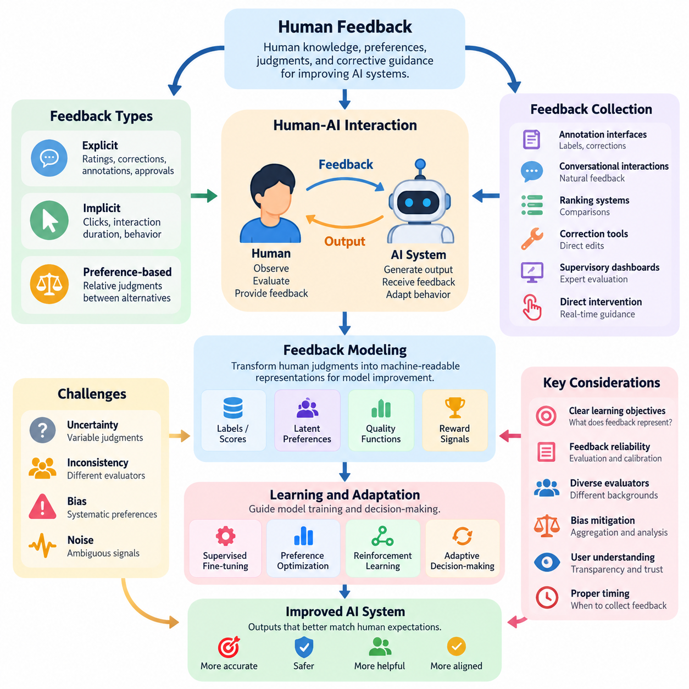
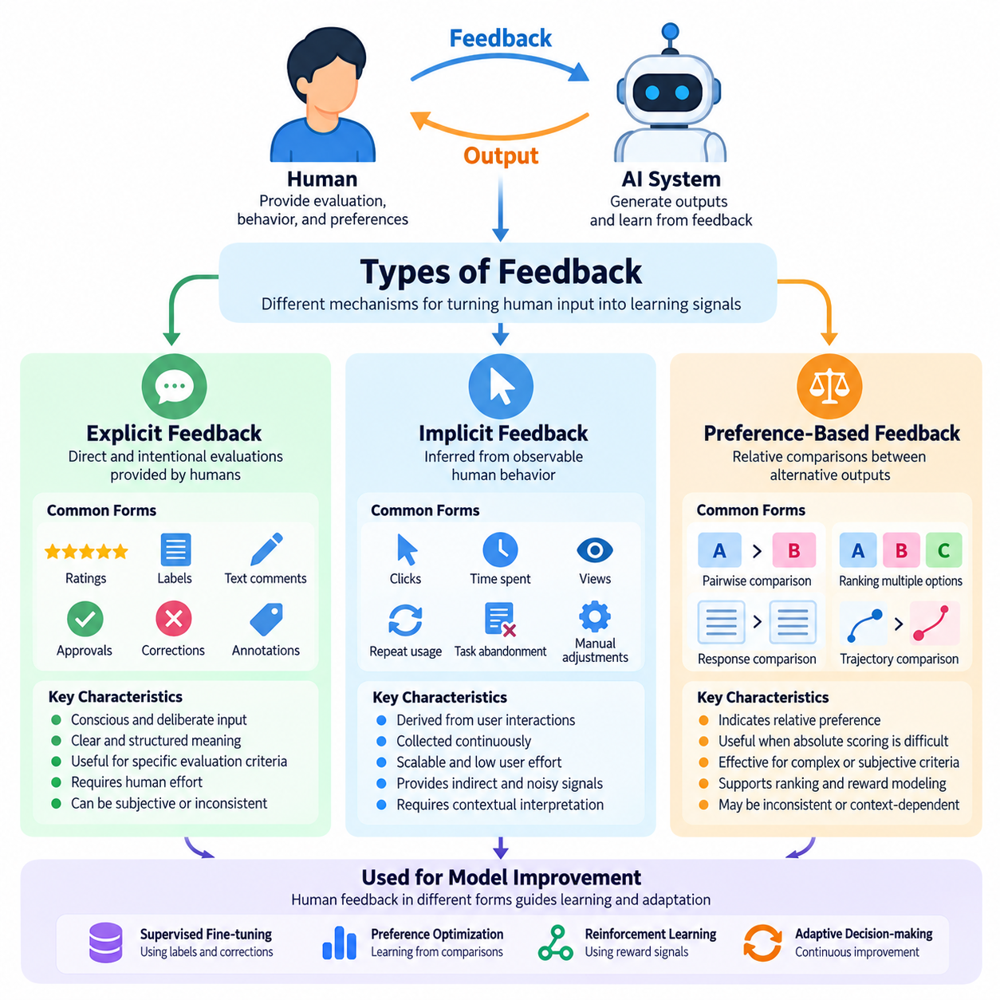
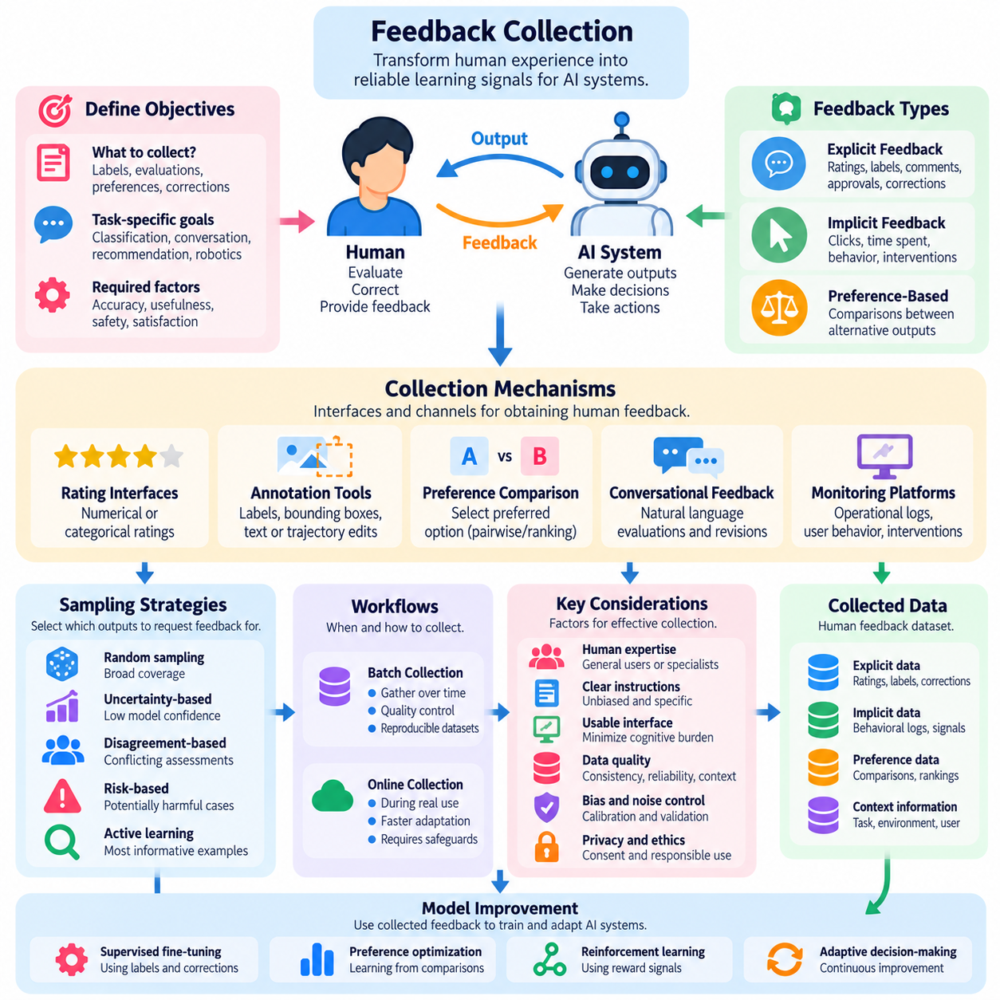
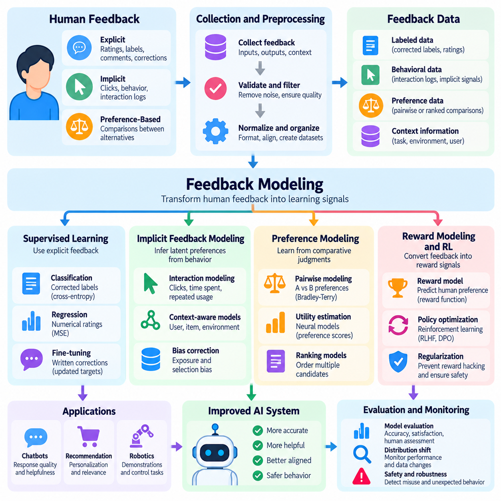
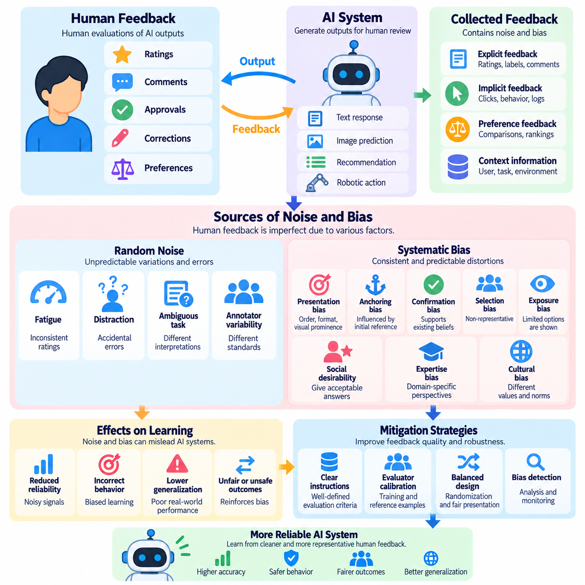
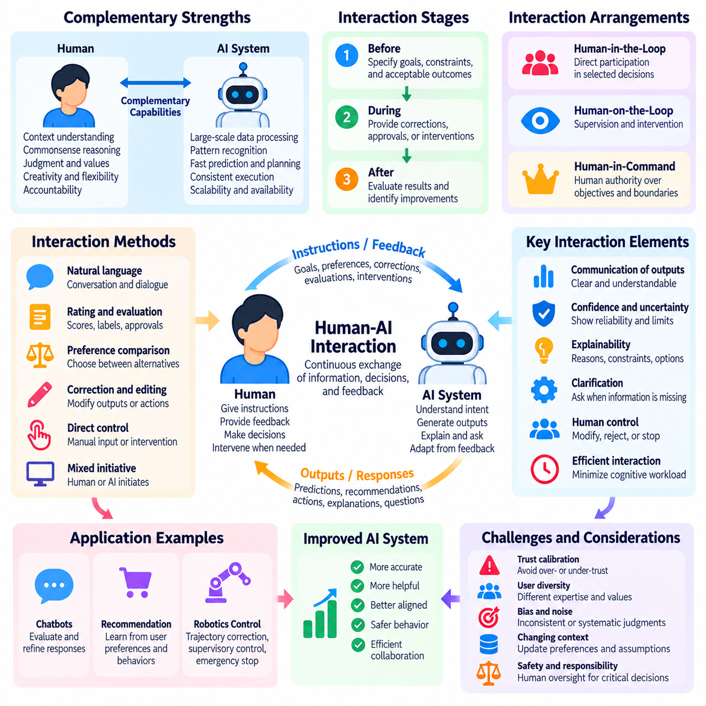
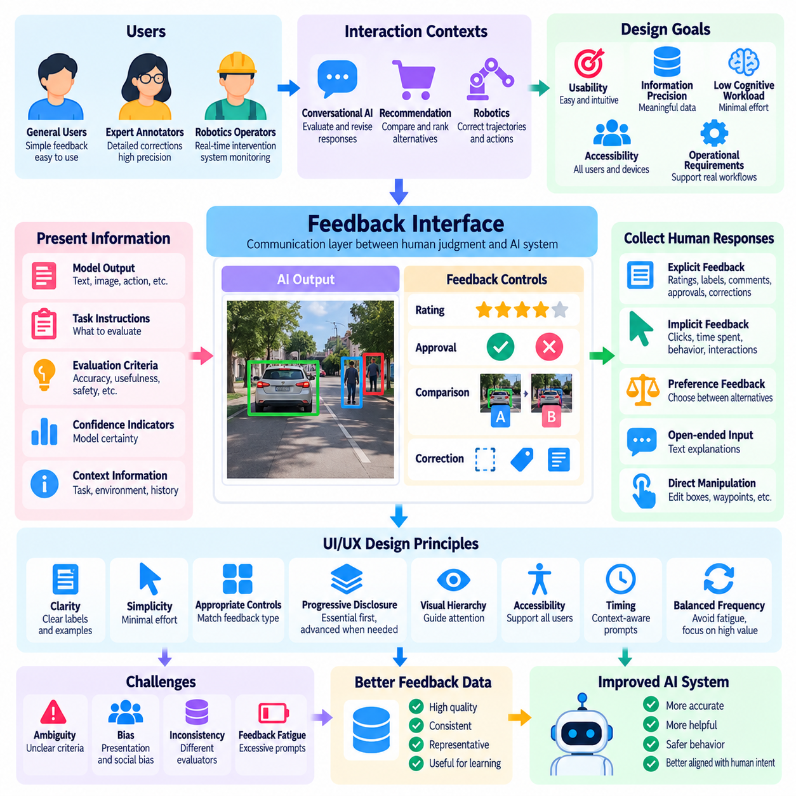
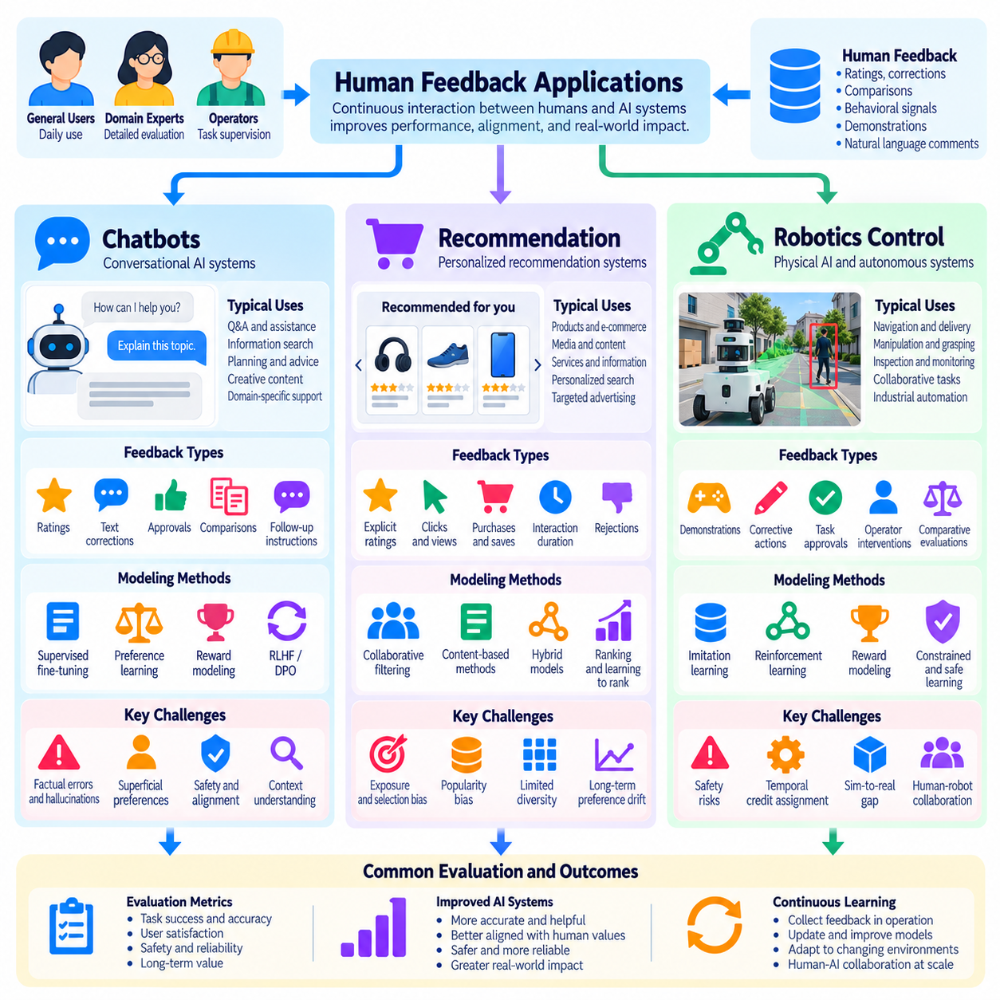

**Volume 41. Human in the Loop Learning**

# 02. Human Feedback

## 02.00 Overview

{width="7.268055555555556in" height="7.268055555555556in"}

Human feedback is a fundamental mechanism for improving artificial intelligence systems by incorporating human knowledge, preferences, judgments, and corrective guidance into the learning process. Unlike conventional machine learning, which primarily relies on predefined datasets and objective functions, human feedback enables models to adapt to expectations that may be difficult to express through mathematical rules or static labels.

The central purpose of human feedback is to reduce the gap between machine-generated outputs and human expectations. An AI model may achieve high predictive accuracy while producing responses that are inappropriate, confusing, unsafe, or inconsistent with user intentions. Human evaluations provide additional information about these limitations, allowing developers to improve model behavior beyond conventional performance metrics.

Human feedback plays an essential role within Human-in-the-Loop Learning, where human participants actively contribute to training, evaluation, and operational decision-making. Instead of treating humans exclusively as data providers, this approach establishes an interactive relationship in which human expertise influences model development. Feedback may be collected during initial training, iterative refinement, or deployment.

The feedback process generally begins when an AI system generates a prediction, recommendation, decision, or action. A human participant observes the result and provides information about its correctness, usefulness, quality, or suitability. This information is recorded and transformed into a representation that can support model improvement, evaluation, or operational correction, creating a recurring interaction between humans and machines.

Human feedback can be categorized into explicit, implicit, and preference-based forms. Explicit feedback involves deliberate evaluations such as ratings, corrections, annotations, and approval decisions. Implicit feedback is inferred from observable behavior, including clicks, interaction duration, repeated requests, and task completion patterns. Preference-based feedback expresses relative judgments between alternative outputs or behaviors.

These feedback categories provide different levels of information and reliability. Explicit evaluations often communicate clear judgments but require additional human effort. Implicit signals can be collected continuously during normal system operation, although their interpretation may be ambiguous. Preference-based comparisons are particularly useful when evaluating relative quality is easier than assigning an absolute numerical score.

Effective feedback collection requires a carefully designed interaction between human participants and AI systems. Collection mechanisms should capture relevant information while minimizing unnecessary effort, interruption, and cognitive burden. Depending on the application, feedback may be obtained through annotation interfaces, conversational interactions, ranking systems, correction tools, supervisory dashboards, or direct intervention during autonomous operation.

Feedback modeling transforms human judgments into representations that machine learning algorithms can process. A simple system may convert evaluations into classification labels or numerical scores, while more advanced approaches estimate latent preferences, quality functions, or reward signals. These representations can guide supervised fine-tuning, preference optimization, reinforcement learning, and adaptive decision-making.

The effectiveness of feedback modeling depends on the relationship between the collected signals and the intended learning objectives. A numerical rating may provide a convenient optimization target, but it does not necessarily capture every dimension of human judgment. Developers must consider whether feedback represents correctness, satisfaction, safety, efficiency, fairness, or some combination of these objectives before incorporating it into training.

Human feedback is inherently affected by uncertainty, inconsistency, and bias. Different evaluators may interpret the same output differently because of differences in expertise, experience, expectations, or cultural context. Even a single evaluator may provide inconsistent judgments across repeated assessments. These variations must be considered when constructing datasets, estimating feedback reliability, and interpreting evaluation results.

Noise and bias can enter the feedback process through ambiguous instructions, poorly designed interfaces, fatigue, incomplete information, and systematic preferences. Feedback aggregation, evaluator calibration, repeated assessment, and disagreement analysis can help identify these problems. However, averaging judgments does not automatically eliminate bias, particularly when evaluators share similar assumptions or represent a limited population.

Human-AI interaction determines how effectively feedback can be communicated and incorporated into system behavior. Successful interaction requires more than a mechanism for accepting corrections. Users should understand what the system is attempting to accomplish, which aspects of its output can be modified, and how their feedback may influence subsequent behavior. Transparency and predictable interaction patterns are important for maintaining appropriate trust.

User interface and user experience design directly influence feedback quality. Interfaces that demand excessive attention may discourage participation, while overly simplified controls may fail to capture meaningful distinctions. Effective feedback interfaces balance expressiveness, accessibility, response time, and cognitive effort. Contextual explanations, confidence indicators, correction options, and clear confirmation mechanisms can improve the usefulness of collected judgments.

Feedback timing is another important design consideration. Immediate feedback can support rapid correction and interactive adaptation, especially when the system is operating in a changing environment. Delayed feedback may be more appropriate when evaluating long-term outcomes or complex tasks. The choice between immediate and delayed assessment affects feedback interpretation, learning efficiency, and the system\'s ability to associate judgments with particular actions.

Human feedback also introduces important tradeoffs between learning performance and operational cost. Expert evaluations may provide high-quality information but can be expensive and difficult to obtain at scale. Large-scale participation can increase feedback volume while introducing additional variability. Efficient systems therefore prioritize informative interactions and allocate human attention according to uncertainty, task importance, expected improvement, and potential risk.

In conversational AI, human feedback helps improve response relevance, instruction following, clarity, and appropriateness. Users may correct factual errors, express preferences between alternative responses, or indicate whether an answer satisfies their needs. These signals can support improvements in response generation and evaluation, although user satisfaction alone should not be treated as definitive evidence of factual correctness.

Recommendation systems use human feedback to adapt suggestions to individual preferences and changing interests. Explicit ratings and comparative choices provide direct information about user satisfaction, while interaction histories supply indirect behavioral signals. Combining these sources can improve personalization, but the system must distinguish genuine preferences from temporary behavior, interface effects, and exposure-driven selection patterns.

In robotics control, human feedback may involve corrective demonstrations, trajectory evaluations, intervention commands, or assessments of task execution. A human operator can identify unsafe movements, inefficient manipulation strategies, or navigation decisions that violate operational expectations. Such feedback helps connect learned control policies with practical requirements that may not be fully represented in simulated environments or predefined reward functions.

Physical AI systems introduce additional challenges because feedback may concern continuous actions, spatial relationships, physical constraints, and delayed consequences. A robot can complete a task successfully while using excessive force, approaching obstacles too closely, or producing unacceptable operational risk. Human evaluations must therefore consider execution quality, safety margins, task outcomes, and the physical context surrounding each action.

Human feedback should also be distinguished from human oversight. Feedback primarily provides information that may improve system behavior, whereas oversight establishes mechanisms for supervision, authorization, intervention, and accountability. The two functions are complementary, particularly in safety-critical applications. A system may learn from operator corrections while still requiring independent safety constraints and human authority over consequential decisions.

Privacy, consent, and data governance are essential when feedback contains personal information, behavioral records, or sensitive operational observations. Organizations should establish clear policies for collecting, storing, accessing, and retaining feedback. Appropriate safeguards also help prevent feedback manipulation, unauthorized disclosure, and the use of collected information for purposes that participants did not reasonably expect.

Evaluating a human feedback system requires examining both model improvement and the human effort needed to achieve it. Relevant considerations include feedback consistency, annotation cost, response quality, correction effectiveness, user satisfaction, and changes in downstream task performance. Evaluation should also investigate whether improvements generalize beyond the particular evaluators, tasks, and interaction conditions represented during development.

Continuous feedback integration connects human judgments with operational machine learning workflows. Collected feedback can be validated, curated, versioned, and incorporated into periodic retraining or carefully controlled online adaptation. Monitoring is necessary to detect performance degradation, unintended behavioral changes, and feedback distribution shifts. Not every individual correction should automatically trigger an immediate model update.

A mature human feedback framework treats human participation as a structured source of learning signals rather than an informal collection of opinions. It coordinates feedback collection, representation, quality assessment, interaction design, and evaluation within a coherent improvement process. This foundation supports more advanced approaches such as reinforcement learning from human feedback, interactive learning, hybrid intelligence, and collaborative human-AI systems.

Ultimately, human feedback enables AI development to move beyond optimizing isolated statistical objectives toward systems that better reflect human intentions and operational requirements. Its value depends not merely on the quantity of judgments collected, but on their relevance, reliability, interpretation, and integration into learning. Well-designed feedback mechanisms create a foundation for adaptive, accountable, and human-centered artificial intelligence.

## 02.01 Types of Feedback

{width="7.268055555555556in" height="7.268055555555556in"}

Human feedback can be classified into three fundamental categories: explicit feedback, implicit feedback, and preference-based feedback. Each category represents a different mechanism through which human judgments, behaviors, and preferences become learning signals for artificial intelligence systems. Understanding these distinctions is essential for designing feedback collection processes that balance information quality, user effort, scalability, and learning effectiveness.

Explicit feedback refers to information intentionally provided by a human participant to evaluate, correct, or guide an AI system. The participant consciously communicates an assessment through ratings, labels, textual comments, approval decisions, or corrective instructions. Because the feedback is directly expressed, its intended meaning is often easier to interpret than behavioral signals, although subjective judgments and inconsistencies may still occur.

A common form of explicit feedback is numerical rating, where users evaluate an output using a predefined scale. For example, a conversational AI response may receive a satisfaction score, while an industrial inspection system may receive an operator-assigned quality rating. Such evaluations provide structured information that can support statistical analysis, supervised learning, and model comparison across different operating conditions.

Explicit feedback also includes corrective annotations that identify errors and provide preferred alternatives. In computer vision, an annotator may correct an object category or bounding box. In natural language processing, a reviewer may revise an inaccurate answer. In robotics, an operator may adjust a planned trajectory or identify an unsafe action. These corrections provide targeted information about the difference between actual and desired behavior.

The primary advantage of explicit feedback is its direct connection to human evaluation criteria. Developers can design questions and interfaces that capture specific dimensions such as accuracy, usefulness, safety, or task completion. However, explicit feedback requires deliberate participation and may impose substantial cognitive effort. Its reliability depends on clear instructions, evaluator expertise, consistent interpretation, and appropriate collection conditions.

Implicit feedback is derived from human behavior rather than directly stated evaluations. It assumes that observable interactions may reveal information about user interests, satisfaction, or intentions. Examples include clicking a recommendation, continuing a conversation, abandoning a task, modifying a generated result, or repeatedly requesting an alternative. These behavioral observations can provide learning signals without requiring users to complete formal evaluations.

Implicit feedback is particularly valuable in systems with frequent user interactions. Recommendation platforms can observe browsing patterns, selection frequency, and engagement duration, while conversational systems can analyze follow-up requests and correction behavior. Industrial AI systems may record operator overrides, manual adjustments, and workflow interruptions. These observations help identify patterns that would be difficult to capture through occasional explicit assessments.

Despite its scalability, implicit feedback presents substantial interpretation challenges. A user may click an item because it is prominently displayed rather than genuinely preferred. Long interaction duration may indicate satisfaction, confusion, or difficulty completing a task. Similarly, the absence of corrective action does not necessarily indicate approval. Behavioral signals must therefore be interpreted within their operational and interaction contexts.

Implicit feedback modeling often involves estimating relationships between observed behavior and unobserved preferences or satisfaction. Statistical models may account for interaction frequency, position bias, exposure probability, and contextual variables. Machine learning systems can combine multiple behavioral indicators to estimate engagement or task success. However, inferred preferences remain uncertain and should not automatically be treated as direct expressions of human intention.

Preference-based feedback captures human judgments about the relative desirability of alternative outputs, decisions, or behaviors. Rather than assigning an absolute score, participants compare two or more candidates and indicate which they prefer. This approach is useful when evaluation criteria are complex or difficult to quantify. Relative comparisons can reveal meaningful distinctions even when participants cannot consistently define an ideal numerical rating.

In a typical pairwise preference evaluation, a participant examines two candidate responses and selects the better alternative. The comparison may concern factual accuracy, clarity, helpfulness, safety, or overall quality. In robotics, an evaluator may compare alternative manipulation trajectories or navigation strategies. These judgments produce preference datasets that can support ranking models, reward estimation, and policy improvement.

Preference-based feedback is closely associated with learning systems that optimize behavior according to human judgments. A preference model can estimate the probability that one candidate will be selected over another. Reward models may transform comparative evaluations into scalar signals for reinforcement learning. Such methods provide a practical connection between qualitative human assessments and quantitative optimization objectives.

However, preference-based feedback also introduces limitations. Human preferences may be inconsistent, context-dependent, or influenced by presentation order. A participant may prefer one response for clarity while another is more accurate, making overall selection ambiguous. Pairwise comparisons also provide relative information rather than an independently calibrated measure of quality. Careful experimental design is necessary to interpret these judgments reliably.

The three feedback categories differ in collection cost, interpretability, and information density. Explicit feedback communicates intended evaluations directly but requires active participation. Implicit feedback can be collected continuously with relatively low interaction burden but involves greater uncertainty. Preference-based feedback provides structured comparative judgments, although the number of required comparisons may increase substantially as candidate diversity grows.

Feedback selection should depend on the learning objective and application environment. When precise error correction is required, explicit annotations may be most appropriate. When large-scale behavioral adaptation is important, implicit observations may provide useful coverage. When optimizing subjective quality or complex behavior, preference comparisons may offer more informative signals than absolute ratings. No single feedback category is universally superior.

Hybrid feedback systems combine multiple categories to compensate for their individual limitations. A recommendation system may use browsing behavior to identify candidate preferences and explicit ratings to validate them. A conversational assistant may combine response comparisons with user corrections. A robotic system may integrate operator interventions, trajectory rankings, and task completion observations to construct a richer representation of acceptable behavior.

Combining feedback sources requires careful attention to differences in reliability and meaning. Explicit corrections should not necessarily receive the same weight as inferred behavioral preferences. Preference judgments may reflect subjective quality rather than objective correctness. Feedback fusion mechanisms can assign confidence estimates, model source-specific uncertainty, and preserve distinctions between observed actions and directly expressed evaluations.

Feedback quality also depends on temporal context. Human preferences can change as users gain experience, encounter new conditions, or modify their goals. Explicit ratings collected during initial interaction may differ from evaluations made after extended use. Implicit behavior can reflect temporary circumstances, while comparative preferences may depend on the available alternatives. Adaptive systems must recognize these changes without overreacting to isolated observations.

In safety-critical applications, feedback categories must be interpreted according to operational risk. An operator\'s explicit rejection of an unsafe robot action may represent a critical safety constraint, whereas the absence of intervention provides weaker evidence of acceptable behavior. Preference rankings should not override mandatory safety requirements. Human feedback can improve system behavior, but independent safety mechanisms remain necessary.

Effective feedback systems also require mechanisms for handling disagreement. Multiple evaluators may provide conflicting explicit ratings or select different preferred alternatives. Such disagreement can reveal ambiguity, diverse preferences, or insufficient task specifications. Instead of automatically removing conflicting observations, developers can analyze their causes, estimate evaluator reliability, and represent uncertainty within the learning process.

The design of feedback interfaces influences which signals are collected and how accurately they represent human intentions. Clear rating criteria, balanced comparison presentation, accessible correction tools, and minimal interaction burden can improve feedback usefulness. Interfaces should also avoid encouraging superficial responses or manipulating user choices. Feedback collection is therefore both a machine learning problem and a human-computer interaction problem.

Evaluation of feedback mechanisms should consider more than the number of collected observations. Important dimensions include annotation consistency, predictive validity, information gained per interaction, collection cost, and downstream model improvement. Controlled experiments can compare learning performance under different feedback strategies. These evaluations help determine whether additional feedback produces meaningful benefits or merely increases data volume.

Ultimately, explicit, implicit, and preference-based feedback provide complementary perspectives on human expectations and AI behavior. Explicit feedback communicates deliberate judgments, implicit feedback reveals behavioral patterns, and preference-based feedback captures relative evaluations. Their effective integration enables AI systems to learn from human interaction while accounting for uncertainty, subjective variation, operational constraints, and the continuing evolution of user requirements.

## 02.02 Feedback Collection

{width="7.268055555555556in" height="7.268055555555556in"}

Feedback collection is a fundamental component of Human-in-the-Loop Learning, enabling artificial intelligence systems to acquire human judgments, corrections, preferences, and behavioral observations. Its primary objective is to transform human experience into reliable learning signals that support model improvement. Effective collection requires coordinated consideration of interaction design, data quality, operational constraints, and the intended learning objectives.

A feedback collection system establishes communication between human participants and AI models during training, evaluation, or deployment. The system presents outputs, decisions, or actions for human assessment and records the resulting responses. These observations may represent correctness, usefulness, safety, satisfaction, or preferred behavior. The collection process must preserve sufficient context to interpret each judgment accurately.

Feedback collection begins with defining what information the learning system requires. A classification model may need corrected labels, while a conversational assistant may require response evaluations or comparative preferences. Robotics systems may request trajectory corrections, intervention signals, or task outcome assessments. Clearly defined objectives prevent unnecessary collection and ensure that human effort contributes to meaningful improvements.

Collection mechanisms commonly include structured rating interfaces, annotation tools, preference comparison systems, conversational feedback channels, and operational monitoring platforms. Structured interfaces provide consistent response formats, while open-ended channels allow participants to communicate complex observations. The selection of mechanisms depends on task complexity, evaluator expertise, interaction frequency, and the required level of precision.

Explicit feedback collection requires participants to deliberately communicate evaluations or corrections. Users may assign numerical scores, select categorical labels, approve generated outputs, or provide written explanations. Such mechanisms offer relatively direct information about human judgments. However, their effectiveness depends on understandable instructions, appropriately designed response options, and manageable evaluation workloads.

Implicit feedback collection observes behavior during ordinary system interaction without requiring formal evaluations. Examples include user selections, repeated requests, abandoned tasks, manual corrections, and operator interventions. These observations can provide large volumes of information with relatively little additional effort. Nevertheless, behavioral signals require contextual interpretation because observed actions do not always reveal genuine preferences.

Preference-based collection presents alternative outputs or behaviors and asks participants to identify the preferred option. Pairwise comparisons are particularly common because selecting between two candidates may be easier than assigning absolute scores. Comparative judgments can support ranking models and reward estimation. Candidate selection and presentation order must be controlled to reduce systematic evaluation bias.

The design of feedback prompts strongly influences collection quality. Questions should communicate clear evaluation criteria without suggesting a preferred answer. Ambiguous prompts may cause participants to evaluate different attributes, producing inconsistent results. Separating dimensions such as accuracy, clarity, safety, and usefulness can improve interpretability, although additional questions increase the time required for each assessment.

Feedback interfaces should minimize cognitive burden while preserving the information needed for learning. Simple controls are appropriate for frequent evaluations, whereas complex tasks may require detailed annotation environments. Visual context, explanatory information, and correction previews can help participants understand the assessment task. Interface complexity should remain proportional to the importance and difficulty of the requested judgment.

Human expertise is another critical consideration in collection design. General users can provide valuable information about usability and satisfaction, while specialized tasks may require trained annotators, engineers, clinicians, or robotics operators. Evaluator selection should reflect the knowledge necessary to judge the target behavior. Expert feedback may be more informative for technical decisions but typically involves higher collection costs.

Feedback sampling determines which model outputs receive human attention. Random sampling provides broad coverage, while uncertainty-based selection prioritizes predictions where the model lacks confidence. Disagreement-based strategies identify cases where models or evaluators produce conflicting assessments. Risk-based sampling emphasizes potentially harmful decisions. Combining these strategies can improve information efficiency and coverage.

Active learning provides a useful framework for selecting informative feedback requests. Instead of asking humans to evaluate every output, the system identifies examples expected to contribute substantially to model improvement. Selection may depend on predictive uncertainty, sample diversity, expected model change, or operational importance. This approach reduces unnecessary annotation effort while preserving valuable learning opportunities.

Feedback collection can operate through batch or online workflows. Batch collection gathers evaluations over a defined period before incorporating them into training datasets. Online collection captures responses during ongoing interaction and may support faster adaptation. Batch workflows simplify quality control and reproducibility, while online workflows improve responsiveness but require stronger safeguards against unstable or inappropriate updates.

Timing affects both feedback quality and user experience. Immediate requests can capture observations while the relevant interaction remains fresh, but frequent interruptions may reduce productivity. Delayed assessments allow participants to consider complete task outcomes, although memory limitations may reduce precision. Collection schedules should reflect task duration, operational urgency, and the cognitive demands placed on evaluators.

High-quality feedback records require more than a judgment value. Relevant metadata may include the original input, model output, model version, evaluator identifier or pseudonym, timestamp, task context, and collection method. Such information supports reproducibility, disagreement analysis, and error investigation. Data minimization principles should limit collection to information necessary for legitimate learning and evaluation purposes.

Feedback validation identifies incomplete, inconsistent, duplicated, or potentially unreliable observations before they enter training pipelines. Validation procedures may include format checks, repeated assessments, reference examples, and consistency analysis. Automated checks can detect structural problems, while human review may be necessary for subjective or ambiguous cases. Validation should distinguish genuine disagreement from collection errors.

Evaluator agreement provides insight into the consistency of collected judgments. Agreement measures can reveal whether participants interpret instructions similarly, although high agreement does not necessarily establish correctness. Low agreement may indicate unclear criteria, insufficient expertise, or legitimate differences in preference. Investigating disagreement can improve annotation guidelines and reveal uncertainty that should remain represented in the dataset.

Collection bias can arise from participant recruitment, task selection, interface presentation, and feedback availability. Highly engaged users may provide more evaluations than occasional users, creating an unrepresentative dataset. Difficult examples may be underreported, while prominently displayed alternatives may receive disproportionate attention. Balanced sampling and careful monitoring help reduce these distortions.

Feedback aggregation combines observations from multiple participants or collection channels. Simple methods may use majority voting or average ratings, while more advanced approaches estimate evaluator reliability and task difficulty. Aggregation must account for the possibility that different judgments represent valid perspectives. Preserving disagreement information can be important when learning objectives involve subjective preferences or uncertain conditions.

In conversational AI, feedback collection may involve response ratings, suggested corrections, preference comparisons, and follow-up interactions. The system can capture whether an answer was useful, understandable, or aligned with the user\'s request. However, satisfaction signals should be distinguished from factual verification. Reliable evaluation may require independent evidence or qualified reviewers when correctness is difficult for ordinary users to assess.

In recommendation systems, feedback collection combines explicit ratings with behavioral observations such as selections, browsing patterns, and repeated engagement. These signals support preference estimation and personalization. Collection mechanisms must account for exposure bias because users can only interact with recommendations they encounter. Evaluation should also distinguish short-term engagement from longer-term satisfaction.

Robotics applications require feedback mechanisms capable of representing physical actions and operational constraints. Operators may correct trajectories, demonstrate preferred movements, identify unsafe behaviors, or intervene during task execution. Sensor observations and execution logs provide context for these judgments. Feedback records should associate human assessments with relevant robot states, actions, and environmental conditions.

Safety-critical systems require collection procedures that prioritize reliable reporting and rapid intervention. Human feedback may identify hazardous behavior, unexpected system responses, or violations of operational constraints. Critical observations should be recorded with appropriate priority and traceability. However, feedback collection must not replace independent safety controls, emergency mechanisms, or established human authorization requirements.

Privacy and security are essential throughout feedback collection. Systems should communicate collection purposes, obtain appropriate consent, restrict unnecessary personal information, and protect stored records. Access controls, retention policies, and secure transmission reduce the risk of unauthorized use. Feedback involving sensitive operational environments may require additional safeguards and organizational governance.

The effectiveness of feedback collection should be evaluated using both information quality and operational efficiency. Relevant measures include annotation time, evaluator consistency, collection cost, feedback coverage, and downstream model improvement. Comparing these measures across collection strategies helps determine whether additional human effort produces meaningful learning benefits. Collection volume alone is not a sufficient indicator of success.

Ultimately, feedback collection transforms human interaction into structured information that can guide artificial intelligence development. Successful systems coordinate clear objectives, appropriate interfaces, informative sampling, quality assurance, and responsible data management. By preserving the meaning and context of human judgments, feedback collection establishes the foundation for reliable feedback modeling, continuous learning, and effective human-AI collaboration.

## 02.03 Feedback Modeling [w/Code]

{width="7.268055555555556in" height="7.268055555555556in"}

Feedback modeling is the process of transforming human evaluations, corrections, preferences, and behavioral observations into representations that artificial intelligence systems can learn from. It connects qualitative human judgments with quantitative learning objectives. Effective feedback modeling requires understanding what each signal represents, how reliably it reflects human intentions, and how it should influence model predictions, decisions, or actions.

The fundamental challenge of feedback modeling is that human judgments are rarely expressed in a form directly suitable for mathematical optimization. People may describe an answer as useful, reject an unsafe action, or prefer one outcome over another without specifying numerical values. Feedback models translate these observations into labels, scores, probability distributions, constraints, or reward functions while attempting to preserve their original meaning.

A feedback modeling pipeline generally begins with collecting human observations and associating them with relevant inputs, model outputs, and operational contexts. The collected information is validated, normalized, and organized into training examples. A modeling algorithm then estimates relationships between system behavior and human evaluations. The resulting representation can support supervised learning, preference optimization, reinforcement learning, or model evaluation.

Explicit feedback is often modeled through supervised learning objectives. Corrected classification labels can become categorical targets, while numerical ratings can support regression or ordinal prediction. Written corrections may provide revised target outputs for supervised fine-tuning. The appropriate representation depends on whether the feedback expresses objective correctness, subjective quality, ordered preferences, or an operational requirement.

Numerical feedback requires careful treatment because rating scales do not always represent equal intervals of perceived quality. A difference between ratings of one and two may not have the same meaning as a difference between four and five. Ordinal regression and probabilistic rating models can preserve ordering without assuming uniform distances. Calibration is necessary when scores are compared across evaluators, tasks, or operating environments.

Implicit feedback modeling attempts to infer latent preferences from observable human behavior. Clicks, selections, interaction duration, repeated requests, and operator interventions can provide indirect evidence about satisfaction or task success. However, these signals are influenced by exposure, interface design, context, and user intentions. A robust model must distinguish behavioral observations from the underlying preferences it attempts to estimate.

Implicit signals are frequently represented through weighted interaction histories or probabilistic preference estimates. For example, repeated selection may increase confidence in a preference, while a single click may provide weak evidence. Contextual features can help explain why an interaction occurred. Statistical correction for exposure and selection bias is important because observed behavior does not represent a random sample of possible choices.

Preference-based modeling learns relationships between alternative outputs and human comparative judgments. In pairwise evaluation, a participant selects one candidate over another, creating an ordered comparison. A preference model estimates which candidate is more likely to be selected under similar conditions. These models are particularly useful when human evaluators can compare outcomes more consistently than they can assign absolute quality scores.

A common mathematical approach is the Bradley-Terry preference model, which represents the probability of selecting one candidate using differences between learned utility scores. Neural networks can estimate these utilities from input-output pairs. Training typically minimizes a negative log-likelihood objective over observed comparisons. The resulting scores express relative preference tendencies rather than independently verified measures of correctness.

Reward modeling extends preference estimation by constructing a function that assigns numerical values to candidate behaviors or outputs. The reward model is trained to predict human preferences and can subsequently guide policy optimization. This approach is widely associated with reinforcement learning from human feedback. However, learned rewards are approximations of collected judgments and may fail when applied outside the training distribution.

Reward models must be designed to avoid confusing human preference with unrestricted optimization objectives. A model trained on limited comparisons may assign unexpectedly high scores to outputs that exploit weaknesses in the learned reward function. This phenomenon is related to reward hacking and specification gaming. Regularization, independent evaluation, distribution monitoring, and constrained optimization can reduce these risks.

Feedback modeling can also incorporate demonstrations and corrective actions. In imitation learning, expert demonstrations provide target behavior for a policy to reproduce. Corrective feedback identifies deviations from desired behavior and supplies improved actions or trajectories. These approaches are particularly relevant to robotics, where operators can demonstrate manipulation procedures, navigation decisions, or recovery strategies.

For continuous robotic control, feedback may be associated with states, actions, trajectories, or complete task episodes. A trajectory-level evaluation captures overall execution quality, while action-level corrections identify specific control errors. Temporal credit assignment is necessary when feedback arrives after a sequence of decisions. Models must estimate which actions contributed to the observed outcome without assuming that every action deserves identical evaluation.

Human feedback frequently contains noise, disagreement, and systematic bias. Different evaluators may assign different ratings to identical outputs because of expertise, interpretation, or personal preferences. Probabilistic models can represent uncertainty in judgments, while evaluator-specific parameters can account for systematic differences. Disagreement should not automatically be treated as erroneous data because it may reveal genuine ambiguity.

Feedback aggregation combines judgments from multiple evaluators into training targets or probability estimates. Simple aggregation may use majority voting or average scores, while more advanced methods estimate annotator reliability and task difficulty. Hierarchical models can distinguish population-level preferences from individual variation. Preserving disagreement distributions may be more informative than forcing every example into a single definitive label.

Uncertainty estimation is important because feedback datasets are often incomplete and unevenly distributed. A feedback model may perform confidently on familiar examples while becoming unreliable under novel conditions. Ensemble methods, Bayesian approximations, and calibration techniques can help estimate predictive uncertainty. High uncertainty can trigger additional human evaluation or prevent unsupported automated decisions.

Feedback models may also incorporate contextual information to represent changing human expectations. Preferences can depend on user goals, task difficulty, environmental conditions, and operational constraints. Context-conditioned models estimate judgments relative to these variables rather than assuming a universal preference function. Such models can improve personalization while requiring safeguards against overfitting and inappropriate behavioral adaptation.

Training feedback models requires careful dataset construction. Examples should preserve the original input, candidate output, feedback signal, evaluator context, and relevant model version. Training and evaluation partitions should prevent leakage between related interactions. Sampling procedures should address class imbalance, repeated observations, and overrepresentation of highly active participants to support reliable generalization.

Optimization objectives must match the structure of the feedback. Classification losses are appropriate for categorical corrections, regression losses for meaningful numerical targets, and ranking losses for comparative preferences. Demonstration learning may use behavioral cloning objectives, while reward models use preference likelihoods. Selecting an unsuitable objective can distort the meaning of feedback even when training loss decreases.

Evaluation should measure whether the feedback model predicts human judgments and improves downstream system behavior. Relevant metrics include classification accuracy, ranking agreement, calibration error, preference prediction accuracy, and task performance. Independent evaluation datasets are essential because strong agreement with training feedback does not guarantee generalization. Safety and robustness must be assessed separately from preference prediction.

In conversational AI, feedback modeling supports response ranking, supervised fine-tuning, and alignment with user expectations. Preference models may compare alternative answers based on helpfulness, clarity, or instruction following. However, models optimized for perceived quality may favor persuasive but inaccurate responses. Factual verification and independent safety assessment remain necessary complements to human preference modeling.

In recommendation systems, feedback models estimate user interests from explicit ratings and interaction histories. Matrix factorization, neural ranking models, and contextual preference models can represent relationships between users and candidate items. Temporal adaptation allows preferences to evolve, while exposure correction reduces observational bias. Effective evaluation distinguishes engagement prediction from genuine long-term satisfaction.

In robotics and Physical AI, feedback modeling connects human operational expertise with autonomous decision-making. Operators may rank navigation trajectories, correct manipulation actions, or identify unsafe execution patterns. Feedback models can estimate task quality and support policy refinement. Nevertheless, learned preferences must operate within independently enforced physical constraints, safety limits, and human intervention mechanisms.

Deployment introduces additional challenges because feedback distributions change as models and users adapt. Continuous monitoring can identify declining preference prediction accuracy, systematic disagreement, or unexpected reward behavior. Feedback models should be versioned and evaluated before influencing production policies. Controlled updates and rollback mechanisms reduce the risk of unstable adaptation caused by noisy or manipulated feedback.

Ultimately, feedback modeling converts human experience into structured learning objectives while preserving uncertainty, context, and differences among evaluators. Its effectiveness depends on selecting appropriate representations, controlling bias, validating learned preferences, and evaluating downstream consequences. Reliable feedback models establish an essential foundation for human-centered AI systems that improve through interaction without treating imperfect human judgments as infallible ground truth.

## 02.04 Noise and Bias in Feedback

{width="7.268055555555556in" height="7.268055555555556in"}

Noise and bias in human feedback are fundamental challenges in Human-in-the-Loop Learning because human judgments are neither perfectly consistent nor entirely objective. Feedback may contain accidental errors, subjective interpretations, systematic preferences, and contextual influences. Understanding these imperfections is essential for preventing AI systems from learning misleading patterns or optimizing behaviors that do not reflect intended human values.

Feedback noise refers to unpredictable variation or errors in collected evaluations. The same participant may assign different ratings to identical outputs at different times, while multiple evaluators may disagree despite following the same instructions. Such variation can arise from fatigue, distraction, incomplete information, or ambiguous criteria. Noise reduces the reliability of learning signals and may increase the amount of data required for effective training.

Feedback bias represents systematic distortion in human evaluations or collection processes. Unlike random noise, bias can consistently favor certain outputs, behaviors, populations, or presentation styles. A model trained on biased feedback may reproduce these preferences even when they conflict with actual task requirements. Bias is particularly dangerous because increasing the quantity of similarly biased observations does not necessarily improve correctness.

Random noise and systematic bias affect learning differently. Random errors may partially cancel when independent observations are aggregated, although they still increase uncertainty. Systematic errors can persist across large datasets and shift learned decision boundaries or reward functions. Effective feedback modeling must therefore distinguish uncertainty caused by inconsistent judgments from distortion caused by predictable evaluation patterns.

Annotator variability is a major source of feedback uncertainty. Evaluators differ in expertise, experience, cultural background, interpretation of instructions, and personal expectations. One reviewer may prioritize factual accuracy, while another emphasizes clarity or presentation quality. These differences do not always represent mistakes. They may reflect legitimate variation in evaluation criteria that should be modeled rather than automatically eliminated.

Intra-annotator inconsistency occurs when the same evaluator provides different judgments under similar conditions. Fatigue, changing attention, emotional state, and evolving understanding of the task can influence decisions. Repeated reference examples and consistency checks can help identify unstable evaluations. However, excessive pressure for uniform responses may suppress meaningful uncertainty or encourage superficial agreement.

Ambiguous instructions create another important source of noise. Terms such as helpful, safe, natural, or high quality may have different meanings for different participants. Without operational definitions, evaluators may apply incompatible standards to identical examples. Clear guidelines, representative examples, and separate evaluation dimensions can improve consistency while preserving the complexity of human judgment.

Presentation bias occurs when the arrangement or appearance of alternatives influences evaluations. In pairwise preference comparisons, participants may favor the first response, the longer explanation, or the visually prominent option. Such preferences may arise independently of actual task quality. Randomizing candidate order, standardizing presentation formats, and monitoring positional effects can reduce these distortions.

Anchoring bias arises when an initial score, example, or suggested answer influences subsequent judgments. Evaluators who see a model-generated rating before making their own assessment may unconsciously adjust their decisions toward that reference. Similar effects can occur when previous annotations establish expectations. Independent initial evaluation and carefully controlled reference materials help limit unwanted anchoring.

Confirmation bias occurs when evaluators interpret information in ways that reinforce existing beliefs or expectations. An operator who trusts a particular AI system may overlook its errors, while a skeptical reviewer may interpret ambiguous outputs negatively. Blind evaluation procedures and evidence-based assessment criteria can reduce these effects. Nevertheless, complete elimination of human expectations is rarely achievable.

Selection bias emerges when collected feedback does not adequately represent the intended population or operating conditions. Highly active users may contribute disproportionately, while dissatisfied users may abandon a system without submitting evaluations. In robotics, feedback may concentrate on familiar environments and routine tasks. Models trained on such data can perform poorly when deployed under less frequently observed conditions.

Exposure bias is especially important in implicit feedback systems. Users can only evaluate or interact with options that the system presents, meaning observed preferences depend on earlier ranking and selection decisions. A recommendation model may repeatedly promote popular items and interpret their resulting engagement as evidence of superior quality. Exposure-aware evaluation and carefully designed exploration can reduce this self-reinforcing process.

Social desirability bias occurs when participants provide responses they believe are expected or socially acceptable rather than expressing their genuine judgments. Evaluators may hesitate to criticize a system developed by colleagues or may approve outputs to avoid disagreement. Anonymous feedback channels, neutral instructions, and separation between evaluation and performance assessment can improve the authenticity of collected responses.

Expertise-related bias can influence feedback when specialized knowledge is unevenly distributed among evaluators. Nonexperts may prefer confident explanations even when technically incorrect, while experts may emphasize subtle errors that general users cannot recognize. Evaluator selection should match task requirements. Combining expert verification with user experience assessments can provide complementary information without treating every judgment as equally authoritative.

Temporal bias arises when feedback distributions change over time. Evaluators may become more experienced, user expectations may evolve, and system behavior may improve or deteriorate. Ratings collected during early deployment may not be directly comparable with later assessments. Time-aware analysis, periodic recalibration, and evaluation against stable reference examples can help distinguish genuine progress from changing judgment standards.

Noise and bias also affect preference-based reward modeling. A reward model may learn to favor verbosity, confident language, or stylistic features that evaluators associate with quality. Subsequent policy optimization can amplify these tendencies beyond their original importance. Independent factual evaluation, reward model validation, and constraints on optimization help prevent superficial preferences from dominating system behavior.

Feedback aggregation can reduce some forms of noise but cannot automatically remove systematic bias. Majority voting may improve reliability when evaluators make approximately independent errors, yet shared misconceptions can produce confidently incorrect consensus. Reliability-weighted aggregation and probabilistic annotator models can improve estimates. Their assumptions must be validated because agreement alone does not establish truth.

Disagreement analysis provides valuable information about feedback quality. High disagreement may indicate ambiguous tasks, insufficient instructions, evaluator differences, or inherently subjective outcomes. Rather than discarding conflicting observations, developers can examine disagreement patterns and estimate uncertainty. In preference learning, representing multiple legitimate perspectives may be more appropriate than imposing a single universal ranking.

Statistical techniques can help detect feedback anomalies and systematic distortions. Inter-rater agreement measures, confusion matrices, calibration analysis, and subgroup performance comparisons reveal different aspects of evaluation quality. Repeated assessments can estimate consistency, while controlled experiments can isolate presentation effects. No single metric captures every source of noise or bias, so complementary analyses are necessary.

Robust learning methods can reduce sensitivity to imperfect feedback. Approaches include noise-aware loss functions, confidence weighting, probabilistic labels, regularization, and carefully validated filtering. Models may also estimate evaluator reliability or identify uncertain examples for additional review. However, aggressive filtering can remove difficult but informative cases and unintentionally increase representation bias.

Active learning can improve feedback quality by selecting examples that clarify uncertain or conflicting judgments. Instead of repeatedly collecting evaluations for familiar cases, the system can prioritize ambiguous outputs, rare conditions, or disagreement clusters. Expert review may be allocated to high-risk examples. Sampling must still preserve sufficient coverage because selecting only uncertain cases can distort the overall training distribution.

In robotics and Physical AI, feedback noise can originate from human reaction delays, sensor uncertainty, inconsistent demonstrations, and changing environmental conditions. An operator intervention may occur after the behavior that caused concern, complicating temporal credit assignment. Reliable modeling requires synchronized observations, action histories, and intervention timestamps. Safety-related feedback should be interpreted conservatively and verified against operational constraints.

Safety-critical applications require particular attention to asymmetric consequences. Incorrect approval of a hazardous action may be far more damaging than unnecessary rejection of a safe action. Evaluation procedures should account for this imbalance rather than optimizing overall agreement alone. Expert escalation, conservative decision thresholds, and independent safety controls remain necessary even when feedback models appear statistically reliable.

Bias mitigation must also consider fairness and representativeness. Feedback collected from a narrow group may encode preferences that do not generalize to other users or environments. Subgroup evaluation can identify systematic differences in error rates or satisfaction. However, fairness objectives must be defined in relation to the application and its legitimate requirements rather than assuming that every observed difference represents unjustified bias.

Continuous monitoring is essential because feedback quality can deteriorate after deployment. Changes in evaluator composition, interface design, model outputs, or user behavior may introduce new distortions. Versioned datasets, audit trails, reference evaluations, and periodic quality reviews support traceability. Monitoring should connect feedback statistics with downstream model behavior to determine whether detected changes have practical consequences.

Ultimately, managing noise and bias in feedback requires more than removing inconsistent observations. Reliable systems must distinguish random variation, systematic distortion, genuine preference diversity, and uncertainty arising from incomplete information. Clear evaluation criteria, representative sampling, probabilistic modeling, independent validation, and continuous monitoring help preserve the meaning of human judgments while preventing imperfect feedback from becoming amplified model behavior.

## 02.05 Human AI Interaction

{width="7.268055555555556in" height="7.268055555555556in"}

Human-AI interaction describes the continuous exchange of information, decisions, and feedback between human participants and artificial intelligence systems. In Human-in-the-Loop Learning, interaction is not limited to issuing commands or receiving predictions. It creates a collaborative process in which humans provide guidance, evaluate outcomes, correct errors, and influence future model behavior through structured and unstructured communication.

Effective Human-AI interaction requires a clear understanding of the respective capabilities and responsibilities of humans and machines. AI systems can process large datasets, recognize statistical patterns, and generate predictions rapidly, while humans contribute contextual knowledge, judgment, and accountability. Interaction design should combine these complementary strengths without assuming that either participant is universally reliable or capable of handling every situation.

Interaction can occur before, during, or after an AI decision. Before execution, humans may specify goals, constraints, and acceptable outcomes. During execution, they may provide corrections, approvals, or interventions. After execution, they can evaluate results and identify opportunities for improvement. These interaction stages create feedback loops that connect human intentions with model adaptation and operational performance.

Human-AI interaction commonly follows human-in-the-loop, human-on-the-loop, or human-in-command arrangements. Human-in-the-loop systems require direct participation in selected decisions, while human-on-the-loop systems emphasize supervision and intervention. Human-in-command arrangements preserve human authority over objectives and deployment boundaries. These approaches differ in intervention frequency, autonomy, and responsibility.

The quality of interaction depends on how clearly an AI system communicates its outputs, confidence, limitations, and intended actions. Users should understand what the system has produced and what remains uncertain. Confidence estimates and explanatory information can support informed decisions when they are appropriately calibrated. Misleading explanations or exaggerated certainty may instead encourage inappropriate trust and reduce meaningful human oversight.

Trust calibration is essential for effective collaboration. Excessive trust can lead users to accept incorrect recommendations without verification, while insufficient trust can cause unnecessary rejection of useful outputs. Appropriate trust develops when system behavior, communicated uncertainty, and demonstrated performance remain consistent. Interaction mechanisms should encourage verification when consequences are significant rather than maximizing user acceptance.

Human feedback provides an important mechanism for adapting AI behavior during interaction. Users may rate responses, correct predictions, compare alternatives, or demonstrate preferred actions. These signals can support supervised learning, preference modeling, and policy refinement. However, the system must distinguish direct corrections from subjective preferences and indirect behavioral observations before incorporating them into learning objectives.

Interaction design should minimize unnecessary cognitive workload while preserving meaningful human control. Frequent confirmation requests may interrupt productivity, whereas insufficient intervention opportunities can allow errors to propagate. Adaptive interaction policies can request assistance when uncertainty, task complexity, or operational risk exceeds predefined thresholds. Such policies should consider both the cost of interruption and the consequences of autonomous failure.

Mixed-initiative interaction allows both humans and AI systems to initiate communication or propose actions. A human may request assistance, while an AI system may ask clarifying questions, suggest alternatives, or request approval. Effective mixed-initiative systems recognize when additional information is necessary and when independent execution is appropriate. The objective is coordinated decision-making rather than constant human involvement.

Clarification is particularly important when user instructions are ambiguous or incomplete. An AI system may encounter conflicting objectives, missing parameters, or uncertain operational constraints. Asking targeted questions can prevent incorrect assumptions and reduce downstream errors. However, excessive clarification can make interaction inefficient. Systems should prioritize questions whose answers materially influence task success, safety, or user satisfaction.

Interaction history provides contextual information that supports continuity and personalization. Previous corrections, accepted recommendations, and expressed preferences can help the system interpret future requests. Nevertheless, historical behavior should not be treated as permanently valid. User goals and environmental conditions may change, requiring mechanisms for updating preferences, resolving contradictions, and preventing outdated assumptions from influencing decisions.

Explainability contributes to interaction by helping humans understand the basis of AI recommendations and actions. Explanations may describe influential inputs, relevant constraints, alternative options, or uncertainty sources. Their level of detail should match the user\'s expertise and the importance of the decision. Explanations must remain faithful to actual system behavior because plausible but inaccurate justifications can undermine reliable oversight.

Human intervention mechanisms enable participants to modify or interrupt AI behavior when necessary. In software applications, intervention may involve rejecting a recommendation or editing generated content. In robotics, it may involve trajectory correction, supervisory control, or emergency stopping. Intervention pathways should be accessible, responsive, and clearly defined, particularly when automated actions can produce physical or irreversible consequences.

Shared autonomy distributes control between human operators and AI systems according to task requirements and operational conditions. An autonomous robot may handle routine navigation while requesting assistance in uncertain environments. Human operators can provide high-level objectives or corrective commands without controlling every movement. Successful shared autonomy requires predictable transitions, clear authority boundaries, and reliable communication of control status.

Interaction latency affects the effectiveness of human participation. Delayed feedback can make it difficult to associate corrections with the actions that caused them, especially in dynamic environments. Real-time systems must coordinate sensing, decision-making, communication, and human response. Appropriate synchronization and event logging support accurate interpretation of interventions and improve the quality of subsequent feedback modeling.

In conversational AI, Human-AI interaction involves iterative exchanges that refine user intentions and generated responses. Users may provide additional context, request revisions, challenge factual claims, or compare alternatives. The system should maintain conversational continuity while recognizing uncertainty and correcting errors. Interaction quality depends on usefulness, clarity, responsiveness, and the ability to incorporate legitimate feedback without losing task objectives.

Recommendation systems use interaction to refine estimates of user interests and preferences. Explicit ratings, item selections, browsing patterns, and rejection signals provide information about changing user needs. Interactive recommendation can also allow users to modify constraints or explain why an option is unsuitable. Such mechanisms improve user agency and help distinguish genuine preferences from behavior influenced by presentation or availability.

In robotics and Physical AI, interaction extends beyond digital interfaces into physical environments. Human operators may assign missions, monitor execution, approve hazardous transitions, and correct manipulation or navigation behavior. Sensor data, robot state, and environmental context influence how feedback should be interpreted. Reliable interaction requires coordination between human supervision, autonomous planning, and low-level control mechanisms.

Safety-critical Human-AI interaction requires explicit authority structures and dependable intervention capabilities. AI systems should communicate hazardous conditions and avoid treating human silence as unconditional approval. Operators must understand when automated control is active and how to regain authority. Independent safety mechanisms remain necessary because communication delays, interface failures, or incorrect human judgments can undermine feedback-based safeguards.

Human factors influence interaction reliability through attention, fatigue, workload, expertise, and situational awareness. An operator supervising multiple autonomous systems may overlook important alerts or misunderstand system status. Interface design should prioritize critical information and avoid excessive notifications. Training, operational procedures, and workload-aware assistance can improve decision quality without assuming that humans can maintain continuous attention indefinitely.

Interaction quality should be evaluated through both system performance and human experience. Relevant measures include task success, correction frequency, intervention latency, user workload, trust calibration, and recovery effectiveness. Controlled studies can reveal whether explanations or feedback mechanisms genuinely improve decisions. High satisfaction alone is insufficient when users may overlook errors or misunderstand system capabilities.

Privacy, consent, and accountability are important when interaction data contributes to continuous learning. Systems should communicate how feedback and behavioral observations may be used, limit unnecessary collection, and preserve appropriate records of consequential decisions. Human participants should be able to correct mistaken assumptions and understand relevant control boundaries. Governance mechanisms should support responsible adaptation without exposing sensitive information.

Continuous improvement requires interaction data to be integrated into controlled learning and evaluation processes. Collected feedback can identify recurring errors, changing preferences, and previously unseen conditions. Model updates should be validated before deployment, especially when they influence safety-sensitive actions. Monitoring and rollback mechanisms help ensure that adaptation improves performance without introducing unstable or unexpected behavior.

Ultimately, Human-AI interaction is a coordinated process through which human judgment and machine intelligence influence one another. Effective systems combine clear communication, calibrated trust, meaningful feedback, appropriate autonomy, and reliable intervention mechanisms. By treating interaction as an ongoing source of learning and accountability, Human-in-the-Loop systems can become more adaptive, transparent, and aligned with human intentions and operational requirements.

## 02.06 UI UX Design for Feedback

{width="7.268055555555556in" height="7.268055555555556in"}

User interface and user experience design for feedback determine how effectively humans can evaluate, correct, and guide artificial intelligence systems. In Human-in-the-Loop Learning, interface design directly influences the quality, consistency, and quantity of collected feedback. An effective design must balance usability, information precision, cognitive workload, accessibility, and the operational requirements of the learning system.

A feedback interface serves as the communication layer between human judgment and machine learning processes. It presents model outputs, explains evaluation tasks, and captures human responses in structured or unstructured forms. The interface must preserve the meaning of each judgment while minimizing unnecessary interaction effort. Poorly designed interfaces can introduce errors and biases even when participants possess sufficient expertise.

Feedback-oriented UI/UX design begins with understanding users, tasks, and interaction contexts. General users may require simple rating controls, while expert annotators need detailed correction tools. Robotics operators may require real-time intervention interfaces with clear system status indicators. Designing around actual workflows ensures that feedback mechanisms support human decisions rather than interrupting essential operational activities.

Clarity is a fundamental principle of feedback interface design. Users should understand what they are evaluating, which criteria apply, and how their responses will be interpreted. Labels, instructions, and examples should avoid ambiguous terminology. When evaluating AI responses, separate criteria for accuracy, usefulness, and safety can improve consistency by preventing participants from combining unrelated dimensions into a single unclear judgment.

Interaction simplicity reduces the effort required to provide feedback. Binary approval controls, numerical ratings, and categorical selections are appropriate for frequent assessments. More complex tasks may require textual explanations, region annotations, or trajectory corrections. The interface should request only the information necessary for the learning objective because excessive interaction demands can reduce participation and encourage superficial responses.

Feedback controls should match the structure of the information being collected. Categorical judgments require clearly distinguished options, while ordinal ratings should communicate meaningful ordering. Preference comparisons benefit from balanced candidate presentation and consistent formatting. Correction tools should allow users to identify specific errors and provide alternatives without forcing them to repeat information already available to the system.

Progressive disclosure helps manage interface complexity by presenting essential controls first and revealing advanced functions when necessary. A conversational assistant may initially offer simple approval or rejection options, followed by optional correction fields. Expert annotation tools may expose detailed settings only during specialized tasks. This approach maintains accessibility while supporting users who need greater precision.

Visual hierarchy guides attention toward information relevant to evaluation. Model outputs, task instructions, confidence indicators, and feedback controls should be arranged according to their importance. Critical warnings must remain distinguishable from routine notifications. Consistent spacing, typography, and interaction patterns reduce interpretation errors and help users complete repeated evaluations efficiently.

Accessibility ensures that feedback mechanisms remain usable across different abilities, devices, and operating conditions. Interfaces should support keyboard navigation, readable text, appropriate contrast, and assistive technologies where applicable. Feedback should not depend exclusively on color or complex gestures. Accessible design improves participation and reduces systematic exclusion from collected feedback datasets.

Feedback timing strongly influences user experience and evaluation accuracy. Immediate prompts can capture fresh impressions but may interrupt ongoing tasks. Delayed requests allow users to evaluate complete outcomes, although relevant details may be forgotten. Context-aware triggering can request feedback after meaningful events, unexpected outcomes, or uncertain decisions rather than relying on constant interruptions.

The frequency of feedback requests should reflect user workload and the expected value of additional information. Excessive prompts create feedback fatigue, reduce response quality, and may encourage automatic approval. Adaptive interfaces can prioritize uncertain or consequential examples while limiting repetitive questions. Feedback collection efficiency should be measured through useful information gained rather than interaction volume alone.

Preference comparison interfaces require particular attention to presentation bias. Differences in candidate position, length, typography, or surrounding information can influence selection independently of actual quality. Randomizing order and standardizing presentation reduce these effects. Interfaces may also allow ties or indicate that neither candidate is acceptable, preventing forced preferences that misrepresent human judgments.

Correction interfaces should make error identification and revision straightforward. In computer vision, users may adjust bounding boxes, segmentation masks, or class labels. In conversational systems, they may highlight inaccurate passages and provide replacements. In robotics, operators may modify waypoints or demonstrated movements. Direct manipulation can reduce ambiguity by connecting corrections to specific model outputs.

Explanations and confidence indicators can support informed feedback when presented accurately. Users may benefit from knowing which evidence influenced a prediction or where the model remains uncertain. However, explanations can also anchor judgments and introduce automation bias. Interface designers should determine whether explanatory information should appear before evaluation, after independent judgment, or only when requested.

Trust calibration is an important UX objective. Interfaces should communicate capabilities and limitations without exaggerating reliability. Users need to recognize when AI outputs require verification and when autonomous execution is appropriate. Clear uncertainty communication and visible intervention options support informed oversight. Trust should develop through demonstrated performance rather than persuasive presentation alone.

Feedback confirmation helps users understand whether their input has been recorded and how it may influence the system. Acknowledgment messages should distinguish successful submission from actual model improvement. Immediate confirmation does not imply that retraining has occurred. Transparent communication about feedback processing, review, and deployment prevents unrealistic expectations and strengthens confidence in the interaction process.

Error recovery is essential when users submit incorrect feedback or misunderstand an evaluation task. Interfaces should support editing, withdrawal, or correction of recent submissions where operationally feasible. Version histories and audit records can preserve traceability. In high-stakes environments, correcting feedback should not silently overwrite evidence needed for investigation, accountability, or safety review.

Collaborative feedback environments must accommodate multiple evaluators and potential disagreements. Interfaces may support independent assessments, expert review, and adjudication workflows. Showing earlier judgments too soon can bias later evaluators, so blind assessment may be preferable during initial review. Disagreement visualization can help supervisors identify ambiguous cases without automatically treating minority judgments as errors.

In conversational AI, feedback interfaces should integrate naturally with dialogue. Users may rate an answer, request clarification, identify inaccuracies, or specify preferred response characteristics. These interactions provide different learning signals and should be recorded accordingly. A revision request may indicate changing requirements rather than dissatisfaction, making contextual interpretation essential for accurate feedback modeling.

Recommendation systems benefit from interfaces that allow users to refine preferences and explain rejected options. Controls for relevance, constraints, and unwanted recommendations can supplement implicit behavioral observations. Users should understand how their selections affect personalization. Providing meaningful preference controls improves agency and helps distinguish deliberate choices from behavior influenced by ranking or exposure.

Robotics and Physical AI require feedback interfaces that communicate physical system state and operational risk. Operators may need access to camera views, robot localization, planned trajectories, and execution status. Intervention controls should be distinguishable from ordinary annotation functions. Real-time feedback mechanisms must account for latency, synchronization, and the consequences of delayed human responses.

Safety-critical interfaces require predictable behavior and clearly defined control authority. Emergency stopping, supervisory intervention, and authorization of hazardous actions should not depend on ambiguous interaction patterns. Critical alerts must communicate urgency without overwhelming operators. Interface-level controls complement, but cannot replace, independent safety systems and hardware-level protection mechanisms.

Privacy and responsible data handling must be reflected in the user experience. Participants should understand what feedback is collected, why it is needed, and how it may be retained or used for model improvement. Consent and preference controls should be accessible and understandable. Interfaces should avoid collecting unnecessary personal information or using manipulative designs to increase participation.

UI/UX evaluation should measure both human experience and downstream learning quality. Relevant indicators include task completion time, feedback accuracy, correction effort, evaluator consistency, cognitive workload, and participation rates. Controlled usability studies can reveal whether interface changes improve judgment quality or merely increase response frequency. Evaluation should also examine accessibility, safety, and unintended behavioral bias.

Ultimately, feedback-oriented UI/UX design transforms human evaluation into a practical and reliable component of AI development. Successful interfaces combine clarity, simplicity, contextual information, accessible controls, appropriate timing, and meaningful intervention capabilities. By reducing interaction errors and preserving human intent, thoughtful design improves feedback quality and strengthens continuous learning, human oversight, and effective Human-AI collaboration.

## 02.07 Applications

{width="7.268055555555556in" height="7.268055555555556in"}

Human feedback applications demonstrate how artificial intelligence systems can improve through continuous interaction with users, evaluators, and operators. Chatbots, recommendation systems, and robotics control represent three important application domains with different feedback characteristics. Although their interfaces and operational requirements vary, all three depend on interpreting human judgments, adapting model behavior, and maintaining reliable performance under changing conditions.

In chatbot applications, human feedback helps conversational AI systems produce responses that better satisfy user intentions. Users may evaluate factual accuracy, relevance, clarity, completeness, and conversational appropriateness. Explicit ratings, textual corrections, preference comparisons, and follow-up instructions provide complementary learning signals. These interactions support improvements in response generation, dialogue management, and alignment with legitimate user requirements.

Conversational feedback can be collected through approval buttons, numerical ratings, rewritten answers, or comparisons between candidate responses. Simple evaluations are convenient but often lack diagnostic detail. Corrective feedback identifies specific errors and suggests preferred alternatives. Preference-based feedback captures relative quality when absolute scoring is difficult. Combining these mechanisms provides richer information about desirable conversational behavior.

Chatbot feedback modeling often uses supervised fine-tuning, preference learning, and reward modeling. Human-written corrections can provide target responses for supervised training, while pairwise comparisons can train preference or reward models. Reinforcement Learning from Human Feedback may then optimize policies using learned rewards. Direct preference optimization provides another approach, using preference comparisons without requiring a separately trained reward model.

Context is essential when interpreting chatbot feedback. A response considered appropriate in casual conversation may be unsuitable for medical, legal, or technical assistance. User expertise, task objectives, conversation history, and uncertainty influence evaluation criteria. Feedback systems should preserve relevant context rather than treating each rating as an isolated judgment. This helps distinguish genuine response errors from differences in user expectations.

A major challenge in conversational applications is preventing feedback optimization from rewarding superficial qualities. Users may prefer confident, agreeable, or lengthy responses even when those responses contain factual errors. Reward models can learn these correlations and encourage inaccurate or overly compliant behavior. Independent factual verification, safety evaluation, and calibration testing help ensure that conversational improvements extend beyond user satisfaction scores.

Interactive chatbot systems can request clarification when instructions are ambiguous or when important information is missing. They may also invite users to identify incorrect statements or revise generated content. Such interactions create opportunities for learning from corrections. However, feedback should not be incorporated indiscriminately, because individual requests may conflict with safety constraints, broader task requirements, or previously established objectives.

Recommendation systems apply human feedback to estimate preferences among products, media, services, or information. Explicit ratings, purchases, clicks, viewing duration, saved items, and rejection signals provide evidence about user interests. These observations differ in reliability and interpretation. A purchase may indicate strong preference, while a click may reflect curiosity, prominent placement, or accidental interaction rather than satisfaction.

Collaborative filtering and content-based recommendation provide common foundations for feedback-driven personalization. Collaborative filtering identifies patterns across user-item interactions, while content-based approaches use item characteristics and inferred user interests. Hybrid models combine these sources. Feedback updates user representations and ranking functions, allowing recommendations to adapt as interests and available items change over time.

Implicit feedback creates significant modeling challenges because observed behavior depends on exposure and interface design. Users cannot interact with items they never encounter, and highly ranked recommendations naturally receive more attention. Treating every unobserved item as disliked introduces incorrect assumptions. Exposure-aware training, negative sampling strategies, and controlled exploration help reduce distortions caused by incomplete observations.

Interactive recommendation interfaces allow users to refine preferences directly. A user may specify price limits, exclude categories, request greater diversity, or explain why a recommendation is unsuitable. These corrections can provide more actionable information than engagement metrics alone. Systems should distinguish persistent preferences from temporary constraints, ensuring that short-term choices do not permanently distort long-term personalization.

Recommendation feedback loops can amplify popularity bias and reduce diversity. Frequently recommended items accumulate interactions, strengthening their apparent relevance and encouraging further exposure. Less popular but potentially suitable alternatives may remain undiscovered. Exploration strategies, diversity-aware ranking, and periodic evaluation against independent preference measurements help prevent excessive concentration and improve discovery.

Recommendation quality should be evaluated using both predictive and behavioral outcomes. Ranking metrics, click-through rates, conversion rates, and retention provide useful information but do not fully measure satisfaction or long-term value. User studies and explicit preference assessments can reveal whether recommendations remain relevant, diverse, and trustworthy. Privacy and transparency are also important because personalization often relies on extensive interaction histories.

Robotics control introduces a different feedback environment because AI decisions produce physical actions. Human operators may supervise navigation, manipulation, inspection, transportation, or collaborative tasks. Feedback can include demonstrations, corrective commands, trajectory adjustments, task approvals, and emergency interventions. Unlike purely digital applications, incorrect actions may damage equipment, disrupt operations, or create immediate safety hazards.

Learning from Demonstration allows robots to acquire behavior from human examples. Operators may guide robotic arms, demonstrate grasping strategies, or provide navigation trajectories. Imitation learning converts these demonstrations into policies that predict suitable actions from observations. Demonstration quality, coverage, and consistency strongly influence performance, especially when robots encounter states not represented in the training data.

Corrective feedback enables operators to improve robotic behavior without demonstrating entire tasks repeatedly. A human may adjust a grasp pose, modify a waypoint, or intervene when a planned movement becomes unsafe. These corrections provide localized information about undesirable actions and preferred alternatives. Effective learning requires associating feedback with the relevant robot state, action, and environmental conditions.

Preference-based feedback can also guide robotics policies when precise action labels are difficult to provide. Operators may compare trajectories according to smoothness, efficiency, comfort, or task quality. Preference models can infer reward functions from these comparisons and support policy optimization. However, learned preferences must remain subordinate to explicit safety constraints, because an attractive trajectory is not necessarily safe.

Shared autonomy combines autonomous robot control with human supervision and intervention. A robot may independently execute routine movements while requesting assistance during uncertain manipulation or navigation. Operators can supply high-level instructions rather than continuously controlling individual actuators. Effective shared autonomy depends on reliable state estimation, predictable control transitions, and clear communication of human and machine authority.

Robotic feedback systems must address timing and synchronization. Human reactions may occur after the action that triggered concern, making temporal credit assignment difficult. Sensor measurements, control commands, and intervention events should therefore be recorded with consistent timestamps. Accurate event alignment supports learning from corrections and helps distinguish perception errors, planning failures, and execution problems.

Safety-critical robotics requires separating learning feedback from protective control mechanisms. Human preferences and learned reward functions cannot replace collision avoidance, emergency stopping, or validated operational limits. Feedback-driven policies should be evaluated under disturbances, unfamiliar environments, and equipment failures. Independent safety supervision remains necessary even when human operators actively participate in the learning process.

Across chatbots, recommendation systems, and robotics, feedback can be explicit, implicit, corrective, comparative, or demonstrative. The meaning of each signal depends on its application context. A rejected chatbot response, an ignored recommendation, and an interrupted robot trajectory represent different observations. Effective systems therefore require domain-specific feedback interpretation rather than applying a single universal learning rule.

Evaluation strategies must also reflect application-specific consequences. Chatbots require assessments of factual reliability, helpfulness, and conversational quality. Recommendation systems emphasize relevance, diversity, satisfaction, and long-term engagement. Robotics requires task success, execution precision, intervention frequency, robustness, and safety. Combining human evaluations with objective measurements provides stronger evidence of improvement than feedback scores alone.

Continuous deployment creates opportunities for iterative learning but introduces risks from changing users, tasks, and environments. Feedback distributions may shift, and updated models may behave differently from earlier versions. Versioned datasets, controlled experiments, monitoring, and rollback procedures support reliable adaptation. High-impact changes should undergo independent validation before affecting consequential recommendations or physical actions.

Ultimately, these applications demonstrate that human feedback is not merely a mechanism for collecting ratings but a foundation for adaptive Human-AI collaboration. Chatbots learn to communicate more effectively, recommendation systems refine personalized decisions, and robots improve physical task execution. Reliable outcomes depend on preserving feedback context, controlling bias, validating learned behavior, and maintaining meaningful human oversight throughout the learning lifecycle.
