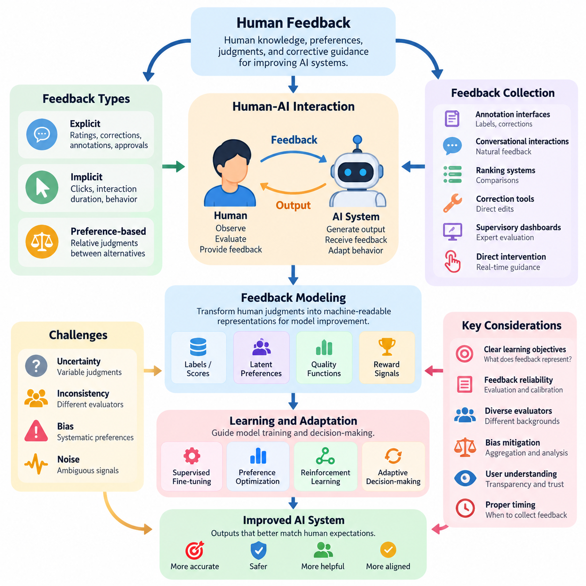
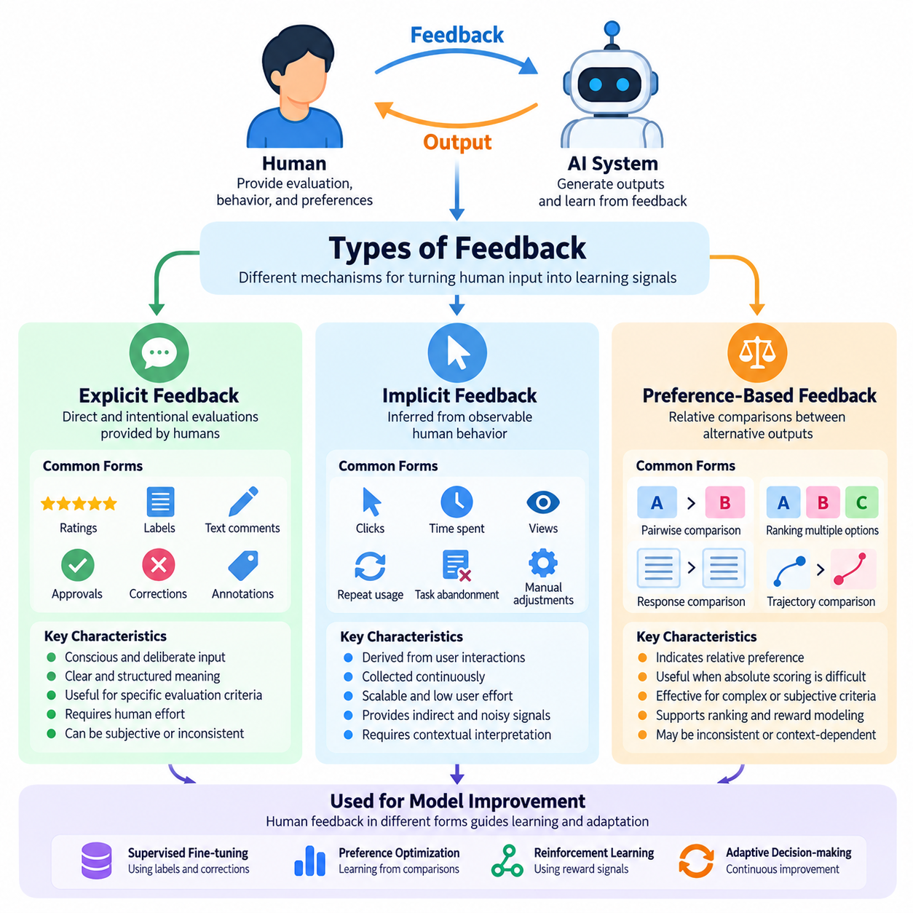
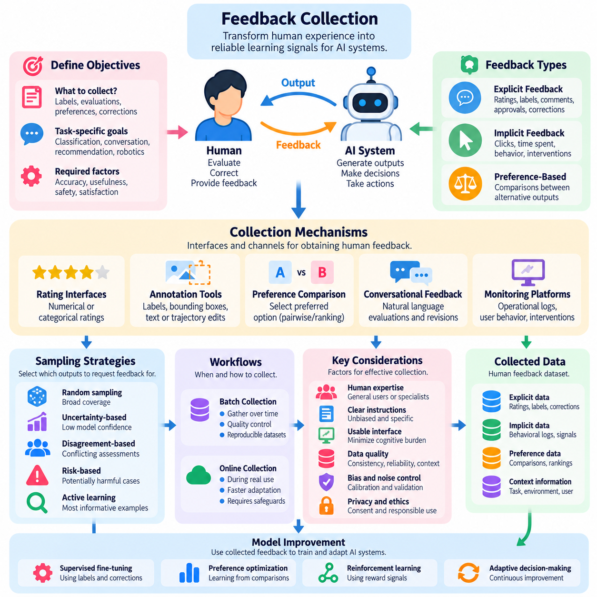
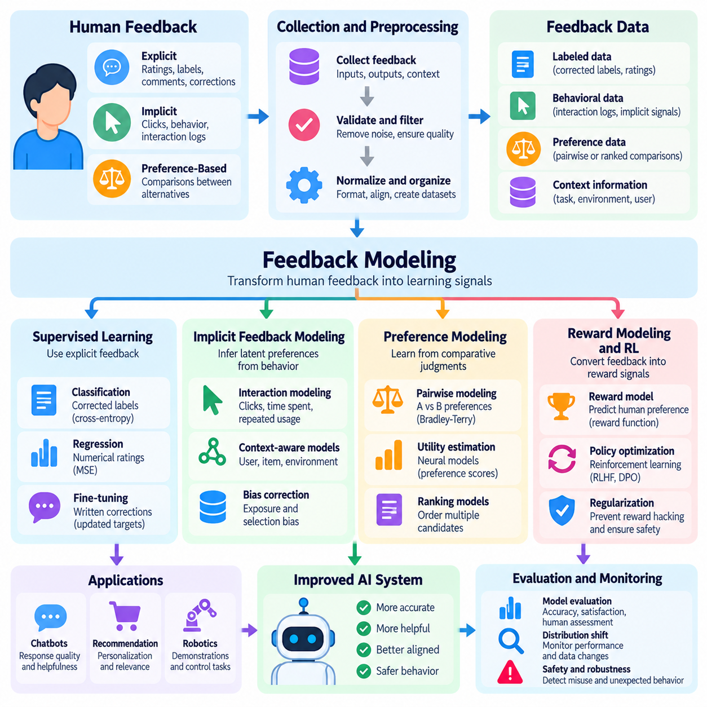
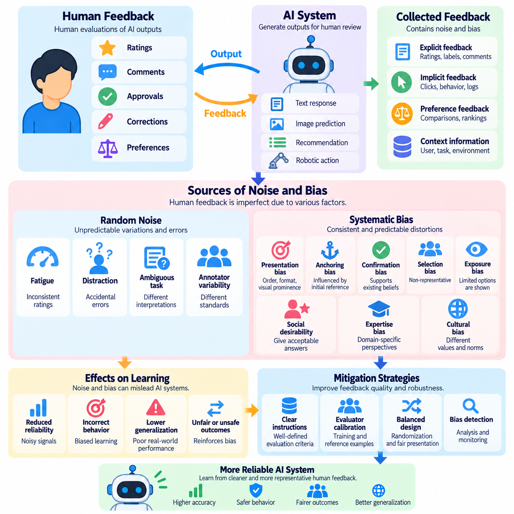
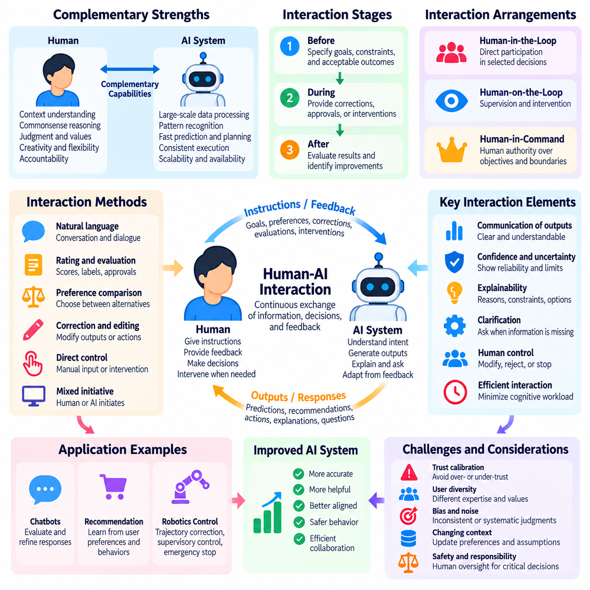
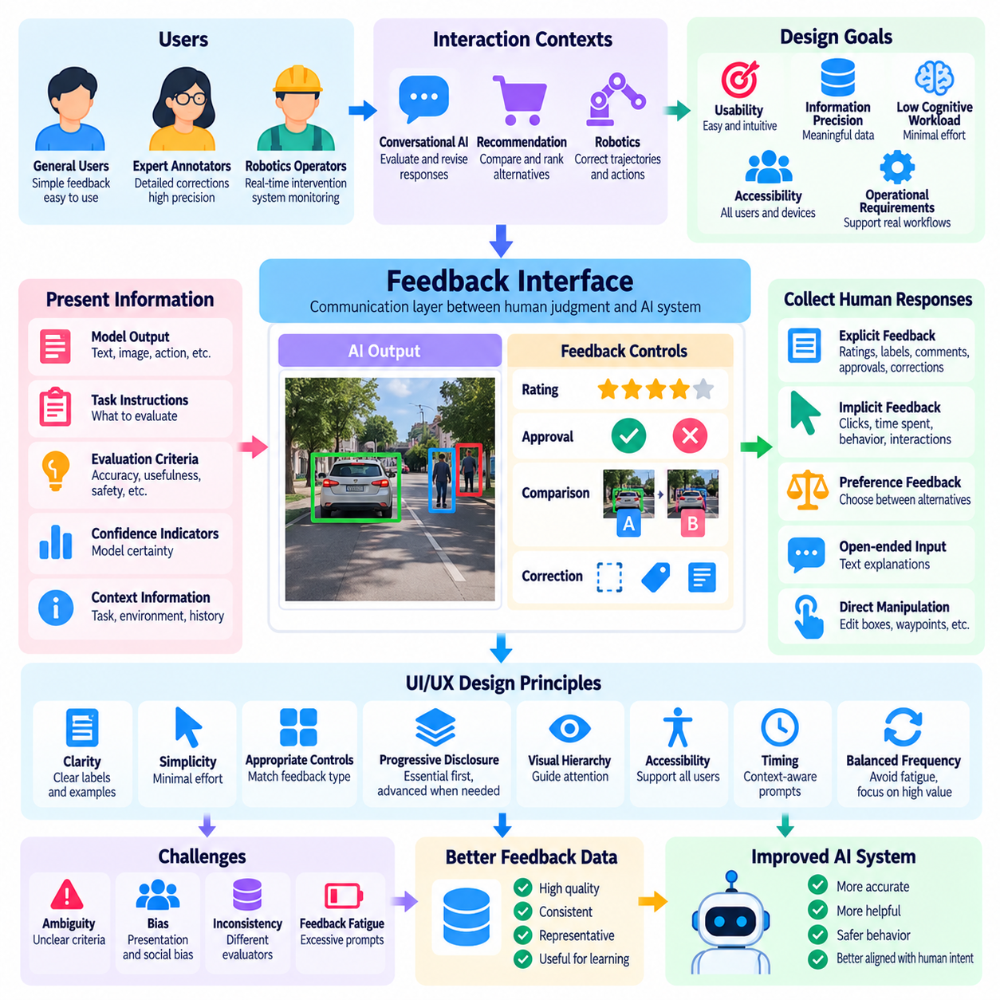
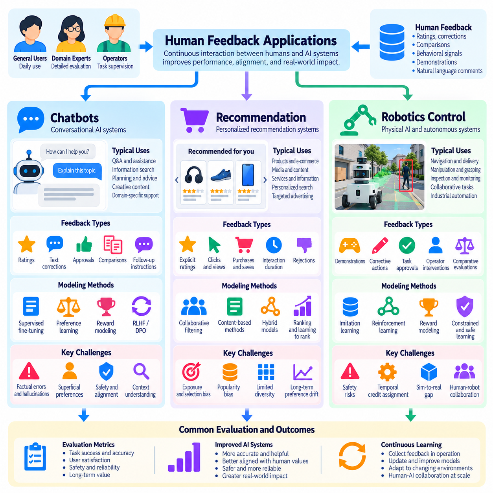

**Volume 41. Human in the Loop Learning**

# 02. Human Feedback

## 02.00 Overview

{width="7.268055555555556in" height="7.268055555555556in"}

인간 피드백(Human Feedback)은 인간의 지식(Knowledge), 선호도(Preferences), 판단(Judgments), 교정 지침(Corrective Guidance)을 학습 과정(Learning Process)에 통합하여 인공지능(AI) 시스템을 개선하는 핵심 메커니즘이다. 주로 사전에 정의된 데이터셋(Dataset)과 목적 함수(Objective Function)에 의존하는 기존 머신러닝(Machine Learning)과 달리, 인간 피드백은 수학적 규칙이나 정적인 레이블(Static Labels)로 표현하기 어려운 인간의 기대와 요구사항에 모델이 적응할 수 있도록 한다.

인간 피드백의 핵심 목적은 기계가 생성한 출력(Machine-Generated Outputs)과 인간의 기대(Human Expectations) 사이의 격차를 줄이는 것이다. AI 모델은 높은 예측 정확도(Predictive Accuracy)를 달성하더라도 부적절하거나 이해하기 어렵고, 안전하지 않거나 사용자의 의도(User Intentions)와 일치하지 않는 응답을 생성할 수 있다. 인간의 평가(Human Evaluations)는 이러한 한계에 관한 추가 정보를 제공하며, 개발자가 기존 성능 지표(Performance Metrics)를 넘어 모델의 행동(Model Behavior)을 개선할 수 있도록 지원한다.

인간 피드백은 인간 참여형 학습(Human-in-the-Loop Learning, HITL)에서 필수적인 역할을 수행하며, 인간 참여자(Human Participants)는 학습(Training), 평가(Evaluation), 운영 의사결정(Operational Decision-Making)에 적극적으로 기여한다. 이러한 접근 방식은 인간을 단순한 데이터 제공자(Data Provider)로 취급하는 대신, 인간의 전문성이 모델 개발에 영향을 미치는 상호작용 관계(Interactive Relationship)를 구축한다. 피드백은 초기 학습, 반복적인 개선(Iterative Refinement), 실제 배포(Deployment) 과정에서 수집될 수 있다.

피드백 프로세스(Feedback Process)는 일반적으로 AI 시스템이 예측(Prediction), 추천(Recommendation), 의사결정(Decision) 또는 행동(Action)을 생성하면서 시작된다. 인간 참여자는 결과를 관찰하고 정확성(Correctness), 유용성(Usefulness), 품질(Quality), 적합성(Suitability)에 관한 정보를 제공한다. 이러한 정보는 기록된 후 모델 개선, 평가 또는 운영상 교정에 활용할 수 있는 표현(Representation)으로 변환되며, 인간과 기계 사이의 반복적인 상호작용을 형성한다.

인간 피드백은 명시적 피드백(Explicit Feedback), 암묵적 피드백(Implicit Feedback), 선호도 기반 피드백(Preference-Based Feedback)으로 분류할 수 있다. 명시적 피드백은 평점(Ratings), 수정(Corrections), 주석(Annotations), 승인 결정(Approval Decisions)과 같은 의도적인 평가를 포함한다. 암묵적 피드백은 클릭(Clicks), 상호작용 시간(Interaction Duration), 반복 요청(Repeated Requests), 작업 완료 패턴(Task Completion Patterns) 등 관찰 가능한 행동에서 추론된다. 선호도 기반 피드백은 대안적인 출력이나 행동 사이의 상대적 판단(Relative Judgments)을 나타낸다.

이러한 피드백 유형은 서로 다른 수준의 정보와 신뢰성(Reliability)을 제공한다. 명시적 평가는 대체로 명확한 판단을 전달하지만 추가적인 인간의 노력이 필요하다. 암묵적 신호(Implicit Signals)는 정상적인 시스템 운영 과정에서 지속적으로 수집할 수 있지만, 그 해석에는 모호성이 존재할 수 있다. 선호도 기반 비교(Preference-Based Comparison)는 절대적인 수치 점수(Absolute Numerical Score)를 부여하는 것보다 상대적인 품질을 평가하는 것이 쉬운 상황에서 특히 유용하다.

효과적인 피드백 수집(Feedback Collection)을 위해서는 인간 참여자와 AI 시스템 사이의 상호작용을 신중하게 설계해야 한다. 수집 메커니즘(Collection Mechanisms)은 불필요한 노력, 작업 중단, 인지적 부담(Cognitive Burden)을 최소화하면서 관련 정보를 확보해야 한다. 응용 분야에 따라 주석 인터페이스(Annotation Interfaces), 대화형 상호작용(Conversational Interactions), 순위 평가 시스템(Ranking Systems), 수정 도구(Correction Tools), 감독 대시보드(Supervisory Dashboards), 자율 운영 중 직접 개입(Direct Intervention) 등을 통해 피드백을 수집할 수 있다.

피드백 모델링(Feedback Modeling)은 인간의 판단을 머신러닝 알고리즘(Machine Learning Algorithms)이 처리할 수 있는 표현으로 변환하는 과정이다. 단순한 시스템은 평가 결과를 분류 레이블(Classification Labels)이나 수치 점수(Numerical Scores)로 변환할 수 있으며, 고급 접근 방식은 잠재 선호도(Latent Preferences), 품질 함수(Quality Functions), 보상 신호(Reward Signals)를 추정한다. 이러한 표현은 지도 미세조정(Supervised Fine-Tuning), 선호도 최적화(Preference Optimization), 강화학습(Reinforcement Learning), 적응형 의사결정(Adaptive Decision-Making)을 지원한다.

피드백 모델링의 효과는 수집된 신호와 의도한 학습 목표(Learning Objectives) 사이의 관계에 따라 결정된다. 수치 평점은 편리한 최적화 목표(Optimization Target)를 제공할 수 있지만, 인간 판단의 모든 차원을 반드시 포착하는 것은 아니다. 개발자는 피드백을 학습에 반영하기 전에 해당 피드백이 정확성(Correctness), 만족도(Satisfaction), 안전성(Safety), 효율성(Efficiency), 공정성(Fairness) 또는 이러한 목표의 조합 중 무엇을 나타내는지 고려해야 한다.

인간 피드백은 본질적으로 불확실성(Uncertainty), 비일관성(Inconsistency), 편향(Bias)의 영향을 받는다. 평가자마다 전문성(Expertise), 경험(Experience), 기대(Expectations), 문화적 배경(Cultural Context)이 다르기 때문에 동일한 출력을 서로 다르게 해석할 수 있다. 동일한 평가자도 반복 평가에서 일관되지 않은 판단을 내릴 수 있다. 이러한 변동성(Variability)은 데이터셋 구축, 피드백 신뢰성 추정, 평가 결과 해석 과정에서 반드시 고려해야 한다.

잡음(Noise)과 편향(Bias)은 모호한 지침(Ambiguous Instructions), 부적절하게 설계된 인터페이스, 피로(Fatigue), 불완전한 정보(Incomplete Information), 체계적인 선호도(Systematic Preferences)를 통해 피드백 과정에 유입될 수 있다. 피드백 집계(Feedback Aggregation), 평가자 보정(Evaluator Calibration), 반복 평가(Repeated Assessment), 불일치 분석(Disagreement Analysis)은 이러한 문제를 식별하는 데 도움이 된다. 그러나 평가자들이 유사한 가정을 공유하거나 제한된 집단을 대표하는 경우, 판단을 평균화하는 것만으로 편향이 자동으로 제거되지는 않는다.

인간-AI 상호작용(Human-AI Interaction)은 피드백이 얼마나 효과적으로 전달되고 시스템 행동에 반영되는지를 결정한다. 성공적인 상호작용에는 단순히 수정 사항을 입력받는 메커니즘 이상의 요소가 필요하다. 사용자는 시스템이 수행하려는 작업, 수정할 수 있는 출력의 범위, 자신의 피드백이 이후 행동에 영향을 미칠 수 있는 방식을 이해해야 한다. 투명성(Transparency)과 예측 가능한 상호작용 패턴(Predictable Interaction Patterns)은 적절한 신뢰(Trust)를 유지하는 데 중요하다.

사용자 인터페이스(User Interface, UI)와 사용자 경험(User Experience, UX) 설계는 피드백 품질에 직접적인 영향을 미친다. 과도한 주의를 요구하는 인터페이스는 참여를 저해할 수 있으며, 지나치게 단순화된 제어 기능은 의미 있는 차이를 포착하지 못할 수 있다. 효과적인 피드백 인터페이스는 표현력(Expressiveness), 접근성(Accessibility), 응답 시간(Response Time), 인지적 노력(Cognitive Effort) 사이의 균형을 유지해야 한다. 상황별 설명(Contextual Explanations), 신뢰도 표시(Confidence Indicators), 수정 옵션(Correction Options), 명확한 확인 메커니즘(Confirmation Mechanisms)은 수집된 판단의 유용성을 높일 수 있다.

피드백 시점(Feedback Timing) 역시 중요한 설계 고려사항이다. 즉각적인 피드백(Immediate Feedback)은 특히 변화하는 환경에서 시스템이 작동할 때 신속한 수정과 상호작용형 적응(Interactive Adaptation)을 지원할 수 있다. 지연 피드백(Delayed Feedback)은 장기적인 결과(Long-Term Outcomes)나 복잡한 작업을 평가할 때 더 적합할 수 있다. 즉각적인 평가와 지연 평가 사이의 선택은 피드백 해석, 학습 효율성(Learning Efficiency), 특정 행동과 판단을 연결하는 시스템의 능력에 영향을 미친다.

인간 피드백은 학습 성능(Learning Performance)과 운영 비용(Operational Cost) 사이의 중요한 상충관계(Tradeoffs)도 발생시킨다. 전문가 평가(Expert Evaluations)는 높은 품질의 정보를 제공할 수 있지만 비용이 많이 들고 대규모로 확보하기 어려울 수 있다. 대규모 참여는 피드백의 양을 증가시키지만 추가적인 변동성을 유발할 수 있다. 따라서 효율적인 시스템은 정보 가치가 높은 상호작용을 우선시하고, 불확실성, 작업 중요도(Task Importance), 예상 개선 효과(Expected Improvement), 잠재적 위험(Potential Risk)에 따라 인간의 주의를 배분한다.

대화형 인공지능(Conversational AI)에서 인간 피드백은 응답 관련성(Response Relevance), 지시 이행(Instruction Following), 명확성(Clarity), 적절성(Appropriateness)을 개선하는 데 도움이 된다. 사용자는 사실적 오류(Factual Errors)를 수정하거나 대안적인 응답 사이의 선호도를 표현하고, 답변이 자신의 요구를 충족하는지 평가할 수 있다. 이러한 신호는 응답 생성(Response Generation)과 평가의 개선을 지원하지만, 사용자 만족도만으로 사실적 정확성(Factual Correctness)이 확정되었다고 판단해서는 안 된다.

추천 시스템(Recommendation Systems)은 인간 피드백을 활용하여 개인의 선호도와 변화하는 관심사에 맞게 추천 결과를 조정한다. 명시적 평점과 비교 선택(Comparative Choices)은 사용자 만족도에 관한 직접적인 정보를 제공하며, 상호작용 이력(Interaction Histories)은 간접적인 행동 신호(Behavioral Signals)를 제공한다. 이러한 정보원을 결합하면 개인화(Personalization)를 개선할 수 있지만, 시스템은 실제 선호도와 일시적인 행동, 인터페이스 효과(Interface Effects), 노출에 따른 선택 패턴(Exposure-Driven Selection Patterns)을 구분해야 한다.

로봇 제어(Robotics Control)에서 인간 피드백은 교정 시연(Corrective Demonstrations), 궤적 평가(Trajectory Evaluations), 개입 명령(Intervention Commands), 작업 실행 평가(Task Execution Assessments) 등의 형태로 제공될 수 있다. 인간 운영자(Human Operator)는 안전하지 않은 움직임, 비효율적인 조작 전략(Manipulation Strategies), 운영상 기대를 위반하는 내비게이션 결정(Navigation Decisions)을 식별할 수 있다. 이러한 피드백은 학습된 제어 정책(Control Policies)을 시뮬레이션 환경이나 사전에 정의된 보상 함수(Reward Functions)에 완전히 반영되지 않은 실제 요구사항과 연결하는 데 도움이 된다.

피지컬 AI(Physical AI) 시스템은 피드백이 연속적인 행동(Continuous Actions), 공간적 관계(Spatial Relationships), 물리적 제약(Physical Constraints), 지연된 결과(Delayed Consequences)와 관련될 수 있기 때문에 추가적인 과제를 수반한다. 로봇은 작업을 성공적으로 완료하더라도 과도한 힘을 사용하거나 장애물에 지나치게 접근하고, 허용할 수 없는 운영 위험(Operational Risk)을 발생시킬 수 있다. 따라서 인간 평가는 실행 품질(Execution Quality), 안전 여유(Safety Margins), 작업 결과(Task Outcomes), 각 행동을 둘러싼 물리적 맥락(Physical Context)을 고려해야 한다.

인간 피드백은 인간 감독(Human Oversight)과도 구분해야 한다. 피드백은 주로 시스템 행동을 개선할 수 있는 정보를 제공하는 반면, 감독은 감시(Supervision), 승인(Authorization), 개입(Intervention), 책임성(Accountability)을 위한 메커니즘을 확립한다. 두 기능은 상호보완적이며, 특히 안전 필수 응용 분야(Safety-Critical Applications)에서 중요하다. 시스템은 운영자의 수정 사항으로부터 학습하면서도 독립적인 안전 제약(Safety Constraints)과 중대한 의사결정에 대한 인간의 통제 권한(Human Authority)을 유지해야 할 수 있다.

개인정보 보호(Privacy), 동의(Consent), 데이터 거버넌스(Data Governance)는 피드백에 개인정보(Personal Information), 행동 기록(Behavioral Records), 민감한 운영 관찰 정보(Sensitive Operational Observations)가 포함될 때 필수적이다. 조직은 피드백의 수집, 저장, 접근, 보존에 관한 명확한 정책을 수립해야 한다. 적절한 보호 조치(Safeguards)는 피드백 조작(Feedback Manipulation), 무단 공개(Unauthorized Disclosure), 참여자가 합리적으로 예상하지 못한 목적으로 수집 정보를 사용하는 행위를 방지하는 데에도 도움이 된다.

인간 피드백 시스템을 평가하려면 모델 개선(Model Improvement)과 이를 달성하는 데 필요한 인간의 노력(Human Effort)을 함께 검토해야 한다. 관련 평가 요소에는 피드백 일관성(Feedback Consistency), 주석 비용(Annotation Cost), 응답 품질(Response Quality), 수정 효과(Correction Effectiveness), 사용자 만족도(User Satisfaction), 후속 작업 성능(Downstream Task Performance)의 변화가 포함된다. 또한 평가에서는 개발 과정에 참여한 특정 평가자, 작업, 상호작용 조건을 넘어 개선 효과가 일반화(Generalization)되는지 조사해야 한다.

지속적인 피드백 통합(Continuous Feedback Integration)은 인간의 판단을 운영 중인 머신러닝 워크플로(Machine Learning Workflows)와 연결한다. 수집된 피드백은 검증(Validation), 큐레이션(Curation), 버전 관리(Versioning)를 거쳐 주기적인 재학습(Periodic Retraining)이나 신중하게 통제되는 온라인 적응(Online Adaptation)에 반영될 수 있다. 성능 저하(Performance Degradation), 의도하지 않은 행동 변화(Unintended Behavioral Changes), 피드백 분포 변화(Feedback Distribution Shifts)를 탐지하기 위한 모니터링(Monitoring)이 필요하다. 모든 개별 수정 사항이 즉각적인 모델 업데이트(Model Update)로 자동 연결되어서는 안 된다.

성숙한 인간 피드백 프레임워크(Human Feedback Framework)는 인간의 참여를 비공식적인 의견 수집이 아니라 구조화된 학습 신호(Structured Learning Signals)의 원천으로 취급한다. 이 프레임워크는 피드백 수집, 표현, 품질 평가(Quality Assessment), 상호작용 설계(Interaction Design), 평가를 일관된 개선 프로세스(Improvement Process) 안에서 조정한다. 이러한 기반은 인간 피드백 기반 강화학습(Reinforcement Learning from Human Feedback, RLHF), 상호작용형 학습(Interactive Learning), 하이브리드 지능(Hybrid Intelligence), 협력적 인간-AI 시스템(Collaborative Human-AI Systems)과 같은 고급 접근 방식을 지원한다.

궁극적으로 인간 피드백은 AI 개발이 개별적인 통계적 목표(Statistical Objectives)를 최적화하는 수준을 넘어 인간의 의도(Human Intentions)와 운영 요구사항(Operational Requirements)을 더욱 충실하게 반영하는 시스템으로 발전하도록 한다. 인간 피드백의 가치는 단순히 수집된 판단의 양이 아니라 관련성(Relevance), 신뢰성(Reliability), 해석(Interpretation), 학습 과정으로의 통합(Integration)에 달려 있다. 잘 설계된 피드백 메커니즘은 적응형(Adaptive), 책임성 있는(Accountable), 인간 중심(Human-Centered) 인공지능을 구현하기 위한 기반을 형성한다.

## 02.01 Types of Feedback

{width="7.268055555555556in" height="7.268055555555556in"}

인간 피드백(Human Feedback)은 명시적 피드백(Explicit Feedback), 암묵적 피드백(Implicit Feedback), 선호도 기반 피드백(Preference-Based Feedback)의 세 가지 기본 유형으로 분류할 수 있다. 각 유형은 인간의 판단(Judgments), 행동(Behaviors), 선호도(Preferences)가 인공지능(AI) 시스템의 학습 신호(Learning Signals)로 전환되는 서로 다른 메커니즘을 나타낸다. 이러한 차이를 이해하는 것은 정보 품질(Information Quality), 사용자 노력(User Effort), 확장성(Scalability), 학습 효과(Learning Effectiveness) 사이의 균형을 유지하는 피드백 수집 프로세스(Feedback Collection Process)를 설계하는 데 필수적이다.

명시적 피드백(Explicit Feedback)은 인간 참여자가 AI 시스템을 평가(Evaluate), 수정(Correct), 지도(Guide)하기 위해 의도적으로 제공하는 정보를 의미한다. 참여자는 평점(Ratings), 레이블(Labels), 텍스트 의견(Textual Comments), 승인 결정(Approval Decisions), 교정 지침(Corrective Instructions)을 통해 자신의 평가를 명확하게 전달한다. 피드백이 직접 표현되므로 의도된 의미를 행동 신호(Behavioral Signals)보다 쉽게 해석할 수 있는 경우가 많지만, 주관적인 판단(Subjective Judgments)과 비일관성(Inconsistencies)은 여전히 발생할 수 있다.

명시적 피드백의 일반적인 형태는 사용자가 사전에 정의된 척도(Predefined Scale)를 사용하여 출력을 평가하는 수치 평점(Numerical Rating)이다. 예를 들어 대화형 인공지능(Conversational AI)의 응답에는 만족도 점수(Satisfaction Score)가 부여될 수 있으며, 산업 검사 시스템(Industrial Inspection System)에는 운영자가 지정한 품질 평점(Quality Rating)이 적용될 수 있다. 이러한 평가는 다양한 운영 조건(Operating Conditions)에서 통계 분석(Statistical Analysis), 지도학습(Supervised Learning), 모델 비교(Model Comparison)를 지원하는 구조화된 정보(Structured Information)를 제공한다.

명시적 피드백에는 오류를 식별하고 바람직한 대안을 제공하는 교정 주석(Corrective Annotations)도 포함된다. 컴퓨터 비전(Computer Vision)에서는 주석 작업자(Annotator)가 객체 범주(Object Category)나 경계 상자(Bounding Box)를 수정할 수 있다. 자연어 처리(Natural Language Processing)에서는 검토자가 부정확한 답변을 수정할 수 있다. 로봇공학(Robotics)에서는 운영자가 계획된 궤적(Planned Trajectory)을 조정하거나 안전하지 않은 행동(Unsafe Action)을 식별할 수 있다. 이러한 수정은 실제 행동과 목표 행동 사이의 차이에 관한 구체적인 정보를 제공한다.

명시적 피드백의 주요 장점은 인간의 평가 기준(Human Evaluation Criteria)과 직접적으로 연결된다는 점이다. 개발자는 정확성(Accuracy), 유용성(Usefulness), 안전성(Safety), 작업 완료(Task Completion)와 같은 특정 차원을 포착하도록 질문과 인터페이스를 설계할 수 있다. 그러나 명시적 피드백은 의도적인 참여를 요구하며 상당한 인지적 노력(Cognitive Effort)을 발생시킬 수 있다. 신뢰성(Reliability)은 명확한 지침(Clear Instructions), 평가자의 전문성(Evaluator Expertise), 일관된 해석(Consistent Interpretation), 적절한 수집 조건(Collection Conditions)에 따라 달라진다.

암묵적 피드백(Implicit Feedback)은 직접적으로 표현된 평가가 아니라 인간의 행동에서 추출되는 정보이다. 이는 관찰 가능한 상호작용(Observable Interactions)이 사용자의 관심사(User Interests), 만족도(Satisfaction), 의도(Intentions)에 관한 정보를 드러낼 수 있다고 가정한다. 예를 들어 추천 항목 클릭(Recommendation Click), 대화 지속(Conversation Continuation), 작업 포기(Task Abandonment), 생성 결과 수정(Generated Result Modification), 대안 반복 요청(Repeated Alternative Requests) 등이 포함된다. 이러한 행동 관찰은 사용자가 공식적인 평가를 수행하지 않아도 학습 신호를 제공할 수 있다.

암묵적 피드백은 사용자 상호작용(User Interactions)이 빈번하게 발생하는 시스템에서 특히 유용하다. 추천 플랫폼(Recommendation Platforms)은 탐색 패턴(Browsing Patterns), 선택 빈도(Selection Frequency), 참여 시간(Engagement Duration)을 관찰할 수 있으며, 대화형 시스템(Conversational Systems)은 후속 요청(Follow-Up Requests)과 수정 행동(Correction Behavior)을 분석할 수 있다. 산업용 AI(Industrial AI) 시스템은 운영자의 제어 개입(Operator Overrides), 수동 조정(Manual Adjustments), 작업 흐름 중단(Workflow Interruptions)을 기록할 수 있다. 이러한 관찰은 간헐적인 명시적 평가만으로 포착하기 어려운 패턴을 식별하는 데 도움이 된다.

암묵적 피드백은 확장성이라는 장점이 있지만 해석 측면에서 상당한 어려움이 존재한다. 사용자는 실제로 선호하기 때문이 아니라 화면에서 눈에 잘 띄는 위치에 표시되었다는 이유로 항목을 클릭할 수 있다. 긴 상호작용 시간(Long Interaction Duration)은 만족, 혼란 또는 작업 완료의 어려움을 의미할 수 있다. 마찬가지로 수정 행동이 없다는 사실이 반드시 승인을 의미하지는 않는다. 따라서 행동 신호는 운영 맥락(Operational Context)과 상호작용 맥락(Interaction Context)을 고려하여 해석해야 한다.

암묵적 피드백 모델링(Implicit Feedback Modeling)은 관찰된 행동과 직접 관찰할 수 없는 선호도(Unobserved Preferences) 또는 만족도 사이의 관계를 추정하는 경우가 많다. 통계 모델(Statistical Models)은 상호작용 빈도(Interaction Frequency), 위치 편향(Position Bias), 노출 확률(Exposure Probability), 상황 변수(Contextual Variables)를 고려할 수 있다. 머신러닝 시스템은 여러 행동 지표(Behavioral Indicators)를 결합하여 참여도(Engagement)나 작업 성공(Task Success)을 추정할 수 있다. 그러나 추론된 선호도(Inferred Preferences)에는 불확실성이 존재하므로 인간의 의도가 직접 표현된 것으로 자동 간주해서는 안 된다.

선호도 기반 피드백(Preference-Based Feedback)은 대안적인 출력, 의사결정 또는 행동 사이의 상대적인 바람직함(Relative Desirability)에 관한 인간의 판단을 포착한다. 참여자는 절대적인 점수(Absolute Score)를 부여하는 대신 두 개 이상의 후보(Candidates)를 비교하고 더 선호하는 대안을 선택한다. 이 접근 방식은 평가 기준(Evaluation Criteria)이 복잡하거나 정량화하기 어려울 때 유용하다. 상대 비교(Relative Comparisons)는 참여자가 이상적인 수치 평점을 일관되게 정의하지 못하더라도 의미 있는 차이를 드러낼 수 있다.

일반적인 쌍별 선호도 평가(Pairwise Preference Evaluation)에서는 참여자가 두 개의 후보 응답(Candidate Responses)을 검토하고 더 나은 대안을 선택한다. 비교 기준에는 사실적 정확성(Factual Accuracy), 명확성(Clarity), 유용성(Helpfulness), 안전성(Safety), 전반적인 품질(Overall Quality)이 포함될 수 있다. 로봇공학에서는 평가자가 대안적인 조작 궤적(Manipulation Trajectories)이나 내비게이션 전략(Navigation Strategies)을 비교할 수 있다. 이러한 판단은 순위 모델(Ranking Models), 보상 추정(Reward Estimation), 정책 개선(Policy Improvement)을 지원하는 선호도 데이터셋(Preference Datasets)을 생성한다.

선호도 기반 피드백은 인간의 판단에 따라 행동을 최적화하는 학습 시스템과 밀접하게 연관된다. 선호도 모델(Preference Model)은 하나의 후보가 다른 후보보다 선택될 확률(Selection Probability)을 추정할 수 있다. 보상 모델(Reward Models)은 비교 평가(Comparative Evaluations)를 강화학습(Reinforcement Learning)에 사용할 수 있는 스칼라 신호(Scalar Signals)로 변환할 수 있다. 이러한 방법은 정성적인 인간 평가(Qualitative Human Assessments)와 정량적인 최적화 목표(Quantitative Optimization Objectives)를 연결하는 실용적인 수단을 제공한다.

그러나 선호도 기반 피드백에도 한계가 존재한다. 인간의 선호도는 일관되지 않거나 상황에 따라 달라질 수 있으며, 제시 순서(Presentation Order)의 영향을 받을 수도 있다. 참여자는 명확성 측면에서는 하나의 응답을 선호하지만 정확성 측면에서는 다른 응답을 선호할 수 있으므로 전체적인 선택이 모호해질 수 있다. 또한 쌍별 비교는 독립적으로 보정된 품질 측정값(Independently Calibrated Quality Measure)이 아니라 상대적인 정보를 제공한다. 이러한 판단을 신뢰성 있게 해석하려면 신중한 실험 설계(Experimental Design)가 필요하다.

세 가지 피드백 유형은 수집 비용(Collection Cost), 해석 가능성(Interpretability), 정보 밀도(Information Density) 측면에서 차이가 있다. 명시적 피드백은 의도된 평가를 직접 전달하지만 적극적인 참여가 필요하다. 암묵적 피드백은 상대적으로 낮은 상호작용 부담(Interaction Burden)으로 지속적으로 수집할 수 있지만 불확실성이 더 크다. 선호도 기반 피드백은 구조화된 비교 판단(Structured Comparative Judgments)을 제공하지만 후보의 다양성(Candidate Diversity)이 증가함에 따라 필요한 비교 횟수가 크게 늘어날 수 있다.

피드백 유형의 선택은 학습 목표(Learning Objective)와 응용 환경(Application Environment)에 따라 결정해야 한다. 정확한 오류 수정(Error Correction)이 필요한 경우 명시적 주석(Explicit Annotations)이 가장 적합할 수 있다. 대규모 행동 적응(Large-Scale Behavioral Adaptation)이 중요한 경우 암묵적 관찰(Implicit Observations)이 유용한 정보를 제공할 수 있다. 주관적인 품질(Subjective Quality)이나 복잡한 행동(Complex Behavior)을 최적화하는 경우 선호도 비교(Preference Comparisons)가 절대 평점(Absolute Ratings)보다 더 많은 정보를 제공할 수 있다. 모든 상황에서 보편적으로 우수한 단일 피드백 유형은 존재하지 않는다.

하이브리드 피드백 시스템(Hybrid Feedback Systems)은 여러 유형을 결합하여 개별적인 한계를 보완한다. 추천 시스템은 탐색 행동(Browsing Behavior)을 활용하여 후보 선호도(Candidate Preferences)를 식별하고, 명시적 평점을 통해 이를 검증할 수 있다. 대화형 어시스턴트(Conversational Assistant)는 응답 비교(Response Comparisons)와 사용자 수정(User Corrections)을 결합할 수 있다. 로봇 시스템은 운영자 개입(Operator Interventions), 궤적 순위 평가(Trajectory Rankings), 작업 완료 관찰(Task Completion Observations)을 통합하여 허용 가능한 행동(Acceptable Behavior)을 더욱 풍부하게 표현할 수 있다.

피드백 출처(Feedback Sources)를 결합할 때는 신뢰성과 의미의 차이에 주의해야 한다. 명시적 수정 사항(Explicit Corrections)에 추론된 행동 선호도(Inferred Behavioral Preferences)와 반드시 동일한 가중치(Weight)를 부여할 필요는 없다. 선호도 판단은 객관적인 정확성(Objective Correctness)이 아니라 주관적인 품질을 반영할 수 있다. 피드백 융합 메커니즘(Feedback Fusion Mechanisms)은 신뢰도 추정치(Confidence Estimates)를 부여하고, 출처별 불확실성(Source-Specific Uncertainty)을 모델링하며, 관찰된 행동과 직접 표현된 평가 사이의 차이를 유지할 수 있다.

피드백 품질(Feedback Quality)은 시간적 맥락(Temporal Context)에 따라서도 달라진다. 인간의 선호도는 사용자가 경험을 축적하거나 새로운 조건에 직면하고 목표를 변경함에 따라 변화할 수 있다. 초기 상호작용에서 수집한 명시적 평점은 장기간 사용한 후의 평가와 다를 수 있다. 암묵적 행동은 일시적인 상황을 반영할 수 있으며, 비교 선호도(Comparative Preferences)는 제시된 대안에 따라 달라질 수 있다. 적응형 시스템(Adaptive Systems)은 개별적인 관찰에 과도하게 반응하지 않으면서 이러한 변화를 인식해야 한다.

안전 필수 응용 분야(Safety-Critical Applications)에서는 피드백 유형을 운영 위험(Operational Risk)에 따라 해석해야 한다. 안전하지 않은 로봇 행동에 대한 운영자의 명시적 거부(Explicit Rejection)는 중요한 안전 제약(Safety Constraint)을 나타낼 수 있지만, 개입이 없었다는 사실은 행동의 허용 가능성(Acceptability)에 관한 상대적으로 약한 증거만 제공한다. 선호도 순위(Preference Rankings)가 필수 안전 요구사항(Mandatory Safety Requirements)을 무효화해서는 안 된다. 인간 피드백은 시스템 행동을 개선할 수 있지만 독립적인 안전 메커니즘(Independent Safety Mechanisms)은 여전히 필요하다.

효과적인 피드백 시스템에는 의견 불일치(Disagreement)를 처리하는 메커니즘도 필요하다. 여러 평가자가 서로 충돌하는 명시적 평점을 제공하거나 서로 다른 대안을 선택할 수 있다. 이러한 불일치는 모호성(Ambiguity), 다양한 선호도(Diverse Preferences), 불충분한 작업 명세(Insufficient Task Specifications)를 드러낼 수 있다. 개발자는 상충하는 관찰을 자동으로 제거하는 대신 그 원인을 분석하고, 평가자 신뢰성(Evaluator Reliability)을 추정하며, 학습 과정에서 불확실성을 표현할 수 있다.

피드백 인터페이스(Feedback Interfaces)의 설계는 어떤 신호가 수집되고 그것이 인간의 의도를 얼마나 정확하게 반영하는지에 영향을 미친다. 명확한 평점 기준(Rating Criteria), 균형 잡힌 비교 제시(Balanced Comparison Presentation), 접근하기 쉬운 수정 도구(Accessible Correction Tools), 최소화된 상호작용 부담은 피드백의 유용성을 향상시킬 수 있다. 또한 인터페이스는 피상적인 응답(Superficial Responses)을 유도하거나 사용자의 선택을 조작하지 않도록 설계해야 한다. 따라서 피드백 수집은 머신러닝 문제인 동시에 인간-컴퓨터 상호작용(Human-Computer Interaction, HCI) 문제이기도 하다.

피드백 메커니즘(Feedback Mechanisms)의 평가는 수집된 관찰의 수량만을 고려해서는 안 된다. 중요한 평가 차원에는 주석 일관성(Annotation Consistency), 예측 타당성(Predictive Validity), 상호작용당 정보 획득량(Information Gained per Interaction), 수집 비용(Collection Cost), 후속 모델 개선(Downstream Model Improvement)이 포함된다. 통제 실험(Controlled Experiments)을 통해 서로 다른 피드백 전략(Feedback Strategies)의 학습 성능을 비교할 수 있다. 이러한 평가는 추가적인 피드백이 의미 있는 이점을 제공하는지, 아니면 단순히 데이터 양만 증가시키는지 판단하는 데 도움이 된다.

궁극적으로 명시적 피드백(Explicit Feedback), 암묵적 피드백(Implicit Feedback), 선호도 기반 피드백(Preference-Based Feedback)은 인간의 기대(Human Expectations)와 AI 행동(AI Behavior)에 관한 상호보완적인 관점을 제공한다. 명시적 피드백은 의도적인 판단(Deliberate Judgments)을 전달하고, 암묵적 피드백은 행동 패턴(Behavioral Patterns)을 드러내며, 선호도 기반 피드백은 상대적 평가(Relative Evaluations)를 포착한다. 이들을 효과적으로 통합하면 AI 시스템은 불확실성(Uncertainty), 주관적 변동성(Subjective Variation), 운영 제약(Operational Constraints), 지속적으로 변화하는 사용자 요구사항(User Requirements)을 고려하면서 인간과의 상호작용으로부터 학습할 수 있다.

## 02.02 Feedback Collection

{width="7.268055555555556in" height="7.268055555555556in"}

피드백 수집(Feedback Collection)은 인간 참여형 학습(Human-in-the-Loop Learning)의 핵심 구성 요소로, 인공지능(AI) 시스템이 인간의 판단(Judgments), 수정(Corrections), 선호도(Preferences), 행동 관찰(Behavioral Observations)을 확보할 수 있도록 한다. 주요 목적은 인간의 경험(Human Experience)을 모델 개선(Model Improvement)에 활용할 수 있는 신뢰성 높은 학습 신호(Learning Signals)로 변환하는 것이다. 효과적인 피드백 수집을 위해서는 상호작용 설계(Interaction Design), 데이터 품질(Data Quality), 운영 제약(Operational Constraints), 학습 목표(Learning Objectives)를 종합적으로 고려해야 한다.

피드백 수집 시스템(Feedback Collection System)은 학습(Training), 평가(Evaluation), 배포(Deployment) 과정에서 인간 참여자와 AI 모델 사이의 의사소통을 구축한다. 시스템은 인간의 평가를 위해 출력(Outputs), 의사결정(Decisions), 행동(Actions)을 제시하고 그에 따른 응답을 기록한다. 이러한 관찰 결과는 정확성(Correctness), 유용성(Usefulness), 안전성(Safety), 만족도(Satisfaction), 선호 행동(Preferred Behavior)을 나타낼 수 있다. 수집 과정에서는 각 판단을 정확하게 해석할 수 있도록 충분한 맥락(Context)을 보존해야 한다.

피드백 수집은 학습 시스템이 어떤 정보를 필요로 하는지 정의하는 것에서 시작된다. 분류 모델(Classification Model)은 수정된 레이블(Corrected Labels)이 필요할 수 있으며, 대화형 어시스턴트(Conversational Assistant)는 응답 평가(Response Evaluations)나 비교 선호도(Comparative Preferences)가 필요할 수 있다. 로봇 시스템(Robotics Systems)은 궤적 수정(Trajectory Corrections), 개입 신호(Intervention Signals), 작업 결과 평가(Task Outcome Assessments)를 요청할 수 있다. 명확하게 정의된 목표는 불필요한 수집을 방지하고 인간의 노력이 의미 있는 개선에 기여하도록 한다.

피드백 수집 메커니즘(Collection Mechanisms)에는 일반적으로 구조화된 평점 인터페이스(Structured Rating Interfaces), 주석 도구(Annotation Tools), 선호도 비교 시스템(Preference Comparison Systems), 대화형 피드백 채널(Conversational Feedback Channels), 운영 모니터링 플랫폼(Operational Monitoring Platforms)이 포함된다. 구조화된 인터페이스는 일관된 응답 형식을 제공하는 반면, 개방형 채널(Open-Ended Channels)은 참여자가 복잡한 관찰 내용을 전달할 수 있도록 한다. 메커니즘의 선택은 작업 복잡도(Task Complexity), 평가자 전문성(Evaluator Expertise), 상호작용 빈도(Interaction Frequency), 요구되는 정밀도(Precision)에 따라 결정된다.

명시적 피드백 수집(Explicit Feedback Collection)은 참여자가 의도적으로 평가나 수정 사항을 전달하도록 요구한다. 사용자는 수치 점수(Numerical Scores)를 부여하거나 범주형 레이블(Categorical Labels)을 선택하고, 생성된 출력을 승인하거나 서면 설명(Written Explanations)을 제공할 수 있다. 이러한 메커니즘은 인간의 판단에 관한 비교적 직접적인 정보를 제공한다. 그러나 효과는 이해하기 쉬운 지침(Understandable Instructions), 적절하게 설계된 응답 옵션(Response Options), 관리 가능한 평가 작업량(Evaluation Workloads)에 따라 달라진다.

암묵적 피드백 수집(Implicit Feedback Collection)은 공식적인 평가를 요구하지 않고 일반적인 시스템 상호작용 과정에서 발생하는 행동을 관찰한다. 예를 들어 사용자 선택(User Selections), 반복 요청(Repeated Requests), 작업 포기(Abandoned Tasks), 수동 수정(Manual Corrections), 운영자 개입(Operator Interventions) 등이 포함된다. 이러한 관찰은 상대적으로 적은 추가 노력으로 대량의 정보를 제공할 수 있다. 그러나 관찰된 행동이 항상 실제 선호도(Genuine Preferences)를 나타내는 것은 아니므로 행동 신호(Behavioral Signals)는 맥락에 따라 해석해야 한다.

선호도 기반 수집(Preference-Based Collection)은 대안적인 출력이나 행동을 제시하고 참여자가 선호하는 선택지를 식별하도록 요청한다. 쌍별 비교(Pairwise Comparisons)는 두 후보 중 하나를 선택하는 것이 절대 점수(Absolute Scores)를 부여하는 것보다 쉬울 수 있기 때문에 특히 널리 사용된다. 비교 판단(Comparative Judgments)은 순위 모델(Ranking Models)과 보상 추정(Reward Estimation)을 지원할 수 있다. 체계적인 평가 편향(Systematic Evaluation Bias)을 줄이기 위해서는 후보 선택(Candidate Selection)과 제시 순서(Presentation Order)를 통제해야 한다.

피드백 질문(Feedback Prompts)의 설계는 수집 품질(Collection Quality)에 큰 영향을 미친다. 질문은 특정 답변을 유도하지 않으면서 명확한 평가 기준(Evaluation Criteria)을 전달해야 한다. 모호한 질문(Ambiguous Prompts)은 참여자가 서로 다른 속성을 평가하도록 만들어 일관되지 않은 결과를 발생시킬 수 있다. 정확성(Accuracy), 명확성(Clarity), 안전성(Safety), 유용성(Usefulness)과 같은 평가 차원을 분리하면 해석 가능성(Interpretability)을 높일 수 있지만, 추가 질문은 각 평가에 필요한 시간을 증가시킨다.

피드백 인터페이스(Feedback Interfaces)는 학습에 필요한 정보를 유지하면서 인지적 부담(Cognitive Burden)을 최소화해야 한다. 단순한 제어 기능(Simple Controls)은 빈번한 평가에 적합하지만, 복잡한 작업에는 상세한 주석 환경(Detailed Annotation Environments)이 필요할 수 있다. 시각적 맥락(Visual Context), 설명 정보(Explanatory Information), 수정 미리보기(Correction Previews)는 참여자가 평가 작업을 이해하는 데 도움이 된다. 인터페이스 복잡도(Interface Complexity)는 요청된 판단의 중요도와 난이도에 비례해야 한다.

인간의 전문성(Human Expertise)은 수집 설계에서 또 다른 중요한 고려사항이다. 일반 사용자는 사용성(Usability)과 만족도(Satisfaction)에 관한 유용한 정보를 제공할 수 있지만, 전문적인 작업에는 숙련된 주석 작업자(Trained Annotators), 엔지니어(Engineers), 임상의(Clinicians), 로봇 운영자(Robotics Operators)가 필요할 수 있다. 평가자 선정(Evaluator Selection)은 목표 행동(Target Behavior)을 판단하는 데 필요한 지식을 반영해야 한다. 전문가 피드백(Expert Feedback)은 기술적 의사결정에 더 유용한 정보를 제공할 수 있지만 일반적으로 수집 비용(Collection Costs)이 더 높다.

피드백 샘플링(Feedback Sampling)은 어떤 모델 출력에 인간의 주의를 집중할지 결정한다. 무작위 샘플링(Random Sampling)은 광범위한 범위를 제공하는 반면, 불확실성 기반 선택(Uncertainty-Based Selection)은 모델의 신뢰도가 낮은 예측을 우선시한다. 불일치 기반 전략(Disagreement-Based Strategies)은 모델이나 평가자가 서로 다른 평가를 생성하는 사례를 식별한다. 위험 기반 샘플링(Risk-Based Sampling)은 잠재적으로 유해한 의사결정을 강조한다. 이러한 전략을 결합하면 정보 효율성(Information Efficiency)과 적용 범위(Coverage)를 개선할 수 있다.

능동학습(Active Learning)은 정보 가치가 높은 피드백 요청을 선택하기 위한 유용한 프레임워크(Framework)를 제공한다. 시스템은 모든 출력을 인간에게 평가하도록 요청하는 대신, 모델 개선에 상당한 기여를 할 것으로 예상되는 사례를 식별한다. 선택 기준에는 예측 불확실성(Predictive Uncertainty), 샘플 다양성(Sample Diversity), 예상 모델 변화(Expected Model Change), 운영 중요도(Operational Importance)가 포함될 수 있다. 이러한 접근 방식은 가치 있는 학습 기회를 유지하면서 불필요한 주석 작업(Annotation Effort)을 줄인다.

피드백 수집은 배치 방식(Batch Workflows) 또는 온라인 방식(Online Workflows)으로 운영될 수 있다. 배치 수집(Batch Collection)은 일정 기간 평가 결과를 모은 후 학습 데이터셋(Training Datasets)에 반영한다. 온라인 수집(Online Collection)은 지속적인 상호작용 과정에서 응답을 확보하며 더 빠른 적응(Faster Adaptation)을 지원할 수 있다. 배치 방식은 품질 관리(Quality Control)와 재현성(Reproducibility)을 단순화하는 반면, 온라인 방식은 응답성(Responsiveness)을 향상시키지만 불안정하거나 부적절한 업데이트를 방지하기 위한 더욱 강력한 보호 조치(Safeguards)가 필요하다.

피드백 시점(Feedback Timing)은 피드백 품질과 사용자 경험(User Experience)에 모두 영향을 미친다. 즉각적인 요청(Immediate Requests)은 관련 상호작용에 대한 기억이 생생할 때 관찰 내용을 확보할 수 있지만, 빈번한 중단은 생산성(Productivity)을 저하시킬 수 있다. 지연 평가(Delayed Assessments)는 참여자가 전체 작업 결과(Task Outcomes)를 고려하도록 하지만, 기억의 한계(Memory Limitations)로 인해 정확도가 낮아질 수 있다. 수집 일정(Collection Schedules)은 작업 지속 시간(Task Duration), 운영 긴급성(Operational Urgency), 평가자에게 요구되는 인지적 부담을 반영해야 한다.

고품질 피드백 기록(High-Quality Feedback Records)에는 단순한 판단값(Judgment Value) 이상의 정보가 필요하다. 관련 메타데이터(Metadata)에는 원본 입력(Original Input), 모델 출력(Model Output), 모델 버전(Model Version), 평가자 식별자 또는 가명(Evaluator Identifier or Pseudonym), 타임스탬프(Timestamp), 작업 맥락(Task Context), 수집 방법(Collection Method)이 포함될 수 있다. 이러한 정보는 재현성, 불일치 분석(Disagreement Analysis), 오류 조사(Error Investigation)를 지원한다. 데이터 최소화 원칙(Data Minimization Principles)에 따라 합법적이고 정당한 학습 및 평가 목적에 필요한 정보만 수집해야 한다.

피드백 검증(Feedback Validation)은 학습 파이프라인(Training Pipelines)에 데이터가 입력되기 전에 불완전하거나 일관되지 않고, 중복되거나 잠재적으로 신뢰할 수 없는 관찰 결과를 식별한다. 검증 절차(Validation Procedures)에는 형식 검사(Format Checks), 반복 평가(Repeated Assessments), 참조 예제(Reference Examples), 일관성 분석(Consistency Analysis)이 포함될 수 있다. 자동화된 검사(Automated Checks)는 구조적 문제(Structural Problems)를 탐지할 수 있지만, 주관적이거나 모호한 사례에는 인간 검토(Human Review)가 필요할 수 있다. 검증 과정에서는 실제 의견 불일치(Genuine Disagreement)와 수집 오류(Collection Errors)를 구분해야 한다.

평가자 간 일치도(Evaluator Agreement)는 수집된 판단의 일관성(Consistency)에 관한 정보를 제공한다. 일치도 지표(Agreement Measures)는 참여자들이 지침을 유사하게 해석하는지 보여줄 수 있지만, 높은 일치도가 반드시 정확성(Correctness)을 입증하는 것은 아니다. 낮은 일치도는 불명확한 기준(Unclear Criteria), 불충분한 전문성(Insufficient Expertise), 정당한 선호도 차이(Legitimate Preference Differences)를 나타낼 수 있다. 불일치를 조사하면 주석 지침(Annotation Guidelines)을 개선하고 데이터셋에 유지해야 할 불확실성(Uncertainty)을 식별할 수 있다.

수집 편향(Collection Bias)은 참여자 모집(Participant Recruitment), 작업 선택(Task Selection), 인터페이스 제시(Interface Presentation), 피드백 가용성(Feedback Availability)에서 발생할 수 있다. 참여도가 높은 사용자(Highly Engaged Users)는 가끔 사용하는 사용자보다 더 많은 평가를 제공하여 대표성이 부족한 데이터셋(Unrepresentative Dataset)을 형성할 수 있다. 어려운 사례(Difficult Examples)는 과소 보고될 수 있으며, 눈에 잘 띄는 대안은 불균형적으로 많은 관심을 받을 수 있다. 균형 잡힌 샘플링(Balanced Sampling)과 신중한 모니터링(Monitoring)은 이러한 왜곡(Distortions)을 줄이는 데 도움이 된다.

피드백 집계(Feedback Aggregation)는 여러 참여자나 수집 채널(Collection Channels)에서 확보한 관찰 결과를 결합한다. 단순한 방법으로는 다수결 투표(Majority Voting)나 평균 평점(Average Ratings)을 사용할 수 있으며, 고급 접근 방식은 평가자 신뢰성(Evaluator Reliability)과 작업 난이도(Task Difficulty)를 추정한다. 집계 과정에서는 서로 다른 판단이 모두 타당한 관점(Valid Perspectives)을 나타낼 가능성을 고려해야 한다. 학습 목표에 주관적인 선호도나 불확실한 조건이 포함되는 경우 불일치 정보(Disagreement Information)를 보존하는 것이 중요할 수 있다.

대화형 인공지능(Conversational AI)에서 피드백 수집에는 응답 평점(Response Ratings), 수정 제안(Suggested Corrections), 선호도 비교(Preference Comparisons), 후속 상호작용(Follow-Up Interactions)이 포함될 수 있다. 시스템은 답변이 유용하고 이해하기 쉬우며 사용자의 요청에 부합하는지에 관한 정보를 확보할 수 있다. 그러나 만족도 신호(Satisfaction Signals)는 사실 검증(Factual Verification)과 구분해야 한다. 일반 사용자가 정확성을 평가하기 어려운 경우에는 독립적인 증거(Independent Evidence)나 자격을 갖춘 검토자(Qualified Reviewers)가 필요할 수 있다.

추천 시스템(Recommendation Systems)에서는 명시적 평점(Explicit Ratings)과 선택(Selections), 탐색 패턴(Browsing Patterns), 반복 참여(Repeated Engagement) 등의 행동 관찰을 결합하여 피드백을 수집한다. 이러한 신호는 선호도 추정(Preference Estimation)과 개인화(Personalization)를 지원한다. 수집 메커니즘은 사용자가 실제로 접한 추천 항목에만 상호작용할 수 있다는 점에서 노출 편향(Exposure Bias)을 고려해야 한다. 또한 평가 과정에서는 단기적인 참여(Short-Term Engagement)와 장기적인 만족도(Long-Term Satisfaction)를 구분해야 한다.

로봇공학(Robotics) 응용 분야에는 물리적 행동(Physical Actions)과 운영 제약(Operational Constraints)을 표현할 수 있는 피드백 메커니즘이 필요하다. 운영자는 궤적(Trajectories)을 수정하거나 선호하는 움직임(Preferred Movements)을 시연하고, 안전하지 않은 행동(Unsafe Behaviors)을 식별하거나 작업 실행(Task Execution) 중 개입할 수 있다. 센서 관찰(Sensor Observations)과 실행 로그(Execution Logs)는 이러한 판단에 필요한 맥락을 제공한다. 피드백 기록은 인간의 평가를 관련 로봇 상태(Robot States), 행동(Actions), 환경 조건(Environmental Conditions)과 연결해야 한다.

안전 필수 시스템(Safety-Critical Systems)에서는 신뢰성 높은 보고(Reliable Reporting)와 신속한 개입(Rapid Intervention)을 우선시하는 수집 절차가 필요하다. 인간 피드백은 위험한 행동(Hazardous Behavior), 예상하지 못한 시스템 응답(Unexpected System Responses), 운영 제약 위반(Operational Constraint Violations)을 식별할 수 있다. 중요한 관찰 결과는 적절한 우선순위(Priority)와 추적 가능성(Traceability)을 확보하여 기록해야 한다. 그러나 피드백 수집이 독립적인 안전 제어(Independent Safety Controls), 비상 메커니즘(Emergency Mechanisms), 확립된 인간 승인 요구사항(Human Authorization Requirements)을 대체해서는 안 된다.

개인정보 보호(Privacy)와 보안(Security)은 피드백 수집 전 과정에서 필수적이다. 시스템은 수집 목적(Collection Purposes)을 명확하게 전달하고 적절한 동의(Consent)를 확보하며, 불필요한 개인정보(Personal Information)를 제한하고 저장된 기록(Stored Records)을 보호해야 한다. 접근 제어(Access Controls), 보존 정책(Retention Policies), 안전한 전송(Secure Transmission)은 무단 사용(Unauthorized Use)의 위험을 줄인다. 민감한 운영 환경(Sensitive Operational Environments)과 관련된 피드백에는 추가적인 보호 조치와 조직 차원의 거버넌스(Organizational Governance)가 필요할 수 있다.

피드백 수집의 효과는 정보 품질(Information Quality)과 운영 효율성(Operational Efficiency)을 모두 고려하여 평가해야 한다. 관련 지표에는 주석 시간(Annotation Time), 평가자 일관성(Evaluator Consistency), 수집 비용(Collection Cost), 피드백 적용 범위(Feedback Coverage), 후속 모델 개선(Downstream Model Improvement)이 포함된다. 여러 수집 전략(Collection Strategies)에서 이러한 지표를 비교하면 추가적인 인간의 노력이 의미 있는 학습 효과를 만들어내는지 판단할 수 있다. 수집량(Collection Volume)만으로는 성공 여부를 충분히 평가할 수 없다.

궁극적으로 피드백 수집(Feedback Collection)은 인간과의 상호작용(Human Interaction)을 인공지능 개발을 안내할 수 있는 구조화된 정보(Structured Information)로 변환한다. 성공적인 시스템은 명확한 목표(Clear Objectives), 적절한 인터페이스(Appropriate Interfaces), 정보 가치가 높은 샘플링(Informative Sampling), 품질 보증(Quality Assurance), 책임 있는 데이터 관리(Responsible Data Management)를 통합한다. 인간 판단의 의미와 맥락을 보존함으로써 피드백 수집은 신뢰성 높은 피드백 모델링(Feedback Modeling), 지속 학습(Continuous Learning), 효과적인 인간-AI 협업(Human-AI Collaboration)을 위한 기반을 확립한다.

## 02.03 Feedback Modeling [w/Code]

{width="7.268055555555556in" height="7.268055555555556in"}

피드백 모델링(Feedback Modeling)은 인간의 평가(Human Evaluations), 수정(Corrections), 선호도(Preferences), 행동 관찰(Behavioral Observations)을 인공지능(AI) 시스템이 학습할 수 있는 표현(Representations)으로 변환하는 과정이다. 이는 정성적인 인간 판단(Qualitative Human Judgments)과 정량적인 학습 목표(Quantitative Learning Objectives)를 연결한다. 효과적인 피드백 모델링을 위해서는 각 신호가 무엇을 나타내는지, 인간의 의도(Human Intentions)를 얼마나 신뢰성 있게 반영하는지, 그리고 모델의 예측(Predictions), 의사결정(Decisions), 행동(Actions)에 어떻게 영향을 미쳐야 하는지 이해해야 한다.

피드백 모델링의 근본적인 과제는 인간의 판단이 수학적 최적화(Mathematical Optimization)에 직접 활용할 수 있는 형태로 표현되는 경우가 드물다는 점이다. 사람들은 수치값을 지정하지 않고도 답변이 유용하다고 평가하거나, 안전하지 않은 행동을 거부하거나, 특정 결과를 다른 결과보다 선호할 수 있다. 피드백 모델은 이러한 관찰을 레이블(Labels), 점수(Scores), 확률 분포(Probability Distributions), 제약 조건(Constraints), 보상 함수(Reward Functions)로 변환하면서 원래의 의미를 보존하고자 한다.

피드백 모델링 파이프라인(Feedback Modeling Pipeline)은 일반적으로 인간의 관찰 결과를 수집하고 이를 관련 입력(Inputs), 모델 출력(Model Outputs), 운영 맥락(Operational Contexts)과 연결하는 것에서 시작된다. 수집된 정보는 검증(Validation), 정규화(Normalization), 구조화(Organization)를 거쳐 학습 예제(Training Examples)로 구성된다. 이후 모델링 알고리즘(Modeling Algorithm)은 시스템 행동(System Behavior)과 인간 평가(Human Evaluations) 사이의 관계를 추정한다. 생성된 표현은 지도학습(Supervised Learning), 선호도 최적화(Preference Optimization), 강화학습(Reinforcement Learning), 모델 평가(Model Evaluation)를 지원할 수 있다.

명시적 피드백(Explicit Feedback)은 지도학습 목표(Supervised Learning Objectives)를 통해 모델링되는 경우가 많다. 수정된 분류 레이블(Corrected Classification Labels)은 범주형 목표값(Categorical Targets)이 될 수 있으며, 수치 평점(Numerical Ratings)은 회귀(Regression) 또는 순서형 예측(Ordinal Prediction)에 활용될 수 있다. 서면 수정(Written Corrections)은 지도 미세조정(Supervised Fine-Tuning)을 위한 수정된 목표 출력(Revised Target Outputs)을 제공할 수 있다. 적절한 표현 방식은 피드백이 객관적 정확성(Objective Correctness), 주관적 품질(Subjective Quality), 순서가 있는 선호도(Ordered Preferences), 운영 요구사항(Operational Requirements) 중 무엇을 나타내는지에 따라 달라진다.

수치 피드백(Numerical Feedback)은 평점 척도(Rating Scales)가 항상 인지된 품질(Perceived Quality)의 동일한 간격을 나타내는 것은 아니므로 신중하게 처리해야 한다. 평점 1과 2의 차이가 평점 4와 5의 차이와 동일한 의미를 갖지 않을 수 있다. 순서형 회귀(Ordinal Regression)와 확률적 평점 모델(Probabilistic Rating Models)은 균일한 간격(Uniform Distances)을 가정하지 않으면서 순서를 보존할 수 있다. 평가자(Evaluators), 작업(Tasks), 운영 환경(Operating Environments) 사이에서 점수를 비교하려면 보정(Calibration)이 필요하다.

암묵적 피드백 모델링(Implicit Feedback Modeling)은 관찰 가능한 인간 행동(Observable Human Behavior)으로부터 잠재 선호도(Latent Preferences)를 추론하고자 한다. 클릭(Clicks), 선택(Selections), 상호작용 시간(Interaction Duration), 반복 요청(Repeated Requests), 운영자 개입(Operator Interventions)은 만족도(Satisfaction)나 작업 성공(Task Success)에 관한 간접적인 증거를 제공할 수 있다. 그러나 이러한 신호는 노출(Exposure), 인터페이스 설계(Interface Design), 맥락(Context), 사용자 의도(User Intentions)의 영향을 받는다. 견고한 모델(Robust Model)은 행동 관찰과 추정하려는 근본적인 선호도를 구분해야 한다.

암묵적 신호(Implicit Signals)는 가중치가 부여된 상호작용 이력(Weighted Interaction Histories)이나 확률적 선호도 추정치(Probabilistic Preference Estimates)로 표현되는 경우가 많다. 예를 들어 반복적인 선택은 특정 선호도에 대한 신뢰도(Confidence)를 높일 수 있지만, 단일 클릭은 약한 증거만 제공할 수 있다. 상황 특성(Contextual Features)은 상호작용이 발생한 이유를 설명하는 데 도움이 된다. 관찰된 행동은 가능한 선택지의 무작위 표본(Random Sample)이 아니므로 노출 편향(Exposure Bias)과 선택 편향(Selection Bias)에 대한 통계적 보정(Statistical Correction)이 중요하다.

선호도 기반 모델링(Preference-Based Modeling)은 대안적인 출력(Alternative Outputs)과 인간의 비교 판단(Human Comparative Judgments) 사이의 관계를 학습한다. 쌍별 평가(Pairwise Evaluation)에서는 참여자가 하나의 후보를 다른 후보보다 선호하여 순서가 있는 비교(Ordered Comparison)를 생성한다. 선호도 모델(Preference Model)은 유사한 조건에서 어떤 후보가 선택될 가능성이 높은지 추정한다. 이러한 모델은 인간 평가자가 절대적인 품질 점수(Absolute Quality Scores)를 부여하는 것보다 결과를 비교하는 데 더 일관된 판단을 내릴 수 있을 때 특히 유용하다.

일반적인 수학적 접근 방식은 브래들리-테리 선호도 모델(Bradley-Terry Preference Model)로, 학습된 효용 점수(Learned Utility Scores) 사이의 차이를 이용하여 하나의 후보가 선택될 확률을 표현한다. 신경망(Neural Networks)은 입력-출력 쌍(Input-Output Pairs)으로부터 이러한 효용을 추정할 수 있다. 학습 과정에서는 일반적으로 관찰된 비교에 대한 음의 로그우도 목적함수(Negative Log-Likelihood Objective)를 최소화한다. 생성된 점수는 독립적으로 검증된 정확성 척도(Verified Measures of Correctness)가 아니라 상대적인 선호 경향(Relative Preference Tendencies)을 나타낸다.

보상 모델링(Reward Modeling)은 후보 행동(Candidate Behaviors)이나 출력(Outputs)에 수치값을 부여하는 함수를 구성함으로써 선호도 추정(Preference Estimation)을 확장한다. 보상 모델(Reward Model)은 인간의 선호도를 예측하도록 학습되며, 이후 정책 최적화(Policy Optimization)를 안내하는 데 활용될 수 있다. 이러한 접근 방식은 인간 피드백 기반 강화학습(Reinforcement Learning from Human Feedback, RLHF)과 널리 연관되어 있다. 그러나 학습된 보상(Learned Rewards)은 수집된 판단의 근사치(Approximations)이므로 학습 분포(Training Distribution)를 벗어난 상황에서는 실패할 수 있다.

보상 모델은 인간의 선호도를 제한 없는 최적화 목표(Unrestricted Optimization Objectives)와 혼동하지 않도록 설계해야 한다. 제한된 비교 데이터로 학습된 모델은 학습된 보상 함수(Learned Reward Function)의 약점을 악용하는 출력에 예상보다 높은 점수를 부여할 수 있다. 이러한 현상은 보상 해킹(Reward Hacking) 및 명세 악용(Specification Gaming)과 관련이 있다. 정규화(Regularization), 독립적인 평가(Independent Evaluation), 분포 모니터링(Distribution Monitoring), 제약 최적화(Constrained Optimization)는 이러한 위험을 줄일 수 있다.

피드백 모델링에는 시연(Demonstrations)과 교정 행동(Corrective Actions)도 포함될 수 있다. 모방학습(Imitation Learning)에서는 전문가 시연(Expert Demonstrations)이 정책(Policy)이 재현해야 할 목표 행동(Target Behavior)을 제공한다. 교정 피드백(Corrective Feedback)은 바람직한 행동에서 벗어난 편차(Deviations)를 식별하고 개선된 행동이나 궤적(Trajectories)을 제공한다. 이러한 접근 방식은 운영자가 조작 절차(Manipulation Procedures), 내비게이션 의사결정(Navigation Decisions), 복구 전략(Recovery Strategies)을 시연할 수 있는 로봇공학(Robotics)에서 특히 중요하다.

연속적인 로봇 제어(Continuous Robotic Control)에서 피드백은 상태(States), 행동(Actions), 궤적(Trajectories), 전체 작업 에피소드(Task Episodes)와 연결될 수 있다. 궤적 수준 평가(Trajectory-Level Evaluation)는 전체 실행 품질(Execution Quality)을 포착하는 반면, 행동 수준 수정(Action-Level Corrections)은 특정 제어 오류(Control Errors)를 식별한다. 일련의 의사결정 이후 피드백이 도착하는 경우 시간적 기여도 할당(Temporal Credit Assignment)이 필요하다. 모델은 모든 행동이 동일한 평가를 받아야 한다고 가정하지 않고 어떤 행동이 관찰된 결과에 기여했는지 추정해야 한다.

인간 피드백에는 잡음(Noise), 의견 불일치(Disagreement), 체계적 편향(Systematic Bias)이 빈번하게 포함된다. 서로 다른 평가자는 전문성(Expertise), 해석(Interpretation), 개인적 선호도(Personal Preferences)의 차이로 인해 동일한 출력에 서로 다른 평점을 부여할 수 있다. 확률 모델(Probabilistic Models)은 판단의 불확실성(Uncertainty)을 표현할 수 있으며, 평가자별 매개변수(Evaluator-Specific Parameters)는 체계적인 차이를 반영할 수 있다. 의견 불일치는 실제 모호성(Genuine Ambiguity)을 드러낼 수 있으므로 자동으로 잘못된 데이터로 간주해서는 안 된다.

피드백 집계(Feedback Aggregation)는 여러 평가자의 판단을 학습 목표값(Training Targets)이나 확률 추정치(Probability Estimates)로 결합한다. 단순한 집계 방법에는 다수결 투표(Majority Voting)나 평균 점수(Average Scores)가 사용될 수 있으며, 고급 방법은 주석 작업자 신뢰성(Annotator Reliability)과 작업 난이도(Task Difficulty)를 추정한다. 계층적 모델(Hierarchical Models)은 집단 수준 선호도(Population-Level Preferences)와 개인별 변동(Individual Variation)을 구분할 수 있다. 모든 예제를 하나의 확정적인 레이블(Definitive Label)로 강제하는 것보다 의견 불일치 분포(Disagreement Distributions)를 보존하는 것이 더 유용할 수 있다.

불확실성 추정(Uncertainty Estimation)은 피드백 데이터셋(Feedback Datasets)이 불완전하고 불균등하게 분포하는 경우가 많기 때문에 중요하다. 피드백 모델은 익숙한 예제에서는 높은 신뢰도로 작동하지만 새로운 조건(Novel Conditions)에서는 신뢰성이 낮아질 수 있다. 앙상블 방법(Ensemble Methods), 베이지안 근사(Bayesian Approximations), 보정 기법(Calibration Techniques)은 예측 불확실성(Predictive Uncertainty)을 추정하는 데 도움이 된다. 높은 불확실성은 추가적인 인간 평가(Human Evaluation)를 요청하거나 근거가 부족한 자동 의사결정(Automated Decisions)을 방지하는 계기가 될 수 있다.

피드백 모델은 변화하는 인간의 기대(Human Expectations)를 표현하기 위해 상황 정보(Contextual Information)를 통합할 수도 있다. 선호도는 사용자 목표(User Goals), 작업 난이도(Task Difficulty), 환경 조건(Environmental Conditions), 운영 제약(Operational Constraints)에 따라 달라질 수 있다. 맥락 조건부 모델(Context-Conditioned Models)은 보편적인 선호도 함수(Universal Preference Function)를 가정하는 대신 이러한 변수에 따라 판단을 추정한다. 이러한 모델은 개인화(Personalization)를 개선할 수 있지만 과적합(Overfitting)과 부적절한 행동 적응(Inappropriate Behavioral Adaptation)을 방지하기 위한 보호 조치(Safeguards)가 필요하다.

피드백 모델을 학습하려면 신중한 데이터셋 구성(Dataset Construction)이 필요하다. 예제에는 원본 입력(Original Input), 후보 출력(Candidate Output), 피드백 신호(Feedback Signal), 평가자 맥락(Evaluator Context), 관련 모델 버전(Model Version)이 보존되어야 한다. 학습 및 평가 데이터 분할(Training and Evaluation Partitions)은 관련된 상호작용 사이의 데이터 누출(Data Leakage)을 방지해야 한다. 샘플링 절차(Sampling Procedures)는 신뢰성 있는 일반화(Generalization)를 지원하기 위해 클래스 불균형(Class Imbalance), 반복 관찰(Repeated Observations), 활동성이 높은 참여자의 과도한 대표성(Overrepresentation)을 처리해야 한다.

최적화 목적함수(Optimization Objectives)는 피드백의 구조와 일치해야 한다. 분류 손실(Classification Losses)은 범주형 수정(Categorical Corrections)에 적합하며, 회귀 손실(Regression Losses)은 의미 있는 수치 목표값(Numerical Targets)에, 순위 손실(Ranking Losses)은 비교 선호도(Comparative Preferences)에 적합하다. 시연 학습(Demonstration Learning)은 행동 복제 목적함수(Behavioral Cloning Objectives)를 사용할 수 있으며, 보상 모델은 선호도 우도(Preference Likelihoods)를 활용한다. 부적절한 목적함수를 선택하면 학습 손실(Training Loss)이 감소하더라도 피드백의 의미가 왜곡될 수 있다.

평가(Evaluation)는 피드백 모델이 인간의 판단을 얼마나 잘 예측하고 후속 시스템 행동(Downstream System Behavior)을 개선하는지 측정해야 한다. 관련 지표에는 분류 정확도(Classification Accuracy), 순위 일치도(Ranking Agreement), 보정 오차(Calibration Error), 선호도 예측 정확도(Preference Prediction Accuracy), 작업 성능(Task Performance)이 포함된다. 학습 피드백과 높은 일치도를 보인다고 해서 일반화가 보장되는 것은 아니므로 독립적인 평가 데이터셋(Independent Evaluation Datasets)이 필수적이다. 안전성(Safety)과 강건성(Robustness)은 선호도 예측과 별도로 평가해야 한다.

대화형 인공지능(Conversational AI)에서 피드백 모델링은 응답 순위화(Response Ranking), 지도 미세조정(Supervised Fine-Tuning), 사용자 기대와의 정렬(Alignment with User Expectations)을 지원한다. 선호도 모델은 유용성(Helpfulness), 명확성(Clarity), 지시 이행(Instruction Following)을 기준으로 대안적인 답변을 비교할 수 있다. 그러나 인지된 품질(Perceived Quality)을 최적화하는 모델은 설득력은 높지만 부정확한 응답을 선호할 수 있다. 사실 검증(Factual Verification)과 독립적인 안전성 평가(Independent Safety Assessment)는 인간 선호도 모델링을 보완하는 필수 요소이다.

추천 시스템(Recommendation Systems)에서 피드백 모델은 명시적 평점(Explicit Ratings)과 상호작용 이력(Interaction Histories)을 통해 사용자 관심사(User Interests)를 추정한다. 행렬 분해(Matrix Factorization), 신경망 순위 모델(Neural Ranking Models), 맥락 기반 선호도 모델(Contextual Preference Models)은 사용자와 후보 항목(Candidate Items) 사이의 관계를 표현할 수 있다. 시간적 적응(Temporal Adaptation)은 선호도의 변화를 반영하며, 노출 보정(Exposure Correction)은 관찰 편향(Observational Bias)을 줄인다. 효과적인 평가는 참여도 예측(Engagement Prediction)과 실제 장기 만족도(Genuine Long-Term Satisfaction)를 구분한다.

로봇공학(Robotics)과 피지컬 인공지능(Physical AI)에서 피드백 모델링은 인간의 운영 전문성(Human Operational Expertise)을 자율 의사결정(Autonomous Decision-Making)과 연결한다. 운영자는 내비게이션 궤적(Navigation Trajectories)의 순위를 평가하거나 조작 행동(Manipulation Actions)을 수정하고 안전하지 않은 실행 패턴(Unsafe Execution Patterns)을 식별할 수 있다. 피드백 모델은 작업 품질(Task Quality)을 추정하고 정책 개선(Policy Refinement)을 지원할 수 있다. 그러나 학습된 선호도는 독립적으로 강제되는 물리적 제약(Physical Constraints), 안전 한계(Safety Limits), 인간 개입 메커니즘(Human Intervention Mechanisms) 내에서 작동해야 한다.

배포(Deployment) 과정에서는 모델과 사용자가 적응함에 따라 피드백 분포(Feedback Distributions)가 변화하므로 추가적인 문제가 발생한다. 지속적인 모니터링(Continuous Monitoring)은 선호도 예측 정확도(Preference Prediction Accuracy)의 저하, 체계적인 의견 불일치(Systematic Disagreement), 예상하지 못한 보상 행동(Unexpected Reward Behavior)을 식별할 수 있다. 피드백 모델은 운영 정책(Production Policies)에 영향을 미치기 전에 버전 관리(Versioning)와 평가를 거쳐야 한다. 통제된 업데이트(Controlled Updates)와 롤백 메커니즘(Rollback Mechanisms)은 잡음이 많거나 조작된 피드백으로 인해 발생하는 불안정한 적응(Unstable Adaptation)의 위험을 줄인다.

궁극적으로 피드백 모델링(Feedback Modeling)은 불확실성(Uncertainty), 맥락(Context), 평가자 간 차이(Differences Among Evaluators)를 보존하면서 인간의 경험(Human Experience)을 구조화된 학습 목표(Structured Learning Objectives)로 변환한다. 그 효과는 적절한 표현 방식(Representations)의 선택, 편향 제어(Bias Control), 학습된 선호도 검증(Learned Preference Validation), 후속 결과 평가(Downstream Consequence Evaluation)에 달려 있다. 신뢰성 높은 피드백 모델은 불완전한 인간 판단을 오류가 없는 정답(Ground Truth)으로 간주하지 않으면서 상호작용을 통해 개선되는 인간 중심 인공지능(Human-Centered AI) 시스템의 필수적인 기반을 형성한다.

## 02.04 Noise and Bias in Feedback

{width="7.268055555555556in" height="7.268055555555556in"}

인간 피드백(Human Feedback)의 잡음(Noise)과 편향(Bias)은 인간의 판단이 완벽하게 일관되거나 전적으로 객관적이지 않기 때문에 인간 참여형 학습(Human-in-the-Loop Learning)에서 근본적인 과제로 작용한다. 피드백에는 우발적인 오류(Accidental Errors), 주관적인 해석(Subjective Interpretations), 체계적인 선호도(Systematic Preferences), 상황적 영향(Contextual Influences)이 포함될 수 있다. 이러한 불완전성을 이해하는 것은 인공지능(AI) 시스템이 잘못된 패턴을 학습하거나 의도된 인간의 가치(Human Values)를 반영하지 않는 행동을 최적화하는 것을 방지하는 데 필수적이다.

피드백 잡음(Feedback Noise)은 수집된 평가에서 발생하는 예측하기 어려운 변동(Unpredictable Variation)이나 오류(Errors)를 의미한다. 동일한 참여자가 서로 다른 시점에 동일한 출력에 대해 다른 평점을 부여할 수 있으며, 여러 평가자가 동일한 지침을 따르더라도 의견이 일치하지 않을 수 있다. 이러한 변동은 피로(Fatigue), 주의 분산(Distraction), 불완전한 정보(Incomplete Information), 모호한 기준(Ambiguous Criteria)에서 발생할 수 있다. 잡음은 학습 신호(Learning Signals)의 신뢰성(Reliability)을 저하시키고 효과적인 학습에 필요한 데이터 양을 증가시킬 수 있다.

피드백 편향(Feedback Bias)은 인간의 평가나 수집 과정에서 발생하는 체계적인 왜곡(Systematic Distortion)을 의미한다. 무작위 잡음(Random Noise)과 달리 편향은 특정 출력(Outputs), 행동(Behaviors), 집단(Populations), 표현 방식(Presentation Styles)을 지속적으로 선호하도록 만들 수 있다. 편향된 피드백으로 학습된 모델은 이러한 선호도가 실제 작업 요구사항(Task Requirements)과 충돌하더라도 이를 재현할 수 있다. 편향은 유사하게 왜곡된 관찰의 수량을 늘리는 것만으로 정확성이 반드시 개선되지 않는다는 점에서 특히 위험하다.

무작위 잡음(Random Noise)과 체계적 편향(Systematic Bias)은 학습에 서로 다른 영향을 미친다. 무작위 오류(Random Errors)는 독립적인 관찰 결과를 집계(Aggregation)할 때 부분적으로 상쇄될 수 있지만, 여전히 불확실성(Uncertainty)을 증가시킨다. 체계적 오류(Systematic Errors)는 대규모 데이터셋에서도 지속되며 학습된 결정 경계(Decision Boundaries)나 보상 함수(Reward Functions)를 왜곡할 수 있다. 따라서 효과적인 피드백 모델링(Feedback Modeling)은 일관되지 않은 판단에서 발생하는 불확실성과 예측 가능한 평가 패턴에서 발생하는 왜곡을 구분해야 한다.

주석 작업자 간 변동성(Annotator Variability)은 피드백 불확실성(Feedback Uncertainty)의 주요 원인이다. 평가자는 전문성(Expertise), 경험(Experience), 문화적 배경(Cultural Background), 지침 해석(Interpretation of Instructions), 개인적 기대(Personal Expectations)에서 차이를 보인다. 한 검토자는 사실적 정확성(Factual Accuracy)을 우선시하는 반면, 다른 검토자는 명확성(Clarity)이나 표현 품질(Presentation Quality)을 강조할 수 있다. 이러한 차이가 항상 오류를 의미하는 것은 아니며, 자동으로 제거하기보다 모델링해야 할 정당한 평가 기준의 다양성(Legitimate Variation in Evaluation Criteria)을 반영할 수 있다.

평가자 내 비일관성(Intra-Annotator Inconsistency)은 동일한 평가자가 유사한 조건에서 서로 다른 판단을 제공할 때 발생한다. 피로(Fatigue), 주의력 변화(Changing Attention), 감정 상태(Emotional State), 작업에 대한 이해의 변화(Evolving Task Understanding)가 의사결정에 영향을 미칠 수 있다. 반복적인 참조 예제(Repeated Reference Examples)와 일관성 검사(Consistency Checks)는 불안정한 평가를 식별하는 데 도움이 된다. 그러나 획일적인 응답을 지나치게 강요하면 의미 있는 불확실성이 억제되거나 피상적인 동의(Superficial Agreement)가 유도될 수 있다.

모호한 지침(Ambiguous Instructions)은 또 다른 중요한 잡음의 원인이다. 유용함(Helpful), 안전함(Safe), 자연스러움(Natural), 높은 품질(High Quality)과 같은 용어는 참여자마다 서로 다른 의미로 해석될 수 있다. 운영상 정의(Operational Definitions)가 없다면 평가자는 동일한 예제에 서로 양립하기 어려운 기준을 적용할 수 있다. 명확한 지침(Guidelines), 대표적인 예제(Representative Examples), 분리된 평가 차원(Separate Evaluation Dimensions)은 인간 판단의 복잡성을 유지하면서 일관성을 개선할 수 있다.

제시 편향(Presentation Bias)은 대안의 배치(Arrangement)나 외형(Appearance)이 평가에 영향을 미칠 때 발생한다. 쌍별 선호도 비교(Pairwise Preference Comparisons)에서 참여자는 첫 번째 응답, 더 긴 설명, 시각적으로 두드러지는 선택지를 선호할 수 있다. 이러한 선호도는 실제 작업 품질(Task Quality)과 무관하게 발생할 수 있다. 후보 제시 순서의 무작위화(Randomizing Candidate Order), 제시 형식의 표준화(Standardizing Presentation Formats), 위치 효과 모니터링(Monitoring Positional Effects)은 이러한 왜곡을 줄일 수 있다.

앵커링 편향(Anchoring Bias)은 초기 점수(Initial Score), 예제(Example), 제안된 답변(Suggested Answer)이 이후 판단에 영향을 미칠 때 발생한다. 평가자가 자신의 판단을 내리기 전에 모델이 생성한 평점(Model-Generated Rating)을 확인하면 무의식적으로 해당 기준에 가까운 결정을 내릴 수 있다. 이전 주석(Prior Annotations)이 기대를 형성하는 경우에도 유사한 효과가 발생할 수 있다. 독립적인 초기 평가(Independent Initial Evaluation)와 신중하게 통제된 참조 자료(Controlled Reference Materials)는 원하지 않는 앵커링 효과를 제한하는 데 도움이 된다.

확증 편향(Confirmation Bias)은 평가자가 기존의 믿음(Beliefs)이나 기대(Expectations)를 강화하는 방향으로 정보를 해석할 때 발생한다. 특정 AI 시스템을 신뢰하는 운영자는 오류를 간과할 수 있으며, 회의적인 검토자는 모호한 출력을 부정적으로 해석할 수 있다. 블라인드 평가 절차(Blind Evaluation Procedures)와 증거 기반 평가 기준(Evidence-Based Assessment Criteria)은 이러한 영향을 줄일 수 있다. 그러나 인간의 기대를 완전히 제거하는 것은 현실적으로 거의 불가능하다.

선택 편향(Selection Bias)은 수집된 피드백이 목표 집단(Intended Population)이나 운영 조건(Operating Conditions)을 충분히 대표하지 못할 때 발생한다. 활동성이 높은 사용자(Highly Active Users)는 과도하게 많은 피드백을 제공할 수 있으며, 불만족한 사용자는 평가를 제출하지 않고 시스템 사용을 중단할 수 있다. 로봇공학(Robotics)에서는 익숙한 환경(Familiar Environments)과 일상적인 작업(Routine Tasks)에 피드백이 집중될 수 있다. 이러한 데이터로 학습된 모델은 관찰 빈도가 낮은 조건에서 배포될 때 성능이 저하될 수 있다.

노출 편향(Exposure Bias)은 암묵적 피드백 시스템(Implicit Feedback Systems)에서 특히 중요하다. 사용자는 시스템이 제시한 선택지만 평가하거나 상호작용할 수 있으므로 관찰된 선호도(Observed Preferences)는 이전의 순위 결정(Ranking Decisions)과 선택 결정(Selection Decisions)에 의존한다. 추천 모델(Recommendation Model)은 인기 항목을 반복적으로 노출하고 그 결과 발생한 참여도(Engagement)를 우수한 품질의 증거로 해석할 수 있다. 노출을 고려한 평가(Exposure-Aware Evaluation)와 신중하게 설계된 탐색(Exploration)은 이러한 자기 강화 과정(Self-Reinforcing Process)을 줄일 수 있다.

사회적 바람직성 편향(Social Desirability Bias)은 참여자가 자신의 실제 판단을 표현하기보다 기대되거나 사회적으로 수용될 것이라고 생각하는 응답을 제공할 때 발생한다. 평가자는 동료가 개발한 시스템을 비판하기를 주저하거나 의견 충돌을 피하기 위해 출력을 승인할 수 있다. 익명 피드백 채널(Anonymous Feedback Channels), 중립적인 지침(Neutral Instructions), 평가 활동과 성과 평가(Performance Assessment)의 분리는 수집된 응답의 진정성(Authenticity)을 향상시킬 수 있다.

전문성 관련 편향(Expertise-Related Bias)은 평가자 사이에 전문 지식(Specialized Knowledge)이 불균등하게 분포할 때 피드백에 영향을 미칠 수 있다. 비전문가(Nonexperts)는 기술적으로 부정확하더라도 확신에 찬 설명을 선호할 수 있으며, 전문가(Experts)는 일반 사용자가 인식하기 어려운 미세한 오류(Subtle Errors)를 강조할 수 있다. 평가자 선정(Evaluator Selection)은 작업 요구사항(Task Requirements)에 부합해야 한다. 전문가 검증(Expert Verification)과 사용자 경험 평가(User Experience Assessments)를 결합하면 모든 판단에 동일한 권위(Authority)를 부여하지 않으면서 상호보완적인 정보를 확보할 수 있다.

시간적 편향(Temporal Bias)은 피드백 분포(Feedback Distributions)가 시간에 따라 변화할 때 발생한다. 평가자는 경험을 축적할 수 있고, 사용자 기대(User Expectations)는 변화할 수 있으며, 시스템 행동(System Behavior)은 개선되거나 악화될 수 있다. 초기 배포(Early Deployment) 단계에서 수집한 평점은 이후 평가와 직접 비교하기 어려울 수 있다. 시간 인식 분석(Time-Aware Analysis), 주기적인 재보정(Periodic Recalibration), 안정적인 참조 예제(Stable Reference Examples)를 활용한 평가는 실제 성능 향상과 변화하는 판단 기준을 구분하는 데 도움이 된다.

잡음과 편향은 선호도 기반 보상 모델링(Preference-Based Reward Modeling)에도 영향을 미친다. 보상 모델(Reward Model)은 평가자가 품질과 연관 짓는 장황함(Verbosity), 확신에 찬 표현(Confident Language), 문체적 특성(Stylistic Features)을 선호하도록 학습할 수 있다. 이후 정책 최적화(Policy Optimization)는 이러한 경향을 원래의 중요성보다 더 크게 증폭할 수 있다. 독립적인 사실 평가(Independent Factual Evaluation), 보상 모델 검증(Reward Model Validation), 최적화 제약(Optimization Constraints)은 피상적인 선호도가 시스템 행동을 지배하는 것을 방지하는 데 도움이 된다.

피드백 집계(Feedback Aggregation)는 일부 형태의 잡음을 줄일 수 있지만 체계적 편향(Systematic Bias)을 자동으로 제거하지는 못한다. 평가자들이 대체로 독립적인 오류(Independent Errors)를 발생시키는 경우 다수결 투표(Majority Voting)는 신뢰성을 개선할 수 있지만, 공유된 오해(Shared Misconceptions)는 높은 확신을 가진 잘못된 합의(Incorrect Consensus)를 만들어낼 수 있다. 신뢰도 가중 집계(Reliability-Weighted Aggregation)와 확률적 주석 작업자 모델(Probabilistic Annotator Models)은 추정 결과를 개선할 수 있다. 그러나 평가자 간 일치도(Agreement)만으로 진실성(Truth)이 입증되는 것은 아니므로 이러한 방법의 가정을 검증해야 한다.

의견 불일치 분석(Disagreement Analysis)은 피드백 품질(Feedback Quality)에 관한 유용한 정보를 제공한다. 높은 불일치 수준은 모호한 작업(Ambiguous Tasks), 불충분한 지침(Insufficient Instructions), 평가자 차이(Evaluator Differences), 본질적으로 주관적인 결과(Inherently Subjective Outcomes)를 나타낼 수 있다. 개발자는 상충하는 관찰 결과를 폐기하기보다 불일치 패턴(Disagreement Patterns)을 분석하고 불확실성(Uncertainty)을 추정할 수 있다. 선호도 학습(Preference Learning)에서는 단일한 보편적 순위(Universal Ranking)를 강제하는 것보다 여러 정당한 관점(Legitimate Perspectives)을 표현하는 것이 더 적절할 수 있다.

통계적 기법(Statistical Techniques)은 피드백 이상 징후(Feedback Anomalies)와 체계적인 왜곡(Systematic Distortions)을 탐지하는 데 도움이 된다. 평가자 간 일치도 지표(Inter-Rater Agreement Measures), 혼동 행렬(Confusion Matrices), 보정 분석(Calibration Analysis), 하위 집단 성능 비교(Subgroup Performance Comparisons)는 평가 품질의 서로 다른 측면을 드러낸다. 반복 평가(Repeated Assessments)는 일관성을 추정할 수 있으며, 통제 실험(Controlled Experiments)은 제시 효과(Presentation Effects)를 분리할 수 있다. 단일 지표만으로 모든 잡음과 편향을 포착할 수 없으므로 상호보완적인 분석이 필요하다.

강건한 학습 방법(Robust Learning Methods)은 불완전한 피드백에 대한 민감도를 줄일 수 있다. 대표적인 접근 방식에는 잡음 인식 손실 함수(Noise-Aware Loss Functions), 신뢰도 가중치(Confidence Weighting), 확률적 레이블(Probabilistic Labels), 정규화(Regularization), 신중하게 검증된 필터링(Validated Filtering)이 포함된다. 모델은 평가자 신뢰성(Evaluator Reliability)을 추정하거나 추가 검토가 필요한 불확실한 예제(Uncertain Examples)를 식별할 수도 있다. 그러나 지나치게 공격적인 필터링(Aggressive Filtering)은 어렵지만 유익한 사례를 제거하고 의도치 않게 대표성 편향(Representation Bias)을 증가시킬 수 있다.

능동학습(Active Learning)은 불확실하거나 상충하는 판단을 명확히 하는 예제를 선택함으로써 피드백 품질을 개선할 수 있다. 시스템은 익숙한 사례에 대한 평가를 반복적으로 수집하는 대신 모호한 출력(Ambiguous Outputs), 희귀 조건(Rare Conditions), 불일치 군집(Disagreement Clusters)을 우선적으로 선택할 수 있다. 고위험 예제(High-Risk Examples)에는 전문가 검토(Expert Review)를 배정할 수 있다. 그러나 불확실한 사례만 선택하면 전체 학습 분포(Training Distribution)가 왜곡될 수 있으므로 샘플링은 충분한 적용 범위(Coverage)를 유지해야 한다.

로봇공학(Robotics)과 피지컬 인공지능(Physical AI)에서 피드백 잡음은 인간의 반응 지연(Human Reaction Delays), 센서 불확실성(Sensor Uncertainty), 일관되지 않은 시연(Inconsistent Demonstrations), 변화하는 환경 조건(Environmental Conditions)에서 발생할 수 있다. 운영자 개입(Operator Intervention)은 문제가 된 행동 이후에 발생할 수 있으므로 시간적 기여도 할당(Temporal Credit Assignment)이 복잡해진다. 신뢰성 높은 모델링을 위해서는 동기화된 관찰(Synchronized Observations), 행동 이력(Action Histories), 개입 타임스탬프(Intervention Timestamps)가 필요하다. 안전 관련 피드백(Safety-Related Feedback)은 보수적으로 해석하고 운영 제약(Operational Constraints)에 따라 검증해야 한다.

안전 필수 응용 분야(Safety-Critical Applications)에서는 비대칭적인 결과(Asymmetric Consequences)에 특별히 주의해야 한다. 위험한 행동(Hazardous Action)을 잘못 승인하는 것은 안전한 행동을 불필요하게 거부하는 것보다 훨씬 큰 피해를 초래할 수 있다. 평가 절차(Evaluation Procedures)는 전체 일치도(Overall Agreement)만 최적화하기보다 이러한 불균형(Imbalance)을 고려해야 한다. 피드백 모델이 통계적으로 신뢰성 있게 보이더라도 전문가 상위 검토(Expert Escalation), 보수적인 의사결정 임계값(Conservative Decision Thresholds), 독립적인 안전 제어(Independent Safety Controls)는 여전히 필요하다.

편향 완화(Bias Mitigation)에서는 공정성(Fairness)과 대표성(Representativeness)도 고려해야 한다. 제한된 집단에서 수집된 피드백은 다른 사용자나 환경에 일반화되지 않는 선호도를 포함할 수 있다. 하위 집단 평가(Subgroup Evaluation)는 오류율(Error Rates)이나 만족도(Satisfaction)의 체계적인 차이를 식별할 수 있다. 그러나 모든 관찰된 차이를 정당하지 않은 편향(Unjustified Bias)으로 가정하기보다 응용 분야와 정당한 요구사항(Legitimate Requirements)에 따라 공정성 목표(Fairness Objectives)를 정의해야 한다.

배포(Deployment) 이후에는 피드백 품질이 저하될 수 있으므로 지속적인 모니터링(Continuous Monitoring)이 필수적이다. 평가자 구성(Evaluator Composition), 인터페이스 설계(Interface Design), 모델 출력(Model Outputs), 사용자 행동(User Behavior)의 변화는 새로운 왜곡을 발생시킬 수 있다. 버전 관리된 데이터셋(Versioned Datasets), 감사 추적 기록(Audit Trails), 참조 평가(Reference Evaluations), 주기적인 품질 검토(Periodic Quality Reviews)는 추적 가능성(Traceability)을 지원한다. 모니터링은 피드백 통계(Feedback Statistics)와 후속 모델 행동(Downstream Model Behavior)을 연결하여 탐지된 변화가 실제로 어떤 결과를 초래하는지 판단해야 한다.

궁극적으로 피드백의 잡음과 편향을 관리하는 것은 일관되지 않은 관찰 결과를 제거하는 것 이상의 접근이 필요하다. 신뢰성 높은 시스템은 무작위 변동(Random Variation), 체계적인 왜곡(Systematic Distortion), 실제 선호도 다양성(Genuine Preference Diversity), 불완전한 정보에서 발생하는 불확실성(Uncertainty)을 구분해야 한다. 명확한 평가 기준(Clear Evaluation Criteria), 대표성 있는 샘플링(Representative Sampling), 확률적 모델링(Probabilistic Modeling), 독립적인 검증(Independent Validation), 지속적인 모니터링(Continuous Monitoring)은 인간 판단의 의미를 보존하면서 불완전한 피드백이 모델 행동(Model Behavior)에서 증폭되는 것을 방지하는 데 도움이 된다.

## 02.05 Human AI Interaction

{width="7.268055555555556in" height="7.268055555555556in"}

인간-AI 상호작용(Human-AI Interaction)은 인간 참여자와 인공지능(Artificial Intelligence) 시스템 사이에서 정보(Information), 의사결정(Decisions), 피드백(Feedback)이 지속적으로 교환되는 과정을 의미한다. 인간 참여형 학습(Human-in-the-Loop Learning)에서 상호작용은 단순히 명령을 전달하거나 예측 결과를 수신하는 것에 국한되지 않는다. 인간이 지침을 제공하고, 결과를 평가하며, 오류를 수정하고, 구조화된 의사소통(Structured Communication)과 비구조화된 의사소통(Unstructured Communication)을 통해 향후 모델 행동(Model Behavior)에 영향을 미치는 협력적 과정(Collaborative Process)을 형성한다.

효과적인 인간-AI 상호작용을 위해서는 인간과 기계의 역량(Capabilities) 및 책임(Responsibilities)을 명확하게 이해해야 한다. AI 시스템은 대규모 데이터셋(Large Datasets)을 처리하고, 통계적 패턴(Statistical Patterns)을 인식하며, 예측을 빠르게 생성할 수 있는 반면, 인간은 상황적 지식(Contextual Knowledge), 판단력(Judgment), 책임성(Accountability)을 제공한다. 상호작용 설계(Interaction Design)는 어느 한쪽이 모든 상황에서 보편적으로 신뢰할 수 있거나 모든 문제를 처리할 수 있다고 가정하지 않으면서 이러한 상호보완적인 강점(Complementary Strengths)을 결합해야 한다.

상호작용은 AI의 의사결정 이전, 도중 또는 이후에 발생할 수 있다. 실행 이전(Before Execution)에 인간은 목표(Goals), 제약 조건(Constraints), 허용 가능한 결과(Acceptable Outcomes)를 지정할 수 있다. 실행 도중(During Execution)에는 수정(Corrections), 승인(Approvals), 개입(Interventions)을 제공할 수 있다. 실행 이후(After Execution)에는 결과를 평가하고 개선 기회를 식별할 수 있다. 이러한 상호작용 단계(Interaction Stages)는 인간의 의도(Human Intentions)를 모델 적응(Model Adaptation) 및 운영 성능(Operational Performance)과 연결하는 피드백 루프(Feedback Loops)를 형성한다.

인간-AI 상호작용은 일반적으로 인간 참여형(Human-in-the-Loop), 인간 감독형(Human-on-the-Loop), 인간 지휘형(Human-in-Command) 구조를 따른다. 인간 참여형 시스템은 선택된 의사결정에 인간이 직접 참여하도록 요구하는 반면, 인간 감독형 시스템은 감독(Supervision)과 개입(Intervention)을 강조한다. 인간 지휘형 구조는 목표(Objectives)와 배포 범위(Deployment Boundaries)에 대한 인간의 권한(Human Authority)을 유지한다. 이러한 접근 방식은 개입 빈도(Intervention Frequency), 자율성(Autonomy), 책임(Responsibility) 측면에서 차이가 있다.

상호작용의 품질(Interaction Quality)은 AI 시스템이 출력(Outputs), 신뢰도(Confidence), 한계(Limitations), 의도된 행동(Intended Actions)을 얼마나 명확하게 전달하는지에 따라 달라진다. 사용자는 시스템이 무엇을 생성했으며 어떤 부분에 불확실성(Uncertainty)이 남아 있는지 이해할 수 있어야 한다. 적절하게 보정된 신뢰도 추정치(Confidence Estimates)와 설명 정보(Explanatory Information)는 정보에 근거한 의사결정(Informed Decisions)을 지원할 수 있다. 반면 오해를 유발하는 설명(Misleading Explanations)이나 과장된 확신(Exaggerated Certainty)은 부적절한 신뢰(Inappropriate Trust)를 조장하고 의미 있는 인간 감독(Human Oversight)을 약화시킬 수 있다.

신뢰 보정(Trust Calibration)은 효과적인 협업(Collaboration)을 위해 필수적이다. 과도한 신뢰(Excessive Trust)는 사용자가 잘못된 권고사항(Incorrect Recommendations)을 검증 없이 수용하도록 만들 수 있으며, 불충분한 신뢰(Insufficient Trust)는 유용한 출력을 불필요하게 거부하게 만들 수 있다. 적절한 신뢰(Appropriate Trust)는 시스템 행동(System Behavior), 전달된 불확실성(Communicated Uncertainty), 입증된 성능(Demonstrated Performance)이 일관성을 유지할 때 형성된다. 상호작용 메커니즘(Interaction Mechanisms)은 사용자 수용률(User Acceptance)을 극대화하기보다 결과의 중요성이 높은 경우 검증(Verification)을 장려해야 한다.

인간 피드백(Human Feedback)은 상호작용 과정에서 AI 행동을 적응시키는 중요한 메커니즘을 제공한다. 사용자는 응답에 평점을 부여하거나, 예측을 수정하거나, 대안을 비교하거나, 선호하는 행동(Preferred Actions)을 시연할 수 있다. 이러한 신호는 지도학습(Supervised Learning), 선호도 모델링(Preference Modeling), 정책 개선(Policy Refinement)을 지원할 수 있다. 그러나 시스템은 피드백을 학습 목표(Learning Objectives)에 반영하기 전에 직접적인 수정(Direct Corrections), 주관적인 선호도(Subjective Preferences), 간접적인 행동 관찰(Indirect Behavioral Observations)을 구분해야 한다.

상호작용 설계(Interaction Design)는 의미 있는 인간 통제(Meaningful Human Control)를 유지하면서 불필요한 인지적 작업량(Cognitive Workload)을 최소화해야 한다. 빈번한 확인 요청(Confirmation Requests)은 생산성(Productivity)을 저해할 수 있는 반면, 개입 기회(Intervention Opportunities)가 부족하면 오류가 확산될 수 있다. 적응형 상호작용 정책(Adaptive Interaction Policies)은 불확실성(Uncertainty), 작업 복잡도(Task Complexity), 운영 위험(Operational Risk)이 사전에 정의된 임계값(Predefined Thresholds)을 초과할 때 지원을 요청할 수 있다. 이러한 정책은 작업 중단 비용(Interruption Cost)과 자율 실행 실패(Autonomous Failure)의 결과를 모두 고려해야 한다.

혼합 주도형 상호작용(Mixed-Initiative Interaction)은 인간과 AI 시스템 모두가 의사소통을 시작하거나 행동을 제안할 수 있도록 한다. 인간은 지원을 요청할 수 있으며, AI 시스템은 명확화 질문(Clarifying Questions)을 하거나 대안을 제안하고 승인을 요청할 수 있다. 효과적인 혼합 주도형 시스템은 추가 정보가 필요한 시점과 독립적인 실행(Independent Execution)이 적절한 시점을 인식한다. 목표는 인간의 지속적인 개입(Constant Human Involvement)이 아니라 조율된 의사결정(Coordinated Decision-Making)을 실현하는 것이다.

명확화(Clarification)는 사용자 지침(User Instructions)이 모호하거나 불완전한 경우 특히 중요하다. AI 시스템은 상충하는 목표(Conflicting Objectives), 누락된 매개변수(Missing Parameters), 불확실한 운영 제약(Operational Constraints)에 직면할 수 있다. 목표가 분명한 질문(Targeted Questions)을 통해 잘못된 가정(Incorrect Assumptions)을 방지하고 후속 오류(Downstream Errors)를 줄일 수 있다. 그러나 과도한 명확화 요청(Excessive Clarification)은 상호작용을 비효율적으로 만들 수 있다. 시스템은 답변이 작업 성공(Task Success), 안전성(Safety), 사용자 만족도(User Satisfaction)에 실질적인 영향을 미치는 질문을 우선해야 한다.

상호작용 이력(Interaction History)은 연속성(Continuity)과 개인화(Personalization)를 지원하는 상황 정보를 제공한다. 이전의 수정 사항(Previous Corrections), 수용된 권고사항(Accepted Recommendations), 표현된 선호도(Expressed Preferences)는 시스템이 향후 요청을 해석하는 데 도움이 될 수 있다. 그러나 과거의 행동(Historical Behavior)을 영구적으로 유효한 것으로 취급해서는 안 된다. 사용자 목표(User Goals)와 환경 조건(Environmental Conditions)은 변화할 수 있으므로 선호도 업데이트(Preference Updating), 모순 해결(Contradiction Resolution), 오래된 가정(Outdated Assumptions)이 의사결정에 영향을 미치는 것을 방지하는 메커니즘이 필요하다.

설명 가능성(Explainability)은 인간이 AI의 권고사항과 행동의 근거를 이해하도록 지원함으로써 상호작용에 기여한다. 설명(Explanations)에는 영향력이 큰 입력(Influential Inputs), 관련 제약 조건(Relevant Constraints), 대안적인 선택지(Alternative Options), 불확실성의 원인(Uncertainty Sources)이 포함될 수 있다. 설명의 상세 수준(Level of Detail)은 사용자의 전문성(User Expertise)과 의사결정의 중요도(Decision Importance)에 부합해야 한다. 그럴듯하지만 부정확한 정당화(Plausible but Inaccurate Justifications)는 신뢰성 있는 감독(Reliable Oversight)을 저해할 수 있으므로 설명은 실제 시스템 행동을 충실하게 반영해야 한다.

인간 개입 메커니즘(Human Intervention Mechanisms)은 필요할 때 참여자가 AI 행동을 수정하거나 중단할 수 있도록 한다. 소프트웨어 응용 프로그램(Software Applications)에서 개입은 권고사항을 거부하거나 생성된 콘텐츠(Generated Content)를 편집하는 형태로 이루어질 수 있다. 로봇공학(Robotics)에서는 궤적 수정(Trajectory Correction), 감독 제어(Supervisory Control), 비상 정지(Emergency Stopping)가 포함될 수 있다. 특히 자동화된 행동(Automated Actions)이 물리적 결과(Physical Consequences)나 되돌릴 수 없는 결과(Irreversible Consequences)를 초래할 수 있는 경우 개입 경로(Intervention Pathways)는 접근하기 쉽고, 신속하게 반응하며, 명확하게 정의되어야 한다.

공유 자율성(Shared Autonomy)은 작업 요구사항(Task Requirements)과 운영 조건(Operational Conditions)에 따라 인간 운영자(Human Operators)와 AI 시스템 사이에 제어 권한(Control Authority)을 분배한다. 자율 로봇(Autonomous Robot)은 일상적인 내비게이션(Routine Navigation)을 자체적으로 처리하면서 불확실한 환경(Uncertain Environments)에서는 지원을 요청할 수 있다. 인간 운영자는 모든 움직임을 직접 제어하지 않고도 상위 수준 목표(High-Level Objectives)나 교정 명령(Corrective Commands)을 제공할 수 있다. 성공적인 공유 자율성을 위해서는 예측 가능한 제어 전환(Predictable Transitions), 명확한 권한 경계(Authority Boundaries), 신뢰성 높은 제어 상태 전달(Control Status Communication)이 필요하다.

상호작용 지연 시간(Interaction Latency)은 인간 참여의 효과에 영향을 미친다. 피드백이 지연되면 특히 동적 환경(Dynamic Environments)에서 수정 사항을 그 원인이 된 행동과 연결하기 어려울 수 있다. 실시간 시스템(Real-Time Systems)은 센싱(Sensing), 의사결정(Decision-Making), 통신(Communication), 인간 반응(Human Response)을 조율해야 한다. 적절한 동기화(Synchronization)와 이벤트 로깅(Event Logging)은 개입에 대한 정확한 해석을 지원하고 후속 피드백 모델링(Feedback Modeling)의 품질을 향상시킨다.

대화형 인공지능(Conversational AI)에서 인간-AI 상호작용은 사용자 의도(User Intentions)와 생성된 응답(Generated Responses)을 정교하게 개선하는 반복적인 정보 교환(Iterative Exchanges)을 포함한다. 사용자는 추가 맥락(Additional Context)을 제공하거나, 수정을 요청하거나, 사실적 주장(Factual Claims)에 이의를 제기하거나, 대안을 비교할 수 있다. 시스템은 불확실성을 인식하고 오류를 수정하면서 대화의 연속성(Conversational Continuity)을 유지해야 한다. 상호작용 품질은 유용성(Usefulness), 명확성(Clarity), 응답성(Responsiveness), 작업 목표(Task Objectives)를 유지하면서 정당한 피드백(Legitimate Feedback)을 반영하는 능력에 따라 달라진다.

추천 시스템(Recommendation Systems)은 상호작용을 활용하여 사용자 관심사(User Interests)와 선호도(Preferences)에 대한 추정치를 개선한다. 명시적 평점(Explicit Ratings), 항목 선택(Item Selections), 탐색 패턴(Browsing Patterns), 거부 신호(Rejection Signals)는 변화하는 사용자 요구사항(User Needs)에 관한 정보를 제공한다. 상호작용형 추천(Interactive Recommendation)은 사용자가 제약 조건을 수정하거나 특정 선택지가 부적절한 이유를 설명할 수 있도록 한다. 이러한 메커니즘은 사용자 주도권(User Agency)을 향상시키고 실제 선호도(Genuine Preferences)를 제시 방식(Presentation)이나 가용성(Availability)의 영향을 받은 행동과 구분하는 데 도움이 된다.

로봇공학(Robotics)과 피지컬 인공지능(Physical AI)에서 상호작용은 디지털 인터페이스(Digital Interfaces)를 넘어 물리적 환경(Physical Environments)으로 확장된다. 인간 운영자는 임무(Missions)를 할당하고, 실행(Execution)을 모니터링하며, 위험한 상태 전환(Hazardous Transitions)을 승인하고, 조작(Manipulation)이나 내비게이션(Navigation) 행동을 수정할 수 있다. 센서 데이터(Sensor Data), 로봇 상태(Robot State), 환경 맥락(Environmental Context)은 피드백을 해석하는 방식에 영향을 미친다. 신뢰성 높은 상호작용을 위해서는 인간 감독(Human Supervision), 자율 계획(Autonomous Planning), 저수준 제어 메커니즘(Low-Level Control Mechanisms) 사이의 조율이 필요하다.

안전 필수 인간-AI 상호작용(Safety-Critical Human-AI Interaction)에는 명시적인 권한 구조(Explicit Authority Structures)와 신뢰성 높은 개입 기능(Dependable Intervention Capabilities)이 필요하다. AI 시스템은 위험한 조건(Hazardous Conditions)을 전달해야 하며, 인간의 침묵(Human Silence)을 무조건적인 승인(Unconditional Approval)으로 간주해서는 안 된다. 운영자는 자동 제어(Automated Control)가 활성화된 시점과 제어 권한을 회복하는 방법을 이해해야 한다. 통신 지연(Communication Delays), 인터페이스 장애(Interface Failures), 잘못된 인간 판단(Incorrect Human Judgments)은 피드백 기반 보호 조치(Feedback-Based Safeguards)를 약화시킬 수 있으므로 독립적인 안전 메커니즘(Independent Safety Mechanisms)이 여전히 필요하다.

인적 요인(Human Factors)은 주의력(Attention), 피로(Fatigue), 작업량(Workload), 전문성(Expertise), 상황 인식(Situational Awareness)을 통해 상호작용의 신뢰성(Interaction Reliability)에 영향을 미친다. 여러 자율 시스템(Autonomous Systems)을 감독하는 운영자는 중요한 경고(Alerts)를 놓치거나 시스템 상태(System Status)를 잘못 이해할 수 있다. 인터페이스 설계(Interface Design)는 핵심 정보(Critical Information)를 우선시하고 과도한 알림(Excessive Notifications)을 피해야 한다. 교육(Training), 운영 절차(Operational Procedures), 작업량 인식 지원(Workload-Aware Assistance)은 인간이 무기한 지속적으로 주의를 유지할 수 있다고 가정하지 않으면서 의사결정 품질(Decision Quality)을 개선할 수 있다.

상호작용 품질(Interaction Quality)은 시스템 성능(System Performance)과 인간 경험(Human Experience)을 모두 고려하여 평가해야 한다. 관련 지표에는 작업 성공(Task Success), 수정 빈도(Correction Frequency), 개입 지연 시간(Intervention Latency), 사용자 작업량(User Workload), 신뢰 보정(Trust Calibration), 복구 효과(Recovery Effectiveness)가 포함된다. 통제 연구(Controlled Studies)는 설명이나 피드백 메커니즘이 실제로 의사결정을 개선하는지 확인할 수 있다. 사용자가 오류를 간과하거나 시스템 역량(System Capabilities)을 잘못 이해할 수 있으므로 높은 만족도(High Satisfaction)만으로는 충분하지 않다.

상호작용 데이터(Interaction Data)가 지속 학습(Continuous Learning)에 기여하는 경우 개인정보 보호(Privacy), 동의(Consent), 책임성(Accountability)이 중요하다. 시스템은 피드백과 행동 관찰(Behavioral Observations)이 어떻게 활용될 수 있는지 전달하고, 불필요한 수집(Unnecessary Collection)을 제한하며, 중요한 의사결정(Consequential Decisions)에 관한 적절한 기록을 보존해야 한다. 인간 참여자는 잘못된 가정(Mistaken Assumptions)을 수정하고 관련 제어 경계(Control Boundaries)를 이해할 수 있어야 한다. 거버넌스 메커니즘(Governance Mechanisms)은 민감한 정보(Sensitive Information)를 노출하지 않으면서 책임 있는 적응(Responsible Adaptation)을 지원해야 한다.

지속적인 개선(Continuous Improvement)을 위해서는 상호작용 데이터를 통제된 학습 및 평가 프로세스(Controlled Learning and Evaluation Processes)에 통합해야 한다. 수집된 피드백은 반복적인 오류(Recurring Errors), 변화하는 선호도(Changing Preferences), 이전에 관찰되지 않은 조건(Previously Unseen Conditions)을 식별할 수 있다. 특히 안전에 민감한 행동(Safety-Sensitive Actions)에 영향을 미치는 경우 모델 업데이트(Model Updates)는 배포 전에 검증되어야 한다. 모니터링(Monitoring)과 롤백 메커니즘(Rollback Mechanisms)은 적응 과정에서 불안정하거나 예상하지 못한 행동을 도입하지 않으면서 성능을 개선하도록 지원한다.

궁극적으로 인간-AI 상호작용(Human-AI Interaction)은 인간의 판단(Human Judgment)과 기계 지능(Machine Intelligence)이 서로 영향을 주고받는 조율된 과정(Coordinated Process)이다. 효과적인 시스템은 명확한 의사소통(Clear Communication), 적절하게 보정된 신뢰(Calibrated Trust), 의미 있는 피드백(Meaningful Feedback), 적절한 자율성(Appropriate Autonomy), 신뢰성 높은 개입 메커니즘(Reliable Intervention Mechanisms)을 결합한다. 상호작용을 지속적인 학습(Learning)과 책임성(Accountability)의 원천으로 다룸으로써 인간 참여형 시스템(Human-in-the-Loop Systems)은 더욱 적응적(Adaptive)이고 투명(Transparent)하며 인간의 의도(Human Intentions)와 운영 요구사항(Operational Requirements)에 부합하는 방향으로 발전할 수 있다.

## 02.06 UI UX Design for Feedback

{width="7.268055555555556in" height="7.268055555555556in"}

피드백을 위한 사용자 인터페이스(User Interface, UI)와 사용자 경험(User Experience, UX) 설계는 인간이 인공지능(Artificial Intelligence) 시스템을 얼마나 효과적으로 평가하고, 수정하며, 지도할 수 있는지를 결정한다. 인간 참여형 학습(Human-in-the-Loop Learning)에서 인터페이스 설계(Interface Design)는 수집되는 피드백의 품질(Quality), 일관성(Consistency), 수량(Quantity)에 직접적인 영향을 미친다. 효과적인 설계는 사용성(Usability), 정보의 정확성(Information Precision), 인지적 작업량(Cognitive Workload), 접근성(Accessibility), 학습 시스템의 운영 요구사항(Operational Requirements) 사이에서 균형을 유지해야 한다.

피드백 인터페이스(Feedback Interface)는 인간의 판단(Human Judgment)과 기계학습(Machine Learning) 프로세스를 연결하는 의사소통 계층(Communication Layer)의 역할을 한다. 인터페이스는 모델 출력(Model Outputs)을 제시하고, 평가 작업(Evaluation Tasks)을 설명하며, 인간의 응답(Human Responses)을 구조화된 형태(Structured Forms) 또는 비구조화된 형태(Unstructured Forms)로 수집한다. 인터페이스는 불필요한 상호작용 노력(Interaction Effort)을 최소화하면서 각 판단의 의미를 보존해야 한다. 잘못 설계된 인터페이스는 참여자가 충분한 전문성(Expertise)을 보유하고 있더라도 오류(Errors)와 편향(Biases)을 발생시킬 수 있다.

피드백 중심 UI/UX 설계(Feedback-Oriented UI/UX Design)는 사용자(Users), 작업(Tasks), 상호작용 맥락(Interaction Contexts)을 이해하는 것에서 시작한다. 일반 사용자는 간단한 평점 제어 기능(Rating Controls)이 필요할 수 있지만, 전문 주석 작업자(Expert Annotators)는 상세한 수정 도구(Correction Tools)가 필요하다. 로봇 운영자(Robotics Operators)는 명확한 시스템 상태 표시기(System Status Indicators)를 갖춘 실시간 개입 인터페이스(Real-Time Intervention Interfaces)가 필요할 수 있다. 실제 작업 흐름(Workflows)을 중심으로 설계하면 피드백 메커니즘(Feedback Mechanisms)이 필수적인 운영 활동(Operational Activities)을 방해하지 않고 인간의 의사결정(Human Decisions)을 지원하도록 할 수 있다.

명확성(Clarity)은 피드백 인터페이스 설계(Feedback Interface Design)의 기본 원칙이다. 사용자는 무엇을 평가하고 있는지, 어떤 기준이 적용되는지, 자신의 응답이 어떻게 해석되는지를 이해해야 한다. 레이블(Labels), 지침(Instructions), 예제(Examples)는 모호한 용어(Ambiguous Terminology)를 피해야 한다. AI 응답을 평가할 때 정확성(Accuracy), 유용성(Usefulness), 안전성(Safety)에 대한 기준을 분리하면 참여자가 서로 관련성이 낮은 평가 차원(Evaluation Dimensions)을 하나의 불명확한 판단으로 결합하는 것을 방지하여 일관성을 개선할 수 있다.

상호작용의 단순성(Interaction Simplicity)은 피드백 제공에 필요한 노력을 줄인다. 이진 승인 제어(Binary Approval Controls), 수치 평점(Numerical Ratings), 범주형 선택(Categorical Selections)은 빈번한 평가에 적합하다. 더 복잡한 작업에는 텍스트 설명(Textual Explanations), 영역 주석(Region Annotations), 궤적 수정(Trajectory Corrections)이 필요할 수 있다. 과도한 상호작용 요구(Excessive Interaction Demands)는 참여율(Participation)을 낮추고 피상적인 응답(Superficial Responses)을 유도할 수 있으므로 인터페이스는 학습 목표(Learning Objective)에 필요한 정보만 요청해야 한다.

피드백 제어 요소(Feedback Controls)는 수집하려는 정보의 구조(Information Structure)에 부합해야 한다. 범주형 판단(Categorical Judgments)에는 명확하게 구분된 선택지가 필요하며, 순서형 평점(Ordinal Ratings)은 의미 있는 순서 관계(Meaningful Ordering)를 전달해야 한다. 선호도 비교(Preference Comparisons)는 균형 잡힌 후보 제시(Balanced Candidate Presentation)와 일관된 형식(Consistent Formatting)을 통해 개선될 수 있다. 수정 도구(Correction Tools)는 사용자가 특정 오류(Specific Errors)를 식별하고 대안(Alternatives)을 제공할 수 있도록 하되, 시스템이 이미 보유한 정보를 반복해서 입력하도록 강요해서는 안 된다.

점진적 공개(Progressive Disclosure)는 필수 제어 기능(Essential Controls)을 먼저 제시하고 필요한 경우 고급 기능(Advanced Functions)을 표시함으로써 인터페이스 복잡성(Interface Complexity)을 관리하는 데 도움이 된다. 대화형 비서(Conversational Assistant)는 처음에 간단한 승인 또는 거부 선택지를 제공한 후 선택적인 수정 입력란(Optional Correction Fields)을 표시할 수 있다. 전문 주석 도구(Expert Annotation Tools)는 특수한 작업을 수행할 때만 상세 설정(Detailed Settings)을 노출할 수 있다. 이러한 접근 방식은 더 높은 정밀도(Precision)가 필요한 사용자를 지원하면서 접근성(Accessibility)을 유지한다.

시각적 계층 구조(Visual Hierarchy)는 평가와 관련된 정보로 사용자의 주의(Attention)를 유도한다. 모델 출력(Model Outputs), 작업 지침(Task Instructions), 신뢰도 표시기(Confidence Indicators), 피드백 제어 요소(Feedback Controls)는 중요도(Importance)에 따라 배치해야 한다. 중요한 경고(Critical Warnings)는 일반 알림(Routine Notifications)과 명확하게 구분되어야 한다. 일관된 간격(Spacing), 타이포그래피(Typography), 상호작용 패턴(Interaction Patterns)은 해석 오류(Interpretation Errors)를 줄이고 반복적인 평가를 효율적으로 완료하도록 지원한다.

접근성(Accessibility)은 다양한 능력(Abilities), 장치(Devices), 운영 조건(Operating Conditions)에서도 피드백 메커니즘을 사용할 수 있도록 보장한다. 인터페이스는 적용 가능한 경우 키보드 탐색(Keyboard Navigation), 읽기 쉬운 텍스트(Readable Text), 적절한 명암 대비(Appropriate Contrast), 보조 기술(Assistive Technologies)을 지원해야 한다. 피드백은 색상(Color)이나 복잡한 제스처(Complex Gestures)에만 의존해서는 안 된다. 접근성을 고려한 설계(Accessible Design)는 참여를 확대하고 수집된 피드백 데이터셋(Feedback Datasets)에서 특정 집단이 체계적으로 배제되는 현상(Systematic Exclusion)을 줄인다.

피드백 시점(Feedback Timing)은 사용자 경험(User Experience)과 평가 정확성(Evaluation Accuracy)에 큰 영향을 미친다. 즉각적인 요청(Immediate Prompts)은 생생한 인상(Fresh Impressions)을 포착할 수 있지만 진행 중인 작업을 방해할 수 있다. 지연된 요청(Delayed Requests)은 사용자가 전체 결과(Complete Outcomes)를 평가할 수 있도록 하지만 관련 세부 사항을 잊어버릴 수 있다. 맥락 인식 트리거(Context-Aware Triggering)는 지속적인 작업 중단 대신 의미 있는 이벤트(Meaningful Events), 예상하지 못한 결과(Unexpected Outcomes), 불확실한 의사결정(Uncertain Decisions) 이후에 피드백을 요청할 수 있다.

피드백 요청 빈도(Feedback Request Frequency)는 사용자 작업량(User Workload)과 추가 정보의 기대 가치(Expected Value of Additional Information)를 반영해야 한다. 과도한 요청(Excessive Prompts)은 피드백 피로(Feedback Fatigue)를 유발하고 응답 품질(Response Quality)을 저하시키며 자동적인 승인(Automatic Approval)을 조장할 수 있다. 적응형 인터페이스(Adaptive Interfaces)는 반복적인 질문을 제한하면서 불확실하거나 중요한 예제(Uncertain or Consequential Examples)를 우선적으로 선택할 수 있다. 피드백 수집 효율성(Feedback Collection Efficiency)은 단순한 상호작용 수량(Interaction Volume)이 아니라 획득한 유용한 정보(Useful Information Gained)를 기준으로 측정해야 한다.

선호도 비교 인터페이스(Preference Comparison Interfaces)는 제시 편향(Presentation Bias)에 특별히 주의해야 한다. 후보의 위치(Candidate Position), 길이(Length), 타이포그래피(Typography), 주변 정보(Surrounding Information)의 차이는 실제 품질(Actual Quality)과 무관하게 선택에 영향을 미칠 수 있다. 제시 순서의 무작위화(Randomizing Order)와 제시 형식의 표준화(Standardizing Presentation)는 이러한 영향을 줄인다. 인터페이스는 동률(Ties)을 허용하거나 두 후보 모두 적합하지 않음(Neither Candidate Is Acceptable)을 표시하도록 하여 인간 판단을 왜곡하는 강제적인 선호도 선택(Forced Preferences)을 방지할 수도 있다.

수정 인터페이스(Correction Interfaces)는 오류 식별(Error Identification)과 수정(Revision)을 간단하게 수행할 수 있도록 해야 한다. 컴퓨터 비전(Computer Vision)에서 사용자는 바운딩 박스(Bounding Boxes), 분할 마스크(Segmentation Masks), 클래스 레이블(Class Labels)을 조정할 수 있다. 대화형 시스템(Conversational Systems)에서는 부정확한 문장(Inaccurate Passages)을 강조 표시하고 대체 내용을 제공할 수 있다. 로봇공학(Robotics)에서는 운영자가 경유점(Waypoints)이나 시연된 움직임(Demonstrated Movements)을 수정할 수 있다. 직접 조작(Direct Manipulation)은 수정 사항을 특정 모델 출력과 연결하여 모호성을 줄일 수 있다.

설명(Explanations)과 신뢰도 표시기(Confidence Indicators)는 정확하게 제시될 경우 정보에 근거한 피드백(Informed Feedback)을 지원할 수 있다. 사용자는 어떤 증거(Evidence)가 예측에 영향을 미쳤는지 또는 모델의 불확실성(Uncertainty)이 어디에 남아 있는지를 파악함으로써 도움을 받을 수 있다. 그러나 설명은 판단의 기준점을 형성하는 앵커링 효과(Anchoring Effects)와 자동화 편향(Automation Bias)을 유발할 수도 있다. 인터페이스 설계자는 설명 정보를 평가 이전(Before Evaluation), 독립적인 판단 이후(After Independent Judgment), 또는 요청 시에만(On Request) 표시할지 결정해야 한다.

신뢰 보정(Trust Calibration)은 중요한 사용자 경험 목표(UX Objective)이다. 인터페이스는 신뢰성(Reliability)을 과장하지 않으면서 시스템의 역량(Capabilities)과 한계(Limitations)를 전달해야 한다. 사용자는 AI 출력에 검증(Verification)이 필요한 시점과 자율 실행(Autonomous Execution)이 적절한 시점을 인식해야 한다. 명확한 불확실성 전달(Uncertainty Communication)과 가시적인 개입 선택지(Visible Intervention Options)는 정보에 근거한 감독(Informed Oversight)을 지원한다. 신뢰는 설득력 있는 표현(Persuasive Presentation)만으로 형성되는 것이 아니라 입증된 성능(Demonstrated Performance)을 통해 발전해야 한다.

피드백 확인(Feedback Confirmation)은 사용자가 자신의 입력이 기록되었는지, 그리고 해당 입력이 시스템에 어떤 영향을 미칠 수 있는지 이해하도록 돕는다. 확인 메시지(Acknowledgment Messages)는 성공적인 제출(Successful Submission)과 실제 모델 개선(Actual Model Improvement)을 구분해야 한다. 즉각적인 확인(Immediate Confirmation)이 재학습(Retraining)의 완료를 의미하는 것은 아니다. 피드백 처리(Feedback Processing), 검토(Review), 배포(Deployment)에 관한 투명한 의사소통(Transparent Communication)은 비현실적인 기대(Unrealistic Expectations)를 방지하고 상호작용 과정에 대한 신뢰를 강화한다.

오류 복구(Error Recovery)는 사용자가 잘못된 피드백을 제출하거나 평가 작업(Evaluation Task)을 오해한 경우 필수적이다. 인터페이스는 운영상 가능한 범위에서 최근 제출 내용(Recent Submissions)의 편집(Editing), 철회(Withdrawal), 수정(Correction)을 지원해야 한다. 버전 이력(Version Histories)과 감사 기록(Audit Records)은 추적 가능성(Traceability)을 보존할 수 있다. 고위험 환경(High-Stakes Environments)에서는 피드백 수정 과정에서 조사(Investigation), 책임성(Accountability), 안전 검토(Safety Review)에 필요한 증거를 아무런 기록 없이 덮어써서는 안 된다.

협업형 피드백 환경(Collaborative Feedback Environments)은 여러 평가자(Multiple Evaluators)와 잠재적인 의견 불일치(Potential Disagreements)를 수용해야 한다. 인터페이스는 독립적인 평가(Independent Assessments), 전문가 검토(Expert Review), 판정 작업 흐름(Adjudication Workflows)을 지원할 수 있다. 이전 판단(Prior Judgments)을 지나치게 일찍 표시하면 후속 평가자에게 편향을 유발할 수 있으므로 초기 검토(Initial Review)에서는 블라인드 평가(Blind Assessment)가 더 적절할 수 있다. 의견 불일치 시각화(Disagreement Visualization)는 소수 의견(Minority Judgments)을 자동으로 오류로 취급하지 않으면서 감독자가 모호한 사례(Ambiguous Cases)를 식별하도록 지원할 수 있다.

대화형 인공지능(Conversational AI)에서 피드백 인터페이스(Feedback Interfaces)는 대화(Dialogue)와 자연스럽게 통합되어야 한다. 사용자는 답변에 평점을 부여하거나, 명확화를 요청하거나, 부정확한 내용(Inaccuracies)을 식별하거나, 선호하는 응답 특성(Preferred Response Characteristics)을 지정할 수 있다. 이러한 상호작용은 서로 다른 학습 신호(Learning Signals)를 제공하므로 그에 맞게 기록해야 한다. 수정 요청(Revision Request)은 불만족(Dissatisfaction)이 아니라 요구사항의 변화(Changing Requirements)를 의미할 수 있으므로 정확한 피드백 모델링(Feedback Modeling)을 위해서는 맥락적 해석(Contextual Interpretation)이 필수적이다.

추천 시스템(Recommendation Systems)은 사용자가 선호도를 구체화하고 거부한 선택지(Rejected Options)에 대한 이유를 설명할 수 있는 인터페이스를 통해 개선될 수 있다. 관련성(Relevance), 제약 조건(Constraints), 원하지 않는 추천(Unwanted Recommendations)에 관한 제어 기능은 암묵적 행동 관찰(Implicit Behavioral Observations)을 보완할 수 있다. 사용자는 자신의 선택이 개인화(Personalization)에 어떤 영향을 미치는지 이해해야 한다. 의미 있는 선호도 제어 기능(Meaningful Preference Controls)은 사용자 주도권(User Agency)을 향상시키고 의도적인 선택(Deliberate Choices)을 순위(Ranking)나 노출(Exposure)의 영향을 받은 행동과 구분하는 데 도움이 된다.

로봇공학(Robotics)과 피지컬 인공지능(Physical AI)에는 물리적 시스템 상태(Physical System State)와 운영 위험(Operational Risk)을 전달하는 피드백 인터페이스가 필요하다. 운영자는 카메라 영상(Camera Views), 로봇 위치 추정(Robot Localization), 계획된 궤적(Planned Trajectories), 실행 상태(Execution Status)에 접근해야 할 수 있다. 개입 제어 기능(Intervention Controls)은 일반적인 주석 기능(Annotation Functions)과 명확하게 구분되어야 한다. 실시간 피드백 메커니즘(Real-Time Feedback Mechanisms)은 지연 시간(Latency), 동기화(Synchronization), 지연된 인간 반응(Delayed Human Responses)의 결과를 고려해야 한다.

안전 필수 인터페이스(Safety-Critical Interfaces)에는 예측 가능한 동작(Predictable Behavior)과 명확하게 정의된 제어 권한(Control Authority)이 필요하다. 비상 정지(Emergency Stopping), 감독 개입(Supervisory Intervention), 위험한 행동의 승인(Authorization of Hazardous Actions)은 모호한 상호작용 패턴(Ambiguous Interaction Patterns)에 의존해서는 안 된다. 중요한 경고(Critical Alerts)는 운영자에게 과도한 부담을 주지 않으면서 긴급성(Urgency)을 전달해야 한다. 인터페이스 수준의 제어 기능(Interface-Level Controls)은 독립적인 안전 시스템(Independent Safety Systems)과 하드웨어 수준의 보호 메커니즘(Hardware-Level Protection Mechanisms)을 보완하지만 이를 대체할 수는 없다.

개인정보 보호(Privacy)와 책임 있는 데이터 처리(Responsible Data Handling)는 사용자 경험(User Experience)에 반영되어야 한다. 참여자는 어떤 피드백이 수집되는지, 왜 필요한지, 그리고 모델 개선(Model Improvement)을 위해 어떻게 보관(Retention)되거나 활용될 수 있는지 이해해야 한다. 동의(Consent)와 선호도 제어 기능(Preference Controls)은 접근하기 쉽고 이해하기 쉬워야 한다. 인터페이스는 불필요한 개인정보(Personal Information)를 수집하거나 참여율(Participation)을 높이기 위해 조작적인 설계(Manipulative Designs)를 사용해서는 안 된다.

UI/UX 평가(UI/UX Evaluation)는 인간 경험(Human Experience)과 후속 학습 품질(Downstream Learning Quality)을 모두 측정해야 한다. 관련 지표에는 작업 완료 시간(Task Completion Time), 피드백 정확도(Feedback Accuracy), 수정 노력(Correction Effort), 평가자 일관성(Evaluator Consistency), 인지적 작업량(Cognitive Workload), 참여율(Participation Rates)이 포함된다. 통제된 사용성 연구(Controlled Usability Studies)는 인터페이스 변경이 판단 품질(Judgment Quality)을 실제로 개선하는지, 아니면 단순히 응답 빈도(Response Frequency)만 증가시키는지 확인할 수 있다. 평가에서는 접근성(Accessibility), 안전성(Safety), 의도하지 않은 행동 편향(Unintended Behavioral Bias)도 검토해야 한다.

궁극적으로 피드백 중심 UI/UX 설계(Feedback-Oriented UI/UX Design)는 인간의 평가(Human Evaluation)를 AI 개발의 실용적이고 신뢰성 높은 구성 요소(Practical and Reliable Component)로 전환한다. 성공적인 인터페이스는 명확성(Clarity), 단순성(Simplicity), 맥락 정보(Contextual Information), 접근 가능한 제어 기능(Accessible Controls), 적절한 피드백 시점(Appropriate Timing), 의미 있는 개입 기능(Meaningful Intervention Capabilities)을 결합한다. 세심한 설계(Thoughtful Design)는 상호작용 오류(Interaction Errors)를 줄이고 인간의 의도(Human Intent)를 보존함으로써 피드백 품질(Feedback Quality)을 개선하고 지속 학습(Continuous Learning), 인간 감독(Human Oversight), 효과적인 인간-AI 협업(Human-AI Collaboration)을 강화한다.

## 02.07 Applications

{width="7.268055555555556in" height="7.268055555555556in"}

인간 피드백 응용(Human Feedback Applications)은 인공지능(Artificial Intelligence) 시스템이 사용자(Users), 평가자(Evaluators), 운영자(Operators)와의 지속적인 상호작용(Continuous Interaction)을 통해 어떻게 개선될 수 있는지를 보여준다. 챗봇(Chatbots), 추천 시스템(Recommendation Systems), 로봇 제어(Robotics Control)는 서로 다른 피드백 특성(Feedback Characteristics)을 가진 세 가지 중요한 응용 분야(Application Domains)이다. 인터페이스와 운영 요구사항(Operational Requirements)은 서로 다르지만, 세 분야 모두 인간 판단(Human Judgments)의 해석, 모델 행동(Model Behavior)의 적응, 변화하는 조건에서 신뢰성 높은 성능(Reliable Performance)의 유지에 의존한다.

챗봇 응용(Chatbot Applications)에서 인간 피드백(Human Feedback)은 대화형 인공지능(Conversational AI) 시스템이 사용자 의도(User Intentions)를 더 잘 충족하는 응답을 생성하도록 지원한다. 사용자는 사실적 정확성(Factual Accuracy), 관련성(Relevance), 명확성(Clarity), 완전성(Completeness), 대화의 적절성(Conversational Appropriateness)을 평가할 수 있다. 명시적 평점(Explicit Ratings), 텍스트 수정(Textual Corrections), 선호도 비교(Preference Comparisons), 후속 지침(Follow-Up Instructions)은 상호보완적인 학습 신호(Learning Signals)를 제공한다. 이러한 상호작용은 응답 생성(Response Generation), 대화 관리(Dialogue Management), 정당한 사용자 요구사항(Legitimate User Requirements)과의 정렬(Alignment)을 개선하는 데 기여한다.

대화형 피드백(Conversational Feedback)은 승인 버튼(Approval Buttons), 수치 평점(Numerical Ratings), 재작성된 답변(Rewritten Answers), 후보 응답 간 비교(Comparisons Between Candidate Responses)를 통해 수집할 수 있다. 간단한 평가는 편리하지만 진단에 필요한 세부 정보(Diagnostic Detail)가 부족한 경우가 많다. 교정 피드백(Corrective Feedback)은 특정 오류(Specific Errors)를 식별하고 선호하는 대안(Preferred Alternatives)을 제안한다. 선호도 기반 피드백(Preference-Based Feedback)은 절대적인 점수 부여(Absolute Scoring)가 어려운 경우 상대적인 품질(Relative Quality)을 포착한다. 이러한 메커니즘을 결합하면 바람직한 대화 행동(Desirable Conversational Behavior)에 관한 더 풍부한 정보를 확보할 수 있다.

챗봇 피드백 모델링(Chatbot Feedback Modeling)은 지도 미세조정(Supervised Fine-Tuning), 선호도 학습(Preference Learning), 보상 모델링(Reward Modeling)을 활용하는 경우가 많다. 인간이 작성한 수정 사항(Human-Written Corrections)은 지도학습(Supervised Training)을 위한 목표 응답(Target Responses)을 제공할 수 있으며, 쌍별 비교(Pairwise Comparisons)는 선호도 모델(Preference Models)이나 보상 모델(Reward Models)을 학습시키는 데 활용될 수 있다. 이후 인간 피드백 기반 강화학습(Reinforcement Learning from Human Feedback, RLHF)은 학습된 보상(Learned Rewards)을 사용하여 정책(Policies)을 최적화할 수 있다. 직접 선호도 최적화(Direct Preference Optimization, DPO)는 별도로 학습된 보상 모델 없이 선호도 비교를 활용하는 또 다른 접근 방식이다.

챗봇 피드백을 해석할 때 맥락(Context)은 필수적이다. 일상적인 대화(Casual Conversation)에서 적절하다고 평가되는 응답이 의료(Medical), 법률(Legal), 기술 지원(Technical Assistance)에서는 부적절할 수 있다. 사용자 전문성(User Expertise), 작업 목표(Task Objectives), 대화 이력(Conversation History), 불확실성(Uncertainty)은 평가 기준(Evaluation Criteria)에 영향을 미친다. 피드백 시스템은 각 평점을 독립적인 판단(Isolated Judgment)으로 취급하기보다 관련 맥락(Relevant Context)을 보존해야 한다. 이를 통해 실제 응답 오류(Genuine Response Errors)와 사용자 기대(User Expectations)의 차이를 구분할 수 있다.

대화형 응용 분야(Conversational Applications)의 주요 과제는 피드백 최적화(Feedback Optimization)가 피상적인 품질(Superficial Qualities)에 보상을 부여하지 않도록 하는 것이다. 사용자는 사실적 오류(Factual Errors)가 포함되어 있더라도 확신에 찬 응답(Confident Responses), 동조적인 응답(Agreeable Responses), 긴 응답(Lengthy Responses)을 선호할 수 있다. 보상 모델(Reward Models)은 이러한 상관관계(Correlations)를 학습하여 부정확하거나 지나치게 순응적인 행동(Overly Compliant Behavior)을 장려할 수 있다. 독립적인 사실 검증(Independent Factual Verification), 안전성 평가(Safety Evaluation), 보정 시험(Calibration Testing)은 대화 품질의 개선이 사용자 만족도 점수(User Satisfaction Scores)를 넘어 실제 성능 향상으로 이어지도록 지원한다.

상호작용형 챗봇 시스템(Interactive Chatbot Systems)은 지침이 모호하거나 중요한 정보가 누락된 경우 명확화(Clarification)를 요청할 수 있다. 또한 사용자에게 잘못된 진술(Incorrect Statements)을 식별하거나 생성된 콘텐츠(Generated Content)를 수정하도록 요청할 수 있다. 이러한 상호작용은 수정 사항(Corrections)으로부터 학습할 기회를 제공한다. 그러나 개별 요청(Individual Requests)은 안전 제약(Safety Constraints), 더 광범위한 작업 요구사항(Broader Task Requirements), 이전에 설정된 목표(Previously Established Objectives)와 충돌할 수 있으므로 피드백을 무분별하게 반영해서는 안 된다.

추천 시스템(Recommendation Systems)은 인간 피드백을 활용하여 제품(Products), 미디어(Media), 서비스(Services), 정보(Information)에 대한 선호도를 추정한다. 명시적 평점(Explicit Ratings), 구매(Purchases), 클릭(Clicks), 시청 시간(Viewing Duration), 저장된 항목(Saved Items), 거부 신호(Rejection Signals)는 사용자 관심사(User Interests)에 관한 증거를 제공한다. 이러한 관찰 결과는 신뢰성(Reliability)과 해석(Interpretation) 측면에서 차이가 있다. 구매는 강한 선호도(Strong Preference)를 나타낼 수 있지만, 클릭은 만족도(Satisfaction)가 아니라 호기심(Curiosity), 눈에 잘 띄는 배치(Prominent Placement), 우발적인 상호작용(Accidental Interaction)을 반영할 수 있다.

협업 필터링(Collaborative Filtering)과 콘텐츠 기반 추천(Content-Based Recommendation)은 피드백 기반 개인화(Feedback-Driven Personalization)의 일반적인 기반을 제공한다. 협업 필터링은 사용자-항목 상호작용(User-Item Interactions) 전반의 패턴을 식별하며, 콘텐츠 기반 접근 방식은 항목 특성(Item Characteristics)과 추론된 사용자 관심사(Inferred User Interests)를 활용한다. 하이브리드 모델(Hybrid Models)은 이러한 정보원을 결합한다. 피드백은 사용자 표현(User Representations)과 순위 함수(Ranking Functions)를 업데이트하여 관심사와 이용 가능한 항목이 시간에 따라 변화할 때 추천 결과가 적응하도록 한다.

암묵적 피드백(Implicit Feedback)은 관찰된 행동(Observed Behavior)이 노출(Exposure)과 인터페이스 설계(Interface Design)에 의존하기 때문에 중요한 모델링 과제를 발생시킨다. 사용자는 한 번도 접하지 못한 항목과 상호작용할 수 없으며, 높은 순위의 추천 항목(Highly Ranked Recommendations)은 자연스럽게 더 많은 관심을 받는다. 관찰되지 않은 모든 항목(Unobserved Items)을 비선호 항목(Disliked Items)으로 취급하면 잘못된 가정(Incorrect Assumptions)이 도입된다. 노출 인식 학습(Exposure-Aware Training), 음성 샘플링 전략(Negative Sampling Strategies), 통제된 탐색(Controlled Exploration)은 불완전한 관찰(Incomplete Observations)에서 발생하는 왜곡을 줄이는 데 도움이 된다.

상호작용형 추천 인터페이스(Interactive Recommendation Interfaces)는 사용자가 선호도를 직접 구체화할 수 있도록 한다. 사용자는 가격 제한(Price Limits)을 지정하거나, 특정 범주(Categories)를 제외하거나, 더 높은 다양성(Diversity)을 요청하거나, 추천 항목이 부적절한 이유를 설명할 수 있다. 이러한 수정 사항(Corrections)은 참여도 지표(Engagement Metrics)만으로 얻을 수 있는 정보보다 더 직접적으로 활용 가능한 정보(Actionable Information)를 제공할 수 있다. 시스템은 지속적인 선호도(Persistent Preferences)와 일시적인 제약 조건(Temporary Constraints)을 구분하여 단기적인 선택(Short-Term Choices)이 장기적인 개인화(Long-Term Personalization)를 영구적으로 왜곡하지 않도록 해야 한다.

추천 피드백 루프(Recommendation Feedback Loops)는 인기 편향(Popularity Bias)을 증폭시키고 다양성(Diversity)을 감소시킬 수 있다. 자주 추천되는 항목은 상호작용을 축적하고, 이는 해당 항목의 겉보기 관련성(Apparent Relevance)을 강화하여 추가 노출(Further Exposure)을 유도한다. 인기가 낮지만 잠재적으로 적합한 대안(Less Popular but Potentially Suitable Alternatives)은 발견되지 않은 상태로 남을 수 있다. 탐색 전략(Exploration Strategies), 다양성 인식 순위화(Diversity-Aware Ranking), 독립적인 선호도 측정(Independent Preference Measurements)에 기반한 주기적인 평가는 과도한 집중(Excessive Concentration)을 방지하고 새로운 항목의 발견(Discovery)을 개선하는 데 도움이 된다.

추천 품질(Recommendation Quality)은 예측 결과(Predictive Outcomes)와 행동 결과(Behavioral Outcomes)를 모두 사용하여 평가해야 한다. 순위 지표(Ranking Metrics), 클릭률(Click-Through Rates), 전환율(Conversion Rates), 유지율(Retention)은 유용한 정보를 제공하지만 만족도(Satisfaction)나 장기적 가치(Long-Term Value)를 완전히 측정하지는 못한다. 사용자 연구(User Studies)와 명시적 선호도 평가(Explicit Preference Assessments)는 추천 결과가 관련성(Relevance), 다양성(Diversity), 신뢰성(Trustworthiness)을 유지하는지 확인할 수 있다. 개인화는 광범위한 상호작용 이력(Interaction Histories)에 의존하는 경우가 많으므로 개인정보 보호(Privacy)와 투명성(Transparency)도 중요하다.

로봇 제어(Robotics Control)는 AI 의사결정(AI Decisions)이 물리적 행동(Physical Actions)을 생성하기 때문에 다른 피드백 환경(Feedback Environment)을 형성한다. 인간 운영자(Human Operators)는 내비게이션(Navigation), 조작(Manipulation), 검사(Inspection), 운송(Transportation), 협업 작업(Collaborative Tasks)을 감독할 수 있다. 피드백에는 시연(Demonstrations), 교정 명령(Corrective Commands), 궤적 조정(Trajectory Adjustments), 작업 승인(Task Approvals), 비상 개입(Emergency Interventions)이 포함될 수 있다. 순수한 디지털 응용 분야와 달리 잘못된 행동은 장비 손상(Equipment Damage), 운영 중단(Operational Disruption), 즉각적인 안전 위험(Immediate Safety Hazards)을 초래할 수 있다.

시연 학습(Learning from Demonstration)은 로봇이 인간의 예제(Human Examples)로부터 행동을 습득하도록 한다. 운영자는 로봇 팔(Robotic Arms)을 안내하거나, 파지 전략(Grasping Strategies)을 시연하거나, 내비게이션 궤적(Navigation Trajectories)을 제공할 수 있다. 모방학습(Imitation Learning)은 이러한 시연을 관찰(Observations)로부터 적절한 행동(Suitable Actions)을 예측하는 정책(Policies)으로 변환한다. 시연의 품질(Demonstration Quality), 적용 범위(Coverage), 일관성(Consistency)은 특히 로봇이 학습 데이터(Training Data)에 포함되지 않은 상태(States)에 직면할 때 성능에 큰 영향을 미친다.

교정 피드백(Corrective Feedback)은 운영자가 전체 작업을 반복적으로 시연하지 않고도 로봇 행동을 개선할 수 있도록 한다. 인간은 파지 자세(Grasp Pose)를 조정하거나, 경유점(Waypoint)을 수정하거나, 계획된 움직임(Planned Movement)이 안전하지 않게 되는 경우 개입할 수 있다. 이러한 수정 사항은 바람직하지 않은 행동(Undesirable Actions)과 선호하는 대안(Preferred Alternatives)에 관한 국소적인 정보(Localized Information)를 제공한다. 효과적인 학습을 위해서는 피드백을 관련 로봇 상태(Robot State), 행동(Action), 환경 조건(Environmental Conditions)과 연결해야 한다.

정확한 행동 레이블(Precise Action Labels)을 제공하기 어려운 경우 선호도 기반 피드백(Preference-Based Feedback)을 활용하여 로봇 정책(Robotics Policies)을 지도할 수도 있다. 운영자는 부드러움(Smoothness), 효율성(Efficiency), 편안함(Comfort), 작업 품질(Task Quality)을 기준으로 궤적(Trajectories)을 비교할 수 있다. 선호도 모델(Preference Models)은 이러한 비교를 통해 보상 함수(Reward Functions)를 추론하고 정책 최적화(Policy Optimization)를 지원할 수 있다. 그러나 매력적인 궤적(Attractive Trajectory)이 반드시 안전한 것은 아니므로 학습된 선호도(Learned Preferences)는 명시적인 안전 제약(Explicit Safety Constraints)보다 우선해서는 안 된다.

공유 자율성(Shared Autonomy)은 자율 로봇 제어(Autonomous Robot Control)와 인간 감독(Human Supervision) 및 개입(Intervention)을 결합한다. 로봇은 일상적인 움직임(Routine Movements)을 독립적으로 실행하면서 불확실한 조작(Uncertain Manipulation)이나 내비게이션(Navigation) 상황에서 지원을 요청할 수 있다. 운영자는 개별 액추에이터(Individual Actuators)를 지속적으로 제어하지 않고도 상위 수준 지침(High-Level Instructions)을 제공할 수 있다. 효과적인 공유 자율성은 신뢰성 높은 상태 추정(State Estimation), 예측 가능한 제어 전환(Predictable Control Transitions), 인간과 기계의 권한(Human and Machine Authority)에 관한 명확한 의사소통에 의존한다.

로봇 피드백 시스템(Robotic Feedback Systems)은 시간적 정합성(Timing)과 동기화(Synchronization) 문제를 해결해야 한다. 인간의 반응(Human Reactions)은 우려를 유발한 행동 이후에 발생할 수 있으므로 시간적 기여도 할당(Temporal Credit Assignment)이 어려워진다. 따라서 센서 측정값(Sensor Measurements), 제어 명령(Control Commands), 개입 이벤트(Intervention Events)는 일관된 타임스탬프(Consistent Timestamps)와 함께 기록되어야 한다. 정확한 이벤트 정렬(Event Alignment)은 수정 사항으로부터의 학습(Learning from Corrections)을 지원하고 인식 오류(Perception Errors), 계획 실패(Planning Failures), 실행 문제(Execution Problems)를 구분하는 데 도움이 된다.

안전 필수 로봇공학(Safety-Critical Robotics)에서는 학습 피드백(Learning Feedback)과 보호 제어 메커니즘(Protective Control Mechanisms)을 분리해야 한다. 인간 선호도(Human Preferences)와 학습된 보상 함수(Learned Reward Functions)는 충돌 회피(Collision Avoidance), 비상 정지(Emergency Stopping), 검증된 운영 한계(Validated Operational Limits)를 대체할 수 없다. 피드백 기반 정책(Feedback-Driven Policies)은 외란(Disturbances), 익숙하지 않은 환경(Unfamiliar Environments), 장비 고장(Equipment Failures) 조건에서 평가되어야 한다. 인간 운영자가 학습 과정에 적극적으로 참여하더라도 독립적인 안전 감독(Independent Safety Supervision)은 여전히 필요하다.

챗봇(Chatbots), 추천 시스템(Recommendation Systems), 로봇공학(Robotics) 전반에서 피드백은 명시적(Explicit), 암묵적(Implicit), 교정형(Corrective), 비교형(Comparative), 시연형(Demonstrative)으로 나타날 수 있다. 각 신호의 의미(Meaning)는 응용 맥락(Application Context)에 따라 달라진다. 거부된 챗봇 응답(Rejected Chatbot Response), 무시된 추천(Ignored Recommendation), 중단된 로봇 궤적(Interrupted Robot Trajectory)은 서로 다른 관찰 결과(Observations)를 나타낸다. 따라서 효과적인 시스템에는 단일한 보편적 학습 규칙(Universal Learning Rule)을 적용하기보다 도메인별 피드백 해석(Domain-Specific Feedback Interpretation)이 필요하다.

평가 전략(Evaluation Strategies) 역시 응용 분야별 결과(Application-Specific Consequences)를 반영해야 한다. 챗봇은 사실적 신뢰성(Factual Reliability), 유용성(Helpfulness), 대화 품질(Conversational Quality)에 대한 평가가 필요하다. 추천 시스템은 관련성(Relevance), 다양성(Diversity), 만족도(Satisfaction), 장기적인 참여도(Long-Term Engagement)를 강조한다. 로봇공학에서는 작업 성공(Task Success), 실행 정밀도(Execution Precision), 개입 빈도(Intervention Frequency), 강건성(Robustness), 안전성(Safety)이 중요하다. 인간 평가(Human Evaluations)와 객관적인 측정값(Objective Measurements)을 결합하면 피드백 점수만 사용하는 것보다 성능 개선에 관한 더 강력한 증거를 확보할 수 있다.

지속적인 배포(Continuous Deployment)는 반복 학습(Iterative Learning)의 기회를 제공하지만 사용자, 작업, 환경의 변화로 인한 위험도 발생시킨다. 피드백 분포(Feedback Distributions)는 변화할 수 있으며, 업데이트된 모델(Updated Models)은 이전 버전과 다르게 행동할 수 있다. 버전 관리된 데이터셋(Versioned Datasets), 통제 실험(Controlled Experiments), 모니터링(Monitoring), 롤백 절차(Rollback Procedures)는 신뢰성 높은 적응(Reliable Adaptation)을 지원한다. 영향력이 큰 변경 사항(High-Impact Changes)은 중요한 권고사항(Consequential Recommendations)이나 물리적 행동(Physical Actions)에 영향을 미치기 전에 독립적인 검증(Independent Validation)을 거쳐야 한다.

궁극적으로 이러한 응용 사례는 인간 피드백(Human Feedback)이 단순히 평점(Ratings)을 수집하는 메커니즘이 아니라 적응형 인간-AI 협업(Adaptive Human-AI Collaboration)의 기반이라는 사실을 보여준다. 챗봇은 더욱 효과적으로 의사소통하는 방법을 학습하고, 추천 시스템은 개인화된 의사결정(Personalized Decisions)을 정교하게 개선하며, 로봇은 물리적 작업 실행(Physical Task Execution)을 향상시킨다. 신뢰성 높은 결과(Reliable Outcomes)를 얻기 위해서는 피드백 맥락(Feedback Context)을 보존하고, 편향(Bias)을 통제하며, 학습된 행동(Learned Behavior)을 검증하고, 전체 학습 생애주기(Learning Lifecycle)에 걸쳐 의미 있는 인간 감독(Meaningful Human Oversight)을 유지해야 한다.
