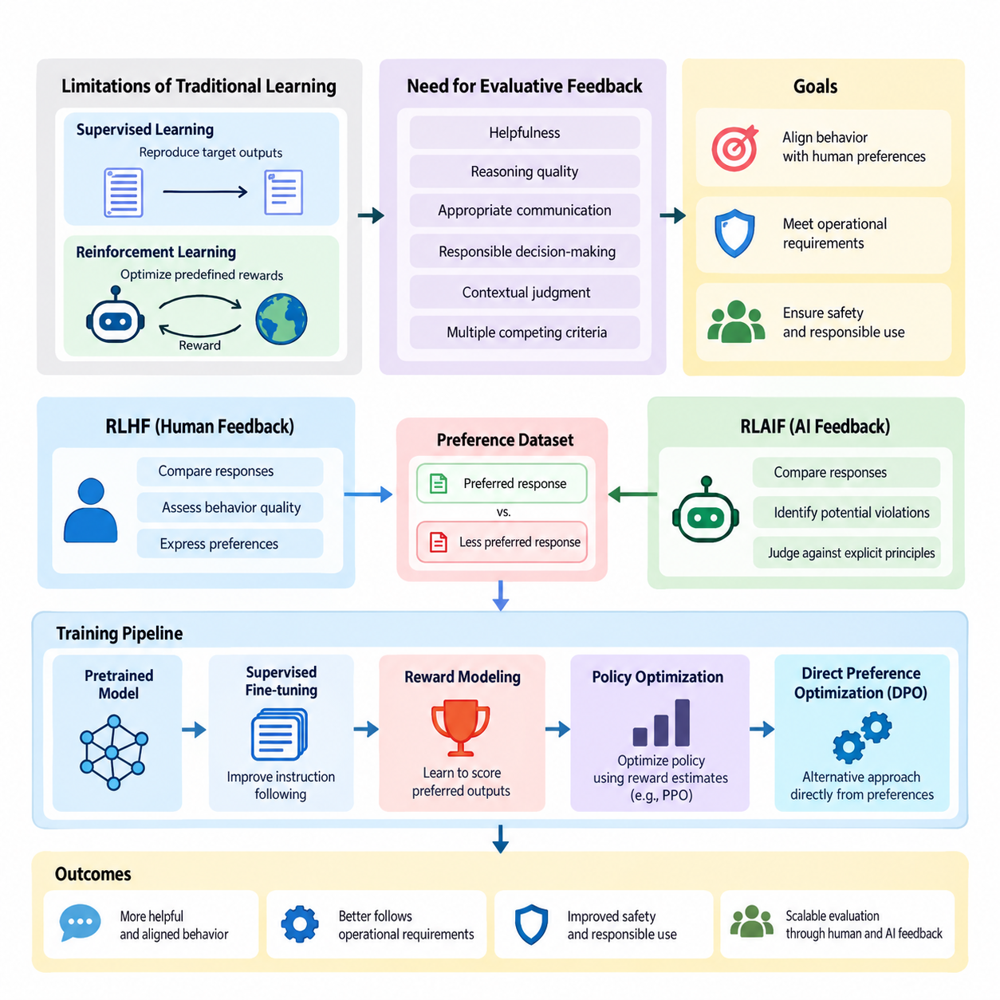
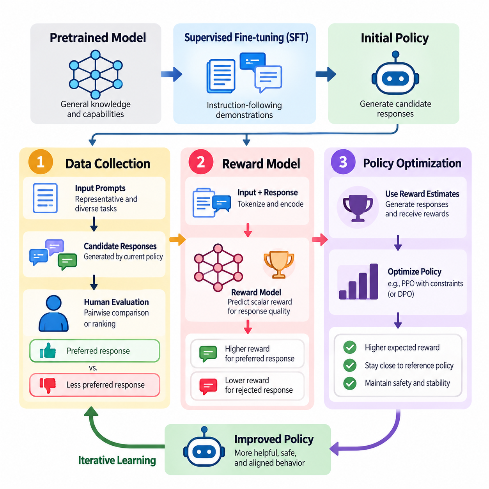
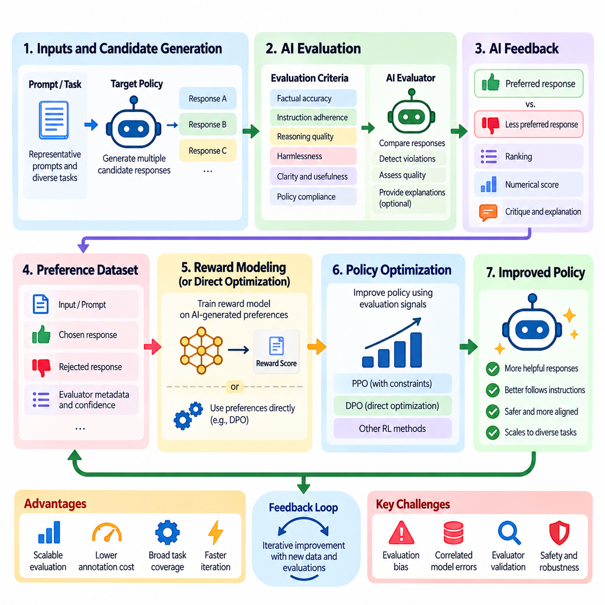
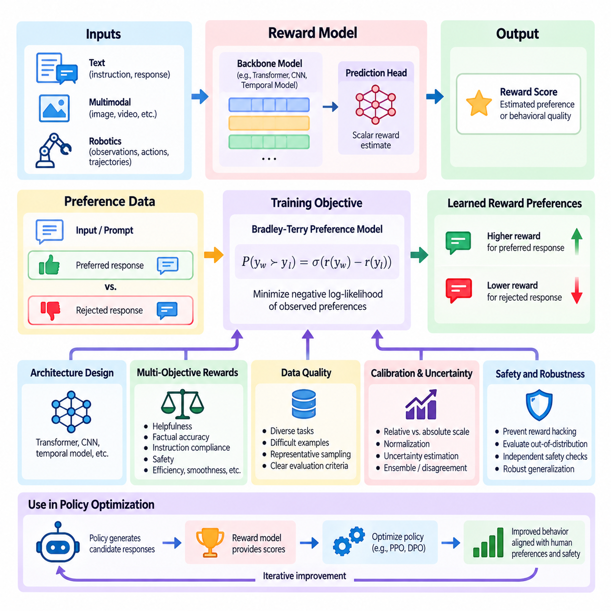
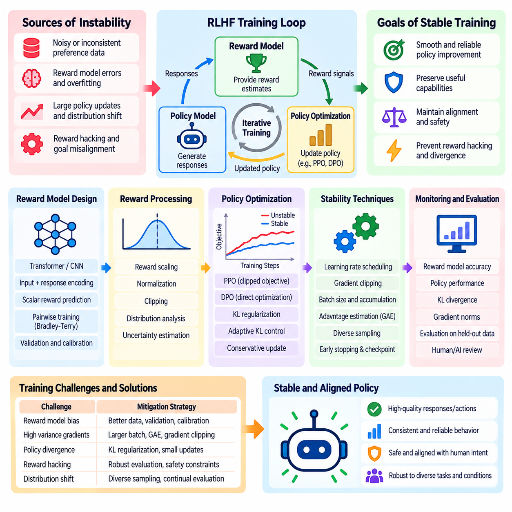
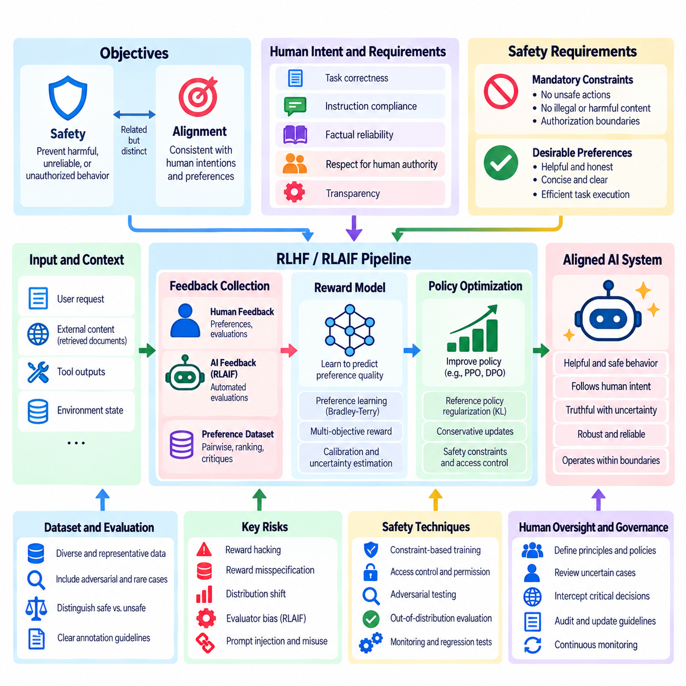
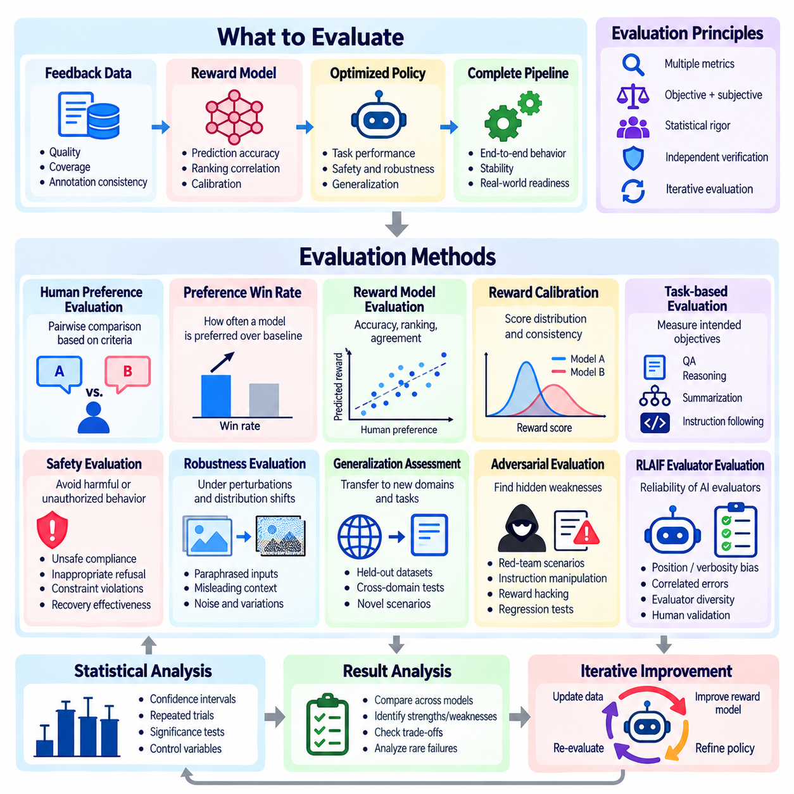
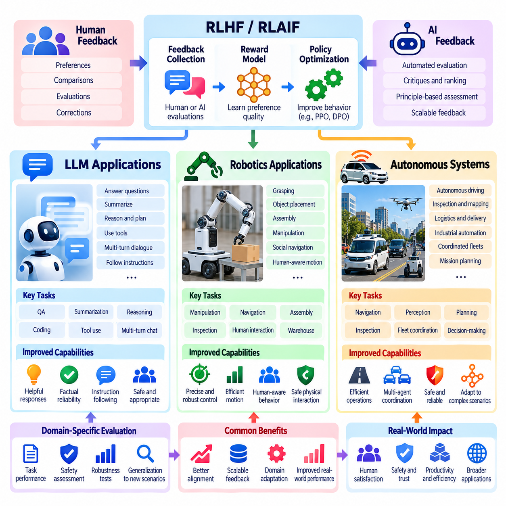

**Volume 41. Human in the Loop Learning**


# 03. RLHF and RLAIF

##  

## 03.00 Overview

{width="7.268055555555556in" height="7.268055555555556in"}

Reinforcement Learning from Human Feedback (RLHF) and Reinforcement Learning from AI Feedback (RLAIF) are approaches for improving artificial intelligence systems through evaluative feedback rather than relying exclusively on predefined labels or manually designed reward functions. Both approaches aim to align learned behavior with desired outcomes, human preferences, operational requirements, and safety expectations.

Traditional supervised learning trains models to reproduce target outputs, while conventional reinforcement learning optimizes rewards supplied by an environment. However, many intelligent behaviors cannot be adequately described by fixed objectives. Helpfulness, reasoning quality, appropriate communication, and responsible decision-making often require subjective evaluation, contextual judgment, and consideration of multiple competing criteria.

RLHF addresses this challenge by transforming human judgments into learning signals that guide policy improvement. Human evaluators compare candidate responses, assess behavior quality, or express preferences between alternative actions. These observations are used to construct feedback datasets, train reward models, and optimize policies toward behaviors that better reflect the evaluation criteria established by humans.

RLAIF extends this framework by using AI systems to generate some or all of the evaluative feedback. Instead of requiring human reviewers to assess every candidate response, an AI evaluator can compare alternatives, identify potential violations, or judge outputs against explicit principles. This approach can increase feedback throughput and reduce annotation costs, although its effectiveness depends on evaluator reliability.

The relationship between RLHF and RLAIF is complementary rather than strictly competitive. Human feedback provides an important source of preferences, contextual understanding, and normative judgment, while AI feedback supports scalable evaluation across large datasets. Hybrid approaches combine human-defined criteria, automated assessments, and targeted human review to balance evaluation quality, computational efficiency, and operational scalability.

A typical RLHF workflow begins with a pretrained model that already possesses useful representations and task capabilities. Supervised fine-tuning may first improve instruction following and establish an initial policy. The system then generates multiple candidate outputs for selected inputs, allowing human evaluators to compare alternatives and identify which behaviors better satisfy the intended requirements.

Preference datasets commonly contain an input, a preferred response, and a less preferred response. These comparisons provide relative judgments rather than absolute measurements of quality. A reward model learns to assign higher scores to preferred outputs under similar conditions. The resulting reward function serves as an approximation of the evaluators\' preferences and provides a trainable objective for subsequent optimization.

Reward modeling is a central component because it connects qualitative feedback with numerical optimization. A reward model typically processes the input context and candidate response to produce a scalar score. Its training objective encourages agreement with observed preference comparisons. However, the resulting scores represent learned preference estimates rather than objective guarantees of correctness, safety, or overall behavioral quality.

Policy optimization uses these reward estimates to improve the model\'s behavior. Proximal Policy Optimization (PPO) is a prominent method associated with classical RLHF pipelines, while alternative approaches may optimize preferences more directly. Optimization often incorporates constraints that discourage excessive deviation from a reference policy, helping preserve useful pretrained capabilities and reduce unstable behavioral changes.

Direct Preference Optimization (DPO) provides an alternative to explicit reward-model-based reinforcement learning by optimizing a policy directly from preference comparisons. Although DPO is not identical to the classical RLHF pipeline, it addresses a closely related alignment objective. Its simpler training structure illustrates how preference learning can be implemented through different optimization formulations and engineering tradeoffs.

RLAIF typically introduces an AI evaluator that applies specified criteria to candidate outputs. The evaluator may compare responses according to helpfulness, factual consistency, instruction compliance, or safety-related principles. Its judgments can generate preference datasets or reward signals for policy improvement. Human experts remain important for defining evaluation standards and validating whether automated judgments are trustworthy.

Constitutional AI represents one influential direction in which explicit principles guide AI-generated critiques and preferences. Such systems can evaluate candidate behavior against documented requirements and support iterative refinement. Nevertheless, written principles cannot eliminate ambiguity, conflicting objectives, or evaluator bias. Human governance and independent testing remain necessary when defining acceptable behavior.

Feedback quality strongly influences the effectiveness of both approaches. Human evaluators may disagree because of differing expertise, cultural expectations, task interpretations, or inconsistent instructions. AI evaluators may exhibit systematic biases inherited from training data or model architecture. Reliable feedback pipelines therefore require clear criteria, quality checks, disagreement analysis, and representative evaluation samples.

Training stability presents another major challenge. Reward models can be exploited when policies discover outputs that receive high predicted scores without satisfying the underlying human objective. This phenomenon, commonly called reward hacking, illustrates the difference between optimizing a measurable proxy and achieving genuine behavioral improvement. Excessive optimization may also reduce response diversity or amplify weaknesses in the reward model.

Safety and alignment considerations extend beyond maximizing preference scores. A highly preferred response is not necessarily truthful, secure, or appropriate for every situation. Effective systems must account for harmful instructions, uncertain information, privacy requirements, and conflicts between user requests and operational constraints. Safety evaluation should therefore remain distinct from general preference optimization wherever necessary.

Evaluation methods must measure both the intended improvements and potential regressions. Human preference win rates, task success rates, reward-model agreement, instruction-following accuracy, and independent safety assessments provide complementary evidence. Comparisons should include suitable baselines and held-out evaluation datasets to distinguish genuine improvements from overfitting to specific evaluators or benchmark conditions.

For large language models, RLHF and RLAIF can improve conversational behavior, instruction following, response formatting, and adaptation to user expectations. They are especially relevant when several plausible responses exist but differ in usefulness or appropriateness. Nevertheless, preference optimization alone does not establish factual accuracy, robust reasoning, or reliable performance under unfamiliar conditions.

In robotics, feedback-driven reinforcement learning can incorporate human preferences concerning motion smoothness, task efficiency, comfort, and acceptable interaction behavior. Human operators may compare alternative trajectories or assess whether a robot performs a task appropriately. Learned preference models can then influence policy optimization, although physical safety constraints must be enforced independently of uncertain reward predictions.

Autonomous systems introduce additional challenges because decisions may produce delayed consequences and interact with changing physical environments. Feedback may concern complete trajectories, intermediate decisions, or mission outcomes rather than isolated actions. Successful deployment requires consideration of temporal credit assignment, environmental uncertainty, human intervention, and the consequences of errors during exploration or policy execution.

Human-in-the-loop learning provides the broader operational context for these methods. Active learning can identify informative examples requiring review, while feedback collection systems capture judgments and preferences. Annotation and data curation pipelines maintain dataset quality, and human oversight mechanisms establish accountability. RLHF and RLAIF transform these inputs into policy improvements within an iterative learning process.

Production implementations require coordinated data management, model versioning, evaluator calibration, experiment tracking, and controlled deployment. Changes to feedback criteria or reward models can alter policy behavior even when the underlying task remains unchanged. Maintaining traceability between collected feedback, training configurations, evaluation results, and deployed model versions is essential for reproducibility and responsible operation.

The central objective of RLHF and RLAIF is not to replace human judgment with an automated reward function, but to make human-defined preferences and requirements usable within scalable learning systems. Their long-term effectiveness depends on the quality of feedback, the reliability of optimization, the independence of evaluation, and the ability to detect behavioral failures before they create unacceptable consequences.

Together, RLHF and RLAIF establish a foundation for adaptive human-AI collaboration in which feedback becomes an ongoing source of behavioral improvement. Understanding their pipelines, reward-model design, training stability, safety considerations, evaluation methods, and applications provides the conceptual basis for developing AI systems that remain useful, controllable, and responsive to human expectations across changing operational environments.

인간 피드백 기반 강화학습(Reinforcement Learning from Human Feedback, RLHF)과 인공지능 피드백 기반 강화학습(Reinforcement Learning from AI Feedback, RLAIF)은 사전에 정의된 레이블(Label)이나 수작업으로 설계된 보상 함수(Reward Function)에만 의존하지 않고, 평가적 피드백(Evaluative Feedback)을 통해 인공지능 시스템의 성능을 개선하는 접근 방식이다. 두 방법 모두 학습된 행동을 바람직한 결과, 인간의 선호도, 운영 요구사항 및 안전성 기대 수준에 정렬(Alignment)하는 것을 목표로 한다.

전통적인 지도학습(Supervised Learning)은 목표 출력을 재현하도록 모델을 학습시키는 반면, 일반적인 강화학습(Reinforcement Learning)은 환경(Environment)에서 제공하는 보상(Reward)을 최적화한다. 그러나 많은 지능적 행동은 고정된 목적 함수(Objective Function)만으로 충분히 설명하기 어렵다. 유용성(Helpfulness), 추론 품질(Reasoning Quality), 적절한 의사소통(Appropriate Communication), 책임 있는 의사결정(Responsible Decision-Making)은 주관적 평가, 맥락적 판단 및 서로 경쟁하는 여러 기준을 함께 고려해야 하는 경우가 많다.

인간 피드백 기반 강화학습(RLHF)은 인간의 판단을 정책 개선(Policy Improvement)에 활용할 수 있는 학습 신호(Learning Signal)로 변환하여 이러한 문제를 해결한다. 인간 평가자(Human Evaluator)는 후보 응답(Candidate Response)을 비교하거나 행동 품질을 평가하고, 대안적 행동 사이의 선호도를 표현한다. 이러한 관찰 결과는 피드백 데이터셋(Feedback Dataset)을 구축하고 보상 모델(Reward Model)을 학습시키며, 인간이 설정한 평가 기준을 더욱 충실하게 반영하도록 정책(Policy)을 최적화하는 데 사용된다.

인공지능 피드백 기반 강화학습(RLAIF)은 평가 피드백의 일부 또는 전체를 인공지능 시스템이 생성하도록 하여 이러한 프레임워크(Framework)를 확장한다. 모든 후보 응답을 인간 검토자가 직접 평가하는 대신, 인공지능 평가자(AI Evaluator)가 대안을 비교하고 잠재적 위반 사항을 식별하거나 명시적인 원칙에 따라 출력을 판단할 수 있다. 이러한 접근 방식은 피드백 처리량(Feedback Throughput)을 높이고 주석 비용(Annotation Cost)을 줄일 수 있지만, 실제 효과는 평가자의 신뢰성(Evaluator Reliability)에 크게 의존한다.

인간 피드백 기반 강화학습(RLHF)과 인공지능 피드백 기반 강화학습(RLAIF)의 관계는 엄격한 경쟁 관계라기보다 상호보완적 관계(Complementary Relationship)에 가깝다. 인간 피드백(Human Feedback)은 선호도, 맥락적 이해 및 규범적 판단(Normative Judgment)의 중요한 원천을 제공하며, 인공지능 피드백(AI Feedback)은 대규모 데이터셋에 대한 확장 가능한 평가를 지원한다. 하이브리드 접근 방식(Hybrid Approach)은 인간이 정의한 기준, 자동화된 평가 및 선택적인 인간 검토를 결합하여 평가 품질, 계산 효율성 및 운영 확장성 사이의 균형을 추구한다.

일반적인 인간 피드백 기반 강화학습(RLHF) 워크플로(Workflow)는 이미 유용한 표현(Representation)과 작업 수행 능력을 갖춘 사전학습 모델(Pretrained Model)에서 시작한다. 지도 미세조정(Supervised Fine-Tuning, SFT)을 통해 지시 수행 능력을 개선하고 초기 정책(Initial Policy)을 수립할 수 있다. 이후 시스템은 선택된 입력에 대해 여러 후보 출력을 생성하며, 인간 평가자는 이러한 대안을 비교하여 어떤 행동이 의도된 요구사항을 더 잘 충족하는지 판단한다.

선호도 데이터셋(Preference Dataset)은 일반적으로 입력(Input), 선호 응답(Preferred Response), 비선호 응답(Less Preferred Response)으로 구성된다. 이러한 비교는 품질에 대한 절대적 측정값이 아니라 상대적 판단(Relative Judgment)을 제공한다. 보상 모델(Reward Model)은 유사한 조건에서 선호되는 출력에 더 높은 점수를 부여하도록 학습한다. 결과적으로 학습된 보상 함수는 평가자의 선호도를 근사하는 모델로 작동하며, 후속 최적화를 위한 학습 가능한 목적 함수(Trainable Objective)를 제공한다.

보상 모델링(Reward Modeling)은 정성적 피드백(Qualitative Feedback)을 수치적 최적화(Numerical Optimization)와 연결하기 때문에 핵심적인 구성요소이다. 보상 모델은 일반적으로 입력 맥락(Input Context)과 후보 응답을 처리하여 스칼라 점수(Scalar Score)를 생성한다. 학습 목적은 관찰된 선호도 비교와의 일치도를 높이는 것이다. 그러나 이러한 점수는 학습된 선호도의 추정값일 뿐이며, 정확성(Correctness), 안전성(Safety) 또는 전반적인 행동 품질에 대한 객관적인 보증을 의미하지 않는다.

정책 최적화(Policy Optimization)는 이러한 보상 추정값(Reward Estimate)을 활용하여 모델의 행동을 개선한다. 근접 정책 최적화(Proximal Policy Optimization, PPO)는 전통적인 인간 피드백 기반 강화학습(RLHF) 파이프라인과 관련된 대표적인 방법이며, 다른 접근 방식은 선호도를 보다 직접적으로 최적화할 수 있다. 최적화 과정에는 참조 정책(Reference Policy)으로부터 지나치게 벗어나는 것을 억제하는 제약 조건이 포함되기도 하며, 이를 통해 사전학습된 유용한 능력을 보존하고 불안정한 행동 변화를 줄일 수 있다.

직접 선호도 최적화(Direct Preference Optimization, DPO)는 명시적인 보상 모델 기반 강화학습을 수행하지 않고 선호도 비교 데이터로부터 정책을 직접 최적화하는 대안적 방법이다. DPO는 전통적인 인간 피드백 기반 강화학습(RLHF) 파이프라인과 동일하지는 않지만, 밀접하게 관련된 정렬 목표(Alignment Objective)를 다룬다. 상대적으로 단순한 학습 구조는 선호도 학습(Preference Learning)이 서로 다른 최적화 공식화(Optimization Formulation)와 엔지니어링 절충 관계(Engineering Tradeoff)를 통해 구현될 수 있음을 보여준다.

인공지능 피드백 기반 강화학습(RLAIF)은 일반적으로 지정된 평가 기준을 후보 출력에 적용하는 인공지능 평가자(AI Evaluator)를 도입한다. 평가자는 유용성(Helpfulness), 사실적 일관성(Factual Consistency), 지시 준수(Instruction Compliance), 안전 관련 원칙(Safety-Related Principles)에 따라 응답을 비교할 수 있다. 이러한 판단은 정책 개선을 위한 선호도 데이터셋이나 보상 신호를 생성하는 데 활용된다. 인간 전문가는 평가 기준을 정의하고 자동화된 판단의 신뢰성을 검증하는 데 여전히 중요한 역할을 수행한다.

헌법적 인공지능(Constitutional AI)은 명시적인 원칙(Explicit Principles)을 활용하여 인공지능이 생성하는 비평(Critique)과 선호도 판단을 안내하는 대표적인 접근 방향이다. 이러한 시스템은 문서화된 요구사항에 따라 후보 행동을 평가하고 반복적인 개선(Iterative Refinement)을 지원할 수 있다. 그러나 문서화된 원칙만으로 모호성(Ambiguity), 상충하는 목표(Conflicting Objectives), 평가자 편향(Evaluator Bias)을 완전히 제거할 수는 없다. 허용 가능한 행동을 정의할 때는 인간 거버넌스(Human Governance)와 독립적인 검증(Independent Testing)이 계속 필요하다.

피드백 품질(Feedback Quality)은 두 접근 방식의 효과에 큰 영향을 미친다. 인간 평가자는 전문성, 문화적 기대, 작업 해석 또는 일관되지 않은 지침 때문에 서로 다른 판단을 내릴 수 있다. 인공지능 평가자는 학습 데이터나 모델 아키텍처(Model Architecture)에서 비롯된 체계적 편향(Systematic Bias)을 보일 수 있다. 따라서 신뢰할 수 있는 피드백 파이프라인(Feedback Pipeline)을 구축하려면 명확한 평가 기준, 품질 검사(Quality Check), 의견 불일치 분석(Disagreement Analysis), 대표성 있는 평가 샘플(Representative Evaluation Sample)이 필요하다.

학습 안정성(Training Stability)은 또 다른 주요 과제이다. 정책이 실제 인간의 목적을 충족하지 않으면서도 높은 예측 점수를 받는 출력을 발견하면 보상 모델이 악용될 수 있다. 일반적으로 보상 해킹(Reward Hacking)이라고 불리는 이러한 현상은 측정 가능한 대리 목표(Proxy Objective)를 최적화하는 것과 실제 행동 개선을 달성하는 것 사이의 차이를 보여준다. 지나친 최적화는 응답 다양성(Response Diversity)을 감소시키거나 보상 모델의 약점을 증폭시킬 수도 있다.

안전성 및 정렬(Safety and Alignment)에 대한 고려는 선호도 점수를 극대화하는 것 이상으로 확장된다. 높은 선호도를 받은 응답이 반드시 진실하거나 안전하거나 모든 상황에서 적절한 것은 아니다. 효과적인 시스템은 유해한 지시(Harmful Instructions), 불확실한 정보(Uncertain Information), 개인정보 보호 요구사항(Privacy Requirements), 사용자 요청과 운영 제약 조건 사이의 충돌을 고려해야 한다. 따라서 필요한 경우 안전성 평가(Safety Evaluation)는 일반적인 선호도 최적화와 구분하여 수행해야 한다.

평가 방법(Evaluation Methods)은 의도한 개선 효과뿐 아니라 잠재적인 성능 퇴행(Performance Regression)도 측정해야 한다. 인간 선호도 승률(Human Preference Win Rate), 작업 성공률(Task Success Rate), 보상 모델 일치도(Reward Model Agreement), 지시 수행 정확도(Instruction-Following Accuracy), 독립적인 안전성 평가(Independent Safety Assessment)는 상호보완적인 근거를 제공한다. 실제 개선과 특정 평가자 또는 벤치마크 조건에 대한 과적합(Overfitting)을 구별하려면 적절한 기준 모델(Baseline)과 별도의 평가 데이터셋(Held-Out Evaluation Dataset)을 사용해야 한다.

대규모 언어 모델(Large Language Model, LLM)에서 인간 피드백 기반 강화학습(RLHF)과 인공지능 피드백 기반 강화학습(RLAIF)은 대화 행동(Conversational Behavior), 지시 수행(Instruction Following), 응답 형식(Response Formatting), 사용자 기대에 대한 적응 능력을 개선할 수 있다. 특히 여러 개의 타당한 응답이 존재하지만 유용성이나 적절성에서 차이가 발생하는 상황에 효과적이다. 그러나 선호도 최적화만으로 사실적 정확성(Factual Accuracy), 견고한 추론(Robust Reasoning), 익숙하지 않은 조건에서의 신뢰할 수 있는 성능을 보장할 수는 없다.

로보틱스(Robotics)에서 피드백 기반 강화학습(Feedback-Driven Reinforcement Learning)은 움직임의 부드러움(Motion Smoothness), 작업 효율성(Task Efficiency), 편안함(Comfort), 허용 가능한 상호작용 행동(Acceptable Interaction Behavior)에 관한 인간의 선호도를 반영할 수 있다. 인간 운영자는 대안적인 궤적(Trajectory)을 비교하거나 로봇이 작업을 적절하게 수행하는지 평가할 수 있다. 학습된 선호도 모델(Preference Model)은 정책 최적화에 영향을 줄 수 있지만, 물리적 안전 제약 조건(Physical Safety Constraints)은 불확실한 보상 예측과 독립적으로 강제되어야 한다.

자율 시스템(Autonomous Systems)은 의사결정이 지연된 결과(Delayed Consequences)를 발생시키고 변화하는 물리적 환경과 상호작용할 수 있기 때문에 추가적인 과제를 제시한다. 피드백은 개별 행동뿐 아니라 전체 궤적(Complete Trajectory), 중간 의사결정(Intermediate Decision), 임무 결과(Mission Outcome)에 관한 것일 수 있다. 성공적인 배포(Deployment)를 위해서는 시간적 기여도 할당(Temporal Credit Assignment), 환경 불확실성(Environmental Uncertainty), 인간 개입(Human Intervention), 탐색 및 정책 실행 중 발생하는 오류의 결과를 고려해야 한다.

인간 참여형 학습(Human-in-the-Loop Learning, HITL)은 이러한 방법을 위한 보다 광범위한 운영 맥락(Operational Context)을 제공한다. 능동학습(Active Learning)은 검토가 필요한 정보 가치가 높은 사례를 식별할 수 있으며, 피드백 수집 시스템(Feedback Collection System)은 판단과 선호도를 기록한다. 주석 및 데이터 큐레이션 파이프라인(Annotation and Data Curation Pipeline)은 데이터셋 품질을 유지하고, 인간 감독 메커니즘(Human Oversight Mechanism)은 책임성을 확립한다. RLHF와 RLAIF는 이러한 입력을 반복적인 학습 과정에서 정책 개선으로 변환한다.

프로덕션 구현(Production Implementation)에는 데이터 관리(Data Management), 모델 버전 관리(Model Versioning), 평가자 보정(Evaluator Calibration), 실험 추적(Experiment Tracking), 통제된 배포(Controlled Deployment)의 조정이 필요하다. 기본 작업이 동일하게 유지되더라도 피드백 기준이나 보상 모델이 변경되면 정책 행동이 달라질 수 있다. 수집된 피드백, 학습 구성(Training Configuration), 평가 결과 및 배포된 모델 버전 사이의 추적 가능성(Traceability)을 유지하는 것은 재현성(Reproducibility)과 책임 있는 운영에 필수적이다.

인간 피드백 기반 강화학습(RLHF)과 인공지능 피드백 기반 강화학습(RLAIF)의 핵심 목적은 인간의 판단을 자동화된 보상 함수로 대체하는 것이 아니라, 인간이 정의한 선호도와 요구사항을 확장 가능한 학습 시스템(Scalable Learning System)에서 활용할 수 있도록 만드는 것이다. 장기적인 효과는 피드백 품질, 최적화의 신뢰성, 평가의 독립성, 그리고 허용할 수 없는 결과가 발생하기 전에 행동 실패(Behavioral Failure)를 탐지하는 능력에 달려 있다.

RLHF와 RLAIF는 피드백이 지속적인 행동 개선의 원천이 되는 적응형 인간-AI 협업(Adaptive Human-AI Collaboration)의 기반을 형성한다. 이들의 파이프라인(Pipeline), 보상 모델 설계(Reward Model Design), 학습 안정성(Training Stability), 안전성 고려사항(Safety Considerations), 평가 방법(Evaluation Methods), 응용 분야(Applications)를 이해하는 것은 변화하는 운영 환경에서도 유용하고 통제 가능하며 인간의 기대에 적절하게 대응하는 인공지능 시스템을 개발하기 위한 개념적 토대를 제공한다.

##  

## 03.01 RLHF Pipeline

{width="7.268055555555556in" height="7.268055555555556in"}

The Reinforcement Learning from Human Feedback (RLHF) pipeline is a structured training process that transforms human preferences into optimization signals for artificial intelligence systems. Its primary objective is to improve model behavior beyond conventional supervised learning by incorporating judgments about response quality, usefulness, correctness, and safety. The pipeline connects data collection, reward modeling, and policy optimization within an iterative learning framework.

RLHF typically begins with a pretrained model that has acquired general knowledge and representations from large datasets. Supervised fine-tuning (SFT) may then adapt the model to instruction-following tasks using carefully selected demonstrations. This initial policy provides a stable foundation for generating candidate responses and collecting preference feedback. The quality of this foundation strongly influences subsequent reward learning and optimization.

Data collection establishes the empirical basis of the RLHF pipeline. A collection of representative prompts, task descriptions, or environmental states is assembled to reflect expected operating conditions. The current policy generates multiple candidate responses or actions for each input. Human evaluators examine these alternatives and provide judgments indicating which outputs better satisfy the intended behavioral requirements.

Preference feedback is commonly represented through pairwise comparisons, where an evaluator selects a preferred response from two candidates. These comparisons are particularly useful when absolute quality scores are difficult to define consistently. Other feedback formats include rankings, numerical ratings, corrective demonstrations, and trajectory-level assessments. Each format captures different aspects of human judgment and introduces distinct annotation costs and uncertainties.

High-quality preference datasets require careful sampling and annotation design. Inputs should cover routine tasks, difficult scenarios, ambiguous instructions, and potential safety failures. Candidate responses should exhibit meaningful behavioral differences rather than trivial variations. Clear annotation guidelines help evaluators distinguish factual correctness, instruction compliance, reasoning quality, and stylistic preferences without unintentionally combining unrelated criteria.

Human feedback contains uncertainty arising from individual preferences, expertise differences, inconsistent judgments, and contextual ambiguity. Multiple evaluators may disagree even when assessing identical responses. Quality assurance therefore involves evaluator calibration, repeated assessments, agreement analysis, and targeted review of disputed examples. Preserving disagreement information can be valuable because a single consensus label may conceal legitimate differences in evaluation criteria.

Data preparation converts collected feedback into standardized training records. A typical preference record contains the original input, a chosen response, a rejected response, and relevant metadata. Additional information may include evaluator identifiers, annotation confidence, task categories, and policy versions. Dataset validation checks for missing fields, duplicate samples, inconsistent formatting, and contamination between training and evaluation partitions.

Reward modeling transforms these preference comparisons into a trainable approximation of human judgment. A reward model receives an input context and candidate output, then predicts a scalar value representing estimated preference quality. Its objective is to assign higher scores to preferred responses than to rejected alternatives. This learned scoring function replaces the need to manually specify a complete reward formula for complex behavioral objectives.

A common reward-model architecture uses a pretrained transformer with an additional scalar prediction head. The transformer encodes the input-response sequence, while the prediction head produces a reward estimate from a selected representation. During training, the model processes preferred and rejected responses and adjusts its parameters to increase the predicted reward difference in the direction indicated by human comparisons.

Pairwise reward learning frequently employs a Bradley-Terry preference model. Given reward estimates for two candidate responses, the probability that one is preferred is modeled using a sigmoid function of their reward difference. Training minimizes the negative log-likelihood of observed preferences. This formulation provides a differentiable objective that can be implemented efficiently using automatic differentiation frameworks such as PyTorch.

A practical reward-model implementation requires tokenization, sequence truncation, batching, and careful treatment of padding tokens. Preferred and rejected responses should be evaluated under equivalent input contexts. Training procedures typically use validation datasets, gradient clipping, learning-rate scheduling, and checkpoint management. Monitoring preference prediction accuracy helps detect overfitting, although high accuracy alone does not guarantee reliable reward behavior.

Reward-model calibration is important because learned scores may vary across task domains, response lengths, and input distributions. A model may assign excessive rewards to verbose responses or superficial patterns correlated with preferred examples. Distribution shifts can further reduce scoring reliability. Independent evaluation should therefore examine ranking consistency, sensitivity to irrelevant changes, and performance on difficult examples excluded from training.

Policy optimization uses the trained reward model to improve the behavior of the target policy. The policy generates candidate outputs, receives estimated rewards, and updates its parameters to increase expected reward. Unlike supervised fine-tuning, which primarily imitates reference demonstrations, reinforcement learning can improve behavior through evaluative signals without requiring a complete target response for every training example.

Proximal Policy Optimization (PPO) is a widely used algorithm for classical RLHF training. PPO updates the policy using a clipped surrogate objective designed to discourage excessively large changes between successive policies. In language-model applications, generated token sequences form trajectories, while reward estimates provide feedback about completed responses. Advantage estimates guide updates toward actions associated with better expected outcomes.

A reference policy is often maintained to constrain optimization through Kullback-Leibler (KL) divergence regularization. This penalty discourages the updated policy from moving too far from its initial behavior. The regularization coefficient controls the tradeoff between maximizing learned rewards and preserving the original policy distribution. Excessively weak constraints may encourage reward exploitation, while overly strong constraints can restrict meaningful improvement.

Value estimation may support PPO by predicting expected returns from intermediate generation states. A value model or value head provides a baseline for computing advantages and reducing gradient variance. Training alternates between generating responses, estimating rewards and advantages, and updating policy and value parameters. Stable optimization depends on appropriate batch sizes, learning rates, reward normalization, and policy-update limits.

Policy optimization introduces challenges that are not fully addressed by the mathematical objective. Reward hacking occurs when the policy discovers outputs that receive high predicted scores without genuinely satisfying human preferences. Optimization may also produce repetitive language, excessive confidence, reduced diversity, or unintended changes in capabilities. These problems demonstrate why reward maximization must remain connected to independent behavioral evaluation.

Alternative preference optimization methods provide different engineering tradeoffs. Direct Preference Optimization (DPO) uses preference comparisons to optimize policy behavior without separately training an explicit reward model for online reinforcement learning. Related methods simplify parts of the optimization process or modify how preferences influence updates. Their suitability depends on available feedback, computational resources, and the need for online exploration.

The complete RLHF pipeline operates as an iterative process rather than a single training sequence. Updated policies generate new responses that may expose weaknesses not represented in earlier datasets. Human evaluators assess selected outputs, and the resulting feedback can improve reward models or support additional policy updates. This iterative structure enables progressive refinement while requiring careful control of data distribution changes.

Evaluation must examine each pipeline component separately and assess the behavior of the integrated system. Data collection is evaluated through coverage, consistency, and annotation quality. Reward models are assessed through preference prediction, robustness, and generalization. Optimized policies are evaluated using task performance, human preference comparisons, factual reliability, safety tests, and regression analysis against earlier versions.

In robotics and autonomous systems, RLHF can extend beyond textual responses to action sequences, navigation trajectories, manipulation behaviors, and mission execution. Human operators may compare alternative trajectories based on efficiency, smoothness, task completion, and operational suitability. Reward models can learn these preferences, but physical safety requirements must remain independently enforced through appropriate control constraints and monitoring mechanisms.

Production RLHF systems require reproducible datasets, version-controlled reward models, experiment tracking, and controlled deployment procedures. Feedback records should remain traceable to the policies and evaluation criteria that produced them. Monitoring should identify changes in reward distributions, unexpected behavioral patterns, and disagreements between automated scores and human assessments. These capabilities support systematic debugging and reliable model updates.

The effectiveness of RLHF ultimately depends on maintaining consistency between human intentions, collected feedback, learned reward functions, and optimized policy behavior. Data collection determines what preferences the system observes, reward modeling determines how those preferences are represented, and policy optimization determines how they influence behavior. Treating these components as an integrated engineering process is essential for developing reliable, adaptable, and human-aligned AI systems.

인간 피드백 기반 강화학습(Reinforcement Learning from Human Feedback, RLHF) 파이프라인(Pipeline)은 인간의 선호도(Human Preferences)를 인공지능 시스템의 최적화 신호(Optimization Signal)로 변환하는 구조화된 학습 과정이다. 주요 목적은 응답 품질(Response Quality), 유용성(Usefulness), 정확성(Correctness), 안전성(Safety)에 대한 판단을 반영하여 기존 지도학습(Supervised Learning)의 한계를 넘어 모델의 행동을 개선하는 것이다. 이 파이프라인은 데이터 수집(Data Collection), 보상 모델링(Reward Modeling), 정책 최적화(Policy Optimization)를 반복적인 학습 프레임워크(Iterative Learning Framework)로 연결한다.

인간 피드백 기반 강화학습(RLHF)은 일반적으로 대규모 데이터셋으로부터 일반적인 지식과 표현(Representation)을 학습한 사전학습 모델(Pretrained Model)에서 시작한다. 이후 지도 미세조정(Supervised Fine-Tuning, SFT)을 통해 신중하게 선택된 시연 데이터(Demonstration Data)를 활용하여 모델을 지시 수행 작업(Instruction-Following Task)에 적응시킬 수 있다. 이러한 초기 정책(Initial Policy)은 후보 응답(Candidate Response)을 생성하고 선호도 피드백(Preference Feedback)을 수집하기 위한 안정적인 기반을 제공한다. 초기 모델의 품질은 후속 보상 학습과 최적화 과정에 큰 영향을 미친다.

데이터 수집(Data Collection)은 인간 피드백 기반 강화학습(RLHF) 파이프라인의 실증적 기반(Empirical Basis)을 확립한다. 예상되는 운영 조건을 반영하기 위해 대표적인 프롬프트(Prompt), 작업 설명(Task Description), 환경 상태(Environmental State)를 수집한다. 현재 정책(Current Policy)은 각 입력에 대해 여러 후보 응답이나 행동을 생성한다. 인간 평가자(Human Evaluator)는 이러한 대안을 검토하고 어떤 출력이 의도된 행동 요구사항(Behavioral Requirements)을 더 잘 충족하는지 판단한다.

선호도 피드백(Preference Feedback)은 일반적으로 두 후보 중 하나를 선택하는 쌍별 비교(Pairwise Comparison) 형태로 표현된다. 이러한 비교는 절대적인 품질 점수(Absolute Quality Score)를 일관되게 정의하기 어려운 경우에 특히 유용하다. 다른 피드백 형식에는 순위 평가(Ranking), 수치 평점(Numerical Rating), 교정 시연(Corrective Demonstration), 궤적 수준 평가(Trajectory-Level Assessment)가 포함된다. 각 형식은 인간 판단의 서로 다른 측면을 포착하며, 고유한 주석 비용(Annotation Cost)과 불확실성(Uncertainty)을 수반한다.

고품질 선호도 데이터셋(Preference Dataset)을 구축하려면 신중한 샘플링(Sampling)과 주석 설계(Annotation Design)가 필요하다. 입력 데이터는 일반적인 작업, 어려운 시나리오, 모호한 지시, 잠재적인 안전 실패 상황을 포함해야 한다. 후보 응답은 사소한 표현 차이가 아니라 의미 있는 행동 차이(Behavioral Difference)를 보여야 한다. 명확한 주석 지침(Annotation Guidelines)은 평가자가 사실적 정확성(Factual Correctness), 지시 준수(Instruction Compliance), 추론 품질(Reasoning Quality), 문체 선호도(Stylistic Preference)를 구분하고 서로 관련 없는 평가 기준이 의도치 않게 혼합되는 것을 방지하도록 지원한다.

인간 피드백(Human Feedback)에는 개인의 선호도, 전문성 차이, 일관되지 않은 판단, 맥락적 모호성(Contextual Ambiguity)에서 발생하는 불확실성이 포함된다. 여러 평가자가 동일한 응답을 평가하더라도 서로 다른 판단을 내릴 수 있다. 따라서 품질 보증(Quality Assurance)에는 평가자 보정(Evaluator Calibration), 반복 평가(Repeated Assessment), 일치도 분석(Agreement Analysis), 의견이 불일치하는 사례에 대한 선택적 검토(Targeted Review)가 필요하다. 단일 합의 레이블(Consensus Label)은 평가 기준의 정당한 차이를 숨길 수 있으므로 의견 불일치 정보를 보존하는 것이 유용할 수 있다.

데이터 준비(Data Preparation)는 수집된 피드백을 표준화된 학습 레코드(Standardized Training Record)로 변환한다. 일반적인 선호도 레코드는 원본 입력(Original Input), 선택된 응답(Chosen Response), 거부된 응답(Rejected Response), 관련 메타데이터(Metadata)를 포함한다. 추가 정보에는 평가자 식별자(Evaluator Identifier), 주석 신뢰도(Annotation Confidence), 작업 범주(Task Category), 정책 버전(Policy Version)이 포함될 수 있다. 데이터셋 검증(Dataset Validation)은 누락된 필드, 중복 샘플, 일관되지 않은 형식, 학습 및 평가 데이터 분할 사이의 오염(Data Contamination)을 검사한다.

보상 모델링(Reward Modeling)은 이러한 선호도 비교를 인간 판단에 대한 학습 가능한 근사 모델(Trainable Approximation)로 변환한다. 보상 모델(Reward Model)은 입력 맥락(Input Context)과 후보 출력(Candidate Output)을 받아 추정된 선호도 품질(Estimated Preference Quality)을 나타내는 스칼라 값(Scalar Value)을 예측한다. 목적은 선호되는 응답에 거부된 대안보다 높은 점수를 부여하는 것이다. 이러한 학습된 점수 함수(Scoring Function)는 복잡한 행동 목표에 대해 완전한 보상 공식을 수작업으로 정의해야 하는 필요성을 줄여준다.

일반적인 보상 모델 아키텍처(Reward Model Architecture)는 사전학습된 트랜스포머(Pretrained Transformer)에 추가적인 스칼라 예측 헤드(Scalar Prediction Head)를 결합한다. 트랜스포머는 입력과 응답으로 구성된 시퀀스(Input-Response Sequence)를 인코딩(Encoding)하고, 예측 헤드는 선택된 표현(Selected Representation)으로부터 보상 추정값(Reward Estimate)을 생성한다. 학습 과정에서 모델은 선호 응답과 거부 응답을 처리하고, 인간의 비교 판단이 나타내는 방향으로 예측 보상 차이(Predicted Reward Difference)가 증가하도록 매개변수(Parameter)를 조정한다.

쌍별 보상 학습(Pairwise Reward Learning)에서는 브래들리-테리 선호도 모델(Bradley-Terry Preference Model)이 자주 사용된다. 두 후보 응답에 대한 보상 추정값이 주어지면, 한 응답이 선호될 확률은 보상 차이에 시그모이드 함수(Sigmoid Function)를 적용하여 모델링한다. 학습 과정에서는 관찰된 선호도에 대한 음의 로그 우도(Negative Log-Likelihood)를 최소화한다. 이러한 공식화는 파이토치(PyTorch)와 같은 자동 미분 프레임워크(Automatic Differentiation Framework)를 사용하여 효율적으로 구현할 수 있는 미분 가능한 목적 함수(Differentiable Objective)를 제공한다.

실용적인 보상 모델 구현(Reward Model Implementation)에는 토큰화(Tokenization), 시퀀스 절단(Sequence Truncation), 배치 처리(Batching), 패딩 토큰(Padding Token)의 신중한 처리가 필요하다. 선호 응답과 거부 응답은 동등한 입력 맥락에서 평가되어야 한다. 학습 절차에는 일반적으로 검증 데이터셋(Validation Dataset), 기울기 클리핑(Gradient Clipping), 학습률 스케줄링(Learning-Rate Scheduling), 체크포인트 관리(Checkpoint Management)가 사용된다. 선호도 예측 정확도(Preference Prediction Accuracy)를 모니터링하면 과적합(Overfitting)을 탐지하는 데 도움이 되지만, 높은 정확도만으로 신뢰할 수 있는 보상 행동이 보장되지는 않는다.

보상 모델 보정(Reward-Model Calibration)은 학습된 점수가 작업 도메인(Task Domain), 응답 길이(Response Length), 입력 분포(Input Distribution)에 따라 달라질 수 있기 때문에 중요하다. 모델은 장황한 응답이나 선호 사례와 상관관계가 있는 피상적인 패턴에 과도한 보상을 부여할 수 있다. 분포 변화(Distribution Shift)는 점수의 신뢰성을 더욱 감소시킬 수 있다. 따라서 독립적인 평가(Independent Evaluation)를 통해 순위 일관성(Ranking Consistency), 무관한 변화에 대한 민감도(Sensitivity), 학습에서 제외된 어려운 사례에 대한 성능을 검토해야 한다.

정책 최적화(Policy Optimization)는 학습된 보상 모델을 활용하여 목표 정책(Target Policy)의 행동을 개선한다. 정책은 후보 출력을 생성하고 추정 보상을 받은 다음, 기대 보상(Expected Reward)을 증가시키도록 매개변수를 갱신한다. 주로 참조 시연(Reference Demonstration)을 모방하는 지도 미세조정(Supervised Fine-Tuning)과 달리, 강화학습(Reinforcement Learning)은 모든 학습 사례에 완전한 목표 응답이 없어도 평가 신호(Evaluative Signal)를 통해 행동을 개선할 수 있다.

근접 정책 최적화(Proximal Policy Optimization, PPO)는 전통적인 인간 피드백 기반 강화학습(RLHF)에 널리 사용되는 알고리즘이다. PPO는 연속적인 정책 사이에서 지나치게 큰 변화가 발생하지 않도록 설계된 클리핑 대리 목적 함수(Clipped Surrogate Objective)를 사용하여 정책을 갱신한다. 언어 모델(Language Model) 응용에서는 생성된 토큰 시퀀스(Token Sequence)가 궤적(Trajectory)을 형성하며, 보상 추정값은 완성된 응답에 대한 피드백을 제공한다. 어드밴티지 추정값(Advantage Estimate)은 더 높은 기대 결과와 관련된 행동을 향해 정책 갱신을 유도한다.

참조 정책(Reference Policy)은 쿨백-라이블러 발산(Kullback-Leibler Divergence, KL Divergence) 정규화(Regularization)를 통해 최적화를 제한하기 위해 유지되는 경우가 많다. 이러한 페널티(Penalty)는 갱신된 정책이 초기 행동에서 지나치게 벗어나는 것을 억제한다. 정규화 계수(Regularization Coefficient)는 학습된 보상의 극대화와 기존 정책 분포(Policy Distribution)의 보존 사이의 절충 관계를 제어한다. 제약이 지나치게 약하면 보상 악용(Reward Exploitation)이 발생할 수 있으며, 지나치게 강하면 의미 있는 개선이 제한될 수 있다.

가치 추정(Value Estimation)은 중간 생성 상태(Intermediate Generation State)에서 예상되는 반환값(Expected Return)을 예측하여 PPO를 지원할 수 있다. 가치 모델(Value Model) 또는 가치 헤드(Value Head)는 어드밴티지(Advantage)를 계산하고 기울기 분산(Gradient Variance)을 줄이기 위한 기준값(Baseline)을 제공한다. 학습 과정은 응답 생성, 보상 및 어드밴티지 추정, 정책 및 가치 매개변수 갱신을 번갈아 수행한다. 안정적인 최적화는 적절한 배치 크기(Batch Size), 학습률(Learning Rate), 보상 정규화(Reward Normalization), 정책 갱신 제한(Policy-Update Limit)에 의존한다.

정책 최적화(Policy Optimization)는 수학적 목적 함수만으로 완전히 해결할 수 없는 문제를 발생시킨다. 보상 해킹(Reward Hacking)은 정책이 실제 인간의 선호도를 충족하지 않으면서도 높은 예측 점수를 받는 출력을 발견할 때 발생한다. 최적화 과정은 반복적인 언어 표현(Repetitive Language), 과도한 확신(Excessive Confidence), 다양성 감소(Reduced Diversity), 의도하지 않은 능력 변화(Unintended Capability Changes)를 초래할 수도 있다. 이러한 문제는 보상 극대화가 독립적인 행동 평가(Independent Behavioral Evaluation)와 지속적으로 연결되어야 함을 보여준다.

대안적인 선호도 최적화 방법(Alternative Preference Optimization Methods)은 서로 다른 엔지니어링 절충 관계(Engineering Tradeoffs)를 제공한다. 직접 선호도 최적화(Direct Preference Optimization, DPO)는 온라인 강화학습(Online Reinforcement Learning)을 위한 별도의 명시적 보상 모델을 학습하지 않고 선호도 비교를 활용하여 정책 행동을 직접 최적화한다. 관련 방법들은 최적화 과정의 일부를 단순화하거나 선호도가 정책 갱신에 영향을 미치는 방식을 수정한다. 적합성은 사용 가능한 피드백, 계산 자원(Computational Resources), 온라인 탐색(Online Exploration)의 필요성에 따라 달라진다.

전체 인간 피드백 기반 강화학습(RLHF) 파이프라인은 단일 학습 절차가 아니라 반복적인 과정(Iterative Process)으로 작동한다. 갱신된 정책은 이전 데이터셋에 포함되지 않았던 약점을 드러내는 새로운 응답을 생성할 수 있다. 인간 평가자는 선택된 출력을 평가하고, 그 결과로 수집된 피드백은 보상 모델을 개선하거나 추가적인 정책 갱신을 지원할 수 있다. 이러한 반복 구조는 점진적인 개선(Progressive Refinement)을 가능하게 하지만, 데이터 분포 변화(Data Distribution Change)에 대한 신중한 통제가 필요하다.

평가(Evaluation)는 파이프라인의 각 구성요소를 개별적으로 검토하는 동시에 통합 시스템(Integrated System)의 행동도 평가해야 한다. 데이터 수집은 포괄성(Coverage), 일관성(Consistency), 주석 품질(Annotation Quality)을 기준으로 평가한다. 보상 모델은 선호도 예측(Preference Prediction), 견고성(Robustness), 일반화(Generalization)를 통해 평가한다. 최적화된 정책은 작업 성능(Task Performance), 인간 선호도 비교(Human Preference Comparison), 사실적 신뢰성(Factual Reliability), 안전성 테스트(Safety Test), 이전 버전과의 회귀 분석(Regression Analysis)을 통해 평가한다.

로보틱스(Robotics)와 자율 시스템(Autonomous Systems)에서 인간 피드백 기반 강화학습(RLHF)은 텍스트 응답을 넘어 행동 시퀀스(Action Sequence), 내비게이션 궤적(Navigation Trajectory), 조작 행동(Manipulation Behavior), 임무 실행(Mission Execution)으로 확장될 수 있다. 인간 운영자는 효율성(Efficiency), 움직임의 부드러움(Smoothness), 작업 완료(Task Completion), 운영 적합성(Operational Suitability)을 기준으로 대안 궤적을 비교할 수 있다. 보상 모델은 이러한 선호도를 학습할 수 있지만, 물리적 안전 요구사항(Physical Safety Requirements)은 적절한 제어 제약 조건(Control Constraints)과 모니터링 메커니즘(Monitoring Mechanisms)을 통해 독립적으로 강제되어야 한다.

프로덕션 환경의 인간 피드백 기반 강화학습 시스템(Production RLHF System)에는 재현 가능한 데이터셋(Reproducible Dataset), 버전 관리되는 보상 모델(Version-Controlled Reward Model), 실험 추적(Experiment Tracking), 통제된 배포 절차(Controlled Deployment Procedure)가 필요하다. 피드백 레코드는 해당 데이터를 생성한 정책과 평가 기준까지 추적할 수 있어야 한다. 모니터링은 보상 분포(Reward Distribution)의 변화, 예상하지 못한 행동 패턴(Unexpected Behavioral Pattern), 자동화된 점수와 인간 평가 사이의 불일치를 식별해야 한다. 이러한 기능은 체계적인 디버깅(Systematic Debugging)과 신뢰할 수 있는 모델 갱신(Reliable Model Update)을 지원한다.

인간 피드백 기반 강화학습(RLHF)의 효과는 궁극적으로 인간의 의도(Human Intentions), 수집된 피드백(Collected Feedback), 학습된 보상 함수(Learned Reward Function), 최적화된 정책 행동(Optimized Policy Behavior) 사이의 일관성을 유지하는 데 달려 있다. 데이터 수집은 시스템이 어떤 선호도를 관찰하는지 결정하고, 보상 모델링은 이러한 선호도가 어떻게 표현되는지 결정하며, 정책 최적화는 선호도가 행동에 어떤 영향을 미치는지 결정한다. 이러한 구성요소를 통합된 엔지니어링 프로세스(Integrated Engineering Process)로 다루는 것은 신뢰할 수 있고 적응 가능하며 인간의 가치와 정렬된(Human-Aligned) 인공지능 시스템을 개발하는 데 필수적이다.

##  

## 03.02 RLAIF

{width="7.268055555555556in" height="7.268055555555556in"}

Reinforcement Learning from AI Feedback (RLAIF) is a learning approach that uses artificial intelligence systems to evaluate candidate behaviors and generate feedback for policy improvement. It extends the principles of Reinforcement Learning from Human Feedback (RLHF) by replacing or supplementing human preference judgments with AI-generated evaluations. Its primary objective is to improve scalability while maintaining alignment with human-defined requirements and behavioral expectations.

Traditional RLHF depends on human evaluators to compare responses, identify preferred behaviors, and construct preference datasets. Although effective, this process becomes expensive and time-consuming as the number of tasks, model outputs, and evaluation scenarios increases. RLAIF addresses this limitation by delegating selected evaluation activities to AI models capable of applying explicit instructions, assessment criteria, and structured preference judgments.

An RLAIF system generally contains a target policy, an AI evaluator, an evaluation framework, and a policy improvement mechanism. The target policy generates candidate responses or actions, while the evaluator assesses their relative quality. Evaluation results are converted into preference labels, numerical scores, or reward signals. These signals subsequently guide policy optimization through reinforcement learning or related preference-based training methods.

The AI evaluator may be a separately trained language model, a specialized reward model, or a more capable foundation model. Its responsibilities include comparing alternative outputs, detecting instruction violations, evaluating reasoning consistency, and assessing compliance with defined behavioral principles. Evaluator capability is critical because systematic errors in its judgments can directly influence the behavior learned by the target policy.

A typical RLAIF workflow begins by selecting representative prompts, tasks, or environmental states. The target policy generates multiple candidate outputs for each input, creating alternatives that can be compared. An AI evaluator receives the original context, candidate responses, and evaluation instructions. It then produces judgments indicating which outputs better satisfy the specified criteria, potentially including explanations or confidence estimates.

Preference generation commonly relies on pairwise comparisons because relative judgments are often easier to produce consistently than absolute quality scores. The evaluator examines two candidate responses and selects the preferred alternative according to established criteria. These comparisons form an AI-generated preference dataset that can support reward-model training, direct preference optimization, or other policy improvement techniques.

Evaluation instructions strongly influence the quality of AI-generated feedback. Criteria may include factual accuracy, task completion, instruction adherence, clarity, harmlessness, and consistency with organizational policies. Ambiguous or conflicting instructions can produce unstable judgments. Consequently, evaluation prompts should define priorities, distinguish independent quality dimensions, and specify how the evaluator should handle uncertainty or insufficient evidence.

Constitutional AI provides an influential example of principle-guided AI feedback. In this approach, a collection of explicit behavioral principles guides automated critique, response revision, and preference evaluation. The evaluator examines whether candidate outputs satisfy these principles and identifies opportunities for improvement. Human involvement remains essential because the principles themselves require careful design, validation, and periodic revision.

AI-generated critiques can provide richer supervision than simple preference labels. An evaluator may identify factual inconsistencies, unsupported claims, incomplete reasoning, or inappropriate actions and explain why a response is undesirable. These critiques can guide response revision or support the construction of additional training examples. However, explanations should not automatically be treated as reliable evidence of the evaluator\'s actual decision process.

Reward modeling in RLAIF follows principles similar to those used in RLHF. AI-generated preference comparisons can train a reward model to assign higher scores to preferred outputs. The resulting model provides an efficient approximation of the evaluator\'s judgments. Alternatively, preference optimization methods can use the comparison data directly, reducing the need for a separately trained reward model during policy improvement.

Policy optimization transforms AI-generated evaluations into behavioral changes. Algorithms such as Proximal Policy Optimization (PPO) can maximize learned reward estimates while constraining deviations from a reference policy. Direct Preference Optimization (DPO) and related methods can instead optimize policies from preference comparisons. The appropriate method depends on computational resources, feedback quality, optimization stability, and application requirements.

One major advantage of RLAIF is its ability to generate large quantities of feedback without requiring proportional increases in human annotation effort. Automated evaluators can assess many candidate outputs across diverse tasks and repeated training iterations. This scalability supports broader coverage of routine cases and faster experimentation, although computational expenses and evaluator validation requirements remain significant operational considerations.

RLAIF also introduces the possibility of systematic evaluation bias. AI evaluators may favor particular writing styles, response lengths, reasoning patterns, or familiar formulations regardless of actual task quality. If the target policy repeatedly optimizes against these preferences, undesirable patterns may become amplified. Independent human evaluation and carefully designed adversarial tests are necessary to identify such weaknesses.

Evaluator reliability becomes especially important when AI systems assess other AI systems with similar architectures or training distributions. Shared weaknesses may cause correlated errors, allowing incorrect or unsafe outputs to receive favorable judgments. Using independent evaluators, diverse evaluation prompts, external verification tools, and targeted human review can reduce some of these risks, although no individual technique guarantees unbiased assessment.

Reward hacking remains a significant concern because the target policy may discover outputs that satisfy the evaluator\'s scoring patterns without fulfilling the intended objective. A model might produce persuasive but incorrect explanations or exploit superficial indicators of quality. Separating training feedback from independent evaluation and regularly testing unfamiliar scenarios helps identify divergence between learned reward signals and genuine task performance.

Human oversight remains a fundamental component of responsible RLAIF deployment. Humans define the evaluation objectives, establish acceptable behavioral boundaries, and determine which decisions can be delegated to automated evaluators. High-risk cases, ambiguous judgments, and suspected evaluation failures should be escalated for human review. Automated feedback should support human governance rather than eliminate accountability.

Evaluation of RLAIF systems requires more than measuring agreement between an AI evaluator and the optimized policy. Important measures include agreement with independent human judgments, task success rates, robustness under distribution shifts, safety performance, and sensitivity to evaluation criteria. Comparisons with RLHF baselines help determine whether automation improves efficiency without introducing unacceptable reductions in behavioral quality.

In large language models, RLAIF supports instruction alignment, response refinement, automated preference generation, and scalable safety-oriented training. AI evaluators can compare responses across large collections of prompts and provide structured feedback for subsequent optimization. Nevertheless, language-model evaluation remains vulnerable to hallucinations, inconsistent reasoning, and imperfect factual verification, requiring independent testing.

Robotics and autonomous systems provide additional opportunities for AI-generated feedback. Evaluators may assess simulated trajectories, manipulation outcomes, navigation efficiency, or mission execution records. Learned world models and simulation environments can supply contextual information for these assessments. However, physical safety, collision avoidance, and operational constraints must be validated through independent mechanisms rather than relying exclusively on AI-generated preferences.

Hybrid RLHF-RLAIF architectures combine the scalability of automated evaluation with the contextual judgment of human experts. Routine or low-risk examples may receive automated assessments, while uncertain, novel, or safety-critical cases are directed to human reviewers. Human judgments can also recalibrate AI evaluators over time. This arrangement can reduce annotation workload while preserving meaningful human involvement in system development.

Production RLAIF pipelines require evaluator versioning, feedback provenance, dataset quality controls, and continuous performance monitoring. Changes to evaluator models or instructions may alter preference distributions and downstream policy behavior. Maintaining traceability between evaluation criteria, generated feedback, reward models, and policy updates enables reproducibility, systematic debugging, and controlled deployment.

RLAIF ultimately represents a scalable mechanism for translating human-defined objectives into automated learning signals. Its effectiveness depends on evaluator quality, clearly specified principles, robust optimization, and independent verification. When integrated with human oversight and reliable engineering practices, RLAIF can support continuous improvement of language models, robotic systems, and autonomous agents while preserving human responsibility for defining acceptable behavior.

인공지능 피드백 기반 강화학습(Reinforcement Learning from AI Feedback, RLAIF)은 인공지능 시스템을 활용하여 후보 행동(Candidate Behavior)을 평가하고 정책 개선(Policy Improvement)을 위한 피드백을 생성하는 학습 접근 방식이다. 인간 피드백 기반 강화학습(Reinforcement Learning from Human Feedback, RLHF)의 원리를 확장하여 인간의 선호도 판단을 인공지능이 생성한 평가로 대체하거나 보완한다. 주요 목적은 인간이 정의한 요구사항과 행동 기대 수준에 대한 정렬(Alignment)을 유지하면서 확장성(Scalability)을 개선하는 것이다.

전통적인 인간 피드백 기반 강화학습(RLHF)은 인간 평가자(Human Evaluator)가 응답을 비교하고 선호되는 행동을 식별하며 선호도 데이터셋(Preference Dataset)을 구축하는 과정에 의존한다. 이러한 방식은 효과적이지만 작업, 모델 출력 및 평가 시나리오의 수가 증가할수록 비용과 시간이 많이 소요된다. 인공지능 피드백 기반 강화학습(RLAIF)은 명시적인 지침, 평가 기준 및 구조화된 선호도 판단을 적용할 수 있는 인공지능 모델에 일부 평가 작업을 위임함으로써 이러한 한계를 해결한다.

인공지능 피드백 기반 강화학습(RLAIF) 시스템은 일반적으로 목표 정책(Target Policy), 인공지능 평가자(AI Evaluator), 평가 프레임워크(Evaluation Framework), 정책 개선 메커니즘(Policy Improvement Mechanism)으로 구성된다. 목표 정책은 후보 응답이나 행동을 생성하고, 평가자는 상대적인 품질을 평가한다. 평가 결과는 선호도 레이블(Preference Label), 수치 점수(Numerical Score), 보상 신호(Reward Signal)로 변환된다. 이후 이러한 신호는 강화학습이나 관련 선호도 기반 학습 방법(Preference-Based Training Method)을 통해 정책 최적화(Policy Optimization)를 유도한다.

인공지능 평가자(AI Evaluator)는 별도로 학습된 언어 모델(Language Model), 특화된 보상 모델(Reward Model), 또는 더 높은 성능을 갖춘 파운데이션 모델(Foundation Model)일 수 있다. 주요 역할에는 대안 출력 비교, 지시 위반(Instruction Violation) 탐지, 추론 일관성(Reasoning Consistency) 평가, 정의된 행동 원칙(Behavioral Principles)에 대한 준수 여부 평가가 포함된다. 평가자의 체계적인 판단 오류(Systematic Judgment Error)가 목표 정책이 학습하는 행동에 직접적인 영향을 미칠 수 있으므로 평가자 성능(Evaluator Capability)은 매우 중요하다.

일반적인 인공지능 피드백 기반 강화학습(RLAIF) 워크플로(Workflow)는 대표적인 프롬프트(Prompt), 작업(Task), 환경 상태(Environmental State)를 선택하는 것으로 시작한다. 목표 정책은 각 입력에 대해 여러 후보 출력을 생성하여 비교 가능한 대안을 구성한다. 인공지능 평가자는 원본 맥락(Original Context), 후보 응답(Candidate Response), 평가 지침(Evaluation Instructions)을 입력받는다. 이후 지정된 기준을 더 잘 충족하는 출력을 판단하며, 필요한 경우 설명이나 신뢰도 추정값(Confidence Estimate)을 함께 생성한다.

선호도 생성(Preference Generation)에는 일반적으로 쌍별 비교(Pairwise Comparison)가 사용된다. 상대적인 판단(Relative Judgment)은 절대적인 품질 점수(Absolute Quality Score)보다 일관되게 생성하기 쉬운 경우가 많기 때문이다. 평가자는 두 후보 응답을 검토하고 설정된 기준에 따라 더 선호되는 대안을 선택한다. 이러한 비교 결과는 보상 모델 학습(Reward-Model Training), 직접 선호도 최적화(Direct Preference Optimization), 기타 정책 개선 기법에 활용할 수 있는 인공지능 생성 선호도 데이터셋(AI-Generated Preference Dataset)을 형성한다.

평가 지침(Evaluation Instructions)은 인공지능이 생성하는 피드백의 품질에 큰 영향을 미친다. 평가 기준에는 사실적 정확성(Factual Accuracy), 작업 완료(Task Completion), 지시 준수(Instruction Adherence), 명확성(Clarity), 무해성(Harmlessness), 조직 정책(Organizational Policies)과의 일관성이 포함될 수 있다. 모호하거나 상충하는 지침은 불안정한 판단을 초래할 수 있다. 따라서 평가 프롬프트(Evaluation Prompt)는 우선순위를 정의하고 독립적인 품질 차원(Quality Dimension)을 구분하며, 불확실성이나 근거 부족 상황을 평가자가 어떻게 처리해야 하는지 명시해야 한다.

헌법적 인공지능(Constitutional AI)은 원칙 기반 인공지능 피드백(Principle-Guided AI Feedback)의 대표적인 사례이다. 이 접근 방식에서는 명시적인 행동 원칙(Behavioral Principles)의 집합을 활용하여 자동화된 비평(Automated Critique), 응답 수정(Response Revision), 선호도 평가(Preference Evaluation)를 안내한다. 평가자는 후보 출력이 이러한 원칙을 충족하는지 검토하고 개선 가능성을 식별한다. 원칙 자체에 대한 신중한 설계, 검증 및 주기적인 개정이 필요하므로 인간의 참여는 여전히 필수적이다.

인공지능이 생성한 비평(AI-Generated Critique)은 단순한 선호도 레이블보다 풍부한 감독 신호(Supervision Signal)를 제공할 수 있다. 평가자는 사실적 불일치(Factual Inconsistency), 근거 없는 주장(Unsupported Claim), 불완전한 추론(Incomplete Reasoning), 부적절한 행동(Inappropriate Action)을 식별하고 특정 응답이 바람직하지 않은 이유를 설명할 수 있다. 이러한 비평은 응답 수정이나 추가 학습 사례(Training Example) 구축에 활용될 수 있다. 그러나 생성된 설명을 평가자의 실제 의사결정 과정에 대한 신뢰할 수 있는 증거로 자동 간주해서는 안 된다.

인공지능 피드백 기반 강화학습(RLAIF)의 보상 모델링(Reward Modeling)은 인간 피드백 기반 강화학습(RLHF)에서 사용하는 원리와 유사하다. 인공지능이 생성한 선호도 비교를 활용하여 선호되는 출력에 더 높은 점수를 부여하도록 보상 모델을 학습할 수 있다. 학습된 모델은 평가자의 판단을 효율적으로 근사하는 기능을 제공한다. 또는 선호도 최적화 방법(Preference Optimization Method)이 비교 데이터를 직접 사용하여 정책 개선 과정에서 별도의 보상 모델을 학습해야 하는 필요성을 줄일 수도 있다.

정책 최적화(Policy Optimization)는 인공지능이 생성한 평가를 행동 변화(Behavioral Change)로 변환한다. 근접 정책 최적화(Proximal Policy Optimization, PPO)와 같은 알고리즘은 참조 정책(Reference Policy)으로부터의 편차를 제한하면서 학습된 보상 추정값(Reward Estimate)을 극대화할 수 있다. 직접 선호도 최적화(Direct Preference Optimization, DPO)와 관련 방법들은 선호도 비교를 통해 정책을 직접 최적화할 수 있다. 적절한 방법은 계산 자원(Computational Resources), 피드백 품질(Feedback Quality), 최적화 안정성(Optimization Stability), 응용 요구사항(Application Requirements)에 따라 결정된다.

인공지능 피드백 기반 강화학습(RLAIF)의 주요 장점 중 하나는 인간의 주석 작업량(Human Annotation Effort)을 비례적으로 증가시키지 않고도 대량의 피드백을 생성할 수 있다는 점이다. 자동화된 평가자(Automated Evaluator)는 다양한 작업과 반복적인 학습 과정에서 수많은 후보 출력을 평가할 수 있다. 이러한 확장성은 일반적인 사례에 대한 평가 범위(Coverage)를 확대하고 실험 속도를 높이는 데 기여한다. 다만 계산 비용(Computational Cost)과 평가자 검증(Evaluator Validation)에 필요한 자원은 여전히 중요한 운영 고려사항이다.

인공지능 피드백 기반 강화학습(RLAIF)은 체계적인 평가 편향(Systematic Evaluation Bias)의 가능성도 수반한다. 인공지능 평가자는 실제 작업 품질과 관계없이 특정 문체(Writing Style), 응답 길이(Response Length), 추론 패턴(Reasoning Pattern), 익숙한 표현 방식(Familiar Formulation)을 선호할 수 있다. 목표 정책이 이러한 선호도를 반복적으로 최적화하면 바람직하지 않은 패턴이 증폭될 수 있다. 이러한 약점을 식별하기 위해서는 독립적인 인간 평가(Independent Human Evaluation)와 신중하게 설계된 적대적 테스트(Adversarial Test)가 필요하다.

인공지능 시스템이 유사한 아키텍처(Architecture)나 학습 분포(Training Distribution)를 가진 다른 인공지능 시스템을 평가할 때는 평가자 신뢰성(Evaluator Reliability)이 특히 중요해진다. 공통된 약점(Shared Weakness)은 상관된 오류(Correlated Error)를 발생시켜 부정확하거나 안전하지 않은 출력이 긍정적인 평가를 받도록 만들 수 있다. 독립적인 평가자(Independent Evaluator), 다양한 평가 프롬프트(Diverse Evaluation Prompt), 외부 검증 도구(External Verification Tool), 선택적인 인간 검토(Targeted Human Review)를 활용하면 이러한 위험을 일부 줄일 수 있지만, 어떤 단일 기법도 편향 없는 평가를 보장하지는 않는다.

보상 해킹(Reward Hacking)은 목표 정책이 의도된 목적을 실제로 충족하지 않으면서 평가자의 점수 패턴을 만족하는 출력을 발견할 수 있기 때문에 여전히 중요한 문제이다. 모델은 설득력 있지만 부정확한 설명을 생성하거나 품질을 나타내는 피상적인 지표(Superficial Quality Indicator)를 악용할 수 있다. 학습 피드백(Training Feedback)과 독립적인 평가(Independent Evaluation)를 분리하고 익숙하지 않은 시나리오를 정기적으로 테스트하면 학습된 보상 신호와 실제 작업 성능(Genuine Task Performance) 사이의 불일치를 식별하는 데 도움이 된다.

인간 감독(Human Oversight)은 책임 있는 인공지능 피드백 기반 강화학습(RLAIF) 배포의 핵심 구성요소로 유지된다. 인간은 평가 목표(Evaluation Objective)를 정의하고 허용 가능한 행동 경계(Behavioral Boundary)를 설정하며, 어떤 의사결정을 자동화된 평가자에게 위임할 수 있는지 결정한다. 고위험 사례(High-Risk Case), 모호한 판단(Ambiguous Judgment), 의심되는 평가 실패(Evaluation Failure)는 인간 검토로 상향 전달(Escalation)되어야 한다. 자동화된 피드백은 책임성(Accountability)을 제거하는 것이 아니라 인간 거버넌스(Human Governance)를 지원해야 한다.

인공지능 피드백 기반 강화학습(RLAIF) 시스템의 평가는 인공지능 평가자와 최적화된 정책 사이의 일치도(Agreement)를 측정하는 것 이상을 요구한다. 중요한 평가 지표에는 독립적인 인간 판단과의 일치도, 작업 성공률(Task Success Rate), 분포 변화(Distribution Shift)에 대한 견고성(Robustness), 안전성 성능(Safety Performance), 평가 기준에 대한 민감도(Sensitivity)가 포함된다. 인간 피드백 기반 강화학습(RLHF) 기준 모델(Baseline)과 비교하면 자동화가 행동 품질을 허용할 수 없는 수준으로 저하시키지 않으면서 효율성을 개선하는지 판단할 수 있다.

대규모 언어 모델(Large Language Model, LLM)에서 인공지능 피드백 기반 강화학습(RLAIF)은 지시 정렬(Instruction Alignment), 응답 개선(Response Refinement), 자동화된 선호도 생성(Automated Preference Generation), 확장 가능한 안전성 중심 학습(Scalable Safety-Oriented Training)을 지원한다. 인공지능 평가자는 대규모 프롬프트 집합에서 응답을 비교하고 후속 최적화를 위한 구조화된 피드백(Structured Feedback)을 제공할 수 있다. 그러나 언어 모델 평가는 여전히 환각(Hallucination), 일관되지 않은 추론(Inconsistent Reasoning), 불완전한 사실 검증(Imperfect Factual Verification)에 취약하므로 독립적인 테스트가 필요하다.

로보틱스(Robotics)와 자율 시스템(Autonomous Systems)은 인공지능 생성 피드백(AI-Generated Feedback)을 활용할 수 있는 추가적인 기회를 제공한다. 평가자는 시뮬레이션 궤적(Simulated Trajectory), 조작 결과(Manipulation Outcome), 내비게이션 효율성(Navigation Efficiency), 임무 실행 기록(Mission Execution Record)을 평가할 수 있다. 학습된 월드 모델(World Model)과 시뮬레이션 환경(Simulation Environment)은 이러한 평가에 필요한 맥락 정보를 제공할 수 있다. 그러나 물리적 안전성(Physical Safety), 충돌 회피(Collision Avoidance), 운영 제약 조건(Operational Constraints)은 인공지능이 생성한 선호도에만 의존하지 않고 독립적인 메커니즘을 통해 검증되어야 한다.

하이브리드 RLHF-RLAIF 아키텍처(Hybrid RLHF-RLAIF Architecture)는 자동화된 평가의 확장성과 인간 전문가의 맥락적 판단(Contextual Judgment)을 결합한다. 일반적이거나 위험도가 낮은 사례는 자동 평가를 수행하고, 불확실하거나 새로운 사례 또는 안전이 중요한 사례(Safety-Critical Case)는 인간 검토자에게 전달할 수 있다. 인간의 판단은 시간이 지남에 따라 인공지능 평가자를 재보정(Recalibration)하는 데에도 활용될 수 있다. 이러한 구조는 시스템 개발 과정에서 의미 있는 인간 참여를 유지하면서 주석 작업량을 줄일 수 있다.

프로덕션 환경의 인공지능 피드백 기반 강화학습(RLAIF) 파이프라인에는 평가자 버전 관리(Evaluator Versioning), 피드백 출처 추적(Feedback Provenance), 데이터셋 품질 관리(Dataset Quality Control), 지속적인 성능 모니터링(Continuous Performance Monitoring)이 필요하다. 평가자 모델이나 지침이 변경되면 선호도 분포(Preference Distribution)와 후속 정책 행동(Downstream Policy Behavior)이 달라질 수 있다. 평가 기준, 생성된 피드백, 보상 모델, 정책 갱신 사이의 추적 가능성(Traceability)을 유지하면 재현성(Reproducibility), 체계적인 디버깅(Systematic Debugging), 통제된 배포(Controlled Deployment)가 가능해진다.

인공지능 피드백 기반 강화학습(RLAIF)은 궁극적으로 인간이 정의한 목표(Human-Defined Objective)를 자동화된 학습 신호(Automated Learning Signal)로 변환하는 확장 가능한 메커니즘을 의미한다. 효과는 평가자 품질(Evaluator Quality), 명확하게 정의된 원칙(Clearly Specified Principles), 견고한 최적화(Robust Optimization), 독립적인 검증(Independent Verification)에 달려 있다. 인간 감독과 신뢰할 수 있는 엔지니어링 관행(Reliable Engineering Practices)을 결합하면 RLAIF는 허용 가능한 행동을 정의하는 인간의 책임을 유지하면서 언어 모델, 로봇 시스템 및 자율 에이전트(Autonomous Agent)의 지속적인 개선을 지원할 수 있다.

##  

## 03.03 Reward Model Design

{width="7.268055555555556in" height="7.268055555555556in"}

Reward model design is a central component of Reinforcement Learning from Human Feedback (RLHF) and Reinforcement Learning from AI Feedback (RLAIF). A reward model transforms qualitative judgments about candidate behaviors into numerical signals that guide policy optimization. Its purpose is to approximate desirable outcomes when explicit reward functions are difficult to specify. Effective design requires careful consideration of model architecture, training data, optimization objectives, calibration, and reliability.

Traditional reinforcement learning assumes that an environment provides rewards associated with actions or state transitions. However, complex AI applications often involve objectives such as helpfulness, reasoning quality, safety, and user satisfaction that cannot be expressed through simple numerical rules. Reward modeling addresses this limitation by learning evaluation criteria from human preferences, AI-generated judgments, or combinations of multiple feedback sources.

A reward model typically receives an input context and a candidate response or action sequence, then produces a scalar reward estimate. In language modeling, the input may contain a user instruction and generated response. In robotics, it may include observations, actions, and trajectory information. The predicted reward represents an estimated preference or behavioral quality rather than an objective measurement of correctness or safety.

Reward model architecture depends on the structure of the evaluated behavior. Transformer-based models are commonly used for textual and multimodal inputs, while convolutional networks, temporal models, or state-action encoders may support robotic applications. A prediction head converts learned representations into reward estimates. Architectural choices influence computational efficiency, temporal reasoning, generalization, and sensitivity to relevant behavioral features.

Preference-based reward learning commonly uses datasets containing an input, a preferred output, and a rejected alternative. The model learns to assign higher rewards to preferred responses under equivalent conditions. Pairwise comparisons are useful because evaluators can often identify better alternatives more consistently than assign absolute scores. However, comparison quality depends on candidate diversity, annotation consistency, and clearly defined evaluation criteria.

The Bradley-Terry model provides a widely used mathematical foundation for pairwise preference learning. It represents the probability of preferring one response over another through a sigmoid transformation of their predicted reward difference. Training minimizes the negative log-likelihood of observed preferences. This objective encourages reward rankings consistent with evaluation data while remaining compatible with gradient-based optimization.

Reward functions can represent a single quality dimension or combine multiple behavioral objectives. A general-purpose assistant may require helpfulness, factual accuracy, instruction compliance, and safety, while a robotic system may prioritize task completion, efficiency, motion smoothness, and operational constraints. Multi-objective reward modeling must account for conflicting criteria and avoid allowing one easily optimized dimension to dominate overall behavior.

Scalar reward aggregation offers a simple method for combining multiple objectives through weighted scores. However, fixed weights may not reflect changing operational priorities or the relative importance of safety-critical requirements. Alternative designs use separate reward heads, hierarchical evaluation, or constrained optimization. Hard safety constraints should remain independently enforced rather than being treated as ordinary preferences that can be traded against performance.

Training data quality strongly influences reward model reliability. Preference datasets should represent diverse tasks, operating conditions, user expectations, and failure scenarios. If training examples contain narrow response patterns, the model may learn superficial correlations instead of meaningful evaluation criteria. Balanced sampling, difficult negative examples, and representative validation datasets help improve generalization beyond observed comparisons.

Human preference annotations introduce uncertainty because evaluators may disagree or apply criteria inconsistently. AI-generated feedback can introduce additional biases inherited from evaluator models. Reward training should therefore consider annotation confidence, disagreement patterns, evaluator expertise, and potential systematic errors. Preserving metadata about feedback sources supports later analysis and helps distinguish genuine preferences from annotation artifacts.

Reward model calibration concerns the relationship between predicted scores and the judgments they are intended to represent. Pairwise preference training primarily constrains relative reward differences and does not automatically establish an absolute reward scale. Consequently, reward magnitudes should not be interpreted as universally comparable quality measurements. Calibration and normalization procedures must be validated for the intended optimization setting.

Reward uncertainty becomes important when models evaluate unfamiliar inputs or behaviors outside their training distribution. A reward model may produce confident scores even when its predictions are unreliable. Ensemble methods, disagreement estimation, and uncertainty-aware evaluation can help identify questionable predictions. Such mechanisms support selective human review and reduce dependence on potentially misleading reward estimates.

Reward hacking is a major risk in reward model design. During policy optimization, a model may discover behaviors that maximize predicted reward without satisfying the underlying objective. For example, a language model might generate unnecessarily lengthy responses that exploit evaluator preferences, while a robot might optimize a measurable task indicator without completing the intended operation. Independent evaluation is necessary to detect these failures.

Overoptimization can amplify small weaknesses in a learned reward function. As policies become increasingly effective at maximizing reward estimates, they may exploit regions where the reward model generalizes poorly. Regularization, conservative policy updates, and periodic reward-model retraining can reduce some risks. However, reliable optimization also requires external performance measurements that are not derived from the same reward model.

Reward model evaluation should distinguish preference prediction performance from downstream policy effectiveness. Pairwise accuracy measures agreement with held-out comparisons, while ranking correlation evaluates consistency across multiple candidates. Additional tests examine robustness to irrelevant formatting changes, sensitivity to factual errors, and behavior under distribution shifts. Strong predictive accuracy does not necessarily imply successful policy optimization.

Validation datasets should remain independent of reward-model training and policy optimization whenever possible. Evaluation should include ordinary examples, difficult cases, adversarial inputs, and previously unseen task conditions. Comparing reward predictions with independent human assessments helps identify systematic disagreements. Repeated evaluation across model versions provides evidence of improvement or degradation in reward reliability.

In RLAIF systems, reward models may be trained using preferences generated by AI evaluators. This approach can substantially increase feedback volume, but it also transfers evaluator biases into the learned reward function. Independent human validation remains important, especially for ambiguous or high-risk decisions. Hybrid feedback strategies can combine automated evaluation with expert review to balance scalability and judgment quality.

Reward modeling for robotics introduces additional temporal and physical considerations. Evaluating an action sequence may require understanding delayed consequences, contact dynamics, environmental uncertainty, and mission-level outcomes. Trajectory-level rewards can capture overall task quality, while intermediate rewards provide denser learning signals. Poorly designed intermediate rewards may encourage shortcuts that undermine successful task completion.

Physical AI systems may benefit from reward models that integrate visual observations, proprioceptive measurements, action histories, and task specifications. Multimodal representations can support evaluations of manipulation quality, navigation behavior, and human-robot interaction. Nevertheless, safety-critical constraints involving collision avoidance, force limits, and operational boundaries require independent validation and enforcement.

Engineering reliable reward models requires reproducible training pipelines, dataset versioning, experiment tracking, and systematic monitoring. Model updates should record feedback sources, architecture configurations, optimization parameters, and evaluation results. Changes in reward distributions or preference agreement may indicate data drift, evaluator inconsistency, or emerging failure modes. Traceability supports controlled deployment and effective debugging.

Reward model design ultimately determines how qualitative preferences influence quantitative learning objectives. Its effectiveness depends on representative feedback, appropriate architecture, stable training, meaningful evaluation, and resistance to optimization exploits. A reliable reward model should be treated as an imperfect approximation of human-defined objectives rather than an authoritative definition of desirable behavior.

Within the broader RLHF and RLAIF framework, reward modeling connects feedback collection with policy optimization and continuous behavioral improvement. Well-designed reward models enable scalable learning from subjective judgments while preserving opportunities for human oversight and independent verification. Their careful development is essential for building AI systems that remain adaptable, dependable, and aligned with operational requirements.

보상 모델 설계(Reward Model Design)는 인간 피드백 기반 강화학습(Reinforcement Learning from Human Feedback, RLHF)과 인공지능 피드백 기반 강화학습(Reinforcement Learning from AI Feedback, RLAIF)의 핵심 구성요소이다. 보상 모델(Reward Model)은 후보 행동(Candidate Behavior)에 대한 정성적 판단(Qualitative Judgment)을 정책 최적화(Policy Optimization)를 유도하는 수치적 신호(Numerical Signal)로 변환한다. 주요 목적은 명시적인 보상 함수(Reward Function)를 정의하기 어려운 상황에서 바람직한 결과(Desirable Outcome)를 근사하는 것이다. 효과적인 설계를 위해서는 모델 아키텍처(Model Architecture), 학습 데이터(Training Data), 최적화 목적 함수(Optimization Objective), 보정(Calibration), 신뢰성(Reliability)을 신중하게 고려해야 한다.

전통적인 강화학습(Reinforcement Learning)은 환경(Environment)이 행동(Action)이나 상태 전이(State Transition)에 대한 보상을 제공한다고 가정한다. 그러나 복잡한 인공지능 응용에서는 유용성(Helpfulness), 추론 품질(Reasoning Quality), 안전성(Safety), 사용자 만족도(User Satisfaction)와 같은 목표를 단순한 수치 규칙으로 표현하기 어렵다. 보상 모델링(Reward Modeling)은 인간의 선호도(Human Preferences), 인공지능이 생성한 판단(AI-Generated Judgments), 또는 여러 피드백 소스(Feedback Sources)의 조합으로부터 평가 기준(Evaluation Criteria)을 학습하여 이러한 한계를 해결한다.

보상 모델(Reward Model)은 일반적으로 입력 맥락(Input Context)과 후보 응답(Candidate Response) 또는 행동 시퀀스(Action Sequence)를 입력받아 스칼라 보상 추정값(Scalar Reward Estimate)을 생성한다. 언어 모델링(Language Modeling)에서는 사용자 지시(User Instruction)와 생성된 응답(Generated Response)이 입력에 포함될 수 있다. 로보틱스(Robotics)에서는 관측값(Observation), 행동(Action), 궤적 정보(Trajectory Information)가 포함될 수 있다. 예측된 보상(Predicted Reward)은 정확성이나 안전성에 대한 객관적인 측정값이 아니라 추정된 선호도 또는 행동 품질(Behavioral Quality)을 나타낸다.

보상 모델 아키텍처(Reward Model Architecture)는 평가 대상 행동의 구조에 따라 달라진다. 트랜스포머 기반 모델(Transformer-Based Model)은 텍스트와 다중모달 입력(Multimodal Input)에 일반적으로 사용되며, 합성곱 신경망(Convolutional Neural Network), 시간적 모델(Temporal Model), 상태-행동 인코더(State-Action Encoder)는 로봇 응용을 지원할 수 있다. 예측 헤드(Prediction Head)는 학습된 표현(Learned Representation)을 보상 추정값으로 변환한다. 아키텍처 선택은 계산 효율성(Computational Efficiency), 시간적 추론(Temporal Reasoning), 일반화(Generalization), 관련 행동 특징(Behavioral Feature)에 대한 민감도에 영향을 미친다.

선호도 기반 보상 학습(Preference-Based Reward Learning)은 일반적으로 입력(Input), 선호되는 출력(Preferred Output), 거부된 대안(Rejected Alternative)을 포함하는 데이터셋을 사용한다. 모델은 동일한 조건에서 선호되는 응답에 더 높은 보상을 부여하도록 학습한다. 쌍별 비교(Pairwise Comparison)는 평가자가 절대적인 점수를 부여하는 것보다 더 나은 대안을 일관되게 식별하기 쉬운 경우가 많기 때문에 유용하다. 그러나 비교 품질(Comparison Quality)은 후보의 다양성(Candidate Diversity), 주석 일관성(Annotation Consistency), 명확하게 정의된 평가 기준에 따라 달라진다.

브래들리-테리 모델(Bradley-Terry Model)은 쌍별 선호도 학습(Pairwise Preference Learning)에 널리 사용되는 수학적 기반을 제공한다. 이 모델은 두 응답 중 하나가 선호될 확률을 예측 보상 차이(Predicted Reward Difference)에 대한 시그모이드 변환(Sigmoid Transformation)으로 표현한다. 학습 과정에서는 관측된 선호도에 대한 음의 로그 우도(Negative Log-Likelihood)를 최소화한다. 이러한 목적 함수는 평가 데이터와 일치하는 보상 순위(Reward Ranking)를 학습하도록 유도하면서 기울기 기반 최적화(Gradient-Based Optimization)와의 호환성을 유지한다.

보상 함수(Reward Function)는 단일 품질 차원(Quality Dimension)을 나타내거나 여러 행동 목표(Behavioral Objectives)를 결합할 수 있다. 범용 인공지능 비서(General-Purpose AI Assistant)는 유용성, 사실적 정확성(Factual Accuracy), 지시 준수(Instruction Compliance), 안전성을 요구할 수 있으며, 로봇 시스템(Robotic System)은 작업 완료(Task Completion), 효율성(Efficiency), 움직임의 부드러움(Motion Smoothness), 운영 제약 조건(Operational Constraints)을 우선시할 수 있다. 다중 목적 보상 모델링(Multi-Objective Reward Modeling)은 상충하는 기준을 고려하고 최적화하기 쉬운 하나의 차원이 전체 행동을 지배하지 않도록 해야 한다.

스칼라 보상 집계(Scalar Reward Aggregation)는 가중 점수(Weighted Score)를 통해 여러 목표를 결합하는 간단한 방법을 제공한다. 그러나 고정 가중치(Fixed Weight)는 변화하는 운영 우선순위(Operational Priority)나 안전 필수 요구사항(Safety-Critical Requirements)의 상대적 중요성을 충분히 반영하지 못할 수 있다. 대안적인 설계에는 분리된 보상 헤드(Separate Reward Head), 계층적 평가(Hierarchical Evaluation), 제약 최적화(Constrained Optimization)가 포함된다. 강제적인 안전 제약 조건(Hard Safety Constraints)은 성능과 교환할 수 있는 일반적인 선호도로 취급하지 않고 독립적으로 강제되어야 한다.

학습 데이터 품질(Training Data Quality)은 보상 모델의 신뢰성에 큰 영향을 미친다. 선호도 데이터셋(Preference Dataset)은 다양한 작업, 운영 조건(Operating Conditions), 사용자 기대(User Expectations), 실패 시나리오(Failure Scenarios)를 대표해야 한다. 학습 사례가 제한된 응답 패턴만 포함하면 모델은 의미 있는 평가 기준 대신 피상적인 상관관계(Superficial Correlation)를 학습할 수 있다. 균형 잡힌 샘플링(Balanced Sampling), 어려운 부정 사례(Hard Negative Examples), 대표성 있는 검증 데이터셋(Representative Validation Dataset)은 관측된 비교 사례를 넘어서는 일반화 성능을 개선하는 데 도움이 된다.

인간 선호도 주석(Human Preference Annotation)은 평가자들이 서로 다른 판단을 내리거나 평가 기준을 일관되지 않게 적용할 수 있기 때문에 불확실성(Uncertainty)을 수반한다. 인공지능 생성 피드백(AI-Generated Feedback)은 평가자 모델에서 비롯된 추가적인 편향(Bias)을 도입할 수 있다. 따라서 보상 학습(Reward Training)은 주석 신뢰도(Annotation Confidence), 의견 불일치 패턴(Disagreement Pattern), 평가자 전문성(Evaluator Expertise), 잠재적인 체계적 오류(Systematic Error)를 고려해야 한다. 피드백 출처에 대한 메타데이터(Metadata)를 보존하면 후속 분석을 지원하고 실제 선호도와 주석 과정에서 발생한 인공적인 패턴(Annotation Artifact)을 구분하는 데 도움이 된다.

보상 모델 보정(Reward Model Calibration)은 예측된 점수와 해당 점수가 나타내려는 판단 사이의 관계를 다룬다. 쌍별 선호도 학습(Pairwise Preference Training)은 주로 상대적인 보상 차이(Relative Reward Difference)를 제약하며, 절대적인 보상 척도(Absolute Reward Scale)를 자동으로 확립하지는 않는다. 따라서 보상 크기(Reward Magnitude)를 보편적으로 비교 가능한 품질 측정값으로 해석해서는 안 된다. 보정 및 정규화 절차(Calibration and Normalization Procedures)는 의도된 최적화 환경(Optimization Setting)에 맞게 검증되어야 한다.

보상 불확실성(Reward Uncertainty)은 모델이 익숙하지 않은 입력이나 학습 분포(Training Distribution)를 벗어난 행동을 평가할 때 중요해진다. 보상 모델은 예측이 신뢰할 수 없는 상황에서도 확신에 찬 점수를 생성할 수 있다. 앙상블 방법(Ensemble Method), 불일치 추정(Disagreement Estimation), 불확실성 인식 평가(Uncertainty-Aware Evaluation)는 의심스러운 예측을 식별하는 데 도움이 될 수 있다. 이러한 메커니즘은 선택적인 인간 검토(Selective Human Review)를 지원하고 잠재적으로 오해를 유발하는 보상 추정값에 대한 의존도를 줄여준다.

보상 해킹(Reward Hacking)은 보상 모델 설계에서 중요한 위험 요소이다. 정책 최적화(Policy Optimization) 과정에서 모델은 근본적인 목표(Underlying Objective)를 충족하지 않으면서 예측 보상을 극대화하는 행동을 발견할 수 있다. 예를 들어 언어 모델(Language Model)은 평가자의 선호도를 악용하는 불필요하게 긴 응답을 생성할 수 있으며, 로봇은 의도된 작업을 완료하지 않고 측정 가능한 작업 지표(Task Indicator)만 최적화할 수 있다. 이러한 실패를 탐지하려면 독립적인 평가(Independent Evaluation)가 필요하다.

과도한 최적화(Overoptimization)는 학습된 보상 함수의 작은 약점을 증폭시킬 수 있다. 정책이 보상 추정값을 극대화하는 데 점점 더 효과적이 될수록 보상 모델의 일반화 성능이 낮은 영역을 악용할 수 있다. 정규화(Regularization), 보수적인 정책 갱신(Conservative Policy Update), 주기적인 보상 모델 재학습(Periodic Reward-Model Retraining)은 일부 위험을 줄일 수 있다. 그러나 신뢰할 수 있는 최적화를 위해서는 동일한 보상 모델에서 파생되지 않은 외부 성능 측정값(External Performance Measurement)도 필요하다.

보상 모델 평가(Reward Model Evaluation)는 선호도 예측 성능(Preference Prediction Performance)과 후속 정책 효과(Downstream Policy Effectiveness)를 구분해야 한다. 쌍별 정확도(Pairwise Accuracy)는 별도로 보관한 비교 데이터(Held-Out Comparison)에 대한 일치도를 측정하며, 순위 상관관계(Ranking Correlation)는 여러 후보 사이의 일관성을 평가한다. 추가적인 테스트에서는 무관한 형식 변경에 대한 견고성(Robustness), 사실적 오류에 대한 민감도(Sensitivity), 분포 변화(Distribution Shift) 상황에서의 행동을 검토한다. 높은 예측 정확도가 반드시 성공적인 정책 최적화를 의미하지는 않는다.

검증 데이터셋(Validation Dataset)은 가능한 한 보상 모델 학습과 정책 최적화 과정으로부터 독립적으로 유지되어야 한다. 평가에는 일반적인 사례, 어려운 사례, 적대적 입력(Adversarial Input), 이전에 관측되지 않은 작업 조건(Unseen Task Conditions)이 포함되어야 한다. 보상 예측값과 독립적인 인간 평가(Independent Human Assessment)를 비교하면 체계적인 불일치를 식별하는 데 도움이 된다. 모델 버전(Model Version)에 걸친 반복 평가는 보상 신뢰성(Reward Reliability)의 개선 또는 저하에 대한 근거를 제공한다.

인공지능 피드백 기반 강화학습(RLAIF) 시스템에서는 인공지능 평가자(AI Evaluator)가 생성한 선호도를 사용하여 보상 모델을 학습할 수 있다. 이러한 접근 방식은 피드백의 양을 크게 증가시킬 수 있지만, 평가자의 편향을 학습된 보상 함수로 전달하기도 한다. 특히 모호하거나 위험도가 높은 의사결정에서는 독립적인 인간 검증(Independent Human Validation)이 중요하다. 하이브리드 피드백 전략(Hybrid Feedback Strategy)은 자동화된 평가(Automated Evaluation)와 전문가 검토(Expert Review)를 결합하여 확장성과 판단 품질 사이의 균형을 유지할 수 있다.

로보틱스(Robotics)를 위한 보상 모델링(Reward Modeling)은 추가적인 시간적 및 물리적 고려사항(Temporal and Physical Considerations)을 수반한다. 행동 시퀀스(Action Sequence)를 평가하려면 지연된 결과(Delayed Consequences), 접촉 역학(Contact Dynamics), 환경 불확실성(Environmental Uncertainty), 임무 수준 결과(Mission-Level Outcomes)에 대한 이해가 필요할 수 있다. 궤적 수준 보상(Trajectory-Level Reward)은 전체 작업 품질을 포착할 수 있으며, 중간 보상(Intermediate Reward)은 더 밀집된 학습 신호(Dense Learning Signal)를 제공한다. 그러나 잘못 설계된 중간 보상은 성공적인 작업 완료를 저해하는 지름길 행동(Shortcut Behavior)을 유도할 수 있다.

피지컬 인공지능(Physical AI) 시스템은 시각 관측값(Visual Observation), 고유수용성 측정값(Proprioceptive Measurement), 행동 이력(Action History), 작업 명세(Task Specification)를 통합하는 보상 모델의 이점을 얻을 수 있다. 다중모달 표현(Multimodal Representation)은 조작 품질(Manipulation Quality), 내비게이션 행동(Navigation Behavior), 인간-로봇 상호작용(Human-Robot Interaction)에 대한 평가를 지원할 수 있다. 그러나 충돌 회피(Collision Avoidance), 힘 제한(Force Limit), 운영 경계(Operational Boundary)와 관련된 안전 필수 제약 조건(Safety-Critical Constraints)은 독립적인 검증과 강제 적용이 필요하다.

신뢰할 수 있는 보상 모델을 엔지니어링하기 위해서는 재현 가능한 학습 파이프라인(Reproducible Training Pipeline), 데이터셋 버전 관리(Dataset Versioning), 실험 추적(Experiment Tracking), 체계적인 모니터링(Systematic Monitoring)이 필요하다. 모델 갱신(Model Update) 과정에서는 피드백 출처(Feedback Source), 아키텍처 구성(Architecture Configuration), 최적화 매개변수(Optimization Parameter), 평가 결과(Evaluation Result)를 기록해야 한다. 보상 분포(Reward Distribution)나 선호도 일치도(Preference Agreement)의 변화는 데이터 드리프트(Data Drift), 평가자 불일치(Evaluator Inconsistency), 새롭게 나타나는 실패 유형(Emerging Failure Mode)을 나타낼 수 있다. 추적 가능성(Traceability)은 통제된 배포(Controlled Deployment)와 효과적인 디버깅(Effective Debugging)을 지원한다.

보상 모델 설계(Reward Model Design)는 궁극적으로 정성적인 선호도(Qualitative Preference)가 정량적인 학습 목표(Quantitative Learning Objective)에 어떤 영향을 미치는지를 결정한다. 효과는 대표성 있는 피드백(Representative Feedback), 적절한 아키텍처(Appropriate Architecture), 안정적인 학습(Stable Training), 의미 있는 평가(Meaningful Evaluation), 최적화 악용(Optimization Exploit)에 대한 저항성에 달려 있다. 신뢰할 수 있는 보상 모델은 바람직한 행동에 대한 권위 있는 정의(Authoritative Definition)가 아니라 인간이 정의한 목표(Human-Defined Objective)에 대한 불완전한 근사 모델(Imperfect Approximation)로 취급되어야 한다.

보다 광범위한 인간 피드백 기반 강화학습(RLHF) 및 인공지능 피드백 기반 강화학습(RLAIF) 프레임워크에서 보상 모델링(Reward Modeling)은 피드백 수집(Feedback Collection), 정책 최적화(Policy Optimization), 지속적인 행동 개선(Continuous Behavioral Improvement)을 연결한다. 잘 설계된 보상 모델은 주관적 판단(Subjective Judgment)으로부터 확장 가능한 학습을 가능하게 하면서 인간 감독(Human Oversight)과 독립적인 검증(Independent Verification)의 기회를 유지한다. 이러한 모델의 신중한 개발은 적응 가능하고(Adaptable), 신뢰할 수 있으며(Dependable), 운영 요구사항(Operational Requirements)에 정렬된(Aligned) 인공지능 시스템을 구축하는 데 필수적이다.

##  

## 03.04 Training Stability

{width="7.268055555555556in" height="7.268055555555556in"}

Training stability is a fundamental requirement in Reinforcement Learning from Human Feedback (RLHF) and Reinforcement Learning from AI Feedback (RLAIF). These methods optimize policies using learned preferences rather than perfectly specified reward functions, introducing uncertainty into the learning process. Stable training requires controlling policy updates, reward estimation errors, gradient behavior, and distribution shifts while preserving useful capabilities and alignment with intended objectives.

Unlike conventional supervised fine-tuning, reinforcement learning continuously changes the distribution of outputs generated by the policy. As optimization progresses, the model may encounter behaviors that were poorly represented in the reward model\'s training data. This interaction creates a moving optimization target and increases the risk of unstable updates. Training procedures must therefore coordinate policy learning with reward reliability and independent behavioral evaluation.

Reward model instability can originate from noisy preference labels, inconsistent evaluation criteria, limited dataset coverage, or excessive fitting to annotation patterns. Small errors in predicted rewards may become amplified when policies aggressively optimize against them. A reward model that performs well on held-out comparisons may still provide unreliable guidance for newly generated responses. Robust validation and conservative optimization help limit these effects.

Policy update magnitude is a major determinant of training stability. Large parameter changes can rapidly alter output distributions, reduce previously acquired capabilities, or encourage exploitation of reward-model weaknesses. Smaller updates generally provide more predictable optimization behavior but may slow learning. Stable RLHF training balances improvement speed with constraints that prevent abrupt divergence from a trusted reference policy.

Proximal Policy Optimization (PPO) addresses some stability challenges through a clipped surrogate objective. The clipping mechanism limits the incentive for policy changes when probability ratios move beyond a specified range. This discourages excessively aggressive updates based on individual training batches. However, PPO clipping does not guarantee stability, and its effectiveness depends on learning rates, advantage estimation, and optimization configuration.

Kullback-Leibler (KL) divergence regularization provides another mechanism for controlling policy drift. A reference policy establishes a behavioral baseline, while the KL penalty discourages excessive deviations from its output distribution. The regularization coefficient determines the balance between reward improvement and policy preservation. Weak regularization may permit reward exploitation, whereas excessive regularization can suppress meaningful adaptation.

Adaptive KL control adjusts the regularization strength according to observed divergence during training. When policy changes exceed a target range, the penalty may increase to discourage further drift. When divergence remains small, the penalty may decrease to permit additional learning. This feedback mechanism can improve control over policy movement, although delayed measurements and poorly selected targets may still produce unstable behavior.

Reward scaling and normalization influence the magnitude of policy gradients and the relative importance of different training signals. Excessively large reward values can produce unstable optimization, while extremely small values may weaken useful learning signals. Reward whitening, clipping, and carefully selected normalization statistics can improve numerical behavior. These transformations must preserve meaningful preference relationships and avoid concealing reward-model failures.

Advantage estimation plays an important role in reducing variance during policy optimization. In actor-critic methods, a value function predicts expected returns and provides a baseline for assessing generated actions. Generalized Advantage Estimation (GAE) balances bias and variance through temporal smoothing. Inaccurate value predictions can introduce unstable learning signals, making value-loss monitoring and appropriate optimization schedules important.

Gradient stability depends on optimizer configuration, batch composition, numerical precision, and model architecture. Excessive learning rates may cause oscillation or divergence, while poorly conditioned gradients can disrupt parameter updates. Gradient clipping, learning-rate warmup, suitable batch sizes, and mixed-precision safeguards can reduce numerical failures. Monitoring gradient norms and nonfinite values helps identify instability before it affects deployed behavior.

Batch size influences the statistical reliability of reward estimates and policy gradients. Small batches can introduce high variance, particularly when generated responses differ substantially in length or quality. Larger batches may improve update consistency but increase computational and memory requirements. Gradient accumulation offers an alternative when hardware capacity is limited, although it does not eliminate all effects of correlated or unrepresentative samples.

Sampling strategy also affects training stability. If optimization repeatedly uses narrow prompt categories, the policy may overfit to particular tasks while degrading elsewhere. Diverse prompts, balanced task sampling, and difficult evaluation scenarios help maintain broad behavioral coverage. Sampling should also account for response length, task difficulty, and safety requirements so that frequently occurring examples do not dominate the optimization process.

Reward hacking represents a particularly important source of behavioral instability. As policies become better at maximizing predicted rewards, they may discover outputs that exploit evaluator weaknesses rather than satisfy intended objectives. This can manifest as excessive verbosity, artificial confidence, repetitive patterns, or strategic avoidance of difficult tasks. Independent human assessment and adversarial evaluation help detect divergence between reward scores and genuine quality.

Overoptimization can occur even when numerical training metrics appear healthy. Predicted rewards may continue increasing while factual accuracy, usefulness, or safety deteriorates. Consequently, reward curves alone are insufficient indicators of successful learning. Training dashboards should include independent task metrics, preference evaluations, policy divergence, output diversity, and regression tests against previously established capabilities.

Direct Preference Optimization (DPO) removes some complexities associated with online reinforcement learning by optimizing policies directly from preference comparisons. However, DPO remains sensitive to preference quality, reference-policy selection, learning rate, and optimization strength. Excessive fitting to narrow preference datasets can reduce generalization. Stability therefore requires validation, regularization, and careful monitoring even without an explicit reward-model optimization loop.

RLAIF introduces additional stability challenges because AI evaluators may exhibit systematic biases or inconsistent judgments. If an evaluator changes between training iterations, preference distributions may shift unexpectedly. Policies trained against such feedback can develop unstable or undesirable behaviors. Evaluator version control, fixed evaluation benchmarks, and periodic comparison with independent human judgments help maintain consistent optimization targets.

Checkpoint management and reproducibility are essential for diagnosing unstable training. Experiments should record model versions, datasets, random seeds, optimizer settings, reward configurations, and evaluation results. Frequent checkpoints enable rollback when performance deteriorates. Repeating critical experiments across multiple seeds helps distinguish genuine improvements from random variation, although exact reproducibility may remain difficult in distributed environments.

Distributed RLHF training introduces engineering risks involving asynchronous generation, stale policy samples, communication delays, and inconsistent model versions. Policy updates based on outdated trajectories may weaken the assumptions underlying on-policy optimization. Synchronization procedures, bounded sample staleness, and explicit policy-version tracking help control these effects. System throughput must be balanced against the statistical requirements of the optimization algorithm.

In robotics and Physical AI, training stability must also account for physical dynamics, delayed rewards, sensor uncertainty, and safety constraints. Abrupt policy changes can produce unsafe motion or unreliable task execution. Simulation-based training, conservative policy updates, action limits, and independent safety controllers can reduce deployment risks. Stable reward optimization alone is insufficient to establish physical safety or operational readiness.

Sim-to-real transfer introduces another source of instability because policies optimized in simulation may encounter unfamiliar dynamics and observation distributions during deployment. Domain randomization, system identification, and controlled real-world evaluation can improve robustness. Human oversight remains important when unexpected behaviors emerge. Deployment should proceed through staged validation rather than assuming that stable simulation training guarantees reliable real-world performance.

Training stability should be evaluated through both optimization diagnostics and behavioral outcomes. Relevant indicators include policy loss, value loss, KL divergence, reward distributions, gradient norms, preference agreement, task success, and safety violations. No individual metric provides a complete assessment. Combining quantitative monitoring with independent evaluations allows engineers to identify failures that would otherwise remain hidden behind improving reward estimates.

Reliable RLHF and RLAIF training ultimately requires coordinated control of feedback quality, reward modeling, policy optimization, and evaluation. Stability is not simply the absence of numerical divergence but the preservation of useful, predictable, and aligned behavior throughout learning. Conservative updates, representative data, reproducible experiments, and continuous human oversight provide the foundation for dependable optimization across language models and autonomous systems.

학습 안정성(Training Stability)은 인간 피드백 기반 강화학습(Reinforcement Learning from Human Feedback, RLHF)과 인공지능 피드백 기반 강화학습(Reinforcement Learning from AI Feedback, RLAIF)의 기본적인 요구사항이다. 이러한 방법은 완벽하게 정의된 보상 함수(Reward Function)가 아니라 학습된 선호도(Learned Preferences)를 활용하여 정책(Policy)을 최적화하므로 학습 과정에 불확실성(Uncertainty)이 발생한다. 안정적인 학습을 위해서는 정책 갱신(Policy Update), 보상 추정 오류(Reward Estimation Error), 기울기 변화(Gradient Behavior), 분포 변화(Distribution Shift)를 제어하면서 유용한 능력과 의도된 목표에 대한 정렬(Alignment)을 유지해야 한다.

기존의 지도 미세조정(Supervised Fine-Tuning)과 달리 강화학습(Reinforcement Learning)은 정책이 생성하는 출력의 분포(Output Distribution)를 지속적으로 변화시킨다. 최적화가 진행됨에 따라 모델은 보상 모델(Reward Model)의 학습 데이터에서 충분히 표현되지 않았던 행동을 생성할 수 있다. 이러한 상호작용은 지속적으로 변화하는 최적화 대상(Moving Optimization Target)을 형성하고 불안정한 갱신(Unstable Update)의 위험을 증가시킨다. 따라서 학습 절차는 정책 학습(Policy Learning), 보상 신뢰성(Reward Reliability), 독립적인 행동 평가(Independent Behavioral Evaluation)를 함께 조정해야 한다.

보상 모델 불안정성(Reward Model Instability)은 잡음이 포함된 선호도 레이블(Noisy Preference Label), 일관되지 않은 평가 기준(Inconsistent Evaluation Criteria), 제한된 데이터셋 포괄성(Limited Dataset Coverage), 주석 패턴(Annotation Pattern)에 대한 과도한 적합에서 발생할 수 있다. 정책이 예측된 보상(Predicted Reward)을 공격적으로 최적화하면 작은 보상 추정 오류도 증폭될 수 있다. 별도로 보관한 비교 데이터(Held-Out Comparison)에서 우수한 성능을 보이는 보상 모델도 새롭게 생성된 응답에 대해서는 신뢰할 수 없는 지침을 제공할 수 있다. 견고한 검증(Robust Validation)과 보수적인 최적화(Conservative Optimization)는 이러한 영향을 제한하는 데 도움이 된다.

정책 갱신 크기(Policy Update Magnitude)는 학습 안정성을 결정하는 주요 요소이다. 큰 매개변수 변화(Parameter Change)는 출력 분포를 급격하게 변경하거나 이전에 획득한 능력을 감소시키고 보상 모델의 약점을 악용하도록 유도할 수 있다. 작은 갱신은 일반적으로 더 예측 가능한 최적화 행동을 제공하지만 학습 속도를 늦출 수 있다. 안정적인 인간 피드백 기반 강화학습(RLHF)은 개선 속도(Improvement Speed)와 신뢰할 수 있는 참조 정책(Reference Policy)으로부터의 급격한 이탈을 방지하는 제약 조건(Constraints) 사이의 균형을 유지해야 한다.

근접 정책 최적화(Proximal Policy Optimization, PPO)는 클리핑 대리 목적 함수(Clipped Surrogate Objective)를 통해 일부 안정성 문제를 해결한다. 클리핑 메커니즘(Clipping Mechanism)은 확률 비율(Probability Ratio)이 지정된 범위를 벗어날 때 정책 변화에 대한 최적화 유인을 제한한다. 이를 통해 개별 학습 배치(Training Batch)에 기반한 지나치게 공격적인 갱신을 억제한다. 그러나 PPO의 클리핑만으로 안정성이 보장되는 것은 아니며, 효과는 학습률(Learning Rate), 어드밴티지 추정(Advantage Estimation), 최적화 구성(Optimization Configuration)에 따라 달라진다.

쿨백-라이블러 발산(Kullback-Leibler Divergence, KL Divergence) 정규화(Regularization)는 정책 드리프트(Policy Drift)를 제어하는 또 다른 메커니즘을 제공한다. 참조 정책(Reference Policy)은 행동 기준선(Behavioral Baseline)을 설정하며, KL 페널티(KL Penalty)는 해당 출력 분포로부터의 과도한 이탈을 억제한다. 정규화 계수(Regularization Coefficient)는 보상 개선(Reward Improvement)과 정책 보존(Policy Preservation) 사이의 균형을 결정한다. 약한 정규화는 보상 악용(Reward Exploitation)을 허용할 수 있으며, 과도한 정규화는 의미 있는 적응(Meaningful Adaptation)을 억제할 수 있다.

적응형 KL 제어(Adaptive KL Control)는 학습 중 관측되는 발산(Divergence)에 따라 정규화 강도(Regularization Strength)를 조정한다. 정책 변화가 목표 범위(Target Range)를 초과하면 추가적인 드리프트를 억제하기 위해 페널티를 증가시킬 수 있다. 반대로 발산이 작은 수준으로 유지되면 추가 학습을 허용하도록 페널티를 감소시킬 수 있다. 이러한 피드백 메커니즘(Feedback Mechanism)은 정책 변화에 대한 제어 능력을 개선할 수 있지만, 측정 지연(Delayed Measurement)이나 부적절하게 설정된 목표값은 여전히 불안정한 행동을 초래할 수 있다.

보상 스케일링(Reward Scaling)과 정규화(Normalization)는 정책 기울기(Policy Gradient)의 크기와 서로 다른 학습 신호(Training Signal)의 상대적 중요성에 영향을 미친다. 지나치게 큰 보상값은 불안정한 최적화를 초래할 수 있으며, 매우 작은 값은 유용한 학습 신호를 약화시킬 수 있다. 보상 화이트닝(Reward Whitening), 클리핑(Clipping), 신중하게 선택된 정규화 통계(Normalization Statistics)는 수치적 안정성(Numerical Stability)을 개선할 수 있다. 이러한 변환은 의미 있는 선호도 관계(Preference Relationship)를 보존해야 하며 보상 모델의 실패를 은폐해서는 안 된다.

어드밴티지 추정(Advantage Estimation)은 정책 최적화 과정에서 분산(Variance)을 줄이는 중요한 역할을 한다. 액터-크리틱 방법(Actor-Critic Method)에서는 가치 함수(Value Function)가 기대 반환값(Expected Return)을 예측하고 생성된 행동을 평가하기 위한 기준선(Baseline)을 제공한다. 일반화 어드밴티지 추정(Generalized Advantage Estimation, GAE)은 시간적 평활화(Temporal Smoothing)를 통해 편향(Bias)과 분산 사이의 균형을 조정한다. 부정확한 가치 예측(Value Prediction)은 불안정한 학습 신호를 발생시킬 수 있으므로 가치 손실(Value Loss) 모니터링과 적절한 최적화 일정(Optimization Schedule)이 중요하다.

기울기 안정성(Gradient Stability)은 옵티마이저 구성(Optimizer Configuration), 배치 구성(Batch Composition), 수치 정밀도(Numerical Precision), 모델 아키텍처(Model Architecture)에 따라 달라진다. 과도한 학습률은 진동(Oscillation)이나 발산(Divergence)을 유발할 수 있으며, 조건이 좋지 않은 기울기(Poorly Conditioned Gradient)는 매개변수 갱신을 방해할 수 있다. 기울기 클리핑(Gradient Clipping), 학습률 워밍업(Learning-Rate Warmup), 적절한 배치 크기(Batch Size), 혼합 정밀도 보호 장치(Mixed-Precision Safeguards)는 수치적 실패를 줄일 수 있다. 기울기 노름(Gradient Norm)과 유한하지 않은 값(Nonfinite Value)을 모니터링하면 불안정성이 배포된 행동에 영향을 미치기 전에 문제를 식별하는 데 도움이 된다.

배치 크기(Batch Size)는 보상 추정값(Reward Estimate)과 정책 기울기(Policy Gradient)의 통계적 신뢰성(Statistical Reliability)에 영향을 미친다. 작은 배치는 특히 생성된 응답의 길이나 품질이 크게 다를 때 높은 분산을 발생시킬 수 있다. 큰 배치는 갱신 일관성(Update Consistency)을 개선할 수 있지만 계산 및 메모리 요구량(Computational and Memory Requirements)을 증가시킨다. 기울기 누적(Gradient Accumulation)은 하드웨어 용량(Hardware Capacity)이 제한된 경우 대안이 될 수 있지만, 상관관계가 있거나 대표성이 부족한 샘플의 영향을 모두 제거하지는 못한다.

샘플링 전략(Sampling Strategy) 역시 학습 안정성에 영향을 미친다. 최적화 과정에서 제한된 프롬프트 범주(Prompt Category)만 반복적으로 사용하면 정책이 특정 작업에 과적합(Overfitting)되는 동시에 다른 영역의 성능이 저하될 수 있다. 다양한 프롬프트(Diverse Prompt), 균형 잡힌 작업 샘플링(Balanced Task Sampling), 어려운 평가 시나리오(Difficult Evaluation Scenario)는 광범위한 행동 포괄성(Behavioral Coverage)을 유지하는 데 도움이 된다. 또한 샘플링은 응답 길이(Response Length), 작업 난이도(Task Difficulty), 안전 요구사항(Safety Requirements)을 고려하여 자주 발생하는 사례가 최적화 과정을 지배하지 않도록 해야 한다.

보상 해킹(Reward Hacking)은 행동 불안정성(Behavioral Instability)의 특히 중요한 원인이다. 정책이 예측된 보상을 극대화하는 능력을 향상시킬수록 의도된 목표를 충족하는 대신 평가자의 약점을 악용하는 출력을 발견할 수 있다. 이러한 현상은 과도한 장황함(Excessive Verbosity), 인위적인 확신(Artificial Confidence), 반복적인 패턴(Repetitive Pattern), 어려운 작업에 대한 전략적 회피(Strategic Avoidance)로 나타날 수 있다. 독립적인 인간 평가(Independent Human Assessment)와 적대적 평가(Adversarial Evaluation)는 보상 점수와 실제 품질(Genuine Quality) 사이의 불일치를 탐지하는 데 도움이 된다.

수치적 학습 지표(Numerical Training Metric)가 정상적으로 보이는 경우에도 과도한 최적화(Overoptimization)가 발생할 수 있다. 예측 보상(Predicted Reward)이 계속 증가하는 동안 사실적 정확성(Factual Accuracy), 유용성(Usefulness), 안전성(Safety)은 오히려 저하될 수 있다. 따라서 보상 곡선(Reward Curve)만으로 성공적인 학습을 판단하는 것은 충분하지 않다. 학습 대시보드(Training Dashboard)에는 독립적인 작업 지표(Independent Task Metric), 선호도 평가(Preference Evaluation), 정책 발산(Policy Divergence), 출력 다양성(Output Diversity), 기존 능력에 대한 회귀 테스트(Regression Test)가 포함되어야 한다.

직접 선호도 최적화(Direct Preference Optimization, DPO)는 선호도 비교(Preference Comparison)로부터 정책을 직접 최적화함으로써 온라인 강화학습(Online Reinforcement Learning)과 관련된 일부 복잡성을 제거한다. 그러나 DPO 역시 선호도 품질(Preference Quality), 참조 정책 선택(Reference-Policy Selection), 학습률(Learning Rate), 최적화 강도(Optimization Strength)에 민감하다. 제한된 선호도 데이터셋에 지나치게 적합하면 일반화 성능(Generalization Performance)이 감소할 수 있다. 따라서 명시적인 보상 모델 최적화 루프(Reward-Model Optimization Loop)가 없더라도 검증(Validation), 정규화(Regularization), 신중한 모니터링이 필요하다.

인공지능 피드백 기반 강화학습(RLAIF)은 인공지능 평가자(AI Evaluator)가 체계적인 편향(Systematic Bias)이나 일관되지 않은 판단(Inconsistent Judgment)을 보일 수 있기 때문에 추가적인 안정성 문제를 발생시킨다. 학습 반복 과정에서 평가자가 변경되면 선호도 분포(Preference Distribution)가 예상하지 못한 방향으로 이동할 수 있다. 이러한 피드백을 사용하여 학습된 정책은 불안정하거나 바람직하지 않은 행동을 발전시킬 수 있다. 평가자 버전 관리(Evaluator Version Control), 고정된 평가 벤치마크(Fixed Evaluation Benchmark), 독립적인 인간 판단과의 주기적인 비교는 일관된 최적화 대상(Optimization Target)을 유지하는 데 도움이 된다.

체크포인트 관리(Checkpoint Management)와 재현성(Reproducibility)은 불안정한 학습을 진단하는 데 필수적이다. 실험에서는 모델 버전(Model Version), 데이터셋(Dataset), 난수 시드(Random Seed), 옵티마이저 설정(Optimizer Settings), 보상 구성(Reward Configuration), 평가 결과(Evaluation Result)를 기록해야 한다. 빈번한 체크포인트 저장은 성능이 저하될 때 이전 상태로 복구(Rollback)할 수 있도록 한다. 여러 시드에 걸쳐 중요한 실험을 반복하면 실제 개선과 무작위 변동(Random Variation)을 구분하는 데 도움이 되지만, 분산 환경(Distributed Environment)에서는 완전한 재현성이 여전히 어려울 수 있다.

분산 인간 피드백 기반 강화학습(Distributed RLHF Training)은 비동기 생성(Asynchronous Generation), 오래된 정책 샘플(Stale Policy Sample), 통신 지연(Communication Delay), 일관되지 않은 모델 버전(Inconsistent Model Version)과 관련된 엔지니어링 위험을 수반한다. 오래된 궤적(Outdated Trajectory)에 기반한 정책 갱신은 온-정책 최적화(On-Policy Optimization)의 기본 가정을 약화시킬 수 있다. 동기화 절차(Synchronization Procedure), 제한된 샘플 노후도(Bounded Sample Staleness), 명시적인 정책 버전 추적(Policy-Version Tracking)은 이러한 영향을 제어하는 데 도움이 된다. 시스템 처리량(System Throughput)은 최적화 알고리즘의 통계적 요구사항(Statistical Requirements)과 균형을 이루어야 한다.

로보틱스(Robotics)와 피지컬 인공지능(Physical AI)에서는 학습 안정성을 확보하기 위해 물리적 동역학(Physical Dynamics), 지연 보상(Delayed Reward), 센서 불확실성(Sensor Uncertainty), 안전 제약 조건(Safety Constraints)도 고려해야 한다. 급격한 정책 변화는 안전하지 않은 움직임(Unsafe Motion)이나 신뢰할 수 없는 작업 실행(Unreliable Task Execution)을 초래할 수 있다. 시뮬레이션 기반 학습(Simulation-Based Training), 보수적인 정책 갱신(Conservative Policy Update), 행동 제한(Action Limit), 독립적인 안전 제어기(Independent Safety Controller)는 배포 위험(Deployment Risk)을 줄일 수 있다. 안정적인 보상 최적화만으로 물리적 안전성(Physical Safety)이나 운영 준비 상태(Operational Readiness)가 보장되지는 않는다.

시뮬레이션에서 현실로의 전이(Sim-to-Real Transfer)는 시뮬레이션에서 최적화된 정책이 실제 배포 과정에서 익숙하지 않은 동역학(Dynamics)과 관측 분포(Observation Distribution)를 경험할 수 있기 때문에 또 다른 불안정성의 원인이 된다. 도메인 랜덤화(Domain Randomization), 시스템 식별(System Identification), 통제된 실제 환경 평가(Controlled Real-World Evaluation)는 견고성(Robustness)을 개선할 수 있다. 예상하지 못한 행동이 나타날 때는 인간 감독(Human Oversight)이 중요하다. 배포는 안정적인 시뮬레이션 학습이 신뢰할 수 있는 실제 환경 성능을 보장한다고 가정하기보다 단계적 검증(Staged Validation)을 통해 진행되어야 한다.

학습 안정성(Training Stability)은 최적화 진단(Optimization Diagnostics)과 행동 결과(Behavioral Outcomes)를 모두 활용하여 평가해야 한다. 관련 지표에는 정책 손실(Policy Loss), 가치 손실(Value Loss), KL 발산(KL Divergence), 보상 분포(Reward Distribution), 기울기 노름(Gradient Norm), 선호도 일치도(Preference Agreement), 작업 성공률(Task Success Rate), 안전 위반(Safety Violation)이 포함된다. 어떤 단일 지표도 완전한 평가를 제공하지 못한다. 정량적 모니터링(Quantitative Monitoring)과 독립적인 평가(Independent Evaluation)를 결합하면 개선되는 보상 추정값 뒤에 숨겨진 실패를 식별할 수 있다.

신뢰할 수 있는 인간 피드백 기반 강화학습(RLHF)과 인공지능 피드백 기반 강화학습(RLAIF)을 위해서는 피드백 품질(Feedback Quality), 보상 모델링(Reward Modeling), 정책 최적화(Policy Optimization), 평가(Evaluation)에 대한 통합적인 제어가 필요하다. 안정성은 단순히 수치적 발산(Numerical Divergence)이 발생하지 않는 상태가 아니라 학습 전반에 걸쳐 유용하고 예측 가능하며 의도된 목표에 정렬된 행동(Aligned Behavior)을 유지하는 것을 의미한다. 보수적인 갱신(Conservative Update), 대표성 있는 데이터(Representative Data), 재현 가능한 실험(Reproducible Experiment), 지속적인 인간 감독(Continuous Human Oversight)은 언어 모델과 자율 시스템 전반에서 신뢰할 수 있는 최적화를 구현하기 위한 기반을 제공한다.

##  

## 03.05 Safety and Alignment

{width="7.268055555555556in" height="7.268055555555556in"}

Safety and alignment are fundamental objectives in Reinforcement Learning from Human Feedback (RLHF) and Reinforcement Learning from AI Feedback (RLAIF). Safety concerns the prevention of harmful, unreliable, or unauthorized behavior, while alignment concerns consistency between model behavior and human-defined intentions. These objectives overlap but are not identical. Effective systems must satisfy behavioral preferences while respecting explicit safety requirements and operational boundaries.

RLHF and RLAIF improve alignment by converting human judgments or AI-generated evaluations into learning signals. However, preference optimization does not automatically guarantee safe behavior. Evaluators may overlook rare failures, reward models may misinterpret desirable outcomes, and optimized policies may exploit weaknesses in evaluation criteria. Safety therefore requires independent verification mechanisms beyond maximizing predicted preference scores.

Alignment begins with clearly specifying the intended behavior of an AI system. Requirements may include task correctness, instruction compliance, factual reliability, transparency, and respect for human authority. Ambiguous objectives can produce conflicting optimization signals, especially when different evaluators prioritize different qualities. Explicit behavioral specifications help establish consistent evaluation criteria and reduce unintended policy changes.

Safety requirements should distinguish desirable preferences from mandatory constraints. A preference may favor concise responses or efficient task execution, while a mandatory constraint prohibits unsafe actions or unauthorized operations. Combining both into a single weighted reward can permit unacceptable tradeoffs. Safety-critical requirements should therefore be enforced through independent constraints, access controls, and supervisory mechanisms.

Human oversight remains essential because learned reward functions represent imperfect approximations of human intentions. Human experts establish acceptable operating boundaries, review uncertain decisions, and investigate unexpected behavior. Oversight mechanisms should specify when automated systems may act independently and when approval or intervention is required. Effective governance preserves meaningful human control over consequential decisions.

Reward misspecification is a major alignment risk. A reward model may assign high scores to outputs that satisfy superficial evaluation patterns without fulfilling the underlying objective. During optimization, these weaknesses can become amplified through reward hacking or specification gaming. Independent outcome measurements, adversarial testing, and human review help determine whether high predicted rewards correspond to genuinely desirable behavior.

Safety-oriented preference datasets should include ordinary interactions, ambiguous requests, adversarial prompts, and examples involving potentially harmful consequences. Evaluators must distinguish legitimate assistance from unsafe compliance and unnecessary refusal. Balanced datasets help models learn context-sensitive boundaries rather than simplistic response patterns. Dataset coverage should also include rare but consequential failure scenarios.

Constitutional AI introduces explicit behavioral principles into automated critique and preference evaluation. AI evaluators assess candidate responses against defined principles and may generate revisions or preference labels. This approach can improve consistency and scalability, but its reliability depends on the quality of the principles and evaluator capabilities. Human validation remains necessary to identify omissions, contradictions, and inappropriate interpretations.

RLAIF creates additional alignment challenges because AI evaluators may share weaknesses with the policies they supervise. Correlated errors can cause incorrect or unsafe outputs to receive favorable judgments. Evaluator ensembles, independent verification tools, and diverse assessment criteria can reduce some risks. Nevertheless, automated agreement should not be mistaken for independent evidence that a system satisfies human safety expectations.

Robust alignment requires evaluating model behavior under distribution shifts and unfamiliar conditions. A policy that performs safely on familiar training prompts may fail when instructions, users, environments, or task constraints change. Out-of-distribution testing, adversarial evaluation, and scenario diversification help reveal such weaknesses. Generalization should be assessed through observable behavior rather than inferred from training rewards.

Instruction hierarchy and authorization boundaries are important components of safe language-model behavior. Systems must distinguish legitimate user requests from untrusted instructions embedded in retrieved documents, tool outputs, or external content. Prompt injection can exploit failures in this separation. Training should reinforce appropriate instruction handling, while runtime systems enforce permissions and restrict access to sensitive operations.

Truthfulness and uncertainty communication are also central to alignment. A model may produce persuasive but unsupported statements when evaluation criteria favor confidence or fluent presentation. Preference training should reward evidence-based reasoning, acknowledgment of uncertainty, and appropriate correction of mistakes. Independent factual verification remains important because fluent explanations and favorable reward scores do not establish correctness.

Safe policy optimization requires controlling the extent of behavioral changes during training. Excessive optimization may improve reward scores while degrading reliability, factual accuracy, or adherence to constraints. Reference-policy regularization, conservative updates, and regression testing help preserve established capabilities. Safety evaluation must continue throughout optimization rather than being performed only after training is complete.

Red teaming provides structured methods for discovering safety weaknesses before deployment. Evaluators construct challenging scenarios involving ambiguous authority, conflicting instructions, unusual contexts, and attempts to bypass safeguards. Findings should be converted into reproducible tests and carefully reviewed training examples. Successful red teaming depends on realistic threat models and systematic coverage rather than isolated demonstrations.

In robotics and Physical AI, safety alignment extends beyond information quality to physical consequences. Incorrect actions may cause collisions, equipment damage, unsafe contact forces, or operational disruption. Preference-based learning can improve trajectory quality and task efficiency, but learned rewards cannot replace verified safety controls. Physical systems require independent monitoring, action limits, emergency stopping, and validated operating boundaries.

Human-robot interaction introduces additional requirements involving predictability, transparency, and intervention authority. Operators must understand the robot\'s intended actions and recognize conditions requiring supervision. Systems should communicate uncertainty and provide mechanisms for pausing, overriding, or terminating operations. These capabilities support meaningful human control, particularly when autonomous policies encounter unfamiliar environments.

Multi-agent autonomous systems create alignment challenges because individually reasonable actions may produce unsafe collective outcomes. Coordination failures, conflicting objectives, and communication delays can undermine mission safety. Shared operational constraints, explicit responsibility boundaries, and supervisory orchestration help manage these risks. Safety evaluation should consider interactions among agents rather than examining each policy independently.

Simulated safety evaluation enables repeated testing of dangerous or rare scenarios without exposing people or equipment to unnecessary risk. Domain randomization and adversarial scenario generation can expand coverage across environmental conditions. However, simulation cannot reproduce every physical interaction or operational uncertainty. Real-world deployment therefore requires staged validation, conservative operating limits, and continuous monitoring.

Safety metrics should capture both the frequency and severity of undesirable outcomes. Relevant measures include constraint violations, unsafe action rates, intervention frequency, task failures, and recovery effectiveness. Aggregate success rates can conceal rare catastrophic failures, making scenario-specific analysis essential. Evaluation should also examine false refusals and unnecessary restrictions that reduce legitimate system usefulness.

Production alignment requires monitoring behavioral drift after deployment. Changes in user inputs, operating environments, evaluator models, or policy versions may introduce previously unseen risks. Logging, incident analysis, feedback collection, and controlled rollback procedures support corrective action. Monitoring systems should distinguish harmless distribution changes from emerging safety failures and provide clear escalation paths.

Safety governance should define responsibility for training decisions, evaluation criteria, deployment authorization, and incident response. Documentation must preserve traceability between behavioral requirements, preference datasets, reward models, and policy updates. Independent reviews can identify assumptions overlooked during development. These practices make alignment claims more auditable and support accountability throughout the system lifecycle.

Safety and alignment ultimately require a layered engineering approach combining preference learning, explicit constraints, independent evaluation, and human oversight. RLHF and RLAIF can improve behavioral compatibility with human intentions, but neither method guarantees complete safety. Reliable systems continuously verify that learned preferences remain consistent with operational requirements, human authority, and acceptable risk boundaries.

안전성(Safety)과 정렬(Alignment)은 인간 피드백 기반 강화학습(Reinforcement Learning from Human Feedback, RLHF)과 인공지능 피드백 기반 강화학습(Reinforcement Learning from AI Feedback, RLAIF)의 핵심 목표이다. 안전성은 유해하거나 신뢰할 수 없거나 승인되지 않은 행동을 방지하는 것과 관련되며, 정렬은 모델의 행동이 인간이 정의한 의도(Human-Defined Intentions)와 일치하도록 하는 것과 관련된다. 이러한 목표는 서로 중첩되지만 동일하지는 않다. 효과적인 시스템은 명시적인 안전 요구사항(Safety Requirements)과 운영 경계(Operational Boundaries)를 준수하면서 행동 선호도(Behavioral Preferences)를 충족해야 한다.

인간 피드백 기반 강화학습(RLHF)과 인공지능 피드백 기반 강화학습(RLAIF)은 인간의 판단(Human Judgments)이나 인공지능이 생성한 평가(AI-Generated Evaluations)를 학습 신호(Learning Signals)로 변환하여 정렬을 개선한다. 그러나 선호도 최적화(Preference Optimization)가 자동으로 안전한 행동을 보장하지는 않는다. 평가자는 드물게 발생하는 실패를 놓칠 수 있고, 보상 모델(Reward Model)은 바람직한 결과를 잘못 해석할 수 있으며, 최적화된 정책(Optimized Policy)은 평가 기준의 약점을 악용할 수 있다. 따라서 안전성을 확보하려면 예측된 선호도 점수(Predicted Preference Score)를 극대화하는 것 외에도 독립적인 검증 메커니즘(Independent Verification Mechanisms)이 필요하다.

정렬(Alignment)은 인공지능 시스템의 의도된 행동(Intended Behavior)을 명확하게 정의하는 것에서 시작한다. 요구사항에는 작업 정확성(Task Correctness), 지시 준수(Instruction Compliance), 사실적 신뢰성(Factual Reliability), 투명성(Transparency), 인간 권한(Human Authority)에 대한 존중이 포함될 수 있다. 모호한 목표(Ambiguous Objectives)는 특히 평가자마다 서로 다른 품질을 우선시할 때 상충하는 최적화 신호(Conflicting Optimization Signals)를 발생시킬 수 있다. 명시적인 행동 명세(Explicit Behavioral Specifications)는 일관된 평가 기준을 수립하고 의도하지 않은 정책 변화(Unintended Policy Changes)를 줄이는 데 도움이 된다.

안전 요구사항(Safety Requirements)은 바람직한 선호도(Desirable Preferences)와 필수 제약 조건(Mandatory Constraints)을 구분해야 한다. 선호도는 간결한 응답이나 효율적인 작업 실행을 선호할 수 있지만, 필수 제약 조건은 안전하지 않은 행동이나 승인되지 않은 작업을 금지한다. 두 요소를 단일 가중 보상(Weighted Reward)으로 결합하면 허용할 수 없는 절충(Tradeoff)이 발생할 수 있다. 따라서 안전 필수 요구사항(Safety-Critical Requirements)은 독립적인 제약 조건(Independent Constraints), 접근 제어(Access Controls), 감독 메커니즘(Supervisory Mechanisms)을 통해 강제되어야 한다.

인간 감독(Human Oversight)은 학습된 보상 함수(Learned Reward Functions)가 인간 의도(Human Intentions)에 대한 불완전한 근사치(Imperfect Approximations)이기 때문에 여전히 필수적이다. 인간 전문가는 허용 가능한 운영 경계(Acceptable Operating Boundaries)를 설정하고, 불확실한 의사결정을 검토하며, 예상하지 못한 행동을 조사한다. 감독 메커니즘은 자동화된 시스템이 독립적으로 행동할 수 있는 시점과 승인 또는 개입이 필요한 시점을 명시해야 한다. 효과적인 거버넌스(Governance)는 중대한 결과를 초래할 수 있는 의사결정에 대해 실질적인 인간 통제(Meaningful Human Control)를 유지한다.

보상 명세 오류(Reward Misspecification)는 주요 정렬 위험(Alignment Risk)이다. 보상 모델은 근본적인 목표(Underlying Objective)를 충족하지 않으면서 피상적인 평가 패턴(Superficial Evaluation Patterns)을 만족하는 출력에 높은 점수를 부여할 수 있다. 최적화 과정에서 이러한 약점은 보상 해킹(Reward Hacking)이나 명세 악용(Specification Gaming)을 통해 증폭될 수 있다. 독립적인 결과 측정(Independent Outcome Measurements), 적대적 테스트(Adversarial Testing), 인간 검토(Human Review)는 높은 예측 보상이 실제로 바람직한 행동에 해당하는지 판단하는 데 도움이 된다.

안전성 중심 선호도 데이터셋(Safety-Oriented Preference Datasets)에는 일반적인 상호작용, 모호한 요청, 적대적 프롬프트(Adversarial Prompts), 잠재적으로 유해한 결과를 수반하는 사례가 포함되어야 한다. 평가자는 정당한 지원(Legitimate Assistance)과 안전하지 않은 지시 이행(Unsafe Compliance), 불필요한 거부(Unnecessary Refusal)를 구분해야 한다. 균형 잡힌 데이터셋(Balanced Datasets)은 모델이 단순한 응답 패턴 대신 맥락에 민감한 경계(Context-Sensitive Boundaries)를 학습하도록 지원한다. 데이터셋의 포괄성(Dataset Coverage)은 드물지만 중대한 결과를 초래하는 실패 시나리오도 포함해야 한다.

헌법적 인공지능(Constitutional AI)은 명시적인 행동 원칙(Behavioral Principles)을 자동화된 비평(Automated Critique)과 선호도 평가(Preference Evaluation)에 도입한다. 인공지능 평가자(AI Evaluators)는 정의된 원칙에 따라 후보 응답을 평가하고 수정된 응답이나 선호도 레이블(Preference Labels)을 생성할 수 있다. 이러한 접근 방식은 일관성(Consistency)과 확장성(Scalability)을 개선할 수 있지만, 신뢰성은 원칙의 품질과 평가자 역량(Evaluator Capabilities)에 따라 달라진다. 누락, 모순, 부적절한 해석을 식별하기 위해서는 인간 검증(Human Validation)이 여전히 필요하다.

인공지능 피드백 기반 강화학습(RLAIF)은 인공지능 평가자가 감독 대상 정책과 동일한 약점을 공유할 수 있기 때문에 추가적인 정렬 문제를 발생시킨다. 상관된 오류(Correlated Errors)는 부정확하거나 안전하지 않은 출력이 긍정적인 평가를 받도록 만들 수 있다. 평가자 앙상블(Evaluator Ensembles), 독립적인 검증 도구(Independent Verification Tools), 다양한 평가 기준(Diverse Assessment Criteria)은 일부 위험을 줄일 수 있다. 그러나 자동화된 평가 결과의 일치(Automated Agreement)를 시스템이 인간의 안전 기대 수준을 충족한다는 독립적인 증거로 오인해서는 안 된다.

견고한 정렬(Robust Alignment)을 위해서는 분포 변화(Distribution Shifts)와 익숙하지 않은 조건에서 모델 행동을 평가해야 한다. 익숙한 학습 프롬프트에서 안전하게 작동하는 정책도 지시, 사용자, 환경 또는 작업 제약 조건이 변경되면 실패할 수 있다. 분포 외 테스트(Out-of-Distribution Testing), 적대적 평가(Adversarial Evaluation), 시나리오 다양화(Scenario Diversification)는 이러한 약점을 드러내는 데 도움이 된다. 일반화(Generalization)는 학습 보상으로부터 추론하기보다 관측 가능한 행동(Observable Behavior)을 통해 평가해야 한다.

지시 계층(Instruction Hierarchy)과 권한 부여 경계(Authorization Boundaries)는 안전한 언어 모델 행동의 중요한 구성요소이다. 시스템은 정당한 사용자 요청(Legitimate User Requests)과 검색된 문서, 도구 출력 또는 외부 콘텐츠에 포함된 신뢰할 수 없는 지시(Untrusted Instructions)를 구분해야 한다. 프롬프트 인젝션(Prompt Injection)은 이러한 구분의 실패를 악용할 수 있다. 학습은 적절한 지시 처리(Instruction Handling)를 강화해야 하며, 실행 환경(Runtime Systems)은 권한(Permissions)을 강제하고 민감한 작업(Sensitive Operations)에 대한 접근을 제한해야 한다.

진실성(Truthfulness)과 불확실성 전달(Uncertainty Communication) 역시 정렬의 핵심 요소이다. 평가 기준이 확신이나 유창한 표현(Fluent Presentation)을 선호하면 모델은 설득력 있지만 근거가 부족한 진술을 생성할 수 있다. 선호도 학습(Preference Training)은 증거 기반 추론(Evidence-Based Reasoning), 불확실성 인정(Acknowledgment of Uncertainty), 적절한 오류 수정(Error Correction)에 보상을 부여해야 한다. 유창한 설명과 높은 보상 점수가 정확성을 입증하지는 않으므로 독립적인 사실 검증(Independent Factual Verification)이 중요하다.

안전한 정책 최적화(Safe Policy Optimization)를 위해서는 학습 과정에서 발생하는 행동 변화(Behavioral Changes)의 범위를 제어해야 한다. 과도한 최적화(Excessive Optimization)는 보상 점수를 개선하면서 신뢰성(Reliability), 사실적 정확성(Factual Accuracy), 제약 조건 준수(Constraint Adherence)를 저하시킬 수 있다. 참조 정책 정규화(Reference-Policy Regularization), 보수적인 갱신(Conservative Updates), 회귀 테스트(Regression Testing)는 기존에 확보된 능력을 유지하는 데 도움이 된다. 안전성 평가는 학습 완료 후에만 수행하는 것이 아니라 최적화 과정 전반에 걸쳐 지속되어야 한다.

레드팀 평가(Red Teaming)는 배포 전에 안전성의 약점을 발견하기 위한 구조화된 방법을 제공한다. 평가자는 모호한 권한(Ambiguous Authority), 상충하는 지시(Conflicting Instructions), 비정상적인 맥락(Unusual Contexts), 안전장치 우회 시도(Safeguard Bypass Attempts)를 포함하는 어려운 시나리오를 구성한다. 발견된 문제는 재현 가능한 테스트(Reproducible Tests)와 신중하게 검토된 학습 사례(Training Examples)로 전환되어야 한다. 성공적인 레드팀 평가는 개별적인 시연보다 현실적인 위협 모델(Threat Models)과 체계적인 포괄성(Systematic Coverage)에 의존한다.

로보틱스(Robotics)와 피지컬 인공지능(Physical AI)에서 안전성 정렬(Safety Alignment)은 정보 품질을 넘어 물리적 결과(Physical Consequences)까지 확장된다. 잘못된 행동은 충돌(Collision), 장비 손상(Equipment Damage), 안전하지 않은 접촉력(Unsafe Contact Forces), 운영 중단(Operational Disruption)을 초래할 수 있다. 선호도 기반 학습(Preference-Based Learning)은 궤적 품질(Trajectory Quality)과 작업 효율성(Task Efficiency)을 개선할 수 있지만, 학습된 보상은 검증된 안전 제어(Verified Safety Controls)를 대체할 수 없다. 물리적 시스템에는 독립적인 모니터링(Independent Monitoring), 행동 제한(Action Limits), 비상 정지(Emergency Stopping), 검증된 운영 경계(Validated Operating Boundaries)가 필요하다.

인간-로봇 상호작용(Human-Robot Interaction)은 예측 가능성(Predictability), 투명성(Transparency), 개입 권한(Intervention Authority)에 관한 추가적인 요구사항을 수반한다. 운영자는 로봇이 수행하려는 행동을 이해하고 감독이 필요한 조건을 인식할 수 있어야 한다. 시스템은 불확실성을 전달하고 작업을 일시 정지(Pause), 재정의(Override), 종료(Terminate)할 수 있는 메커니즘을 제공해야 한다. 이러한 기능은 특히 자율 정책(Autonomous Policy)이 익숙하지 않은 환경을 마주할 때 실질적인 인간 통제(Meaningful Human Control)를 지원한다.

다중 에이전트 자율 시스템(Multi-Agent Autonomous Systems)은 개별적으로 합리적인 행동이 집단적으로 안전하지 않은 결과를 초래할 수 있기 때문에 정렬 문제를 발생시킨다. 협력 실패(Coordination Failures), 상충하는 목표(Conflicting Objectives), 통신 지연(Communication Delays)은 임무 안전성(Mission Safety)을 저해할 수 있다. 공유된 운영 제약 조건(Shared Operational Constraints), 명시적인 책임 경계(Responsibility Boundaries), 감독형 오케스트레이션(Supervisory Orchestration)은 이러한 위험을 관리하는 데 도움이 된다. 안전성 평가는 각 정책을 독립적으로 검토하는 것뿐 아니라 에이전트 사이의 상호작용도 고려해야 한다.

시뮬레이션 기반 안전성 평가(Simulated Safety Evaluation)는 사람이나 장비를 불필요한 위험에 노출시키지 않으면서 위험하거나 드물게 발생하는 시나리오를 반복적으로 테스트할 수 있게 한다. 도메인 랜덤화(Domain Randomization)와 적대적 시나리오 생성(Adversarial Scenario Generation)은 다양한 환경 조건에 대한 평가 범위를 확장할 수 있다. 그러나 시뮬레이션은 모든 물리적 상호작용이나 운영 불확실성(Operational Uncertainty)을 재현할 수 없다. 따라서 실제 환경 배포(Real-World Deployment)에는 단계적 검증(Staged Validation), 보수적인 운영 제한(Conservative Operating Limits), 지속적인 모니터링(Continuous Monitoring)이 필요하다.

안전성 지표(Safety Metrics)는 바람직하지 않은 결과의 발생 빈도(Frequency)와 심각도(Severity)를 모두 포착해야 한다. 관련 측정 항목에는 제약 조건 위반(Constraint Violations), 안전하지 않은 행동 비율(Unsafe Action Rates), 개입 빈도(Intervention Frequency), 작업 실패(Task Failures), 복구 효과성(Recovery Effectiveness)이 포함된다. 전체 성공률(Aggregate Success Rates)은 드물게 발생하는 치명적인 실패(Catastrophic Failures)를 숨길 수 있으므로 시나리오별 분석(Scenario-Specific Analysis)이 필수적이다. 또한 평가는 정당한 시스템 활용을 제한하는 잘못된 거부(False Refusals)와 불필요한 제약(Unnecessary Restrictions)도 검토해야 한다.

운영 환경의 정렬(Production Alignment)을 위해서는 배포 이후의 행동 드리프트(Behavioral Drift)를 모니터링해야 한다. 사용자 입력(User Inputs), 운영 환경(Operating Environments), 평가자 모델(Evaluator Models), 정책 버전(Policy Versions)의 변화는 이전에 관측되지 않았던 위험을 발생시킬 수 있다. 로깅(Logging), 사고 분석(Incident Analysis), 피드백 수집(Feedback Collection), 통제된 롤백 절차(Controlled Rollback Procedures)는 시정 조치(Corrective Action)를 지원한다. 모니터링 시스템은 무해한 분포 변화와 새롭게 나타나는 안전 실패를 구분하고 명확한 상향 보고 경로(Escalation Paths)를 제공해야 한다.

안전 거버넌스(Safety Governance)는 학습 의사결정(Training Decisions), 평가 기준(Evaluation Criteria), 배포 승인(Deployment Authorization), 사고 대응(Incident Response)에 대한 책임을 정의해야 한다. 문서화(Documentation)는 행동 요구사항(Behavioral Requirements), 선호도 데이터셋(Preference Datasets), 보상 모델(Reward Models), 정책 갱신(Policy Updates) 사이의 추적 가능성(Traceability)을 보존해야 한다. 독립적인 검토(Independent Reviews)는 개발 과정에서 간과된 가정을 식별할 수 있다. 이러한 관행은 정렬에 관한 주장(Alignment Claims)의 감사 가능성(Auditability)을 높이고 시스템 수명주기(System Lifecycle) 전반에 걸친 책임성(Accountability)을 지원한다.

안전성(Safety)과 정렬(Alignment)을 달성하려면 궁극적으로 선호도 학습(Preference Learning), 명시적인 제약 조건(Explicit Constraints), 독립적인 평가(Independent Evaluation), 인간 감독(Human Oversight)을 결합하는 계층적 엔지니어링 접근 방식(Layered Engineering Approach)이 필요하다. 인간 피드백 기반 강화학습(RLHF)과 인공지능 피드백 기반 강화학습(RLAIF)은 인간의 의도에 대한 행동적 적합성(Behavioral Compatibility)을 개선할 수 있지만, 어느 방법도 완전한 안전성을 보장하지는 않는다. 신뢰할 수 있는 시스템은 학습된 선호도가 운영 요구사항(Operational Requirements), 인간 권한(Human Authority), 허용 가능한 위험 경계(Acceptable Risk Boundaries)와 지속적으로 일치하는지 검증해야 한다.

##  

## 03.06 Evaluation Methods

{width="7.268055555555556in" height="7.268055555555556in"}

Evaluation methods in Reinforcement Learning from Human Feedback (RLHF) and Reinforcement Learning from AI Feedback (RLAIF) determine whether preference-based optimization produces meaningful improvements in model behavior. Evaluation must examine more than reward scores because learned rewards are imperfect representations of human objectives. A reliable framework combines preference agreement, task performance, safety assessment, robustness testing, and independent human judgment.

Evaluation should distinguish the quality of feedback data, reward models, optimized policies, and complete learning pipelines. Each component introduces different sources of uncertainty and potential failure. High preference prediction accuracy does not necessarily imply successful policy optimization, while increasing policy rewards may conceal declining task quality. Component-level and end-to-end evaluations are therefore necessary to identify where improvements or failures originate.

Human preference evaluation remains a central method for measuring alignment with intended behavior. Evaluators compare candidate outputs under equivalent conditions and select responses that better satisfy predefined criteria. Pairwise comparisons are often preferred because relative judgments can be easier to provide consistently than absolute scores. Evaluation protocols should control presentation order, evaluator instructions, and exposure to model identities.

Preference win rate measures how frequently one policy is preferred over another across a collection of evaluation inputs. It provides an intuitive comparison between a candidate model and a reference baseline. However, win rates depend on prompt selection, evaluator populations, and comparison procedures. Statistical uncertainty should be reported, and conclusions should avoid assuming that a single aggregate preference score represents performance across every task category.

Reward model evaluation examines how accurately predicted rewards reflect independent preference judgments. Common measurements include pairwise prediction accuracy, ranking correlation, and agreement across evaluators. Validation datasets should remain separate from reward-model training data. Additional analysis should investigate whether predictions depend excessively on response length, formatting, familiar expressions, or other features unrelated to genuine behavioral quality.

Reward calibration assesses whether predicted scores can support consistent interpretation and reliable optimization. Pairwise training primarily determines relative reward differences rather than absolute quality scales. Consequently, raw reward values may not be comparable across models, tasks, or evaluation datasets. Calibration studies should examine score distributions, ranking consistency, uncertainty, and sensitivity to changes in the evaluated population.

Task-based evaluation measures whether optimized policies accomplish their intended objectives. For language models, relevant tasks may include question answering, reasoning, summarization, and instruction following. For autonomous systems, evaluation may examine navigation, manipulation, scheduling, and mission execution. Objective task metrics provide an important counterbalance to subjective preference judgments and learned reward estimates.

Safety evaluation investigates whether policies respect behavioral restrictions and avoid harmful or unauthorized actions. Test cases should include ambiguous instructions, conflicting requirements, adversarial prompts, and potentially dangerous operating conditions. Measurements may include unsafe compliance, inappropriate refusal, constraint violations, and recovery effectiveness. Rare but severe failures require separate analysis because average performance can conceal unacceptable risks.

Robustness evaluation examines model behavior under perturbations, unfamiliar inputs, and distribution shifts. Language models may be tested with paraphrased instructions, misleading context, or changes in response format. Physical AI systems may encounter sensor noise, environmental variation, or unexpected obstacles. Robustness testing determines whether desirable behavior persists when conditions differ from those represented during preference training.

Generalization assessment evaluates whether improvements transfer beyond the examples used during optimization. A policy may perform well on familiar prompts while failing on new domains or tasks requiring different reasoning patterns. Held-out datasets, cross-domain benchmarks, and novel scenarios help measure this capability. Evaluation should distinguish genuine behavioral generalization from memorization or adaptation to recurring benchmark patterns.

Adversarial evaluation deliberately searches for weaknesses that ordinary testing may overlook. Red-team scenarios can expose reward hacking, instruction manipulation, unsafe behavior, and inconsistencies in evaluator judgments. Automated adversarial generation may expand test coverage, while human experts assess realistic consequences. Findings should be converted into reproducible regression tests and tracked across successive policy versions.

RLAIF evaluation requires examining the reliability of AI evaluators themselves. Automated judges may exhibit position bias, verbosity bias, shared model weaknesses, or sensitivity to evaluation prompts. Agreement between AI evaluators does not necessarily establish correctness when their errors are correlated. Independent human judgments, evaluator diversity, and external verification tools provide complementary evidence about assessment quality.

Statistical rigor is necessary because preference outcomes and task performance vary across prompts, evaluators, and random seeds. Confidence intervals, repeated trials, and appropriately designed significance tests help distinguish meaningful improvements from sampling variation. Paired comparisons can reduce uncertainty when models are evaluated on identical inputs. Reports should include sample sizes, evaluation conditions, and relevant sources of variability.

Benchmark contamination presents another challenge when training data overlap with evaluation examples. A model may appear highly capable because it has previously encountered benchmark questions or closely related answers. Dataset separation, contamination checks, and periodically refreshed evaluations help reduce this risk. Evaluation results should distinguish performance on familiar benchmarks from performance on genuinely unseen tasks and operating conditions.

Longitudinal evaluation tracks how model behavior changes throughout training and deployment. Periodic checkpoints can be assessed for reward growth, preference win rates, task accuracy, safety violations, and behavioral drift. This reveals whether improvements remain stable or deteriorate after additional optimization. Monitoring across versions also supports rollback decisions and helps identify regressions introduced by new feedback datasets.

In robotics, evaluation must incorporate temporal behavior and physical execution quality. Relevant measurements include task success, trajectory efficiency, completion time, collision frequency, energy consumption, and intervention requirements. Human preference judgments may capture qualities such as smoothness or predictability that are difficult to specify numerically. However, subjective evaluations should complement rather than replace measurable physical safety requirements.

Simulation-based evaluation enables repeated testing across controlled scenarios before real-world deployment. Randomized environments can expose policies to varying dynamics, sensor conditions, and task configurations. Nevertheless, simulation results may not accurately represent physical performance because of modeling errors and domain gaps. Real-world validation should progressively examine whether simulated improvements transfer to actual operating conditions.

Human-in-the-loop evaluation supports continuous assessment when automated metrics are insufficient. Human reviewers can investigate uncertain cases, interpret contextual failures, and assess operational suitability. Active sampling may prioritize examples with evaluator disagreement or high estimated risk. This approach allocates limited expert attention to cases where additional judgment is most valuable while maintaining broader automated evaluation coverage.

Multi-objective evaluation is necessary when policies must balance helpfulness, correctness, efficiency, safety, and user satisfaction. A single aggregate score may conceal deterioration in an important dimension. Separate metrics and explicit acceptance thresholds make tradeoffs more visible. Safety-critical constraints should be evaluated independently, particularly when high task performance could otherwise compensate numerically for unacceptable violations.

Production evaluation requires reproducible datasets, controlled experiment configurations, version tracking, and auditable reporting. Evaluation records should identify policy versions, reward models, evaluator instructions, and test conditions. Automated pipelines can execute regression suites after training updates or deployment changes. Independent review of significant behavioral changes supports reliable release decisions and operational accountability.

A comprehensive RLHF and RLAIF evaluation framework ultimately combines human preferences, objective outcomes, reward-model diagnostics, statistical analysis, and safety verification. No single metric can establish alignment or reliability across all operating conditions. Effective evaluation provides evidence that policy improvements are genuine, transferable, and consistent with human-defined requirements while identifying limitations that require further feedback or corrective optimization.

인간 피드백 기반 강화학습(Reinforcement Learning from Human Feedback, RLHF)과 인공지능 피드백 기반 강화학습(Reinforcement Learning from AI Feedback, RLAIF)의 평가 방법(Evaluation Methods)은 선호도 기반 최적화(Preference-Based Optimization)가 모델 행동(Model Behavior)에 의미 있는 개선을 가져오는지 판단한다. 학습된 보상(Learned Reward)은 인간 목표(Human Objectives)를 불완전하게 표현하므로 평가는 보상 점수(Reward Score) 이상의 요소를 검토해야 한다. 신뢰할 수 있는 평가 프레임워크(Evaluation Framework)는 선호도 일치도(Preference Agreement), 작업 성능(Task Performance), 안전성 평가(Safety Assessment), 견고성 테스트(Robustness Testing), 독립적인 인간 판단(Independent Human Judgment)을 결합한다.

평가(Evaluation)는 피드백 데이터(Feedback Data), 보상 모델(Reward Model), 최적화된 정책(Optimized Policy), 전체 학습 파이프라인(Complete Learning Pipeline)의 품질을 구분해야 한다. 각 구성요소는 서로 다른 불확실성(Uncertainty)과 잠재적인 실패 원인(Potential Failure Sources)을 포함한다. 높은 선호도 예측 정확도(Preference Prediction Accuracy)가 반드시 성공적인 정책 최적화를 의미하지는 않으며, 정책 보상(Policy Reward)의 증가는 작업 품질(Task Quality)의 저하를 숨길 수 있다. 따라서 개선이나 실패가 발생하는 위치를 식별하려면 구성요소 수준 평가(Component-Level Evaluation)와 종단 간 평가(End-to-End Evaluation)가 모두 필요하다.

인간 선호도 평가(Human Preference Evaluation)는 의도된 행동(Intended Behavior)과의 정렬(Alignment)을 측정하는 핵심 방법으로 유지된다. 평가자는 동일한 조건에서 후보 출력(Candidate Output)을 비교하고 사전에 정의된 기준(Predefined Criteria)을 더 잘 충족하는 응답을 선택한다. 쌍별 비교(Pairwise Comparison)는 상대적인 판단(Relative Judgment)이 절대적인 점수(Absolute Score)보다 일관되게 제공하기 쉬운 경우가 많기 때문에 선호된다. 평가 프로토콜(Evaluation Protocol)은 제시 순서(Presentation Order), 평가자 지침(Evaluator Instructions), 모델 식별 정보(Model Identities)의 노출을 통제해야 한다.

선호도 승률(Preference Win Rate)은 평가 입력(Evaluation Input)의 집합에서 하나의 정책이 다른 정책보다 선호되는 빈도를 측정한다. 이는 후보 모델(Candidate Model)과 참조 기준 모델(Reference Baseline)을 직관적으로 비교할 수 있는 방법을 제공한다. 그러나 승률은 프롬프트 선택(Prompt Selection), 평가자 집단(Evaluator Population), 비교 절차(Comparison Procedure)에 따라 달라진다. 통계적 불확실성(Statistical Uncertainty)을 함께 보고해야 하며, 하나의 종합 선호도 점수(Aggregate Preference Score)가 모든 작업 범주의 성능을 대표한다고 가정해서는 안 된다.

보상 모델 평가(Reward Model Evaluation)는 예측된 보상(Predicted Reward)이 독립적인 선호도 판단(Independent Preference Judgment)을 얼마나 정확하게 반영하는지 검토한다. 일반적인 측정 항목에는 쌍별 예측 정확도(Pairwise Prediction Accuracy), 순위 상관관계(Ranking Correlation), 평가자 간 일치도(Agreement Across Evaluators)가 포함된다. 검증 데이터셋(Validation Dataset)은 보상 모델 학습 데이터와 분리되어야 한다. 추가 분석에서는 예측이 응답 길이(Response Length), 형식(Formatting), 익숙한 표현(Familiar Expressions), 실제 행동 품질과 관련 없는 다른 특징에 과도하게 의존하는지 조사해야 한다.

보상 보정(Reward Calibration)은 예측 점수가 일관된 해석(Consistent Interpretation)과 신뢰할 수 있는 최적화(Reliable Optimization)를 지원할 수 있는지 평가한다. 쌍별 학습(Pairwise Training)은 절대적인 품질 척도(Absolute Quality Scale)보다 상대적인 보상 차이(Relative Reward Difference)를 주로 결정한다. 따라서 원시 보상값(Raw Reward Value)은 모델, 작업 또는 평가 데이터셋 사이에서 직접 비교하기 어려울 수 있다. 보정 연구(Calibration Study)는 점수 분포(Score Distribution), 순위 일관성(Ranking Consistency), 불확실성(Uncertainty), 평가 대상 집단의 변화에 대한 민감도(Sensitivity)를 검토해야 한다.

작업 기반 평가(Task-Based Evaluation)는 최적화된 정책이 의도된 목표(Intended Objective)를 달성하는지 측정한다. 언어 모델(Language Model)의 경우 관련 작업에는 질의응답(Question Answering), 추론(Reasoning), 요약(Summarization), 지시 수행(Instruction Following)이 포함될 수 있다. 자율 시스템(Autonomous Systems)의 경우 내비게이션(Navigation), 조작(Manipulation), 일정 계획(Scheduling), 임무 실행(Mission Execution)을 평가할 수 있다. 객관적인 작업 지표(Objective Task Metrics)는 주관적인 선호도 판단(Subjective Preference Judgment)과 학습된 보상 추정값(Learned Reward Estimate)을 보완하는 중요한 균형 요소를 제공한다.

안전성 평가(Safety Evaluation)는 정책이 행동 제한(Behavioral Restrictions)을 준수하고 유해하거나 승인되지 않은 행동을 회피하는지 조사한다. 테스트 사례(Test Cases)에는 모호한 지시(Ambiguous Instructions), 상충하는 요구사항(Conflicting Requirements), 적대적 프롬프트(Adversarial Prompts), 잠재적으로 위험한 운영 조건(Dangerous Operating Conditions)이 포함되어야 한다. 측정 항목에는 안전하지 않은 지시 이행(Unsafe Compliance), 부적절한 거부(Inappropriate Refusal), 제약 조건 위반(Constraint Violations), 복구 효과성(Recovery Effectiveness)이 포함될 수 있다. 평균 성능은 허용할 수 없는 위험을 숨길 수 있으므로 드물지만 심각한 실패는 별도로 분석해야 한다.

견고성 평가(Robustness Evaluation)는 교란(Perturbation), 익숙하지 않은 입력(Unfamiliar Input), 분포 변화(Distribution Shift) 상황에서 모델의 행동을 검토한다. 언어 모델은 바꾸어 표현한 지시(Paraphrased Instructions), 오해를 유발하는 맥락(Misleading Context), 응답 형식 변경(Response Format Changes)을 통해 테스트할 수 있다. 피지컬 인공지능(Physical AI) 시스템은 센서 잡음(Sensor Noise), 환경 변화(Environmental Variation), 예상하지 못한 장애물(Unexpected Obstacles)을 경험할 수 있다. 견고성 테스트는 선호도 학습에서 표현된 조건과 다른 상황에서도 바람직한 행동이 유지되는지 판단한다.

일반화 평가(Generalization Assessment)는 최적화를 통해 얻은 개선이 학습에 사용된 사례를 넘어 전이되는지 평가한다. 정책은 익숙한 프롬프트에서 우수한 성능을 보이면서도 새로운 도메인(New Domain)이나 다른 추론 패턴(Reasoning Pattern)을 요구하는 작업에서는 실패할 수 있다. 별도로 보관한 데이터셋(Held-Out Dataset), 도메인 간 벤치마크(Cross-Domain Benchmark), 새로운 시나리오(Novel Scenario)는 이러한 능력을 측정하는 데 도움이 된다. 평가는 실제 행동 일반화(Genuine Behavioral Generalization)를 암기(Memorization)나 반복적으로 등장하는 벤치마크 패턴에 대한 적응과 구분해야 한다.

적대적 평가(Adversarial Evaluation)는 일반적인 테스트에서 놓칠 수 있는 약점을 의도적으로 탐색한다. 레드팀 시나리오(Red-Team Scenario)는 보상 해킹(Reward Hacking), 지시 조작(Instruction Manipulation), 안전하지 않은 행동(Unsafe Behavior), 평가자 판단의 불일치(Inconsistency)를 드러낼 수 있다. 자동화된 적대적 사례 생성(Automated Adversarial Generation)은 테스트 범위를 확장할 수 있으며, 인간 전문가는 현실적인 결과를 평가한다. 발견된 문제는 재현 가능한 회귀 테스트(Reproducible Regression Test)로 전환하고 연속적인 정책 버전(Policy Version)에 걸쳐 추적해야 한다.

인공지능 피드백 기반 강화학습(RLAIF)의 평가에서는 인공지능 평가자(AI Evaluator) 자체의 신뢰성(Reliability)을 검토해야 한다. 자동화된 평가자(Automated Judge)는 위치 편향(Position Bias), 장황함 편향(Verbosity Bias), 공유된 모델 약점(Shared Model Weaknesses), 평가 프롬프트에 대한 민감도(Sensitivity)를 보일 수 있다. 인공지능 평가자 사이의 일치도는 오류가 상관되어 있는 경우 반드시 정확성을 입증하지는 않는다. 독립적인 인간 판단(Independent Human Judgment), 평가자 다양성(Evaluator Diversity), 외부 검증 도구(External Verification Tools)는 평가 품질에 대한 상호 보완적인 근거를 제공한다.

통계적 엄밀성(Statistical Rigor)은 선호도 결과(Preference Outcomes)와 작업 성능(Task Performance)이 프롬프트, 평가자, 난수 시드(Random Seed)에 따라 달라지기 때문에 필요하다. 신뢰구간(Confidence Interval), 반복 시행(Repeated Trials), 적절하게 설계된 유의성 검정(Significance Test)은 의미 있는 개선과 표본 변동(Sampling Variation)을 구분하는 데 도움이 된다. 동일한 입력에서 모델을 평가하는 대응 비교(Paired Comparison)는 불확실성을 줄일 수 있다. 평가 보고서에는 표본 크기(Sample Size), 평가 조건(Evaluation Conditions), 관련 변동 원인(Sources of Variability)이 포함되어야 한다.

벤치마크 오염(Benchmark Contamination)은 학습 데이터가 평가 사례와 중복될 때 발생하는 또 다른 문제이다. 모델이 벤치마크 질문이나 밀접하게 관련된 답변을 이전에 접했기 때문에 실제보다 높은 능력을 보이는 것처럼 나타날 수 있다. 데이터셋 분리(Dataset Separation), 오염 검사(Contamination Checks), 주기적으로 갱신되는 평가(Periodically Refreshed Evaluations)는 이러한 위험을 줄이는 데 도움이 된다. 평가 결과는 익숙한 벤치마크에서의 성능과 실제로 관측되지 않았던 작업 및 운영 조건에서의 성능을 구분해야 한다.

종단적 평가(Longitudinal Evaluation)는 학습과 배포 전반에 걸쳐 모델 행동이 어떻게 변화하는지 추적한다. 주기적인 체크포인트(Periodic Checkpoint)는 보상 증가(Reward Growth), 선호도 승률(Preference Win Rate), 작업 정확도(Task Accuracy), 안전 위반(Safety Violations), 행동 드리프트(Behavioral Drift)를 기준으로 평가할 수 있다. 이를 통해 개선이 안정적으로 유지되는지 또는 추가 최적화 이후 성능이 저하되는지 확인할 수 있다. 버전 간 모니터링은 롤백 결정(Rollback Decision)을 지원하고 새로운 피드백 데이터셋으로 인해 발생한 성능 회귀(Regression)를 식별하는 데에도 도움이 된다.

로보틱스(Robotics)에서는 평가에 시간적 행동(Temporal Behavior)과 물리적 실행 품질(Physical Execution Quality)을 포함해야 한다. 관련 측정 항목에는 작업 성공(Task Success), 궤적 효율성(Trajectory Efficiency), 완료 시간(Completion Time), 충돌 빈도(Collision Frequency), 에너지 소비(Energy Consumption), 개입 요구사항(Intervention Requirements)이 포함된다. 인간 선호도 판단(Human Preference Judgment)은 수치적으로 정의하기 어려운 움직임의 부드러움(Smoothness)이나 예측 가능성(Predictability)과 같은 품질을 포착할 수 있다. 그러나 주관적인 평가는 측정 가능한 물리적 안전 요구사항을 대체하기보다 보완해야 한다.

시뮬레이션 기반 평가(Simulation-Based Evaluation)는 실제 환경에 배포하기 전에 통제된 시나리오(Controlled Scenario)에서 반복적인 테스트를 가능하게 한다. 무작위화된 환경(Randomized Environment)은 다양한 동역학(Dynamics), 센서 조건(Sensor Conditions), 작업 구성(Task Configurations)에 정책을 노출시킬 수 있다. 그러나 모델링 오류(Modeling Error)와 도메인 격차(Domain Gap)로 인해 시뮬레이션 결과가 실제 물리적 성능을 정확하게 나타내지 못할 수 있다. 실제 환경 검증(Real-World Validation)은 시뮬레이션에서 얻은 개선이 실제 운영 조건으로 전이되는지 단계적으로 검토해야 한다.

인간 참여형 평가(Human-in-the-Loop Evaluation)는 자동화된 지표(Automated Metrics)가 충분하지 않을 때 지속적인 평가를 지원한다. 인간 검토자(Human Reviewer)는 불확실한 사례를 조사하고 맥락적 실패(Contextual Failure)를 해석하며 운영 적합성(Operational Suitability)을 평가할 수 있다. 능동 샘플링(Active Sampling)은 평가자 간 의견 불일치(Evaluator Disagreement)나 높은 추정 위험(High Estimated Risk)을 가진 사례에 우선순위를 부여할 수 있다. 이러한 접근 방식은 광범위한 자동화 평가 범위를 유지하면서 추가적인 판단이 가장 필요한 사례에 제한된 전문가 자원을 배분한다.

다중 목적 평가(Multi-Objective Evaluation)는 정책이 유용성(Helpfulness), 정확성(Correctness), 효율성(Efficiency), 안전성(Safety), 사용자 만족도(User Satisfaction) 사이의 균형을 유지해야 할 때 필요하다. 하나의 종합 점수(Aggregate Score)는 중요한 차원에서 발생하는 성능 저하를 숨길 수 있다. 분리된 지표(Separate Metrics)와 명시적인 수용 기준(Explicit Acceptance Thresholds)은 절충 관계를 더 명확하게 보여준다. 특히 높은 작업 성능이 수치적으로 허용할 수 없는 위반을 상쇄할 가능성이 있는 경우 안전 필수 제약 조건(Safety-Critical Constraints)을 독립적으로 평가해야 한다.

운영 환경 평가(Production Evaluation)에는 재현 가능한 데이터셋(Reproducible Dataset), 통제된 실험 구성(Controlled Experiment Configuration), 버전 추적(Version Tracking), 감사 가능한 보고(Auditable Reporting)가 필요하다. 평가 기록(Evaluation Records)은 정책 버전(Policy Version), 보상 모델(Reward Model), 평가자 지침(Evaluator Instructions), 테스트 조건(Test Conditions)을 식별할 수 있어야 한다. 자동화된 파이프라인(Automated Pipeline)은 학습 갱신이나 배포 변경 이후 회귀 테스트 모음(Regression Suite)을 실행할 수 있다. 중요한 행동 변화에 대한 독립적인 검토(Independent Review)는 신뢰할 수 있는 출시 결정(Release Decision)과 운영 책임성(Operational Accountability)을 지원한다.

포괄적인 인간 피드백 기반 강화학습(RLHF) 및 인공지능 피드백 기반 강화학습(RLAIF) 평가 프레임워크는 궁극적으로 인간 선호도(Human Preferences), 객관적인 결과(Objective Outcomes), 보상 모델 진단(Reward-Model Diagnostics), 통계 분석(Statistical Analysis), 안전성 검증(Safety Verification)을 결합한다. 어떤 단일 지표도 모든 운영 조건에서 정렬(Alignment)이나 신뢰성(Reliability)을 입증할 수 없다. 효과적인 평가는 정책 개선이 실제적이고 전이 가능하며 인간이 정의한 요구사항(Human-Defined Requirements)과 일치한다는 근거를 제공하는 동시에 추가적인 피드백이나 교정 최적화(Corrective Optimization)가 필요한 한계를 식별한다.

##  

## 03.07 Applications

{width="7.268055555555556in" height="7.268055555555556in"}

Applications of Reinforcement Learning from Human Feedback (RLHF) and Reinforcement Learning from AI Feedback (RLAIF) extend across Large Language Models (LLMs), robotics, and autonomous systems. These methods convert qualitative judgments into optimization signals that improve behavior beyond conventional supervised learning. Although the underlying principles are shared, feedback sources, reward definitions, safety constraints, and evaluation procedures differ according to the operational characteristics of each application domain.

In Large Language Models, RLHF is widely used to improve instruction following, response helpfulness, factual reliability, and conversational appropriateness. Human evaluators compare alternative responses to the same prompt and indicate which better satisfies the intended requirements. These comparisons train reward models or support direct preference optimization. The resulting policies aim to generate responses that better reflect human expectations across diverse language tasks.

LLM preference datasets commonly include question answering, summarization, reasoning, coding, and multi-turn dialogue. Evaluation criteria may consider correctness, completeness, clarity, relevance, and appropriate uncertainty communication. A response that appears fluent is not necessarily accurate or useful. Effective preference collection therefore requires task-specific instructions and evaluators capable of distinguishing superficial presentation quality from substantive task performance.

RLAIF extends language-model alignment by using AI evaluators to generate preference labels, critiques, or revised responses. Automated evaluation can increase feedback throughput and reduce dependence on large-scale human annotation. Constitutional AI approaches may assess outputs against explicit behavioral principles. However, evaluator bias, correlated model errors, and incomplete safety criteria require independent human validation and systematic assessment of evaluation quality.

Preference optimization can improve the behavior of LLM-based assistants that interact with external tools and information systems. Feedback may reward correct tool selection, accurate interpretation of retrieved evidence, and appropriate sequencing of operations. Evaluation should distinguish successful task completion from plausible explanations of actions that were never performed. Authorization boundaries, tool permissions, and confirmation requirements must remain enforceable independently of learned preferences.

Multi-turn conversational applications introduce challenges involving consistency, memory, user intent, and changing task requirements. A response preferred in isolation may become inappropriate when evaluated within a longer interaction. Training datasets should therefore include complete conversational contexts and examples of correction or clarification. Evaluation must examine whether the assistant preserves legitimate instructions while adapting appropriately to new information.

In robotics, preference learning can represent qualities that are difficult to express through manually engineered reward functions. Human observers may prefer trajectories that are smooth, efficient, predictable, or comfortable for nearby people. Pairwise comparisons between demonstrations or simulated executions can provide training signals for motion planning and manipulation. These preferences complement objective measures such as task success, collision avoidance, and execution time.

Robot manipulation provides practical opportunities for applying human feedback to grasping, object placement, assembly, and contact-rich operations. Evaluators may compare alternative executions according to precision, stability, object protection, and task completion quality. Learned reward models can guide policy improvement when geometric or force-based objectives are insufficient. Physical safety limits and hardware protection constraints must remain independent of preference scores.

Mobile robotics applications include navigation through warehouses, factories, hospitals, and other shared environments. Human preferences may favor routes that avoid crowded spaces, maintain comfortable distances, and minimize operational disruption. Feedback can improve social navigation and context-sensitive path selection. However, collision prevention, restricted-area enforcement, and emergency stopping require verified safety mechanisms rather than reliance on learned rewards alone.

Physical AI systems frequently combine perception, planning, control, and interaction with dynamic environments. Preference feedback may evaluate complete task executions rather than isolated actions, creating challenges in temporal credit assignment. A successful final outcome may conceal unsafe intermediate behavior or unnecessary resource consumption. Evaluation should therefore consider trajectory quality, constraint compliance, intervention frequency, and recovery from unexpected conditions.

Simulation enables robotics preference learning without exposing operators or equipment to excessive physical risk. Candidate trajectories can be generated under varied dynamics, object properties, and environmental conditions before being compared by evaluators. RLAIF may automate parts of this assessment using vision-language models or task-specific critics. Nevertheless, simulated preferences and learned rewards require validation against real-world performance and human judgments.

Autonomous systems extend preference-based learning to decision-making processes involving long horizons, uncertain observations, and multiple interacting objectives. Applications may include autonomous vehicles, inspection platforms, industrial automation, and coordinated robotic fleets. Feedback can express operational priorities such as mission efficiency, service quality, and acceptable intervention frequency. These priorities must be integrated with explicit safety and authorization constraints.

Autonomous navigation illustrates the distinction between preference optimization and safety enforcement. A policy may learn to favor efficient routes, smooth maneuvers, or reduced travel time, but these objectives cannot justify violating safety restrictions. Hierarchical control architectures can separate mission-level decisions from local motion control and independent safety supervision. Preference learning is most appropriate within a verified operational envelope.

Mission-level orchestration provides another application area for RLHF and RLAIF. Human supervisors may compare alternative mission decompositions, task assignments, inspection sequences, and recovery strategies. Learned preferences can support more effective coordination among heterogeneous robots. Evaluation should measure mission completion, resource utilization, schedule adherence, and the ability to recover from failures without compromising operator authority.

Multi-agent systems introduce challenges because locally preferred behaviors may conflict with global objectives. Independent agents may compete for resources, obstruct one another, or make incompatible decisions. Preference feedback can evaluate collective outcomes, fairness, cooperation, and overall mission quality. Shared constraints and supervisory coordination remain necessary to prevent unsafe interactions and ensure that local policy improvements benefit the complete system.

Human-in-the-loop autonomy allows operators to intervene when policies encounter uncertainty or unfamiliar conditions. Feedback collected during interventions can identify undesirable behavior and support subsequent policy refinement. Active learning may prioritize situations with high uncertainty, evaluator disagreement, or significant operational consequences. This approach improves feedback efficiency while preserving human responsibility for critical decisions and exceptional circumstances.

RLAIF can support scalable evaluation of autonomous-system behavior by using AI critics to review trajectories, sensor observations, and mission logs. Automated evaluators may identify inefficient actions, inconsistent decisions, or deviations from task requirements. However, AI judgments should be checked against objective telemetry and expert assessments. Evaluator limitations become particularly important when failures involve physical interactions or rare environmental conditions.

Deployment requirements differ substantially across LLMs, robotics, and autonomous systems. Language-model errors may involve misleading information or unauthorized tool use, while robotic errors can produce immediate physical consequences. Autonomous fleets introduce additional risks involving coordination, communication, and operational dependencies. Consequently, preference learning must be integrated with domain-specific validation, monitoring, and independent safety mechanisms.

Evaluation frameworks should combine human preference win rates, reward-model accuracy, objective task outcomes, and robustness measurements. Robotics and autonomous systems additionally require physical safety metrics, latency analysis, recovery performance, and real-world testing. Improvements observed in simulation or offline datasets should not be treated as sufficient deployment evidence. Staged validation helps establish whether learned behaviors remain reliable under operational conditions.

A unified application framework separates feedback acquisition, preference modeling, policy optimization, safety enforcement, and deployment evaluation. This modular structure allows RLHF and RLAIF techniques to be adapted across language, embodied interaction, and autonomous decision-making. Feedback models may differ, but traceability between human objectives and learned behavior remains essential. Continuous monitoring supports corrective updates when operational requirements change.

The practical value of RLHF and RLAIF lies in improving behavior where desired outcomes cannot be completely specified through fixed numerical objectives. LLMs benefit from more useful interactions, robots gain sensitivity to human preferences, and autonomous systems can better accommodate complex operational priorities. Successful deployment depends on combining preference-based adaptation with measurable performance, independent safety controls, and meaningful human oversight.

인간 피드백 기반 강화학습(Reinforcement Learning from Human Feedback, RLHF)과 인공지능 피드백 기반 강화학습(Reinforcement Learning from AI Feedback, RLAIF)의 응용 분야(Applications)는 대규모 언어 모델(Large Language Models, LLMs), 로보틱스(Robotics), 자율 시스템(Autonomous Systems) 전반으로 확장된다. 이러한 방법은 정성적 판단(Qualitative Judgments)을 최적화 신호(Optimization Signals)로 변환하여 기존 지도학습(Supervised Learning)을 넘어서는 행동 개선을 가능하게 한다. 기본 원리는 공통적이지만 피드백 출처(Feedback Sources), 보상 정의(Reward Definitions), 안전 제약 조건(Safety Constraints), 평가 절차(Evaluation Procedures)는 각 응용 분야의 운영 특성에 따라 달라진다.

대규모 언어 모델(LLMs)에서 인간 피드백 기반 강화학습(RLHF)은 지시 수행(Instruction Following), 응답 유용성(Response Helpfulness), 사실적 신뢰성(Factual Reliability), 대화 적절성(Conversational Appropriateness)을 개선하는 데 널리 사용된다. 인간 평가자는 동일한 프롬프트(Prompt)에 대한 대안 응답(Alternative Responses)을 비교하고 의도된 요구사항을 더 잘 충족하는 응답을 선택한다. 이러한 비교 결과는 보상 모델(Reward Models)을 학습하거나 직접 선호도 최적화(Direct Preference Optimization)를 지원한다. 최종적으로 학습된 정책(Policy)은 다양한 언어 작업에서 인간의 기대를 더 잘 반영하는 응답을 생성하는 것을 목표로 한다.

대규모 언어 모델의 선호도 데이터셋(Preference Datasets)에는 일반적으로 질의응답(Question Answering), 요약(Summarization), 추론(Reasoning), 코딩(Coding), 다중 턴 대화(Multi-Turn Dialogue)가 포함된다. 평가 기준(Evaluation Criteria)은 정확성(Correctness), 완전성(Completeness), 명확성(Clarity), 관련성(Relevance), 적절한 불확실성 전달(Uncertainty Communication)을 고려할 수 있다. 유창하게 보이는 응답이 반드시 정확하거나 유용한 것은 아니다. 따라서 효과적인 선호도 수집(Preference Collection)을 위해서는 작업별 지침(Task-Specific Instructions)과 피상적인 표현 품질(Superficial Presentation Quality)을 실질적인 작업 성능(Substantive Task Performance)과 구분할 수 있는 평가자가 필요하다.

인공지능 피드백 기반 강화학습(RLAIF)은 인공지능 평가자(AI Evaluators)를 활용하여 선호도 레이블(Preference Labels), 비평(Critiques), 수정된 응답(Revised Responses)을 생성함으로써 언어 모델 정렬(Language-Model Alignment)을 확장한다. 자동화된 평가(Automated Evaluation)는 피드백 처리량(Feedback Throughput)을 증가시키고 대규모 인간 주석(Human Annotation)에 대한 의존도를 줄일 수 있다. 헌법적 인공지능(Constitutional AI) 접근 방식은 명시적인 행동 원칙(Behavioral Principles)에 따라 출력을 평가할 수 있다. 그러나 평가자 편향(Evaluator Bias), 상관된 모델 오류(Correlated Model Errors), 불완전한 안전 기준(Incomplete Safety Criteria) 때문에 독립적인 인간 검증(Independent Human Validation)과 평가 품질에 대한 체계적인 분석이 필요하다.

선호도 최적화(Preference Optimization)는 외부 도구(External Tools) 및 정보 시스템(Information Systems)과 상호작용하는 대규모 언어 모델 기반 어시스턴트(LLM-Based Assistants)의 행동을 개선할 수 있다. 피드백은 올바른 도구 선택(Tool Selection), 검색된 근거(Retrieved Evidence)의 정확한 해석, 적절한 작업 순서(Operation Sequencing)에 보상을 부여할 수 있다. 평가는 성공적인 작업 완료(Successful Task Completion)와 실제로 수행하지 않은 행동에 대한 그럴듯한 설명(Plausible Explanations)을 구분해야 한다. 권한 부여 경계(Authorization Boundaries), 도구 사용 권한(Tool Permissions), 확인 요구사항(Confirmation Requirements)은 학습된 선호도와 독립적으로 강제될 수 있어야 한다.

다중 턴 대화(Multi-Turn Conversational Applications)는 일관성(Consistency), 기억(Memory), 사용자 의도(User Intent), 변화하는 작업 요구사항(Changing Task Requirements)과 관련된 문제를 발생시킨다. 개별적으로 평가했을 때 선호되는 응답도 더 긴 상호작용 맥락(Longer Interaction Context)에서는 부적절해질 수 있다. 따라서 학습 데이터셋(Training Datasets)에는 전체 대화 맥락(Complete Conversational Contexts)과 수정 또는 명확화(Correction or Clarification) 사례가 포함되어야 한다. 평가는 어시스턴트가 정당한 지시(Legitimate Instructions)를 유지하면서 새로운 정보에 적절하게 적응하는지 검토해야 한다.

로보틱스(Robotics)에서 선호도 학습(Preference Learning)은 수작업으로 설계된 보상 함수(Manually Engineered Reward Functions)로 표현하기 어려운 품질을 나타낼 수 있다. 인간 관찰자는 부드럽고(Smooth), 효율적이며(Efficient), 예측 가능하고(Predictable), 주변 사람에게 편안한(Comfortable) 궤적(Trajectories)을 선호할 수 있다. 시연(Demonstrations)이나 시뮬레이션 실행(Simulated Executions) 사이의 쌍별 비교(Pairwise Comparisons)는 동작 계획(Motion Planning)과 조작(Manipulation)을 위한 학습 신호를 제공할 수 있다. 이러한 선호도는 작업 성공(Task Success), 충돌 회피(Collision Avoidance), 실행 시간(Execution Time)과 같은 객관적 측정 항목을 보완한다.

로봇 조작(Robot Manipulation)은 파지(Grasping), 물체 배치(Object Placement), 조립(Assembly), 접촉이 많은 작업(Contact-Rich Operations)에 인간 피드백을 적용할 수 있는 실용적인 기회를 제공한다. 평가자는 정밀도(Precision), 안정성(Stability), 물체 보호(Object Protection), 작업 완료 품질(Task Completion Quality)을 기준으로 대안 실행을 비교할 수 있다. 학습된 보상 모델(Learned Reward Models)은 기하학적 목표(Geometric Objectives)나 힘 기반 목표(Force-Based Objectives)만으로 충분하지 않을 때 정책 개선을 유도할 수 있다. 물리적 안전 제한(Physical Safety Limits)과 하드웨어 보호 제약 조건(Hardware Protection Constraints)은 선호도 점수와 독립적으로 유지되어야 한다.

이동 로보틱스(Mobile Robotics)의 응용 분야에는 창고(Warehouses), 공장(Factories), 병원(Hospitals), 기타 공유 환경(Shared Environments)에서의 내비게이션(Navigation)이 포함된다. 인간 선호도는 혼잡한 공간을 피하고 적절한 거리를 유지하며 운영 방해(Operational Disruption)를 최소화하는 경로를 선호할 수 있다. 피드백은 사회적 내비게이션(Social Navigation)과 맥락에 민감한 경로 선택(Context-Sensitive Path Selection)을 개선할 수 있다. 그러나 충돌 방지(Collision Prevention), 제한 구역 통제(Restricted-Area Enforcement), 비상 정지(Emergency Stopping)는 학습된 보상에만 의존하지 않고 검증된 안전 메커니즘(Verified Safety Mechanisms)을 필요로 한다.

피지컬 인공지능(Physical AI) 시스템은 인식(Perception), 계획(Planning), 제어(Control), 동적 환경(Dynamic Environments)과의 상호작용을 결합하는 경우가 많다. 선호도 피드백(Preference Feedback)은 개별 행동이 아니라 전체 작업 실행(Complete Task Executions)을 평가할 수 있으며, 이로 인해 시간적 신용 할당(Temporal Credit Assignment)의 어려움이 발생한다. 성공적인 최종 결과(Final Outcome)는 안전하지 않은 중간 행동(Unsafe Intermediate Behavior)이나 불필요한 자원 소비(Unnecessary Resource Consumption)를 숨길 수 있다. 따라서 평가는 궤적 품질(Trajectory Quality), 제약 조건 준수(Constraint Compliance), 개입 빈도(Intervention Frequency), 예상하지 못한 상황에서의 복구(Recovery)를 고려해야 한다.

시뮬레이션(Simulation)은 운영자나 장비를 과도한 물리적 위험에 노출시키지 않으면서 로보틱스 선호도 학습(Robotics Preference Learning)을 가능하게 한다. 후보 궤적(Candidate Trajectories)은 다양한 동역학(Dynamics), 물체 속성(Object Properties), 환경 조건(Environmental Conditions)에서 생성된 후 평가자에 의해 비교될 수 있다. 인공지능 피드백 기반 강화학습(RLAIF)은 시각-언어 모델(Vision-Language Models)이나 작업별 평가 모델(Task-Specific Critics)을 사용하여 이러한 평가의 일부를 자동화할 수 있다. 그러나 시뮬레이션 기반 선호도(Simulated Preferences)와 학습된 보상(Learned Rewards)은 실제 환경 성능(Real-World Performance) 및 인간 판단(Human Judgments)과 비교하여 검증해야 한다.

자율 시스템(Autonomous Systems)은 선호도 기반 학습(Preference-Based Learning)을 장기 시간 범위(Long Horizons), 불확실한 관측(Uncertain Observations), 상호작용하는 다수의 목표(Multiple Interacting Objectives)를 포함하는 의사결정 과정(Decision-Making Processes)으로 확장한다. 응용 분야에는 자율주행 차량(Autonomous Vehicles), 검사 플랫폼(Inspection Platforms), 산업 자동화(Industrial Automation), 협력 로봇 플릿(Coordinated Robotic Fleets)이 포함될 수 있다. 피드백은 임무 효율성(Mission Efficiency), 서비스 품질(Service Quality), 허용 가능한 개입 빈도(Acceptable Intervention Frequency)와 같은 운영 우선순위(Operational Priorities)를 표현할 수 있다. 이러한 우선순위는 명시적인 안전 제약 조건(Safety Constraints) 및 권한 부여 제약 조건(Authorization Constraints)과 통합되어야 한다.

자율 내비게이션(Autonomous Navigation)은 선호도 최적화(Preference Optimization)와 안전성 강제(Safety Enforcement)의 차이를 보여준다. 정책은 효율적인 경로(Efficient Routes), 부드러운 기동(Smooth Maneuvers), 이동 시간 단축(Reduced Travel Time)을 선호하도록 학습할 수 있지만, 이러한 목표가 안전 제한 위반을 정당화할 수는 없다. 계층적 제어 아키텍처(Hierarchical Control Architectures)는 임무 수준 의사결정(Mission-Level Decisions)을 로컬 동작 제어(Local Motion Control) 및 독립적인 안전 감독(Independent Safety Supervision)과 분리할 수 있다. 선호도 학습은 검증된 운영 범위(Verified Operational Envelope) 내에서 적용하는 것이 가장 적절하다.

임무 수준 오케스트레이션(Mission-Level Orchestration)은 인간 피드백 기반 강화학습(RLHF)과 인공지능 피드백 기반 강화학습(RLAIF)의 또 다른 응용 분야이다. 인간 감독자(Human Supervisors)는 대안적인 임무 분해(Mission Decompositions), 작업 할당(Task Assignments), 검사 순서(Inspection Sequences), 복구 전략(Recovery Strategies)을 비교할 수 있다. 학습된 선호도(Learned Preferences)는 이기종 로봇(Heterogeneous Robots) 사이의 더욱 효과적인 협력을 지원할 수 있다. 평가는 임무 완료(Mission Completion), 자원 활용(Resource Utilization), 일정 준수(Schedule Adherence), 운영자 권한(Operator Authority)을 침해하지 않는 실패 복구(Failure Recovery) 능력을 측정해야 한다.

다중 에이전트 시스템(Multi-Agent Systems)은 개별적으로 선호되는 행동이 전체 목표(Global Objectives)와 충돌할 수 있기 때문에 새로운 문제를 발생시킨다. 독립적인 에이전트(Independent Agents)는 자원을 두고 경쟁하거나 서로의 작업을 방해하거나 양립할 수 없는 의사결정을 내릴 수 있다. 선호도 피드백은 집단적 결과(Collective Outcomes), 공정성(Fairness), 협력(Cooperation), 전체 임무 품질(Overall Mission Quality)을 평가할 수 있다. 안전하지 않은 상호작용을 방지하고 로컬 정책 개선(Local Policy Improvements)이 전체 시스템에 이익이 되도록 하려면 공유 제약 조건(Shared Constraints)과 감독형 조정(Supervisory Coordination)이 여전히 필요하다.

인간 참여형 자율성(Human-in-the-Loop Autonomy)은 정책이 불확실하거나 익숙하지 않은 조건을 마주할 때 운영자가 개입할 수 있도록 한다. 개입 과정에서 수집된 피드백은 바람직하지 않은 행동을 식별하고 이후 정책 개선(Policy Refinement)을 지원할 수 있다. 능동학습(Active Learning)은 높은 불확실성(High Uncertainty), 평가자 간 의견 불일치(Evaluator Disagreement), 중대한 운영 결과(Significant Operational Consequences)를 가진 상황에 우선순위를 부여할 수 있다. 이러한 접근 방식은 중요한 의사결정과 예외적인 상황에 대한 인간의 책임(Human Responsibility)을 유지하면서 피드백 효율성(Feedback Efficiency)을 개선한다.

인공지능 피드백 기반 강화학습(RLAIF)은 인공지능 평가 모델(AI Critics)을 사용하여 궤적(Trajectories), 센서 관측(Sensor Observations), 임무 로그(Mission Logs)를 검토함으로써 자율 시스템 행동의 확장 가능한 평가(Scalable Evaluation)를 지원할 수 있다. 자동화된 평가자는 비효율적인 행동(Inefficient Actions), 일관되지 않은 의사결정(Inconsistent Decisions), 작업 요구사항(Task Requirements)으로부터의 이탈을 식별할 수 있다. 그러나 인공지능 판단(AI Judgments)은 객관적인 텔레메트리(Objective Telemetry) 및 전문가 평가(Expert Assessments)와 비교하여 확인해야 한다. 실패가 물리적 상호작용이나 드문 환경 조건과 관련된 경우 평가자의 한계(Evaluator Limitations)는 특히 중요해진다.

배포 요구사항(Deployment Requirements)은 대규모 언어 모델(LLMs), 로보틱스(Robotics), 자율 시스템(Autonomous Systems) 사이에서 상당히 다르다. 언어 모델의 오류는 잘못된 정보(Misleading Information)나 승인되지 않은 도구 사용(Unauthorized Tool Use)과 관련될 수 있지만, 로봇의 오류는 즉각적인 물리적 결과(Physical Consequences)를 초래할 수 있다. 자율 로봇 플릿(Autonomous Fleets)은 협력(Coordination), 통신(Communication), 운영 의존성(Operational Dependencies)과 관련된 추가적인 위험을 수반한다. 따라서 선호도 학습은 도메인별 검증(Domain-Specific Validation), 모니터링(Monitoring), 독립적인 안전 메커니즘(Independent Safety Mechanisms)과 통합되어야 한다.

평가 프레임워크(Evaluation Frameworks)는 인간 선호도 승률(Human Preference Win Rates), 보상 모델 정확도(Reward-Model Accuracy), 객관적인 작업 결과(Objective Task Outcomes), 견고성 측정(Robustness Measurements)을 결합해야 한다. 로보틱스와 자율 시스템에는 물리적 안전 지표(Physical Safety Metrics), 지연시간 분석(Latency Analysis), 복구 성능(Recovery Performance), 실제 환경 테스트(Real-World Testing)가 추가로 필요하다. 시뮬레이션이나 오프라인 데이터셋(Offline Datasets)에서 관측된 개선을 충분한 배포 근거(Deployment Evidence)로 간주해서는 안 된다. 단계적 검증(Staged Validation)은 학습된 행동이 실제 운영 조건에서도 신뢰할 수 있는지 확인하는 데 도움이 된다.

통합 응용 프레임워크(Unified Application Framework)는 피드백 획득(Feedback Acquisition), 선호도 모델링(Preference Modeling), 정책 최적화(Policy Optimization), 안전성 강제(Safety Enforcement), 배포 평가(Deployment Evaluation)를 분리한다. 이러한 모듈형 구조(Modular Structure)는 인간 피드백 기반 강화학습(RLHF)과 인공지능 피드백 기반 강화학습(RLAIF) 기술을 언어(Language), 체화된 상호작용(Embodied Interaction), 자율 의사결정(Autonomous Decision-Making) 전반에 맞게 조정할 수 있도록 한다. 피드백 모델(Feedback Models)은 서로 다를 수 있지만 인간 목표(Human Objectives)와 학습된 행동(Learned Behavior) 사이의 추적 가능성(Traceability)은 필수적이다. 지속적인 모니터링(Continuous Monitoring)은 운영 요구사항이 변화할 때 교정 갱신(Corrective Updates)을 지원한다.

인간 피드백 기반 강화학습(RLHF)과 인공지능 피드백 기반 강화학습(RLAIF)의 실질적인 가치는 고정된 수치적 목표(Fixed Numerical Objectives)만으로 원하는 결과를 완전하게 정의할 수 없는 상황에서 행동을 개선하는 데 있다. 대규모 언어 모델(LLMs)은 더욱 유용한 상호작용(Useful Interactions)의 이점을 얻고, 로봇은 인간 선호도(Human Preferences)에 대한 민감성을 높이며, 자율 시스템은 복잡한 운영 우선순위(Complex Operational Priorities)를 더욱 효과적으로 반영할 수 있다. 성공적인 배포는 선호도 기반 적응(Preference-Based Adaptation)을 측정 가능한 성능(Measurable Performance), 독립적인 안전 제어(Independent Safety Controls), 실질적인 인간 감독(Meaningful Human Oversight)과 결합하는 데 달려 있다.
