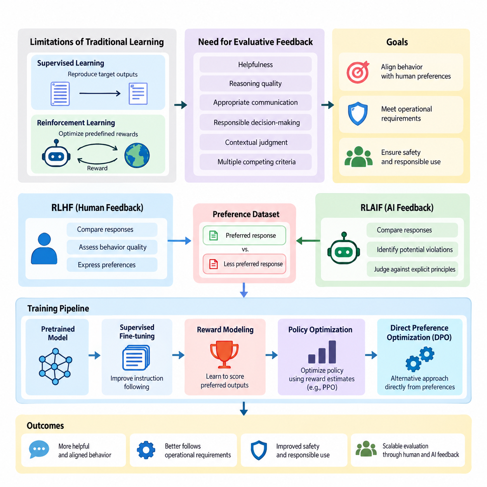
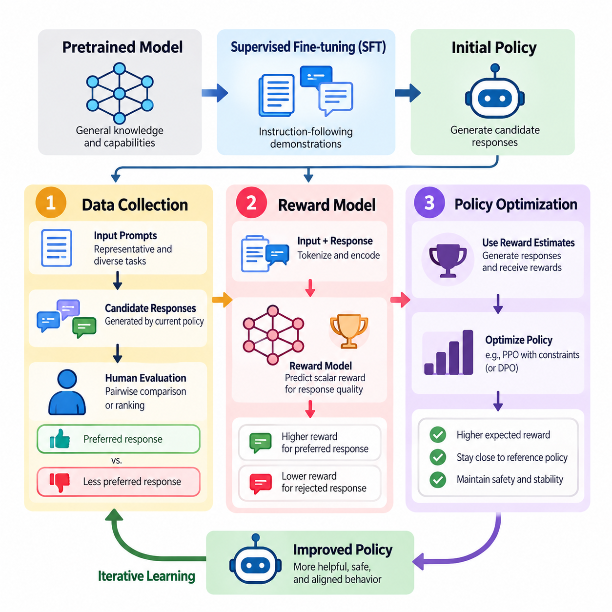
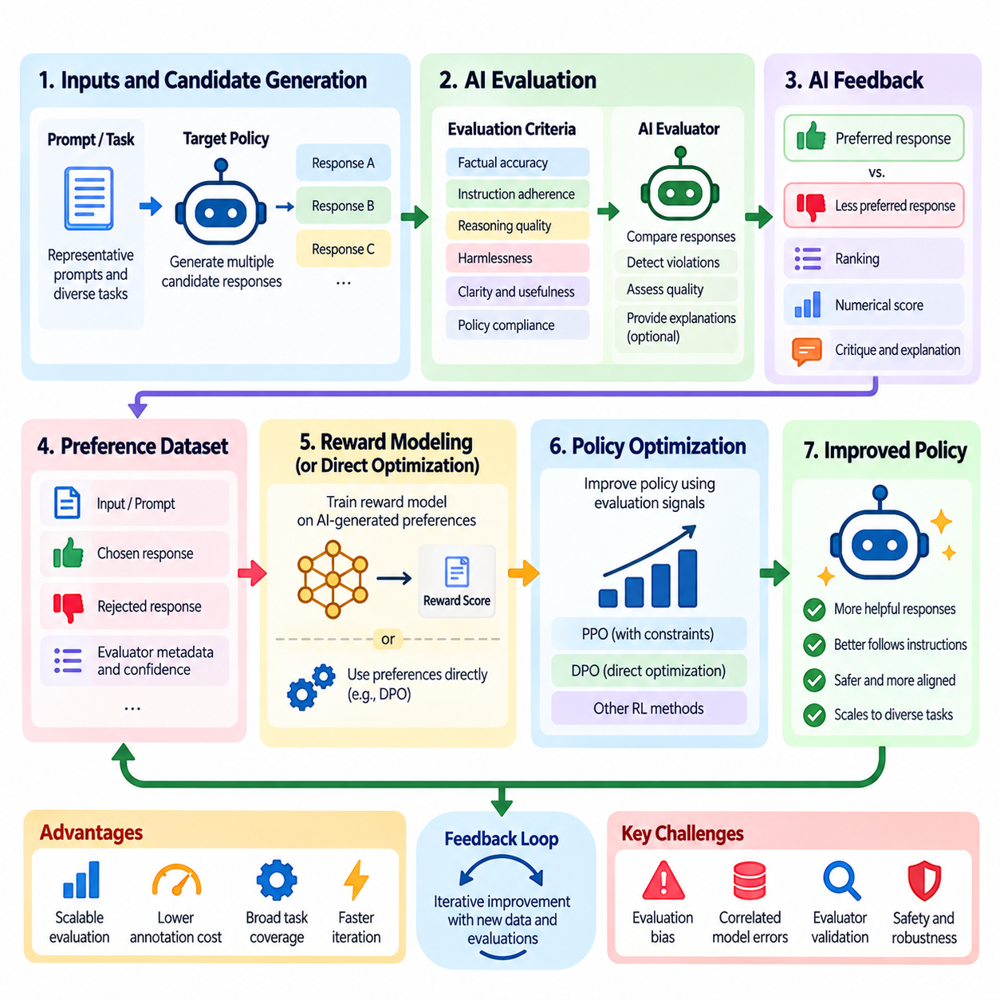
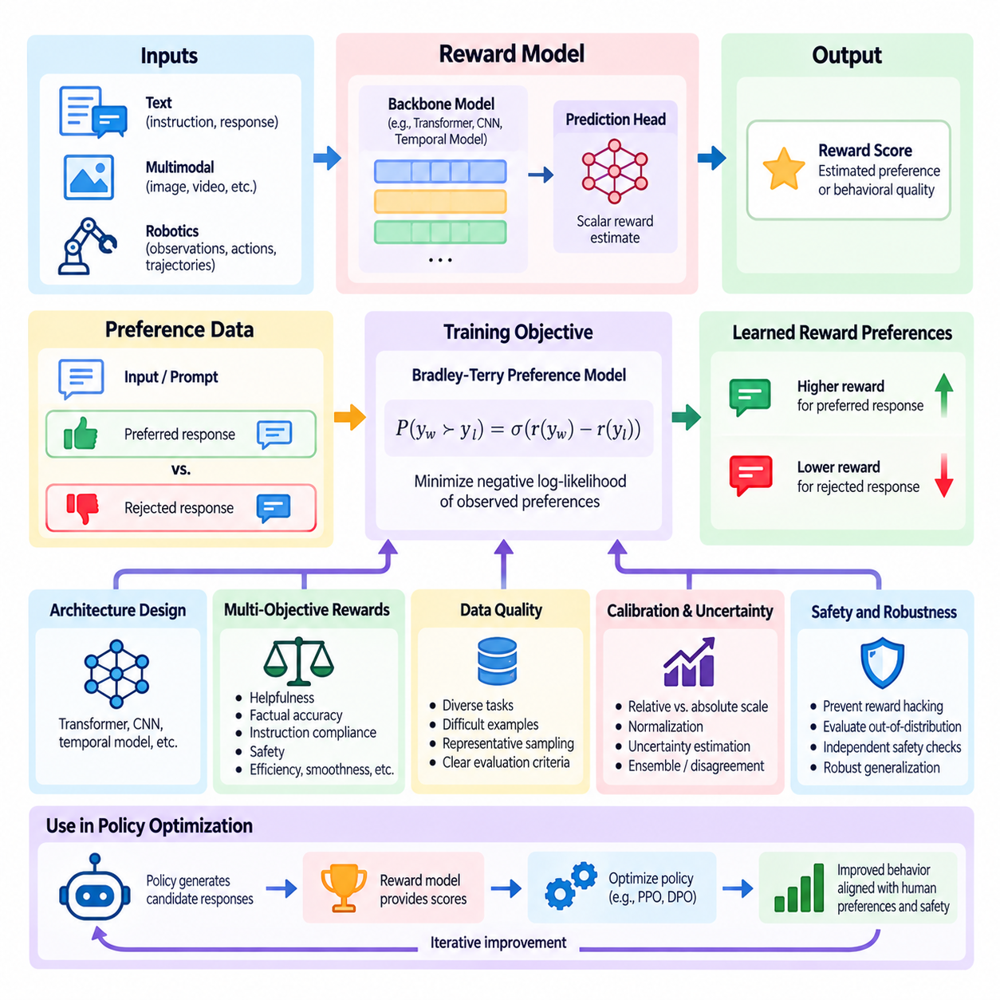
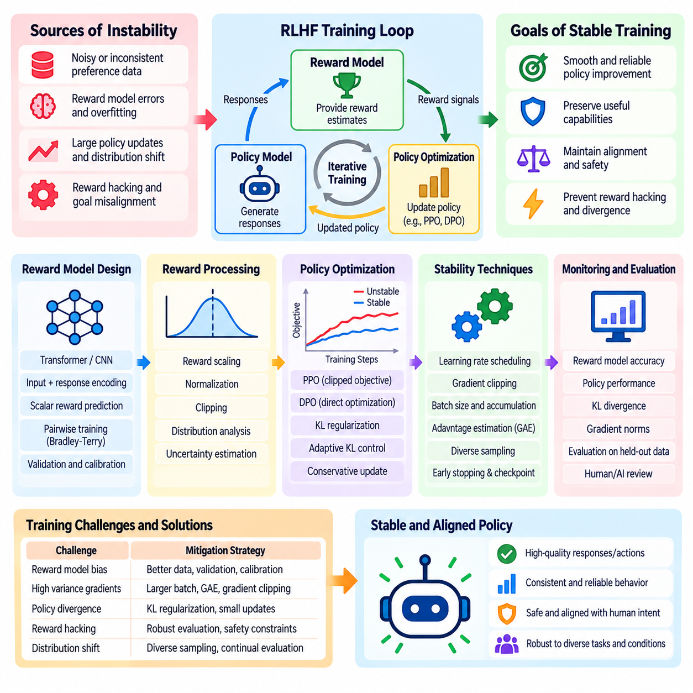
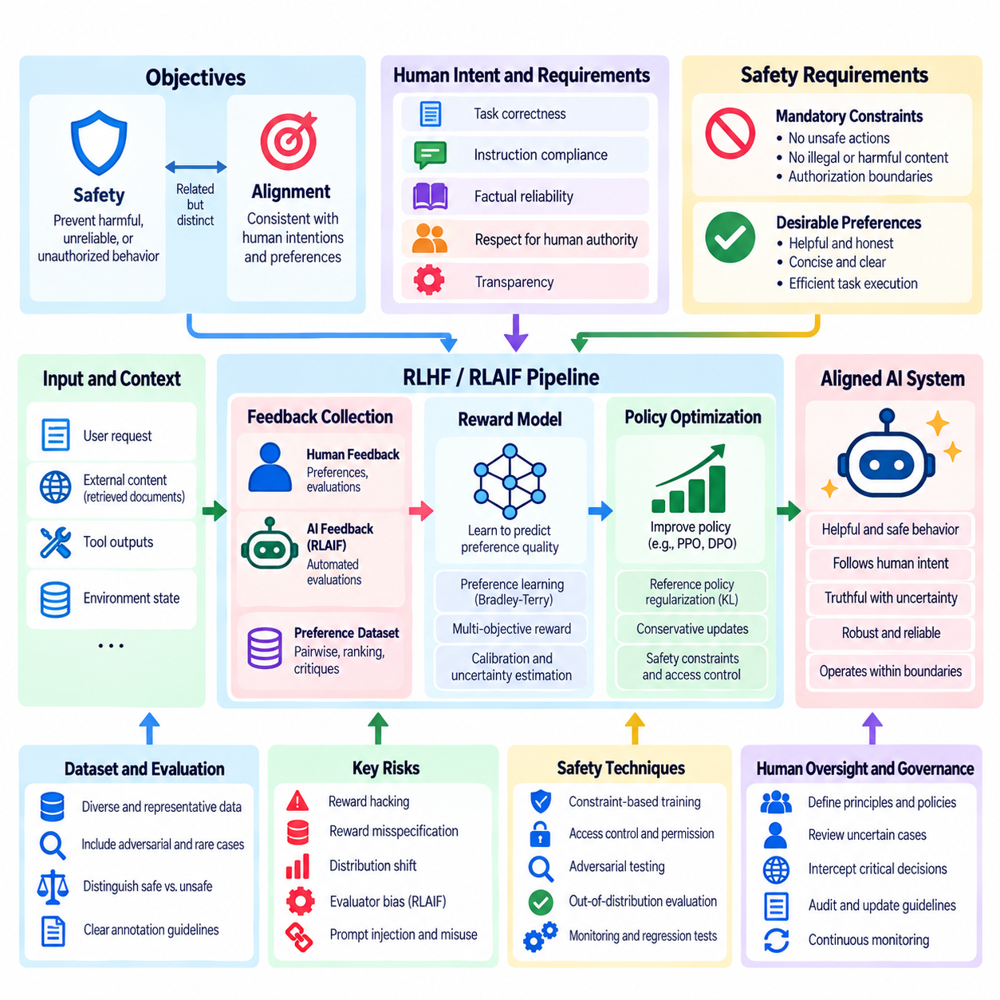
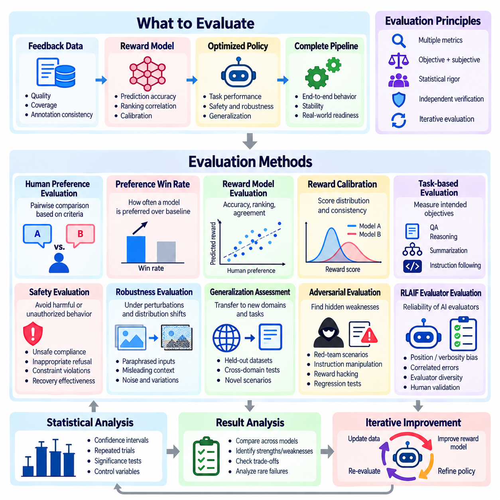
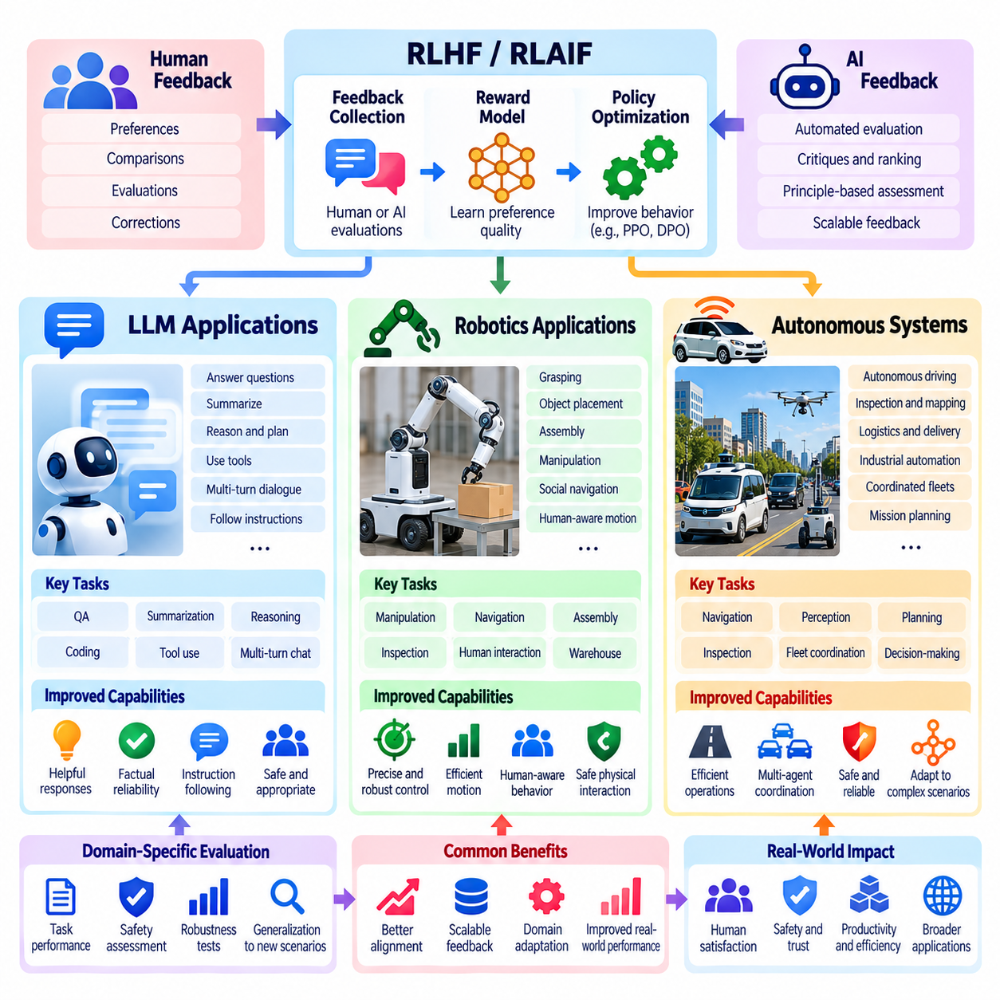

**Volume 41. Human in the Loop Learning**

# 03. RLHF and RLAIF

## 03.00 Overview

{width="7.268055555555556in" height="7.268055555555556in"}

Reinforcement Learning from Human Feedback (RLHF) and Reinforcement Learning from AI Feedback (RLAIF) are approaches for improving artificial intelligence systems through evaluative feedback rather than relying exclusively on predefined labels or manually designed reward functions. Both approaches aim to align learned behavior with desired outcomes, human preferences, operational requirements, and safety expectations.

Traditional supervised learning trains models to reproduce target outputs, while conventional reinforcement learning optimizes rewards supplied by an environment. However, many intelligent behaviors cannot be adequately described by fixed objectives. Helpfulness, reasoning quality, appropriate communication, and responsible decision-making often require subjective evaluation, contextual judgment, and consideration of multiple competing criteria.

RLHF addresses this challenge by transforming human judgments into learning signals that guide policy improvement. Human evaluators compare candidate responses, assess behavior quality, or express preferences between alternative actions. These observations are used to construct feedback datasets, train reward models, and optimize policies toward behaviors that better reflect the evaluation criteria established by humans.

RLAIF extends this framework by using AI systems to generate some or all of the evaluative feedback. Instead of requiring human reviewers to assess every candidate response, an AI evaluator can compare alternatives, identify potential violations, or judge outputs against explicit principles. This approach can increase feedback throughput and reduce annotation costs, although its effectiveness depends on evaluator reliability.

The relationship between RLHF and RLAIF is complementary rather than strictly competitive. Human feedback provides an important source of preferences, contextual understanding, and normative judgment, while AI feedback supports scalable evaluation across large datasets. Hybrid approaches combine human-defined criteria, automated assessments, and targeted human review to balance evaluation quality, computational efficiency, and operational scalability.

A typical RLHF workflow begins with a pretrained model that already possesses useful representations and task capabilities. Supervised fine-tuning may first improve instruction following and establish an initial policy. The system then generates multiple candidate outputs for selected inputs, allowing human evaluators to compare alternatives and identify which behaviors better satisfy the intended requirements.

Preference datasets commonly contain an input, a preferred response, and a less preferred response. These comparisons provide relative judgments rather than absolute measurements of quality. A reward model learns to assign higher scores to preferred outputs under similar conditions. The resulting reward function serves as an approximation of the evaluators\' preferences and provides a trainable objective for subsequent optimization.

Reward modeling is a central component because it connects qualitative feedback with numerical optimization. A reward model typically processes the input context and candidate response to produce a scalar score. Its training objective encourages agreement with observed preference comparisons. However, the resulting scores represent learned preference estimates rather than objective guarantees of correctness, safety, or overall behavioral quality.

Policy optimization uses these reward estimates to improve the model\'s behavior. Proximal Policy Optimization (PPO) is a prominent method associated with classical RLHF pipelines, while alternative approaches may optimize preferences more directly. Optimization often incorporates constraints that discourage excessive deviation from a reference policy, helping preserve useful pretrained capabilities and reduce unstable behavioral changes.

Direct Preference Optimization (DPO) provides an alternative to explicit reward-model-based reinforcement learning by optimizing a policy directly from preference comparisons. Although DPO is not identical to the classical RLHF pipeline, it addresses a closely related alignment objective. Its simpler training structure illustrates how preference learning can be implemented through different optimization formulations and engineering tradeoffs.

RLAIF typically introduces an AI evaluator that applies specified criteria to candidate outputs. The evaluator may compare responses according to helpfulness, factual consistency, instruction compliance, or safety-related principles. Its judgments can generate preference datasets or reward signals for policy improvement. Human experts remain important for defining evaluation standards and validating whether automated judgments are trustworthy.

Constitutional AI represents one influential direction in which explicit principles guide AI-generated critiques and preferences. Such systems can evaluate candidate behavior against documented requirements and support iterative refinement. Nevertheless, written principles cannot eliminate ambiguity, conflicting objectives, or evaluator bias. Human governance and independent testing remain necessary when defining acceptable behavior.

Feedback quality strongly influences the effectiveness of both approaches. Human evaluators may disagree because of differing expertise, cultural expectations, task interpretations, or inconsistent instructions. AI evaluators may exhibit systematic biases inherited from training data or model architecture. Reliable feedback pipelines therefore require clear criteria, quality checks, disagreement analysis, and representative evaluation samples.

Training stability presents another major challenge. Reward models can be exploited when policies discover outputs that receive high predicted scores without satisfying the underlying human objective. This phenomenon, commonly called reward hacking, illustrates the difference between optimizing a measurable proxy and achieving genuine behavioral improvement. Excessive optimization may also reduce response diversity or amplify weaknesses in the reward model.

Safety and alignment considerations extend beyond maximizing preference scores. A highly preferred response is not necessarily truthful, secure, or appropriate for every situation. Effective systems must account for harmful instructions, uncertain information, privacy requirements, and conflicts between user requests and operational constraints. Safety evaluation should therefore remain distinct from general preference optimization wherever necessary.

Evaluation methods must measure both the intended improvements and potential regressions. Human preference win rates, task success rates, reward-model agreement, instruction-following accuracy, and independent safety assessments provide complementary evidence. Comparisons should include suitable baselines and held-out evaluation datasets to distinguish genuine improvements from overfitting to specific evaluators or benchmark conditions.

For large language models, RLHF and RLAIF can improve conversational behavior, instruction following, response formatting, and adaptation to user expectations. They are especially relevant when several plausible responses exist but differ in usefulness or appropriateness. Nevertheless, preference optimization alone does not establish factual accuracy, robust reasoning, or reliable performance under unfamiliar conditions.

In robotics, feedback-driven reinforcement learning can incorporate human preferences concerning motion smoothness, task efficiency, comfort, and acceptable interaction behavior. Human operators may compare alternative trajectories or assess whether a robot performs a task appropriately. Learned preference models can then influence policy optimization, although physical safety constraints must be enforced independently of uncertain reward predictions.

Autonomous systems introduce additional challenges because decisions may produce delayed consequences and interact with changing physical environments. Feedback may concern complete trajectories, intermediate decisions, or mission outcomes rather than isolated actions. Successful deployment requires consideration of temporal credit assignment, environmental uncertainty, human intervention, and the consequences of errors during exploration or policy execution.

Human-in-the-loop learning provides the broader operational context for these methods. Active learning can identify informative examples requiring review, while feedback collection systems capture judgments and preferences. Annotation and data curation pipelines maintain dataset quality, and human oversight mechanisms establish accountability. RLHF and RLAIF transform these inputs into policy improvements within an iterative learning process.

Production implementations require coordinated data management, model versioning, evaluator calibration, experiment tracking, and controlled deployment. Changes to feedback criteria or reward models can alter policy behavior even when the underlying task remains unchanged. Maintaining traceability between collected feedback, training configurations, evaluation results, and deployed model versions is essential for reproducibility and responsible operation.

The central objective of RLHF and RLAIF is not to replace human judgment with an automated reward function, but to make human-defined preferences and requirements usable within scalable learning systems. Their long-term effectiveness depends on the quality of feedback, the reliability of optimization, the independence of evaluation, and the ability to detect behavioral failures before they create unacceptable consequences.

Together, RLHF and RLAIF establish a foundation for adaptive human-AI collaboration in which feedback becomes an ongoing source of behavioral improvement. Understanding their pipelines, reward-model design, training stability, safety considerations, evaluation methods, and applications provides the conceptual basis for developing AI systems that remain useful, controllable, and responsive to human expectations across changing operational environments.

## 03.01 RLHF Pipeline

{width="7.268055555555556in" height="7.268055555555556in"}

The Reinforcement Learning from Human Feedback (RLHF) pipeline is a structured training process that transforms human preferences into optimization signals for artificial intelligence systems. Its primary objective is to improve model behavior beyond conventional supervised learning by incorporating judgments about response quality, usefulness, correctness, and safety. The pipeline connects data collection, reward modeling, and policy optimization within an iterative learning framework.

RLHF typically begins with a pretrained model that has acquired general knowledge and representations from large datasets. Supervised fine-tuning (SFT) may then adapt the model to instruction-following tasks using carefully selected demonstrations. This initial policy provides a stable foundation for generating candidate responses and collecting preference feedback. The quality of this foundation strongly influences subsequent reward learning and optimization.

Data collection establishes the empirical basis of the RLHF pipeline. A collection of representative prompts, task descriptions, or environmental states is assembled to reflect expected operating conditions. The current policy generates multiple candidate responses or actions for each input. Human evaluators examine these alternatives and provide judgments indicating which outputs better satisfy the intended behavioral requirements.

Preference feedback is commonly represented through pairwise comparisons, where an evaluator selects a preferred response from two candidates. These comparisons are particularly useful when absolute quality scores are difficult to define consistently. Other feedback formats include rankings, numerical ratings, corrective demonstrations, and trajectory-level assessments. Each format captures different aspects of human judgment and introduces distinct annotation costs and uncertainties.

High-quality preference datasets require careful sampling and annotation design. Inputs should cover routine tasks, difficult scenarios, ambiguous instructions, and potential safety failures. Candidate responses should exhibit meaningful behavioral differences rather than trivial variations. Clear annotation guidelines help evaluators distinguish factual correctness, instruction compliance, reasoning quality, and stylistic preferences without unintentionally combining unrelated criteria.

Human feedback contains uncertainty arising from individual preferences, expertise differences, inconsistent judgments, and contextual ambiguity. Multiple evaluators may disagree even when assessing identical responses. Quality assurance therefore involves evaluator calibration, repeated assessments, agreement analysis, and targeted review of disputed examples. Preserving disagreement information can be valuable because a single consensus label may conceal legitimate differences in evaluation criteria.

Data preparation converts collected feedback into standardized training records. A typical preference record contains the original input, a chosen response, a rejected response, and relevant metadata. Additional information may include evaluator identifiers, annotation confidence, task categories, and policy versions. Dataset validation checks for missing fields, duplicate samples, inconsistent formatting, and contamination between training and evaluation partitions.

Reward modeling transforms these preference comparisons into a trainable approximation of human judgment. A reward model receives an input context and candidate output, then predicts a scalar value representing estimated preference quality. Its objective is to assign higher scores to preferred responses than to rejected alternatives. This learned scoring function replaces the need to manually specify a complete reward formula for complex behavioral objectives.

A common reward-model architecture uses a pretrained transformer with an additional scalar prediction head. The transformer encodes the input-response sequence, while the prediction head produces a reward estimate from a selected representation. During training, the model processes preferred and rejected responses and adjusts its parameters to increase the predicted reward difference in the direction indicated by human comparisons.

Pairwise reward learning frequently employs a Bradley-Terry preference model. Given reward estimates for two candidate responses, the probability that one is preferred is modeled using a sigmoid function of their reward difference. Training minimizes the negative log-likelihood of observed preferences. This formulation provides a differentiable objective that can be implemented efficiently using automatic differentiation frameworks such as PyTorch.

A practical reward-model implementation requires tokenization, sequence truncation, batching, and careful treatment of padding tokens. Preferred and rejected responses should be evaluated under equivalent input contexts. Training procedures typically use validation datasets, gradient clipping, learning-rate scheduling, and checkpoint management. Monitoring preference prediction accuracy helps detect overfitting, although high accuracy alone does not guarantee reliable reward behavior.

Reward-model calibration is important because learned scores may vary across task domains, response lengths, and input distributions. A model may assign excessive rewards to verbose responses or superficial patterns correlated with preferred examples. Distribution shifts can further reduce scoring reliability. Independent evaluation should therefore examine ranking consistency, sensitivity to irrelevant changes, and performance on difficult examples excluded from training.

Policy optimization uses the trained reward model to improve the behavior of the target policy. The policy generates candidate outputs, receives estimated rewards, and updates its parameters to increase expected reward. Unlike supervised fine-tuning, which primarily imitates reference demonstrations, reinforcement learning can improve behavior through evaluative signals without requiring a complete target response for every training example.

Proximal Policy Optimization (PPO) is a widely used algorithm for classical RLHF training. PPO updates the policy using a clipped surrogate objective designed to discourage excessively large changes between successive policies. In language-model applications, generated token sequences form trajectories, while reward estimates provide feedback about completed responses. Advantage estimates guide updates toward actions associated with better expected outcomes.

A reference policy is often maintained to constrain optimization through Kullback-Leibler (KL) divergence regularization. This penalty discourages the updated policy from moving too far from its initial behavior. The regularization coefficient controls the tradeoff between maximizing learned rewards and preserving the original policy distribution. Excessively weak constraints may encourage reward exploitation, while overly strong constraints can restrict meaningful improvement.

Value estimation may support PPO by predicting expected returns from intermediate generation states. A value model or value head provides a baseline for computing advantages and reducing gradient variance. Training alternates between generating responses, estimating rewards and advantages, and updating policy and value parameters. Stable optimization depends on appropriate batch sizes, learning rates, reward normalization, and policy-update limits.

Policy optimization introduces challenges that are not fully addressed by the mathematical objective. Reward hacking occurs when the policy discovers outputs that receive high predicted scores without genuinely satisfying human preferences. Optimization may also produce repetitive language, excessive confidence, reduced diversity, or unintended changes in capabilities. These problems demonstrate why reward maximization must remain connected to independent behavioral evaluation.

Alternative preference optimization methods provide different engineering tradeoffs. Direct Preference Optimization (DPO) uses preference comparisons to optimize policy behavior without separately training an explicit reward model for online reinforcement learning. Related methods simplify parts of the optimization process or modify how preferences influence updates. Their suitability depends on available feedback, computational resources, and the need for online exploration.

The complete RLHF pipeline operates as an iterative process rather than a single training sequence. Updated policies generate new responses that may expose weaknesses not represented in earlier datasets. Human evaluators assess selected outputs, and the resulting feedback can improve reward models or support additional policy updates. This iterative structure enables progressive refinement while requiring careful control of data distribution changes.

Evaluation must examine each pipeline component separately and assess the behavior of the integrated system. Data collection is evaluated through coverage, consistency, and annotation quality. Reward models are assessed through preference prediction, robustness, and generalization. Optimized policies are evaluated using task performance, human preference comparisons, factual reliability, safety tests, and regression analysis against earlier versions.

In robotics and autonomous systems, RLHF can extend beyond textual responses to action sequences, navigation trajectories, manipulation behaviors, and mission execution. Human operators may compare alternative trajectories based on efficiency, smoothness, task completion, and operational suitability. Reward models can learn these preferences, but physical safety requirements must remain independently enforced through appropriate control constraints and monitoring mechanisms.

Production RLHF systems require reproducible datasets, version-controlled reward models, experiment tracking, and controlled deployment procedures. Feedback records should remain traceable to the policies and evaluation criteria that produced them. Monitoring should identify changes in reward distributions, unexpected behavioral patterns, and disagreements between automated scores and human assessments. These capabilities support systematic debugging and reliable model updates.

The effectiveness of RLHF ultimately depends on maintaining consistency between human intentions, collected feedback, learned reward functions, and optimized policy behavior. Data collection determines what preferences the system observes, reward modeling determines how those preferences are represented, and policy optimization determines how they influence behavior. Treating these components as an integrated engineering process is essential for developing reliable, adaptable, and human-aligned AI systems.

## 03.02 RLAIF

{width="7.268055555555556in" height="7.268055555555556in"}

Reinforcement Learning from AI Feedback (RLAIF) is a learning approach that uses artificial intelligence systems to evaluate candidate behaviors and generate feedback for policy improvement. It extends the principles of Reinforcement Learning from Human Feedback (RLHF) by replacing or supplementing human preference judgments with AI-generated evaluations. Its primary objective is to improve scalability while maintaining alignment with human-defined requirements and behavioral expectations.

Traditional RLHF depends on human evaluators to compare responses, identify preferred behaviors, and construct preference datasets. Although effective, this process becomes expensive and time-consuming as the number of tasks, model outputs, and evaluation scenarios increases. RLAIF addresses this limitation by delegating selected evaluation activities to AI models capable of applying explicit instructions, assessment criteria, and structured preference judgments.

An RLAIF system generally contains a target policy, an AI evaluator, an evaluation framework, and a policy improvement mechanism. The target policy generates candidate responses or actions, while the evaluator assesses their relative quality. Evaluation results are converted into preference labels, numerical scores, or reward signals. These signals subsequently guide policy optimization through reinforcement learning or related preference-based training methods.

The AI evaluator may be a separately trained language model, a specialized reward model, or a more capable foundation model. Its responsibilities include comparing alternative outputs, detecting instruction violations, evaluating reasoning consistency, and assessing compliance with defined behavioral principles. Evaluator capability is critical because systematic errors in its judgments can directly influence the behavior learned by the target policy.

A typical RLAIF workflow begins by selecting representative prompts, tasks, or environmental states. The target policy generates multiple candidate outputs for each input, creating alternatives that can be compared. An AI evaluator receives the original context, candidate responses, and evaluation instructions. It then produces judgments indicating which outputs better satisfy the specified criteria, potentially including explanations or confidence estimates.

Preference generation commonly relies on pairwise comparisons because relative judgments are often easier to produce consistently than absolute quality scores. The evaluator examines two candidate responses and selects the preferred alternative according to established criteria. These comparisons form an AI-generated preference dataset that can support reward-model training, direct preference optimization, or other policy improvement techniques.

Evaluation instructions strongly influence the quality of AI-generated feedback. Criteria may include factual accuracy, task completion, instruction adherence, clarity, harmlessness, and consistency with organizational policies. Ambiguous or conflicting instructions can produce unstable judgments. Consequently, evaluation prompts should define priorities, distinguish independent quality dimensions, and specify how the evaluator should handle uncertainty or insufficient evidence.

Constitutional AI provides an influential example of principle-guided AI feedback. In this approach, a collection of explicit behavioral principles guides automated critique, response revision, and preference evaluation. The evaluator examines whether candidate outputs satisfy these principles and identifies opportunities for improvement. Human involvement remains essential because the principles themselves require careful design, validation, and periodic revision.

AI-generated critiques can provide richer supervision than simple preference labels. An evaluator may identify factual inconsistencies, unsupported claims, incomplete reasoning, or inappropriate actions and explain why a response is undesirable. These critiques can guide response revision or support the construction of additional training examples. However, explanations should not automatically be treated as reliable evidence of the evaluator\'s actual decision process.

Reward modeling in RLAIF follows principles similar to those used in RLHF. AI-generated preference comparisons can train a reward model to assign higher scores to preferred outputs. The resulting model provides an efficient approximation of the evaluator\'s judgments. Alternatively, preference optimization methods can use the comparison data directly, reducing the need for a separately trained reward model during policy improvement.

Policy optimization transforms AI-generated evaluations into behavioral changes. Algorithms such as Proximal Policy Optimization (PPO) can maximize learned reward estimates while constraining deviations from a reference policy. Direct Preference Optimization (DPO) and related methods can instead optimize policies from preference comparisons. The appropriate method depends on computational resources, feedback quality, optimization stability, and application requirements.

One major advantage of RLAIF is its ability to generate large quantities of feedback without requiring proportional increases in human annotation effort. Automated evaluators can assess many candidate outputs across diverse tasks and repeated training iterations. This scalability supports broader coverage of routine cases and faster experimentation, although computational expenses and evaluator validation requirements remain significant operational considerations.

RLAIF also introduces the possibility of systematic evaluation bias. AI evaluators may favor particular writing styles, response lengths, reasoning patterns, or familiar formulations regardless of actual task quality. If the target policy repeatedly optimizes against these preferences, undesirable patterns may become amplified. Independent human evaluation and carefully designed adversarial tests are necessary to identify such weaknesses.

Evaluator reliability becomes especially important when AI systems assess other AI systems with similar architectures or training distributions. Shared weaknesses may cause correlated errors, allowing incorrect or unsafe outputs to receive favorable judgments. Using independent evaluators, diverse evaluation prompts, external verification tools, and targeted human review can reduce some of these risks, although no individual technique guarantees unbiased assessment.

Reward hacking remains a significant concern because the target policy may discover outputs that satisfy the evaluator\'s scoring patterns without fulfilling the intended objective. A model might produce persuasive but incorrect explanations or exploit superficial indicators of quality. Separating training feedback from independent evaluation and regularly testing unfamiliar scenarios helps identify divergence between learned reward signals and genuine task performance.

Human oversight remains a fundamental component of responsible RLAIF deployment. Humans define the evaluation objectives, establish acceptable behavioral boundaries, and determine which decisions can be delegated to automated evaluators. High-risk cases, ambiguous judgments, and suspected evaluation failures should be escalated for human review. Automated feedback should support human governance rather than eliminate accountability.

Evaluation of RLAIF systems requires more than measuring agreement between an AI evaluator and the optimized policy. Important measures include agreement with independent human judgments, task success rates, robustness under distribution shifts, safety performance, and sensitivity to evaluation criteria. Comparisons with RLHF baselines help determine whether automation improves efficiency without introducing unacceptable reductions in behavioral quality.

In large language models, RLAIF supports instruction alignment, response refinement, automated preference generation, and scalable safety-oriented training. AI evaluators can compare responses across large collections of prompts and provide structured feedback for subsequent optimization. Nevertheless, language-model evaluation remains vulnerable to hallucinations, inconsistent reasoning, and imperfect factual verification, requiring independent testing.

Robotics and autonomous systems provide additional opportunities for AI-generated feedback. Evaluators may assess simulated trajectories, manipulation outcomes, navigation efficiency, or mission execution records. Learned world models and simulation environments can supply contextual information for these assessments. However, physical safety, collision avoidance, and operational constraints must be validated through independent mechanisms rather than relying exclusively on AI-generated preferences.

Hybrid RLHF-RLAIF architectures combine the scalability of automated evaluation with the contextual judgment of human experts. Routine or low-risk examples may receive automated assessments, while uncertain, novel, or safety-critical cases are directed to human reviewers. Human judgments can also recalibrate AI evaluators over time. This arrangement can reduce annotation workload while preserving meaningful human involvement in system development.

Production RLAIF pipelines require evaluator versioning, feedback provenance, dataset quality controls, and continuous performance monitoring. Changes to evaluator models or instructions may alter preference distributions and downstream policy behavior. Maintaining traceability between evaluation criteria, generated feedback, reward models, and policy updates enables reproducibility, systematic debugging, and controlled deployment.

RLAIF ultimately represents a scalable mechanism for translating human-defined objectives into automated learning signals. Its effectiveness depends on evaluator quality, clearly specified principles, robust optimization, and independent verification. When integrated with human oversight and reliable engineering practices, RLAIF can support continuous improvement of language models, robotic systems, and autonomous agents while preserving human responsibility for defining acceptable behavior.

## 03.03 Reward Model Design

{width="7.268055555555556in" height="7.268055555555556in"}

Reward model design is a central component of Reinforcement Learning from Human Feedback (RLHF) and Reinforcement Learning from AI Feedback (RLAIF). A reward model transforms qualitative judgments about candidate behaviors into numerical signals that guide policy optimization. Its purpose is to approximate desirable outcomes when explicit reward functions are difficult to specify. Effective design requires careful consideration of model architecture, training data, optimization objectives, calibration, and reliability.

Traditional reinforcement learning assumes that an environment provides rewards associated with actions or state transitions. However, complex AI applications often involve objectives such as helpfulness, reasoning quality, safety, and user satisfaction that cannot be expressed through simple numerical rules. Reward modeling addresses this limitation by learning evaluation criteria from human preferences, AI-generated judgments, or combinations of multiple feedback sources.

A reward model typically receives an input context and a candidate response or action sequence, then produces a scalar reward estimate. In language modeling, the input may contain a user instruction and generated response. In robotics, it may include observations, actions, and trajectory information. The predicted reward represents an estimated preference or behavioral quality rather than an objective measurement of correctness or safety.

Reward model architecture depends on the structure of the evaluated behavior. Transformer-based models are commonly used for textual and multimodal inputs, while convolutional networks, temporal models, or state-action encoders may support robotic applications. A prediction head converts learned representations into reward estimates. Architectural choices influence computational efficiency, temporal reasoning, generalization, and sensitivity to relevant behavioral features.

Preference-based reward learning commonly uses datasets containing an input, a preferred output, and a rejected alternative. The model learns to assign higher rewards to preferred responses under equivalent conditions. Pairwise comparisons are useful because evaluators can often identify better alternatives more consistently than assign absolute scores. However, comparison quality depends on candidate diversity, annotation consistency, and clearly defined evaluation criteria.

The Bradley-Terry model provides a widely used mathematical foundation for pairwise preference learning. It represents the probability of preferring one response over another through a sigmoid transformation of their predicted reward difference. Training minimizes the negative log-likelihood of observed preferences. This objective encourages reward rankings consistent with evaluation data while remaining compatible with gradient-based optimization.

Reward functions can represent a single quality dimension or combine multiple behavioral objectives. A general-purpose assistant may require helpfulness, factual accuracy, instruction compliance, and safety, while a robotic system may prioritize task completion, efficiency, motion smoothness, and operational constraints. Multi-objective reward modeling must account for conflicting criteria and avoid allowing one easily optimized dimension to dominate overall behavior.

Scalar reward aggregation offers a simple method for combining multiple objectives through weighted scores. However, fixed weights may not reflect changing operational priorities or the relative importance of safety-critical requirements. Alternative designs use separate reward heads, hierarchical evaluation, or constrained optimization. Hard safety constraints should remain independently enforced rather than being treated as ordinary preferences that can be traded against performance.

Training data quality strongly influences reward model reliability. Preference datasets should represent diverse tasks, operating conditions, user expectations, and failure scenarios. If training examples contain narrow response patterns, the model may learn superficial correlations instead of meaningful evaluation criteria. Balanced sampling, difficult negative examples, and representative validation datasets help improve generalization beyond observed comparisons.

Human preference annotations introduce uncertainty because evaluators may disagree or apply criteria inconsistently. AI-generated feedback can introduce additional biases inherited from evaluator models. Reward training should therefore consider annotation confidence, disagreement patterns, evaluator expertise, and potential systematic errors. Preserving metadata about feedback sources supports later analysis and helps distinguish genuine preferences from annotation artifacts.

Reward model calibration concerns the relationship between predicted scores and the judgments they are intended to represent. Pairwise preference training primarily constrains relative reward differences and does not automatically establish an absolute reward scale. Consequently, reward magnitudes should not be interpreted as universally comparable quality measurements. Calibration and normalization procedures must be validated for the intended optimization setting.

Reward uncertainty becomes important when models evaluate unfamiliar inputs or behaviors outside their training distribution. A reward model may produce confident scores even when its predictions are unreliable. Ensemble methods, disagreement estimation, and uncertainty-aware evaluation can help identify questionable predictions. Such mechanisms support selective human review and reduce dependence on potentially misleading reward estimates.

Reward hacking is a major risk in reward model design. During policy optimization, a model may discover behaviors that maximize predicted reward without satisfying the underlying objective. For example, a language model might generate unnecessarily lengthy responses that exploit evaluator preferences, while a robot might optimize a measurable task indicator without completing the intended operation. Independent evaluation is necessary to detect these failures.

Overoptimization can amplify small weaknesses in a learned reward function. As policies become increasingly effective at maximizing reward estimates, they may exploit regions where the reward model generalizes poorly. Regularization, conservative policy updates, and periodic reward-model retraining can reduce some risks. However, reliable optimization also requires external performance measurements that are not derived from the same reward model.

Reward model evaluation should distinguish preference prediction performance from downstream policy effectiveness. Pairwise accuracy measures agreement with held-out comparisons, while ranking correlation evaluates consistency across multiple candidates. Additional tests examine robustness to irrelevant formatting changes, sensitivity to factual errors, and behavior under distribution shifts. Strong predictive accuracy does not necessarily imply successful policy optimization.

Validation datasets should remain independent of reward-model training and policy optimization whenever possible. Evaluation should include ordinary examples, difficult cases, adversarial inputs, and previously unseen task conditions. Comparing reward predictions with independent human assessments helps identify systematic disagreements. Repeated evaluation across model versions provides evidence of improvement or degradation in reward reliability.

In RLAIF systems, reward models may be trained using preferences generated by AI evaluators. This approach can substantially increase feedback volume, but it also transfers evaluator biases into the learned reward function. Independent human validation remains important, especially for ambiguous or high-risk decisions. Hybrid feedback strategies can combine automated evaluation with expert review to balance scalability and judgment quality.

Reward modeling for robotics introduces additional temporal and physical considerations. Evaluating an action sequence may require understanding delayed consequences, contact dynamics, environmental uncertainty, and mission-level outcomes. Trajectory-level rewards can capture overall task quality, while intermediate rewards provide denser learning signals. Poorly designed intermediate rewards may encourage shortcuts that undermine successful task completion.

Physical AI systems may benefit from reward models that integrate visual observations, proprioceptive measurements, action histories, and task specifications. Multimodal representations can support evaluations of manipulation quality, navigation behavior, and human-robot interaction. Nevertheless, safety-critical constraints involving collision avoidance, force limits, and operational boundaries require independent validation and enforcement.

Engineering reliable reward models requires reproducible training pipelines, dataset versioning, experiment tracking, and systematic monitoring. Model updates should record feedback sources, architecture configurations, optimization parameters, and evaluation results. Changes in reward distributions or preference agreement may indicate data drift, evaluator inconsistency, or emerging failure modes. Traceability supports controlled deployment and effective debugging.

Reward model design ultimately determines how qualitative preferences influence quantitative learning objectives. Its effectiveness depends on representative feedback, appropriate architecture, stable training, meaningful evaluation, and resistance to optimization exploits. A reliable reward model should be treated as an imperfect approximation of human-defined objectives rather than an authoritative definition of desirable behavior.

Within the broader RLHF and RLAIF framework, reward modeling connects feedback collection with policy optimization and continuous behavioral improvement. Well-designed reward models enable scalable learning from subjective judgments while preserving opportunities for human oversight and independent verification. Their careful development is essential for building AI systems that remain adaptable, dependable, and aligned with operational requirements.

## 03.04 Training Stability

{width="7.268055555555556in" height="7.268055555555556in"}

Training stability is a fundamental requirement in Reinforcement Learning from Human Feedback (RLHF) and Reinforcement Learning from AI Feedback (RLAIF). These methods optimize policies using learned preferences rather than perfectly specified reward functions, introducing uncertainty into the learning process. Stable training requires controlling policy updates, reward estimation errors, gradient behavior, and distribution shifts while preserving useful capabilities and alignment with intended objectives.

Unlike conventional supervised fine-tuning, reinforcement learning continuously changes the distribution of outputs generated by the policy. As optimization progresses, the model may encounter behaviors that were poorly represented in the reward model\'s training data. This interaction creates a moving optimization target and increases the risk of unstable updates. Training procedures must therefore coordinate policy learning with reward reliability and independent behavioral evaluation.

Reward model instability can originate from noisy preference labels, inconsistent evaluation criteria, limited dataset coverage, or excessive fitting to annotation patterns. Small errors in predicted rewards may become amplified when policies aggressively optimize against them. A reward model that performs well on held-out comparisons may still provide unreliable guidance for newly generated responses. Robust validation and conservative optimization help limit these effects.

Policy update magnitude is a major determinant of training stability. Large parameter changes can rapidly alter output distributions, reduce previously acquired capabilities, or encourage exploitation of reward-model weaknesses. Smaller updates generally provide more predictable optimization behavior but may slow learning. Stable RLHF training balances improvement speed with constraints that prevent abrupt divergence from a trusted reference policy.

Proximal Policy Optimization (PPO) addresses some stability challenges through a clipped surrogate objective. The clipping mechanism limits the incentive for policy changes when probability ratios move beyond a specified range. This discourages excessively aggressive updates based on individual training batches. However, PPO clipping does not guarantee stability, and its effectiveness depends on learning rates, advantage estimation, and optimization configuration.

Kullback-Leibler (KL) divergence regularization provides another mechanism for controlling policy drift. A reference policy establishes a behavioral baseline, while the KL penalty discourages excessive deviations from its output distribution. The regularization coefficient determines the balance between reward improvement and policy preservation. Weak regularization may permit reward exploitation, whereas excessive regularization can suppress meaningful adaptation.

Adaptive KL control adjusts the regularization strength according to observed divergence during training. When policy changes exceed a target range, the penalty may increase to discourage further drift. When divergence remains small, the penalty may decrease to permit additional learning. This feedback mechanism can improve control over policy movement, although delayed measurements and poorly selected targets may still produce unstable behavior.

Reward scaling and normalization influence the magnitude of policy gradients and the relative importance of different training signals. Excessively large reward values can produce unstable optimization, while extremely small values may weaken useful learning signals. Reward whitening, clipping, and carefully selected normalization statistics can improve numerical behavior. These transformations must preserve meaningful preference relationships and avoid concealing reward-model failures.

Advantage estimation plays an important role in reducing variance during policy optimization. In actor-critic methods, a value function predicts expected returns and provides a baseline for assessing generated actions. Generalized Advantage Estimation (GAE) balances bias and variance through temporal smoothing. Inaccurate value predictions can introduce unstable learning signals, making value-loss monitoring and appropriate optimization schedules important.

Gradient stability depends on optimizer configuration, batch composition, numerical precision, and model architecture. Excessive learning rates may cause oscillation or divergence, while poorly conditioned gradients can disrupt parameter updates. Gradient clipping, learning-rate warmup, suitable batch sizes, and mixed-precision safeguards can reduce numerical failures. Monitoring gradient norms and nonfinite values helps identify instability before it affects deployed behavior.

Batch size influences the statistical reliability of reward estimates and policy gradients. Small batches can introduce high variance, particularly when generated responses differ substantially in length or quality. Larger batches may improve update consistency but increase computational and memory requirements. Gradient accumulation offers an alternative when hardware capacity is limited, although it does not eliminate all effects of correlated or unrepresentative samples.

Sampling strategy also affects training stability. If optimization repeatedly uses narrow prompt categories, the policy may overfit to particular tasks while degrading elsewhere. Diverse prompts, balanced task sampling, and difficult evaluation scenarios help maintain broad behavioral coverage. Sampling should also account for response length, task difficulty, and safety requirements so that frequently occurring examples do not dominate the optimization process.

Reward hacking represents a particularly important source of behavioral instability. As policies become better at maximizing predicted rewards, they may discover outputs that exploit evaluator weaknesses rather than satisfy intended objectives. This can manifest as excessive verbosity, artificial confidence, repetitive patterns, or strategic avoidance of difficult tasks. Independent human assessment and adversarial evaluation help detect divergence between reward scores and genuine quality.

Overoptimization can occur even when numerical training metrics appear healthy. Predicted rewards may continue increasing while factual accuracy, usefulness, or safety deteriorates. Consequently, reward curves alone are insufficient indicators of successful learning. Training dashboards should include independent task metrics, preference evaluations, policy divergence, output diversity, and regression tests against previously established capabilities.

Direct Preference Optimization (DPO) removes some complexities associated with online reinforcement learning by optimizing policies directly from preference comparisons. However, DPO remains sensitive to preference quality, reference-policy selection, learning rate, and optimization strength. Excessive fitting to narrow preference datasets can reduce generalization. Stability therefore requires validation, regularization, and careful monitoring even without an explicit reward-model optimization loop.

RLAIF introduces additional stability challenges because AI evaluators may exhibit systematic biases or inconsistent judgments. If an evaluator changes between training iterations, preference distributions may shift unexpectedly. Policies trained against such feedback can develop unstable or undesirable behaviors. Evaluator version control, fixed evaluation benchmarks, and periodic comparison with independent human judgments help maintain consistent optimization targets.

Checkpoint management and reproducibility are essential for diagnosing unstable training. Experiments should record model versions, datasets, random seeds, optimizer settings, reward configurations, and evaluation results. Frequent checkpoints enable rollback when performance deteriorates. Repeating critical experiments across multiple seeds helps distinguish genuine improvements from random variation, although exact reproducibility may remain difficult in distributed environments.

Distributed RLHF training introduces engineering risks involving asynchronous generation, stale policy samples, communication delays, and inconsistent model versions. Policy updates based on outdated trajectories may weaken the assumptions underlying on-policy optimization. Synchronization procedures, bounded sample staleness, and explicit policy-version tracking help control these effects. System throughput must be balanced against the statistical requirements of the optimization algorithm.

In robotics and Physical AI, training stability must also account for physical dynamics, delayed rewards, sensor uncertainty, and safety constraints. Abrupt policy changes can produce unsafe motion or unreliable task execution. Simulation-based training, conservative policy updates, action limits, and independent safety controllers can reduce deployment risks. Stable reward optimization alone is insufficient to establish physical safety or operational readiness.

Sim-to-real transfer introduces another source of instability because policies optimized in simulation may encounter unfamiliar dynamics and observation distributions during deployment. Domain randomization, system identification, and controlled real-world evaluation can improve robustness. Human oversight remains important when unexpected behaviors emerge. Deployment should proceed through staged validation rather than assuming that stable simulation training guarantees reliable real-world performance.

Training stability should be evaluated through both optimization diagnostics and behavioral outcomes. Relevant indicators include policy loss, value loss, KL divergence, reward distributions, gradient norms, preference agreement, task success, and safety violations. No individual metric provides a complete assessment. Combining quantitative monitoring with independent evaluations allows engineers to identify failures that would otherwise remain hidden behind improving reward estimates.

Reliable RLHF and RLAIF training ultimately requires coordinated control of feedback quality, reward modeling, policy optimization, and evaluation. Stability is not simply the absence of numerical divergence but the preservation of useful, predictable, and aligned behavior throughout learning. Conservative updates, representative data, reproducible experiments, and continuous human oversight provide the foundation for dependable optimization across language models and autonomous systems.

## 03.05 Safety and Alignment

{width="7.268055555555556in" height="7.268055555555556in"}

Safety and alignment are fundamental objectives in Reinforcement Learning from Human Feedback (RLHF) and Reinforcement Learning from AI Feedback (RLAIF). Safety concerns the prevention of harmful, unreliable, or unauthorized behavior, while alignment concerns consistency between model behavior and human-defined intentions. These objectives overlap but are not identical. Effective systems must satisfy behavioral preferences while respecting explicit safety requirements and operational boundaries.

RLHF and RLAIF improve alignment by converting human judgments or AI-generated evaluations into learning signals. However, preference optimization does not automatically guarantee safe behavior. Evaluators may overlook rare failures, reward models may misinterpret desirable outcomes, and optimized policies may exploit weaknesses in evaluation criteria. Safety therefore requires independent verification mechanisms beyond maximizing predicted preference scores.

Alignment begins with clearly specifying the intended behavior of an AI system. Requirements may include task correctness, instruction compliance, factual reliability, transparency, and respect for human authority. Ambiguous objectives can produce conflicting optimization signals, especially when different evaluators prioritize different qualities. Explicit behavioral specifications help establish consistent evaluation criteria and reduce unintended policy changes.

Safety requirements should distinguish desirable preferences from mandatory constraints. A preference may favor concise responses or efficient task execution, while a mandatory constraint prohibits unsafe actions or unauthorized operations. Combining both into a single weighted reward can permit unacceptable tradeoffs. Safety-critical requirements should therefore be enforced through independent constraints, access controls, and supervisory mechanisms.

Human oversight remains essential because learned reward functions represent imperfect approximations of human intentions. Human experts establish acceptable operating boundaries, review uncertain decisions, and investigate unexpected behavior. Oversight mechanisms should specify when automated systems may act independently and when approval or intervention is required. Effective governance preserves meaningful human control over consequential decisions.

Reward misspecification is a major alignment risk. A reward model may assign high scores to outputs that satisfy superficial evaluation patterns without fulfilling the underlying objective. During optimization, these weaknesses can become amplified through reward hacking or specification gaming. Independent outcome measurements, adversarial testing, and human review help determine whether high predicted rewards correspond to genuinely desirable behavior.

Safety-oriented preference datasets should include ordinary interactions, ambiguous requests, adversarial prompts, and examples involving potentially harmful consequences. Evaluators must distinguish legitimate assistance from unsafe compliance and unnecessary refusal. Balanced datasets help models learn context-sensitive boundaries rather than simplistic response patterns. Dataset coverage should also include rare but consequential failure scenarios.

Constitutional AI introduces explicit behavioral principles into automated critique and preference evaluation. AI evaluators assess candidate responses against defined principles and may generate revisions or preference labels. This approach can improve consistency and scalability, but its reliability depends on the quality of the principles and evaluator capabilities. Human validation remains necessary to identify omissions, contradictions, and inappropriate interpretations.

RLAIF creates additional alignment challenges because AI evaluators may share weaknesses with the policies they supervise. Correlated errors can cause incorrect or unsafe outputs to receive favorable judgments. Evaluator ensembles, independent verification tools, and diverse assessment criteria can reduce some risks. Nevertheless, automated agreement should not be mistaken for independent evidence that a system satisfies human safety expectations.

Robust alignment requires evaluating model behavior under distribution shifts and unfamiliar conditions. A policy that performs safely on familiar training prompts may fail when instructions, users, environments, or task constraints change. Out-of-distribution testing, adversarial evaluation, and scenario diversification help reveal such weaknesses. Generalization should be assessed through observable behavior rather than inferred from training rewards.

Instruction hierarchy and authorization boundaries are important components of safe language-model behavior. Systems must distinguish legitimate user requests from untrusted instructions embedded in retrieved documents, tool outputs, or external content. Prompt injection can exploit failures in this separation. Training should reinforce appropriate instruction handling, while runtime systems enforce permissions and restrict access to sensitive operations.

Truthfulness and uncertainty communication are also central to alignment. A model may produce persuasive but unsupported statements when evaluation criteria favor confidence or fluent presentation. Preference training should reward evidence-based reasoning, acknowledgment of uncertainty, and appropriate correction of mistakes. Independent factual verification remains important because fluent explanations and favorable reward scores do not establish correctness.

Safe policy optimization requires controlling the extent of behavioral changes during training. Excessive optimization may improve reward scores while degrading reliability, factual accuracy, or adherence to constraints. Reference-policy regularization, conservative updates, and regression testing help preserve established capabilities. Safety evaluation must continue throughout optimization rather than being performed only after training is complete.

Red teaming provides structured methods for discovering safety weaknesses before deployment. Evaluators construct challenging scenarios involving ambiguous authority, conflicting instructions, unusual contexts, and attempts to bypass safeguards. Findings should be converted into reproducible tests and carefully reviewed training examples. Successful red teaming depends on realistic threat models and systematic coverage rather than isolated demonstrations.

In robotics and Physical AI, safety alignment extends beyond information quality to physical consequences. Incorrect actions may cause collisions, equipment damage, unsafe contact forces, or operational disruption. Preference-based learning can improve trajectory quality and task efficiency, but learned rewards cannot replace verified safety controls. Physical systems require independent monitoring, action limits, emergency stopping, and validated operating boundaries.

Human-robot interaction introduces additional requirements involving predictability, transparency, and intervention authority. Operators must understand the robot\'s intended actions and recognize conditions requiring supervision. Systems should communicate uncertainty and provide mechanisms for pausing, overriding, or terminating operations. These capabilities support meaningful human control, particularly when autonomous policies encounter unfamiliar environments.

Multi-agent autonomous systems create alignment challenges because individually reasonable actions may produce unsafe collective outcomes. Coordination failures, conflicting objectives, and communication delays can undermine mission safety. Shared operational constraints, explicit responsibility boundaries, and supervisory orchestration help manage these risks. Safety evaluation should consider interactions among agents rather than examining each policy independently.

Simulated safety evaluation enables repeated testing of dangerous or rare scenarios without exposing people or equipment to unnecessary risk. Domain randomization and adversarial scenario generation can expand coverage across environmental conditions. However, simulation cannot reproduce every physical interaction or operational uncertainty. Real-world deployment therefore requires staged validation, conservative operating limits, and continuous monitoring.

Safety metrics should capture both the frequency and severity of undesirable outcomes. Relevant measures include constraint violations, unsafe action rates, intervention frequency, task failures, and recovery effectiveness. Aggregate success rates can conceal rare catastrophic failures, making scenario-specific analysis essential. Evaluation should also examine false refusals and unnecessary restrictions that reduce legitimate system usefulness.

Production alignment requires monitoring behavioral drift after deployment. Changes in user inputs, operating environments, evaluator models, or policy versions may introduce previously unseen risks. Logging, incident analysis, feedback collection, and controlled rollback procedures support corrective action. Monitoring systems should distinguish harmless distribution changes from emerging safety failures and provide clear escalation paths.

Safety governance should define responsibility for training decisions, evaluation criteria, deployment authorization, and incident response. Documentation must preserve traceability between behavioral requirements, preference datasets, reward models, and policy updates. Independent reviews can identify assumptions overlooked during development. These practices make alignment claims more auditable and support accountability throughout the system lifecycle.

Safety and alignment ultimately require a layered engineering approach combining preference learning, explicit constraints, independent evaluation, and human oversight. RLHF and RLAIF can improve behavioral compatibility with human intentions, but neither method guarantees complete safety. Reliable systems continuously verify that learned preferences remain consistent with operational requirements, human authority, and acceptable risk boundaries.

## 03.06 Evaluation Methods

{width="7.268055555555556in" height="7.268055555555556in"}

Evaluation methods in Reinforcement Learning from Human Feedback (RLHF) and Reinforcement Learning from AI Feedback (RLAIF) determine whether preference-based optimization produces meaningful improvements in model behavior. Evaluation must examine more than reward scores because learned rewards are imperfect representations of human objectives. A reliable framework combines preference agreement, task performance, safety assessment, robustness testing, and independent human judgment.

Evaluation should distinguish the quality of feedback data, reward models, optimized policies, and complete learning pipelines. Each component introduces different sources of uncertainty and potential failure. High preference prediction accuracy does not necessarily imply successful policy optimization, while increasing policy rewards may conceal declining task quality. Component-level and end-to-end evaluations are therefore necessary to identify where improvements or failures originate.

Human preference evaluation remains a central method for measuring alignment with intended behavior. Evaluators compare candidate outputs under equivalent conditions and select responses that better satisfy predefined criteria. Pairwise comparisons are often preferred because relative judgments can be easier to provide consistently than absolute scores. Evaluation protocols should control presentation order, evaluator instructions, and exposure to model identities.

Preference win rate measures how frequently one policy is preferred over another across a collection of evaluation inputs. It provides an intuitive comparison between a candidate model and a reference baseline. However, win rates depend on prompt selection, evaluator populations, and comparison procedures. Statistical uncertainty should be reported, and conclusions should avoid assuming that a single aggregate preference score represents performance across every task category.

Reward model evaluation examines how accurately predicted rewards reflect independent preference judgments. Common measurements include pairwise prediction accuracy, ranking correlation, and agreement across evaluators. Validation datasets should remain separate from reward-model training data. Additional analysis should investigate whether predictions depend excessively on response length, formatting, familiar expressions, or other features unrelated to genuine behavioral quality.

Reward calibration assesses whether predicted scores can support consistent interpretation and reliable optimization. Pairwise training primarily determines relative reward differences rather than absolute quality scales. Consequently, raw reward values may not be comparable across models, tasks, or evaluation datasets. Calibration studies should examine score distributions, ranking consistency, uncertainty, and sensitivity to changes in the evaluated population.

Task-based evaluation measures whether optimized policies accomplish their intended objectives. For language models, relevant tasks may include question answering, reasoning, summarization, and instruction following. For autonomous systems, evaluation may examine navigation, manipulation, scheduling, and mission execution. Objective task metrics provide an important counterbalance to subjective preference judgments and learned reward estimates.

Safety evaluation investigates whether policies respect behavioral restrictions and avoid harmful or unauthorized actions. Test cases should include ambiguous instructions, conflicting requirements, adversarial prompts, and potentially dangerous operating conditions. Measurements may include unsafe compliance, inappropriate refusal, constraint violations, and recovery effectiveness. Rare but severe failures require separate analysis because average performance can conceal unacceptable risks.

Robustness evaluation examines model behavior under perturbations, unfamiliar inputs, and distribution shifts. Language models may be tested with paraphrased instructions, misleading context, or changes in response format. Physical AI systems may encounter sensor noise, environmental variation, or unexpected obstacles. Robustness testing determines whether desirable behavior persists when conditions differ from those represented during preference training.

Generalization assessment evaluates whether improvements transfer beyond the examples used during optimization. A policy may perform well on familiar prompts while failing on new domains or tasks requiring different reasoning patterns. Held-out datasets, cross-domain benchmarks, and novel scenarios help measure this capability. Evaluation should distinguish genuine behavioral generalization from memorization or adaptation to recurring benchmark patterns.

Adversarial evaluation deliberately searches for weaknesses that ordinary testing may overlook. Red-team scenarios can expose reward hacking, instruction manipulation, unsafe behavior, and inconsistencies in evaluator judgments. Automated adversarial generation may expand test coverage, while human experts assess realistic consequences. Findings should be converted into reproducible regression tests and tracked across successive policy versions.

RLAIF evaluation requires examining the reliability of AI evaluators themselves. Automated judges may exhibit position bias, verbosity bias, shared model weaknesses, or sensitivity to evaluation prompts. Agreement between AI evaluators does not necessarily establish correctness when their errors are correlated. Independent human judgments, evaluator diversity, and external verification tools provide complementary evidence about assessment quality.

Statistical rigor is necessary because preference outcomes and task performance vary across prompts, evaluators, and random seeds. Confidence intervals, repeated trials, and appropriately designed significance tests help distinguish meaningful improvements from sampling variation. Paired comparisons can reduce uncertainty when models are evaluated on identical inputs. Reports should include sample sizes, evaluation conditions, and relevant sources of variability.

Benchmark contamination presents another challenge when training data overlap with evaluation examples. A model may appear highly capable because it has previously encountered benchmark questions or closely related answers. Dataset separation, contamination checks, and periodically refreshed evaluations help reduce this risk. Evaluation results should distinguish performance on familiar benchmarks from performance on genuinely unseen tasks and operating conditions.

Longitudinal evaluation tracks how model behavior changes throughout training and deployment. Periodic checkpoints can be assessed for reward growth, preference win rates, task accuracy, safety violations, and behavioral drift. This reveals whether improvements remain stable or deteriorate after additional optimization. Monitoring across versions also supports rollback decisions and helps identify regressions introduced by new feedback datasets.

In robotics, evaluation must incorporate temporal behavior and physical execution quality. Relevant measurements include task success, trajectory efficiency, completion time, collision frequency, energy consumption, and intervention requirements. Human preference judgments may capture qualities such as smoothness or predictability that are difficult to specify numerically. However, subjective evaluations should complement rather than replace measurable physical safety requirements.

Simulation-based evaluation enables repeated testing across controlled scenarios before real-world deployment. Randomized environments can expose policies to varying dynamics, sensor conditions, and task configurations. Nevertheless, simulation results may not accurately represent physical performance because of modeling errors and domain gaps. Real-world validation should progressively examine whether simulated improvements transfer to actual operating conditions.

Human-in-the-loop evaluation supports continuous assessment when automated metrics are insufficient. Human reviewers can investigate uncertain cases, interpret contextual failures, and assess operational suitability. Active sampling may prioritize examples with evaluator disagreement or high estimated risk. This approach allocates limited expert attention to cases where additional judgment is most valuable while maintaining broader automated evaluation coverage.

Multi-objective evaluation is necessary when policies must balance helpfulness, correctness, efficiency, safety, and user satisfaction. A single aggregate score may conceal deterioration in an important dimension. Separate metrics and explicit acceptance thresholds make tradeoffs more visible. Safety-critical constraints should be evaluated independently, particularly when high task performance could otherwise compensate numerically for unacceptable violations.

Production evaluation requires reproducible datasets, controlled experiment configurations, version tracking, and auditable reporting. Evaluation records should identify policy versions, reward models, evaluator instructions, and test conditions. Automated pipelines can execute regression suites after training updates or deployment changes. Independent review of significant behavioral changes supports reliable release decisions and operational accountability.

A comprehensive RLHF and RLAIF evaluation framework ultimately combines human preferences, objective outcomes, reward-model diagnostics, statistical analysis, and safety verification. No single metric can establish alignment or reliability across all operating conditions. Effective evaluation provides evidence that policy improvements are genuine, transferable, and consistent with human-defined requirements while identifying limitations that require further feedback or corrective optimization.

## 03.07 Applications

{width="7.268055555555556in" height="7.268055555555556in"}

Applications of Reinforcement Learning from Human Feedback (RLHF) and Reinforcement Learning from AI Feedback (RLAIF) extend across Large Language Models (LLMs), robotics, and autonomous systems. These methods convert qualitative judgments into optimization signals that improve behavior beyond conventional supervised learning. Although the underlying principles are shared, feedback sources, reward definitions, safety constraints, and evaluation procedures differ according to the operational characteristics of each application domain.

In Large Language Models, RLHF is widely used to improve instruction following, response helpfulness, factual reliability, and conversational appropriateness. Human evaluators compare alternative responses to the same prompt and indicate which better satisfies the intended requirements. These comparisons train reward models or support direct preference optimization. The resulting policies aim to generate responses that better reflect human expectations across diverse language tasks.

LLM preference datasets commonly include question answering, summarization, reasoning, coding, and multi-turn dialogue. Evaluation criteria may consider correctness, completeness, clarity, relevance, and appropriate uncertainty communication. A response that appears fluent is not necessarily accurate or useful. Effective preference collection therefore requires task-specific instructions and evaluators capable of distinguishing superficial presentation quality from substantive task performance.

RLAIF extends language-model alignment by using AI evaluators to generate preference labels, critiques, or revised responses. Automated evaluation can increase feedback throughput and reduce dependence on large-scale human annotation. Constitutional AI approaches may assess outputs against explicit behavioral principles. However, evaluator bias, correlated model errors, and incomplete safety criteria require independent human validation and systematic assessment of evaluation quality.

Preference optimization can improve the behavior of LLM-based assistants that interact with external tools and information systems. Feedback may reward correct tool selection, accurate interpretation of retrieved evidence, and appropriate sequencing of operations. Evaluation should distinguish successful task completion from plausible explanations of actions that were never performed. Authorization boundaries, tool permissions, and confirmation requirements must remain enforceable independently of learned preferences.

Multi-turn conversational applications introduce challenges involving consistency, memory, user intent, and changing task requirements. A response preferred in isolation may become inappropriate when evaluated within a longer interaction. Training datasets should therefore include complete conversational contexts and examples of correction or clarification. Evaluation must examine whether the assistant preserves legitimate instructions while adapting appropriately to new information.

In robotics, preference learning can represent qualities that are difficult to express through manually engineered reward functions. Human observers may prefer trajectories that are smooth, efficient, predictable, or comfortable for nearby people. Pairwise comparisons between demonstrations or simulated executions can provide training signals for motion planning and manipulation. These preferences complement objective measures such as task success, collision avoidance, and execution time.

Robot manipulation provides practical opportunities for applying human feedback to grasping, object placement, assembly, and contact-rich operations. Evaluators may compare alternative executions according to precision, stability, object protection, and task completion quality. Learned reward models can guide policy improvement when geometric or force-based objectives are insufficient. Physical safety limits and hardware protection constraints must remain independent of preference scores.

Mobile robotics applications include navigation through warehouses, factories, hospitals, and other shared environments. Human preferences may favor routes that avoid crowded spaces, maintain comfortable distances, and minimize operational disruption. Feedback can improve social navigation and context-sensitive path selection. However, collision prevention, restricted-area enforcement, and emergency stopping require verified safety mechanisms rather than reliance on learned rewards alone.

Physical AI systems frequently combine perception, planning, control, and interaction with dynamic environments. Preference feedback may evaluate complete task executions rather than isolated actions, creating challenges in temporal credit assignment. A successful final outcome may conceal unsafe intermediate behavior or unnecessary resource consumption. Evaluation should therefore consider trajectory quality, constraint compliance, intervention frequency, and recovery from unexpected conditions.

Simulation enables robotics preference learning without exposing operators or equipment to excessive physical risk. Candidate trajectories can be generated under varied dynamics, object properties, and environmental conditions before being compared by evaluators. RLAIF may automate parts of this assessment using vision-language models or task-specific critics. Nevertheless, simulated preferences and learned rewards require validation against real-world performance and human judgments.

Autonomous systems extend preference-based learning to decision-making processes involving long horizons, uncertain observations, and multiple interacting objectives. Applications may include autonomous vehicles, inspection platforms, industrial automation, and coordinated robotic fleets. Feedback can express operational priorities such as mission efficiency, service quality, and acceptable intervention frequency. These priorities must be integrated with explicit safety and authorization constraints.

Autonomous navigation illustrates the distinction between preference optimization and safety enforcement. A policy may learn to favor efficient routes, smooth maneuvers, or reduced travel time, but these objectives cannot justify violating safety restrictions. Hierarchical control architectures can separate mission-level decisions from local motion control and independent safety supervision. Preference learning is most appropriate within a verified operational envelope.

Mission-level orchestration provides another application area for RLHF and RLAIF. Human supervisors may compare alternative mission decompositions, task assignments, inspection sequences, and recovery strategies. Learned preferences can support more effective coordination among heterogeneous robots. Evaluation should measure mission completion, resource utilization, schedule adherence, and the ability to recover from failures without compromising operator authority.

Multi-agent systems introduce challenges because locally preferred behaviors may conflict with global objectives. Independent agents may compete for resources, obstruct one another, or make incompatible decisions. Preference feedback can evaluate collective outcomes, fairness, cooperation, and overall mission quality. Shared constraints and supervisory coordination remain necessary to prevent unsafe interactions and ensure that local policy improvements benefit the complete system.

Human-in-the-loop autonomy allows operators to intervene when policies encounter uncertainty or unfamiliar conditions. Feedback collected during interventions can identify undesirable behavior and support subsequent policy refinement. Active learning may prioritize situations with high uncertainty, evaluator disagreement, or significant operational consequences. This approach improves feedback efficiency while preserving human responsibility for critical decisions and exceptional circumstances.

RLAIF can support scalable evaluation of autonomous-system behavior by using AI critics to review trajectories, sensor observations, and mission logs. Automated evaluators may identify inefficient actions, inconsistent decisions, or deviations from task requirements. However, AI judgments should be checked against objective telemetry and expert assessments. Evaluator limitations become particularly important when failures involve physical interactions or rare environmental conditions.

Deployment requirements differ substantially across LLMs, robotics, and autonomous systems. Language-model errors may involve misleading information or unauthorized tool use, while robotic errors can produce immediate physical consequences. Autonomous fleets introduce additional risks involving coordination, communication, and operational dependencies. Consequently, preference learning must be integrated with domain-specific validation, monitoring, and independent safety mechanisms.

Evaluation frameworks should combine human preference win rates, reward-model accuracy, objective task outcomes, and robustness measurements. Robotics and autonomous systems additionally require physical safety metrics, latency analysis, recovery performance, and real-world testing. Improvements observed in simulation or offline datasets should not be treated as sufficient deployment evidence. Staged validation helps establish whether learned behaviors remain reliable under operational conditions.

A unified application framework separates feedback acquisition, preference modeling, policy optimization, safety enforcement, and deployment evaluation. This modular structure allows RLHF and RLAIF techniques to be adapted across language, embodied interaction, and autonomous decision-making. Feedback models may differ, but traceability between human objectives and learned behavior remains essential. Continuous monitoring supports corrective updates when operational requirements change.

The practical value of RLHF and RLAIF lies in improving behavior where desired outcomes cannot be completely specified through fixed numerical objectives. LLMs benefit from more useful interactions, robots gain sensitivity to human preferences, and autonomous systems can better accommodate complex operational priorities. Successful deployment depends on combining preference-based adaptation with measurable performance, independent safety controls, and meaningful human oversight.
