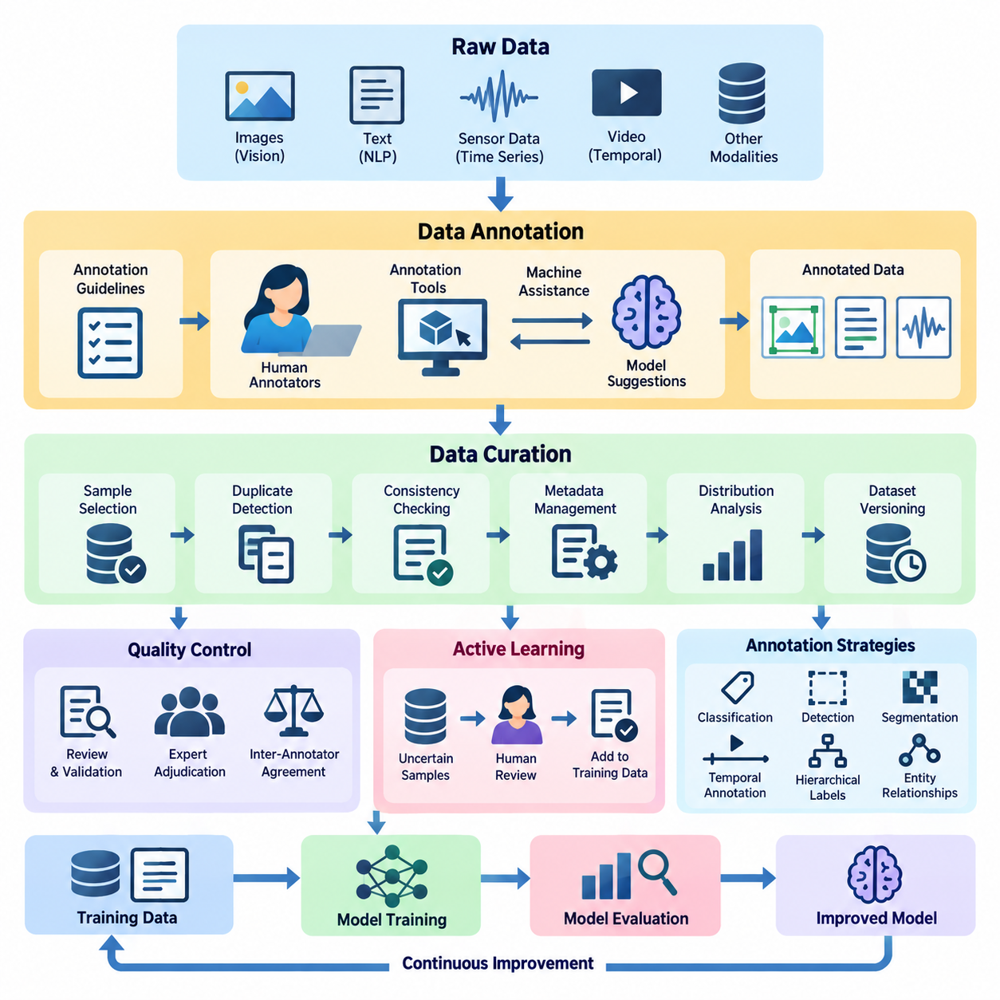
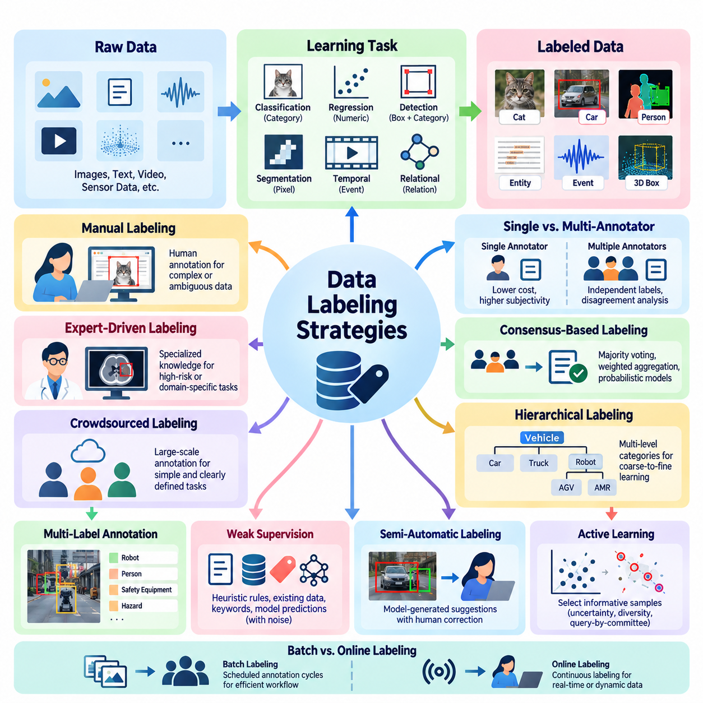
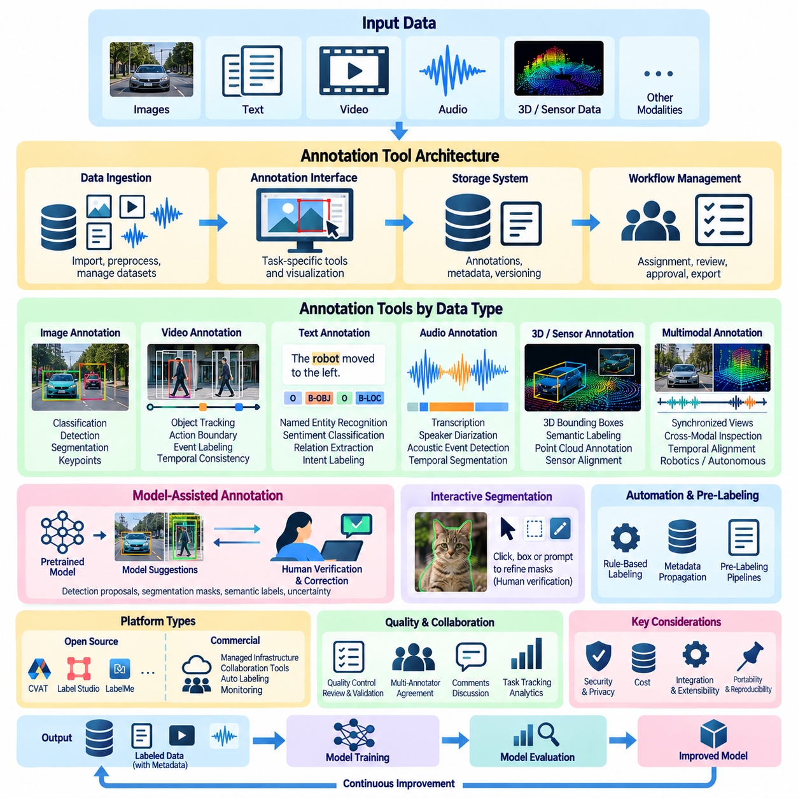
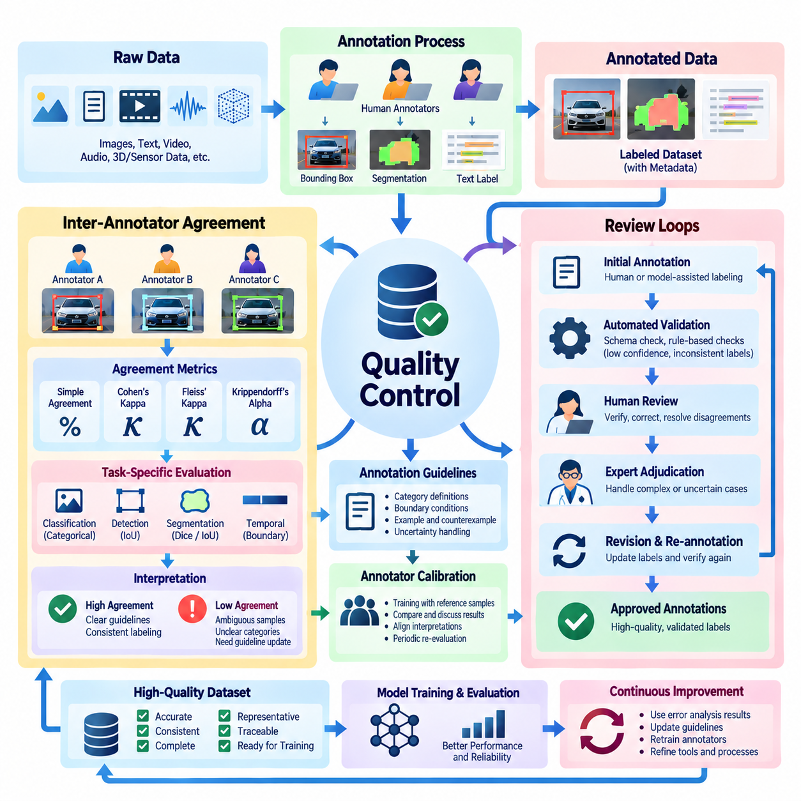
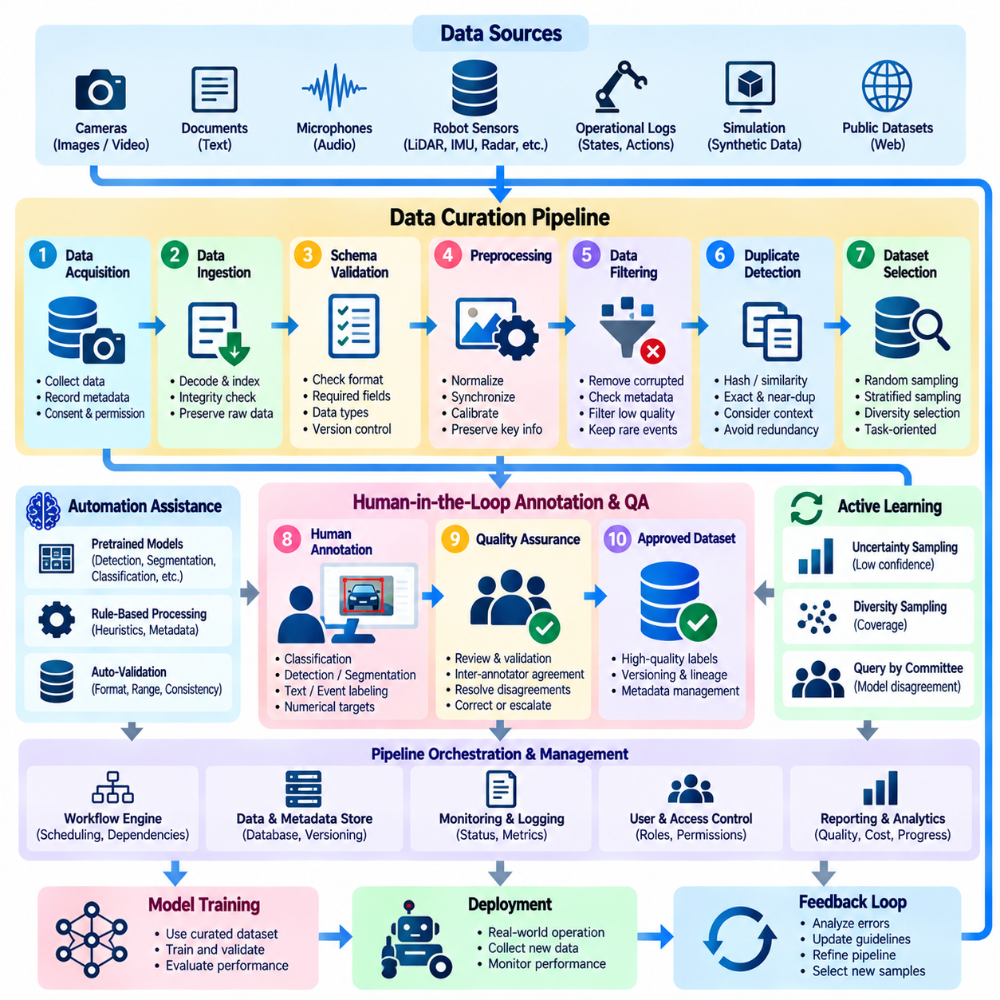
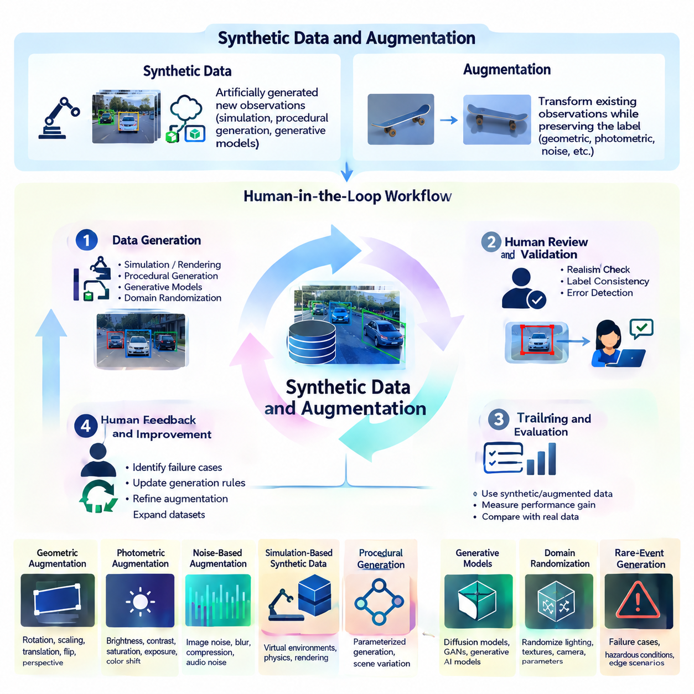
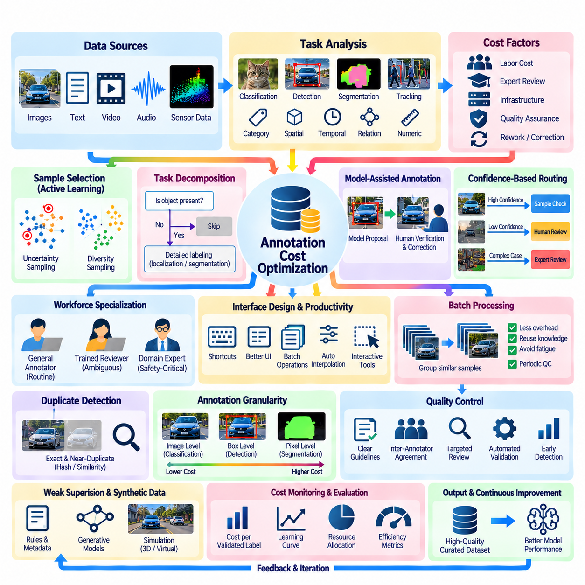
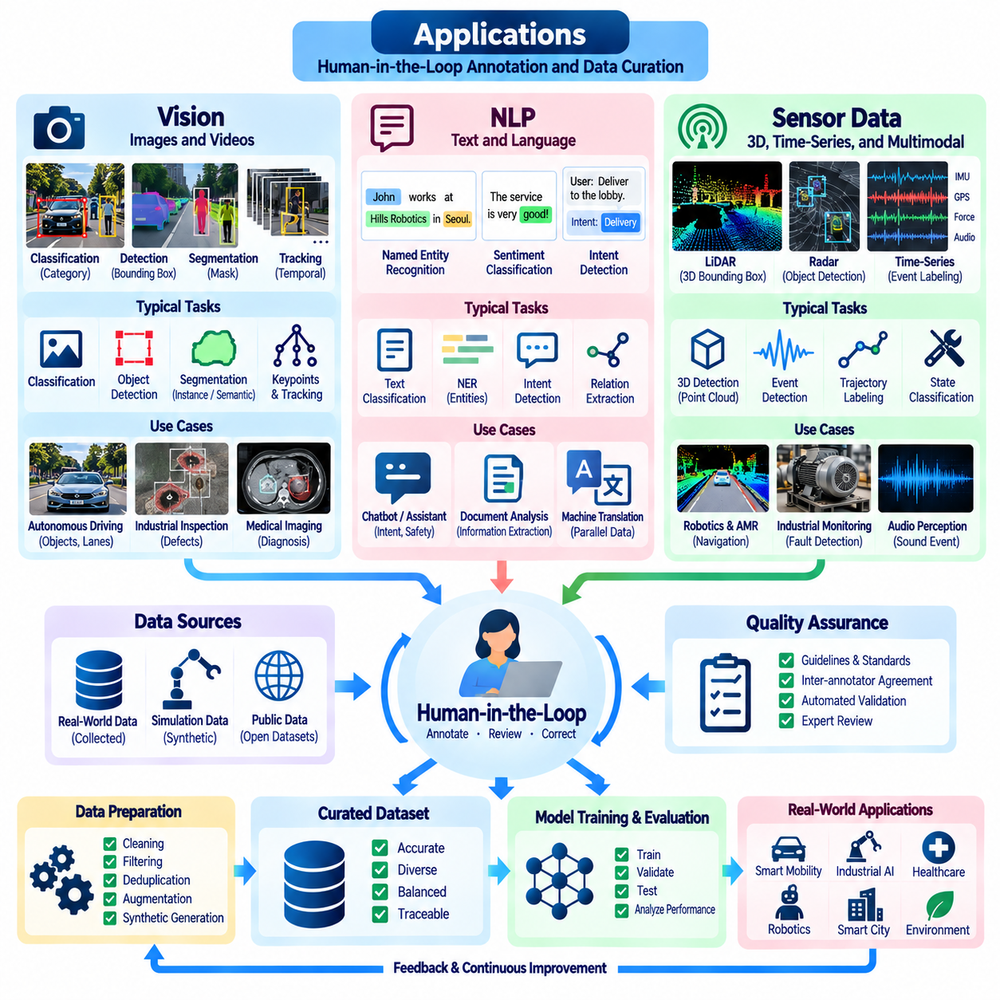

**Volume 41. Human in the Loop Learning**


# 04. Annotation and Data Curation

##  

## 04.00 Overview

{width="7.268055555555556in" height="7.268055555555556in"}

Annotation and data curation are fundamental components of Human-in-the-Loop (HITL) learning, providing the structured information required to train, evaluate, and continuously improve artificial intelligence systems. Annotation assigns meaningful labels to raw observations, while data curation organizes, validates, filters, and maintains datasets. Together, these processes transform heterogeneous information into reliable learning resources.

Modern artificial intelligence depends not only on model architectures and computational resources but also on the accuracy, consistency, and representativeness of training data. Incorrect labels, duplicated samples, incomplete metadata, and biased distributions can undermine model performance even when sophisticated learning algorithms are employed. Effective annotation and curation therefore constitute essential mechanisms for controlling data quality throughout the AI lifecycle.

Within Human-in-the-Loop learning, annotation is more than a preliminary data preparation activity. It establishes a continuous interaction between human expertise and machine learning systems. Human annotators interpret ambiguous observations, correct automated predictions, and identify previously unrecognized patterns. Models subsequently incorporate these corrections, producing improved predictions that can support future annotation activities.

Data annotation converts unstructured or partially structured observations into representations suitable for supervised and interactive learning. Depending on the application, annotations may describe object categories, spatial boundaries, semantic relationships, temporal events, numerical measurements, or preferred behaviors. Their structure must correspond to the intended learning objective, since different prediction tasks require different forms of ground truth.

Data curation extends beyond assigning labels by addressing the overall composition and reliability of a dataset. It includes sample selection, duplicate detection, consistency checking, metadata management, distribution analysis, and dataset versioning. A well-curated dataset should preserve meaningful diversity while minimizing irrelevant redundancy, systematic errors, and unintended correlations that could distort model behavior.

The relationship between annotation and active learning is particularly important when human labeling resources are limited. Rather than annotating every available observation, an active learning system identifies samples expected to provide substantial learning value. Human experts review these selected examples, and the resulting annotations are incorporated into subsequent training cycles. This approach can reduce labeling effort while maintaining competitive model performance.

Annotation strategies vary according to data complexity, application requirements, and available expertise. Simple classification tasks may require assigning one category to each sample, whereas object detection requires spatial localization and category identification. Segmentation involves detailed region boundaries, while temporal annotation identifies events or actions within sequences. Complex tasks may require hierarchical labels, multiple attributes, or relationships among entities.

The choice of annotation strategy directly affects dataset consistency and downstream model capabilities. Annotation guidelines should define category boundaries, acceptable uncertainty, ambiguous cases, and procedures for handling incomplete observations. Without standardized instructions, annotators may interpret identical samples differently. Such inconsistencies introduce label noise and can prevent models from learning stable relationships between observations and target outputs.

Annotation tools provide interfaces that help human experts inspect data, assign labels, and correct predictions efficiently. Computer vision platforms may support bounding boxes, polygons, segmentation masks, and keypoints. Natural language processing tools may provide token-level tagging, entity identification, and relationship annotation. Sensor-oriented interfaces may display synchronized measurements, temporal sequences, and multidimensional observations.

Machine-assisted annotation improves productivity by combining automated predictions with human verification. A pretrained model may propose candidate labels, object boundaries, or semantic categories, allowing annotators to focus on corrections rather than creating every annotation manually. However, automated suggestions can introduce confirmation bias when humans accept predictions without sufficient examination. Interface design must therefore encourage independent judgment.

Annotation quality control evaluates whether assigned labels are accurate, consistent, and suitable for their intended purpose. Common procedures include independent review, expert adjudication, reference samples, and automated validation rules. Quality assessment should distinguish between annotation errors and legitimate ambiguity in the underlying data. A disagreement between annotators does not necessarily indicate negligence, particularly when observations admit multiple interpretations.

Inter-annotator agreement provides a systematic method for examining consistency among human labelers. Measures such as Cohen\'s kappa, Fleiss\' kappa, and Krippendorff\'s alpha can quantify agreement under different annotation conditions. These measurements should be interpreted alongside class distributions, task difficulty, and annotation guidelines. High agreement indicates consistency but does not independently establish that annotations are factually correct.

Review loops provide mechanisms for detecting and resolving annotation problems before they propagate into model training. Samples with conflicting labels, low confidence, or unusual characteristics can be escalated to experienced reviewers. Adjudication outcomes should be documented and incorporated into revised guidelines. This process gradually improves annotation consistency while establishing an auditable record of human decisions and corrections.

Data curation pipelines coordinate the transformation of collected observations into validated datasets. A typical pipeline performs ingestion, format normalization, metadata extraction, quality screening, annotation integration, and dataset partitioning. Each processing stage should preserve traceability between original observations and derived records. Automated checks can identify corrupted files, invalid labels, missing attributes, and inconsistent annotation structures.

Dataset versioning is essential for reproducible experimentation and continuous learning. Changes to annotations, filtering criteria, or sample composition can alter training outcomes even when model architectures remain unchanged. Maintaining dataset identifiers, transformation histories, annotation revisions, and validation records enables researchers to reconstruct experimental conditions. This traceability also supports rollback when newly curated data produces unexpected performance degradation.

Synthetic data and augmentation offer complementary methods for increasing dataset coverage when real-world observations are scarce or expensive. Simulation, generative models, and controlled transformations can produce additional examples representing diverse environments and operating conditions. However, synthetic samples must preserve task-relevant relationships. Unrealistic distributions, incorrect generated labels, or inappropriate transformations can reduce rather than improve model reliability.

Human oversight remains necessary when synthetic data is integrated with real observations. Experts can evaluate whether generated examples preserve semantic meaning, physical plausibility, and application-specific constraints. For example, geometric transformations may be appropriate for object classification but unsuitable for tasks involving directional relationships or calibrated physical measurements. Augmentation policies should therefore reflect the assumptions and invariances of each learning objective.

Annotation cost optimization seeks to balance labeling expenditure, data quality, and model improvement. Costs include human labor, expert review, annotation infrastructure, quality assurance, and repeated correction cycles. Efficient workflows prioritize informative samples, automate routine operations, and reserve specialized expertise for difficult decisions. Cost should be evaluated relative to measurable learning benefits rather than simply the number of annotations produced.

Data diversity and representativeness are equally important considerations. A large dataset dominated by common operating conditions may provide insufficient information about rare events, minority categories, or environmental changes. Curators should examine coverage across relevant attributes and operational scenarios. Targeted collection and annotation can address identified gaps, although dataset balancing must avoid introducing artificial distributions that misrepresent deployment conditions.

In computer vision applications, annotation and curation support image classification, object detection, segmentation, tracking, and scene understanding. Labels may identify visual categories, object locations, instance boundaries, or temporal identities. Dataset quality depends on factors such as image resolution, occlusion, lighting variation, camera geometry, and class imbalance. Consistent spatial annotations are especially important when evaluation depends on localization accuracy.

Natural language processing introduces different annotation challenges because linguistic meaning depends heavily on context. Tasks may involve sentiment classification, named entity recognition, intent identification, semantic relationships, or preference judgments. Ambiguity, cultural variation, specialized terminology, and differences in annotator interpretation can influence labeling outcomes. Carefully designed guidelines and expert review help establish more consistent semantic representations.

Sensor data annotation is especially significant in robotics, industrial automation, and Physical AI systems. Measurements from cameras, LiDAR, radar, inertial sensors, and other devices may require synchronization and contextual interpretation. Annotations can describe environmental states, detected objects, operational events, or system failures. Reliable labels depend on sensor calibration, timestamp accuracy, measurement uncertainty, and the physical conditions under which data was collected.

The integration of annotation and data curation into operational AI workflows enables continuous improvement after deployment. Production observations can reveal distribution shifts, unexpected behaviors, and previously unrepresented conditions. Selected observations are returned to human reviewers, incorporated into curated datasets, and used for model refinement. This feedback mechanism connects data management with monitoring, evaluation, and iterative model development.

Ultimately, annotation and data curation establish the informational foundation of trustworthy Human-in-the-Loop learning. Their effectiveness depends on coordinated human expertise, appropriate automation, rigorous quality control, and transparent data management. By treating datasets as evolving, validated assets rather than static training inputs, AI systems can improve their reliability, adaptability, and ability to learn from meaningful human supervision.

어노테이션(Annotation)과 데이터 큐레이션(Data Curation)은 인간 참여형 학습(Human-in-the-Loop Learning, HITL)의 핵심 구성 요소로, 인공지능(Artificial Intelligence) 시스템의 학습, 평가 및 지속적인 개선에 필요한 구조화된 정보를 제공한다. 어노테이션은 원시 관측 데이터(Raw Observation Data)에 의미 있는 레이블(Label)을 부여하는 과정이며, 데이터 큐레이션은 데이터셋(Dataset)을 구성하고 검증하며 필터링하고 유지 관리하는 과정이다. 이 두 과정은 이질적인 정보를 신뢰할 수 있는 학습 자원으로 변환한다.

현대 인공지능(Artificial Intelligence)은 모델 아키텍처(Model Architecture)와 컴퓨팅 자원(Computational Resources)뿐만 아니라 학습 데이터(Training Data)의 정확성(Accuracy), 일관성(Consistency), 대표성(Representativeness)에 크게 의존한다. 잘못된 레이블, 중복 샘플, 불완전한 메타데이터(Metadata), 편향된 데이터 분포(Data Distribution)는 정교한 학습 알고리즘을 사용하더라도 모델 성능을 저하시킬 수 있다. 따라서 효과적인 어노테이션과 데이터 큐레이션은 인공지능 생명주기(AI Lifecycle) 전반에서 데이터 품질을 관리하는 필수적인 메커니즘이다.

인간 참여형 학습(Human-in-the-Loop Learning)에서 어노테이션은 단순한 사전 데이터 준비 작업 이상의 의미를 가진다. 이는 인간의 전문 지식(Human Expertise)과 기계학습(Machine Learning) 시스템 사이에 지속적인 상호작용을 형성한다. 인간 어노테이터(Human Annotator)는 모호한 관측 결과를 해석하고, 자동화된 예측을 수정하며, 이전에 인식되지 않았던 패턴을 식별한다. 이후 모델은 이러한 수정 결과를 학습에 반영하고, 개선된 예측을 생성하여 후속 어노테이션 작업을 지원한다.

데이터 어노테이션(Data Annotation)은 비정형(Unstructured) 또는 부분적으로 구조화된 관측 데이터를 지도학습(Supervised Learning)과 상호작용 학습(Interactive Learning)에 적합한 표현으로 변환한다. 응용 분야에 따라 어노테이션은 객체 범주(Object Category), 공간적 경계(Spatial Boundary), 의미적 관계(Semantic Relationship), 시간적 이벤트(Temporal Event), 수치 측정값(Numerical Measurement), 선호 행동(Preferred Behavior) 등을 기술할 수 있다. 어노테이션 구조는 학습 목표와 일치해야 하며, 예측 작업의 유형에 따라 서로 다른 정답 데이터(Ground Truth)가 요구된다.

데이터 큐레이션(Data Curation)은 레이블 부여를 넘어 데이터셋의 전체적인 구성과 신뢰성을 관리한다. 여기에는 샘플 선택(Sample Selection), 중복 탐지(Duplicate Detection), 일관성 검사(Consistency Checking), 메타데이터 관리(Metadata Management), 분포 분석(Distribution Analysis), 데이터셋 버전 관리(Dataset Versioning)가 포함된다. 잘 정제된 데이터셋은 의미 있는 다양성을 유지하면서 불필요한 중복, 체계적 오류(Systematic Error), 의도하지 않은 상관관계(Unintended Correlation)를 최소화하여 모델의 학습 행동이 왜곡되는 것을 방지해야 한다.

어노테이션과 능동학습(Active Learning)의 관계는 인간의 레이블링(Labeling) 자원이 제한된 환경에서 특히 중요하다. 모든 관측 데이터에 레이블을 부여하는 대신, 능동학습 시스템은 학습에 높은 가치를 제공할 것으로 예상되는 샘플을 식별한다. 인간 전문가는 선택된 샘플을 검토하고, 생성된 어노테이션은 후속 학습 주기(Training Cycle)에 통합된다. 이러한 접근 방식은 모델 성능을 경쟁력 있는 수준으로 유지하면서 레이블링에 필요한 작업량을 줄일 수 있다.

어노테이션 전략(Annotation Strategy)은 데이터의 복잡성, 응용 요구사항, 활용 가능한 전문 지식에 따라 달라진다. 단순 분류(Classification) 작업에서는 각 샘플에 하나의 범주를 지정할 수 있지만, 객체 탐지(Object Detection)에서는 공간적 위치 추정과 범주 식별이 필요하다. 분할(Segmentation)은 세밀한 영역 경계를 요구하며, 시간적 어노테이션(Temporal Annotation)은 시퀀스(Sequence) 내 이벤트나 행동을 식별한다. 복잡한 작업에서는 계층적 레이블(Hierarchical Label), 다중 속성(Multiple Attributes), 개체 간 관계(Relationship)를 함께 표현해야 할 수 있다.

어노테이션 전략의 선택은 데이터셋의 일관성과 후속 모델의 기능에 직접적인 영향을 미친다. 어노테이션 지침(Annotation Guidelines)은 범주 간 경계, 허용 가능한 불확실성(Uncertainty), 모호한 사례(Ambiguous Case), 불완전한 관측 데이터의 처리 절차를 정의해야 한다. 표준화된 지침이 없으면 어노테이터마다 동일한 샘플을 다르게 해석할 수 있다. 이러한 불일치는 레이블 잡음(Label Noise)을 발생시키고, 모델이 관측 데이터와 목표 출력 사이의 안정적인 관계를 학습하는 것을 방해할 수 있다.

어노테이션 도구(Annotation Tools)는 인간 전문가가 데이터를 검사하고, 레이블을 부여하며, 예측 결과를 효율적으로 수정할 수 있도록 인터페이스(Interface)를 제공한다. 컴퓨터 비전(Computer Vision) 플랫폼은 경계 상자(Bounding Box), 다각형(Polygon), 분할 마스크(Segmentation Mask), 핵심점(Keypoint)을 지원할 수 있다. 자연어 처리(Natural Language Processing) 도구는 토큰 단위 태깅(Token-Level Tagging), 개체명 식별(Entity Identification), 관계 어노테이션(Relationship Annotation)을 제공할 수 있다. 센서 데이터용 인터페이스는 동기화된 측정값, 시간적 시퀀스, 다차원 관측 데이터를 표시할 수 있다.

기계 보조 어노테이션(Machine-Assisted Annotation)은 자동화된 예측과 인간 검증(Human Verification)을 결합하여 생산성을 향상시킨다. 사전 학습 모델(Pretrained Model)은 후보 레이블, 객체 경계, 의미적 범주를 제안할 수 있으며, 어노테이터는 모든 어노테이션을 처음부터 생성하는 대신 수정 작업에 집중할 수 있다. 그러나 자동화된 제안은 인간이 충분한 검토 없이 예측 결과를 수용할 때 확증 편향(Confirmation Bias)을 유발할 수 있다. 따라서 인터페이스 설계는 독립적인 판단을 장려해야 한다.

어노테이션 품질 관리(Annotation Quality Control)는 부여된 레이블이 정확하고 일관되며 의도한 목적에 적합한지를 평가한다. 일반적인 절차에는 독립 검토(Independent Review), 전문가 판정(Expert Adjudication), 참조 샘플(Reference Sample), 자동 검증 규칙(Automated Validation Rule)이 포함된다. 품질 평가는 어노테이션 오류와 원본 데이터에 존재하는 실제 모호성을 구분해야 한다. 특히 관측 결과에 여러 해석이 가능한 경우, 어노테이터 간 불일치가 반드시 작업자의 부주의를 의미하지는 않는다.

어노테이터 간 일치도(Inter-Annotator Agreement)는 인간 레이블러 사이의 일관성을 체계적으로 평가하는 방법을 제공한다. 코헨의 카파(Cohen\'s Kappa), 플라이스의 카파(Fleiss\' Kappa), 크리펜도르프의 알파(Krippendorff\'s Alpha)와 같은 지표는 서로 다른 어노테이션 조건에서 일치도를 정량화할 수 있다. 이러한 측정값은 클래스 분포(Class Distribution), 작업 난이도(Task Difficulty), 어노테이션 지침과 함께 해석해야 한다. 높은 일치도는 일관성을 나타내지만, 어노테이션이 사실적으로 정확하다는 것을 독립적으로 보장하지는 않는다.

검토 루프(Review Loop)는 어노테이션 문제가 모델 학습으로 전파되기 전에 이를 탐지하고 해결하는 메커니즘을 제공한다. 레이블 충돌(Conflicting Label), 낮은 신뢰도(Low Confidence), 비정상적 특성(Unusual Characteristics)을 가진 샘플은 숙련된 검토자에게 전달될 수 있다. 판정 결과는 문서화하고 개정된 지침에 반영해야 한다. 이러한 과정은 어노테이션의 일관성을 점진적으로 향상시키면서 인간의 결정과 수정 사항에 대한 감사 가능한 기록(Auditable Record)을 구축한다.

데이터 큐레이션 파이프라인(Data Curation Pipeline)은 수집된 관측 데이터를 검증된 데이터셋으로 변환하는 과정을 조정한다. 일반적인 파이프라인은 데이터 수집 및 적재(Ingestion), 형식 정규화(Format Normalization), 메타데이터 추출(Metadata Extraction), 품질 검사(Quality Screening), 어노테이션 통합(Annotation Integration), 데이터셋 분할(Dataset Partitioning)을 수행한다. 각 처리 단계는 원본 관측 데이터와 파생 데이터 사이의 추적 가능성(Traceability)을 유지해야 한다. 자동 검사는 손상된 파일, 유효하지 않은 레이블, 누락된 속성, 일관되지 않은 어노테이션 구조를 식별할 수 있다.

데이터셋 버전 관리(Dataset Versioning)는 재현 가능한 실험(Reproducible Experiment)과 지속적 학습(Continuous Learning)을 위해 필수적이다. 모델 아키텍처가 동일하더라도 어노테이션, 필터링 기준, 샘플 구성의 변화는 학습 결과를 변경할 수 있다. 데이터셋 식별자(Dataset Identifier), 변환 이력(Transformation History), 어노테이션 수정 기록(Annotation Revision), 검증 기록(Validation Record)을 유지하면 연구자가 실험 조건을 재구성할 수 있다. 이러한 추적 가능성은 새롭게 정제된 데이터로 인해 예상치 못한 성능 저하가 발생했을 때 이전 상태로 복원하는 롤백(Rollback)도 지원한다.

합성 데이터(Synthetic Data)와 데이터 증강(Data Augmentation)은 실제 관측 데이터가 부족하거나 수집 비용이 높은 경우 데이터셋의 범위를 확장하는 상호보완적 방법을 제공한다. 시뮬레이션(Simulation), 생성 모델(Generative Model), 제어된 변환(Controlled Transformation)을 통해 다양한 환경과 작동 조건을 나타내는 추가 샘플을 생성할 수 있다. 그러나 합성 샘플은 작업과 관련된 핵심 관계를 보존해야 한다. 비현실적인 분포, 잘못 생성된 레이블, 부적절한 변환은 모델의 신뢰성을 개선하기보다 저하시킬 수 있다.

합성 데이터를 실제 관측 데이터와 통합할 때에도 인간 감독(Human Oversight)은 필요하다. 전문가는 생성된 예제가 의미적 일관성(Semantic Consistency), 물리적 타당성(Physical Plausibility), 응용 분야별 제약조건(Application-Specific Constraints)을 유지하는지 평가할 수 있다. 예를 들어 기하학적 변환(Geometric Transformation)은 객체 분류에는 적합할 수 있지만, 방향 관계나 보정된 물리적 측정값을 다루는 작업에는 적합하지 않을 수 있다. 따라서 데이터 증강 정책(Augmentation Policy)은 각 학습 목표의 가정과 불변성(Invariance)을 반영해야 한다.

어노테이션 비용 최적화(Annotation Cost Optimization)는 레이블링 비용, 데이터 품질, 모델 개선 효과 사이의 균형을 추구한다. 비용에는 인간 노동력(Human Labor), 전문가 검토(Expert Review), 어노테이션 인프라(Annotation Infrastructure), 품질 보증(Quality Assurance), 반복적인 수정 작업이 포함된다. 효율적인 작업 흐름(Workflow)은 정보 가치가 높은 샘플을 우선 처리하고, 반복적인 작업을 자동화하며, 어려운 판단에 전문 인력을 집중시킨다. 비용은 단순히 생성된 어노테이션 수가 아니라 측정 가능한 학습 효과와 비교하여 평가해야 한다.

데이터 다양성(Data Diversity)과 대표성(Representativeness) 역시 중요한 고려 사항이다. 일반적인 작동 조건에 편중된 대규모 데이터셋은 희귀 이벤트(Rare Event), 소수 범주(Minority Category), 환경 변화(Environmental Change)에 대한 충분한 정보를 제공하지 못할 수 있다. 데이터 큐레이터(Data Curator)는 관련 속성과 운영 시나리오 전반의 데이터 포괄 범위(Coverage)를 분석해야 한다. 목표 지향적 데이터 수집과 어노테이션은 발견된 공백을 보완할 수 있지만, 데이터셋 균형 조정(Dataset Balancing)이 실제 배포 환경을 왜곡하는 인위적인 분포를 생성하지 않도록 주의해야 한다.

컴퓨터 비전(Computer Vision) 응용에서 어노테이션과 데이터 큐레이션은 이미지 분류(Image Classification), 객체 탐지(Object Detection), 분할(Segmentation), 추적(Tracking), 장면 이해(Scene Understanding)를 지원한다. 레이블은 시각적 범주, 객체 위치, 인스턴스 경계(Instance Boundary), 시간적 식별 정보(Temporal Identity)를 나타낼 수 있다. 데이터셋 품질은 이미지 해상도(Image Resolution), 가림 현상(Occlusion), 조명 변화(Lighting Variation), 카메라 기하학(Camera Geometry), 클래스 불균형(Class Imbalance) 등의 영향을 받는다. 특히 평가가 위치 추정 정확도에 의존하는 경우 일관된 공간 어노테이션(Spatial Annotation)이 중요하다.

자연어 처리(Natural Language Processing)는 언어적 의미가 문맥(Context)에 크게 의존하기 때문에 다른 형태의 어노테이션 문제를 제시한다. 작업에는 감성 분류(Sentiment Classification), 개체명 인식(Named Entity Recognition), 의도 식별(Intent Identification), 의미적 관계(Semantic Relationship), 선호도 판단(Preference Judgment)이 포함될 수 있다. 모호성(Ambiguity), 문화적 차이(Cultural Variation), 전문 용어(Specialized Terminology), 어노테이터 간 해석 차이는 레이블링 결과에 영향을 미칠 수 있다. 정교하게 설계된 지침과 전문가 검토는 더욱 일관된 의미 표현(Semantic Representation)을 구축하는 데 도움이 된다.

센서 데이터 어노테이션(Sensor Data Annotation)은 로보틱스(Robotics), 산업 자동화(Industrial Automation), 피지컬 AI(Physical AI) 시스템에서 특히 중요하다. 카메라(Camera), 라이다(LiDAR), 레이더(Radar), 관성 센서(Inertial Sensor) 및 기타 장치에서 수집된 측정값은 동기화(Synchronization)와 상황적 해석(Contextual Interpretation)이 필요할 수 있다. 어노테이션은 환경 상태(Environmental State), 탐지된 객체(Detected Object), 운영 이벤트(Operational Event), 시스템 고장(System Failure)을 기술할 수 있다. 신뢰할 수 있는 레이블은 센서 보정(Sensor Calibration), 타임스탬프 정확도(Timestamp Accuracy), 측정 불확실성(Measurement Uncertainty), 데이터가 수집된 물리적 조건에 의존한다.

어노테이션과 데이터 큐레이션을 운영 인공지능 워크플로(Operational AI Workflow)에 통합하면 배포 이후에도 지속적인 개선이 가능해진다. 실제 운영 환경에서 수집된 관측 데이터는 데이터 분포 변화(Distribution Shift), 예상하지 못한 행동(Unexpected Behavior), 기존 데이터에 포함되지 않았던 조건을 드러낼 수 있다. 선택된 관측 데이터는 인간 검토자에게 전달되고, 정제된 데이터셋에 통합된 후 모델 개선(Model Refinement)에 활용된다. 이러한 피드백 메커니즘(Feedback Mechanism)은 데이터 관리와 모니터링(Monitoring), 평가(Evaluation), 반복적 모델 개발(Iterative Model Development)을 연결한다.

궁극적으로 어노테이션(Annotation)과 데이터 큐레이션(Data Curation)은 신뢰할 수 있는 인간 참여형 학습(Human-in-the-Loop Learning)의 정보적 기반을 형성한다. 그 효과는 인간의 전문 지식(Human Expertise), 적절한 자동화(Automation), 엄격한 품질 관리(Quality Control), 투명한 데이터 관리(Transparent Data Management)의 유기적인 결합에 달려 있다. 데이터셋을 정적인 학습 입력이 아니라 지속적으로 발전하고 검증되는 자산(Evolving and Validated Asset)으로 관리함으로써, 인공지능 시스템은 신뢰성(Reliability), 적응성(Adaptability), 의미 있는 인간 감독을 통한 학습 능력을 지속적으로 향상시킬 수 있다.

##  

## 04.01 Data Labeling Strategies

{width="7.268055555555556in" height="7.268055555555556in"}

Data labeling strategies define how raw observations are transformed into structured annotations that support machine learning objectives. Within Human-in-the-Loop learning, these strategies determine which samples require human attention, what information should be recorded, and how annotation quality is maintained. Effective labeling balances accuracy, consistency, efficiency, and the representativeness of the resulting dataset.

The selection of a labeling strategy begins with the learning task and the intended model output. Classification requires categorical labels, regression requires numerical targets, and object detection requires both spatial coordinates and category assignments. More complex applications may require semantic segmentation, temporal boundaries, relational annotations, or hierarchical descriptions. Each label structure must reflect the information needed for training and evaluation.

Manual labeling relies on human annotators to interpret observations and assign appropriate labels. This approach is particularly valuable when tasks require contextual understanding, domain expertise, or judgments that automated systems cannot reliably perform. However, manual annotation can become expensive and time-consuming as dataset size increases. Standardized instructions and appropriate annotation interfaces are therefore essential for maintaining productivity.

Expert-driven labeling assigns complex or high-risk annotation tasks to individuals with specialized knowledge. Medical imaging, industrial inspection, autonomous robotics, and scientific data analysis often require expertise beyond general visual recognition. Experts can distinguish subtle abnormalities, interpret operational conditions, and identify physically implausible observations. Their involvement improves annotation validity but introduces additional cost and scheduling constraints.

Crowdsourced labeling distributes annotation tasks across a large group of contributors, often through online platforms. It can provide substantial labeling capacity for relatively simple and clearly defined tasks. Quality depends on contributor selection, task instructions, redundancy, and verification procedures. Crowdsourcing is less appropriate when annotations require confidential information, specialized expertise, or detailed understanding of complex operational environments.

Single-annotator labeling assigns each sample to one individual and minimizes annotation expenditure. Although efficient, this strategy provides limited protection against subjective interpretation and individual mistakes. Multi-annotator labeling introduces independent judgments from several contributors, enabling disagreement analysis and consensus formation. The additional cost can be justified when label uncertainty significantly affects model performance.

Consensus-based labeling combines multiple annotations into a representative decision. Majority voting is a straightforward approach for categorical labels, while weighted aggregation can account for differences in annotator reliability. More advanced methods estimate latent ground truth using probabilistic models of annotator behavior. Consensus should not automatically replace expert adjudication when disagreements arise from genuine ambiguity or insufficient information.

Hierarchical labeling organizes categories into multiple levels of semantic detail. An image may first be classified as containing a vehicle, then as a mobile robot, and finally as a particular robotic platform. This structure supports coarse-to-fine learning and allows uncertain samples to retain valid higher-level labels. Hierarchical strategies are useful when fine-grained categories are difficult to distinguish or annotation expertise varies.

Multi-label annotation allows one observation to belong to several categories simultaneously. An industrial image may contain a robot, a human worker, safety equipment, and a hazardous condition. Unlike single-label classification, multi-label strategies preserve overlapping semantic properties. Annotation guidelines must distinguish between absent attributes, unobserved attributes, and attributes that cannot be determined from the available evidence.

Weak supervision uses imperfect labeling sources such as heuristic rules, existing databases, keyword patterns, and model predictions. These sources can generate large quantities of approximate labels without requiring manual annotation of every sample. However, weak labels may contain systematic errors and correlations. Their reliability should be evaluated using trusted reference data and, where appropriate, models that account for labeling-source uncertainty.

Semi-automatic labeling combines machine-generated suggestions with human correction. A pretrained detector may propose object locations, while annotators verify categories and adjust bounding boxes. This approach can substantially reduce repetitive work when the initial model is reasonably accurate. Its effectiveness depends on prediction quality, interface usability, and mechanisms that prevent incorrect automated suggestions from being accepted without inspection.

Active learning introduces a selective labeling strategy in which the model identifies observations that are particularly informative for further training. Uncertainty sampling prioritizes predictions with low confidence, while diversity-based sampling selects examples representing different regions of the data distribution. Query-by-committee methods examine disagreement among multiple models. These strategies seek to maximize learning improvement under limited annotation budgets.

Batch labeling processes groups of samples through scheduled annotation cycles, allowing efficient workforce allocation and systematic quality review. Online labeling handles incoming observations continuously and is more suitable for evolving production environments. Hybrid workflows combine periodic dataset updates with immediate escalation of critical observations. The appropriate strategy depends on data arrival rates, model update requirements, and operational constraints.

Confidence-aware labeling records uncertainty alongside assigned annotations. Instead of forcing every observation into a definitive category, annotators may indicate confidence levels, ambiguous boundaries, or insufficient evidence. Such information helps distinguish reliable training examples from uncertain cases. Confidence values should follow standardized definitions because subjective confidence estimates may differ substantially between annotators.

Abstention and escalation strategies allow annotators to defer decisions when observations exceed their expertise or lack sufficient information. Deferred samples can be reviewed by specialists, assigned provisional labels, or excluded from particular training objectives. This prevents arbitrary decisions from contaminating the dataset. Effective escalation procedures should preserve the original observation, the reason for uncertainty, and the final resolution.

Temporal labeling addresses sequences in which events, actions, and states evolve over time. Video annotation may require identifying action boundaries, tracking objects across frames, or describing transitions between operational states. Sensor streams may require event timestamps and synchronized labels across modalities. Temporal consistency is essential because inaccurate boundaries or inconsistent object identities can distort sequence learning and behavioral prediction.

Spatial labeling represents the geometric properties of observations through bounding boxes, polygons, segmentation masks, keypoints, or three-dimensional regions. Annotation precision should match the model\'s intended use. A coarse bounding box may be sufficient for general object detection, whereas robotic manipulation may require detailed object boundaries and contact-related geometry. Excessive annotation precision can increase costs without producing proportional learning benefits.

Class imbalance requires deliberate labeling strategies because common categories may dominate collected observations. Targeted sampling can increase coverage of rare defects, unusual environmental conditions, and safety-critical events. However, annotation priorities should not be confused with the true operational frequency of events. Dataset metadata and evaluation protocols must preserve information about the original distribution to support reliable performance interpretation.

Cost-sensitive labeling allocates annotation resources according to task difficulty, expected information value, and consequences of incorrect predictions. Routine observations may be processed through automated or general-purpose workflows, while ambiguous or safety-critical cases receive expert review. This allocation improves resource efficiency without applying uniform annotation effort to every sample. Cost models should include review, correction, and reannotation expenses.

Quality-aware labeling integrates validation directly into the annotation process. Automated checks can identify missing labels, invalid coordinates, contradictory categories, and inconsistent temporal boundaries. Human reviewers examine disagreements and samples that fail predefined quality criteria. Feedback from these checks should inform both annotator training and guideline revisions, creating a continuous mechanism for improving labeling reliability.

Annotation provenance records who created or modified a label, which tools were used, and what evidence supported the decision. Versioned annotations enable teams to compare revisions and reproduce dataset construction procedures. Provenance becomes particularly important when labels are generated through combinations of human judgment, automated models, and synthetic data. Transparent records support auditing, debugging, and accountability.

In Physical AI applications, labeling strategies must reflect interactions between perception, action, and physical environments. Robot observations may require object identities, terrain properties, contact events, navigation states, and task outcomes. Multimodal annotation should preserve synchronization among cameras, LiDAR, inertial sensors, and control signals. Physically meaningful labels help models connect observed conditions with operational behavior and consequences.

An effective labeling strategy is therefore not a fixed procedure but an adaptive component of the learning system. As model capabilities improve, annotation resources can shift from routine examples toward uncertain, rare, and operationally significant cases. Human expertise, automated assistance, quality control, and data curation must operate together. This integration enables scalable dataset development while preserving the reliability required for trustworthy AI.

데이터 레이블링 전략(Data Labeling Strategies)은 원시 관측 데이터(Raw Observations)를 기계학습(Machine Learning) 목표를 지원하는 구조화된 어노테이션(Structured Annotation)으로 변환하는 방법을 정의한다. 인간 참여형 학습(Human-in-the-Loop Learning)에서 이러한 전략은 어떤 샘플에 인간의 개입이 필요한지, 어떤 정보를 기록해야 하는지, 어노테이션 품질을 어떻게 유지할 것인지를 결정한다. 효과적인 레이블링은 정확성(Accuracy), 일관성(Consistency), 효율성(Efficiency), 결과 데이터셋(Dataset)의 대표성(Representativeness) 사이에서 균형을 유지한다.

레이블링 전략의 선택은 학습 작업(Learning Task)과 의도한 모델 출력(Model Output)을 정의하는 것에서 시작된다. 분류(Classification)에는 범주형 레이블(Categorical Label)이 필요하고, 회귀(Regression)에는 수치형 목표값(Numerical Target)이 필요하며, 객체 탐지(Object Detection)에는 공간 좌표(Spatial Coordinates)와 범주 할당(Category Assignment)이 모두 필요하다. 더욱 복잡한 응용에서는 의미론적 분할(Semantic Segmentation), 시간적 경계(Temporal Boundary), 관계형 어노테이션(Relational Annotation), 계층적 설명(Hierarchical Description)이 요구될 수 있다. 각 레이블 구조는 학습과 평가에 필요한 정보를 반영해야 한다.

수동 레이블링(Manual Labeling)은 인간 어노테이터(Human Annotator)가 관측 데이터를 해석하고 적절한 레이블을 부여하는 방식이다. 이 접근 방식은 맥락적 이해(Contextual Understanding), 도메인 전문 지식(Domain Expertise), 자동화 시스템이 신뢰성 있게 수행하기 어려운 판단이 필요한 작업에서 특히 유용하다. 그러나 데이터셋의 규모가 증가하면 수동 어노테이션(Manual Annotation)은 비용과 시간이 많이 소요될 수 있다. 따라서 생산성을 유지하기 위해 표준화된 지침(Standardized Instructions)과 적절한 어노테이션 인터페이스(Annotation Interface)가 필수적이다.

전문가 중심 레이블링(Expert-Driven Labeling)은 복잡하거나 위험도가 높은 어노테이션 작업을 전문 지식을 갖춘 인력에게 할당한다. 의료 영상(Medical Imaging), 산업 검사(Industrial Inspection), 자율 로보틱스(Autonomous Robotics), 과학 데이터 분석(Scientific Data Analysis)은 일반적인 시각적 인식 이상의 전문성이 요구되는 경우가 많다. 전문가는 미세한 이상 징후(Subtle Abnormality)를 구별하고, 운영 조건(Operational Condition)을 해석하며, 물리적으로 타당하지 않은 관측 결과를 식별할 수 있다. 전문가의 참여는 어노테이션의 타당성(Annotation Validity)을 높이지만 추가 비용과 일정 관리상의 제약을 발생시킨다.

크라우드소싱 레이블링(Crowdsourced Labeling)은 어노테이션 작업을 다수의 참여자에게 분산하며, 일반적으로 온라인 플랫폼(Online Platform)을 통해 수행된다. 이 방식은 비교적 단순하고 명확하게 정의된 작업에서 대규모 레이블링 처리 능력을 제공할 수 있다. 품질은 참여자 선정(Contributor Selection), 작업 지침(Task Instructions), 중복 어노테이션(Redundancy), 검증 절차(Verification Procedures)에 따라 달라진다. 기밀 정보(Confidential Information), 전문 지식(Specialized Expertise), 복잡한 운영 환경에 대한 깊은 이해가 필요한 경우에는 크라우드소싱이 적합하지 않을 수 있다.

단일 어노테이터 레이블링(Single-Annotator Labeling)은 각 샘플을 한 명의 작업자에게 할당하여 어노테이션 비용을 최소화한다. 효율적이지만 주관적 해석(Subjective Interpretation)과 개인적인 실수(Individual Mistake)에 대한 방어 능력이 제한적이다. 다중 어노테이터 레이블링(Multi-Annotator Labeling)은 여러 참여자의 독립적인 판단을 활용하여 불일치 분석(Disagreement Analysis)과 합의 형성(Consensus Formation)을 가능하게 한다. 레이블 불확실성(Label Uncertainty)이 모델 성능에 큰 영향을 미치는 경우 추가 비용을 정당화할 수 있다.

합의 기반 레이블링(Consensus-Based Labeling)은 여러 어노테이션 결과를 결합하여 대표적인 결정을 도출한다. 다수결 투표(Majority Voting)는 범주형 레이블에 적용할 수 있는 간단한 방법이며, 가중 집계(Weighted Aggregation)는 어노테이터의 신뢰도 차이를 반영할 수 있다. 더욱 발전된 방법은 어노테이터 행동에 대한 확률 모델(Probabilistic Model)을 사용하여 잠재적인 정답(Latent Ground Truth)을 추정한다. 다만 불일치가 실제 모호성이나 정보 부족에서 발생한 경우에는 합의 결과가 전문가 판정(Expert Adjudication)을 자동으로 대체해서는 안 된다.

계층적 레이블링(Hierarchical Labeling)은 범주를 여러 수준의 의미적 세부 구조(Semantic Detail)로 구성한다. 이미지는 먼저 차량(Vehicle)을 포함하는 것으로 분류되고, 다음으로 이동 로봇(Mobile Robot), 마지막으로 특정 로봇 플랫폼(Robotic Platform)으로 세분화될 수 있다. 이러한 구조는 거친 수준에서 세밀한 수준으로 진행하는 학습(Coarse-to-Fine Learning)을 지원하며, 불확실한 샘플도 유효한 상위 수준 레이블(Higher-Level Label)을 유지할 수 있도록 한다. 계층적 전략은 세부 범주를 구별하기 어렵거나 어노테이션 전문성이 서로 다른 경우 유용하다.

다중 레이블 어노테이션(Multi-Label Annotation)은 하나의 관측 데이터가 동시에 여러 범주에 속할 수 있도록 한다. 산업 현장의 이미지에는 로봇(Robot), 인간 작업자(Human Worker), 안전 장비(Safety Equipment), 위험 상황(Hazardous Condition)이 함께 포함될 수 있다. 단일 레이블 분류(Single-Label Classification)와 달리 다중 레이블 전략은 중첩되는 의미적 속성(Overlapping Semantic Properties)을 보존한다. 어노테이션 지침은 존재하지 않는 속성(Absent Attribute), 관측되지 않은 속성(Unobserved Attribute), 이용 가능한 증거로 판단할 수 없는 속성을 명확하게 구분해야 한다.

약지도 학습(Weak Supervision)은 휴리스틱 규칙(Heuristic Rules), 기존 데이터베이스(Existing Databases), 키워드 패턴(Keyword Patterns), 모델 예측(Model Predictions)과 같은 불완전한 레이블링 소스를 활용한다. 이러한 소스는 모든 샘플에 수동 어노테이션을 수행하지 않고도 대량의 근사 레이블(Approximate Label)을 생성할 수 있다. 그러나 약한 레이블(Weak Label)에는 체계적인 오류(Systematic Error)와 상관관계(Correlation)가 포함될 수 있다. 신뢰성은 검증된 참조 데이터(Trusted Reference Data)와 필요한 경우 레이블링 소스의 불확실성을 고려하는 모델을 통해 평가해야 한다.

반자동 레이블링(Semi-Automatic Labeling)은 기계가 생성한 제안과 인간의 수정을 결합한다. 사전 학습된 탐지기(Pretrained Detector)는 객체 위치를 제안하고, 어노테이터는 범주를 검증하며 경계 상자(Bounding Box)를 조정할 수 있다. 초기 모델의 정확도가 충분히 높은 경우 이러한 접근 방식은 반복적인 작업을 크게 줄일 수 있다. 효과는 예측 품질(Prediction Quality), 인터페이스 사용성(Interface Usability), 잘못된 자동 제안이 검토 없이 수용되는 것을 방지하는 메커니즘에 따라 달라진다.

능동학습(Active Learning)은 모델이 추가 학습에 특히 유익한 관측 데이터를 식별하는 선택적 레이블링 전략(Selective Labeling Strategy)을 도입한다. 불확실성 샘플링(Uncertainty Sampling)은 신뢰도가 낮은 예측을 우선하며, 다양성 기반 샘플링(Diversity-Based Sampling)은 데이터 분포의 서로 다른 영역을 대표하는 예제를 선택한다. 위원회 기반 질의(Query-by-Committee)는 여러 모델 사이의 예측 불일치를 분석한다. 이러한 전략은 제한된 어노테이션 예산(Annotation Budget)에서 학습 개선 효과를 극대화하는 것을 목표로 한다.

배치 레이블링(Batch Labeling)은 샘플 그룹을 정해진 어노테이션 주기(Annotation Cycle)에 따라 처리하여 효율적인 인력 배분과 체계적인 품질 검토를 가능하게 한다. 온라인 레이블링(Online Labeling)은 새롭게 유입되는 관측 데이터를 지속적으로 처리하므로 변화하는 운영 환경에 적합하다. 하이브리드 워크플로(Hybrid Workflow)는 주기적인 데이터셋 업데이트(Dataset Update)와 중요한 관측 데이터의 즉각적인 상위 검토 요청(Escalation)을 결합한다. 적절한 전략은 데이터 유입 속도(Data Arrival Rate), 모델 업데이트 요구사항(Model Update Requirements), 운영 제약조건(Operational Constraints)에 따라 결정된다.

신뢰도 인식 레이블링(Confidence-Aware Labeling)은 부여된 어노테이션과 함께 불확실성(Uncertainty)을 기록한다. 모든 관측 데이터를 확정적인 범주에 강제로 할당하는 대신, 어노테이터는 신뢰도 수준(Confidence Level), 모호한 경계(Ambiguous Boundary), 불충분한 증거(Insufficient Evidence)를 표시할 수 있다. 이러한 정보는 신뢰할 수 있는 학습 예제와 불확실한 사례를 구별하는 데 도움이 된다. 주관적인 신뢰도 추정은 어노테이터마다 크게 다를 수 있으므로 신뢰도 값은 표준화된 정의를 따라야 한다.

판단 보류 및 상위 검토 전략(Abstention and Escalation Strategies)은 관측 데이터가 어노테이터의 전문성을 초과하거나 충분한 정보가 없는 경우 결정을 유보할 수 있도록 한다. 보류된 샘플은 전문가 검토(Specialist Review)를 거치거나 임시 레이블(Provisional Label)을 부여받거나 특정 학습 목표에서 제외될 수 있다. 이는 임의적인 판단이 데이터셋을 오염시키는 것을 방지한다. 효과적인 상위 검토 절차는 원본 관측 데이터, 불확실성의 원인, 최종 해결 결과(Final Resolution)를 보존해야 한다.

시간적 레이블링(Temporal Labeling)은 이벤트(Event), 행동(Action), 상태(State)가 시간에 따라 변화하는 시퀀스(Sequence)를 다룬다. 비디오 어노테이션(Video Annotation)은 행동 경계(Action Boundary)를 식별하거나, 프레임 간 객체를 추적하거나, 운영 상태 사이의 전환을 기술해야 할 수 있다. 센서 스트림(Sensor Stream)은 이벤트 타임스탬프(Event Timestamp)와 모달리티(Modality) 간 동기화된 레이블이 필요할 수 있다. 부정확한 시간 경계나 일관되지 않은 객체 식별 정보(Object Identity)는 시퀀스 학습(Sequence Learning)과 행동 예측(Behavioral Prediction)을 왜곡할 수 있으므로 시간적 일관성(Temporal Consistency)이 필수적이다.

공간적 레이블링(Spatial Labeling)은 경계 상자(Bounding Box), 다각형(Polygon), 분할 마스크(Segmentation Mask), 핵심점(Keypoint), 3차원 영역(Three-Dimensional Region)을 통해 관측 데이터의 기하학적 특성(Geometric Properties)을 표현한다. 어노테이션 정밀도(Annotation Precision)는 모델의 의도된 사용 목적과 일치해야 한다. 일반적인 객체 탐지에는 대략적인 경계 상자로 충분할 수 있지만, 로봇 조작(Robotic Manipulation)에는 상세한 객체 경계와 접촉 관련 기하학(Contact-Related Geometry)이 필요할 수 있다. 과도한 정밀도는 학습 효과에 비례하는 이점 없이 비용만 증가시킬 수 있다.

클래스 불균형(Class Imbalance)은 일반적인 범주가 수집된 관측 데이터의 대부분을 차지할 수 있으므로 의도적인 레이블링 전략을 요구한다. 목표 지향적 샘플링(Targeted Sampling)은 희귀 결함(Rare Defect), 비정상적인 환경 조건(Unusual Environmental Conditions), 안전 필수 이벤트(Safety-Critical Event)의 데이터 포괄 범위를 확대할 수 있다. 그러나 어노테이션 우선순위(Annotation Priority)를 실제 운영 환경에서의 이벤트 발생 빈도와 혼동해서는 안 된다. 데이터셋 메타데이터(Dataset Metadata)와 평가 프로토콜(Evaluation Protocol)은 신뢰할 수 있는 성능 해석을 위해 원본 분포(Original Distribution)에 관한 정보를 보존해야 한다.

비용 민감형 레이블링(Cost-Sensitive Labeling)은 작업 난이도(Task Difficulty), 예상 정보 가치(Expected Information Value), 잘못된 예측의 결과에 따라 어노테이션 자원을 배분한다. 일반적인 관측 데이터는 자동화되거나 범용적인 워크플로를 통해 처리할 수 있으며, 모호하거나 안전에 중요한 사례는 전문가 검토를 받는다. 이러한 자원 배분은 모든 샘플에 동일한 어노테이션 노력을 적용하지 않으면서 효율성을 향상시킨다. 비용 모델(Cost Model)에는 검토, 수정, 재어노테이션(Reannotation) 비용도 포함해야 한다.

품질 인식 레이블링(Quality-Aware Labeling)은 검증(Validation)을 어노테이션 과정에 직접 통합한다. 자동 검사는 누락된 레이블(Missing Label), 유효하지 않은 좌표(Invalid Coordinates), 모순되는 범주(Contradictory Categories), 일관되지 않은 시간적 경계(Inconsistent Temporal Boundaries)를 식별할 수 있다. 인간 검토자는 불일치 사례와 사전에 정의된 품질 기준(Quality Criteria)을 충족하지 못한 샘플을 검사한다. 이러한 검사에서 얻은 피드백은 어노테이터 교육(Annotator Training)과 지침 개정(Guideline Revision)에 반영되어 레이블링 신뢰성을 지속적으로 향상시키는 메커니즘을 형성해야 한다.

어노테이션 출처 이력(Annotation Provenance)은 누가 레이블을 생성하거나 수정했는지, 어떤 도구가 사용되었는지, 어떤 증거가 판단을 뒷받침했는지를 기록한다. 버전 관리된 어노테이션(Versioned Annotation)은 팀이 수정 사항을 비교하고 데이터셋 구축 절차(Dataset Construction Procedure)를 재현할 수 있도록 한다. 출처 이력은 인간 판단(Human Judgment), 자동화 모델(Automated Model), 합성 데이터(Synthetic Data)를 결합하여 레이블을 생성하는 경우 특히 중요하다. 투명한 기록은 감사(Auditing), 디버깅(Debugging), 책임성(Accountability)을 지원한다.

피지컬 AI(Physical AI) 응용에서 레이블링 전략은 인식(Perception), 행동(Action), 물리적 환경(Physical Environment) 사이의 상호작용을 반영해야 한다. 로봇 관측 데이터에는 객체 식별 정보(Object Identity), 지형 특성(Terrain Properties), 접촉 이벤트(Contact Event), 내비게이션 상태(Navigation State), 작업 결과(Task Outcome)가 필요할 수 있다. 다중 모달 어노테이션(Multimodal Annotation)은 카메라(Camera), 라이다(LiDAR), 관성 센서(Inertial Sensor), 제어 신호(Control Signal) 사이의 동기화를 유지해야 한다. 물리적으로 의미 있는 레이블은 모델이 관측된 조건을 운영 행동 및 그 결과와 연결하도록 지원한다.

따라서 효과적인 레이블링 전략(Effective Labeling Strategy)은 고정된 절차가 아니라 학습 시스템의 적응형 구성 요소(Adaptive Component)이다. 모델의 능력이 향상됨에 따라 어노테이션 자원은 일반적인 예제에서 불확실하거나 희귀하며 운영상 중요한 사례로 이동할 수 있다. 인간의 전문 지식(Human Expertise), 자동화 지원(Automated Assistance), 품질 관리(Quality Control), 데이터 큐레이션(Data Curation)은 유기적으로 작동해야 한다. 이러한 통합은 신뢰할 수 있는 인공지능(Trustworthy AI)에 필요한 신뢰성을 유지하면서 확장 가능한 데이터셋 개발(Scalable Dataset Development)을 가능하게 한다.

##  

## 04.02 Annotation Tools [w/Code]

{width="7.268055555555556in" height="7.268055555555556in"}

Annotation tools provide the operational interfaces through which human experts transform raw observations into structured training data. Within Human-in-the-Loop learning, these tools support label creation, inspection, correction, validation, and review. Their effectiveness depends on annotation accuracy, interface usability, workflow integration, and the ability to manage heterogeneous datasets across repeated model development cycles.

Modern annotation platforms combine visual interfaces, data management functions, and automated assistance. Instead of treating labeling as an isolated manual activity, they integrate human decisions with machine-generated predictions and quality control procedures. This integration allows annotation teams to process larger datasets while maintaining traceability between original observations, assigned labels, and subsequent corrections.

The architecture of an annotation tool typically includes a data ingestion layer, an annotation interface, a storage system, and a workflow management component. Data ingestion handles images, documents, videos, or sensor measurements, while the interface presents task-specific controls. Storage preserves annotations and metadata, and workflow management coordinates assignment, review, approval, and export operations.

Image annotation tools support classification, object detection, segmentation, and keypoint identification. Classification interfaces allow annotators to assign categories to complete images, whereas detection interfaces provide bounding boxes around individual objects. Segmentation tools support polygons, brushes, and pixel-level masks. Keypoint tools identify anatomical landmarks, mechanical joints, or other geometrically significant locations.

Video annotation introduces temporal consistency requirements beyond those encountered in static images. Annotators may track objects across frames, identify action boundaries, and associate events with timestamps. Efficient platforms provide frame navigation, interpolation, object identity management, and sequence playback. These capabilities reduce repetitive labeling while helping maintain consistent annotations across extended recordings.

Natural language annotation tools operate on textual units such as documents, sentences, tokens, and semantic spans. They support named entity recognition, sentiment classification, intent labeling, relation extraction, and preference evaluation. Interfaces may highlight text spans, connect related entities, or present alternative interpretations. Context preservation is essential because linguistic meaning frequently depends on surrounding information.

Audio annotation tools support speech transcription, speaker diarization, acoustic event detection, and temporal segmentation. Annotators interact with waveforms, playback controls, and synchronized text representations. Accurate timestamps are important when labels must correspond to particular sounds or utterances. Specialized workflows may additionally record background noise, overlapping speakers, emotional characteristics, or uncertain transcription segments.

Three-dimensional annotation tools process point clouds, depth measurements, and spatial reconstructions. Common tasks include placing three-dimensional bounding boxes, identifying object surfaces, and assigning semantic labels to spatial regions. Interactive rotation, zooming, coordinate visualization, and sensor alignment are essential functions. These tools are especially important for autonomous vehicles, robotics, and spatial perception systems.

Multimodal annotation platforms integrate observations from several synchronized sources. A robotic dataset may contain RGB images, depth maps, LiDAR point clouds, inertial measurements, and control signals. Effective interfaces preserve temporal alignment while allowing annotators to inspect complementary representations. Cross-modal inspection helps resolve ambiguities that cannot be interpreted reliably from a single sensor.

Open-source annotation platforms provide adaptable environments for developing customized labeling workflows. Tools such as CVAT, Label Studio, and LabelMe support different combinations of image annotation, structured labeling, and extensibility. Their capabilities vary by version and configuration. Platform selection should consider supported data types, deployment requirements, integration interfaces, collaboration features, and long-term maintenance.

Commercial annotation platforms often provide managed infrastructure, collaboration tools, automated labeling assistance, and operational monitoring. These services may reduce the engineering effort required to establish annotation pipelines. However, organizations must evaluate pricing, data ownership, security controls, export compatibility, and dependency on proprietary services. Platform convenience should not compromise dataset portability or reproducibility.

Model-assisted annotation integrates pretrained machine learning models into the labeling interface. An object detector may propose bounding boxes, a segmentation model may generate candidate masks, and a language model may suggest semantic labels. Human annotators verify or correct these outputs before acceptance. The approach is most effective when automated predictions are sufficiently accurate and uncertainty is clearly communicated.

Interactive segmentation tools allow annotators to refine masks through clicks, bounding boxes, or corrective prompts. Promptable segmentation models can reduce the effort required to identify object boundaries. Nevertheless, generated masks may fail around transparent surfaces, overlapping objects, or fine geometric structures. Human verification remains important when annotation precision affects downstream model performance.

Annotation automation can also employ rule-based methods, geometric constraints, and metadata-derived labels. For example, synchronized timestamps may identify corresponding sensor observations, while calibrated coordinate transformations can project spatial annotations between modalities. Such procedures improve efficiency but depend on accurate calibration and reliable metadata. Automated labels should retain information about their generation method.

Annotation interfaces should minimize unnecessary cognitive effort and repetitive interaction. Keyboard shortcuts, batch operations, zoom controls, configurable layouts, and clear visual feedback can improve productivity. Interface complexity should match task requirements rather than expose every possible feature simultaneously. Poor usability increases annotation time and can introduce systematic errors through fatigue or misunderstanding.

Workflow management tools coordinate annotators, reviewers, and project administrators. They assign tasks, monitor completion, manage permissions, and track review status. More advanced systems support specialized review queues and escalation procedures for ambiguous samples. Separating annotation from approval responsibilities can improve accountability, particularly when datasets support safety-critical or regulated applications.

Quality assurance functions identify inconsistent labels, missing annotations, invalid geometries, and disagreement between annotators. Automated validation rules can detect coordinates outside image boundaries, incompatible class assignments, or incomplete required fields. Human review remains necessary for semantic errors that cannot be recognized through structural checks. Combining automated and manual validation provides stronger quality control.

Inter-annotator agreement analysis evaluates consistency among independent labeling decisions. Annotation platforms may calculate agreement statistics or display conflicting labels for adjudication. Disagreement visualization helps reviewers identify ambiguous categories and unclear instructions. Agreement measurements should be interpreted carefully because consensus does not necessarily establish factual correctness or eliminate systematic labeling bias.

Annotation storage formats determine how labels are exchanged between tools and machine learning frameworks. Common computer vision representations include COCO-style JSON, Pascal VOC XML, and YOLO-compatible text files. Other tasks may use JSONL, CSV, or specialized schemas. Conversion procedures must preserve category identifiers, coordinate conventions, temporal references, and metadata to prevent silent annotation corruption.

Application programming interfaces and software development kits enable annotation tools to connect with data pipelines and training infrastructure. Python-based automation can upload samples, retrieve completed labels, validate schemas, and initiate dataset exports. Integration with PyTorch or TensorFlow workflows allows curated annotations to enter model training with limited manual intervention. Robust interfaces should support authentication, error handling, and reproducible processing.

Dataset versioning capabilities preserve changes to labels, categories, and annotation guidelines over time. Each revision should identify its source, modification history, and relationship to previous dataset states. Version control is particularly important when model-assisted annotation introduces large batches of proposed corrections. Reproducible dataset snapshots enable meaningful comparison between model training experiments.

Security and privacy requirements influence annotation platform architecture. Sensitive datasets may require local deployment, encrypted storage, access restrictions, and detailed audit logs. Organizations should consider whether external annotation services are permitted to process confidential information. Data minimization and role-based access control help reduce unnecessary exposure while preserving the information needed for annotation.

In Physical AI systems, annotation tools must accommodate dynamic environments and physically meaningful observations. Robot datasets may require labels for terrain conditions, obstacles, manipulation targets, contact events, and operational states. Interfaces should support synchronized sensor playback and precise temporal inspection. Reliable annotations enable perception models and learning systems to connect environmental observations with robotic actions.

The selection of annotation tools should reflect task complexity, dataset scale, workforce expertise, and integration requirements. A lightweight desktop interface may be sufficient for small research datasets, while distributed industrial projects require collaborative workflows and automated validation. No single platform is optimal for every modality or application. Evaluation should consider annotation quality, operational cost, scalability, and data governance.

Ultimately, annotation tools serve as the practical connection between human expertise and machine learning infrastructure. Their value extends beyond accelerating label creation to supporting reliable review, transparent data management, and continuous dataset improvement. When integrated with active learning, quality control, and automated training pipelines, annotation tools become essential components of scalable and trustworthy Human-in-the-Loop AI systems.

어노테이션 도구(Annotation Tools)는 인간 전문가가 원시 관측 데이터(Raw Observations)를 구조화된 학습 데이터(Structured Training Data)로 변환할 수 있도록 지원하는 운영 인터페이스(Operational Interface)를 제공한다. 인간 참여형 학습(Human-in-the-Loop Learning)에서 이러한 도구는 레이블 생성(Label Creation), 검사(Inspection), 수정(Correction), 검증(Validation), 검토(Review)를 지원한다. 도구의 효과는 어노테이션 정확성(Annotation Accuracy), 인터페이스 사용성(Interface Usability), 워크플로 통합(Workflow Integration), 반복적인 모델 개발 주기 전반에서 이질적인 데이터셋(Heterogeneous Dataset)을 관리하는 능력에 따라 결정된다.

현대적인 어노테이션 플랫폼(Annotation Platform)은 시각적 인터페이스(Visual Interface), 데이터 관리 기능(Data Management Functions), 자동화 지원(Automated Assistance)을 결합한다. 레이블링을 독립적인 수작업으로 취급하는 대신, 인간의 판단을 기계가 생성한 예측 및 품질 관리 절차(Quality Control Procedures)와 통합한다. 이러한 통합을 통해 어노테이션 팀은 원본 관측 데이터, 부여된 레이블, 후속 수정 사항 사이의 추적 가능성(Traceability)을 유지하면서 더 큰 규모의 데이터셋을 처리할 수 있다.

어노테이션 도구의 아키텍처(Architecture)는 일반적으로 데이터 수집 및 적재 계층(Data Ingestion Layer), 어노테이션 인터페이스(Annotation Interface), 저장 시스템(Storage System), 워크플로 관리 구성 요소(Workflow Management Component)로 이루어진다. 데이터 수집 및 적재는 이미지, 문서, 비디오, 센서 측정값을 처리하며, 인터페이스는 작업별 제어 기능(Task-Specific Controls)을 제공한다. 저장 시스템은 어노테이션과 메타데이터(Metadata)를 보존하고, 워크플로 관리는 작업 할당, 검토, 승인, 내보내기(Export) 작업을 조정한다.

이미지 어노테이션 도구(Image Annotation Tools)는 분류(Classification), 객체 탐지(Object Detection), 분할(Segmentation), 핵심점 식별(Keypoint Identification)을 지원한다. 분류 인터페이스는 전체 이미지에 범주를 부여할 수 있도록 하며, 탐지 인터페이스는 개별 객체 주위에 경계 상자(Bounding Box)를 제공한다. 분할 도구는 다각형(Polygon), 브러시(Brush), 픽셀 단위 마스크(Pixel-Level Mask)를 지원한다. 핵심점 도구는 해부학적 특징점(Anatomical Landmark), 기계적 관절(Mechanical Joint), 기타 기하학적으로 중요한 위치를 식별한다.

비디오 어노테이션(Video Annotation)은 정적 이미지에서 요구되는 수준을 넘어 시간적 일관성(Temporal Consistency)을 필요로 한다. 어노테이터(Annotator)는 프레임(Frame) 간 객체를 추적하고, 행동 경계(Action Boundary)를 식별하며, 이벤트를 타임스탬프(Timestamp)와 연결할 수 있다. 효율적인 플랫폼은 프레임 탐색(Frame Navigation), 보간(Interpolation), 객체 식별 정보 관리(Object Identity Management), 시퀀스 재생(Sequence Playback)을 제공한다. 이러한 기능은 반복적인 레이블링을 줄이면서 긴 녹화 구간에서도 일관된 어노테이션을 유지하도록 지원한다.

자연어 어노테이션 도구(Natural Language Annotation Tools)는 문서(Document), 문장(Sentence), 토큰(Token), 의미적 구간(Semantic Span)과 같은 텍스트 단위를 처리한다. 이러한 도구는 개체명 인식(Named Entity Recognition), 감성 분류(Sentiment Classification), 의도 레이블링(Intent Labeling), 관계 추출(Relation Extraction), 선호도 평가(Preference Evaluation)를 지원한다. 인터페이스는 텍스트 구간을 강조하거나 관련 개체를 연결하고 대안적 해석을 제시할 수 있다. 언어적 의미는 주변 정보에 크게 의존하므로 문맥 보존(Context Preservation)이 필수적이다.

오디오 어노테이션 도구(Audio Annotation Tools)는 음성 전사(Speech Transcription), 화자 분리(Speaker Diarization), 음향 이벤트 탐지(Acoustic Event Detection), 시간적 분할(Temporal Segmentation)을 지원한다. 어노테이터는 파형(Waveform), 재생 제어 기능(Playback Controls), 동기화된 텍스트 표현(Synchronized Text Representation)을 활용한다. 레이블이 특정 소리나 발화에 대응해야 하는 경우 정확한 타임스탬프가 중요하다. 특수한 워크플로에서는 배경 소음(Background Noise), 중첩 발화(Overlapping Speakers), 감정적 특성(Emotional Characteristics), 불확실한 전사 구간(Uncertain Transcription Segments)을 추가로 기록할 수 있다.

3차원 어노테이션 도구(Three-Dimensional Annotation Tools)는 포인트 클라우드(Point Cloud), 깊이 측정값(Depth Measurements), 공간 재구성(Spatial Reconstruction) 데이터를 처리한다. 일반적인 작업에는 3차원 경계 상자(3D Bounding Box) 배치, 객체 표면(Object Surface) 식별, 공간 영역(Spatial Region)에 대한 의미적 레이블 부여가 포함된다. 대화형 회전(Interactive Rotation), 확대 및 축소(Zooming), 좌표 시각화(Coordinate Visualization), 센서 정렬(Sensor Alignment)은 필수 기능이다. 이러한 도구는 자율주행 차량(Autonomous Vehicle), 로보틱스(Robotics), 공간 인식 시스템(Spatial Perception System)에서 특히 중요하다.

다중 모달 어노테이션 플랫폼(Multimodal Annotation Platform)은 여러 동기화된 데이터 소스의 관측 정보를 통합한다. 로봇 데이터셋에는 RGB 이미지(RGB Image), 깊이 맵(Depth Map), 라이다 포인트 클라우드(LiDAR Point Cloud), 관성 측정값(Inertial Measurements), 제어 신호(Control Signals)가 포함될 수 있다. 효과적인 인터페이스는 시간적 정렬(Temporal Alignment)을 유지하면서 어노테이터가 상호보완적인 데이터 표현을 검사할 수 있도록 한다. 교차 모달 검사(Cross-Modal Inspection)는 단일 센서만으로는 신뢰성 있게 해석하기 어려운 모호성을 해결하는 데 도움이 된다.

오픈소스 어노테이션 플랫폼(Open-Source Annotation Platform)은 사용자 정의 레이블링 워크플로(Customized Labeling Workflow)를 개발할 수 있는 유연한 환경을 제공한다. CVAT, Label Studio, LabelMe와 같은 도구는 이미지 어노테이션, 구조화된 레이블링(Structured Labeling), 확장성(Extensibility)을 서로 다른 방식으로 지원한다. 기능은 버전과 설정에 따라 달라질 수 있다. 플랫폼 선택 시 지원 데이터 유형(Supported Data Types), 배포 요구사항(Deployment Requirements), 통합 인터페이스(Integration Interfaces), 협업 기능(Collaboration Features), 장기 유지보수(Long-Term Maintenance)를 고려해야 한다.

상용 어노테이션 플랫폼(Commercial Annotation Platform)은 관리형 인프라(Managed Infrastructure), 협업 도구(Collaboration Tools), 자동 레이블링 지원(Automated Labeling Assistance), 운영 모니터링(Operational Monitoring)을 제공하는 경우가 많다. 이러한 서비스는 어노테이션 파이프라인(Annotation Pipeline)을 구축하는 데 필요한 엔지니어링 작업을 줄일 수 있다. 그러나 조직은 가격 정책(Pricing), 데이터 소유권(Data Ownership), 보안 통제(Security Controls), 내보내기 호환성(Export Compatibility), 독점 서비스에 대한 의존성(Proprietary Service Dependency)을 평가해야 한다. 플랫폼의 편의성이 데이터셋 이식성(Dataset Portability)이나 재현성(Reproducibility)을 저해해서는 안 된다.

모델 보조 어노테이션(Model-Assisted Annotation)은 사전 학습된 기계학습 모델(Pretrained Machine Learning Model)을 레이블링 인터페이스에 통합한다. 객체 탐지기(Object Detector)는 경계 상자를 제안하고, 분할 모델(Segmentation Model)은 후보 마스크(Candidate Mask)를 생성하며, 언어 모델(Language Model)은 의미적 레이블(Semantic Label)을 제안할 수 있다. 인간 어노테이터는 이러한 출력을 승인하기 전에 검증하거나 수정한다. 이 접근 방식은 자동화된 예측이 충분히 정확하고 불확실성이 명확하게 전달될 때 가장 효과적이다.

대화형 분할 도구(Interactive Segmentation Tools)는 클릭(Click), 경계 상자(Bounding Box), 수정 프롬프트(Corrective Prompt)를 통해 어노테이터가 마스크를 정교하게 조정할 수 있도록 한다. 프롬프트 기반 분할 모델(Promptable Segmentation Model)은 객체 경계를 식별하는 데 필요한 작업량을 줄일 수 있다. 그러나 생성된 마스크는 투명한 표면(Transparent Surface), 중첩된 객체(Overlapping Objects), 미세한 기하학적 구조(Fine Geometric Structures) 주변에서 실패할 수 있다. 어노테이션 정밀도가 후속 모델 성능에 영향을 미치는 경우 인간 검증(Human Verification)은 여전히 중요하다.

어노테이션 자동화(Annotation Automation)는 규칙 기반 방법(Rule-Based Methods), 기하학적 제약조건(Geometric Constraints), 메타데이터 기반 레이블(Metadata-Derived Labels)을 활용할 수도 있다. 예를 들어 동기화된 타임스탬프는 서로 대응하는 센서 관측 데이터를 식별할 수 있으며, 보정된 좌표 변환(Calibrated Coordinate Transformation)은 모달리티 간 공간 어노테이션을 투영할 수 있다. 이러한 절차는 효율성을 높이지만 정확한 보정(Calibration)과 신뢰할 수 있는 메타데이터에 의존한다. 자동 생성 레이블은 생성 방법에 관한 정보를 유지해야 한다.

어노테이션 인터페이스(Annotation Interface)는 불필요한 인지적 부담(Cognitive Effort)과 반복적인 상호작용을 최소화해야 한다. 키보드 단축키(Keyboard Shortcuts), 일괄 작업(Batch Operations), 확대 및 축소 제어(Zoom Controls), 구성 가능한 레이아웃(Configurable Layouts), 명확한 시각적 피드백(Visual Feedback)은 생산성을 향상시킬 수 있다. 인터페이스의 복잡성은 가능한 모든 기능을 동시에 노출하기보다 작업 요구사항에 맞춰야 한다. 사용성이 낮으면 어노테이션 시간이 증가하고 피로 또는 오해로 인한 체계적인 오류(Systematic Errors)가 발생할 수 있다.

워크플로 관리 도구(Workflow Management Tools)는 어노테이터, 검토자(Reviewer), 프로젝트 관리자(Project Administrator) 사이의 작업을 조정한다. 이러한 도구는 작업을 할당하고, 완료 상태를 모니터링하며, 권한(Permissions)을 관리하고, 검토 상태(Review Status)를 추적한다. 더욱 발전된 시스템은 모호한 샘플을 위한 전문 검토 대기열(Specialized Review Queue)과 상위 검토 절차(Escalation Procedure)를 지원한다. 어노테이션과 승인 책임을 분리하면 특히 안전 필수(Safety-Critical) 또는 규제 대상 응용 분야에서 책임성(Accountability)을 높일 수 있다.

품질 보증 기능(Quality Assurance Functions)은 일관되지 않은 레이블(Inconsistent Labels), 누락된 어노테이션(Missing Annotations), 유효하지 않은 기하학적 정보(Invalid Geometries), 어노테이터 간 불일치(Annotator Disagreement)를 식별한다. 자동 검증 규칙(Automated Validation Rules)은 이미지 경계를 벗어난 좌표, 양립할 수 없는 클래스 할당(Incompatible Class Assignments), 불완전한 필수 필드(Incomplete Required Fields)를 탐지할 수 있다. 구조적 검사만으로 발견할 수 없는 의미적 오류(Semantic Errors)에 대해서는 인간 검토가 필요하다. 자동 검증과 수동 검증을 결합하면 더욱 강력한 품질 관리가 가능하다.

어노테이터 간 일치도 분석(Inter-Annotator Agreement Analysis)은 독립적인 레이블링 결정 사이의 일관성을 평가한다. 어노테이션 플랫폼은 일치도 통계(Agreement Statistics)를 계산하거나 판정(Adjudication)을 위해 충돌하는 레이블을 표시할 수 있다. 불일치 시각화(Disagreement Visualization)는 검토자가 모호한 범주와 불명확한 지침을 식별하는 데 도움이 된다. 합의(Consensus)가 반드시 사실적 정확성(Factual Correctness)을 입증하거나 체계적인 레이블링 편향(Systematic Labeling Bias)을 제거하는 것은 아니므로 일치도 측정값은 신중하게 해석해야 한다.

어노테이션 저장 형식(Annotation Storage Format)은 레이블이 도구와 기계학습 프레임워크(Machine Learning Framework) 사이에서 교환되는 방식을 결정한다. 일반적인 컴퓨터 비전 표현에는 COCO 형식 JSON(COCO-Style JSON), Pascal VOC XML, YOLO 호환 텍스트 파일(YOLO-Compatible Text File)이 포함된다. 다른 작업에서는 JSONL, CSV 또는 특수 스키마(Specialized Schema)를 사용할 수 있다. 변환 절차(Conversion Procedure)는 조용히 발생하는 어노테이션 손상(Silent Annotation Corruption)을 방지하기 위해 범주 식별자(Category Identifier), 좌표 규칙(Coordinate Convention), 시간 참조(Temporal Reference), 메타데이터를 보존해야 한다.

응용 프로그래밍 인터페이스(Application Programming Interface, API)와 소프트웨어 개발 키트(Software Development Kit, SDK)는 어노테이션 도구를 데이터 파이프라인(Data Pipeline) 및 학습 인프라(Training Infrastructure)와 연결한다. 파이썬 기반 자동화(Python-Based Automation)는 샘플 업로드, 완료된 레이블 검색, 스키마 검증(Schema Validation), 데이터셋 내보내기(Dataset Export)를 수행할 수 있다. PyTorch 또는 TensorFlow 워크플로와 통합하면 정제된 어노테이션을 최소한의 수동 개입으로 모델 학습에 투입할 수 있다. 견고한 인터페이스는 인증(Authentication), 오류 처리(Error Handling), 재현 가능한 처리(Reproducible Processing)를 지원해야 한다.

데이터셋 버전 관리 기능(Dataset Versioning Capabilities)은 시간에 따른 레이블, 범주, 어노테이션 지침의 변경 사항을 보존한다. 각 개정본(Revision)은 출처(Source), 수정 이력(Modification History), 이전 데이터셋 상태와의 관계를 식별할 수 있어야 한다. 버전 관리는 모델 보조 어노테이션이 대규모 수정 제안을 생성하는 경우 특히 중요하다. 재현 가능한 데이터셋 스냅샷(Reproducible Dataset Snapshot)은 모델 학습 실험 사이의 의미 있는 비교를 가능하게 한다.

보안(Security)과 개인정보 보호(Privacy) 요구사항은 어노테이션 플랫폼 아키텍처에 영향을 미친다. 민감한 데이터셋(Sensitive Dataset)은 로컬 배포(Local Deployment), 암호화된 저장소(Encrypted Storage), 접근 제한(Access Restrictions), 상세한 감사 로그(Audit Logs)가 필요할 수 있다. 조직은 외부 어노테이션 서비스가 기밀 정보(Confidential Information)를 처리하도록 허용할 수 있는지 검토해야 한다. 데이터 최소화(Data Minimization)와 역할 기반 접근 제어(Role-Based Access Control)는 어노테이션에 필요한 정보를 유지하면서 불필요한 정보 노출을 줄이는 데 도움이 된다.

피지컬 AI(Physical AI) 시스템에서 어노테이션 도구는 동적 환경(Dynamic Environment)과 물리적으로 의미 있는 관측 데이터(Physically Meaningful Observations)를 처리할 수 있어야 한다. 로봇 데이터셋에는 지형 조건(Terrain Conditions), 장애물(Obstacles), 조작 대상(Manipulation Targets), 접촉 이벤트(Contact Events), 운영 상태(Operational States)에 대한 레이블이 필요할 수 있다. 인터페이스는 동기화된 센서 재생(Synchronized Sensor Playback)과 정밀한 시간적 검사(Temporal Inspection)를 지원해야 한다. 신뢰할 수 있는 어노테이션은 인식 모델(Perception Model)과 학습 시스템(Learning System)이 환경 관측 데이터를 로봇 행동(Robotic Actions)과 연결하도록 한다.

어노테이션 도구의 선택은 작업 복잡성(Task Complexity), 데이터셋 규모(Dataset Scale), 작업 인력의 전문성(Workforce Expertise), 통합 요구사항(Integration Requirements)을 반영해야 한다. 소규모 연구 데이터셋에는 경량 데스크톱 인터페이스(Lightweight Desktop Interface)로 충분할 수 있지만, 분산된 산업 프로젝트(Distributed Industrial Project)에는 협업 워크플로(Collaborative Workflow)와 자동 검증(Automated Validation)이 필요하다. 모든 모달리티나 응용 분야에 최적인 단일 플랫폼은 존재하지 않는다. 평가에서는 어노테이션 품질, 운영 비용(Operational Cost), 확장성(Scalability), 데이터 거버넌스(Data Governance)를 고려해야 한다.

궁극적으로 어노테이션 도구(Annotation Tools)는 인간의 전문 지식(Human Expertise)과 기계학습 인프라(Machine Learning Infrastructure)를 연결하는 실질적인 수단이다. 그 가치는 단순히 레이블 생성 속도를 높이는 것을 넘어 신뢰할 수 있는 검토(Reliable Review), 투명한 데이터 관리(Transparent Data Management), 지속적인 데이터셋 개선(Continuous Dataset Improvement)을 지원하는 데 있다. 능동학습(Active Learning), 품질 관리(Quality Control), 자동화된 학습 파이프라인(Automated Training Pipeline)과 통합될 때 어노테이션 도구는 확장 가능하고 신뢰할 수 있는 인간 참여형 인공지능(Human-in-the-Loop AI) 시스템의 필수 구성 요소가 된다.

##  

## 04.03 Quality Control

{width="7.268055555555556in" height="7.268055555555556in"}

Quality control is a fundamental component of annotation and data curation, ensuring that human-generated labels remain accurate, consistent, and suitable for machine learning. Within Human-in-the-Loop learning, quality control combines systematic validation, inter-annotator agreement, and structured review loops. These mechanisms detect annotation errors, resolve disagreements, and prevent unreliable labels from degrading model performance.

Annotation quality cannot be evaluated solely by counting completed samples or measuring labeling speed. A dataset may contain millions of annotations while still exhibiting systematic errors, ambiguous category definitions, or inconsistent interpretations. Effective quality control therefore examines label correctness, semantic consistency, completeness, and conformity to established annotation guidelines across different annotators and operational conditions.

Inter-annotator agreement measures the extent to which independent annotators assign consistent labels to identical observations. It provides evidence about annotation reproducibility and the clarity of labeling instructions. High agreement suggests that annotators interpret the task similarly, while low agreement may indicate ambiguous samples, insufficient training, or unclear category boundaries. Agreement alone does not establish factual correctness.

The design of an agreement study begins with selecting representative samples and assigning them independently to multiple annotators. Samples should include common categories, difficult cases, and operationally important conditions. Independent labeling is essential because communication between annotators can artificially increase agreement. The resulting annotations are compared using metrics appropriate to the label structure and measurement scale.

Simple percentage agreement calculates the proportion of annotation decisions on which annotators provide identical labels. Although intuitive, this measure does not account for agreement that may occur by chance. It can therefore produce misleading conclusions when one category dominates the dataset. Chance-corrected agreement measures provide additional information, particularly when evaluating categorical labels across imbalanced distributions.

Cohen\'s kappa measures agreement between two annotators while adjusting for agreement expected by chance. Fleiss\' kappa extends related principles to multiple annotators assigning categorical labels. Krippendorff\'s alpha supports different measurement scales and can accommodate certain forms of missing annotation data. Each statistic relies on assumptions that must be considered when interpreting results, especially under severe class imbalance.

Agreement evaluation must also reflect the structure of the annotation task. Classification labels can be compared through categorical agreement, whereas bounding boxes require spatial overlap measurements. Segmentation masks may be evaluated using intersection over union or Dice similarity. Temporal annotations require comparisons of event boundaries and sequence consistency. No single agreement metric adequately represents every annotation modality.

Disagreement between annotators can reveal meaningful uncertainty rather than simple human error. Visual occlusion, incomplete sensor observations, overlapping semantic categories, and ambiguous linguistic expressions may permit multiple reasonable interpretations. Quality control should distinguish annotation mistakes from uncertainty inherent in the data. Preserving disagreement information can help models represent uncertainty instead of learning artificially definitive labels.

Annotation guidelines provide the operational foundation for consistent human judgments. They should define category meanings, boundary conditions, acceptable annotation precision, and procedures for uncertain observations. Representative examples and counterexamples help clarify difficult distinctions. Guidelines should evolve through documented revisions when repeated disagreements reveal limitations in the original labeling definitions.

Annotator calibration aligns individual interpretations before large-scale labeling begins. Calibration sessions typically involve independently annotating reference samples, comparing results, and discussing discrepancies with experienced reviewers. Subsequent assessments determine whether annotators apply revised instructions consistently. Calibration is particularly important when projects involve distributed teams, specialized terminology, or complex multimodal observations.

Review loops transform annotation quality control into an iterative improvement process. Instead of treating annotation as complete immediately after label submission, review workflows introduce verification, correction, and approval stages. Reviewers examine selected annotations, identify inconsistencies, and return problematic samples for revision. The corrected annotations can then be revalidated before entering the approved training dataset.

A structured review loop typically begins with initial annotation and automated validation. Samples that violate schema requirements, exhibit low confidence, or conflict with independent annotations are flagged for further inspection. Human reviewers evaluate these cases and determine whether correction, escalation, or exclusion is appropriate. Final decisions are recorded to preserve traceability and support subsequent quality analysis.

Automated validation improves review efficiency by detecting errors that follow explicit structural rules. Examples include missing required labels, invalid category identifiers, bounding boxes extending beyond image boundaries, and inconsistent timestamps. These checks can operate immediately after annotation submission. However, structural validity does not guarantee semantic correctness, so automated validation must complement rather than replace human review.

Human review addresses errors that require contextual interpretation or domain expertise. A bounding box may satisfy geometric constraints while identifying the wrong object, and a classification label may be syntactically valid but semantically incorrect. Reviewers must examine the underlying evidence rather than relying exclusively on metadata or automated warnings. Expert adjudication is particularly important for ambiguous or safety-critical observations.

Review strategies can use random sampling, uncertainty-based selection, or risk-based prioritization. Random review estimates general annotation quality across the dataset, while targeted review concentrates on suspicious or difficult cases. Risk-based review allocates additional attention to errors with serious operational consequences. Combining these approaches provides broader quality coverage without requiring exhaustive manual inspection of every annotation.

Escalation procedures define how unresolved disagreements are transferred to more experienced reviewers or domain specialists. An annotator may abstain when evidence is insufficient, while a reviewer may request additional sensor data or contextual information. Escalated decisions should preserve the original annotations and reasons for disagreement. This documentation helps distinguish genuine ambiguity from inconsistent application of labeling instructions.

Review feedback should improve both individual performance and the overall annotation process. Repeated mistakes may indicate insufficient training, confusing interfaces, or poorly defined categories. Quality managers can revise instructions, introduce new reference examples, or modify annotation tools accordingly. Effective feedback is specific, evidence-based, and focused on correcting underlying causes rather than merely replacing incorrect labels.

Quality control metrics should monitor both annotation outcomes and review effectiveness. Relevant measures include agreement rates, correction frequency, unresolved disagreement rates, and the proportion of samples requiring escalation. Review turnaround time and annotation rework costs provide additional operational information. These indicators should be interpreted together because high productivity does not necessarily imply high annotation reliability.

Statistical sampling supports quality assessment when exhaustive review is impractical. A representative subset of annotations can be independently inspected to estimate error rates and identify recurring problems. Stratified sampling ensures that rare categories and important operational conditions receive sufficient attention. Confidence intervals help communicate uncertainty in estimated quality metrics, particularly when evaluation samples are limited.

Annotation quality may change over time as datasets, personnel, and model-assisted tools evolve. Annotator fatigue, changes in task instructions, and shifts in incoming data distributions can introduce new inconsistencies. Continuous monitoring should therefore compare quality indicators across annotation batches and project stages. Sudden changes may trigger recalibration, additional review, or temporary suspension of affected labeling workflows.

Model-assisted annotation introduces additional quality risks because automated suggestions can influence human decisions. Annotators may accept incorrect predictions through automation bias, especially when model outputs appear confident. Review workflows should periodically evaluate machine-generated suggestions against independently labeled reference samples. Separating automated proposals from final human decisions preserves accountability and helps identify systematic model errors.

Quality control is particularly challenging for multimodal and temporal datasets. Annotations may depend on synchronized camera frames, LiDAR measurements, inertial signals, and operational logs. Misaligned timestamps or incorrect coordinate transformations can create errors even when individual labels appear reasonable. Validation must therefore examine cross-modal consistency, calibration accuracy, and the physical plausibility of annotated events.

In Physical AI applications, annotation errors can propagate into perception, planning, and control systems. Incorrect obstacle labels, terrain classifications, or contact-event timestamps may distort learned relationships between observations and actions. Safety-critical datasets require stronger review procedures and explicit treatment of uncertain observations. Human experts should verify whether annotations remain consistent with physical constraints and operational context.

Annotation provenance and version control support accountability throughout quality control. Each correction should identify the modified label, reviewer, reason for change, and corresponding dataset version. Maintaining these records enables reproducible training experiments and investigation of unexpected model behavior. Historical annotations should remain accessible when necessary to understand how labeling decisions evolved.

Ultimately, inter-annotator agreement and review loops provide complementary mechanisms for maintaining reliable training data. Agreement analysis reveals consistency and ambiguity, while review loops convert detected problems into corrective actions and improved procedures. Their integration with automated validation, expert judgment, and continuous monitoring establishes a scalable quality assurance framework for trustworthy Human-in-the-Loop learning.

품질 관리(Quality Control)는 어노테이션(Annotation)과 데이터 큐레이션(Data Curation)의 핵심 구성 요소로, 인간이 생성한 레이블이 정확하고 일관되며 기계학습(Machine Learning)에 적합하도록 보장한다. 인간 참여형 학습(Human-in-the-Loop Learning)에서 품질 관리는 체계적인 검증(Systematic Validation), 어노테이터 간 일치도(Inter-Annotator Agreement), 구조화된 검토 루프(Structured Review Loops)를 결합한다. 이러한 메커니즘은 어노테이션 오류를 탐지하고, 불일치를 해결하며, 신뢰할 수 없는 레이블이 모델 성능을 저하시키는 것을 방지한다.

어노테이션 품질(Annotation Quality)은 완료된 샘플의 수를 계산하거나 레이블링 속도(Labeling Speed)를 측정하는 것만으로 평가할 수 없다. 데이터셋(Dataset)에 수백만 개의 어노테이션이 포함되어 있더라도 체계적인 오류(Systematic Errors), 모호한 범주 정의(Ambiguous Category Definitions), 일관되지 않은 해석(Inconsistent Interpretations)이 존재할 수 있다. 따라서 효과적인 품질 관리는 서로 다른 어노테이터와 운영 조건 전반에서 레이블 정확성(Label Correctness), 의미적 일관성(Semantic Consistency), 완전성(Completeness), 확립된 어노테이션 지침(Annotation Guidelines)에 대한 준수 여부를 검토한다.

어노테이터 간 일치도(Inter-Annotator Agreement)는 독립적인 어노테이터들이 동일한 관측 데이터에 얼마나 일관된 레이블을 부여하는지를 측정한다. 이는 어노테이션 재현성(Annotation Reproducibility)과 레이블링 지침의 명확성에 관한 근거를 제공한다. 높은 일치도는 어노테이터들이 작업을 유사하게 해석한다는 것을 시사하며, 낮은 일치도는 모호한 샘플, 불충분한 교육, 불명확한 범주 경계(Category Boundaries)를 나타낼 수 있다. 그러나 일치도만으로 사실적 정확성(Factual Correctness)이 입증되는 것은 아니다.

일치도 연구(Agreement Study)의 설계는 대표적인 샘플(Representative Samples)을 선택하고 이를 여러 어노테이터에게 독립적으로 할당하는 것에서 시작된다. 샘플에는 일반적인 범주, 어려운 사례, 운영상 중요한 조건이 포함되어야 한다. 어노테이터 간 의사소통은 일치도를 인위적으로 높일 수 있으므로 독립적인 레이블링(Independent Labeling)이 필수적이다. 생성된 어노테이션은 레이블 구조(Label Structure)와 측정 척도(Measurement Scale)에 적합한 지표를 사용하여 비교한다.

단순 백분율 일치도(Percentage Agreement)는 어노테이터들이 동일한 레이블을 부여한 어노테이션 결정의 비율을 계산한다. 직관적이지만 이 측정값은 우연에 의해 발생할 수 있는 일치(Chance Agreement)를 고려하지 않는다. 따라서 하나의 범주가 데이터셋의 대부분을 차지하는 경우 오해를 일으킬 수 있다. 우연 일치를 보정한 일치도 지표(Chance-Corrected Agreement Measures)는 특히 불균형 분포(Imbalanced Distribution)를 가진 범주형 레이블(Categorical Labels)을 평가할 때 추가적인 정보를 제공한다.

코헨의 카파(Cohen\'s Kappa)는 우연에 의해 예상되는 일치를 보정하면서 두 어노테이터 사이의 일치도를 측정한다. 플라이스의 카파(Fleiss\' Kappa)는 관련 원리를 범주형 레이블을 부여하는 여러 어노테이터로 확장한다. 크리펜도르프의 알파(Krippendorff\'s Alpha)는 서로 다른 측정 척도를 지원하며 특정 형태의 누락된 어노테이션 데이터(Missing Annotation Data)를 처리할 수 있다. 각 통계량은 해석 시 고려해야 할 가정(Assumptions)을 가지며, 특히 심각한 클래스 불균형(Class Imbalance)이 존재하는 경우 주의가 필요하다.

일치도 평가(Agreement Evaluation)는 어노테이션 작업의 구조도 반영해야 한다. 분류 레이블(Classification Labels)은 범주형 일치도(Categorical Agreement)를 통해 비교할 수 있지만, 경계 상자(Bounding Boxes)는 공간적 중첩 측정(Spatial Overlap Measurements)이 필요하다. 분할 마스크(Segmentation Masks)는 교집합 대 합집합 비율(Intersection over Union, IoU) 또는 다이스 유사도(Dice Similarity)를 사용하여 평가할 수 있다. 시간적 어노테이션(Temporal Annotations)은 이벤트 경계(Event Boundaries)와 시퀀스 일관성(Sequence Consistency)을 비교해야 한다. 하나의 일치도 지표로 모든 어노테이션 모달리티(Annotation Modality)를 적절하게 표현할 수는 없다.

어노테이터 간 불일치(Annotator Disagreement)는 단순한 인간 오류가 아니라 의미 있는 불확실성(Uncertainty)을 드러낼 수 있다. 시각적 가림(Visual Occlusion), 불완전한 센서 관측(Incomplete Sensor Observations), 중첩되는 의미적 범주(Overlapping Semantic Categories), 모호한 언어 표현(Ambiguous Linguistic Expressions)은 여러 가지 합리적인 해석을 허용할 수 있다. 품질 관리는 어노테이션 실수(Annotation Mistakes)와 데이터 자체에 내재된 불확실성을 구별해야 한다. 불일치 정보를 보존하면 모델이 인위적으로 확정된 레이블을 학습하는 대신 불확실성을 표현하는 데 도움이 된다.

어노테이션 지침(Annotation Guidelines)은 일관된 인간 판단(Human Judgments)을 위한 운영상의 기반을 제공한다. 지침에는 범주의 의미(Category Meanings), 경계 조건(Boundary Conditions), 허용 가능한 어노테이션 정밀도(Annotation Precision), 불확실한 관측 데이터의 처리 절차가 정의되어야 한다. 대표적인 예제(Representative Examples)와 반례(Counterexamples)는 어려운 구분을 명확하게 하는 데 도움이 된다. 반복적인 불일치가 기존 레이블링 정의의 한계를 드러내는 경우, 지침은 문서화된 개정(Documented Revisions)을 통해 발전해야 한다.

어노테이터 보정(Annotator Calibration)은 대규모 레이블링을 시작하기 전에 개인별 해석을 일치시키는 과정이다. 보정 세션(Calibration Sessions)은 일반적으로 참조 샘플(Reference Samples)을 독립적으로 어노테이션하고, 결과를 비교하며, 숙련된 검토자(Experienced Reviewers)와 차이점을 논의하는 방식으로 진행된다. 이후 평가를 통해 어노테이터들이 개정된 지침을 일관되게 적용하는지 확인한다. 보정은 분산된 팀(Distributed Teams), 전문 용어(Specialized Terminology), 복잡한 다중 모달 관측(Complex Multimodal Observations)이 포함된 프로젝트에서 특히 중요하다.

검토 루프(Review Loops)는 어노테이션 품질 관리를 반복적인 개선 과정(Iterative Improvement Process)으로 전환한다. 레이블 제출 직후 어노테이션이 완료된 것으로 간주하는 대신, 검토 워크플로(Review Workflows)는 검증(Verification), 수정(Correction), 승인(Approval) 단계를 도입한다. 검토자는 선택된 어노테이션을 검사하고, 불일치를 식별하며, 문제가 있는 샘플을 수정하도록 반환한다. 수정된 어노테이션은 승인된 학습 데이터셋(Approved Training Dataset)에 포함되기 전에 다시 검증할 수 있다.

구조화된 검토 루프(Structured Review Loop)는 일반적으로 초기 어노테이션(Initial Annotation)과 자동 검증(Automated Validation)으로 시작된다. 스키마 요구사항(Schema Requirements)을 위반하거나, 신뢰도가 낮거나, 독립적인 어노테이션과 충돌하는 샘플은 추가 검사를 위해 표시된다. 인간 검토자는 이러한 사례를 평가하고 수정, 상위 검토(Escalation), 제외(Exclusion) 중 어떤 조치가 적절한지 결정한다. 최종 결정은 추적 가능성(Traceability)을 유지하고 후속 품질 분석(Quality Analysis)을 지원하기 위해 기록된다.

자동 검증(Automated Validation)은 명시적인 구조적 규칙(Structural Rules)을 따르는 오류를 탐지하여 검토 효율성을 향상시킨다. 예를 들어 누락된 필수 레이블(Missing Required Labels), 유효하지 않은 범주 식별자(Invalid Category Identifiers), 이미지 경계를 벗어난 경계 상자, 일관되지 않은 타임스탬프(Inconsistent Timestamps)를 탐지할 수 있다. 이러한 검사는 어노테이션 제출 직후 수행할 수 있다. 그러나 구조적 유효성(Structural Validity)이 의미적 정확성(Semantic Correctness)을 보장하지는 않으므로 자동 검증은 인간 검토를 대체하기보다 보완해야 한다.

인간 검토(Human Review)는 맥락적 해석(Contextual Interpretation)이나 도메인 전문 지식(Domain Expertise)이 필요한 오류를 처리한다. 경계 상자가 기하학적 제약조건(Geometric Constraints)을 충족하더라도 잘못된 객체를 식별할 수 있으며, 분류 레이블이 구문적으로 유효(Syntactically Valid)하더라도 의미적으로 잘못될 수 있다. 검토자는 메타데이터(Metadata)나 자동 경고(Automated Warnings)에만 의존하지 않고 근본적인 증거(Underlying Evidence)를 검사해야 한다. 전문가 판정(Expert Adjudication)은 모호하거나 안전에 중요한 관측 데이터에서 특히 중요하다.

검토 전략(Review Strategies)은 무작위 샘플링(Random Sampling), 불확실성 기반 선택(Uncertainty-Based Selection), 위험 기반 우선순위 지정(Risk-Based Prioritization)을 활용할 수 있다. 무작위 검토(Random Review)는 데이터셋 전반의 일반적인 어노테이션 품질을 추정하며, 표적 검토(Targeted Review)는 의심스럽거나 어려운 사례에 집중한다. 위험 기반 검토(Risk-Based Review)는 심각한 운영상 결과를 초래할 수 있는 오류에 추가적인 주의를 배분한다. 이러한 접근 방식을 결합하면 모든 어노테이션을 전수 검사하지 않고도 더 넓은 품질 관리 범위를 확보할 수 있다.

상위 검토 절차(Escalation Procedures)는 해결되지 않은 불일치를 더욱 숙련된 검토자나 도메인 전문가(Domain Specialists)에게 전달하는 방법을 정의한다. 어노테이터는 증거가 불충분할 때 판단을 보류(Abstention)할 수 있으며, 검토자는 추가 센서 데이터(Additional Sensor Data)나 맥락 정보(Contextual Information)를 요청할 수 있다. 상위 검토된 결정은 원본 어노테이션과 불일치의 원인을 보존해야 한다. 이러한 문서화(Documentation)는 실제 모호성과 레이블링 지침의 일관되지 않은 적용을 구별하는 데 도움이 된다.

검토 피드백(Review Feedback)은 개인의 성과뿐 아니라 전체 어노테이션 프로세스(Annotation Process)를 개선해야 한다. 반복적인 실수는 불충분한 교육(Insufficient Training), 혼란스러운 인터페이스(Confusing Interfaces), 부정확하게 정의된 범주(Poorly Defined Categories)를 나타낼 수 있다. 품질 관리자(Quality Managers)는 이에 따라 지침을 개정하고, 새로운 참조 예제를 도입하거나, 어노테이션 도구를 수정할 수 있다. 효과적인 피드백은 구체적이고 증거 기반(Evidence-Based)이며, 단순히 잘못된 레이블을 교체하는 것이 아니라 근본 원인(Underlying Causes)을 수정하는 데 초점을 맞춘다.

품질 관리 지표(Quality Control Metrics)는 어노테이션 결과(Annotation Outcomes)와 검토 효과(Review Effectiveness)를 모두 모니터링해야 한다. 관련 측정값에는 일치율(Agreement Rates), 수정 빈도(Correction Frequency), 미해결 불일치율(Unresolved Disagreement Rates), 상위 검토가 필요한 샘플의 비율이 포함된다. 검토 처리 시간(Review Turnaround Time)과 어노테이션 재작업 비용(Annotation Rework Costs)은 추가적인 운영 정보를 제공한다. 높은 생산성(High Productivity)이 반드시 높은 어노테이션 신뢰성(Annotation Reliability)을 의미하지는 않으므로 이러한 지표는 함께 해석해야 한다.

통계적 샘플링(Statistical Sampling)은 전수 검토(Exhaustive Review)가 현실적으로 어려운 경우 품질 평가를 지원한다. 대표적인 어노테이션 부분집합(Representative Subset)을 독립적으로 검사하여 오류율(Error Rates)을 추정하고 반복적인 문제를 식별할 수 있다. 층화 샘플링(Stratified Sampling)은 희귀 범주(Rare Categories)와 중요한 운영 조건(Operational Conditions)에 충분한 검토가 이루어지도록 한다. 신뢰구간(Confidence Intervals)은 특히 평가 샘플이 제한적인 경우 추정된 품질 지표의 불확실성을 전달하는 데 도움이 된다.

어노테이션 품질은 데이터셋, 인력, 모델 보조 도구(Model-Assisted Tools)가 발전함에 따라 시간에 따라 달라질 수 있다. 어노테이터 피로(Annotator Fatigue), 작업 지침의 변경, 유입 데이터 분포의 변화(Data Distribution Shifts)는 새로운 불일치를 발생시킬 수 있다. 따라서 지속적인 모니터링(Continuous Monitoring)은 어노테이션 배치(Annotation Batches)와 프로젝트 단계(Project Stages) 전반의 품질 지표를 비교해야 한다. 갑작스러운 변화가 발생하면 재보정(Recalibration), 추가 검토(Additional Review), 영향을 받은 레이블링 워크플로의 일시 중단(Temporary Suspension)을 수행할 수 있다.

모델 보조 어노테이션(Model-Assisted Annotation)은 자동화된 제안이 인간의 판단에 영향을 미칠 수 있기 때문에 추가적인 품질 위험(Quality Risks)을 발생시킨다. 어노테이터는 특히 모델 출력이 높은 신뢰도를 보이는 경우 자동화 편향(Automation Bias)으로 인해 잘못된 예측을 수용할 수 있다. 검토 워크플로는 기계가 생성한 제안을 독립적으로 레이블링된 참조 샘플(Independently Labeled Reference Samples)과 주기적으로 비교해야 한다. 자동화된 제안과 최종 인간 판단을 분리하면 책임성을 유지하고 체계적인 모델 오류(Systematic Model Errors)를 식별하는 데 도움이 된다.

품질 관리는 다중 모달 및 시간적 데이터셋(Multimodal and Temporal Datasets)에서 특히 어렵다. 어노테이션은 동기화된 카메라 프레임(Synchronized Camera Frames), 라이다 측정값(LiDAR Measurements), 관성 신호(Inertial Signals), 운영 로그(Operational Logs)에 의존할 수 있다. 정렬되지 않은 타임스탬프(Misaligned Timestamps)나 잘못된 좌표 변환(Incorrect Coordinate Transformations)은 개별 레이블이 합리적으로 보이더라도 오류를 발생시킬 수 있다. 따라서 검증은 교차 모달 일관성(Cross-Modal Consistency), 보정 정확도(Calibration Accuracy), 어노테이션된 이벤트의 물리적 타당성(Physical Plausibility)을 검사해야 한다.

피지컬 AI(Physical AI) 응용에서 어노테이션 오류는 인식(Perception), 계획(Planning), 제어(Control) 시스템으로 전파될 수 있다. 잘못된 장애물 레이블(Obstacle Labels), 지형 분류(Terrain Classifications), 접촉 이벤트 타임스탬프(Contact-Event Timestamps)는 관측과 행동 사이에서 학습된 관계를 왜곡할 수 있다. 안전 필수 데이터셋(Safety-Critical Datasets)은 더욱 강화된 검토 절차와 불확실한 관측 데이터의 명시적인 처리가 필요하다. 인간 전문가는 어노테이션이 물리적 제약조건(Physical Constraints) 및 운영 맥락(Operational Context)과 일관성을 유지하는지 검증해야 한다.

어노테이션 출처 이력(Annotation Provenance)과 버전 관리(Version Control)는 품질 관리 전반에서 책임성(Accountability)을 지원한다. 각 수정 사항에는 변경된 레이블(Modified Label), 검토자(Reviewer), 변경 사유(Reason for Change), 해당 데이터셋 버전(Dataset Version)이 기록되어야 한다. 이러한 기록을 유지하면 재현 가능한 학습 실험(Reproducible Training Experiments)과 예상하지 못한 모델 행동(Unexpected Model Behavior)에 대한 조사가 가능하다. 레이블링 결정이 어떻게 발전했는지 이해해야 하는 경우 과거 어노테이션(Historical Annotations)에 접근할 수 있어야 한다.

궁극적으로 어노테이터 간 일치도(Inter-Annotator Agreement)와 검토 루프(Review Loops)는 신뢰할 수 있는 학습 데이터(Reliable Training Data)를 유지하기 위한 상호보완적인 메커니즘을 제공한다. 일치도 분석(Agreement Analysis)은 일관성과 모호성을 드러내며, 검토 루프는 발견된 문제를 수정 조치(Corrective Actions)와 개선된 절차(Improved Procedures)로 전환한다. 이를 자동 검증(Automated Validation), 전문가 판단(Expert Judgment), 지속적인 모니터링(Continuous Monitoring)과 통합하면 신뢰할 수 있는 인간 참여형 학습(Trustworthy Human-in-the-Loop Learning)을 위한 확장 가능한 품질 보증 프레임워크(Scalable Quality Assurance Framework)를 구축할 수 있다.

##  

## 04.04 Data Curation Pipelines [w/Code]

{width="7.268055555555556in" height="7.268055555555556in"}

Data curation pipelines transform heterogeneous raw data into reliable, structured, and reproducible datasets for machine learning. Within Human-in-the-Loop learning, these pipelines coordinate automated processing with human inspection, annotation, correction, and approval. Their primary objective is not merely to accumulate data but to ensure that selected observations provide sufficient quality, diversity, relevance, and traceability for effective model development.

A data curation pipeline typically connects data acquisition, ingestion, validation, preprocessing, filtering, annotation, quality assurance, and dataset publication. Each stage performs a distinct function while exchanging metadata and quality information with adjacent components. A well-designed pipeline supports repeated execution, partial reprocessing, and systematic error recovery without requiring the entire dataset to be reconstructed whenever individual records change.

Data acquisition establishes the sources from which observations enter the pipeline. These sources may include cameras, robotic sensors, operational databases, simulation environments, public datasets, and human-generated records. Acquisition procedures should document collection conditions, sensor configurations, timestamps, and relevant permissions. Reliable source documentation helps determine whether observations are appropriate for their intended learning objectives.

Data ingestion converts incoming observations into formats that downstream processing components can interpret consistently. Images, video sequences, text documents, audio recordings, and sensor measurements may require different decoding and indexing procedures. Ingestion systems should verify file integrity, preserve original identifiers, and detect incomplete transfers. Raw observations should remain accessible so that later processing errors can be investigated.

Schema validation ensures that records follow predefined structural requirements. Required fields, category identifiers, coordinate systems, timestamps, and data types must satisfy documented constraints. Validation can identify malformed records before they enter expensive annotation or training operations. Schema definitions should be versioned because changes in labeling conventions or sensor representations can otherwise introduce compatibility problems.

Preprocessing prepares observations for efficient annotation and model training. Common operations include image decoding, resolution normalization, timestamp alignment, text normalization, and sensor calibration. Transformations must preserve information relevant to the target task. For example, aggressive image resizing may eliminate small defects, while inappropriate signal filtering may remove important physical events from robotic sensor recordings.

Data filtering removes or isolates observations that fail established quality requirements. Corrupted files, unreadable images, incomplete sensor sequences, and invalid metadata can be detected automatically. However, unusual observations should not be discarded merely because they differ from common examples. Rare events, difficult environmental conditions, and unexpected system behavior may contain valuable information for improving model robustness.

Duplicate detection reduces unnecessary annotation and prevents repeated observations from dominating training distributions. Exact duplicates can be identified through cryptographic hashes, while near-duplicates may require perceptual hashes or embedding similarity. Duplicate removal should account for temporal and semantic context. Similar consecutive video frames may be redundant for classification but essential for motion estimation or event reconstruction.

Dataset selection determines which validated observations should receive annotation resources. Random sampling provides broad distributional coverage, while stratified sampling preserves representation across predefined categories or operating conditions. Diversity-based selection identifies observations that differ meaningfully from existing examples. Selection criteria should reflect the intended deployment environment rather than simply maximizing dataset size.

Active learning connects data curation directly to model uncertainty and expected learning value. A deployed or experimental model can identify samples associated with uncertain predictions, conflicting outputs, or unfamiliar conditions. These samples enter prioritized annotation queues for human evaluation. The resulting labels support subsequent training iterations, creating a feedback mechanism between model performance and dataset construction.

Human annotation transforms selected observations into task-specific supervision signals. Depending on the application, annotations may describe categories, object locations, segmentation masks, temporal events, numerical targets, or action outcomes. Annotation interfaces should preserve contextual information and relevant sensor relationships. Human decisions must remain traceable to the original observations and the labeling guidelines used.

Quality assurance examines whether curated labels are accurate, consistent, and sufficiently complete. Automated validation detects structural errors, while human reviewers resolve semantic disagreements and ambiguous observations. Inter-annotator agreement provides additional evidence about labeling consistency. Samples that fail quality requirements may be corrected, escalated, temporarily quarantined, or excluded from approved training datasets.

Pipeline orchestration coordinates the execution and dependencies of individual processing stages. Workflow engines can schedule ingestion, preprocessing, validation, annotation exports, and dataset assembly. Each operation should expose execution status, input dependencies, and failure information. Idempotent processing helps ensure that retrying an interrupted operation does not create duplicate records or inconsistent dataset states.

Metadata management connects observations with their acquisition conditions, transformations, annotations, and quality assessments. Useful metadata may include source identifiers, timestamps, sensor specifications, processing versions, and annotation confidence. Structured metadata supports filtering, auditing, and dataset analysis. Without reliable metadata, apparently valid samples may become difficult to interpret or reproduce during later experiments.

Data lineage records how each dataset element was derived from its original source. A processed image may have undergone decoding, cropping, annotation, review, and format conversion before publication. Lineage information should preserve these transformations and their associated software versions. This enables engineers to trace unexpected model behavior back to specific processing decisions or annotation revisions.

Dataset versioning creates identifiable snapshots of curated data used in model training and evaluation. Each version should specify included samples, label definitions, annotation revisions, and processing configurations. Immutable releases prevent training results from changing because underlying data was silently modified. Versioned datasets also enable controlled comparisons between alternative curation strategies and model development experiments.

Training, validation, and test partitions must be constructed carefully to prevent data leakage. Samples derived from the same recording session, physical object, or operational episode may be highly correlated. Randomly separating individual frames can therefore produce misleading evaluation results. Group-aware partitioning and temporal separation help measure generalization more realistically, especially in robotics and sequential perception tasks.

Dataset balancing addresses differences in category frequency, environmental coverage, and operational importance. Targeted collection and sampling can improve representation of rare defects, difficult lighting conditions, and safety-critical situations. However, artificial balancing may distort the natural deployment distribution. Curated datasets should preserve sampling information so that training priorities and evaluation statistics can be interpreted correctly.

Synthetic data can supplement curated observations when real examples are expensive, rare, or hazardous to collect. Simulation environments and generative models can provide additional visual conditions, object arrangements, and controlled variations. Synthetic samples should retain provenance and be evaluated for realism and task relevance. Human review helps identify artifacts or physically implausible situations that automated generation may introduce.

Multimodal curation requires consistent relationships among different observation streams. Robotic datasets may combine RGB images, depth maps, LiDAR measurements, inertial signals, joint states, and control commands. Synchronization errors can invalidate relationships between perception and action. Curation pipelines must therefore verify timestamp alignment, coordinate transformations, calibration parameters, and missing sensor intervals.

Operational monitoring evaluates pipeline performance and dataset quality over time. Relevant indicators include ingestion failure rates, annotation throughput, review rejection rates, duplicate frequency, and distribution changes. Monitoring should distinguish processing failures from legitimate changes in incoming observations. Unexpected shifts may trigger additional inspection, revised sampling policies, or targeted data collection.

Security and governance requirements influence how curated datasets are stored, accessed, and distributed. Sensitive information may require access restrictions, encryption, anonymization, and retention policies. Licensing and consent conditions should be documented during acquisition and preserved through subsequent transformations. Governance procedures must ensure that dataset reuse remains consistent with applicable permissions and organizational requirements.

In Physical AI applications, data curation must preserve the relationship between physical observations, robotic actions, and environmental outcomes. Navigation failures, manipulation errors, contact events, and recovery behaviors can provide valuable supervision. Human reviewers may verify event boundaries and operational interpretations. Physically meaningful curation enables learning systems to distinguish successful behavior from unsafe or ineffective execution.

A practical curation pipeline should support incremental improvement rather than requiring complete reconstruction after every model update. Newly collected observations can be validated, compared with existing data, selectively annotated, and incorporated into subsequent dataset releases. Previously approved samples may be revisited when labeling definitions change. This incremental architecture improves scalability while maintaining historical reproducibility.

Ultimately, data curation pipelines establish the operational foundation for reliable Human-in-the-Loop learning. Automated processing provides scale and consistency, while human expertise supplies contextual interpretation and corrective judgment. Their integration with active learning, quality control, provenance tracking, and dataset versioning creates a continuous improvement cycle that transforms raw observations into trustworthy training resources.

데이터 큐레이션 파이프라인(Data Curation Pipelines)은 이질적인 원시 데이터(Heterogeneous Raw Data)를 기계학습(Machine Learning)에 적합한 신뢰성 있고 구조화되며 재현 가능한 데이터셋(Dataset)으로 변환한다. 인간 참여형 학습(Human-in-the-Loop Learning)에서 이러한 파이프라인은 자동화된 처리(Automated Processing)와 인간의 검사(Human Inspection), 어노테이션(Annotation), 수정(Correction), 승인(Approval)을 조정한다. 주요 목표는 단순히 데이터를 축적하는 것이 아니라 선택된 관측 데이터가 효과적인 모델 개발에 필요한 품질(Quality), 다양성(Diversity), 관련성(Relevance), 추적 가능성(Traceability)을 충분히 제공하도록 보장하는 것이다.

데이터 큐레이션 파이프라인은 일반적으로 데이터 획득(Data Acquisition), 데이터 수집 및 적재(Data Ingestion), 검증(Validation), 전처리(Preprocessing), 필터링(Filtering), 어노테이션(Annotation), 품질 보증(Quality Assurance), 데이터셋 배포(Dataset Publication)를 연결한다. 각 단계는 고유한 기능을 수행하면서 인접한 구성 요소와 메타데이터(Metadata) 및 품질 정보를 교환한다. 잘 설계된 파이프라인은 개별 레코드(Record)가 변경될 때마다 전체 데이터셋을 재구축하지 않고도 반복 실행(Repeated Execution), 부분 재처리(Partial Reprocessing), 체계적인 오류 복구(Systematic Error Recovery)를 지원한다.

데이터 획득(Data Acquisition)은 관측 데이터가 파이프라인으로 유입되는 데이터 소스(Data Sources)를 설정한다. 이러한 소스에는 카메라(Camera), 로봇 센서(Robotic Sensors), 운영 데이터베이스(Operational Databases), 시뮬레이션 환경(Simulation Environments), 공개 데이터셋(Public Datasets), 인간이 생성한 기록(Human-Generated Records)이 포함될 수 있다. 획득 절차는 수집 조건(Collection Conditions), 센서 구성(Sensor Configurations), 타임스탬프(Timestamps), 관련 사용 권한(Permissions)을 문서화해야 한다. 신뢰할 수 있는 소스 문서화(Source Documentation)는 관측 데이터가 의도된 학습 목표에 적합한지 판단하는 데 도움이 된다.

데이터 수집 및 적재(Data Ingestion)는 유입되는 관측 데이터를 후속 처리 구성 요소(Downstream Processing Components)가 일관되게 해석할 수 있는 형식으로 변환한다. 이미지(Image), 비디오 시퀀스(Video Sequences), 텍스트 문서(Text Documents), 오디오 녹음(Audio Recordings), 센서 측정값(Sensor Measurements)은 서로 다른 디코딩(Decoding) 및 인덱싱(Indexing) 절차가 필요할 수 있다. 데이터 수집 및 적재 시스템은 파일 무결성(File Integrity)을 검증하고, 원본 식별자(Original Identifiers)를 보존하며, 불완전한 전송(Incomplete Transfers)을 탐지해야 한다. 이후 처리 오류를 조사할 수 있도록 원시 관측 데이터에 대한 접근이 유지되어야 한다.

스키마 검증(Schema Validation)은 레코드가 사전에 정의된 구조적 요구사항(Structural Requirements)을 따르는지 확인한다. 필수 필드(Required Fields), 범주 식별자(Category Identifiers), 좌표계(Coordinate Systems), 타임스탬프(Timestamps), 데이터 유형(Data Types)은 문서화된 제약조건을 충족해야 한다. 검증은 형식이 잘못된 레코드(Malformed Records)가 비용이 많이 드는 어노테이션이나 학습 작업에 들어가기 전에 식별할 수 있다. 레이블링 규칙(Labeling Conventions)이나 센서 표현(Sensor Representations)의 변경으로 호환성 문제가 발생할 수 있으므로 스키마 정의(Schema Definitions)는 버전 관리되어야 한다.

전처리(Preprocessing)는 효율적인 어노테이션과 모델 학습(Model Training)을 위해 관측 데이터를 준비한다. 일반적인 작업에는 이미지 디코딩(Image Decoding), 해상도 정규화(Resolution Normalization), 타임스탬프 정렬(Timestamp Alignment), 텍스트 정규화(Text Normalization), 센서 보정(Sensor Calibration)이 포함된다. 변환(Transformations)은 목표 작업(Target Task)과 관련된 정보를 보존해야 한다. 예를 들어 과도한 이미지 크기 조정(Aggressive Image Resizing)은 작은 결함을 제거할 수 있으며, 부적절한 신호 필터링(Signal Filtering)은 로봇 센서 기록에서 중요한 물리적 이벤트(Physical Events)를 제거할 수 있다.

데이터 필터링(Data Filtering)은 설정된 품질 요구사항(Quality Requirements)을 충족하지 못하는 관측 데이터를 제거하거나 격리한다. 손상된 파일(Corrupted Files), 판독할 수 없는 이미지(Unreadable Images), 불완전한 센서 시퀀스(Incomplete Sensor Sequences), 유효하지 않은 메타데이터(Invalid Metadata)는 자동으로 탐지할 수 있다. 그러나 일반적인 예제와 다르다는 이유만으로 비정상적인 관측 데이터를 제거해서는 안 된다. 희귀 이벤트(Rare Events), 어려운 환경 조건(Difficult Environmental Conditions), 예상하지 못한 시스템 행동(Unexpected System Behavior)은 모델 강건성(Model Robustness)을 향상시키는 데 중요한 정보를 포함할 수 있다.

중복 탐지(Duplicate Detection)는 불필요한 어노테이션을 줄이고 반복된 관측 데이터가 학습 분포(Training Distributions)를 지배하는 것을 방지한다. 완전 중복(Exact Duplicates)은 암호학적 해시(Cryptographic Hashes)를 통해 식별할 수 있으며, 유사 중복(Near-Duplicates)은 지각 해시(Perceptual Hashes) 또는 임베딩 유사도(Embedding Similarity)가 필요할 수 있다. 중복 제거(Duplicate Removal)는 시간적 및 의미적 맥락(Temporal and Semantic Context)을 고려해야 한다. 연속된 비디오 프레임은 분류 작업에는 중복일 수 있지만 동작 추정(Motion Estimation)이나 이벤트 재구성(Event Reconstruction)에는 필수적일 수 있다.

데이터셋 선택(Dataset Selection)은 검증된 관측 데이터 중 어떤 데이터에 어노테이션 자원을 투입할지 결정한다. 무작위 샘플링(Random Sampling)은 광범위한 분포 범위(Distributional Coverage)를 제공하며, 층화 샘플링(Stratified Sampling)은 사전에 정의된 범주나 운영 조건 전반의 대표성을 유지한다. 다양성 기반 선택(Diversity-Based Selection)은 기존 예제와 의미 있게 다른 관측 데이터를 식별한다. 선택 기준(Selection Criteria)은 단순히 데이터셋 크기를 극대화하기보다 의도된 배포 환경(Deployment Environment)을 반영해야 한다.

능동학습(Active Learning)은 데이터 큐레이션을 모델 불확실성(Model Uncertainty) 및 예상 학습 가치(Expected Learning Value)와 직접 연결한다. 배포된 모델이나 실험 모델은 불확실한 예측(Uncertain Predictions), 충돌하는 출력(Conflicting Outputs), 익숙하지 않은 조건(Unfamiliar Conditions)과 관련된 샘플을 식별할 수 있다. 이러한 샘플은 인간 평가를 위한 우선순위 어노테이션 대기열(Prioritized Annotation Queues)에 들어간다. 생성된 레이블은 후속 학습 반복(Training Iterations)을 지원하며, 모델 성능과 데이터셋 구축 사이에 피드백 메커니즘(Feedback Mechanism)을 형성한다.

인간 어노테이션(Human Annotation)은 선택된 관측 데이터를 작업별 지도 신호(Task-Specific Supervision Signals)로 변환한다. 응용 분야에 따라 어노테이션은 범주(Categories), 객체 위치(Object Locations), 분할 마스크(Segmentation Masks), 시간적 이벤트(Temporal Events), 수치형 목표값(Numerical Targets), 행동 결과(Action Outcomes)를 설명할 수 있다. 어노테이션 인터페이스(Annotation Interfaces)는 맥락 정보(Contextual Information)와 관련 센서 사이의 관계를 보존해야 한다. 인간의 판단은 원본 관측 데이터 및 사용된 레이블링 지침(Labeling Guidelines)과 추적 가능하게 연결되어야 한다.

품질 보증(Quality Assurance)은 큐레이션된 레이블(Curated Labels)이 정확하고 일관되며 충분히 완전한지 검사한다. 자동 검증(Automated Validation)은 구조적 오류(Structural Errors)를 탐지하고, 인간 검토자(Human Reviewers)는 의미적 불일치(Semantic Disagreements)와 모호한 관측 데이터를 해결한다. 어노테이터 간 일치도(Inter-Annotator Agreement)는 레이블링 일관성(Labeling Consistency)에 관한 추가적인 근거를 제공한다. 품질 요구사항을 충족하지 못한 샘플은 수정되거나, 상위 검토(Escalation)로 전달되거나, 일시적으로 격리(Quarantine)되거나, 승인된 학습 데이터셋에서 제외될 수 있다.

파이프라인 오케스트레이션(Pipeline Orchestration)은 개별 처리 단계의 실행과 의존성(Dependencies)을 조정한다. 워크플로 엔진(Workflow Engines)은 데이터 수집 및 적재, 전처리, 검증, 어노테이션 내보내기(Annotation Exports), 데이터셋 구성(Dataset Assembly)을 예약하고 실행할 수 있다. 각 작업은 실행 상태(Execution Status), 입력 의존성(Input Dependencies), 실패 정보(Failure Information)를 제공해야 한다. 멱등적 처리(Idempotent Processing)는 중단된 작업을 재시도하더라도 중복 레코드나 일관되지 않은 데이터셋 상태가 생성되지 않도록 지원한다.

메타데이터 관리(Metadata Management)는 관측 데이터를 획득 조건(Acquisition Conditions), 변환 이력(Transformations), 어노테이션, 품질 평가(Quality Assessments)와 연결한다. 유용한 메타데이터에는 소스 식별자(Source Identifiers), 타임스탬프, 센서 사양(Sensor Specifications), 처리 버전(Processing Versions), 어노테이션 신뢰도(Annotation Confidence)가 포함될 수 있다. 구조화된 메타데이터(Structured Metadata)는 필터링, 감사(Auditing), 데이터셋 분석(Dataset Analysis)을 지원한다. 신뢰할 수 있는 메타데이터가 없으면 겉보기에 유효한 샘플도 이후 실험에서 해석하거나 재현하기 어려워질 수 있다.

데이터 계보(Data Lineage)는 각 데이터셋 요소가 원본 소스에서 어떻게 파생되었는지를 기록한다. 처리된 이미지는 배포되기 전에 디코딩, 자르기(Cropping), 어노테이션, 검토, 형식 변환(Format Conversion)을 거쳤을 수 있다. 계보 정보(Lineage Information)는 이러한 변환과 관련 소프트웨어 버전(Software Versions)을 보존해야 한다. 이를 통해 엔지니어는 예상하지 못한 모델 행동(Unexpected Model Behavior)을 특정 처리 결정(Processing Decisions)이나 어노테이션 개정(Annotation Revisions)까지 역추적할 수 있다.

데이터셋 버전 관리(Dataset Versioning)는 모델 학습과 평가에 사용되는 큐레이션 데이터(Curated Data)의 식별 가능한 스냅샷(Identifiable Snapshots)을 생성한다. 각 버전에는 포함된 샘플(Included Samples), 레이블 정의(Label Definitions), 어노테이션 개정 사항, 처리 설정(Processing Configurations)이 명시되어야 한다. 불변 릴리스(Immutable Releases)는 기본 데이터가 알리지 않고 수정되어 학습 결과가 변경되는 것을 방지한다. 버전이 관리된 데이터셋은 서로 다른 큐레이션 전략(Curation Strategies)과 모델 개발 실험(Model Development Experiments) 사이의 통제된 비교도 가능하게 한다.

학습(Training), 검증(Validation), 테스트(Test) 데이터 분할은 데이터 누출(Data Leakage)을 방지하도록 신중하게 구성해야 한다. 동일한 녹화 세션(Recording Session), 물리적 객체(Physical Object), 운영 에피소드(Operational Episode)에서 파생된 샘플은 높은 상관관계(Correlation)를 가질 수 있다. 따라서 개별 프레임을 무작위로 분리하면 오해를 일으키는 평가 결과가 생성될 수 있다. 그룹 인식 분할(Group-Aware Partitioning)과 시간적 분리(Temporal Separation)는 특히 로보틱스(Robotics)와 순차적 인식 작업(Sequential Perception Tasks)에서 일반화 성능(Generalization Performance)을 더욱 현실적으로 측정하도록 지원한다.

데이터셋 균형화(Dataset Balancing)는 범주 빈도(Category Frequency), 환경 범위(Environmental Coverage), 운영상 중요도(Operational Importance)의 차이를 다룬다. 목표 지향적 수집(Targeted Collection)과 샘플링은 희귀 결함(Rare Defects), 어려운 조명 조건(Difficult Lighting Conditions), 안전 필수 상황(Safety-Critical Situations)의 대표성을 향상시킬 수 있다. 그러나 인위적인 균형화(Artificial Balancing)는 실제 배포 분포(Natural Deployment Distribution)를 왜곡할 수 있다. 큐레이션된 데이터셋은 학습 우선순위와 평가 통계를 올바르게 해석할 수 있도록 샘플링 정보(Sampling Information)를 보존해야 한다.

합성 데이터(Synthetic Data)는 실제 예제를 수집하는 데 비용이 많이 들거나, 발생 빈도가 낮거나, 위험한 경우 큐레이션된 관측 데이터를 보완할 수 있다. 시뮬레이션 환경(Simulation Environments)과 생성 모델(Generative Models)은 추가적인 시각적 조건(Visual Conditions), 객체 배치(Object Arrangements), 통제된 변형(Controlled Variations)을 제공할 수 있다. 합성 샘플(Synthetic Samples)은 출처 이력(Provenance)을 유지해야 하며, 사실성(Realism)과 작업 관련성(Task Relevance)에 대한 평가를 받아야 한다. 인간 검토(Human Review)는 자동 생성 과정에서 도입될 수 있는 아티팩트(Artifacts)나 물리적으로 타당하지 않은 상황(Physically Implausible Situations)을 식별하는 데 도움이 된다.

다중 모달 큐레이션(Multimodal Curation)은 서로 다른 관측 스트림(Observation Streams) 사이의 일관된 관계를 요구한다. 로봇 데이터셋은 RGB 이미지(RGB Images), 깊이 맵(Depth Maps), 라이다 측정값(LiDAR Measurements), 관성 신호(Inertial Signals), 관절 상태(Joint States), 제어 명령(Control Commands)을 결합할 수 있다. 동기화 오류(Synchronization Errors)는 인식과 행동 사이의 관계를 무효화할 수 있다. 따라서 큐레이션 파이프라인은 타임스탬프 정렬(Timestamp Alignment), 좌표 변환(Coordinate Transformations), 보정 매개변수(Calibration Parameters), 센서 데이터 누락 구간(Missing Sensor Intervals)을 검증해야 한다.

운영 모니터링(Operational Monitoring)은 시간에 따른 파이프라인 성능(Pipeline Performance)과 데이터셋 품질(Dataset Quality)을 평가한다. 관련 지표에는 데이터 수집 및 적재 실패율(Ingestion Failure Rates), 어노테이션 처리량(Annotation Throughput), 검토 반려율(Review Rejection Rates), 중복 빈도(Duplicate Frequency), 분포 변화(Distribution Changes)가 포함된다. 모니터링은 처리 실패(Processing Failures)와 유입되는 관측 데이터의 실제 변화를 구별해야 한다. 예상하지 못한 변화가 발생하면 추가 검사, 샘플링 정책(Sampling Policies) 개정, 목표 지향적 데이터 수집(Targeted Data Collection)을 수행할 수 있다.

보안(Security)과 거버넌스(Governance) 요구사항은 큐레이션된 데이터셋의 저장, 접근, 배포 방식에 영향을 미친다. 민감한 정보(Sensitive Information)는 접근 제한(Access Restrictions), 암호화(Encryption), 익명화(Anonymization), 보존 정책(Retention Policies)이 필요할 수 있다. 라이선스(Licensing)와 동의 조건(Consent Conditions)은 데이터 획득 단계에서 문서화하고 이후 변환 과정에서도 보존해야 한다. 거버넌스 절차는 데이터셋 재사용(Dataset Reuse)이 적용 가능한 사용 권한과 조직 요구사항(Organizational Requirements)에 부합하도록 보장해야 한다.

피지컬 AI(Physical AI) 응용에서 데이터 큐레이션은 물리적 관측(Physical Observations), 로봇 행동(Robotic Actions), 환경적 결과(Environmental Outcomes) 사이의 관계를 보존해야 한다. 내비게이션 실패(Navigation Failures), 조작 오류(Manipulation Errors), 접촉 이벤트(Contact Events), 복구 행동(Recovery Behaviors)은 가치 있는 지도 신호(Supervision)를 제공할 수 있다. 인간 검토자는 이벤트 경계(Event Boundaries)와 운영상 해석(Operational Interpretations)을 검증할 수 있다. 물리적으로 의미 있는 큐레이션(Physically Meaningful Curation)은 학습 시스템이 성공적인 행동과 안전하지 않거나 비효율적인 실행을 구별하도록 한다.

실용적인 큐레이션 파이프라인(Practical Curation Pipeline)은 모델이 업데이트될 때마다 전체를 재구축하는 대신 점진적인 개선(Incremental Improvement)을 지원해야 한다. 새롭게 수집된 관측 데이터는 검증하고, 기존 데이터와 비교하며, 선택적으로 어노테이션한 후 후속 데이터셋 릴리스(Dataset Releases)에 통합할 수 있다. 레이블링 정의가 변경되면 이전에 승인된 샘플도 다시 검토할 수 있다. 이러한 점진적 아키텍처(Incremental Architecture)는 과거 데이터의 재현성(Historical Reproducibility)을 유지하면서 확장성(Scalability)을 향상시킨다.

궁극적으로 데이터 큐레이션 파이프라인(Data Curation Pipelines)은 신뢰할 수 있는 인간 참여형 학습(Human-in-the-Loop Learning)을 위한 운영 기반(Operational Foundation)을 구축한다. 자동화된 처리(Automated Processing)는 규모 확장과 일관성을 제공하며, 인간의 전문 지식(Human Expertise)은 맥락적 해석(Contextual Interpretation)과 수정 판단(Corrective Judgment)을 제공한다. 이를 능동학습(Active Learning), 품질 관리(Quality Control), 출처 이력 추적(Provenance Tracking), 데이터셋 버전 관리(Dataset Versioning)와 통합하면 원시 관측 데이터를 신뢰할 수 있는 학습 자원(Trustworthy Training Resources)으로 변환하는 지속적인 개선 주기(Continuous Improvement Cycle)가 형성된다.

##  

## 04.05 Synthetic Data and Augmentation

{width="7.268055555555556in" height="7.268055555555556in"}

Synthetic data and data augmentation expand the diversity and coverage of training datasets without requiring every observation to be collected and labeled manually. Within Human-in-the-Loop learning, these techniques complement human annotation by generating additional examples, improving representation of rare conditions, and supporting targeted model evaluation. Their effectiveness depends on preserving label correctness, semantic relevance, and realistic relationships between observations and outcomes.

Synthetic data refers to artificially generated observations designed to approximate properties of real-world data. These observations may originate from physics simulators, rendering engines, procedural generators, or generative machine learning models. Unlike conventional augmentation, which modifies existing samples, synthetic generation can create entirely new scenes, objects, interactions, and operating conditions. The distinction is important when assessing dataset diversity and provenance.

Data augmentation transforms existing observations while preserving the information required for the intended learning task. Common image operations include translation, rotation, reflection, cropping, and controlled adjustments to illumination. Audio augmentation may introduce background noise or modify signal characteristics, while text augmentation may use paraphrasing. Every transformation must be evaluated against the assumptions governing the original label.

Label-preserving augmentation assumes that a transformation does not change the correct target associated with an observation. Horizontal reflection may preserve an object\'s category but invalidate directional instructions or asymmetric spatial relationships. Similarly, cropping can remove critical evidence needed for classification. Augmentation policies should therefore be task-specific rather than applying transformations indiscriminately across an entire dataset.

Geometric augmentation modifies spatial properties through rotation, scaling, translation, reflection, and perspective transformations. These operations can improve robustness to changes in viewpoint and object placement. However, transformations must update bounding boxes, segmentation masks, keypoints, and other spatial annotations consistently. Excessive geometric distortion may introduce physically implausible examples or alter measurements that models are expected to predict.

Photometric augmentation changes visual appearance through brightness, contrast, saturation, exposure, or color adjustments. It can help perception models tolerate variations in illumination and camera response. Nevertheless, aggressive modifications may obscure defects, alter material characteristics, or remove meaningful visual cues. Applications involving color-sensitive inspection or physical property estimation require particularly conservative augmentation policies.

Noise-based augmentation introduces controlled disturbances that approximate sensor imperfections or environmental interference. Examples include image noise, motion blur, compression artifacts, and audio background interference. Realistic noise models should reflect the characteristics of the intended sensing equipment. Arbitrary disturbances may improve apparent robustness while teaching models to tolerate conditions that are unrelated to actual deployment environments.

Simulation-based synthetic data generation creates observations from virtual environments containing modeled objects, sensors, and physical interactions. Rendering engines produce images and depth measurements, while physics engines estimate motion, collision, and contact behavior. Simulation enables controlled variation of conditions that may be expensive or dangerous to reproduce physically. Its usefulness depends on the accuracy of environmental models and sensor representations.

Procedural generation automatically constructs scenes by varying object geometry, placement, materials, lighting, and environmental configurations. Parameterized generators can create large collections of labeled examples with relatively limited manual effort. The generation process should enforce geometric and semantic constraints to prevent unrealistic combinations. Human inspection remains useful for identifying repetitive patterns or artifacts introduced by procedural rules.

Generative models provide another mechanism for creating synthetic observations. Diffusion models, generative adversarial networks, and other learned generators can produce visual or textual variations conditioned on prompts or reference data. Such outputs may increase apparent diversity, but generated content can contain incorrect details or inconsistent labels. Human review and automated validation are necessary before incorporating these samples into trusted training datasets.

Domain randomization deliberately varies simulation parameters to expose models to a broad range of environmental conditions. Randomized lighting, textures, camera positions, friction coefficients, and object arrangements can reduce dependence on specific training conditions. However, parameter ranges should remain physically meaningful. Excessive randomization may produce unrealistic observations and reduce learning efficiency instead of improving real-world generalization.

Synthetic data is especially useful for rare-event coverage. Safety-critical failures, unusual obstacles, equipment malfunctions, and hazardous environmental conditions may be difficult to collect through ordinary operations. Controlled generation can increase exposure to these scenarios without creating physical risks. Nevertheless, synthetic examples should supplement rather than automatically replace real observations because simulated failures may omit important environmental complexities.

Human-in-the-Loop workflows provide mechanisms for evaluating synthetic data quality. Human experts can inspect generated observations, verify semantic labels, and identify unrealistic physical interactions. Reviewers may compare synthetic examples with representative real-world samples to assess plausibility. Their feedback can guide revisions to generation parameters, annotation rules, and sampling policies, creating an iterative synthetic data improvement process.

Synthetic annotation can reduce manual labeling costs because simulation environments often provide direct access to object identities, positions, segmentation masks, and physical states. These automatically generated labels may be geometrically precise, but their validity still depends on correct scene configuration and coordinate transformations. Rendering artifacts, occlusion errors, or inaccurate simulation metadata can introduce systematic annotation problems.

Combining real and synthetic data requires deliberate sampling strategies. Real observations provide evidence about deployment conditions, while synthetic examples expand coverage of underrepresented scenarios. Training mixtures may use fixed proportions, staged introduction, or adaptive sampling based on model performance. The optimal balance depends on domain similarity, task complexity, and synthetic data quality rather than a universally applicable mixing ratio.

Augmentation and synthetic generation can unintentionally introduce dataset bias. Repeated textures, limited object models, unrealistic lighting, or narrow procedural assumptions may create artificial correlations. Models can exploit these shortcuts instead of learning the intended physical or semantic relationships. Bias analysis should compare generated and real distributions while examining performance across different operating conditions and demographic or environmental groups where relevant.

Physical AI applications impose additional constraints because observations are connected to physical quantities and action outcomes. Transformations that preserve object identity may not preserve mass, distance, velocity, orientation, or contact geometry. For example, scaling an object image without adjusting its physical labels can corrupt a weight estimation task. Augmentation must respect the causal and geometric relationships required by downstream robotic learning objectives.

Temporal augmentation requires particular care when applied to robotic trajectories or sensor sequences. Modifying playback speed, reversing sequences, or shifting event boundaries may alter action semantics and physical feasibility. Time reversal is generally inappropriate for irreversible interactions, while temporal cropping can remove causal context. Valid transformations must preserve synchronization between observations, actions, timestamps, and associated supervision targets.

Multimodal augmentation must maintain consistency across synchronized sensors. A geometric transformation applied to an RGB image may require corresponding updates to depth maps, segmentation masks, and camera calibration parameters. Sensor noise can be introduced independently only when doing so reflects plausible measurement behavior. Inconsistent transformations may teach models incorrect relationships between modalities and degrade sensor fusion performance.

Quality evaluation should distinguish visual realism from actual learning utility. A synthetic image may appear convincing while providing little improvement in downstream performance. Conversely, simplified simulation data may be valuable when it captures task-relevant geometry or dynamics. Evaluation should measure performance on independent real-world validation and test sets, including rare conditions, uncertainty, robustness, and safety-related failure modes.

Ablation experiments help determine whether specific augmentation policies or synthetic sources improve model behavior. Models can be trained with real data alone, augmented real data, and controlled mixtures containing synthetic observations. Comparisons should use consistent evaluation protocols and account for differences in training sample counts. These experiments reveal whether observed improvements result from meaningful diversity or merely additional training exposure.

Synthetic data provenance should record generation models, simulation configurations, random seeds, transformation parameters, and annotation sources. Versioned records allow teams to reproduce samples and investigate unexpected model behavior. Generated observations should remain distinguishable from real measurements throughout data curation. Transparent provenance supports auditing, controlled experimentation, and systematic removal of problematic synthetic samples.

Active learning can guide synthetic data generation toward conditions where existing models perform poorly. Uncertain predictions, repeated failures, and underrepresented operational states can identify scenarios requiring additional coverage. Simulation parameters can then be adjusted to produce targeted examples for human verification. This creates a feedback loop connecting real-world model limitations with synthetic scenario construction and dataset refinement.

Cost optimization requires considering more than the computational expense of generating synthetic samples. Simulation development, model inference, human inspection, storage, validation, and downstream training all contribute to total cost. Large synthetic datasets are not necessarily economical if most examples are redundant or misleading. Efficient pipelines prioritize high-value scenarios and evaluate the marginal benefit of each additional generation cycle.

Ultimately, synthetic data and augmentation should operate as controlled extensions of human-guided data curation rather than unrestricted mechanisms for increasing dataset volume. Automated generation supplies scale and variation, while human expertise verifies meaning, physical plausibility, and annotation reliability. Their integration with quality control, active learning, and real-world evaluation enables more robust and trustworthy Human-in-the-Loop learning systems.

합성 데이터(Synthetic Data)와 데이터 증강(Data Augmentation)은 모든 관측 데이터를 직접 수집하고 수동으로 레이블링하지 않고도 학습 데이터셋(Training Dataset)의 다양성(Diversity)과 포괄 범위(Coverage)를 확장한다. 인간 참여형 학습(Human-in-the-Loop Learning)에서 이러한 기술은 추가적인 예제를 생성하고, 희귀 조건(Rare Conditions)의 대표성을 향상시키며, 목표 지향적 모델 평가(Targeted Model Evaluation)를 지원함으로써 인간 어노테이션(Human Annotation)을 보완한다. 효과는 레이블 정확성(Label Correctness), 의미적 관련성(Semantic Relevance), 관측 데이터와 결과 사이의 현실적인 관계를 유지하는 데 달려 있다.

합성 데이터(Synthetic Data)는 실제 데이터의 특성을 근사하도록 설계된 인위적으로 생성된 관측 데이터(Artificially Generated Observations)를 의미한다. 이러한 관측 데이터는 물리 시뮬레이터(Physics Simulator), 렌더링 엔진(Rendering Engine), 절차적 생성기(Procedural Generator), 생성형 기계학습 모델(Generative Machine Learning Model)에서 생성될 수 있다. 기존 샘플을 수정하는 일반적인 데이터 증강과 달리 합성 데이터 생성(Synthetic Data Generation)은 완전히 새로운 장면(Scene), 객체(Object), 상호작용(Interaction), 운영 조건(Operating Conditions)을 만들 수 있다. 이러한 차이는 데이터셋 다양성과 출처 이력(Provenance)을 평가할 때 중요하다.

데이터 증강(Data Augmentation)은 의도된 학습 작업(Learning Task)에 필요한 정보를 보존하면서 기존 관측 데이터를 변환한다. 일반적인 이미지 처리에는 이동(Translation), 회전(Rotation), 반전(Reflection), 자르기(Cropping), 조명 조정(Illumination Adjustment)이 포함된다. 오디오 증강(Audio Augmentation)은 배경 소음(Background Noise)을 추가하거나 신호 특성(Signal Characteristics)을 변경할 수 있으며, 텍스트 증강(Text Augmentation)은 바꿔 쓰기(Paraphrasing)를 활용할 수 있다. 모든 변환은 원본 레이블을 결정하는 가정(Assumptions)에 비추어 평가해야 한다.

레이블 보존 증강(Label-Preserving Augmentation)은 변환이 관측 데이터에 연결된 올바른 목표값(Correct Target)을 변경하지 않는다고 가정한다. 수평 반전(Horizontal Reflection)은 객체의 범주를 유지할 수 있지만 방향 지시(Directional Instructions)나 비대칭 공간 관계(Asymmetric Spatial Relationships)를 무효화할 수 있다. 마찬가지로 자르기(Cropping)는 분류에 필요한 중요한 증거를 제거할 수 있다. 따라서 증강 정책(Augmentation Policies)은 전체 데이터셋에 변환을 무분별하게 적용하기보다 작업별 특성(Task-Specific Characteristics)을 반영해야 한다.

기하학적 증강(Geometric Augmentation)은 회전(Rotation), 크기 조정(Scaling), 이동(Translation), 반전(Reflection), 원근 변환(Perspective Transformation)을 통해 공간적 특성(Spatial Properties)을 변경한다. 이러한 작업은 시점(Viewpoint)과 객체 배치(Object Placement)의 변화에 대한 강건성(Robustness)을 향상시킬 수 있다. 그러나 변환은 경계 상자(Bounding Box), 분할 마스크(Segmentation Mask), 핵심점(Keypoint), 기타 공간 어노테이션(Spatial Annotation)을 일관되게 갱신해야 한다. 과도한 기하학적 왜곡(Geometric Distortion)은 물리적으로 타당하지 않은 예제를 생성하거나 모델이 예측해야 하는 측정값을 변경할 수 있다.

광도 증강(Photometric Augmentation)은 밝기(Brightness), 대비(Contrast), 채도(Saturation), 노출(Exposure), 색상 조정(Color Adjustment)을 통해 시각적 외관(Visual Appearance)을 변경한다. 이는 인식 모델(Perception Model)이 조명과 카메라 응답(Camera Response)의 변화에 대응하도록 지원한다. 그러나 과도한 변경은 결함(Defect)을 가리거나 재료 특성(Material Characteristics)을 바꾸고 중요한 시각적 단서(Visual Cues)를 제거할 수 있다. 색상에 민감한 검사(Color-Sensitive Inspection)나 물리적 특성 추정(Physical Property Estimation)에서는 특히 보수적인 증강 정책이 필요하다.

잡음 기반 증강(Noise-Based Augmentation)은 센서의 불완전성(Sensor Imperfections)이나 환경 간섭(Environmental Interference)을 근사하는 통제된 교란(Controlled Disturbances)을 도입한다. 예를 들어 이미지 잡음(Image Noise), 동작 흐림(Motion Blur), 압축 아티팩트(Compression Artifacts), 오디오 배경 간섭(Audio Background Interference)이 포함된다. 현실적인 잡음 모델(Realistic Noise Model)은 실제 사용되는 센싱 장비(Sensing Equipment)의 특성을 반영해야 한다. 임의적인 교란은 겉보기 강건성을 높일 수 있지만 실제 배포 환경과 관련 없는 조건을 모델이 학습하도록 만들 수 있다.

시뮬레이션 기반 합성 데이터 생성(Simulation-Based Synthetic Data Generation)은 모델링된 객체(Modeled Objects), 센서(Sensors), 물리적 상호작용(Physical Interactions)을 포함하는 가상 환경(Virtual Environment)에서 관측 데이터를 생성한다. 렌더링 엔진(Rendering Engine)은 이미지와 깊이 측정값(Depth Measurements)을 생성하고, 물리 엔진(Physics Engine)은 운동(Motion), 충돌(Collision), 접촉 행동(Contact Behavior)을 추정한다. 시뮬레이션은 실제로 재현하기에 비용이 많이 들거나 위험한 조건을 통제하여 변화시킬 수 있다. 유용성은 환경 모델(Environmental Models)과 센서 표현(Sensor Representations)의 정확도에 따라 달라진다.

절차적 생성(Procedural Generation)은 객체 형상(Object Geometry), 배치(Placement), 재질(Materials), 조명(Lighting), 환경 구성(Environmental Configurations)을 변화시켜 장면을 자동으로 구성한다. 매개변수화된 생성기(Parameterized Generator)는 비교적 적은 수작업으로 대량의 레이블이 포함된 예제를 생성할 수 있다. 생성 과정은 비현실적인 조합을 방지하기 위해 기하학적 제약조건(Geometric Constraints)과 의미적 제약조건(Semantic Constraints)을 적용해야 한다. 인간 검사(Human Inspection)는 절차적 규칙으로 인해 발생하는 반복 패턴(Repetitive Patterns)이나 아티팩트(Artifacts)를 식별하는 데 유용하다.

생성 모델(Generative Models)은 합성 관측 데이터를 생성하는 또 다른 메커니즘을 제공한다. 확산 모델(Diffusion Models), 생성적 적대 신경망(Generative Adversarial Networks), 기타 학습 기반 생성기(Learned Generators)는 프롬프트(Prompt)나 참조 데이터(Reference Data)를 조건으로 시각적 또는 텍스트 변형을 생성할 수 있다. 이러한 출력은 겉보기 다양성을 증가시킬 수 있지만 잘못된 세부 정보나 일관되지 않은 레이블을 포함할 수 있다. 신뢰할 수 있는 학습 데이터셋에 포함하기 전에 인간 검토(Human Review)와 자동 검증(Automated Validation)이 필요하다.

도메인 무작위화(Domain Randomization)는 모델을 광범위한 환경 조건에 노출하기 위해 시뮬레이션 매개변수(Simulation Parameters)를 의도적으로 변화시킨다. 조명(Lighting), 텍스처(Textures), 카메라 위치(Camera Positions), 마찰 계수(Friction Coefficients), 객체 배치(Object Arrangements)를 무작위화하면 특정 학습 조건에 대한 의존성을 줄일 수 있다. 그러나 매개변수 범위(Parameter Ranges)는 물리적으로 의미 있는 수준을 유지해야 한다. 과도한 무작위화는 비현실적인 관측 데이터를 생성하여 실제 환경 일반화(Real-World Generalization)를 개선하기보다 학습 효율성(Learning Efficiency)을 저하시킬 수 있다.

합성 데이터는 희귀 이벤트 포괄 범위(Rare-Event Coverage)를 확대하는 데 특히 유용하다. 안전 필수 고장(Safety-Critical Failures), 비정상적인 장애물(Unusual Obstacles), 장비 오작동(Equipment Malfunctions), 위험한 환경 조건(Hazardous Environmental Conditions)은 일반적인 운영 과정에서 수집하기 어려울 수 있다. 통제된 생성(Controlled Generation)은 물리적 위험을 발생시키지 않으면서 이러한 시나리오(Scenario)에 대한 노출을 증가시킨다. 그러나 시뮬레이션된 고장은 중요한 환경적 복잡성(Environmental Complexities)을 누락할 수 있으므로 합성 예제는 실제 관측 데이터를 자동으로 대체하기보다 보완해야 한다.

인간 참여형 워크플로(Human-in-the-Loop Workflows)는 합성 데이터 품질(Synthetic Data Quality)을 평가하는 메커니즘을 제공한다. 인간 전문가는 생성된 관측 데이터를 검사하고, 의미적 레이블(Semantic Labels)을 검증하며, 비현실적인 물리적 상호작용(Unrealistic Physical Interactions)을 식별할 수 있다. 검토자는 합성 예제와 대표적인 실제 샘플(Representative Real-World Samples)을 비교하여 타당성(Plausibility)을 평가할 수 있다. 이러한 피드백은 생성 매개변수(Generation Parameters), 어노테이션 규칙(Annotation Rules), 샘플링 정책(Sampling Policies)의 개정을 유도하여 반복적인 합성 데이터 개선 과정(Iterative Synthetic Data Improvement Process)을 형성한다.

합성 어노테이션(Synthetic Annotation)은 시뮬레이션 환경에서 객체 식별 정보(Object Identities), 위치(Positions), 분할 마스크(Segmentation Masks), 물리적 상태(Physical States)에 직접 접근할 수 있으므로 수동 레이블링 비용을 줄일 수 있다. 자동 생성된 레이블은 기하학적으로 정밀할 수 있지만, 그 유효성(Validity)은 올바른 장면 구성(Scene Configuration)과 좌표 변환(Coordinate Transformations)에 의존한다. 렌더링 아티팩트(Rendering Artifacts), 가림 오류(Occlusion Errors), 부정확한 시뮬레이션 메타데이터(Simulation Metadata)는 체계적인 어노테이션 문제(Systematic Annotation Problems)를 발생시킬 수 있다.

실제 데이터와 합성 데이터를 결합하려면 의도적인 샘플링 전략(Sampling Strategies)이 필요하다. 실제 관측 데이터(Real Observations)는 배포 조건(Deployment Conditions)에 관한 근거를 제공하며, 합성 예제(Synthetic Examples)는 대표성이 부족한 시나리오(Underrepresented Scenarios)의 포괄 범위를 확장한다. 학습 데이터 혼합(Training Mixtures)은 고정 비율(Fixed Proportions), 단계적 도입(Staged Introduction), 모델 성능에 따른 적응형 샘플링(Adaptive Sampling)을 사용할 수 있다. 최적의 균형은 보편적으로 적용 가능한 혼합 비율보다 도메인 유사성(Domain Similarity), 작업 복잡성(Task Complexity), 합성 데이터 품질에 따라 결정된다.

데이터 증강과 합성 데이터 생성은 의도하지 않은 데이터셋 편향(Dataset Bias)을 도입할 수 있다. 반복되는 텍스처(Repeated Textures), 제한된 객체 모델(Limited Object Models), 비현실적인 조명(Unrealistic Lighting), 협소한 절차적 가정(Narrow Procedural Assumptions)은 인위적인 상관관계(Artificial Correlations)를 생성할 수 있다. 모델은 의도된 물리적 또는 의미적 관계를 학습하는 대신 이러한 지름길(Shortcuts)을 활용할 수 있다. 편향 분석(Bias Analysis)은 생성 데이터와 실제 데이터의 분포를 비교하면서 서로 다른 운영 조건과 관련된 경우 인구통계학적 또는 환경적 집단(Demographic or Environmental Groups) 전반의 성능을 검사해야 한다.

피지컬 AI(Physical AI) 응용에는 관측 데이터가 물리량(Physical Quantities) 및 행동 결과(Action Outcomes)와 연결되어 있기 때문에 추가적인 제약조건이 존재한다. 객체 식별 정보(Object Identity)를 보존하는 변환이라도 질량(Mass), 거리(Distance), 속도(Velocity), 방향(Orientation), 접촉 기하학(Contact Geometry)을 보존하지 않을 수 있다. 예를 들어 물리적 레이블(Physical Labels)을 조정하지 않고 객체 이미지의 크기를 변경하면 무게 추정 작업(Weight Estimation Task)의 학습 데이터를 손상시킬 수 있다. 데이터 증강은 후속 로봇 학습 목표(Downstream Robotic Learning Objectives)에 필요한 인과적 및 기하학적 관계(Causal and Geometric Relationships)를 준수해야 한다.

시간적 증강(Temporal Augmentation)은 로봇 궤적(Robotic Trajectories)이나 센서 시퀀스(Sensor Sequences)에 적용할 때 특별한 주의가 필요하다. 재생 속도(Playback Speed)를 변경하거나, 시퀀스를 역전(Time Reversal)하거나, 이벤트 경계(Event Boundaries)를 이동하면 행동 의미(Action Semantics)와 물리적 실현 가능성(Physical Feasibility)이 달라질 수 있다. 시간 역전은 일반적으로 비가역적 상호작용(Irreversible Interactions)에 적합하지 않으며, 시간적 자르기(Temporal Cropping)는 인과적 맥락(Causal Context)을 제거할 수 있다. 유효한 변환은 관측 데이터, 행동, 타임스탬프, 관련 지도 목표값(Supervision Targets) 사이의 동기화를 보존해야 한다.

다중 모달 증강(Multimodal Augmentation)은 동기화된 센서 사이의 일관성을 유지해야 한다. RGB 이미지에 적용한 기하학적 변환은 깊이 맵(Depth Maps), 분할 마스크(Segmentation Masks), 카메라 보정 매개변수(Camera Calibration Parameters)의 상응하는 갱신을 요구할 수 있다. 센서 잡음(Sensor Noise)은 실제로 발생 가능한 측정 행동(Plausible Measurement Behavior)을 반영하는 경우에만 독립적으로 도입할 수 있다. 일관되지 않은 변환(Inconsistent Transformations)은 모델이 모달리티 사이의 잘못된 관계를 학습하도록 하여 센서 융합 성능(Sensor Fusion Performance)을 저하시킬 수 있다.

품질 평가(Quality Evaluation)는 시각적 사실성(Visual Realism)과 실제 학습 유용성(Actual Learning Utility)을 구별해야 한다. 합성 이미지는 설득력 있게 보이더라도 후속 작업 성능(Downstream Performance)을 거의 개선하지 못할 수 있다. 반대로 단순화된 시뮬레이션 데이터(Simplified Simulation Data)는 작업과 관련된 기하학(Geometry)이나 동역학(Dynamics)을 포착한다면 가치가 있을 수 있다. 평가는 희귀 조건, 불확실성(Uncertainty), 강건성(Robustness), 안전 관련 고장 유형(Safety-Related Failure Modes)을 포함하여 독립적인 실제 검증 및 테스트 데이터셋(Independent Real-World Validation and Test Sets)에서 성능을 측정해야 한다.

절제 실험(Ablation Experiments)은 특정 증강 정책(Augmentation Policies)이나 합성 데이터 소스(Synthetic Sources)가 모델 행동(Model Behavior)을 개선하는지 판단하는 데 도움이 된다. 모델은 실제 데이터만 사용한 경우, 증강된 실제 데이터(Augmented Real Data)를 사용한 경우, 합성 관측 데이터를 포함한 통제된 혼합 데이터(Controlled Mixtures)를 사용한 경우로 구분하여 학습할 수 있다. 비교에는 일관된 평가 프로토콜(Evaluation Protocols)을 적용하고 학습 샘플 수(Training Sample Counts)의 차이를 고려해야 한다. 이러한 실험은 관측된 개선이 의미 있는 다양성에서 비롯된 것인지, 단순히 추가적인 학습 데이터 노출(Additional Training Exposure)의 결과인지를 밝혀준다.

합성 데이터 출처 이력(Synthetic Data Provenance)은 생성 모델(Generation Models), 시뮬레이션 구성(Simulation Configurations), 난수 시드(Random Seeds), 변환 매개변수(Transformation Parameters), 어노테이션 소스(Annotation Sources)를 기록해야 한다. 버전 관리된 기록(Versioned Records)은 팀이 샘플을 재현하고 예상하지 못한 모델 행동을 조사할 수 있도록 한다. 생성된 관측 데이터는 데이터 큐레이션(Data Curation) 전반에서 실제 측정값(Real Measurements)과 구별 가능해야 한다. 투명한 출처 이력(Transparent Provenance)은 감사(Auditing), 통제된 실험(Controlled Experimentation), 문제가 있는 합성 샘플의 체계적인 제거(Systematic Removal)를 지원한다.

능동학습(Active Learning)은 기존 모델의 성능이 낮은 조건을 중심으로 합성 데이터 생성을 유도할 수 있다. 불확실한 예측(Uncertain Predictions), 반복적인 실패(Repeated Failures), 대표성이 부족한 운영 상태(Underrepresented Operational States)는 추가적인 데이터 포괄 범위가 필요한 시나리오를 식별할 수 있다. 이후 시뮬레이션 매개변수를 조정하여 인간 검증(Human Verification)을 위한 목표 지향적 예제(Targeted Examples)를 생성할 수 있다. 이는 실제 환경에서 드러난 모델의 한계와 합성 시나리오 구성(Synthetic Scenario Construction), 데이터셋 개선(Dataset Refinement)을 연결하는 피드백 루프(Feedback Loop)를 형성한다.

비용 최적화(Cost Optimization)는 합성 샘플을 생성하는 데 필요한 계산 비용(Computational Expense) 이상의 요소를 고려해야 한다. 시뮬레이션 개발(Simulation Development), 모델 추론(Model Inference), 인간 검사(Human Inspection), 저장(Storage), 검증(Validation), 후속 학습(Downstream Training)은 모두 총비용(Total Cost)에 기여한다. 대부분의 예제가 중복되거나 오해를 유발한다면 대규모 합성 데이터셋이 반드시 경제적인 것은 아니다. 효율적인 파이프라인(Efficient Pipelines)은 가치가 높은 시나리오(High-Value Scenarios)를 우선하며, 추가 생성 주기(Generation Cycle)마다 얻는 한계 편익(Marginal Benefit)을 평가한다.

궁극적으로 합성 데이터와 데이터 증강은 데이터셋의 양을 무제한으로 늘리는 수단이 아니라 인간 주도 데이터 큐레이션(Human-Guided Data Curation)의 통제된 확장(Controlled Extensions)으로 작동해야 한다. 자동화된 생성(Automated Generation)은 규모와 변형(Variation)을 제공하고, 인간의 전문 지식(Human Expertise)은 의미(Meaning), 물리적 타당성(Physical Plausibility), 어노테이션 신뢰성(Annotation Reliability)을 검증한다. 이를 품질 관리(Quality Control), 능동학습(Active Learning), 실제 환경 평가(Real-World Evaluation)와 통합하면 더욱 강건하고 신뢰할 수 있는 인간 참여형 학습 시스템(Human-in-the-Loop Learning Systems)을 구축할 수 있다.

##  

## 04.06 Annotation Cost Optimization

{width="7.268055555555556in" height="7.268055555555556in"}

Annotation cost optimization aims to reduce the resources required to produce reliable training labels without compromising model performance or dataset integrity. Within Human-in-the-Loop learning, annotation expenses include human labor, expert review, software infrastructure, quality assurance, and repeated correction. Effective optimization therefore considers the complete annotation lifecycle rather than minimizing the cost of individual labeling operations.

The economic structure of annotation depends on task complexity, data modality, required precision, and workforce expertise. Image classification may require only a categorical decision, while segmentation demands detailed spatial boundaries. Video tracking and multimodal sensor annotation introduce additional temporal and geometric requirements. Cost estimation should account for these differences before assigning uniform budgets or productivity targets.

Annotation cost can be represented through the relationship between sample volume, average processing time, labor rates, and review overhead. However, simple cost-per-label calculations may conceal differences in annotation difficulty and quality. A more useful measure is the cost per accepted, validated annotation. This perspective incorporates corrections, rejected labels, and the resources needed to establish confidence in the final dataset.

Task decomposition improves efficiency by separating simple decisions from complex interpretation. Annotators may first determine whether an image contains relevant objects before performing detailed localization or segmentation. Samples that do not satisfy preliminary conditions can bypass expensive downstream operations. This hierarchical workflow reduces unnecessary effort while preserving the ability to escalate ambiguous observations.

Active learning reduces annotation demand by selecting samples expected to provide substantial training value. Uncertainty sampling prioritizes observations associated with unreliable model predictions, while diversity sampling identifies examples that expand dataset coverage. Combining these criteria can reduce redundant labeling. Selection policies must nevertheless avoid concentrating exclusively on difficult outliers while neglecting representative operating conditions.

Model-assisted annotation uses pretrained systems to generate preliminary labels that humans can verify or correct. Object detectors may propose bounding boxes, segmentation models may produce masks, and language models may suggest semantic categories. When predictions are sufficiently accurate, verification requires less effort than manual creation. However, incorrect suggestions can introduce automation bias and increase correction costs.

Confidence-based routing assigns annotation tasks according to estimated difficulty and reliability. High-confidence predictions may undergo sampled verification, while uncertain observations receive detailed human inspection. Complex cases can be directed to domain specialists. This approach allocates expensive expertise where it is most valuable, provided that confidence estimates are calibrated and automated decisions remain subject to appropriate quality controls.

Workforce specialization can improve annotation productivity by matching task requirements with annotator capabilities. General annotators may process routine classification examples, while trained reviewers handle ambiguous boundaries or specialized terminology. Domain experts can focus on safety-critical or technically demanding decisions. Effective specialization requires clear escalation criteria and coordination mechanisms to prevent unnecessary handoffs.

Annotation interface design directly influences labor costs because small interaction delays accumulate across large datasets. Keyboard shortcuts, configurable layouts, batch operations, and efficient navigation reduce repetitive actions. Automated interpolation can accelerate video tracking, while interactive segmentation reduces manual polygon editing. Usability improvements should be measured through both processing time and resulting annotation accuracy.

Batch processing reduces administrative overhead by grouping similar samples into coherent annotation assignments. Consistent task contexts allow annotators to reuse relevant knowledge and reduce frequent switching between labeling rules. However, excessively repetitive batches may increase fatigue and systematic errors. Balanced scheduling should consider task similarity, cognitive workload, and periodic quality checks.

Duplicate detection prevents annotation resources from being spent repeatedly on equivalent observations. Exact duplicates can be identified using hashes, while near-duplicates may require perceptual similarity or embedding comparisons. Removing redundant examples can reduce costs substantially in large image collections. Temporal datasets require additional care because visually similar frames may contain essential motion or event information.

Annotation granularity should match the actual requirements of the learning objective. A classification task may not benefit from pixel-level segmentation, and a navigation system may require obstacle regions rather than detailed object contours. Excessive precision increases labor without necessarily improving downstream performance. Defining minimum sufficient annotation detail is therefore a central cost optimization principle.

Quality control should be designed to prevent expensive rework rather than merely detect errors after completion. Clear guidelines, reference examples, and annotator calibration reduce inconsistent interpretations. Automated schema validation identifies structural problems immediately, while targeted review addresses semantic uncertainty. Early detection generally limits the propagation of incorrect labels into larger training datasets.

Review allocation can be optimized through risk-based sampling. Routine annotations may receive statistical quality checks, while high-impact or uncertain samples undergo more extensive examination. Random audits remain necessary to detect unexpected systematic errors outside prioritized review queues. The appropriate review intensity depends on error consequences, annotation reliability, and the intended deployment environment.

Inter-annotator agreement analysis helps identify categories that consume disproportionate review resources. Repeated disagreement may indicate unclear instructions, overlapping label definitions, or genuinely ambiguous observations. Revising guidelines can sometimes reduce future costs more effectively than increasing reviewer capacity. Agreement statistics should be interpreted alongside accuracy because consistent labeling does not necessarily imply correctness.

Weak supervision offers opportunities to generate approximate labels through rules, existing metadata, and model predictions. These labels can support preliminary training or sample prioritization without requiring full manual annotation. Their economic value depends on coverage, noise levels, and the cost of verification. Unreliable weak labels may create additional downstream correction expenses that offset initial savings.

Synthetic data can reduce collection and annotation costs when simulation environments provide automatic ground-truth information. Generated scenes may include object identities, spatial coordinates, segmentation masks, and physical states. However, simulation development, rendering, validation, and human inspection introduce their own expenses. Cost comparisons should evaluate whether synthetic examples improve performance on real-world data.

Incremental annotation strategies avoid rebuilding datasets after every model update. Newly collected observations can be filtered, prioritized, and labeled while previously approved annotations remain available. Version control preserves historical decisions and enables selective correction when guidelines change. This approach reduces repeated work and supports continuous learning pipelines with controlled resource expenditure.

Annotation budget allocation should consider expected model improvement rather than treating every labeled sample as equally valuable. Learning curves can estimate how performance changes as additional annotations are introduced. When improvement begins to plateau, resources may be redirected toward rare categories, distribution gaps, or quality correction. Such decisions require reliable validation sets and comparable experimental conditions.

Cost-sensitive optimization becomes especially important when annotation errors have unequal consequences. Incorrect labels involving harmless background objects may be less significant than errors affecting obstacle detection or robotic safety. Risk-weighted prioritization directs additional review toward observations with potentially serious outcomes. Financial efficiency must therefore be balanced against operational reliability and safety requirements.

Pipeline monitoring provides evidence about where annotation resources are consumed. Useful indicators include annotation time, acceptance rate, correction frequency, review turnaround, and cost per validated sample. Measurements should be separated by task category and difficulty to reveal hidden bottlenecks. Monitoring trends across batches can identify inefficient interfaces, unclear guidelines, or deteriorating annotation quality.

In Physical AI applications, annotation costs extend beyond visual labeling to synchronized sensor interpretation and physical event verification. Robot trajectories may require identifying contact events, navigation failures, manipulation outcomes, and recovery actions. These tasks often demand specialized expertise and contextual evidence. Automated event proposals and synchronized playback can reduce effort while retaining expert oversight.

A sustainable optimization strategy combines selective sampling, model assistance, workforce specialization, automated validation, and continuous cost monitoring. Improvements should be evaluated through controlled comparisons of annotation expenditure and downstream model performance. Reducing labor without preserving label reliability can increase total development costs through repeated training, debugging, and deployment failures.

Ultimately, annotation cost optimization is a resource allocation problem rather than a simple effort to minimize labeling expenditure. Human expertise should be concentrated on observations where judgment, uncertainty resolution, and physical understanding provide the greatest value. When combined with active learning, quality assurance, and efficient data pipelines, this approach enables scalable and economically sustainable Human-in-the-Loop learning.

어노테이션 비용 최적화(Annotation Cost Optimization)는 모델 성능(Model Performance)이나 데이터셋 무결성(Dataset Integrity)을 저하시키지 않으면서 신뢰할 수 있는 학습 레이블(Training Labels)을 생성하는 데 필요한 자원을 줄이는 것을 목표로 한다. 인간 참여형 학습(Human-in-the-Loop Learning)에서 어노테이션 비용에는 인적 노동(Human Labor), 전문가 검토(Expert Review), 소프트웨어 인프라(Software Infrastructure), 품질 보증(Quality Assurance), 반복적인 수정(Repeated Correction)이 포함된다. 따라서 효과적인 최적화는 개별 레이블링 작업의 비용을 최소화하는 것보다 전체 어노테이션 생명주기(Annotation Lifecycle)를 고려해야 한다.

어노테이션의 경제적 구조(Economic Structure)는 작업 복잡도(Task Complexity), 데이터 모달리티(Data Modality), 요구 정밀도(Required Precision), 작업자의 전문성(Workforce Expertise)에 따라 달라진다. 이미지 분류(Image Classification)는 범주 판단(Categorical Decision)만 필요할 수 있지만, 분할(Segmentation)은 상세한 공간적 경계(Spatial Boundaries)를 요구한다. 비디오 추적(Video Tracking)과 다중 모달 센서 어노테이션(Multimodal Sensor Annotation)은 추가적인 시간적 및 기하학적 요구사항(Temporal and Geometric Requirements)을 도입한다. 비용 추정(Cost Estimation)은 일률적인 예산이나 생산성 목표를 설정하기 전에 이러한 차이를 고려해야 한다.

어노테이션 비용(Annotation Cost)은 샘플 수(Sample Volume), 평균 처리 시간(Average Processing Time), 인건비(Labor Rates), 검토 간접비(Review Overhead) 사이의 관계로 표현할 수 있다. 그러나 단순한 레이블당 비용(Cost per Label) 계산은 어노테이션 난이도와 품질의 차이를 감출 수 있다. 더욱 유용한 지표는 승인되고 검증된 어노테이션당 비용(Cost per Accepted, Validated Annotation)이다. 이러한 관점은 수정(Corrections), 반려된 레이블(Rejected Labels), 최종 데이터셋에 대한 신뢰도를 확보하는 데 필요한 자원을 포함한다.

작업 분해(Task Decomposition)는 단순한 판단과 복잡한 해석을 분리하여 효율성을 향상시킨다. 어노테이터(Annotators)는 상세한 위치 추정(Localization)이나 분할(Segmentation)을 수행하기 전에 이미지에 관련 객체가 포함되어 있는지 먼저 판단할 수 있다. 예비 조건(Preliminary Conditions)을 충족하지 않는 샘플은 비용이 많이 드는 후속 작업(Downstream Operations)을 생략할 수 있다. 이러한 계층적 워크플로(Hierarchical Workflow)는 모호한 관측 데이터를 상위 검토(Escalation)로 전달할 수 있는 능력을 유지하면서 불필요한 노력을 줄인다.

능동학습(Active Learning)은 상당한 학습 가치(Training Value)를 제공할 것으로 예상되는 샘플을 선택하여 어노테이션 수요를 줄인다. 불확실성 샘플링(Uncertainty Sampling)은 신뢰할 수 없는 모델 예측(Model Predictions)과 관련된 관측 데이터를 우선하며, 다양성 샘플링(Diversity Sampling)은 데이터셋 포괄 범위(Dataset Coverage)를 확장하는 예제를 식별한다. 이러한 기준을 결합하면 중복 레이블링(Redundant Labeling)을 줄일 수 있다. 그러나 선택 정책(Selection Policies)은 대표적인 운영 조건(Representative Operating Conditions)을 소홀히 하면서 어려운 이상치(Difficult Outliers)에만 집중하지 않도록 해야 한다.

모델 보조 어노테이션(Model-Assisted Annotation)은 사전 학습된 시스템(Pretrained Systems)을 사용하여 인간이 검증하거나 수정할 수 있는 예비 레이블(Preliminary Labels)을 생성한다. 객체 탐지기(Object Detectors)는 경계 상자(Bounding Boxes)를 제안하고, 분할 모델(Segmentation Models)은 마스크(Masks)를 생성하며, 언어 모델(Language Models)은 의미적 범주(Semantic Categories)를 제안할 수 있다. 예측이 충분히 정확하면 검증에 필요한 노력은 수동 생성보다 적어진다. 그러나 잘못된 제안은 자동화 편향(Automation Bias)을 도입하고 수정 비용(Correction Costs)을 증가시킬 수 있다.

신뢰도 기반 라우팅(Confidence-Based Routing)은 추정된 난이도와 신뢰성에 따라 어노테이션 작업을 배정한다. 높은 신뢰도의 예측(High-Confidence Predictions)은 표본 검증(Sampled Verification)을 받을 수 있으며, 불확실한 관측 데이터는 상세한 인간 검사(Human Inspection)를 받는다. 복잡한 사례는 도메인 전문가(Domain Specialists)에게 전달할 수 있다. 이러한 접근법은 신뢰도 추정(Confidence Estimates)이 보정(Calibration)되어 있고 자동화된 결정이 적절한 품질 관리(Quality Controls)의 적용을 받는다는 조건에서 비용이 높은 전문 지식을 가장 가치 있는 영역에 배분한다.

작업 인력의 전문화(Workforce Specialization)는 작업 요구사항과 어노테이터의 역량(Annotator Capabilities)을 일치시켜 어노테이션 생산성(Annotation Productivity)을 향상시킬 수 있다. 일반 어노테이터(General Annotators)는 일상적인 분류 예제를 처리하고, 숙련된 검토자(Trained Reviewers)는 모호한 경계나 전문 용어(Specialized Terminology)를 다룰 수 있다. 도메인 전문가(Domain Experts)는 안전 필수(Safety-Critical) 또는 기술적으로 까다로운 판단에 집중할 수 있다. 효과적인 전문화를 위해서는 불필요한 작업 이관(Handoffs)을 방지하는 명확한 상위 검토 기준(Escalation Criteria)과 조정 메커니즘(Coordination Mechanisms)이 필요하다.

어노테이션 인터페이스 설계(Annotation Interface Design)는 작은 상호작용 지연(Interaction Delays)이 대규모 데이터셋에서 누적되기 때문에 인건비에 직접적인 영향을 미친다. 키보드 단축키(Keyboard Shortcuts), 구성 가능한 레이아웃(Configurable Layouts), 일괄 작업(Batch Operations), 효율적인 탐색(Efficient Navigation)은 반복적인 행동을 줄인다. 자동 보간(Automated Interpolation)은 비디오 추적(Video Tracking)을 가속하고, 대화형 분할(Interactive Segmentation)은 수동 다각형 편집(Manual Polygon Editing)을 줄인다. 사용성 개선(Usability Improvements)은 처리 시간과 결과 어노테이션 정확도(Annotation Accuracy)를 모두 기준으로 측정해야 한다.

일괄 처리(Batch Processing)는 유사한 샘플을 일관된 어노테이션 작업 단위(Coherent Annotation Assignments)로 묶어 관리 간접비(Administrative Overhead)를 줄인다. 일관된 작업 맥락(Task Contexts)은 어노테이터가 관련 지식을 재사용하고 레이블링 규칙 사이의 빈번한 전환을 줄이도록 한다. 그러나 지나치게 반복적인 작업 묶음은 피로(Fatigue)와 체계적인 오류(Systematic Errors)를 증가시킬 수 있다. 균형 잡힌 작업 일정(Balanced Scheduling)은 작업 유사성(Task Similarity), 인지적 작업 부하(Cognitive Workload), 주기적인 품질 검사(Periodic Quality Checks)를 고려해야 한다.

중복 탐지(Duplicate Detection)는 동등한 관측 데이터에 어노테이션 자원이 반복적으로 소비되는 것을 방지한다. 완전 중복(Exact Duplicates)은 해시(Hashes)를 사용하여 식별할 수 있으며, 유사 중복(Near-Duplicates)은 지각적 유사도(Perceptual Similarity) 또는 임베딩 비교(Embedding Comparisons)가 필요할 수 있다. 중복 예제를 제거하면 대규모 이미지 컬렉션(Image Collections)에서 비용을 상당히 줄일 수 있다. 시간적 데이터셋(Temporal Datasets)은 시각적으로 유사한 프레임이 필수적인 동작(Motion)이나 이벤트 정보(Event Information)를 포함할 수 있으므로 추가적인 주의가 필요하다.

어노테이션 세분화 수준(Annotation Granularity)은 실제 학습 목표(Learning Objective)의 요구사항과 일치해야 한다. 분류 작업(Classification Task)은 픽셀 수준 분할(Pixel-Level Segmentation)의 이점을 얻지 못할 수 있으며, 내비게이션 시스템(Navigation System)은 상세한 객체 윤곽(Object Contours)보다 장애물 영역(Obstacle Regions)을 필요로 할 수 있다. 과도한 정밀도(Excessive Precision)는 반드시 후속 작업 성능(Downstream Performance)을 향상시키지 않으면서 노동량을 증가시킨다. 따라서 최소 충분 어노테이션 상세도(Minimum Sufficient Annotation Detail)를 정의하는 것은 비용 최적화의 핵심 원칙이다.

품질 관리(Quality Control)는 작업 완료 후 오류를 탐지하는 것에 그치지 않고 비용이 많이 드는 재작업(Rework)을 방지하도록 설계해야 한다. 명확한 지침(Guidelines), 참조 예제(Reference Examples), 어노테이터 보정(Annotator Calibration)은 일관되지 않은 해석(Inconsistent Interpretations)을 줄인다. 자동 스키마 검증(Automated Schema Validation)은 구조적 문제(Structural Problems)를 즉시 식별하며, 목표 지향적 검토(Targeted Review)는 의미적 불확실성(Semantic Uncertainty)을 해결한다. 조기 탐지(Early Detection)는 일반적으로 잘못된 레이블이 더 큰 학습 데이터셋으로 확산되는 것을 제한한다.

검토 자원 배분(Review Allocation)은 위험 기반 샘플링(Risk-Based Sampling)을 통해 최적화할 수 있다. 일상적인 어노테이션은 통계적 품질 검사(Statistical Quality Checks)를 받을 수 있으며, 영향이 크거나 불확실한 샘플은 더욱 광범위한 검사를 받는다. 우선순위 검토 대기열(Prioritized Review Queues) 밖에서 발생하는 예상하지 못한 체계적인 오류를 탐지하기 위해 무작위 감사(Random Audits)도 필요하다. 적절한 검토 강도(Review Intensity)는 오류의 결과(Error Consequences), 어노테이션 신뢰성(Annotation Reliability), 의도된 배포 환경(Deployment Environment)에 따라 결정된다.

어노테이터 간 일치도 분석(Inter-Annotator Agreement Analysis)은 불균형적으로 많은 검토 자원을 소비하는 범주를 식별하는 데 도움이 된다. 반복적인 불일치(Repeated Disagreement)는 불명확한 지침(Unclear Instructions), 중복되는 레이블 정의(Overlapping Label Definitions), 실제로 모호한 관측 데이터(Genuinely Ambiguous Observations)를 나타낼 수 있다. 지침을 개정하는 것이 검토자 수용 능력(Reviewer Capacity)을 늘리는 것보다 향후 비용을 효과적으로 줄이는 경우도 있다. 일치도 통계(Agreement Statistics)는 일관된 레이블링이 반드시 정확성을 의미하지는 않으므로 정확도(Accuracy)와 함께 해석해야 한다.

약지도 학습(Weak Supervision)은 규칙(Rules), 기존 메타데이터(Existing Metadata), 모델 예측(Model Predictions)을 통해 근사 레이블(Approximate Labels)을 생성할 수 있는 기회를 제공한다. 이러한 레이블은 완전한 수동 어노테이션 없이 예비 학습(Preliminary Training)이나 샘플 우선순위 지정(Sample Prioritization)을 지원할 수 있다. 경제적 가치(Economic Value)는 포괄 범위(Coverage), 잡음 수준(Noise Levels), 검증 비용(Verification Cost)에 따라 달라진다. 신뢰할 수 없는 약한 레이블(Weak Labels)은 초기 절감 효과를 상쇄하는 추가적인 후속 수정 비용(Downstream Correction Expenses)을 발생시킬 수 있다.

합성 데이터(Synthetic Data)는 시뮬레이션 환경(Simulation Environments)이 자동으로 정답 정보(Ground-Truth Information)를 제공하는 경우 수집 및 어노테이션 비용을 줄일 수 있다. 생성된 장면(Generated Scenes)에는 객체 식별 정보(Object Identities), 공간 좌표(Spatial Coordinates), 분할 마스크(Segmentation Masks), 물리적 상태(Physical States)가 포함될 수 있다. 그러나 시뮬레이션 개발(Simulation Development), 렌더링(Rendering), 검증(Validation), 인간 검사(Human Inspection)에도 별도의 비용이 발생한다. 비용 비교(Cost Comparisons)는 합성 예제가 실제 환경 데이터(Real-World Data)에 대한 성능을 개선하는지 평가해야 한다.

점진적 어노테이션 전략(Incremental Annotation Strategies)은 모델이 업데이트될 때마다 데이터셋을 재구축하는 것을 방지한다. 새롭게 수집된 관측 데이터는 필터링(Filtering), 우선순위 지정(Prioritization), 레이블링(Labeling)을 거치며, 이전에 승인된 어노테이션은 계속 활용할 수 있다. 버전 관리(Version Control)는 과거의 판단(Historical Decisions)을 보존하고 지침이 변경될 때 선택적인 수정(Selective Correction)을 가능하게 한다. 이러한 접근법은 반복 작업을 줄이고 통제된 자원 지출(Resource Expenditure)을 통해 지속적 학습 파이프라인(Continuous Learning Pipelines)을 지원한다.

어노테이션 예산 배분(Annotation Budget Allocation)은 모든 레이블이 지정된 샘플을 동일한 가치로 취급하기보다 예상 모델 개선(Expected Model Improvement)을 고려해야 한다. 학습 곡선(Learning Curves)은 추가 어노테이션이 도입될 때 성능이 어떻게 변화하는지 추정할 수 있다. 성능 개선이 정체 구간(Plateau)에 접근하면 자원을 희귀 범주(Rare Categories), 분포 격차(Distribution Gaps), 품질 수정(Quality Correction)으로 재배분할 수 있다. 이러한 결정에는 신뢰할 수 있는 검증 데이터셋(Validation Sets)과 비교 가능한 실험 조건(Comparable Experimental Conditions)이 필요하다.

비용 민감형 최적화(Cost-Sensitive Optimization)는 어노테이션 오류의 결과가 서로 다를 때 특히 중요해진다. 무해한 배경 객체(Harmless Background Objects)와 관련된 잘못된 레이블은 장애물 탐지(Obstacle Detection)나 로봇 안전(Robotic Safety)에 영향을 미치는 오류보다 중요도가 낮을 수 있다. 위험 가중 우선순위 지정(Risk-Weighted Prioritization)은 잠재적으로 심각한 결과를 초래할 수 있는 관측 데이터에 추가 검토를 집중한다. 따라서 재무적 효율성(Financial Efficiency)은 운영 신뢰성(Operational Reliability) 및 안전 요구사항(Safety Requirements)과 균형을 이루어야 한다.

파이프라인 모니터링(Pipeline Monitoring)은 어노테이션 자원이 어디에서 소비되는지에 관한 근거를 제공한다. 유용한 지표에는 어노테이션 시간(Annotation Time), 승인율(Acceptance Rate), 수정 빈도(Correction Frequency), 검토 처리 시간(Review Turnaround), 검증된 샘플당 비용(Cost per Validated Sample)이 포함된다. 측정값은 작업 범주(Task Category)와 난이도(Difficulty)에 따라 구분하여 숨겨진 병목 현상(Hidden Bottlenecks)을 드러내야 한다. 작업 묶음(Batches) 전반의 추세를 모니터링하면 비효율적인 인터페이스(Inefficient Interfaces), 불명확한 지침(Unclear Guidelines), 저하되는 어노테이션 품질(Deteriorating Annotation Quality)을 식별할 수 있다.

피지컬 AI(Physical AI) 응용에서 어노테이션 비용은 시각적 레이블링(Visual Labeling)을 넘어 동기화된 센서 해석(Synchronized Sensor Interpretation)과 물리적 이벤트 검증(Physical Event Verification)까지 확장된다. 로봇 궤적(Robot Trajectories)은 접촉 이벤트(Contact Events), 내비게이션 실패(Navigation Failures), 조작 결과(Manipulation Outcomes), 복구 행동(Recovery Actions)을 식별해야 할 수 있다. 이러한 작업에는 전문 지식(Specialized Expertise)과 맥락적 근거(Contextual Evidence)가 필요한 경우가 많다. 자동 이벤트 제안(Automated Event Proposals)과 동기화된 재생(Synchronized Playback)은 전문가 감독(Expert Oversight)을 유지하면서 작업량을 줄일 수 있다.

지속 가능한 최적화 전략(Sustainable Optimization Strategy)은 선택적 샘플링(Selective Sampling), 모델 보조(Model Assistance), 작업 인력 전문화(Workforce Specialization), 자동 검증(Automated Validation), 지속적인 비용 모니터링(Continuous Cost Monitoring)을 결합한다. 개선 효과는 어노테이션 지출(Annotation Expenditure)과 후속 모델 성능(Downstream Model Performance)을 통제된 조건에서 비교하여 평가해야 한다. 레이블 신뢰성(Label Reliability)을 유지하지 못한 채 노동량만 줄이면 반복적인 학습(Repeated Training), 디버깅(Debugging), 배포 실패(Deployment Failures)로 인해 전체 개발 비용(Total Development Costs)이 증가할 수 있다.

궁극적으로 어노테이션 비용 최적화(Annotation Cost Optimization)는 단순히 레이블링 지출(Labeling Expenditure)을 최소화하려는 노력이 아니라 자원 배분 문제(Resource Allocation Problem)이다. 인간의 전문 지식(Human Expertise)은 판단(Judgment), 불확실성 해결(Uncertainty Resolution), 물리적 이해(Physical Understanding)가 가장 큰 가치를 제공하는 관측 데이터에 집중되어야 한다. 이를 능동학습(Active Learning), 품질 보증(Quality Assurance), 효율적인 데이터 파이프라인(Efficient Data Pipelines)과 결합하면 확장 가능하고 경제적으로 지속 가능한 인간 참여형 학습(Human-in-the-Loop Learning)을 실현할 수 있다.

##  

## 04.07 Applications

{width="7.268055555555556in" height="7.268055555555556in"}

Applications of Human-in-the-Loop annotation and data curation extend across computer vision, natural language processing, and sensor-based intelligence. Although these domains use different data representations and learning objectives, they share requirements for accurate labels, representative samples, and systematic quality assurance. Human expertise helps resolve ambiguity, correct automated predictions, and maintain alignment between training data and real-world operational requirements.

In computer vision, annotation supports image classification, object detection, semantic segmentation, instance segmentation, and visual tracking. Classification assigns categories to images or regions, while detection identifies object locations through bounding boxes. Segmentation provides pixel-level descriptions of object boundaries and scene structure. Human reviewers verify these annotations, especially when occlusion, poor illumination, or visually similar objects introduce uncertainty.

Visual annotation workflows increasingly combine pretrained perception models with interactive human correction. Automated detectors propose object locations, segmentation models generate preliminary masks, and tracking algorithms propagate labels across video frames. Annotators inspect predictions and correct errors instead of constructing every label manually. This collaboration reduces repetitive work while preserving human responsibility for difficult or safety-critical observations.

Data curation for vision requires attention to environmental diversity and dataset imbalance. Training images should represent different lighting conditions, camera viewpoints, object scales, backgrounds, and degrees of occlusion. Duplicate detection and stratified sampling prevent repetitive scenes from dominating the dataset. Human reviewers can identify missing visual conditions and request targeted collection when existing observations inadequately represent deployment environments.

Medical imaging, industrial inspection, and autonomous navigation illustrate different requirements for visual annotation. Medical applications may require expert interpretation of subtle abnormalities, while industrial inspection emphasizes defect boundaries and consistent classification criteria. Navigation systems require reliable identification of obstacles, traversable regions, and dynamic agents. Annotation precision and review intensity must reflect the consequences of incorrect predictions.

Video understanding introduces temporal relationships that cannot be captured through isolated image labels. Human annotators may identify action boundaries, object interactions, motion trajectories, and event sequences. Automated tracking and temporal interpolation reduce manual effort, but errors can propagate across many frames. Review procedures should therefore examine temporal continuity, identity consistency, and the relationship between observed actions and their outcomes.

In natural language processing, human annotation supports sentiment classification, named entity recognition, intent detection, document categorization, and information extraction. Language contains ambiguity, contextual dependencies, and culturally influenced expressions that automated labeling may misinterpret. Human reviewers establish intended meanings and resolve difficult examples. Consistent annotation guidelines are particularly important when categories overlap or depend on surrounding context.

Text annotation may operate at document, sentence, phrase, or token level depending on the learning objective. Named entity recognition identifies relevant spans, while relation extraction describes connections between entities. Dialogue annotation may classify user intentions, conversational states, or response appropriateness. The chosen annotation granularity determines both labeling cost and the information available for downstream language models.

Large language models can assist NLP annotation by proposing classifications, extracting entities, summarizing documents, and generating candidate responses. Human evaluators verify factual accuracy, semantic relevance, instruction compliance, and contextual appropriateness. Model-generated suggestions can accelerate processing but may also introduce hallucinations or systematic biases. Independent verification remains essential when annotations become authoritative training targets.

Preference annotation provides a foundation for learning from human feedback. Evaluators compare alternative model responses according to helpfulness, correctness, clarity, and task-specific requirements. These comparisons can support reward modeling and preference-based optimization. However, subjective judgments may differ across annotators. Calibration procedures and explicit evaluation criteria help distinguish genuine quality differences from inconsistent personal preferences.

NLP data curation must address linguistic diversity, annotation ambiguity, and privacy. Datasets should represent relevant languages, dialects, terminology, and communication styles without introducing misleading stereotypes. Sensitive text may require anonymization or restricted access. Human reviewers can identify context-dependent errors that automated filters overlook. Dataset governance should preserve source provenance and document the intended boundaries of permissible reuse.

Sensor data annotation extends Human-in-the-Loop learning beyond conventional images and text into measurements of physical environments. Common modalities include LiDAR point clouds, radar returns, inertial measurements, GPS trajectories, force signals, and acoustic observations. These data often describe continuous physical processes rather than discrete semantic objects. Annotation therefore requires understanding sensor characteristics, measurement uncertainty, and operational context.

LiDAR annotation commonly involves identifying objects, assigning semantic categories, and defining three-dimensional bounding boxes. Point cloud sparsity, occlusion, and variable measurement density make object boundaries difficult to interpret. Human annotators may combine multiple viewpoints or synchronized camera images to improve understanding. Calibration errors must be distinguished from annotation mistakes because inaccurate sensor alignment can invalidate otherwise correct labels.

Radar and inertial sensor datasets present different annotation challenges. Radar measurements may contain clutter, multipath reflections, and uncertain object associations. Inertial signals describe acceleration and angular motion but do not directly provide semantic event labels. Human experts may use synchronized video, reference trajectories, or equipment logs to interpret these measurements. Reliable annotation depends on preserving temporal relationships and measurement provenance.

Time-series annotation identifies events, operating states, anomalies, and transitions within continuous sensor streams. Industrial systems may require labeling vibration anomalies, overheating conditions, or equipment degradation. Robotic systems may require identifying collisions, wheel slip, actuator faults, or recovery maneuvers. Event boundaries are often ambiguous, making explicit temporal definitions and consistent review procedures essential.

Multimodal sensor annotation combines information from several synchronized sources to construct a coherent description of physical events. Cameras provide visual appearance, LiDAR captures geometry, inertial sensors measure motion, and control logs describe commanded actions. Human reviewers can use these complementary observations to resolve uncertainty. Accurate timestamp synchronization and coordinate transformations are necessary to maintain consistent cross-modal labels.

In Physical AI, annotation frequently connects perception with action and task outcomes. A robotic manipulation dataset may record object poses, gripper contacts, applied forces, and successful or unsuccessful grasp attempts. Navigation datasets may describe obstacles, localization failures, and route completion. Human annotation adds operational meaning to raw measurements, allowing learning systems to associate environmental conditions with effective or unsafe behavior.

Active learning can improve annotation efficiency across vision, NLP, and sensor applications. Models identify uncertain predictions, underrepresented conditions, or disagreement between different information sources. These observations receive prioritized human review, and validated labels are incorporated into subsequent training iterations. Sampling strategies should balance uncertainty with diversity to prevent narrow concentration on unusual or unrepresentative examples.

Quality assurance must adapt to the structure of each application domain. Vision tasks may use intersection-over-union and boundary consistency, while NLP tasks examine span agreement, semantic correctness, and preference consistency. Sensor applications require temporal alignment, geometric accuracy, and physical plausibility. A unified quality framework should retain domain-specific metrics rather than relying on a single universal annotation score.

Cross-domain applications increasingly require integrated annotation workflows. An embodied assistant may interpret spoken instructions, perceive surrounding objects, and execute physical actions using synchronized sensor information. Errors in language interpretation can affect navigation or manipulation decisions. Human reviewers must therefore evaluate relationships among linguistic instructions, visual observations, sensor measurements, and actual task outcomes.

Deployment feedback provides an additional source of annotation priorities. Misclassified objects, misunderstood instructions, sensor anomalies, and failed robotic actions can be collected for human investigation. Corrected examples enter curated datasets after validation and provenance tracking. This feedback process connects real-world performance monitoring with targeted data improvement, supporting continuous adaptation without discarding established quality requirements.

Ultimately, applications in vision, NLP, and sensor data demonstrate that Human-in-the-Loop annotation is not merely a labeling service but an essential mechanism for aligning machine learning with human interpretation and operational reality. Automated tools provide scale, while human judgment supplies semantic understanding, physical reasoning, and accountability. Their coordinated use enables reliable datasets and more robust intelligent systems across diverse environments.

인간 참여형(Human-in-the-Loop) 어노테이션(Annotation)과 데이터 큐레이션(Data Curation)의 응용 분야는 컴퓨터 비전(Computer Vision), 자연어 처리(Natural Language Processing), 센서 기반 지능(Sensor-Based Intelligence) 전반으로 확장된다. 이러한 분야는 서로 다른 데이터 표현(Data Representations)과 학습 목표(Learning Objectives)를 사용하지만, 정확한 레이블(Accurate Labels), 대표성 있는 샘플(Representative Samples), 체계적인 품질 보증(Systematic Quality Assurance)이라는 공통 요구사항을 가진다. 인간의 전문 지식(Human Expertise)은 모호성을 해결하고, 자동화된 예측을 수정하며, 학습 데이터와 실제 운영 요구사항 사이의 정렬(Alignment)을 유지하는 데 기여한다.

컴퓨터 비전(Computer Vision)에서 어노테이션은 이미지 분류(Image Classification), 객체 탐지(Object Detection), 의미적 분할(Semantic Segmentation), 인스턴스 분할(Instance Segmentation), 시각적 추적(Visual Tracking)을 지원한다. 분류는 이미지나 영역에 범주를 할당하며, 탐지는 경계 상자(Bounding Boxes)를 통해 객체의 위치를 식별한다. 분할은 객체 경계(Object Boundaries)와 장면 구조(Scene Structure)를 픽셀 수준(Pixel-Level)으로 설명한다. 인간 검토자(Human Reviewers)는 특히 가림(Occlusion), 불량한 조명(Poor Illumination), 시각적으로 유사한 객체(Visually Similar Objects)가 불확실성을 유발하는 경우 이러한 어노테이션을 검증한다.

시각적 어노테이션 워크플로(Visual Annotation Workflows)는 사전 학습된 인식 모델(Pretrained Perception Models)과 대화형 인간 수정(Interactive Human Correction)을 점점 더 많이 결합하고 있다. 자동 객체 탐지기(Automated Detectors)는 객체 위치를 제안하고, 분할 모델(Segmentation Models)은 예비 마스크(Preliminary Masks)를 생성하며, 추적 알고리즘(Tracking Algorithms)은 비디오 프레임 전반에 레이블을 전파한다. 어노테이터(Annotators)는 모든 레이블을 수동으로 생성하는 대신 예측을 검사하고 오류를 수정한다. 이러한 협업은 어렵거나 안전 필수(Safety-Critical) 관측 데이터에 대한 인간의 책임을 유지하면서 반복 작업을 줄인다.

비전 데이터 큐레이션(Data Curation for Vision)은 환경적 다양성(Environmental Diversity)과 데이터셋 불균형(Dataset Imbalance)에 주의를 기울여야 한다. 학습 이미지는 서로 다른 조명 조건(Lighting Conditions), 카메라 시점(Camera Viewpoints), 객체 크기(Object Scales), 배경(Backgrounds), 가림 정도(Degrees of Occlusion)를 대표해야 한다. 중복 탐지(Duplicate Detection)와 층화 샘플링(Stratified Sampling)은 반복적인 장면이 데이터셋을 지배하는 것을 방지한다. 인간 검토자는 누락된 시각적 조건(Missing Visual Conditions)을 식별하고 기존 관측 데이터가 배포 환경(Deployment Environments)을 충분히 대표하지 못하는 경우 목표 지향적 수집(Targeted Collection)을 요청할 수 있다.

의료 영상(Medical Imaging), 산업 검사(Industrial Inspection), 자율 내비게이션(Autonomous Navigation)은 시각적 어노테이션에 대한 서로 다른 요구사항을 보여준다. 의료 응용은 미세한 이상(Abnormalities)에 대한 전문가 해석(Expert Interpretation)이 필요할 수 있으며, 산업 검사는 결함 경계(Defect Boundaries)와 일관된 분류 기준(Classification Criteria)을 강조한다. 내비게이션 시스템(Navigation Systems)은 장애물(Obstacles), 주행 가능 영역(Traversable Regions), 동적 객체(Dynamic Agents)를 신뢰성 있게 식별해야 한다. 어노테이션 정밀도(Annotation Precision)와 검토 강도(Review Intensity)는 잘못된 예측이 초래하는 결과를 반영해야 한다.

비디오 이해(Video Understanding)는 개별 이미지 레이블만으로 포착할 수 없는 시간적 관계(Temporal Relationships)를 도입한다. 인간 어노테이터는 행동 경계(Action Boundaries), 객체 상호작용(Object Interactions), 운동 궤적(Motion Trajectories), 이벤트 시퀀스(Event Sequences)를 식별할 수 있다. 자동 추적(Automated Tracking)과 시간적 보간(Temporal Interpolation)은 수작업을 줄이지만 오류가 여러 프레임에 걸쳐 전파될 수 있다. 따라서 검토 절차(Review Procedures)는 시간적 연속성(Temporal Continuity), 식별 정보의 일관성(Identity Consistency), 관측된 행동과 결과 사이의 관계를 검사해야 한다.

자연어 처리(Natural Language Processing)에서 인간 어노테이션(Human Annotation)은 감성 분류(Sentiment Classification), 개체명 인식(Named Entity Recognition), 의도 탐지(Intent Detection), 문서 분류(Document Categorization), 정보 추출(Information Extraction)을 지원한다. 언어에는 자동 레이블링(Automated Labeling)이 잘못 해석할 수 있는 모호성(Ambiguity), 문맥적 의존성(Contextual Dependencies), 문화적 영향을 받는 표현(Culturally Influenced Expressions)이 포함된다. 인간 검토자는 의도된 의미(Intended Meanings)를 확립하고 어려운 예제를 해결한다. 일관된 어노테이션 지침(Annotation Guidelines)은 범주가 중복되거나 주변 문맥에 따라 달라지는 경우 특히 중요하다.

텍스트 어노테이션(Text Annotation)은 학습 목표에 따라 문서(Document), 문장(Sentence), 구(Phrase), 토큰(Token) 수준에서 수행될 수 있다. 개체명 인식(Named Entity Recognition)은 관련 텍스트 구간(Spans)을 식별하며, 관계 추출(Relation Extraction)은 개체 사이의 연결을 설명한다. 대화 어노테이션(Dialogue Annotation)은 사용자 의도(User Intentions), 대화 상태(Conversational States), 응답 적절성(Response Appropriateness)을 분류할 수 있다. 선택된 어노테이션 세분화 수준(Annotation Granularity)은 레이블링 비용과 후속 언어 모델(Downstream Language Models)에 제공되는 정보 모두를 결정한다.

대규모 언어 모델(Large Language Models)은 분류 제안(Proposed Classifications), 개체 추출(Entity Extraction), 문서 요약(Document Summarization), 후보 응답 생성(Candidate Response Generation)을 통해 자연어 처리 어노테이션을 지원할 수 있다. 인간 평가자(Human Evaluators)는 사실적 정확성(Factual Accuracy), 의미적 관련성(Semantic Relevance), 지시사항 준수(Instruction Compliance), 문맥적 적절성(Contextual Appropriateness)을 검증한다. 모델이 생성한 제안은 처리 속도를 높일 수 있지만 환각(Hallucinations)이나 체계적 편향(Systematic Biases)을 도입할 수도 있다. 어노테이션이 권위 있는 학습 목표값(Authoritative Training Targets)이 되는 경우 독립적인 검증(Independent Verification)이 필수적이다.

선호도 어노테이션(Preference Annotation)은 인간 피드백 기반 학습(Learning from Human Feedback)의 기반을 제공한다. 평가자는 유용성(Helpfulness), 정확성(Correctness), 명확성(Clarity), 작업별 요구사항(Task-Specific Requirements)에 따라 대안적인 모델 응답을 비교한다. 이러한 비교는 보상 모델링(Reward Modeling)과 선호도 기반 최적화(Preference-Based Optimization)를 지원할 수 있다. 그러나 주관적 판단(Subjective Judgments)은 어노테이터마다 다를 수 있다. 보정 절차(Calibration Procedures)와 명시적인 평가 기준(Explicit Evaluation Criteria)은 실제 품질 차이와 일관되지 않은 개인적 선호를 구별하는 데 도움이 된다.

자연어 처리 데이터 큐레이션(NLP Data Curation)은 언어적 다양성(Linguistic Diversity), 어노테이션 모호성(Annotation Ambiguity), 개인정보 보호(Privacy)를 다루어야 한다. 데이터셋은 오해를 유발하는 고정관념(Misleading Stereotypes)을 도입하지 않으면서 관련 언어(Languages), 방언(Dialects), 전문 용어(Terminology), 의사소통 방식(Communication Styles)을 대표해야 한다. 민감한 텍스트(Sensitive Text)는 익명화(Anonymization) 또는 접근 제한(Restricted Access)이 필요할 수 있다. 인간 검토자는 자동 필터(Automated Filters)가 놓치는 문맥 의존적 오류(Context-Dependent Errors)를 식별할 수 있다. 데이터셋 거버넌스(Dataset Governance)는 소스 출처 이력(Source Provenance)을 보존하고 허용 가능한 재사용(Permissible Reuse)의 범위를 문서화해야 한다.

센서 데이터 어노테이션(Sensor Data Annotation)은 인간 참여형 학습(Human-in-the-Loop Learning)을 기존 이미지와 텍스트를 넘어 물리적 환경(Physical Environments)의 측정값으로 확장한다. 일반적인 모달리티(Modalities)에는 라이다 포인트 클라우드(LiDAR Point Clouds), 레이더 반사 신호(Radar Returns), 관성 측정값(Inertial Measurements), GPS 궤적(GPS Trajectories), 힘 신호(Force Signals), 음향 관측 데이터(Acoustic Observations)가 포함된다. 이러한 데이터는 개별적인 의미적 객체(Discrete Semantic Objects)보다 연속적인 물리적 과정(Continuous Physical Processes)을 설명하는 경우가 많다. 따라서 어노테이션에는 센서 특성(Sensor Characteristics), 측정 불확실성(Measurement Uncertainty), 운영 맥락(Operational Context)에 대한 이해가 필요하다.

라이다 어노테이션(LiDAR Annotation)은 일반적으로 객체 식별(Object Identification), 의미적 범주 할당(Semantic Category Assignment), 3차원 경계 상자(Three-Dimensional Bounding Boxes) 정의를 포함한다. 포인트 클라우드 희소성(Point Cloud Sparsity), 가림(Occlusion), 가변적인 측정 밀도(Variable Measurement Density)는 객체 경계를 해석하기 어렵게 만든다. 인간 어노테이터는 이해도를 높이기 위해 여러 시점(Multiple Viewpoints)이나 동기화된 카메라 이미지(Synchronized Camera Images)를 결합할 수 있다. 부정확한 센서 정렬(Sensor Alignment)은 올바른 레이블까지 무효화할 수 있으므로 보정 오류(Calibration Errors)와 어노테이션 오류(Annotation Mistakes)를 구별해야 한다.

레이더(Radar)와 관성 센서(Inertial Sensor) 데이터셋은 서로 다른 어노테이션 과제를 제시한다. 레이더 측정값에는 클러터(Clutter), 다중 경로 반사(Multipath Reflections), 불확실한 객체 연관(Object Associations)이 포함될 수 있다. 관성 신호(Inertial Signals)는 가속도(Acceleration)와 각운동(Angular Motion)을 설명하지만 의미적 이벤트 레이블(Semantic Event Labels)을 직접 제공하지는 않는다. 인간 전문가는 동기화된 비디오(Synchronized Video), 참조 궤적(Reference Trajectories), 장비 로그(Equipment Logs)를 활용하여 이러한 측정값을 해석할 수 있다. 신뢰할 수 있는 어노테이션은 시간적 관계(Temporal Relationships)와 측정 출처 이력(Measurement Provenance)을 보존하는 데 달려 있다.

시계열 어노테이션(Time-Series Annotation)은 연속적인 센서 스트림(Continuous Sensor Streams)에서 이벤트(Events), 운영 상태(Operating States), 이상(Anomalies), 상태 전이(Transitions)를 식별한다. 산업 시스템(Industrial Systems)은 진동 이상(Vibration Anomalies), 과열 상태(Overheating Conditions), 장비 성능 저하(Equipment Degradation)에 대한 레이블링이 필요할 수 있다. 로봇 시스템(Robotic Systems)은 충돌(Collisions), 바퀴 미끄러짐(Wheel Slip), 액추에이터 고장(Actuator Faults), 복구 기동(Recovery Maneuvers)을 식별해야 할 수 있다. 이벤트 경계(Event Boundaries)는 종종 모호하므로 명시적인 시간적 정의(Temporal Definitions)와 일관된 검토 절차(Consistent Review Procedures)가 필수적이다.

다중 모달 센서 어노테이션(Multimodal Sensor Annotation)은 여러 동기화된 소스(Synchronized Sources)의 정보를 결합하여 물리적 이벤트에 대한 일관된 설명을 구성한다. 카메라(Camera)는 시각적 외관(Visual Appearance)을 제공하고, 라이다(LiDAR)는 기하학적 구조(Geometry)를 포착하며, 관성 센서(Inertial Sensors)는 운동(Motion)을 측정하고, 제어 로그(Control Logs)는 명령된 행동(Commanded Actions)을 설명한다. 인간 검토자는 이러한 상호 보완적인 관측 데이터를 활용하여 불확실성을 해결할 수 있다. 일관된 교차 모달 레이블(Cross-Modal Labels)을 유지하려면 정확한 타임스탬프 동기화(Timestamp Synchronization)와 좌표 변환(Coordinate Transformations)이 필요하다.

피지컬 AI(Physical AI)에서 어노테이션은 인식(Perception)을 행동(Action) 및 작업 결과(Task Outcomes)와 연결하는 경우가 많다. 로봇 조작 데이터셋(Robotic Manipulation Dataset)은 객체 자세(Object Poses), 그리퍼 접촉(Gripper Contacts), 적용된 힘(Applied Forces), 성공하거나 실패한 파지 시도(Grasp Attempts)를 기록할 수 있다. 내비게이션 데이터셋(Navigation Datasets)은 장애물(Obstacles), 위치 추정 실패(Localization Failures), 경로 완료(Route Completion)를 설명할 수 있다. 인간 어노테이션은 원시 측정값(Raw Measurements)에 운영상 의미(Operational Meaning)를 부여하여 학습 시스템이 환경 조건을 효과적이거나 안전하지 않은 행동과 연관시킬 수 있도록 한다.

능동학습(Active Learning)은 비전(Vision), 자연어 처리(NLP), 센서 응용(Sensor Applications) 전반에서 어노테이션 효율성(Annotation Efficiency)을 향상시킬 수 있다. 모델은 불확실한 예측(Uncertain Predictions), 대표성이 부족한 조건(Underrepresented Conditions), 서로 다른 정보 소스 사이의 불일치(Disagreement)를 식별한다. 이러한 관측 데이터는 우선순위가 높은 인간 검토(Prioritized Human Review)를 받으며, 검증된 레이블(Validated Labels)은 후속 학습 반복(Subsequent Training Iterations)에 통합된다. 샘플링 전략(Sampling Strategies)은 비정상적이거나 대표성이 부족한 예제에 지나치게 집중하지 않도록 불확실성(Uncertainty)과 다양성(Diversity)의 균형을 유지해야 한다.

품질 보증(Quality Assurance)은 각 응용 분야의 구조에 맞게 조정되어야 한다. 비전 작업(Vision Tasks)은 교집합 대비 합집합(Intersection-over-Union)과 경계 일관성(Boundary Consistency)을 사용할 수 있으며, 자연어 처리 작업(NLP Tasks)은 구간 일치도(Span Agreement), 의미적 정확성(Semantic Correctness), 선호도 일관성(Preference Consistency)을 검사한다. 센서 응용(Sensor Applications)은 시간적 정렬(Temporal Alignment), 기하학적 정확성(Geometric Accuracy), 물리적 타당성(Physical Plausibility)을 요구한다. 통합 품질 프레임워크(Unified Quality Framework)는 단일한 범용 어노테이션 점수(Universal Annotation Score)에 의존하기보다 도메인별 지표(Domain-Specific Metrics)를 유지해야 한다.

교차 도메인 응용(Cross-Domain Applications)은 통합 어노테이션 워크플로(Integrated Annotation Workflows)를 점점 더 많이 요구하고 있다. 체화형 보조 시스템(Embodied Assistant)은 음성 지시(Spoken Instructions)를 해석하고, 주변 객체(Surrounding Objects)를 인식하며, 동기화된 센서 정보(Synchronized Sensor Information)를 사용하여 물리적 행동(Physical Actions)을 수행할 수 있다. 언어 해석(Language Interpretation)의 오류는 내비게이션이나 조작 결정(Manipulation Decisions)에 영향을 미칠 수 있다. 따라서 인간 검토자는 언어적 지시(Linguistic Instructions), 시각적 관측 데이터(Visual Observations), 센서 측정값(Sensor Measurements), 실제 작업 결과(Actual Task Outcomes) 사이의 관계를 평가해야 한다.

배포 피드백(Deployment Feedback)은 어노테이션 우선순위(Annotation Priorities)를 결정하는 추가적인 정보원을 제공한다. 잘못 분류된 객체(Misclassified Objects), 잘못 이해된 지시(Misunderstood Instructions), 센서 이상(Sensor Anomalies), 실패한 로봇 행동(Failed Robotic Actions)은 인간 조사를 위해 수집될 수 있다. 수정된 예제(Corrected Examples)는 검증(Validation)과 출처 이력 추적(Provenance Tracking)을 거친 후 큐레이션된 데이터셋(Curated Datasets)에 포함된다. 이러한 피드백 과정은 실제 환경 성능 모니터링(Real-World Performance Monitoring)을 목표 지향적 데이터 개선(Targeted Data Improvement)과 연결하여 기존 품질 요구사항을 폐기하지 않고도 지속적인 적응(Continuous Adaptation)을 지원한다.

궁극적으로 비전(Vision), 자연어 처리(NLP), 센서 데이터(Sensor Data) 분야의 응용은 인간 참여형 어노테이션(Human-in-the-Loop Annotation)이 단순한 레이블링 서비스(Labeling Service)가 아니라 기계학습(Machine Learning)을 인간의 해석(Human Interpretation) 및 운영 현실(Operational Reality)과 정렬시키는 필수적인 메커니즘임을 보여준다. 자동화 도구(Automated Tools)는 규모 확장(Scale)을 제공하며, 인간의 판단(Human Judgment)은 의미적 이해(Semantic Understanding), 물리적 추론(Physical Reasoning), 책임성(Accountability)을 제공한다. 이들을 조정하여 활용하면 다양한 환경 전반에서 신뢰할 수 있는 데이터셋(Reliable Datasets)과 더욱 강건한 지능형 시스템(Robust Intelligent Systems)을 구현할 수 있다.
