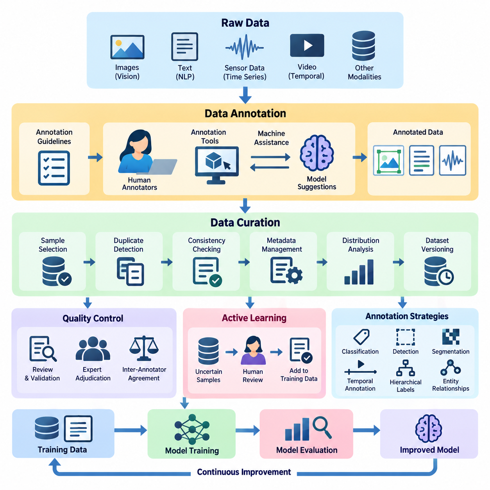
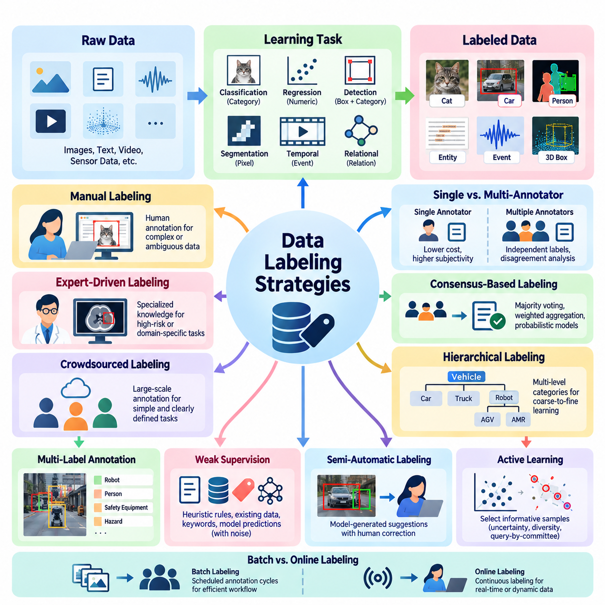
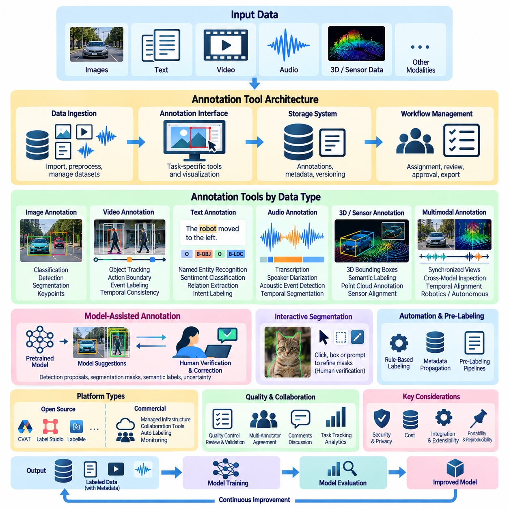
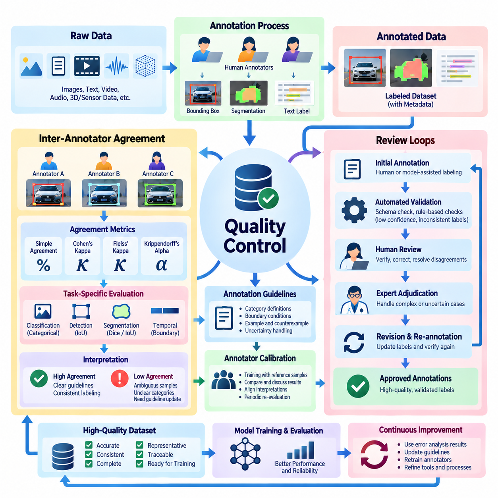
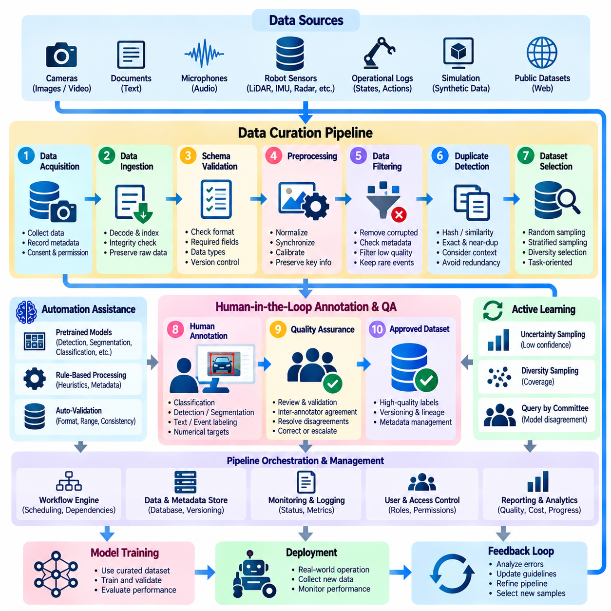
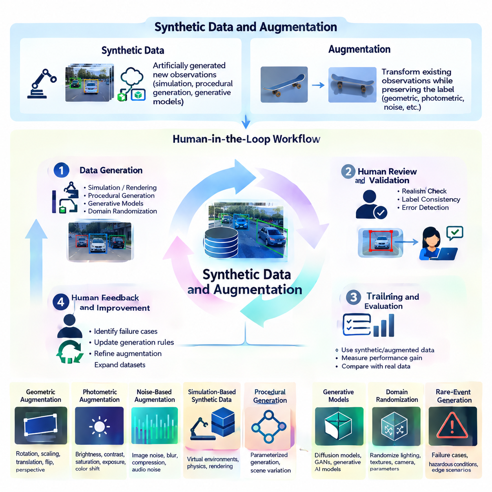
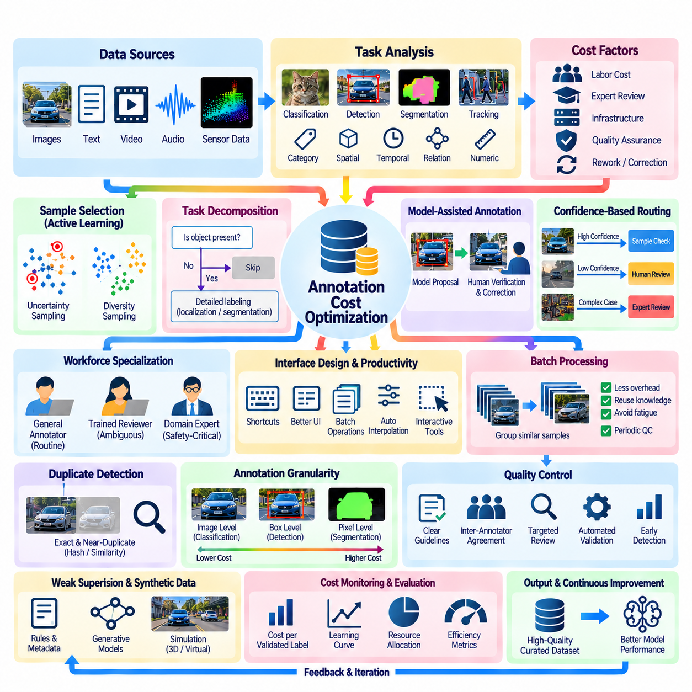
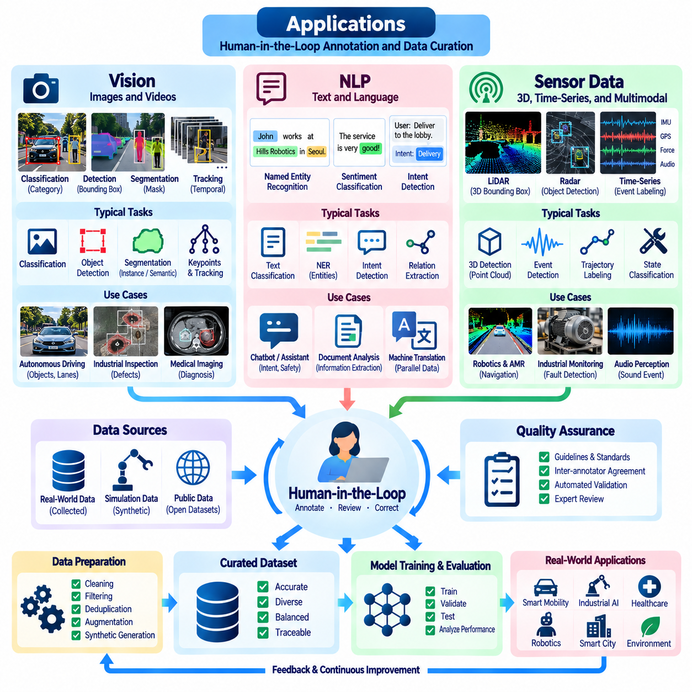

**Volume 41. Human in the Loop Learning**

# 04. Annotation and Data Curation

## 04.00 Overview

{width="7.268055555555556in" height="7.268055555555556in"}

Annotation and data curation are fundamental components of Human-in-the-Loop (HITL) learning, providing the structured information required to train, evaluate, and continuously improve artificial intelligence systems. Annotation assigns meaningful labels to raw observations, while data curation organizes, validates, filters, and maintains datasets. Together, these processes transform heterogeneous information into reliable learning resources.

Modern artificial intelligence depends not only on model architectures and computational resources but also on the accuracy, consistency, and representativeness of training data. Incorrect labels, duplicated samples, incomplete metadata, and biased distributions can undermine model performance even when sophisticated learning algorithms are employed. Effective annotation and curation therefore constitute essential mechanisms for controlling data quality throughout the AI lifecycle.

Within Human-in-the-Loop learning, annotation is more than a preliminary data preparation activity. It establishes a continuous interaction between human expertise and machine learning systems. Human annotators interpret ambiguous observations, correct automated predictions, and identify previously unrecognized patterns. Models subsequently incorporate these corrections, producing improved predictions that can support future annotation activities.

Data annotation converts unstructured or partially structured observations into representations suitable for supervised and interactive learning. Depending on the application, annotations may describe object categories, spatial boundaries, semantic relationships, temporal events, numerical measurements, or preferred behaviors. Their structure must correspond to the intended learning objective, since different prediction tasks require different forms of ground truth.

Data curation extends beyond assigning labels by addressing the overall composition and reliability of a dataset. It includes sample selection, duplicate detection, consistency checking, metadata management, distribution analysis, and dataset versioning. A well-curated dataset should preserve meaningful diversity while minimizing irrelevant redundancy, systematic errors, and unintended correlations that could distort model behavior.

The relationship between annotation and active learning is particularly important when human labeling resources are limited. Rather than annotating every available observation, an active learning system identifies samples expected to provide substantial learning value. Human experts review these selected examples, and the resulting annotations are incorporated into subsequent training cycles. This approach can reduce labeling effort while maintaining competitive model performance.

Annotation strategies vary according to data complexity, application requirements, and available expertise. Simple classification tasks may require assigning one category to each sample, whereas object detection requires spatial localization and category identification. Segmentation involves detailed region boundaries, while temporal annotation identifies events or actions within sequences. Complex tasks may require hierarchical labels, multiple attributes, or relationships among entities.

The choice of annotation strategy directly affects dataset consistency and downstream model capabilities. Annotation guidelines should define category boundaries, acceptable uncertainty, ambiguous cases, and procedures for handling incomplete observations. Without standardized instructions, annotators may interpret identical samples differently. Such inconsistencies introduce label noise and can prevent models from learning stable relationships between observations and target outputs.

Annotation tools provide interfaces that help human experts inspect data, assign labels, and correct predictions efficiently. Computer vision platforms may support bounding boxes, polygons, segmentation masks, and keypoints. Natural language processing tools may provide token-level tagging, entity identification, and relationship annotation. Sensor-oriented interfaces may display synchronized measurements, temporal sequences, and multidimensional observations.

Machine-assisted annotation improves productivity by combining automated predictions with human verification. A pretrained model may propose candidate labels, object boundaries, or semantic categories, allowing annotators to focus on corrections rather than creating every annotation manually. However, automated suggestions can introduce confirmation bias when humans accept predictions without sufficient examination. Interface design must therefore encourage independent judgment.

Annotation quality control evaluates whether assigned labels are accurate, consistent, and suitable for their intended purpose. Common procedures include independent review, expert adjudication, reference samples, and automated validation rules. Quality assessment should distinguish between annotation errors and legitimate ambiguity in the underlying data. A disagreement between annotators does not necessarily indicate negligence, particularly when observations admit multiple interpretations.

Inter-annotator agreement provides a systematic method for examining consistency among human labelers. Measures such as Cohen\'s kappa, Fleiss\' kappa, and Krippendorff\'s alpha can quantify agreement under different annotation conditions. These measurements should be interpreted alongside class distributions, task difficulty, and annotation guidelines. High agreement indicates consistency but does not independently establish that annotations are factually correct.

Review loops provide mechanisms for detecting and resolving annotation problems before they propagate into model training. Samples with conflicting labels, low confidence, or unusual characteristics can be escalated to experienced reviewers. Adjudication outcomes should be documented and incorporated into revised guidelines. This process gradually improves annotation consistency while establishing an auditable record of human decisions and corrections.

Data curation pipelines coordinate the transformation of collected observations into validated datasets. A typical pipeline performs ingestion, format normalization, metadata extraction, quality screening, annotation integration, and dataset partitioning. Each processing stage should preserve traceability between original observations and derived records. Automated checks can identify corrupted files, invalid labels, missing attributes, and inconsistent annotation structures.

Dataset versioning is essential for reproducible experimentation and continuous learning. Changes to annotations, filtering criteria, or sample composition can alter training outcomes even when model architectures remain unchanged. Maintaining dataset identifiers, transformation histories, annotation revisions, and validation records enables researchers to reconstruct experimental conditions. This traceability also supports rollback when newly curated data produces unexpected performance degradation.

Synthetic data and augmentation offer complementary methods for increasing dataset coverage when real-world observations are scarce or expensive. Simulation, generative models, and controlled transformations can produce additional examples representing diverse environments and operating conditions. However, synthetic samples must preserve task-relevant relationships. Unrealistic distributions, incorrect generated labels, or inappropriate transformations can reduce rather than improve model reliability.

Human oversight remains necessary when synthetic data is integrated with real observations. Experts can evaluate whether generated examples preserve semantic meaning, physical plausibility, and application-specific constraints. For example, geometric transformations may be appropriate for object classification but unsuitable for tasks involving directional relationships or calibrated physical measurements. Augmentation policies should therefore reflect the assumptions and invariances of each learning objective.

Annotation cost optimization seeks to balance labeling expenditure, data quality, and model improvement. Costs include human labor, expert review, annotation infrastructure, quality assurance, and repeated correction cycles. Efficient workflows prioritize informative samples, automate routine operations, and reserve specialized expertise for difficult decisions. Cost should be evaluated relative to measurable learning benefits rather than simply the number of annotations produced.

Data diversity and representativeness are equally important considerations. A large dataset dominated by common operating conditions may provide insufficient information about rare events, minority categories, or environmental changes. Curators should examine coverage across relevant attributes and operational scenarios. Targeted collection and annotation can address identified gaps, although dataset balancing must avoid introducing artificial distributions that misrepresent deployment conditions.

In computer vision applications, annotation and curation support image classification, object detection, segmentation, tracking, and scene understanding. Labels may identify visual categories, object locations, instance boundaries, or temporal identities. Dataset quality depends on factors such as image resolution, occlusion, lighting variation, camera geometry, and class imbalance. Consistent spatial annotations are especially important when evaluation depends on localization accuracy.

Natural language processing introduces different annotation challenges because linguistic meaning depends heavily on context. Tasks may involve sentiment classification, named entity recognition, intent identification, semantic relationships, or preference judgments. Ambiguity, cultural variation, specialized terminology, and differences in annotator interpretation can influence labeling outcomes. Carefully designed guidelines and expert review help establish more consistent semantic representations.

Sensor data annotation is especially significant in robotics, industrial automation, and Physical AI systems. Measurements from cameras, LiDAR, radar, inertial sensors, and other devices may require synchronization and contextual interpretation. Annotations can describe environmental states, detected objects, operational events, or system failures. Reliable labels depend on sensor calibration, timestamp accuracy, measurement uncertainty, and the physical conditions under which data was collected.

The integration of annotation and data curation into operational AI workflows enables continuous improvement after deployment. Production observations can reveal distribution shifts, unexpected behaviors, and previously unrepresented conditions. Selected observations are returned to human reviewers, incorporated into curated datasets, and used for model refinement. This feedback mechanism connects data management with monitoring, evaluation, and iterative model development.

Ultimately, annotation and data curation establish the informational foundation of trustworthy Human-in-the-Loop learning. Their effectiveness depends on coordinated human expertise, appropriate automation, rigorous quality control, and transparent data management. By treating datasets as evolving, validated assets rather than static training inputs, AI systems can improve their reliability, adaptability, and ability to learn from meaningful human supervision.

## 04.01 Data Labeling Strategies

{width="7.268055555555556in" height="7.268055555555556in"}

Data labeling strategies define how raw observations are transformed into structured annotations that support machine learning objectives. Within Human-in-the-Loop learning, these strategies determine which samples require human attention, what information should be recorded, and how annotation quality is maintained. Effective labeling balances accuracy, consistency, efficiency, and the representativeness of the resulting dataset.

The selection of a labeling strategy begins with the learning task and the intended model output. Classification requires categorical labels, regression requires numerical targets, and object detection requires both spatial coordinates and category assignments. More complex applications may require semantic segmentation, temporal boundaries, relational annotations, or hierarchical descriptions. Each label structure must reflect the information needed for training and evaluation.

Manual labeling relies on human annotators to interpret observations and assign appropriate labels. This approach is particularly valuable when tasks require contextual understanding, domain expertise, or judgments that automated systems cannot reliably perform. However, manual annotation can become expensive and time-consuming as dataset size increases. Standardized instructions and appropriate annotation interfaces are therefore essential for maintaining productivity.

Expert-driven labeling assigns complex or high-risk annotation tasks to individuals with specialized knowledge. Medical imaging, industrial inspection, autonomous robotics, and scientific data analysis often require expertise beyond general visual recognition. Experts can distinguish subtle abnormalities, interpret operational conditions, and identify physically implausible observations. Their involvement improves annotation validity but introduces additional cost and scheduling constraints.

Crowdsourced labeling distributes annotation tasks across a large group of contributors, often through online platforms. It can provide substantial labeling capacity for relatively simple and clearly defined tasks. Quality depends on contributor selection, task instructions, redundancy, and verification procedures. Crowdsourcing is less appropriate when annotations require confidential information, specialized expertise, or detailed understanding of complex operational environments.

Single-annotator labeling assigns each sample to one individual and minimizes annotation expenditure. Although efficient, this strategy provides limited protection against subjective interpretation and individual mistakes. Multi-annotator labeling introduces independent judgments from several contributors, enabling disagreement analysis and consensus formation. The additional cost can be justified when label uncertainty significantly affects model performance.

Consensus-based labeling combines multiple annotations into a representative decision. Majority voting is a straightforward approach for categorical labels, while weighted aggregation can account for differences in annotator reliability. More advanced methods estimate latent ground truth using probabilistic models of annotator behavior. Consensus should not automatically replace expert adjudication when disagreements arise from genuine ambiguity or insufficient information.

Hierarchical labeling organizes categories into multiple levels of semantic detail. An image may first be classified as containing a vehicle, then as a mobile robot, and finally as a particular robotic platform. This structure supports coarse-to-fine learning and allows uncertain samples to retain valid higher-level labels. Hierarchical strategies are useful when fine-grained categories are difficult to distinguish or annotation expertise varies.

Multi-label annotation allows one observation to belong to several categories simultaneously. An industrial image may contain a robot, a human worker, safety equipment, and a hazardous condition. Unlike single-label classification, multi-label strategies preserve overlapping semantic properties. Annotation guidelines must distinguish between absent attributes, unobserved attributes, and attributes that cannot be determined from the available evidence.

Weak supervision uses imperfect labeling sources such as heuristic rules, existing databases, keyword patterns, and model predictions. These sources can generate large quantities of approximate labels without requiring manual annotation of every sample. However, weak labels may contain systematic errors and correlations. Their reliability should be evaluated using trusted reference data and, where appropriate, models that account for labeling-source uncertainty.

Semi-automatic labeling combines machine-generated suggestions with human correction. A pretrained detector may propose object locations, while annotators verify categories and adjust bounding boxes. This approach can substantially reduce repetitive work when the initial model is reasonably accurate. Its effectiveness depends on prediction quality, interface usability, and mechanisms that prevent incorrect automated suggestions from being accepted without inspection.

Active learning introduces a selective labeling strategy in which the model identifies observations that are particularly informative for further training. Uncertainty sampling prioritizes predictions with low confidence, while diversity-based sampling selects examples representing different regions of the data distribution. Query-by-committee methods examine disagreement among multiple models. These strategies seek to maximize learning improvement under limited annotation budgets.

Batch labeling processes groups of samples through scheduled annotation cycles, allowing efficient workforce allocation and systematic quality review. Online labeling handles incoming observations continuously and is more suitable for evolving production environments. Hybrid workflows combine periodic dataset updates with immediate escalation of critical observations. The appropriate strategy depends on data arrival rates, model update requirements, and operational constraints.

Confidence-aware labeling records uncertainty alongside assigned annotations. Instead of forcing every observation into a definitive category, annotators may indicate confidence levels, ambiguous boundaries, or insufficient evidence. Such information helps distinguish reliable training examples from uncertain cases. Confidence values should follow standardized definitions because subjective confidence estimates may differ substantially between annotators.

Abstention and escalation strategies allow annotators to defer decisions when observations exceed their expertise or lack sufficient information. Deferred samples can be reviewed by specialists, assigned provisional labels, or excluded from particular training objectives. This prevents arbitrary decisions from contaminating the dataset. Effective escalation procedures should preserve the original observation, the reason for uncertainty, and the final resolution.

Temporal labeling addresses sequences in which events, actions, and states evolve over time. Video annotation may require identifying action boundaries, tracking objects across frames, or describing transitions between operational states. Sensor streams may require event timestamps and synchronized labels across modalities. Temporal consistency is essential because inaccurate boundaries or inconsistent object identities can distort sequence learning and behavioral prediction.

Spatial labeling represents the geometric properties of observations through bounding boxes, polygons, segmentation masks, keypoints, or three-dimensional regions. Annotation precision should match the model\'s intended use. A coarse bounding box may be sufficient for general object detection, whereas robotic manipulation may require detailed object boundaries and contact-related geometry. Excessive annotation precision can increase costs without producing proportional learning benefits.

Class imbalance requires deliberate labeling strategies because common categories may dominate collected observations. Targeted sampling can increase coverage of rare defects, unusual environmental conditions, and safety-critical events. However, annotation priorities should not be confused with the true operational frequency of events. Dataset metadata and evaluation protocols must preserve information about the original distribution to support reliable performance interpretation.

Cost-sensitive labeling allocates annotation resources according to task difficulty, expected information value, and consequences of incorrect predictions. Routine observations may be processed through automated or general-purpose workflows, while ambiguous or safety-critical cases receive expert review. This allocation improves resource efficiency without applying uniform annotation effort to every sample. Cost models should include review, correction, and reannotation expenses.

Quality-aware labeling integrates validation directly into the annotation process. Automated checks can identify missing labels, invalid coordinates, contradictory categories, and inconsistent temporal boundaries. Human reviewers examine disagreements and samples that fail predefined quality criteria. Feedback from these checks should inform both annotator training and guideline revisions, creating a continuous mechanism for improving labeling reliability.

Annotation provenance records who created or modified a label, which tools were used, and what evidence supported the decision. Versioned annotations enable teams to compare revisions and reproduce dataset construction procedures. Provenance becomes particularly important when labels are generated through combinations of human judgment, automated models, and synthetic data. Transparent records support auditing, debugging, and accountability.

In Physical AI applications, labeling strategies must reflect interactions between perception, action, and physical environments. Robot observations may require object identities, terrain properties, contact events, navigation states, and task outcomes. Multimodal annotation should preserve synchronization among cameras, LiDAR, inertial sensors, and control signals. Physically meaningful labels help models connect observed conditions with operational behavior and consequences.

An effective labeling strategy is therefore not a fixed procedure but an adaptive component of the learning system. As model capabilities improve, annotation resources can shift from routine examples toward uncertain, rare, and operationally significant cases. Human expertise, automated assistance, quality control, and data curation must operate together. This integration enables scalable dataset development while preserving the reliability required for trustworthy AI.

## 04.02 Annotation Tools [w/Code]

{width="7.268055555555556in" height="7.268055555555556in"}

Annotation tools provide the operational interfaces through which human experts transform raw observations into structured training data. Within Human-in-the-Loop learning, these tools support label creation, inspection, correction, validation, and review. Their effectiveness depends on annotation accuracy, interface usability, workflow integration, and the ability to manage heterogeneous datasets across repeated model development cycles.

Modern annotation platforms combine visual interfaces, data management functions, and automated assistance. Instead of treating labeling as an isolated manual activity, they integrate human decisions with machine-generated predictions and quality control procedures. This integration allows annotation teams to process larger datasets while maintaining traceability between original observations, assigned labels, and subsequent corrections.

The architecture of an annotation tool typically includes a data ingestion layer, an annotation interface, a storage system, and a workflow management component. Data ingestion handles images, documents, videos, or sensor measurements, while the interface presents task-specific controls. Storage preserves annotations and metadata, and workflow management coordinates assignment, review, approval, and export operations.

Image annotation tools support classification, object detection, segmentation, and keypoint identification. Classification interfaces allow annotators to assign categories to complete images, whereas detection interfaces provide bounding boxes around individual objects. Segmentation tools support polygons, brushes, and pixel-level masks. Keypoint tools identify anatomical landmarks, mechanical joints, or other geometrically significant locations.

Video annotation introduces temporal consistency requirements beyond those encountered in static images. Annotators may track objects across frames, identify action boundaries, and associate events with timestamps. Efficient platforms provide frame navigation, interpolation, object identity management, and sequence playback. These capabilities reduce repetitive labeling while helping maintain consistent annotations across extended recordings.

Natural language annotation tools operate on textual units such as documents, sentences, tokens, and semantic spans. They support named entity recognition, sentiment classification, intent labeling, relation extraction, and preference evaluation. Interfaces may highlight text spans, connect related entities, or present alternative interpretations. Context preservation is essential because linguistic meaning frequently depends on surrounding information.

Audio annotation tools support speech transcription, speaker diarization, acoustic event detection, and temporal segmentation. Annotators interact with waveforms, playback controls, and synchronized text representations. Accurate timestamps are important when labels must correspond to particular sounds or utterances. Specialized workflows may additionally record background noise, overlapping speakers, emotional characteristics, or uncertain transcription segments.

Three-dimensional annotation tools process point clouds, depth measurements, and spatial reconstructions. Common tasks include placing three-dimensional bounding boxes, identifying object surfaces, and assigning semantic labels to spatial regions. Interactive rotation, zooming, coordinate visualization, and sensor alignment are essential functions. These tools are especially important for autonomous vehicles, robotics, and spatial perception systems.

Multimodal annotation platforms integrate observations from several synchronized sources. A robotic dataset may contain RGB images, depth maps, LiDAR point clouds, inertial measurements, and control signals. Effective interfaces preserve temporal alignment while allowing annotators to inspect complementary representations. Cross-modal inspection helps resolve ambiguities that cannot be interpreted reliably from a single sensor.

Open-source annotation platforms provide adaptable environments for developing customized labeling workflows. Tools such as CVAT, Label Studio, and LabelMe support different combinations of image annotation, structured labeling, and extensibility. Their capabilities vary by version and configuration. Platform selection should consider supported data types, deployment requirements, integration interfaces, collaboration features, and long-term maintenance.

Commercial annotation platforms often provide managed infrastructure, collaboration tools, automated labeling assistance, and operational monitoring. These services may reduce the engineering effort required to establish annotation pipelines. However, organizations must evaluate pricing, data ownership, security controls, export compatibility, and dependency on proprietary services. Platform convenience should not compromise dataset portability or reproducibility.

Model-assisted annotation integrates pretrained machine learning models into the labeling interface. An object detector may propose bounding boxes, a segmentation model may generate candidate masks, and a language model may suggest semantic labels. Human annotators verify or correct these outputs before acceptance. The approach is most effective when automated predictions are sufficiently accurate and uncertainty is clearly communicated.

Interactive segmentation tools allow annotators to refine masks through clicks, bounding boxes, or corrective prompts. Promptable segmentation models can reduce the effort required to identify object boundaries. Nevertheless, generated masks may fail around transparent surfaces, overlapping objects, or fine geometric structures. Human verification remains important when annotation precision affects downstream model performance.

Annotation automation can also employ rule-based methods, geometric constraints, and metadata-derived labels. For example, synchronized timestamps may identify corresponding sensor observations, while calibrated coordinate transformations can project spatial annotations between modalities. Such procedures improve efficiency but depend on accurate calibration and reliable metadata. Automated labels should retain information about their generation method.

Annotation interfaces should minimize unnecessary cognitive effort and repetitive interaction. Keyboard shortcuts, batch operations, zoom controls, configurable layouts, and clear visual feedback can improve productivity. Interface complexity should match task requirements rather than expose every possible feature simultaneously. Poor usability increases annotation time and can introduce systematic errors through fatigue or misunderstanding.

Workflow management tools coordinate annotators, reviewers, and project administrators. They assign tasks, monitor completion, manage permissions, and track review status. More advanced systems support specialized review queues and escalation procedures for ambiguous samples. Separating annotation from approval responsibilities can improve accountability, particularly when datasets support safety-critical or regulated applications.

Quality assurance functions identify inconsistent labels, missing annotations, invalid geometries, and disagreement between annotators. Automated validation rules can detect coordinates outside image boundaries, incompatible class assignments, or incomplete required fields. Human review remains necessary for semantic errors that cannot be recognized through structural checks. Combining automated and manual validation provides stronger quality control.

Inter-annotator agreement analysis evaluates consistency among independent labeling decisions. Annotation platforms may calculate agreement statistics or display conflicting labels for adjudication. Disagreement visualization helps reviewers identify ambiguous categories and unclear instructions. Agreement measurements should be interpreted carefully because consensus does not necessarily establish factual correctness or eliminate systematic labeling bias.

Annotation storage formats determine how labels are exchanged between tools and machine learning frameworks. Common computer vision representations include COCO-style JSON, Pascal VOC XML, and YOLO-compatible text files. Other tasks may use JSONL, CSV, or specialized schemas. Conversion procedures must preserve category identifiers, coordinate conventions, temporal references, and metadata to prevent silent annotation corruption.

Application programming interfaces and software development kits enable annotation tools to connect with data pipelines and training infrastructure. Python-based automation can upload samples, retrieve completed labels, validate schemas, and initiate dataset exports. Integration with PyTorch or TensorFlow workflows allows curated annotations to enter model training with limited manual intervention. Robust interfaces should support authentication, error handling, and reproducible processing.

Dataset versioning capabilities preserve changes to labels, categories, and annotation guidelines over time. Each revision should identify its source, modification history, and relationship to previous dataset states. Version control is particularly important when model-assisted annotation introduces large batches of proposed corrections. Reproducible dataset snapshots enable meaningful comparison between model training experiments.

Security and privacy requirements influence annotation platform architecture. Sensitive datasets may require local deployment, encrypted storage, access restrictions, and detailed audit logs. Organizations should consider whether external annotation services are permitted to process confidential information. Data minimization and role-based access control help reduce unnecessary exposure while preserving the information needed for annotation.

In Physical AI systems, annotation tools must accommodate dynamic environments and physically meaningful observations. Robot datasets may require labels for terrain conditions, obstacles, manipulation targets, contact events, and operational states. Interfaces should support synchronized sensor playback and precise temporal inspection. Reliable annotations enable perception models and learning systems to connect environmental observations with robotic actions.

The selection of annotation tools should reflect task complexity, dataset scale, workforce expertise, and integration requirements. A lightweight desktop interface may be sufficient for small research datasets, while distributed industrial projects require collaborative workflows and automated validation. No single platform is optimal for every modality or application. Evaluation should consider annotation quality, operational cost, scalability, and data governance.

Ultimately, annotation tools serve as the practical connection between human expertise and machine learning infrastructure. Their value extends beyond accelerating label creation to supporting reliable review, transparent data management, and continuous dataset improvement. When integrated with active learning, quality control, and automated training pipelines, annotation tools become essential components of scalable and trustworthy Human-in-the-Loop AI systems.

## 04.03 Quality Control

{width="7.268055555555556in" height="7.268055555555556in"}

Quality control is a fundamental component of annotation and data curation, ensuring that human-generated labels remain accurate, consistent, and suitable for machine learning. Within Human-in-the-Loop learning, quality control combines systematic validation, inter-annotator agreement, and structured review loops. These mechanisms detect annotation errors, resolve disagreements, and prevent unreliable labels from degrading model performance.

Annotation quality cannot be evaluated solely by counting completed samples or measuring labeling speed. A dataset may contain millions of annotations while still exhibiting systematic errors, ambiguous category definitions, or inconsistent interpretations. Effective quality control therefore examines label correctness, semantic consistency, completeness, and conformity to established annotation guidelines across different annotators and operational conditions.

Inter-annotator agreement measures the extent to which independent annotators assign consistent labels to identical observations. It provides evidence about annotation reproducibility and the clarity of labeling instructions. High agreement suggests that annotators interpret the task similarly, while low agreement may indicate ambiguous samples, insufficient training, or unclear category boundaries. Agreement alone does not establish factual correctness.

The design of an agreement study begins with selecting representative samples and assigning them independently to multiple annotators. Samples should include common categories, difficult cases, and operationally important conditions. Independent labeling is essential because communication between annotators can artificially increase agreement. The resulting annotations are compared using metrics appropriate to the label structure and measurement scale.

Simple percentage agreement calculates the proportion of annotation decisions on which annotators provide identical labels. Although intuitive, this measure does not account for agreement that may occur by chance. It can therefore produce misleading conclusions when one category dominates the dataset. Chance-corrected agreement measures provide additional information, particularly when evaluating categorical labels across imbalanced distributions.

Cohen\'s kappa measures agreement between two annotators while adjusting for agreement expected by chance. Fleiss\' kappa extends related principles to multiple annotators assigning categorical labels. Krippendorff\'s alpha supports different measurement scales and can accommodate certain forms of missing annotation data. Each statistic relies on assumptions that must be considered when interpreting results, especially under severe class imbalance.

Agreement evaluation must also reflect the structure of the annotation task. Classification labels can be compared through categorical agreement, whereas bounding boxes require spatial overlap measurements. Segmentation masks may be evaluated using intersection over union or Dice similarity. Temporal annotations require comparisons of event boundaries and sequence consistency. No single agreement metric adequately represents every annotation modality.

Disagreement between annotators can reveal meaningful uncertainty rather than simple human error. Visual occlusion, incomplete sensor observations, overlapping semantic categories, and ambiguous linguistic expressions may permit multiple reasonable interpretations. Quality control should distinguish annotation mistakes from uncertainty inherent in the data. Preserving disagreement information can help models represent uncertainty instead of learning artificially definitive labels.

Annotation guidelines provide the operational foundation for consistent human judgments. They should define category meanings, boundary conditions, acceptable annotation precision, and procedures for uncertain observations. Representative examples and counterexamples help clarify difficult distinctions. Guidelines should evolve through documented revisions when repeated disagreements reveal limitations in the original labeling definitions.

Annotator calibration aligns individual interpretations before large-scale labeling begins. Calibration sessions typically involve independently annotating reference samples, comparing results, and discussing discrepancies with experienced reviewers. Subsequent assessments determine whether annotators apply revised instructions consistently. Calibration is particularly important when projects involve distributed teams, specialized terminology, or complex multimodal observations.

Review loops transform annotation quality control into an iterative improvement process. Instead of treating annotation as complete immediately after label submission, review workflows introduce verification, correction, and approval stages. Reviewers examine selected annotations, identify inconsistencies, and return problematic samples for revision. The corrected annotations can then be revalidated before entering the approved training dataset.

A structured review loop typically begins with initial annotation and automated validation. Samples that violate schema requirements, exhibit low confidence, or conflict with independent annotations are flagged for further inspection. Human reviewers evaluate these cases and determine whether correction, escalation, or exclusion is appropriate. Final decisions are recorded to preserve traceability and support subsequent quality analysis.

Automated validation improves review efficiency by detecting errors that follow explicit structural rules. Examples include missing required labels, invalid category identifiers, bounding boxes extending beyond image boundaries, and inconsistent timestamps. These checks can operate immediately after annotation submission. However, structural validity does not guarantee semantic correctness, so automated validation must complement rather than replace human review.

Human review addresses errors that require contextual interpretation or domain expertise. A bounding box may satisfy geometric constraints while identifying the wrong object, and a classification label may be syntactically valid but semantically incorrect. Reviewers must examine the underlying evidence rather than relying exclusively on metadata or automated warnings. Expert adjudication is particularly important for ambiguous or safety-critical observations.

Review strategies can use random sampling, uncertainty-based selection, or risk-based prioritization. Random review estimates general annotation quality across the dataset, while targeted review concentrates on suspicious or difficult cases. Risk-based review allocates additional attention to errors with serious operational consequences. Combining these approaches provides broader quality coverage without requiring exhaustive manual inspection of every annotation.

Escalation procedures define how unresolved disagreements are transferred to more experienced reviewers or domain specialists. An annotator may abstain when evidence is insufficient, while a reviewer may request additional sensor data or contextual information. Escalated decisions should preserve the original annotations and reasons for disagreement. This documentation helps distinguish genuine ambiguity from inconsistent application of labeling instructions.

Review feedback should improve both individual performance and the overall annotation process. Repeated mistakes may indicate insufficient training, confusing interfaces, or poorly defined categories. Quality managers can revise instructions, introduce new reference examples, or modify annotation tools accordingly. Effective feedback is specific, evidence-based, and focused on correcting underlying causes rather than merely replacing incorrect labels.

Quality control metrics should monitor both annotation outcomes and review effectiveness. Relevant measures include agreement rates, correction frequency, unresolved disagreement rates, and the proportion of samples requiring escalation. Review turnaround time and annotation rework costs provide additional operational information. These indicators should be interpreted together because high productivity does not necessarily imply high annotation reliability.

Statistical sampling supports quality assessment when exhaustive review is impractical. A representative subset of annotations can be independently inspected to estimate error rates and identify recurring problems. Stratified sampling ensures that rare categories and important operational conditions receive sufficient attention. Confidence intervals help communicate uncertainty in estimated quality metrics, particularly when evaluation samples are limited.

Annotation quality may change over time as datasets, personnel, and model-assisted tools evolve. Annotator fatigue, changes in task instructions, and shifts in incoming data distributions can introduce new inconsistencies. Continuous monitoring should therefore compare quality indicators across annotation batches and project stages. Sudden changes may trigger recalibration, additional review, or temporary suspension of affected labeling workflows.

Model-assisted annotation introduces additional quality risks because automated suggestions can influence human decisions. Annotators may accept incorrect predictions through automation bias, especially when model outputs appear confident. Review workflows should periodically evaluate machine-generated suggestions against independently labeled reference samples. Separating automated proposals from final human decisions preserves accountability and helps identify systematic model errors.

Quality control is particularly challenging for multimodal and temporal datasets. Annotations may depend on synchronized camera frames, LiDAR measurements, inertial signals, and operational logs. Misaligned timestamps or incorrect coordinate transformations can create errors even when individual labels appear reasonable. Validation must therefore examine cross-modal consistency, calibration accuracy, and the physical plausibility of annotated events.

In Physical AI applications, annotation errors can propagate into perception, planning, and control systems. Incorrect obstacle labels, terrain classifications, or contact-event timestamps may distort learned relationships between observations and actions. Safety-critical datasets require stronger review procedures and explicit treatment of uncertain observations. Human experts should verify whether annotations remain consistent with physical constraints and operational context.

Annotation provenance and version control support accountability throughout quality control. Each correction should identify the modified label, reviewer, reason for change, and corresponding dataset version. Maintaining these records enables reproducible training experiments and investigation of unexpected model behavior. Historical annotations should remain accessible when necessary to understand how labeling decisions evolved.

Ultimately, inter-annotator agreement and review loops provide complementary mechanisms for maintaining reliable training data. Agreement analysis reveals consistency and ambiguity, while review loops convert detected problems into corrective actions and improved procedures. Their integration with automated validation, expert judgment, and continuous monitoring establishes a scalable quality assurance framework for trustworthy Human-in-the-Loop learning.

## 04.04 Data Curation Pipelines [w/Code]

{width="7.268055555555556in" height="7.268055555555556in"}

Data curation pipelines transform heterogeneous raw data into reliable, structured, and reproducible datasets for machine learning. Within Human-in-the-Loop learning, these pipelines coordinate automated processing with human inspection, annotation, correction, and approval. Their primary objective is not merely to accumulate data but to ensure that selected observations provide sufficient quality, diversity, relevance, and traceability for effective model development.

A data curation pipeline typically connects data acquisition, ingestion, validation, preprocessing, filtering, annotation, quality assurance, and dataset publication. Each stage performs a distinct function while exchanging metadata and quality information with adjacent components. A well-designed pipeline supports repeated execution, partial reprocessing, and systematic error recovery without requiring the entire dataset to be reconstructed whenever individual records change.

Data acquisition establishes the sources from which observations enter the pipeline. These sources may include cameras, robotic sensors, operational databases, simulation environments, public datasets, and human-generated records. Acquisition procedures should document collection conditions, sensor configurations, timestamps, and relevant permissions. Reliable source documentation helps determine whether observations are appropriate for their intended learning objectives.

Data ingestion converts incoming observations into formats that downstream processing components can interpret consistently. Images, video sequences, text documents, audio recordings, and sensor measurements may require different decoding and indexing procedures. Ingestion systems should verify file integrity, preserve original identifiers, and detect incomplete transfers. Raw observations should remain accessible so that later processing errors can be investigated.

Schema validation ensures that records follow predefined structural requirements. Required fields, category identifiers, coordinate systems, timestamps, and data types must satisfy documented constraints. Validation can identify malformed records before they enter expensive annotation or training operations. Schema definitions should be versioned because changes in labeling conventions or sensor representations can otherwise introduce compatibility problems.

Preprocessing prepares observations for efficient annotation and model training. Common operations include image decoding, resolution normalization, timestamp alignment, text normalization, and sensor calibration. Transformations must preserve information relevant to the target task. For example, aggressive image resizing may eliminate small defects, while inappropriate signal filtering may remove important physical events from robotic sensor recordings.

Data filtering removes or isolates observations that fail established quality requirements. Corrupted files, unreadable images, incomplete sensor sequences, and invalid metadata can be detected automatically. However, unusual observations should not be discarded merely because they differ from common examples. Rare events, difficult environmental conditions, and unexpected system behavior may contain valuable information for improving model robustness.

Duplicate detection reduces unnecessary annotation and prevents repeated observations from dominating training distributions. Exact duplicates can be identified through cryptographic hashes, while near-duplicates may require perceptual hashes or embedding similarity. Duplicate removal should account for temporal and semantic context. Similar consecutive video frames may be redundant for classification but essential for motion estimation or event reconstruction.

Dataset selection determines which validated observations should receive annotation resources. Random sampling provides broad distributional coverage, while stratified sampling preserves representation across predefined categories or operating conditions. Diversity-based selection identifies observations that differ meaningfully from existing examples. Selection criteria should reflect the intended deployment environment rather than simply maximizing dataset size.

Active learning connects data curation directly to model uncertainty and expected learning value. A deployed or experimental model can identify samples associated with uncertain predictions, conflicting outputs, or unfamiliar conditions. These samples enter prioritized annotation queues for human evaluation. The resulting labels support subsequent training iterations, creating a feedback mechanism between model performance and dataset construction.

Human annotation transforms selected observations into task-specific supervision signals. Depending on the application, annotations may describe categories, object locations, segmentation masks, temporal events, numerical targets, or action outcomes. Annotation interfaces should preserve contextual information and relevant sensor relationships. Human decisions must remain traceable to the original observations and the labeling guidelines used.

Quality assurance examines whether curated labels are accurate, consistent, and sufficiently complete. Automated validation detects structural errors, while human reviewers resolve semantic disagreements and ambiguous observations. Inter-annotator agreement provides additional evidence about labeling consistency. Samples that fail quality requirements may be corrected, escalated, temporarily quarantined, or excluded from approved training datasets.

Pipeline orchestration coordinates the execution and dependencies of individual processing stages. Workflow engines can schedule ingestion, preprocessing, validation, annotation exports, and dataset assembly. Each operation should expose execution status, input dependencies, and failure information. Idempotent processing helps ensure that retrying an interrupted operation does not create duplicate records or inconsistent dataset states.

Metadata management connects observations with their acquisition conditions, transformations, annotations, and quality assessments. Useful metadata may include source identifiers, timestamps, sensor specifications, processing versions, and annotation confidence. Structured metadata supports filtering, auditing, and dataset analysis. Without reliable metadata, apparently valid samples may become difficult to interpret or reproduce during later experiments.

Data lineage records how each dataset element was derived from its original source. A processed image may have undergone decoding, cropping, annotation, review, and format conversion before publication. Lineage information should preserve these transformations and their associated software versions. This enables engineers to trace unexpected model behavior back to specific processing decisions or annotation revisions.

Dataset versioning creates identifiable snapshots of curated data used in model training and evaluation. Each version should specify included samples, label definitions, annotation revisions, and processing configurations. Immutable releases prevent training results from changing because underlying data was silently modified. Versioned datasets also enable controlled comparisons between alternative curation strategies and model development experiments.

Training, validation, and test partitions must be constructed carefully to prevent data leakage. Samples derived from the same recording session, physical object, or operational episode may be highly correlated. Randomly separating individual frames can therefore produce misleading evaluation results. Group-aware partitioning and temporal separation help measure generalization more realistically, especially in robotics and sequential perception tasks.

Dataset balancing addresses differences in category frequency, environmental coverage, and operational importance. Targeted collection and sampling can improve representation of rare defects, difficult lighting conditions, and safety-critical situations. However, artificial balancing may distort the natural deployment distribution. Curated datasets should preserve sampling information so that training priorities and evaluation statistics can be interpreted correctly.

Synthetic data can supplement curated observations when real examples are expensive, rare, or hazardous to collect. Simulation environments and generative models can provide additional visual conditions, object arrangements, and controlled variations. Synthetic samples should retain provenance and be evaluated for realism and task relevance. Human review helps identify artifacts or physically implausible situations that automated generation may introduce.

Multimodal curation requires consistent relationships among different observation streams. Robotic datasets may combine RGB images, depth maps, LiDAR measurements, inertial signals, joint states, and control commands. Synchronization errors can invalidate relationships between perception and action. Curation pipelines must therefore verify timestamp alignment, coordinate transformations, calibration parameters, and missing sensor intervals.

Operational monitoring evaluates pipeline performance and dataset quality over time. Relevant indicators include ingestion failure rates, annotation throughput, review rejection rates, duplicate frequency, and distribution changes. Monitoring should distinguish processing failures from legitimate changes in incoming observations. Unexpected shifts may trigger additional inspection, revised sampling policies, or targeted data collection.

Security and governance requirements influence how curated datasets are stored, accessed, and distributed. Sensitive information may require access restrictions, encryption, anonymization, and retention policies. Licensing and consent conditions should be documented during acquisition and preserved through subsequent transformations. Governance procedures must ensure that dataset reuse remains consistent with applicable permissions and organizational requirements.

In Physical AI applications, data curation must preserve the relationship between physical observations, robotic actions, and environmental outcomes. Navigation failures, manipulation errors, contact events, and recovery behaviors can provide valuable supervision. Human reviewers may verify event boundaries and operational interpretations. Physically meaningful curation enables learning systems to distinguish successful behavior from unsafe or ineffective execution.

A practical curation pipeline should support incremental improvement rather than requiring complete reconstruction after every model update. Newly collected observations can be validated, compared with existing data, selectively annotated, and incorporated into subsequent dataset releases. Previously approved samples may be revisited when labeling definitions change. This incremental architecture improves scalability while maintaining historical reproducibility.

Ultimately, data curation pipelines establish the operational foundation for reliable Human-in-the-Loop learning. Automated processing provides scale and consistency, while human expertise supplies contextual interpretation and corrective judgment. Their integration with active learning, quality control, provenance tracking, and dataset versioning creates a continuous improvement cycle that transforms raw observations into trustworthy training resources.

## 04.05 Synthetic Data and Augmentation

{width="7.268055555555556in" height="7.268055555555556in"}

Synthetic data and data augmentation expand the diversity and coverage of training datasets without requiring every observation to be collected and labeled manually. Within Human-in-the-Loop learning, these techniques complement human annotation by generating additional examples, improving representation of rare conditions, and supporting targeted model evaluation. Their effectiveness depends on preserving label correctness, semantic relevance, and realistic relationships between observations and outcomes.

Synthetic data refers to artificially generated observations designed to approximate properties of real-world data. These observations may originate from physics simulators, rendering engines, procedural generators, or generative machine learning models. Unlike conventional augmentation, which modifies existing samples, synthetic generation can create entirely new scenes, objects, interactions, and operating conditions. The distinction is important when assessing dataset diversity and provenance.

Data augmentation transforms existing observations while preserving the information required for the intended learning task. Common image operations include translation, rotation, reflection, cropping, and controlled adjustments to illumination. Audio augmentation may introduce background noise or modify signal characteristics, while text augmentation may use paraphrasing. Every transformation must be evaluated against the assumptions governing the original label.

Label-preserving augmentation assumes that a transformation does not change the correct target associated with an observation. Horizontal reflection may preserve an object\'s category but invalidate directional instructions or asymmetric spatial relationships. Similarly, cropping can remove critical evidence needed for classification. Augmentation policies should therefore be task-specific rather than applying transformations indiscriminately across an entire dataset.

Geometric augmentation modifies spatial properties through rotation, scaling, translation, reflection, and perspective transformations. These operations can improve robustness to changes in viewpoint and object placement. However, transformations must update bounding boxes, segmentation masks, keypoints, and other spatial annotations consistently. Excessive geometric distortion may introduce physically implausible examples or alter measurements that models are expected to predict.

Photometric augmentation changes visual appearance through brightness, contrast, saturation, exposure, or color adjustments. It can help perception models tolerate variations in illumination and camera response. Nevertheless, aggressive modifications may obscure defects, alter material characteristics, or remove meaningful visual cues. Applications involving color-sensitive inspection or physical property estimation require particularly conservative augmentation policies.

Noise-based augmentation introduces controlled disturbances that approximate sensor imperfections or environmental interference. Examples include image noise, motion blur, compression artifacts, and audio background interference. Realistic noise models should reflect the characteristics of the intended sensing equipment. Arbitrary disturbances may improve apparent robustness while teaching models to tolerate conditions that are unrelated to actual deployment environments.

Simulation-based synthetic data generation creates observations from virtual environments containing modeled objects, sensors, and physical interactions. Rendering engines produce images and depth measurements, while physics engines estimate motion, collision, and contact behavior. Simulation enables controlled variation of conditions that may be expensive or dangerous to reproduce physically. Its usefulness depends on the accuracy of environmental models and sensor representations.

Procedural generation automatically constructs scenes by varying object geometry, placement, materials, lighting, and environmental configurations. Parameterized generators can create large collections of labeled examples with relatively limited manual effort. The generation process should enforce geometric and semantic constraints to prevent unrealistic combinations. Human inspection remains useful for identifying repetitive patterns or artifacts introduced by procedural rules.

Generative models provide another mechanism for creating synthetic observations. Diffusion models, generative adversarial networks, and other learned generators can produce visual or textual variations conditioned on prompts or reference data. Such outputs may increase apparent diversity, but generated content can contain incorrect details or inconsistent labels. Human review and automated validation are necessary before incorporating these samples into trusted training datasets.

Domain randomization deliberately varies simulation parameters to expose models to a broad range of environmental conditions. Randomized lighting, textures, camera positions, friction coefficients, and object arrangements can reduce dependence on specific training conditions. However, parameter ranges should remain physically meaningful. Excessive randomization may produce unrealistic observations and reduce learning efficiency instead of improving real-world generalization.

Synthetic data is especially useful for rare-event coverage. Safety-critical failures, unusual obstacles, equipment malfunctions, and hazardous environmental conditions may be difficult to collect through ordinary operations. Controlled generation can increase exposure to these scenarios without creating physical risks. Nevertheless, synthetic examples should supplement rather than automatically replace real observations because simulated failures may omit important environmental complexities.

Human-in-the-Loop workflows provide mechanisms for evaluating synthetic data quality. Human experts can inspect generated observations, verify semantic labels, and identify unrealistic physical interactions. Reviewers may compare synthetic examples with representative real-world samples to assess plausibility. Their feedback can guide revisions to generation parameters, annotation rules, and sampling policies, creating an iterative synthetic data improvement process.

Synthetic annotation can reduce manual labeling costs because simulation environments often provide direct access to object identities, positions, segmentation masks, and physical states. These automatically generated labels may be geometrically precise, but their validity still depends on correct scene configuration and coordinate transformations. Rendering artifacts, occlusion errors, or inaccurate simulation metadata can introduce systematic annotation problems.

Combining real and synthetic data requires deliberate sampling strategies. Real observations provide evidence about deployment conditions, while synthetic examples expand coverage of underrepresented scenarios. Training mixtures may use fixed proportions, staged introduction, or adaptive sampling based on model performance. The optimal balance depends on domain similarity, task complexity, and synthetic data quality rather than a universally applicable mixing ratio.

Augmentation and synthetic generation can unintentionally introduce dataset bias. Repeated textures, limited object models, unrealistic lighting, or narrow procedural assumptions may create artificial correlations. Models can exploit these shortcuts instead of learning the intended physical or semantic relationships. Bias analysis should compare generated and real distributions while examining performance across different operating conditions and demographic or environmental groups where relevant.

Physical AI applications impose additional constraints because observations are connected to physical quantities and action outcomes. Transformations that preserve object identity may not preserve mass, distance, velocity, orientation, or contact geometry. For example, scaling an object image without adjusting its physical labels can corrupt a weight estimation task. Augmentation must respect the causal and geometric relationships required by downstream robotic learning objectives.

Temporal augmentation requires particular care when applied to robotic trajectories or sensor sequences. Modifying playback speed, reversing sequences, or shifting event boundaries may alter action semantics and physical feasibility. Time reversal is generally inappropriate for irreversible interactions, while temporal cropping can remove causal context. Valid transformations must preserve synchronization between observations, actions, timestamps, and associated supervision targets.

Multimodal augmentation must maintain consistency across synchronized sensors. A geometric transformation applied to an RGB image may require corresponding updates to depth maps, segmentation masks, and camera calibration parameters. Sensor noise can be introduced independently only when doing so reflects plausible measurement behavior. Inconsistent transformations may teach models incorrect relationships between modalities and degrade sensor fusion performance.

Quality evaluation should distinguish visual realism from actual learning utility. A synthetic image may appear convincing while providing little improvement in downstream performance. Conversely, simplified simulation data may be valuable when it captures task-relevant geometry or dynamics. Evaluation should measure performance on independent real-world validation and test sets, including rare conditions, uncertainty, robustness, and safety-related failure modes.

Ablation experiments help determine whether specific augmentation policies or synthetic sources improve model behavior. Models can be trained with real data alone, augmented real data, and controlled mixtures containing synthetic observations. Comparisons should use consistent evaluation protocols and account for differences in training sample counts. These experiments reveal whether observed improvements result from meaningful diversity or merely additional training exposure.

Synthetic data provenance should record generation models, simulation configurations, random seeds, transformation parameters, and annotation sources. Versioned records allow teams to reproduce samples and investigate unexpected model behavior. Generated observations should remain distinguishable from real measurements throughout data curation. Transparent provenance supports auditing, controlled experimentation, and systematic removal of problematic synthetic samples.

Active learning can guide synthetic data generation toward conditions where existing models perform poorly. Uncertain predictions, repeated failures, and underrepresented operational states can identify scenarios requiring additional coverage. Simulation parameters can then be adjusted to produce targeted examples for human verification. This creates a feedback loop connecting real-world model limitations with synthetic scenario construction and dataset refinement.

Cost optimization requires considering more than the computational expense of generating synthetic samples. Simulation development, model inference, human inspection, storage, validation, and downstream training all contribute to total cost. Large synthetic datasets are not necessarily economical if most examples are redundant or misleading. Efficient pipelines prioritize high-value scenarios and evaluate the marginal benefit of each additional generation cycle.

Ultimately, synthetic data and augmentation should operate as controlled extensions of human-guided data curation rather than unrestricted mechanisms for increasing dataset volume. Automated generation supplies scale and variation, while human expertise verifies meaning, physical plausibility, and annotation reliability. Their integration with quality control, active learning, and real-world evaluation enables more robust and trustworthy Human-in-the-Loop learning systems.

## 04.06 Annotation Cost Optimization

{width="7.268055555555556in" height="7.268055555555556in"}

Annotation cost optimization aims to reduce the resources required to produce reliable training labels without compromising model performance or dataset integrity. Within Human-in-the-Loop learning, annotation expenses include human labor, expert review, software infrastructure, quality assurance, and repeated correction. Effective optimization therefore considers the complete annotation lifecycle rather than minimizing the cost of individual labeling operations.

The economic structure of annotation depends on task complexity, data modality, required precision, and workforce expertise. Image classification may require only a categorical decision, while segmentation demands detailed spatial boundaries. Video tracking and multimodal sensor annotation introduce additional temporal and geometric requirements. Cost estimation should account for these differences before assigning uniform budgets or productivity targets.

Annotation cost can be represented through the relationship between sample volume, average processing time, labor rates, and review overhead. However, simple cost-per-label calculations may conceal differences in annotation difficulty and quality. A more useful measure is the cost per accepted, validated annotation. This perspective incorporates corrections, rejected labels, and the resources needed to establish confidence in the final dataset.

Task decomposition improves efficiency by separating simple decisions from complex interpretation. Annotators may first determine whether an image contains relevant objects before performing detailed localization or segmentation. Samples that do not satisfy preliminary conditions can bypass expensive downstream operations. This hierarchical workflow reduces unnecessary effort while preserving the ability to escalate ambiguous observations.

Active learning reduces annotation demand by selecting samples expected to provide substantial training value. Uncertainty sampling prioritizes observations associated with unreliable model predictions, while diversity sampling identifies examples that expand dataset coverage. Combining these criteria can reduce redundant labeling. Selection policies must nevertheless avoid concentrating exclusively on difficult outliers while neglecting representative operating conditions.

Model-assisted annotation uses pretrained systems to generate preliminary labels that humans can verify or correct. Object detectors may propose bounding boxes, segmentation models may produce masks, and language models may suggest semantic categories. When predictions are sufficiently accurate, verification requires less effort than manual creation. However, incorrect suggestions can introduce automation bias and increase correction costs.

Confidence-based routing assigns annotation tasks according to estimated difficulty and reliability. High-confidence predictions may undergo sampled verification, while uncertain observations receive detailed human inspection. Complex cases can be directed to domain specialists. This approach allocates expensive expertise where it is most valuable, provided that confidence estimates are calibrated and automated decisions remain subject to appropriate quality controls.

Workforce specialization can improve annotation productivity by matching task requirements with annotator capabilities. General annotators may process routine classification examples, while trained reviewers handle ambiguous boundaries or specialized terminology. Domain experts can focus on safety-critical or technically demanding decisions. Effective specialization requires clear escalation criteria and coordination mechanisms to prevent unnecessary handoffs.

Annotation interface design directly influences labor costs because small interaction delays accumulate across large datasets. Keyboard shortcuts, configurable layouts, batch operations, and efficient navigation reduce repetitive actions. Automated interpolation can accelerate video tracking, while interactive segmentation reduces manual polygon editing. Usability improvements should be measured through both processing time and resulting annotation accuracy.

Batch processing reduces administrative overhead by grouping similar samples into coherent annotation assignments. Consistent task contexts allow annotators to reuse relevant knowledge and reduce frequent switching between labeling rules. However, excessively repetitive batches may increase fatigue and systematic errors. Balanced scheduling should consider task similarity, cognitive workload, and periodic quality checks.

Duplicate detection prevents annotation resources from being spent repeatedly on equivalent observations. Exact duplicates can be identified using hashes, while near-duplicates may require perceptual similarity or embedding comparisons. Removing redundant examples can reduce costs substantially in large image collections. Temporal datasets require additional care because visually similar frames may contain essential motion or event information.

Annotation granularity should match the actual requirements of the learning objective. A classification task may not benefit from pixel-level segmentation, and a navigation system may require obstacle regions rather than detailed object contours. Excessive precision increases labor without necessarily improving downstream performance. Defining minimum sufficient annotation detail is therefore a central cost optimization principle.

Quality control should be designed to prevent expensive rework rather than merely detect errors after completion. Clear guidelines, reference examples, and annotator calibration reduce inconsistent interpretations. Automated schema validation identifies structural problems immediately, while targeted review addresses semantic uncertainty. Early detection generally limits the propagation of incorrect labels into larger training datasets.

Review allocation can be optimized through risk-based sampling. Routine annotations may receive statistical quality checks, while high-impact or uncertain samples undergo more extensive examination. Random audits remain necessary to detect unexpected systematic errors outside prioritized review queues. The appropriate review intensity depends on error consequences, annotation reliability, and the intended deployment environment.

Inter-annotator agreement analysis helps identify categories that consume disproportionate review resources. Repeated disagreement may indicate unclear instructions, overlapping label definitions, or genuinely ambiguous observations. Revising guidelines can sometimes reduce future costs more effectively than increasing reviewer capacity. Agreement statistics should be interpreted alongside accuracy because consistent labeling does not necessarily imply correctness.

Weak supervision offers opportunities to generate approximate labels through rules, existing metadata, and model predictions. These labels can support preliminary training or sample prioritization without requiring full manual annotation. Their economic value depends on coverage, noise levels, and the cost of verification. Unreliable weak labels may create additional downstream correction expenses that offset initial savings.

Synthetic data can reduce collection and annotation costs when simulation environments provide automatic ground-truth information. Generated scenes may include object identities, spatial coordinates, segmentation masks, and physical states. However, simulation development, rendering, validation, and human inspection introduce their own expenses. Cost comparisons should evaluate whether synthetic examples improve performance on real-world data.

Incremental annotation strategies avoid rebuilding datasets after every model update. Newly collected observations can be filtered, prioritized, and labeled while previously approved annotations remain available. Version control preserves historical decisions and enables selective correction when guidelines change. This approach reduces repeated work and supports continuous learning pipelines with controlled resource expenditure.

Annotation budget allocation should consider expected model improvement rather than treating every labeled sample as equally valuable. Learning curves can estimate how performance changes as additional annotations are introduced. When improvement begins to plateau, resources may be redirected toward rare categories, distribution gaps, or quality correction. Such decisions require reliable validation sets and comparable experimental conditions.

Cost-sensitive optimization becomes especially important when annotation errors have unequal consequences. Incorrect labels involving harmless background objects may be less significant than errors affecting obstacle detection or robotic safety. Risk-weighted prioritization directs additional review toward observations with potentially serious outcomes. Financial efficiency must therefore be balanced against operational reliability and safety requirements.

Pipeline monitoring provides evidence about where annotation resources are consumed. Useful indicators include annotation time, acceptance rate, correction frequency, review turnaround, and cost per validated sample. Measurements should be separated by task category and difficulty to reveal hidden bottlenecks. Monitoring trends across batches can identify inefficient interfaces, unclear guidelines, or deteriorating annotation quality.

In Physical AI applications, annotation costs extend beyond visual labeling to synchronized sensor interpretation and physical event verification. Robot trajectories may require identifying contact events, navigation failures, manipulation outcomes, and recovery actions. These tasks often demand specialized expertise and contextual evidence. Automated event proposals and synchronized playback can reduce effort while retaining expert oversight.

A sustainable optimization strategy combines selective sampling, model assistance, workforce specialization, automated validation, and continuous cost monitoring. Improvements should be evaluated through controlled comparisons of annotation expenditure and downstream model performance. Reducing labor without preserving label reliability can increase total development costs through repeated training, debugging, and deployment failures.

Ultimately, annotation cost optimization is a resource allocation problem rather than a simple effort to minimize labeling expenditure. Human expertise should be concentrated on observations where judgment, uncertainty resolution, and physical understanding provide the greatest value. When combined with active learning, quality assurance, and efficient data pipelines, this approach enables scalable and economically sustainable Human-in-the-Loop learning.

## 04.07 Applications

{width="7.268055555555556in" height="7.268055555555556in"}

Applications of Human-in-the-Loop annotation and data curation extend across computer vision, natural language processing, and sensor-based intelligence. Although these domains use different data representations and learning objectives, they share requirements for accurate labels, representative samples, and systematic quality assurance. Human expertise helps resolve ambiguity, correct automated predictions, and maintain alignment between training data and real-world operational requirements.

In computer vision, annotation supports image classification, object detection, semantic segmentation, instance segmentation, and visual tracking. Classification assigns categories to images or regions, while detection identifies object locations through bounding boxes. Segmentation provides pixel-level descriptions of object boundaries and scene structure. Human reviewers verify these annotations, especially when occlusion, poor illumination, or visually similar objects introduce uncertainty.

Visual annotation workflows increasingly combine pretrained perception models with interactive human correction. Automated detectors propose object locations, segmentation models generate preliminary masks, and tracking algorithms propagate labels across video frames. Annotators inspect predictions and correct errors instead of constructing every label manually. This collaboration reduces repetitive work while preserving human responsibility for difficult or safety-critical observations.

Data curation for vision requires attention to environmental diversity and dataset imbalance. Training images should represent different lighting conditions, camera viewpoints, object scales, backgrounds, and degrees of occlusion. Duplicate detection and stratified sampling prevent repetitive scenes from dominating the dataset. Human reviewers can identify missing visual conditions and request targeted collection when existing observations inadequately represent deployment environments.

Medical imaging, industrial inspection, and autonomous navigation illustrate different requirements for visual annotation. Medical applications may require expert interpretation of subtle abnormalities, while industrial inspection emphasizes defect boundaries and consistent classification criteria. Navigation systems require reliable identification of obstacles, traversable regions, and dynamic agents. Annotation precision and review intensity must reflect the consequences of incorrect predictions.

Video understanding introduces temporal relationships that cannot be captured through isolated image labels. Human annotators may identify action boundaries, object interactions, motion trajectories, and event sequences. Automated tracking and temporal interpolation reduce manual effort, but errors can propagate across many frames. Review procedures should therefore examine temporal continuity, identity consistency, and the relationship between observed actions and their outcomes.

In natural language processing, human annotation supports sentiment classification, named entity recognition, intent detection, document categorization, and information extraction. Language contains ambiguity, contextual dependencies, and culturally influenced expressions that automated labeling may misinterpret. Human reviewers establish intended meanings and resolve difficult examples. Consistent annotation guidelines are particularly important when categories overlap or depend on surrounding context.

Text annotation may operate at document, sentence, phrase, or token level depending on the learning objective. Named entity recognition identifies relevant spans, while relation extraction describes connections between entities. Dialogue annotation may classify user intentions, conversational states, or response appropriateness. The chosen annotation granularity determines both labeling cost and the information available for downstream language models.

Large language models can assist NLP annotation by proposing classifications, extracting entities, summarizing documents, and generating candidate responses. Human evaluators verify factual accuracy, semantic relevance, instruction compliance, and contextual appropriateness. Model-generated suggestions can accelerate processing but may also introduce hallucinations or systematic biases. Independent verification remains essential when annotations become authoritative training targets.

Preference annotation provides a foundation for learning from human feedback. Evaluators compare alternative model responses according to helpfulness, correctness, clarity, and task-specific requirements. These comparisons can support reward modeling and preference-based optimization. However, subjective judgments may differ across annotators. Calibration procedures and explicit evaluation criteria help distinguish genuine quality differences from inconsistent personal preferences.

NLP data curation must address linguistic diversity, annotation ambiguity, and privacy. Datasets should represent relevant languages, dialects, terminology, and communication styles without introducing misleading stereotypes. Sensitive text may require anonymization or restricted access. Human reviewers can identify context-dependent errors that automated filters overlook. Dataset governance should preserve source provenance and document the intended boundaries of permissible reuse.

Sensor data annotation extends Human-in-the-Loop learning beyond conventional images and text into measurements of physical environments. Common modalities include LiDAR point clouds, radar returns, inertial measurements, GPS trajectories, force signals, and acoustic observations. These data often describe continuous physical processes rather than discrete semantic objects. Annotation therefore requires understanding sensor characteristics, measurement uncertainty, and operational context.

LiDAR annotation commonly involves identifying objects, assigning semantic categories, and defining three-dimensional bounding boxes. Point cloud sparsity, occlusion, and variable measurement density make object boundaries difficult to interpret. Human annotators may combine multiple viewpoints or synchronized camera images to improve understanding. Calibration errors must be distinguished from annotation mistakes because inaccurate sensor alignment can invalidate otherwise correct labels.

Radar and inertial sensor datasets present different annotation challenges. Radar measurements may contain clutter, multipath reflections, and uncertain object associations. Inertial signals describe acceleration and angular motion but do not directly provide semantic event labels. Human experts may use synchronized video, reference trajectories, or equipment logs to interpret these measurements. Reliable annotation depends on preserving temporal relationships and measurement provenance.

Time-series annotation identifies events, operating states, anomalies, and transitions within continuous sensor streams. Industrial systems may require labeling vibration anomalies, overheating conditions, or equipment degradation. Robotic systems may require identifying collisions, wheel slip, actuator faults, or recovery maneuvers. Event boundaries are often ambiguous, making explicit temporal definitions and consistent review procedures essential.

Multimodal sensor annotation combines information from several synchronized sources to construct a coherent description of physical events. Cameras provide visual appearance, LiDAR captures geometry, inertial sensors measure motion, and control logs describe commanded actions. Human reviewers can use these complementary observations to resolve uncertainty. Accurate timestamp synchronization and coordinate transformations are necessary to maintain consistent cross-modal labels.

In Physical AI, annotation frequently connects perception with action and task outcomes. A robotic manipulation dataset may record object poses, gripper contacts, applied forces, and successful or unsuccessful grasp attempts. Navigation datasets may describe obstacles, localization failures, and route completion. Human annotation adds operational meaning to raw measurements, allowing learning systems to associate environmental conditions with effective or unsafe behavior.

Active learning can improve annotation efficiency across vision, NLP, and sensor applications. Models identify uncertain predictions, underrepresented conditions, or disagreement between different information sources. These observations receive prioritized human review, and validated labels are incorporated into subsequent training iterations. Sampling strategies should balance uncertainty with diversity to prevent narrow concentration on unusual or unrepresentative examples.

Quality assurance must adapt to the structure of each application domain. Vision tasks may use intersection-over-union and boundary consistency, while NLP tasks examine span agreement, semantic correctness, and preference consistency. Sensor applications require temporal alignment, geometric accuracy, and physical plausibility. A unified quality framework should retain domain-specific metrics rather than relying on a single universal annotation score.

Cross-domain applications increasingly require integrated annotation workflows. An embodied assistant may interpret spoken instructions, perceive surrounding objects, and execute physical actions using synchronized sensor information. Errors in language interpretation can affect navigation or manipulation decisions. Human reviewers must therefore evaluate relationships among linguistic instructions, visual observations, sensor measurements, and actual task outcomes.

Deployment feedback provides an additional source of annotation priorities. Misclassified objects, misunderstood instructions, sensor anomalies, and failed robotic actions can be collected for human investigation. Corrected examples enter curated datasets after validation and provenance tracking. This feedback process connects real-world performance monitoring with targeted data improvement, supporting continuous adaptation without discarding established quality requirements.

Ultimately, applications in vision, NLP, and sensor data demonstrate that Human-in-the-Loop annotation is not merely a labeling service but an essential mechanism for aligning machine learning with human interpretation and operational reality. Automated tools provide scale, while human judgment supplies semantic understanding, physical reasoning, and accountability. Their coordinated use enables reliable datasets and more robust intelligent systems across diverse environments.
