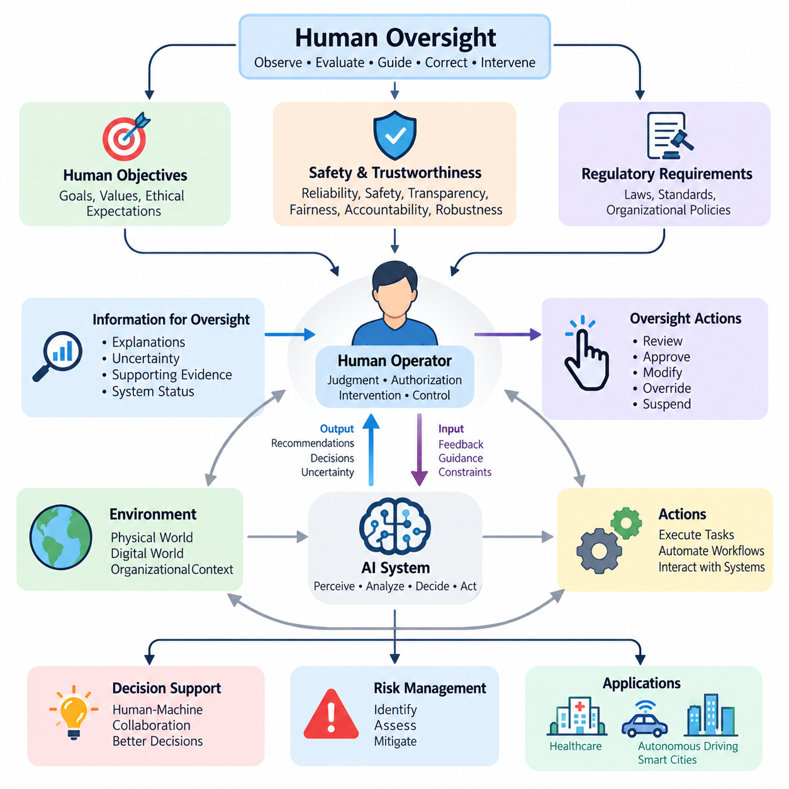
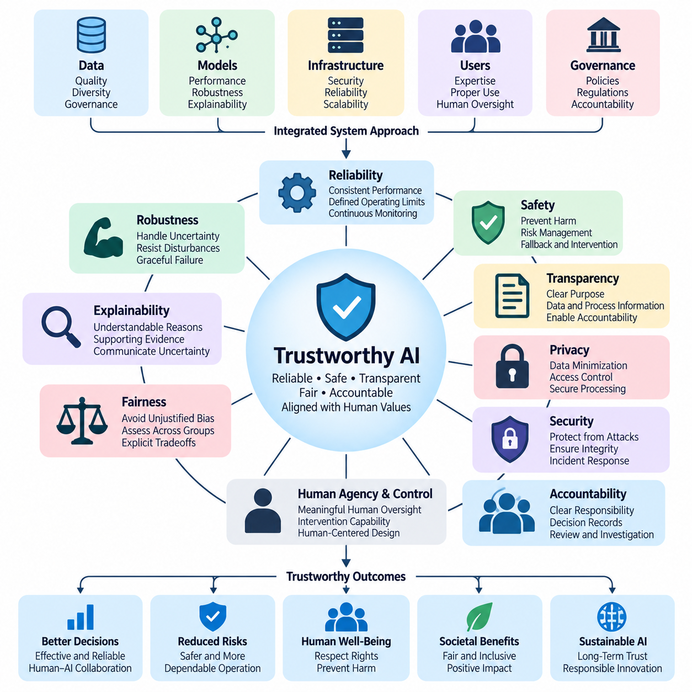
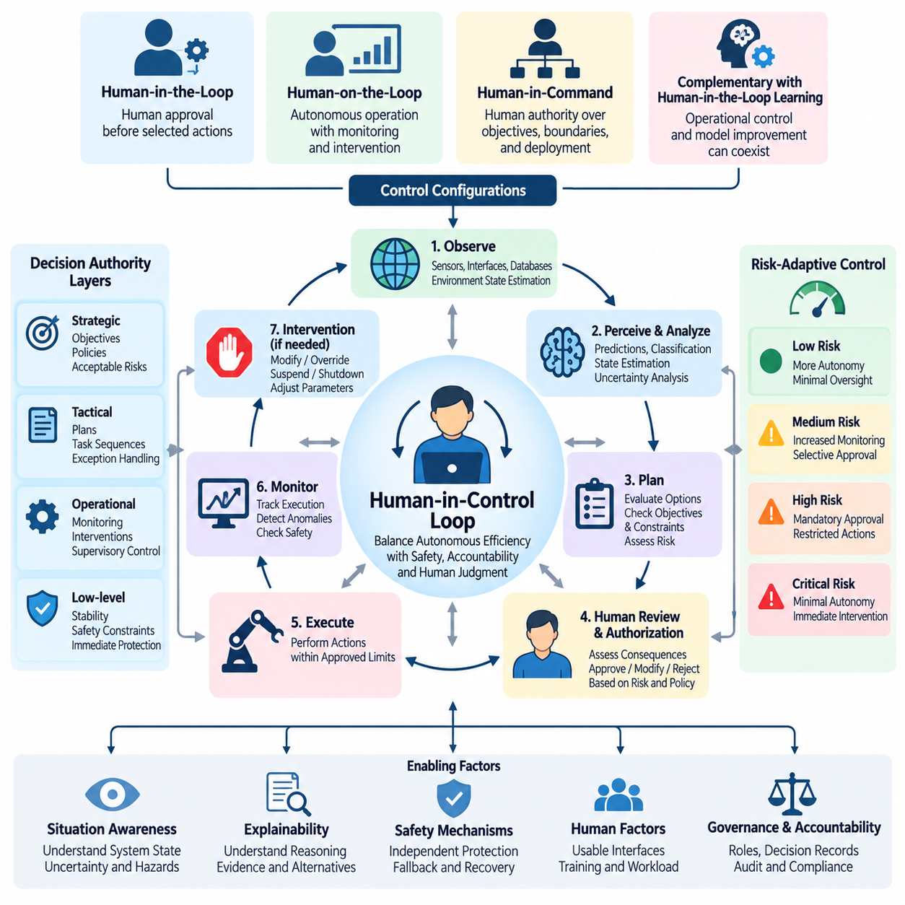
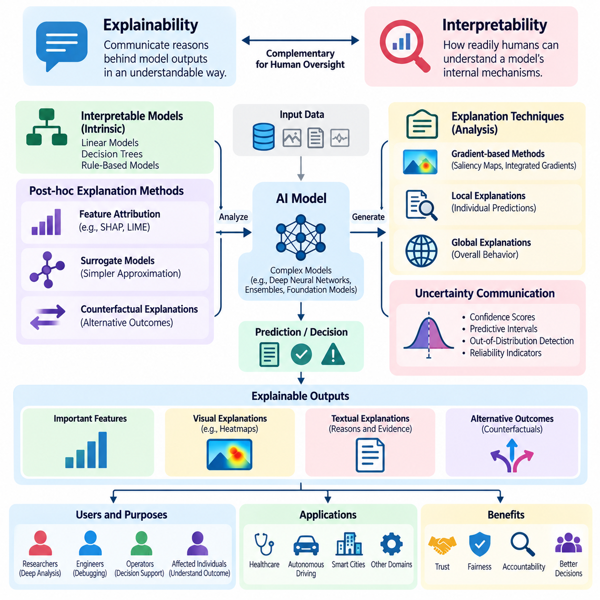
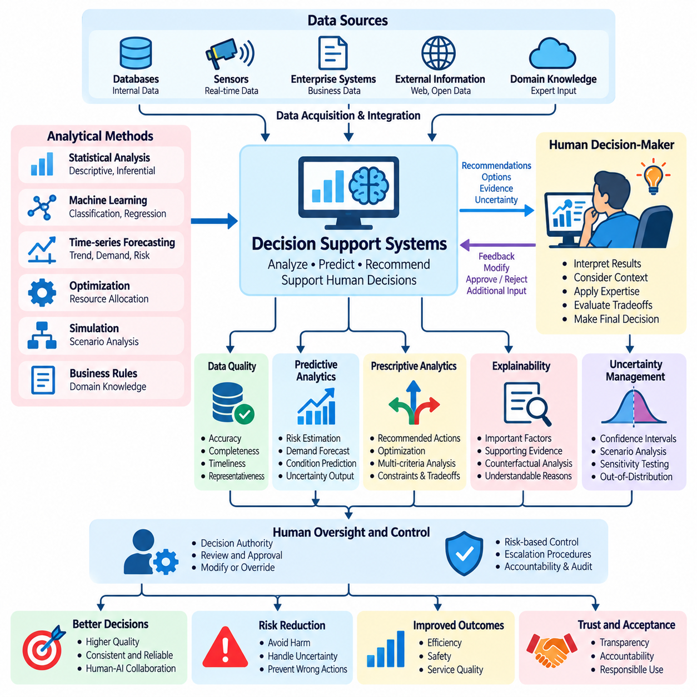
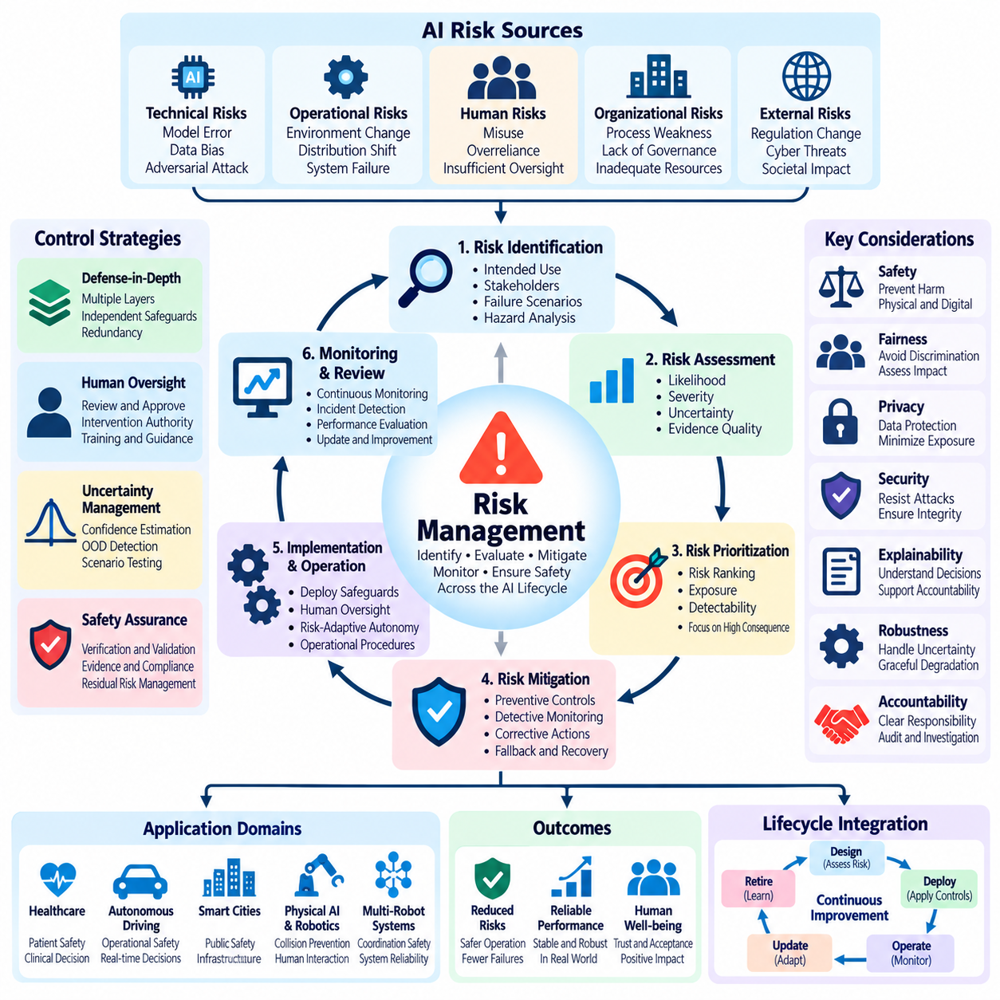
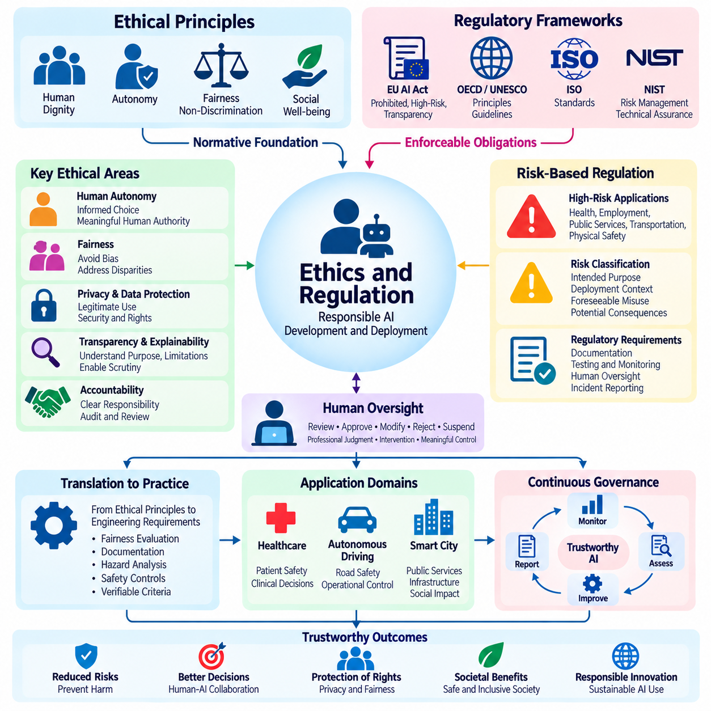
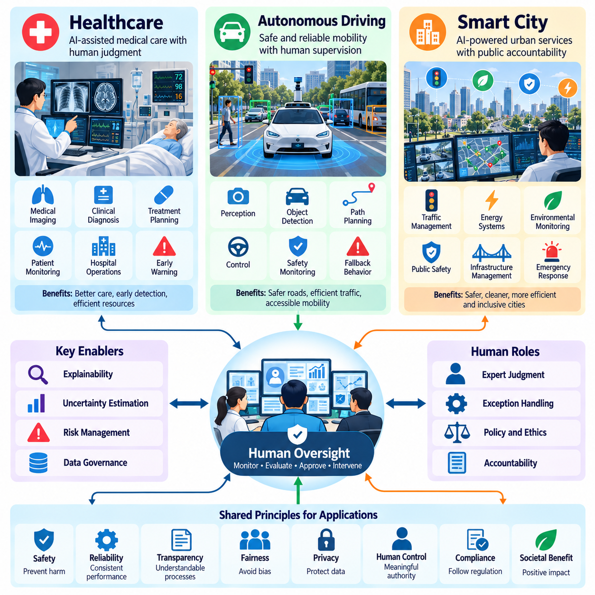

**Volume 41. Human in the Loop Learning**

# 05. Human Oversight

## 05.00 Overview

{width="7.268055555555556in" height="7.268055555555556in"}

Human oversight is a fundamental principle in the development and deployment of artificial intelligence systems that influence human decisions, organizational operations, and physical environments. It establishes mechanisms through which people can observe, evaluate, guide, correct, and intervene in AI behavior. Rather than treating automation as an independent authority, human oversight ensures that intelligent systems remain accountable to human objectives, safety requirements, and ethical expectations.

As artificial intelligence becomes increasingly autonomous, traditional supervision methods become insufficient. Modern AI systems can generate recommendations, execute complex workflows, coordinate multiple agents, and adapt to changing environments. These capabilities introduce uncertainty concerning system behavior and responsibility. Human oversight addresses this challenge by establishing explicit boundaries between autonomous execution and decisions requiring human judgment, authorization, or intervention.

Human oversight is closely related to Human-in-the-Loop learning, but the two concepts serve different purposes. Human-in-the-Loop learning incorporates human knowledge and feedback into model improvement, while human oversight governs how AI systems operate and make decisions throughout their lifecycle. Oversight may involve reviewing predictions, approving actions, monitoring operational conditions, investigating failures, or suspending automated processes when unacceptable risks emerge.

Effective oversight requires a clear understanding of the relationship between human authority and machine autonomy. AI systems may perform routine operations independently while reserving consequential decisions for qualified human operators. The appropriate distribution of responsibility depends on operational complexity, potential harm, uncertainty, and regulatory obligations. Consequently, oversight should be designed as an integral architectural capability rather than an external administrative procedure.

Trustworthy AI provides the conceptual foundation for human oversight by emphasizing reliability, safety, transparency, fairness, accountability, and robustness. A technically accurate model cannot automatically be considered trustworthy if its decisions cannot be examined or challenged. Trustworthiness therefore depends on both model performance and the surrounding governance mechanisms. Human oversight connects these requirements to operational practices that preserve meaningful human authority.

The human-in-control loop extends conventional feedback architectures by explicitly representing human intervention within decision and execution processes. A typical system observes its environment, generates predictions, evaluates possible actions, and executes selected operations. Human supervisors may inspect intermediate results, modify objectives, approve proposed actions, or override automated decisions. This structure allows autonomy to operate within defined boundaries while preserving human control over critical outcomes.

Different oversight configurations provide different levels of human participation. In human-in-the-loop systems, selected decisions require human involvement before execution. Human-on-the-loop systems permit autonomous operation while allowing supervisors to monitor and intervene. Human-in-command arrangements emphasize human authority over system objectives, deployment conditions, and operational boundaries. These configurations are complementary and may coexist within a single intelligent system.

Meaningful human oversight requires more than the theoretical availability of an override mechanism. Operators must receive sufficient information, possess appropriate expertise, and have enough time to recognize problematic behavior. They must also have effective technical controls for modifying or stopping system actions. An oversight mechanism that cannot be exercised under realistic operating conditions provides limited protection, regardless of its formal existence within the architecture.

Explainability and interpretability support oversight by helping human operators understand AI outputs and their underlying limitations. Explainability may provide reasons, supporting evidence, influential features, or alternative outcomes associated with a decision. Interpretability concerns the extent to which internal model behavior can be understood. Although neither guarantees correctness, both can improve the ability of supervisors to identify anomalies, challenge assumptions, and evaluate whether decisions are appropriate.

Decision support systems represent an important application of human oversight because they combine computational analysis with professional judgment. AI models can process large datasets, identify patterns, estimate probabilities, and generate recommendations. Human decision-makers then evaluate these outputs against contextual information, organizational priorities, and practical constraints. The objective is not simply to automate decisions but to improve decision quality through structured human-machine collaboration.

Uncertainty estimation plays a central role in determining when human intervention becomes necessary. Models may produce confidence scores, predictive distributions, anomaly indicators, or out-of-distribution warnings. These signals can help identify cases requiring additional review. However, confidence values must be calibrated and validated because highly confident predictions can still be incorrect. Oversight policies should therefore combine uncertainty measurements with the consequences of potential errors.

Risk management translates oversight principles into operational controls. AI-related risks may arise from inaccurate predictions, distribution shifts, biased training data, cybersecurity vulnerabilities, inappropriate automation, or unexpected interactions with external systems. Risk assessment evaluates the likelihood and severity of harmful outcomes, while mitigation strategies establish preventive and corrective mechanisms. Human oversight provides a means of reviewing residual risks and responding when automated safeguards are insufficient.

Risk-sensitive oversight should allocate human attention according to the potential consequences of AI actions. Low-risk operations may require periodic sampling and retrospective auditing, whereas high-risk actions may demand explicit authorization or continuous supervision. This approach avoids unnecessary human involvement in routine tasks while preserving stronger controls for consequential decisions. Its effectiveness depends on correctly identifying risk categories and maintaining reliable escalation procedures.

Human factors strongly influence the practical effectiveness of oversight. Excessive alerts, poorly designed interfaces, unclear responsibility, and information overload can reduce operator awareness. Automation bias may cause people to accept AI recommendations without sufficient examination, while excessive distrust may lead them to disregard useful information. Effective systems must therefore support calibrated trust, manageable workloads, clear communication, and interfaces that make intervention understandable and timely.

Ethical oversight extends beyond technical correctness to consider fairness, autonomy, privacy, dignity, and the distribution of benefits and harms. AI decisions may affect individuals differently even when overall performance metrics appear satisfactory. Human supervisors must be able to recognize situations in which operational efficiency conflicts with ethical obligations. Governance processes should provide mechanisms for documenting concerns, reviewing contested decisions, and correcting inappropriate outcomes.

Regulatory compliance introduces additional requirements concerning accountability, documentation, transparency, and human control. Applicable obligations vary across jurisdictions, industries, and risk classifications. Organizations must identify relevant legal requirements and translate them into system specifications, operational procedures, and audit evidence. Human oversight contributes to compliance by establishing identifiable responsibilities, decision records, intervention capabilities, and mechanisms for reviewing system performance.

Healthcare illustrates the importance of combining algorithmic assistance with qualified professional supervision. AI systems may support medical imaging, clinical risk assessment, patient monitoring, and treatment planning. However, medical decisions often require contextual interpretation, consideration of individual circumstances, and evaluation of uncertainty. Human oversight helps ensure that automated recommendations remain subject to appropriate clinical judgment and established patient safety procedures.

Autonomous driving introduces oversight challenges because decisions may need to occur faster than humans can reliably react. Vehicle automation must therefore distinguish between functions that can safely operate autonomously and situations requiring human participation. Driver monitoring, operational design domains, transition procedures, and fallback mechanisms are important considerations. Human oversight must be supported by system-level safety engineering rather than relying exclusively on last-second human intervention.

Smart city systems create additional challenges because intelligent infrastructure may coordinate transportation, energy, surveillance, environmental monitoring, and public services. Automated decisions can influence large populations and interconnected physical systems. Oversight must therefore address not only individual model predictions but also system-wide consequences, institutional responsibilities, and public accountability. Transparent governance and controlled intervention become essential elements of urban AI infrastructure.

Operational implementation requires continuous monitoring, event logging, escalation management, and structured review processes. AI systems should record relevant inputs, model versions, decisions, uncertainty indicators, human interventions, and resulting outcomes where appropriate and lawful. These records support incident investigation, performance evaluation, and organizational learning. Oversight findings can subsequently inform data curation, model retraining, interface improvements, and revised operating policies.

Continuous learning creates a particularly important oversight challenge because model behavior may change after deployment. Feedback-driven updates can improve performance but may also introduce unexpected regressions or new failure modes. Human supervisors should participate in defining update policies, reviewing evaluation evidence, approving consequential changes, and establishing rollback criteria. Oversight must therefore extend across the complete model lifecycle rather than focusing only on initial deployment.

The effectiveness of human oversight should be evaluated through measurable operational outcomes. Relevant indicators include intervention accuracy, response latency, escalation quality, false alarm rates, operator workload, and the frequency of harmful decisions prevented or corrected. Evaluation should also examine whether supervisors understand system limitations and can exercise meaningful authority under realistic conditions. These measurements help distinguish functional oversight from purely procedural compliance.

The long-term objective of human oversight is to establish AI systems that remain useful, adaptable, and controllable as their capabilities increase. This requires coordinated development of trustworthy AI principles, human control architectures, explainability methods, decision support mechanisms, risk management practices, and ethical governance. By integrating these elements, human oversight becomes a foundational capability for responsible human-AI collaboration across increasingly autonomous technological environments.

## 05.01 Trustworthy AI

{width="7.268055555555556in" height="7.268055555555556in"}

Trustworthy AI refers to artificial intelligence systems that operate reliably, safely, transparently, and responsibly while remaining aligned with human values and legitimate objectives. Trustworthiness extends beyond predictive accuracy or computational efficiency because technically capable models can still produce harmful or inappropriate outcomes. A trustworthy system must demonstrate dependable behavior across its intended operating conditions and support meaningful human oversight.

Trustworthiness is a system-level property emerging from the interaction of models, data, infrastructure, users, and governance processes. A highly accurate algorithm cannot guarantee trustworthy operation when its training data are biased, its deployment environment is unstable, or its outputs are used without appropriate safeguards. Consequently, trustworthy AI engineering requires coordinated attention to technical performance, organizational accountability, operational procedures, and human decision-making.

Reliability describes the ability of an AI system to perform its intended functions consistently under specified conditions. Reliable systems maintain acceptable performance despite variations in input quality, workload, and environmental conditions. Reliability assessment requires representative testing, continuous monitoring, and clearly defined operational limits. When conditions exceed validated boundaries, the system should detect potential degradation and initiate appropriate responses rather than silently continuing unreliable operation.

Safety concerns the prevention or reduction of unacceptable harm arising from AI behavior. Harm may involve physical injury, financial loss, privacy violations, discriminatory treatment, or disruption of essential services. Safety engineering identifies hazards, evaluates their consequences, and implements preventive or protective mechanisms. In safety-critical environments, AI components must operate within a broader architecture that includes independent safeguards, fallback procedures, and human intervention capabilities.

Robustness refers to the capacity of AI systems to maintain acceptable behavior when encountering disturbances, uncertainty, or unexpected inputs. These conditions may include sensor noise, corrupted measurements, distribution shifts, adversarial manipulation, and incomplete information. Robustness evaluation examines not only average performance but also failure behavior under challenging conditions. A robust system should recognize limitations and avoid making unjustifiably confident decisions when evidence becomes unreliable.

Transparency enables relevant stakeholders to understand how an AI system is developed, evaluated, deployed, and governed. It includes information about intended purposes, data sources, model limitations, performance characteristics, and operational responsibilities. Transparency does not necessarily require unrestricted disclosure of proprietary algorithms or sensitive information. Instead, it requires appropriate visibility into the evidence and processes necessary for informed evaluation, accountability, and oversight.

Explainability complements transparency by providing understandable accounts of individual predictions, recommendations, or decisions. Explanations may identify influential input features, supporting evidence, decision boundaries, or alternative outcomes. Their usefulness depends on the audience and operational context. Engineers may require detailed diagnostic information, while operators may need concise explanations supporting immediate decisions. Explanations should also communicate uncertainty and avoid presenting misleading causal interpretations.

Fairness addresses the possibility that AI systems may produce systematically unequal or unjustified outcomes across individuals or groups. Bias can originate from data collection, annotation practices, model design, evaluation methods, or deployment conditions. Fairness assessment requires examining relevant populations, application contexts, and potential consequences. Because fairness criteria can conflict, trustworthy AI development must make tradeoffs explicit and subject important decisions to appropriate human review.

Privacy and data protection are essential when AI systems process personal, confidential, or sensitive information. Trustworthy systems should apply data minimization, purpose limitation, access controls, secure storage, and appropriate retention policies. Privacy-preserving techniques may reduce unnecessary exposure during training or inference. However, technical safeguards alone are insufficient without organizational policies defining authorized use, responsibility, and procedures for responding to potential violations.

Security protects AI systems against unauthorized access, manipulation, data poisoning, model extraction, and adversarial attacks. Threats can affect training pipelines, deployed models, communication interfaces, and connected infrastructure. Security engineering therefore requires continuous vulnerability assessment, controlled access, integrity verification, and incident response capabilities. Trustworthy AI must consider security throughout its lifecycle because compromised components can undermine otherwise reliable and safe behavior.

Accountability establishes who is responsible for AI-related decisions, operational outcomes, and corrective actions. Responsibility should be assigned across developers, system integrators, operators, organizational managers, and relevant governance authorities. Clear accountability requires documented roles, decision records, review procedures, and mechanisms for investigating failures. Human oversight becomes meaningful when authorized individuals possess both the responsibility and practical ability to challenge or modify automated behavior.

Human agency and control are central to trustworthy AI because automated systems should support legitimate human objectives rather than displace human judgment indiscriminately. Appropriate control mechanisms may include approval requirements, adjustable autonomy levels, intervention interfaces, and emergency shutdown capabilities. Their effectiveness depends on operator competence, available information, and response time. Human authority must therefore be supported by operationally realistic system design.

Trust calibration concerns the relationship between actual AI capabilities and the confidence users place in those capabilities. Excessive trust may produce automation bias, while insufficient trust can prevent effective adoption of useful systems. Appropriate trust emerges when users understand system strengths, limitations, uncertainty, and failure conditions. Interface design, training, performance communication, and feedback mechanisms help establish a balanced relationship between human expectations and demonstrated system behavior.

Trustworthy AI evaluation requires multiple complementary metrics rather than reliance on a single accuracy score. Relevant measurements include reliability, robustness, calibration, fairness, safety incidents, intervention effectiveness, and operational availability. Evaluation should cover normal conditions, foreseeable disturbances, and representative high-risk scenarios. Evidence must be interpreted in relation to intended use because satisfactory benchmark performance does not automatically establish safety in real deployments.

Lifecycle governance ensures that trustworthiness is maintained from initial design through development, deployment, monitoring, and retirement. Requirements should be translated into measurable acceptance criteria, supported by documentation and verification evidence. Changes to models, datasets, infrastructure, or operational environments may invalidate previous assumptions. Consequently, significant modifications require reassessment, controlled deployment, and procedures for detecting and correcting unexpected performance degradation.

In healthcare, trustworthy AI must support clinical safety, patient privacy, reliable recommendations, and professional accountability. In autonomous driving, it must address perception uncertainty, environmental variability, system failures, and safe operational boundaries. In smart cities, trustworthiness also involves public accountability, equitable service delivery, cybersecurity, and the consequences of interconnected automated decisions. Each domain requires controls proportional to its specific risks and responsibilities.

Physical AI introduces additional trustworthiness requirements because intelligent decisions directly influence mechanical actions and physical environments. Robots may interact with people, infrastructure, equipment, and unpredictable obstacles. Trustworthy operation therefore requires coordinated perception validation, motion constraints, collision avoidance, fault detection, and safe recovery behavior. Human supervisors must understand when autonomous execution is permitted and when intervention or controlled shutdown becomes necessary.

Trustworthy AI cannot be established permanently through a single certification, benchmark, or development milestone. Trustworthiness must be maintained through continuous evidence collection, operational monitoring, incident analysis, and organizational learning. Human feedback can reveal failures overlooked during testing, while structured review processes can translate observations into corrective improvements. This ongoing relationship between technical assurance and human oversight supports responsible adaptation.

Ultimately, trustworthy AI provides the foundation for deploying increasingly capable intelligent systems without surrendering accountability or meaningful human control. Reliability, safety, robustness, transparency, fairness, privacy, security, and explainability must operate as mutually reinforcing requirements. By integrating these principles with risk management and human oversight, organizations can develop AI systems that remain dependable, understandable, and appropriately governed throughout their operational lives.

## 05.02 Human in Control Loop

{width="7.268055555555556in" height="7.268055555555556in"}

The Human-in-Control Loop is a governance and operational architecture that preserves meaningful human authority over artificial intelligence systems throughout their decision-making and execution processes. Unlike conventional automation, which emphasizes independent machine operation, this approach integrates human supervision, intervention, and authorization into the control structure. Its primary objective is to balance autonomous efficiency with safety, accountability, and human judgment.

A Human-in-Control Loop combines machine perception, automated reasoning, action planning, execution monitoring, and human decision-making within a coordinated process. AI systems collect information, interpret environmental conditions, and propose or execute actions according to predefined permissions. Human operators observe relevant system states, assess potential consequences, and intervene when necessary. This interaction creates a continuous relationship between computational autonomy and human responsibility.

The architecture differs from traditional Human-in-the-Loop learning because its central purpose is operational control rather than model training. Human-in-the-Loop learning uses annotations, corrections, and preferences to improve predictive models or policies. Human-in-Control systems instead determine when autonomous decisions may proceed, when approval is required, and when operations must be modified or stopped. Both approaches can coexist within a unified AI lifecycle.

Human participation can be organized through several control configurations. Human-in-the-Loop operation requires explicit human involvement before selected actions are executed. Human-on-the-Loop operation allows autonomous execution while maintaining supervisory monitoring and intervention capabilities. Human-in-Command governance establishes authority over system objectives, operational boundaries, and deployment decisions. The appropriate configuration depends on task complexity, risk severity, and available response time.

A typical control cycle begins with environmental observation and state estimation. Sensors, software interfaces, and operational databases provide information about current conditions. AI models transform these inputs into predictions, classifications, or estimated system states. Decision modules then evaluate possible actions against objectives and constraints. Before execution, the control architecture determines whether the proposed action satisfies predefined autonomy and safety requirements.

Authorization mechanisms establish which decisions require human approval and which can proceed automatically. Routine, low-risk operations may be executed without direct intervention, while consequential or uncertain actions may trigger supervisory review. Authorization policies can consider model confidence, estimated risk, operational context, and regulatory requirements. These policies must remain understandable and enforceable so that autonomous systems cannot bypass mandatory human approval.

Human intervention mechanisms allow operators to modify, reject, suspend, or replace automated decisions. Intervention may involve changing task priorities, adjusting operating parameters, selecting alternative actions, or initiating controlled shutdown procedures. Effective intervention requires reliable communication channels and clearly defined control authority. Systems must also distinguish between ordinary supervisory commands and safety-critical actions requiring immediate execution.

Real-time control introduces important constraints because human response times are generally slower than automated computation and machine actuation. In robotics and autonomous vehicles, some hazards develop too quickly for direct human intervention. Consequently, low-level safety functions must operate independently of supervisory approval when immediate protection is necessary. Human control should govern objectives, permissions, and recovery strategies without replacing time-critical protective mechanisms.

Decision authority can be distributed across multiple architectural layers. Strategic supervision defines mission objectives, acceptable risks, and operating policies. Tactical supervision evaluates plans, task sequences, and exceptional situations. Operational supervision monitors execution and manages interventions. Low-level controllers maintain stability and enforce immediate safety constraints. This hierarchical arrangement supports scalable autonomy while preserving appropriate human authority.

Situation awareness is essential for effective human supervision. Operators must understand what the AI system is doing, why particular actions are being considered, and whether current conditions remain within validated limits. Interfaces should present relevant state information, uncertainty estimates, active constraints, and emerging hazards. Excessive technical detail can obscure important signals, while insufficient information prevents informed intervention.

Explainability supports the Human-in-Control Loop by connecting automated recommendations to understandable evidence. An operator reviewing a proposed action may need information about predicted outcomes, alternative strategies, uncertainty, and violated constraints. Explanations should be adapted to the operator\'s responsibilities and available decision time. Their purpose is to support informed judgment rather than create an illusion of certainty or guarantee correctness.

Risk-adaptive control adjusts the level of human involvement according to operational conditions. When system behavior is predictable and potential consequences are limited, greater autonomy may be appropriate. As uncertainty, environmental complexity, or potential harm increases, the architecture can require additional confirmation or restrict available actions. Such transitions should follow validated policies rather than relying exclusively on uncalibrated confidence scores.

Escalation procedures define how unresolved uncertainty, abnormal behavior, or policy violations reach responsible human authorities. An escalation may involve notifying an operator, transferring control, requesting specialized review, or entering a predefined safe state. The system should specify escalation thresholds, response deadlines, and fallback behavior when no authorized person is available. Without these provisions, human supervision can become ineffective during critical events.

Human factors influence whether control mechanisms function reliably in practice. Automation bias may encourage operators to accept recommendations without sufficient examination, while alarm fatigue can reduce responsiveness to genuine hazards. Poor interface design, excessive workload, and unclear authority can further weaken oversight. Effective architectures therefore incorporate operator training, workload management, usable interfaces, and realistic intervention testing.

Accountability requires clear records of automated decisions and human actions. Event logs should capture relevant observations, model outputs, proposed actions, authorization decisions, interventions, and execution outcomes. These records support incident investigation, operational auditing, and continuous improvement. Logging must also respect privacy, security, and data retention requirements while preserving sufficient evidence to reconstruct consequential decisions.

In healthcare, Human-in-Control architectures can support clinical decision systems by requiring qualified professionals to review consequential recommendations. In autonomous driving, they can define operational boundaries, supervisory responsibilities, and safe fallback behavior. In industrial automation, operators may authorize hazardous operations while independent controllers enforce immediate protective limits. Each application requires supervision mechanisms adapted to its specific risks.

Physical AI systems make human control particularly important because software decisions can produce direct mechanical consequences. Mobile robots, manipulators, and autonomous machines interact with uncertain environments and physical infrastructure. Supervisors may approve missions, modify navigation objectives, or suspend operations, while onboard controllers maintain collision avoidance and stability. Reliable operation depends on separating supervisory authority from time-critical control responsibilities.

Multi-robot systems introduce additional complexity because a single operator may supervise several autonomous agents simultaneously. Centralized interfaces can present fleet status, mission progress, resource allocation, and abnormal events. Human supervisors should focus on consequential exceptions rather than continuously directing every movement. Scalable oversight requires prioritization mechanisms, clear responsibility boundaries, and reliable methods for stopping or isolating individual agents.

The effectiveness of a Human-in-Control Loop should be evaluated through intervention latency, authorization correctness, operator workload, escalation reliability, and recovery performance. Testing must examine normal operation, communication failures, unexpected environmental changes, and situations involving conflicting commands. Simulated and real-world evaluations can reveal whether operators retain practical control under realistic constraints rather than merely possessing formal authority.

Ultimately, the Human-in-Control Loop establishes a structured relationship between autonomous intelligence and human responsibility. Its effectiveness depends on explicit decision boundaries, reliable intervention mechanisms, risk-sensitive authorization, understandable system behavior, and independent safety protections. By integrating these capabilities into AI architectures, organizations can achieve meaningful autonomy while ensuring that consequential decisions remain subject to appropriate human authority.

## 05.03 Explainability and Interpretability

{width="7.268055555555556in" height="7.268055555555556in"}

Explainability and interpretability are essential properties of trustworthy artificial intelligence because they enable humans to examine, understand, and challenge automated decisions. Explainability concerns the ability to communicate reasons behind model outputs, while interpretability concerns how readily humans can understand a model\'s internal mechanisms. Both support human oversight by reducing information asymmetry between intelligent systems and their operators.

Modern AI models often contain complex computational structures that make their decision processes difficult to understand directly. Deep neural networks, ensemble methods, and foundation models can learn sophisticated relationships without producing transparent reasoning procedures. High predictive accuracy does not necessarily indicate that a model relies on appropriate evidence. Explainability methods help investigate whether outputs reflect meaningful patterns, irrelevant correlations, or unintended biases.

Interpretability can be achieved through inherently understandable models or through analysis of more complex architectures. Linear models, shallow decision trees, and rule-based systems may expose relationships that humans can inspect directly. However, their transparency depends on model size, feature meaning, and application complexity. More expressive models may require additional analytical techniques to reveal important aspects of their behavior.

Post-hoc explainability techniques analyze trained models without necessarily changing their underlying architecture. Feature attribution methods estimate how individual inputs contribute to predictions, while surrogate models approximate complex decision boundaries using simpler representations. Counterfactual explanations examine how changes in input conditions might alter an outcome. These techniques provide useful perspectives but do not automatically reveal the model\'s complete reasoning process.

Local explanations focus on individual predictions, whereas global explanations describe broader patterns of model behavior. A local explanation may identify which features influenced a particular classification or recommendation. Global analysis examines overall feature importance, decision tendencies, and interactions across many examples. Effective oversight often requires both perspectives because an apparently reasonable individual prediction may conceal systematic weaknesses.

Feature attribution methods such as SHAP and LIME are widely used to investigate model predictions. SHAP assigns contributions according to a game-theoretic framework, while LIME approximates model behavior around selected inputs using simpler local models. Their results depend on assumptions, background distributions, and perturbation strategies. Consequently, explanations should be interpreted as analytical estimates rather than definitive causal accounts.

Gradient-based techniques provide another approach to understanding differentiable neural networks. Saliency maps, integrated gradients, and related methods estimate the sensitivity of model outputs to input features. In computer vision, these techniques can highlight image regions associated with predictions. However, visually convincing explanations may be unstable or misleading, making sensitivity analysis and independent validation necessary.

Counterfactual explanations are particularly useful for decision support because they describe alternative conditions under which a model might produce a different result. For example, a system may indicate which measurable factors would need to change for a recommendation to be revised. Counterfactuals should respect feasible constraints and meaningful relationships between variables. Otherwise, they may suggest unrealistic interventions or imply unsupported causal conclusions.

Explainability must distinguish correlation from causation. A model may associate particular features with an outcome without establishing that those features cause it. Explanations based on feature importance or attention weights should not automatically be interpreted as causal mechanisms. Causal interpretation requires additional assumptions, experimental evidence, or appropriate causal models. Human supervisors must recognize these limitations when evaluating automated recommendations.

The usefulness of an explanation depends strongly on its intended audience. Researchers may require detailed information about internal representations, optimization behavior, and failure patterns. Engineers may focus on debugging, robustness, and data quality. Operational supervisors need concise evidence supporting immediate decisions, while affected individuals may require understandable reasons for consequential outcomes. Explanation design should therefore reflect distinct informational needs.

Human-centered explanation interfaces should communicate model outputs, relevant evidence, uncertainty, and operational limitations without overwhelming users. Explanations must remain accessible under realistic time constraints and workload conditions. Excessive technical detail may obscure important warnings, while oversimplified descriptions can create false confidence. Effective interfaces support appropriate trust rather than merely increasing acceptance of automated decisions.

Uncertainty communication is an important component of explainable decision support. Confidence estimates, predictive intervals, and out-of-distribution indicators can help operators recognize when predictions are unreliable. However, confidence scores may be poorly calibrated and should not be presented as guarantees. Combining explanations with validated uncertainty measures allows supervisors to distinguish routine decisions from cases requiring additional investigation.

Explainability also contributes to fairness assessment by revealing potentially problematic relationships between model predictions and sensitive or contextually inappropriate features. Analysts may investigate whether decisions depend on proxies for protected characteristics or reflect systematic differences across populations. Nevertheless, feature attribution alone cannot establish fairness. Appropriate evaluation requires representative datasets, relevant fairness metrics, and contextual human judgment.

In safety-critical systems, explanations should support operational intervention rather than function only as retrospective descriptions. A supervisor may need to understand why a robot selected a route, why an autonomous vehicle detected a hazard, or why an industrial controller recommended stopping equipment. Useful explanations identify relevant constraints, detected abnormalities, and available alternatives. Immediate safety mechanisms must remain effective even when explanations are unavailable.

Physical AI introduces additional interpretability challenges because intelligent decisions emerge from interactions among perception, state estimation, planning, and control. A robotic failure may originate from sensor errors, incorrect environmental assumptions, planning limitations, or actuator behavior. Explainability should therefore examine the complete decision pipeline rather than a single neural network. Temporal context and physical constraints are essential for understanding system behavior.

Human oversight benefits from explanations that connect predicted outcomes with authorized actions and operational policies. When an AI system proposes a consequential decision, supervisors should be able to inspect supporting evidence, applicable constraints, and alternative responses. Explanation mechanisms can also support escalation when uncertainty or policy violations exceed predefined thresholds. This integration transforms explainability into a practical component of human control.

Evaluating explanation quality requires more than assessing visual clarity or user satisfaction. Relevant criteria include fidelity to actual model behavior, stability under small input changes, completeness, usefulness, and computational efficiency. Human-centered evaluation should examine whether explanations improve error detection and decision quality. An explanation that appears intuitive but misrepresents the model may be more harmful than an acknowledged lack of interpretability.

Explainability systems must also address privacy, security, and information disclosure. Detailed explanations can expose sensitive input attributes, confidential operational information, or aspects of proprietary models. Organizations should define appropriate access permissions and explanation detail according to user responsibilities. Audit records can preserve evidence for authorized investigation while limiting unnecessary disclosure to other stakeholders.

Continuous monitoring is necessary because explanations may change when models are retrained, datasets evolve, or operating environments shift. Explanation drift can reveal altered feature dependencies or unexpected decision patterns, although it does not necessarily indicate performance degradation. Comparing explanations across model versions can support regression analysis and change review. Such monitoring should complement direct performance, robustness, and safety evaluations.

Ultimately, explainability and interpretability provide complementary foundations for meaningful human oversight. They help humans investigate model behavior, identify limitations, challenge questionable decisions, and determine when intervention is necessary. Their value depends on technical fidelity, appropriate communication, contextual understanding, and integration with operational safeguards. Effective AI governance treats explanations as evidence supporting human judgment, not as substitutes for validation or accountability.

## 05.04 Decision Support Systems

{width="7.268055555555556in" height="7.268055555555556in"}

Decision Support Systems (DSS) are computational frameworks designed to assist humans in evaluating information, comparing alternatives, and making informed decisions. Unlike fully autonomous decision-making systems, DSS emphasize human judgment while providing analytical capabilities that improve consistency, efficiency, and situational understanding. AI-powered DSS extend traditional approaches through predictive modeling, adaptive reasoning, and intelligent recommendations.

A modern Decision Support System integrates data acquisition, information processing, predictive analytics, recommendation generation, and human interaction. Data may originate from databases, sensors, enterprise applications, or external information services. Analytical models transform these inputs into estimates, forecasts, and decision alternatives. Human users interpret the results, consider contextual factors, and retain authority over consequential decisions.

Traditional DSS frequently rely on statistical analysis, optimization algorithms, simulation, and predefined business rules. AI-enhanced systems incorporate machine learning, natural language processing, knowledge representation, and probabilistic inference. These technologies enable the analysis of complex patterns and partially structured information. However, increased analytical sophistication also creates additional requirements for transparency, validation, and human oversight.

The fundamental objective of DSS is decision augmentation rather than unrestricted decision automation. Augmentation combines computational strengths in pattern recognition, information retrieval, and quantitative analysis with human expertise, contextual understanding, and ethical judgment. Effective systems recognize that human and machine capabilities are complementary. Their architecture should therefore support informed human decisions instead of encouraging passive acceptance of automated recommendations.

Decision support begins with a clear representation of the decision problem. The system must identify objectives, available alternatives, relevant constraints, and evaluation criteria. Ambiguous objectives can produce technically optimal recommendations that fail to address actual operational needs. Human stakeholders should participate in defining priorities, acceptable tradeoffs, and decision boundaries before analytical models are deployed.

Data quality directly influences the reliability of decision support. Incomplete records, inconsistent measurements, outdated information, and biased samples can distort analytical results. Data validation procedures should examine accuracy, completeness, timeliness, and representativeness. Systems should communicate important data limitations to users because apparently precise recommendations may conceal substantial uncertainty or unsupported assumptions.

Predictive models estimate future outcomes or unknown conditions relevant to a decision. Classification models may identify risk categories, while regression models estimate quantities such as demand, cost, or equipment degradation. Time-series forecasting can support planning under changing conditions. Predictions should include appropriate uncertainty information and should not be treated as guaranteed outcomes or substitutes for contextual evaluation.

Prescriptive analytics extends prediction by recommending actions that may improve selected objectives. Optimization techniques can compare alternatives under resource limitations, operational constraints, and competing priorities. Multi-criteria decision analysis supports choices involving safety, cost, efficiency, and service quality. Recommendations depend on the assumptions and objective functions used, making transparent specification of these elements essential.

Uncertainty-aware decision support distinguishes between incomplete knowledge, random variability, and changing environmental conditions. Probabilistic estimates, confidence intervals, scenario analysis, and sensitivity testing can help users understand possible outcomes. When uncertainty exceeds validated thresholds, systems may request additional information or recommend further review. Communicating uncertainty appropriately reduces the risk of overconfident decisions.

Explainability is particularly important when DSS recommendations influence consequential actions. Users should understand the evidence supporting a recommendation, the factors influencing its ranking, and the assumptions underlying projected outcomes. Counterfactual analysis can demonstrate how different conditions might change a preferred alternative. Explanations should support critical evaluation without falsely implying that statistical associations establish causal relationships.

Human-centered interfaces determine whether analytical insights become useful decisions. Effective interfaces present relevant alternatives, expected consequences, uncertainty, and applicable constraints in an accessible form. Interactive exploration allows users to modify assumptions and compare scenarios. Interface complexity should match user expertise and operational urgency, avoiding excessive information that increases cognitive workload or obscures important warnings.

Human oversight mechanisms establish when recommendations require approval, modification, rejection, or escalation. Routine decisions may receive lightweight review, while high-risk recommendations require explicit authorization. Operators should be able to inspect supporting evidence and document reasons for overriding system suggestions. Such mechanisms preserve accountability and prevent decision support from becoming unexamined automation.

Automation bias represents a major challenge because users may accept algorithmic recommendations even when contradictory evidence is available. Conversely, algorithm aversion may lead users to reject useful recommendations after observing occasional errors. Appropriate trust calibration requires clear performance communication, realistic training, and opportunities to examine system limitations. Decision support should improve human judgment rather than replace it with misplaced confidence.

In healthcare, clinical decision support systems assist professionals with diagnosis, treatment planning, risk assessment, and resource allocation. Their recommendations must account for patient-specific information, clinical uncertainty, and established professional responsibilities. Medical practitioners remain responsible for interpreting outputs within the broader clinical context. Reliable deployment requires rigorous evaluation, privacy safeguards, and monitoring for potentially harmful recommendations.

In autonomous driving and intelligent transportation, DSS can support route selection, traffic management, incident response, and fleet coordination. Predictive models estimate congestion, travel conditions, and operational risks. Human supervisors may review exceptional situations or authorize changes to system objectives. Time-critical safety functions must remain independent of delayed human approval, ensuring that supervisory decision support does not compromise immediate protection.

Industrial and Physical AI applications use DSS for predictive maintenance, mission planning, production scheduling, and robotic fleet management. Sensor information and equipment histories can support estimates of component degradation or operational risk. Optimization models recommend maintenance windows, task assignments, or resource distribution. Human operators evaluate these recommendations against practical constraints, safety requirements, and changing operational priorities.

Multi-agent and multi-robot environments require decision support that summarizes distributed information without overwhelming supervisors. A centralized system may aggregate robot health, mission progress, environmental hazards, and resource availability. AI can prioritize exceptions and propose coordinated responses, while humans retain authority over mission-level changes. Scalable interfaces should emphasize consequential decisions rather than every low-level action performed by individual agents.

Evaluation of DSS should measure more than model accuracy or recommendation quality. Relevant outcomes include decision effectiveness, response time, operator workload, error detection, intervention quality, and user trust calibration. Controlled experiments can compare human-only, AI-only, and human-AI collaborative performance. Realistic evaluation must also examine failures, unusual conditions, and the consequences of incorrect recommendations.

Operational governance requires traceable decision records, model version control, access management, and procedures for correcting identified problems. Logs should distinguish model recommendations from human decisions and subsequent execution outcomes. Monitoring can identify performance drift, changes in user behavior, and emerging risks. Feedback from actual decisions should support controlled improvement without introducing unvalidated changes into safety-critical workflows.

Ultimately, Decision Support Systems provide a practical foundation for collaborative human-AI intelligence. Their value emerges from integrating reliable data, predictive and prescriptive analytics, understandable recommendations, and meaningful human authority. Effective systems enhance the quality and consistency of decisions while preserving accountability and adaptability. As AI capabilities expand, decision support will remain essential for aligning computational intelligence with human objectives and responsible operational control.

## 05.05 Risk Management

{width="7.268055555555556in" height="7.268055555555556in"}

Risk management is a fundamental component of trustworthy artificial intelligence, providing systematic methods for identifying, evaluating, mitigating, and monitoring potential harm. AI risks arise from technical failures, uncertain predictions, human misuse, organizational weaknesses, and changing operational environments. Effective risk management connects system capabilities with safety requirements, human oversight, and accountability throughout the AI lifecycle.

AI risk differs from conventional software risk because learning-based systems may exhibit unexpected behavior outside their training distributions. Model errors, data bias, adversarial manipulation, and environmental changes can produce failures that are difficult to predict through traditional testing alone. Risk assessment must therefore consider both deterministic engineering failures and probabilistic uncertainties associated with learned decision-making.

Risk identification begins by examining intended use, operating conditions, affected stakeholders, and potential failure scenarios. Hazards may include incorrect predictions, unsafe actions, privacy violations, discriminatory outcomes, or disruptions to essential services. Structured techniques such as hazard analysis, failure mode and effects analysis, and scenario exploration help reveal vulnerabilities. Human experts remain essential for identifying contextual risks overlooked by automated tools.

Risk assessment evaluates the likelihood and severity of potential consequences while considering uncertainty and exposure. A low-probability event may still require strong controls when its consequences are catastrophic. Quantitative methods estimate failure frequencies or expected losses, while qualitative approaches classify risks using structured categories. Assessment results should explicitly document assumptions, evidence quality, and limitations.

Risk prioritization determines which threats require immediate mitigation and which can be managed through routine controls. Priorities depend on potential harm, operational exposure, detectability, and the effectiveness of existing safeguards. Risk matrices can support communication, but their simplified categories may conceal uncertainty or produce misleading rankings. High-consequence hazards should receive particular attention even when reliable probability estimates are unavailable.

Risk mitigation combines preventive, detective, and corrective controls to reduce the likelihood or consequences of harmful events. Preventive measures include data validation, model constraints, access restrictions, and robust engineering practices. Detective controls identify abnormal behavior through monitoring and diagnostics. Corrective mechanisms provide fallback operations, human intervention, recovery procedures, and controlled shutdown capabilities.

Defense-in-depth is especially important when individual safeguards may fail or share common vulnerabilities. Multiple protection layers can include input validation, uncertainty estimation, policy enforcement, independent safety monitors, and emergency stopping mechanisms. Their effectiveness depends on sufficient independence and verified interactions. Redundant components do not necessarily provide protection when they depend on the same flawed assumptions.

Human oversight provides an additional risk control by enabling authorized individuals to review consequential decisions and intervene when necessary. However, human involvement does not automatically eliminate risk. Operators may face automation bias, excessive workload, incomplete information, or insufficient response time. Effective oversight requires clear authority, understandable interfaces, realistic training, and escalation procedures matched to operational hazards.

Risk-adaptive autonomy adjusts system permissions according to current conditions and assessed consequences. Routine operations within validated boundaries may proceed autonomously, while uncertain or high-risk situations require additional authorization. Systems can reduce speed, restrict actions, request assistance, or transition to safer operating modes. Such adaptations should rely on validated risk indicators rather than uncalibrated confidence estimates alone.

Uncertainty management distinguishes between uncertainty arising from limited knowledge and variability inherent in the environment. Epistemic uncertainty may decrease through improved data or modeling, while aleatoric uncertainty reflects stochastic conditions that cannot always be eliminated. Calibration, out-of-distribution detection, and scenario testing help characterize these uncertainties. Their limitations must remain visible to human supervisors.

Safety assurance requires evidence that identified risks are controlled to an acceptable level for the intended application. Assurance arguments connect safety claims with design requirements, verification results, operational restrictions, and supporting evidence. Testing alone cannot demonstrate the absence of every possible failure. Consequently, assurance should combine analytical evaluation, simulation, controlled experiments, operational monitoring, and documented residual risks.

Physical AI introduces direct mechanical and environmental hazards because intelligent decisions influence moving equipment and physical infrastructure. Mobile robots and manipulators may encounter unexpected obstacles, sensor degradation, actuator faults, or human proximity. Risk management must integrate perception validation, collision prevention, motion constraints, and independent protective functions. Supervisory approval cannot replace immediate safety responses.

Multi-robot systems create additional risks through coordination failures, communication delays, shared infrastructure, and cascading operational errors. A faulty mission assignment may affect several agents, while network disruptions can compromise fleet-wide coordination. Risk controls should address agent isolation, communication loss, resource conflicts, and safe degradation. Human supervisors require consolidated visibility into system-wide hazards and intervention priorities.

Operational monitoring identifies emerging risks after deployment, including data drift, performance degradation, changing usage patterns, and previously unobserved failure modes. Monitoring thresholds should be linked to actionable responses rather than generating excessive alarms. Incident reports, near-miss observations, and operator feedback provide valuable evidence. These findings should trigger structured investigation and controlled improvements.

Incident response defines how organizations detect, contain, investigate, and recover from AI-related failures. Effective procedures establish responsibilities, communication channels, escalation thresholds, and evidence preservation requirements. Recovery may involve disabling affected capabilities, reverting model versions, or restoring validated operating configurations. Post-incident analysis should identify contributing technical and organizational factors rather than focusing only on individual mistakes.

Governance establishes organizational responsibility for risk acceptance, mitigation decisions, and ongoing oversight. Risk owners should maintain documented assessments, control measures, verification evidence, and review schedules. Relevant frameworks and standards can provide structured guidance, but compliance alone does not guarantee safe operation. Organizations must evaluate whether controls remain appropriate for actual deployment conditions and stakeholder needs.

Risk management also involves balancing competing objectives such as performance, efficiency, cost, privacy, fairness, and safety. Improving one dimension may introduce additional risks elsewhere. For example, aggressive automation may reduce operating costs while increasing supervision demands or failure consequences. Transparent tradeoff analysis enables decision-makers to justify selected controls and determine whether remaining risks are acceptable.

Evaluation should examine both risk reduction and the practical effectiveness of protective mechanisms. Relevant measures include incident frequency, failure severity, detection latency, intervention success, recovery time, and residual exposure. Stress testing and rare-event simulations can reveal weaknesses missed during ordinary evaluation. Evidence should be updated whenever system architecture, model behavior, or operating conditions change significantly.

Continuous risk management treats AI safety as an evolving operational responsibility rather than a one-time certification activity. New datasets, model updates, hardware modifications, and environmental changes can invalidate previous assumptions. Change management procedures should require impact assessment, regression testing, and authorization before consequential modifications are deployed. Human feedback and operational evidence support ongoing refinement of safeguards.

Ultimately, effective AI risk management integrates technical assurance, organizational governance, human oversight, and continuous operational learning. Its purpose is not to claim that all uncertainty can be eliminated, but to identify foreseeable harms, establish proportionate controls, and maintain accountability for residual risks. As AI systems become more autonomous, disciplined risk management becomes essential for preserving safety, trustworthiness, and meaningful human control.

## 05.06 Ethics and Regulation

{width="7.268055555555556in" height="7.268055555555556in"}

Ethics and regulation provide the normative and institutional foundations for responsible artificial intelligence development and deployment. Ethics examines whether AI behavior respects human dignity, autonomy, fairness, and societal well-being, while regulation establishes enforceable obligations and accountability mechanisms. Together, they guide how intelligent systems should be designed, evaluated, and governed, particularly when automated decisions affect fundamental rights or physical safety.

AI ethics extends beyond technical performance because accurate predictions do not necessarily produce morally acceptable outcomes. A system may optimize efficiency while creating unfair treatment, privacy violations, or excessive dependence on automation. Ethical evaluation therefore considers the interests of affected individuals, the distribution of benefits and harms, and the legitimacy of decision-making processes. Human oversight provides an essential mechanism for addressing these concerns.

Human autonomy is a central ethical principle because individuals should retain meaningful influence over decisions affecting their lives. AI systems should support informed choice rather than manipulate behavior or conceal consequential alternatives. In operational environments, autonomy also requires clearly defined human authority over objectives, permissions, and interventions. Effective governance ensures that automated recommendations remain contestable and that appropriate mechanisms exist for human review.

Fairness and non-discrimination require examining whether AI systems produce unjustified differences in treatment or outcomes. Bias may emerge from historical data, sampling practices, labeling decisions, or deployment conditions. Ethical assessment must consider relevant social contexts and the consequences for affected populations. Since fairness definitions may conflict, organizations should document their choices, evaluate competing criteria, and establish procedures for addressing harmful disparities.

Privacy and data protection concern the ethical collection, processing, storage, and sharing of information. Responsible AI systems should limit data collection to legitimate purposes, apply appropriate security controls, and respect applicable rights concerning personal information. Consent alone may not resolve every ethical concern, particularly when individuals cannot meaningfully negotiate data practices. Governance must therefore consider power imbalances, proportionality, and potential secondary uses.

Transparency and explainability support ethical accountability by allowing stakeholders to understand the purpose, limitations, and consequences of AI systems. Transparency may involve documentation of training data, evaluation methods, intended applications, and operational responsibilities. Explainability provides understandable accounts of particular outputs or recommendations. These mechanisms should enable meaningful scrutiny without exposing confidential information or creating misleading impressions of certainty.

Accountability requires identifiable individuals and organizations to remain responsible for consequential AI decisions. Responsibility cannot be transferred entirely to algorithms because automated systems do not independently possess institutional authority or legal obligations. Developers, deployers, operators, and governing bodies may hold different responsibilities throughout the lifecycle. Clear documentation, audit trails, incident procedures, and accessible review mechanisms support effective accountability.

Regulatory approaches increasingly emphasize risk-based obligations rather than treating every AI application identically. Systems affecting health, employment, public services, transportation, or physical safety may require stronger safeguards than low-impact applications. Risk classification considers intended purpose, deployment context, foreseeable misuse, and potential consequences. Regulatory requirements may include documentation, testing, monitoring, human oversight, and incident reporting.

The European Union AI Act illustrates a structured regulatory approach that distinguishes prohibited practices, high-risk applications, and systems subject to specific transparency obligations. High-risk systems may face requirements concerning risk management, data governance, technical documentation, recordkeeping, human oversight, robustness, and cybersecurity. Applicable duties depend on the system\'s classification, the organization\'s role, and implementation timelines.

International governance also draws upon frameworks and principles developed by organizations such as the OECD, UNESCO, ISO, and NIST. These initiatives address trustworthy AI, human rights, risk management, organizational governance, and technical assurance. Their legal status and scope differ, and voluntary guidance should not be confused with binding legislation. Organizations must determine which requirements apply within their jurisdictions and operational contexts.

Ethical principles become operationally meaningful when translated into measurable engineering requirements. Fairness objectives may require subgroup evaluation, while transparency commitments may require documentation and user-facing explanations. Safety obligations can lead to hazard analysis, independent protective controls, and validated intervention procedures. This translation connects abstract values with technical evidence, operational responsibilities, and verifiable acceptance criteria.

Human oversight is especially important in regulated decision-making because consequential outcomes may require professional judgment or authorized intervention. Oversight mechanisms should define who can approve, reject, modify, or suspend automated actions. Their effectiveness depends on sufficient information, appropriate competence, and realistic response times. Merely placing a human operator in a workflow does not establish meaningful control when intervention is impractical.

Ethical governance must address automation bias, responsibility gaps, and the possibility of excessive reliance on AI recommendations. Operators may defer to systems perceived as authoritative, even when relevant evidence contradicts their outputs. Training, interface design, uncertainty communication, and independent review can reduce these risks. Organizations should evaluate whether human supervisors can identify errors and exercise authority under realistic operational conditions.

Physical AI introduces distinctive ethical and regulatory challenges because software decisions directly influence mechanical actions. Robots and autonomous machines may interact with workers, pedestrians, patients, and public infrastructure. Safety governance must address foreseeable physical harm, operational boundaries, emergency stopping, and responsibility for autonomous behavior. Applicable machinery, product safety, workplace, and sector-specific requirements must be considered alongside AI governance.

Multi-agent and robotic fleet systems create additional questions concerning distributed responsibility and coordinated autonomy. A mission-level decision may influence several machines, making failures difficult to attribute to one component. Governance should distinguish responsibilities for centralized planning, local control, communications, and safety enforcement. Traceable execution records and clearly assigned intervention authority are necessary for investigating incidents and maintaining accountability.

Ethical impact assessment examines consequences that conventional performance testing may overlook. Relevant concerns include accessibility, social inequality, worker displacement, environmental costs, and the concentration of decision-making power. Stakeholder engagement can reveal risks that developers may not anticipate. Assessments should consider both intended benefits and foreseeable negative effects, with particular attention to vulnerable or disproportionately affected populations.

Regulatory compliance requires ongoing organizational processes rather than isolated documentation activities. Model updates, changes in operating conditions, new datasets, and expanded applications may alter a system\'s risk classification or compliance obligations. Change management should therefore include impact assessment, verification, approval, and updated records. Continuous monitoring and incident investigation help ensure that previously established safeguards remain effective.

Ethical and legal requirements may differ across jurisdictions, creating challenges for internationally deployed AI systems. Privacy rules, product safety obligations, liability frameworks, and sector-specific standards may impose distinct requirements. Organizations should maintain jurisdiction-specific compliance assessments while establishing consistent internal principles. A unified governance architecture can support common safety and accountability practices without assuming that legal obligations are identical everywhere.

Evaluation of ethical governance should examine actual outcomes rather than relying solely on policy statements. Useful evidence includes fairness assessments, privacy incidents, intervention effectiveness, audit findings, complaint resolution, and documented corrective actions. Independent review can strengthen credibility when conducted with appropriate expertise and access. Governance effectiveness ultimately depends on whether identified problems lead to measurable improvements in system behavior.

Ultimately, ethics and regulation establish the conditions under which increasingly autonomous AI systems can operate responsibly within society. Ethical principles define desirable conduct, while legal requirements establish enforceable boundaries and institutional responsibilities. Their practical effectiveness depends on integration with engineering processes, risk management, human oversight, and continuous evaluation. Responsible AI governance preserves innovation while protecting human rights, safety, and meaningful human control.

## 05.07 Applications

{width="7.268055555555556in" height="7.268055555555556in"}

Human oversight becomes especially important when artificial intelligence operates in environments where automated decisions directly affect human health, physical safety, and public welfare. Healthcare, autonomous driving, and smart cities represent three major application domains with different operational requirements but shared principles of accountability, transparency, and risk management. Effective oversight must adapt to domain-specific hazards while preserving meaningful human authority.

These applications demonstrate that trustworthy AI cannot depend exclusively on model accuracy or autonomous performance. Intelligent systems must operate within clearly defined responsibilities, safety constraints, and intervention procedures. Human supervisors require reliable information about system behavior, uncertainty, and potential consequences. The appropriate level of oversight depends on decision urgency, environmental complexity, and the severity of possible failures.

In healthcare, AI supports medical imaging, clinical diagnosis, treatment planning, patient monitoring, and hospital resource management. Machine learning models can identify patterns in medical records, estimate disease risks, and assist clinicians in interpreting complex information. However, medical decisions involve patient-specific circumstances that may not be fully represented in training data. Clinical expertise and professional judgment therefore remain essential components of responsible AI-assisted care.

Clinical decision support systems should present predictions as evidence for professional evaluation rather than unquestionable conclusions. A diagnostic model may highlight suspicious image regions or estimate the probability of a particular condition. Physicians must consider symptoms, medical history, laboratory findings, and alternative explanations before selecting treatment. Explainability and uncertainty communication help clinicians determine when recommendations are reliable or require further investigation.

Healthcare oversight must address data quality, population differences, privacy, and the consequences of incorrect recommendations. Models trained on limited patient populations may perform poorly when deployed in different hospitals or demographic groups. Continuous validation should examine diagnostic accuracy, calibration, subgroup performance, and clinical outcomes. Human review mechanisms must support the identification of unusual cases and the correction of potentially harmful decisions.

AI-assisted patient monitoring introduces additional requirements for timely intervention. Intelligent systems may analyze physiological signals, detect deterioration, and generate early warnings for clinical staff. Excessive false alarms can contribute to alert fatigue, while missed detections may delay necessary treatment. Effective monitoring systems therefore require validated alert thresholds, clear escalation procedures, and interfaces that communicate urgency without overwhelming healthcare professionals.

Autonomous driving presents a different oversight challenge because intelligent decisions must interact continuously with dynamic physical environments. Perception models identify vehicles, pedestrians, traffic signals, road boundaries, and potential obstacles. Planning algorithms select trajectories, while control systems execute steering, braking, and acceleration commands. Errors can develop rapidly, making the relationship between human supervision and automated safety functions particularly important.

Human involvement in autonomous driving depends on the system\'s operational design domain and level of automation. Driver assistance systems may require continuous driver attention, while highly automated systems can perform driving tasks within defined conditions. Supervisory responsibilities must correspond to actual system capabilities. An automated vehicle should not assume that a disengaged human can immediately recover control during a rapidly developing emergency.

Safe autonomous driving requires explicit operational boundaries, robust perception, uncertainty estimation, and dependable fallback behavior. Heavy rain, sensor obstruction, unusual road configurations, and unexpected human behavior may challenge learned models. When conditions exceed validated capabilities, the system should initiate an appropriate minimal-risk response. Human oversight supports operational governance, incident investigation, and authorization of significant system changes.

Explainability in autonomous driving must address both immediate operational behavior and retrospective accountability. Engineers may investigate why a vehicle classified an object incorrectly or selected an unsafe trajectory. Supervisors may require information about active constraints, detected hazards, and system degradation. Event records should connect sensor observations, model outputs, planning decisions, and control actions to support reliable reconstruction of safety-related incidents.

Smart cities extend AI oversight from individual machines to interconnected public infrastructure and urban services. Intelligent systems can support traffic optimization, energy distribution, environmental monitoring, emergency response, and public resource allocation. These applications combine information from distributed sensors, municipal databases, and connected infrastructure. Their decisions may affect large populations, creating significant requirements for transparency and public accountability.

Urban traffic management systems can predict congestion, adjust signal timing, and recommend alternative routes. Human operators may supervise network-wide performance and intervene during accidents, construction, or emergency conditions. Optimization must consider pedestrian safety, accessibility, public transportation, and equitable service delivery rather than vehicle throughput alone. Decisions should remain auditable because local improvements may create unintended consequences elsewhere.

Smart energy systems use predictive analytics to estimate electricity demand, identify infrastructure faults, and coordinate distributed energy resources. Automated recommendations can improve efficiency and resilience, but inappropriate actions may disrupt essential services. Human supervisors should review consequential operating changes and coordinate emergency responses. Independent protective mechanisms must maintain infrastructure safety when communication or AI decision-making becomes unreliable.

AI-supported public safety and emergency management require particularly careful governance. Systems may analyze environmental hazards, detect infrastructure abnormalities, or prioritize emergency resources. However, inaccurate predictions and biased data can influence decisions affecting vulnerable communities. Human authorities should retain responsibility for consequential interventions, while transparent procedures support public scrutiny, complaint handling, and correction of harmful outcomes.

Privacy and fairness are central concerns in smart city applications because urban systems may process extensive information about residents and public spaces. Data collection should follow legitimate purposes, proportionality, and applicable legal requirements. Automated resource allocation must be evaluated for unequal impacts across neighborhoods or population groups. Public governance mechanisms should provide opportunities for participation, accountability, and meaningful review.

Across all three domains, the architecture of human oversight should distinguish strategic authority, operational supervision, and immediate safety control. Healthcare professionals determine clinical actions, autonomous driving systems enforce time-critical safety responses, and municipal operators supervise infrastructure objectives. The distribution of authority differs, but each application requires explicit responsibilities, dependable escalation mechanisms, and documented intervention procedures.

Decision support systems provide a common foundation for integrating AI recommendations with human expertise. Healthcare applications combine clinical evidence with predictive models, autonomous driving systems integrate perception and motion planning, and smart cities coordinate distributed operational information. Effective interfaces must communicate relevant alternatives, uncertainty, and consequences. Their purpose is to improve decisions without encouraging uncritical reliance on automated outputs.

Risk management also requires domain-specific evaluation methods. Healthcare systems must assess clinical safety and patient outcomes, autonomous vehicles require scenario-based testing and physical safety validation, and smart cities must examine infrastructure resilience and societal consequences. Testing should include rare events, distribution shifts, communication failures, and unexpected interactions. Deployment evidence must reflect actual operating conditions rather than benchmark performance alone.

Continuous monitoring connects initial validation with long-term operational trustworthiness. Clinical practices evolve, road environments change, and urban infrastructure develops over time. These changes can alter data distributions and invalidate earlier performance assumptions. Monitoring systems should identify degradation, document incidents, and support controlled updates. Human feedback provides valuable evidence for improving models, interfaces, and organizational procedures.

The broader lesson from healthcare, autonomous driving, and smart cities is that meaningful human oversight must be engineered into the complete AI system rather than added as a superficial approval step. Technical safeguards, understandable recommendations, clear authority, and accountable governance must operate together. By adapting these principles to each application domain, organizations can deploy increasingly capable AI while protecting human welfare and maintaining responsible control.
