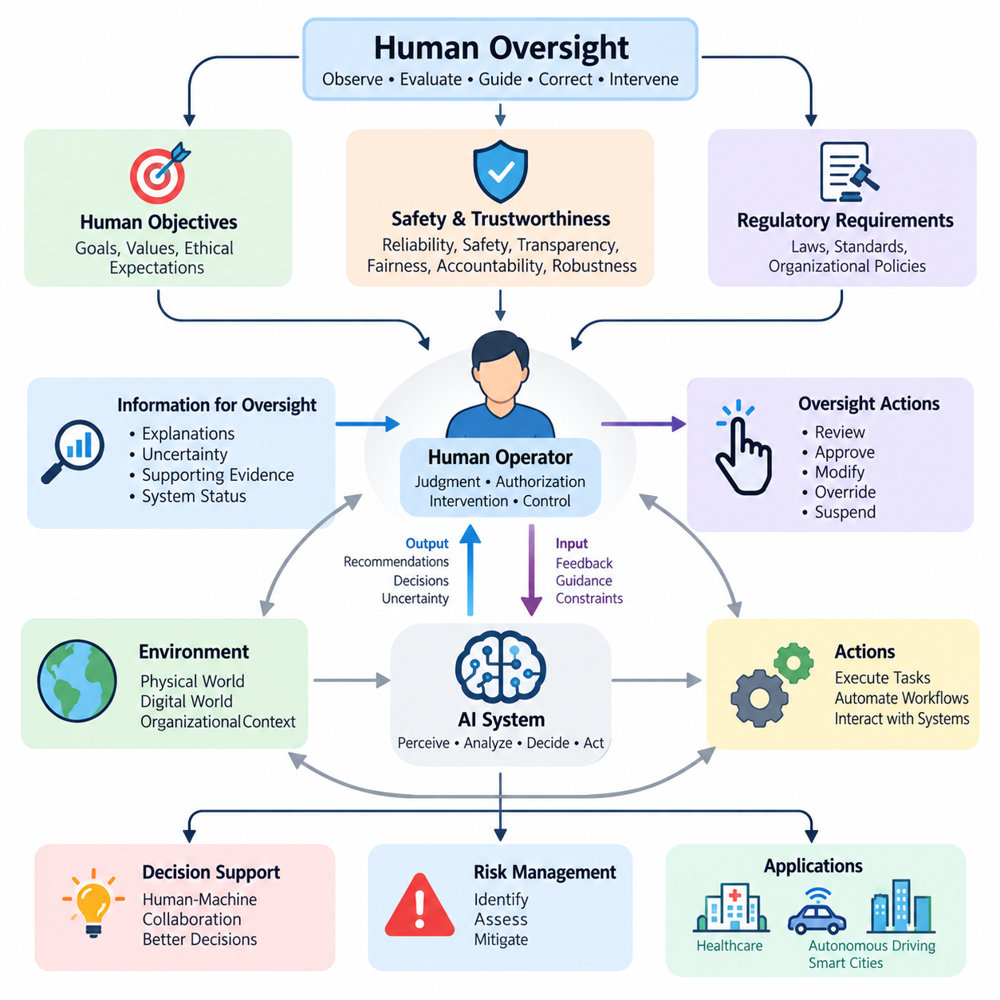
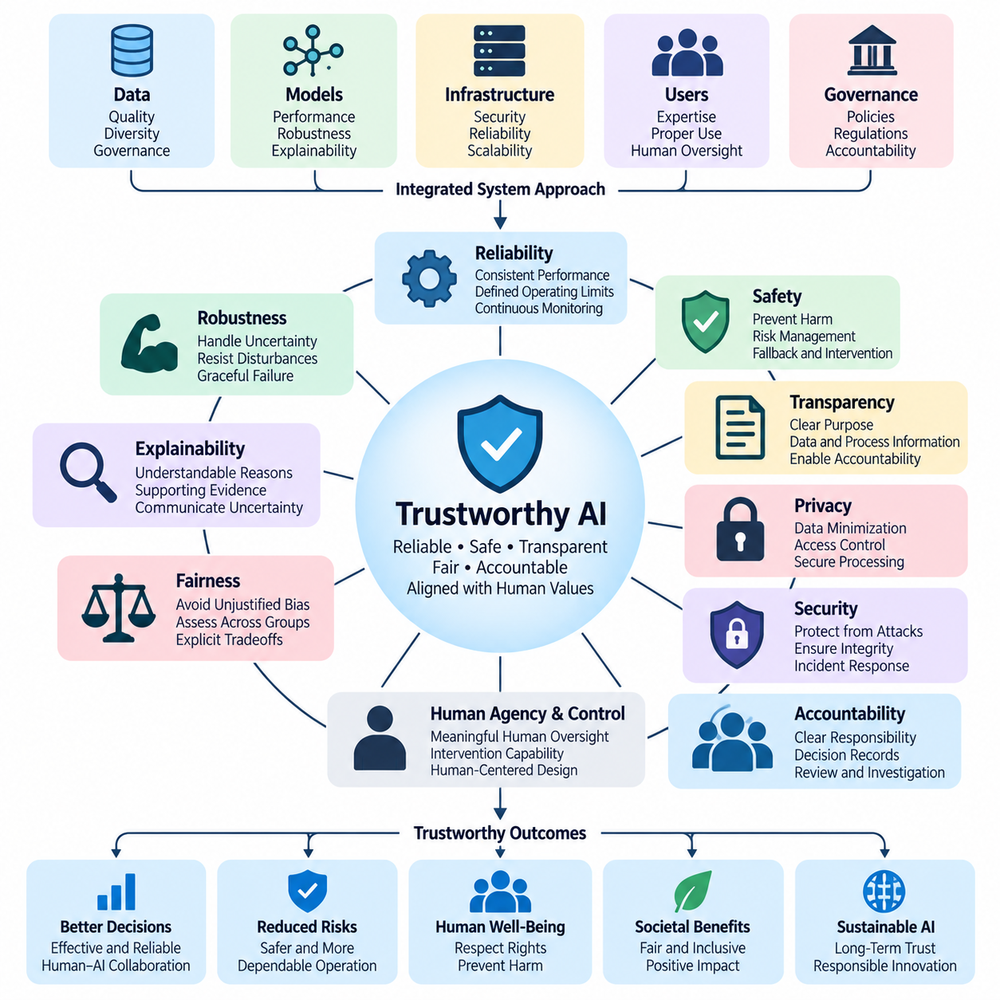
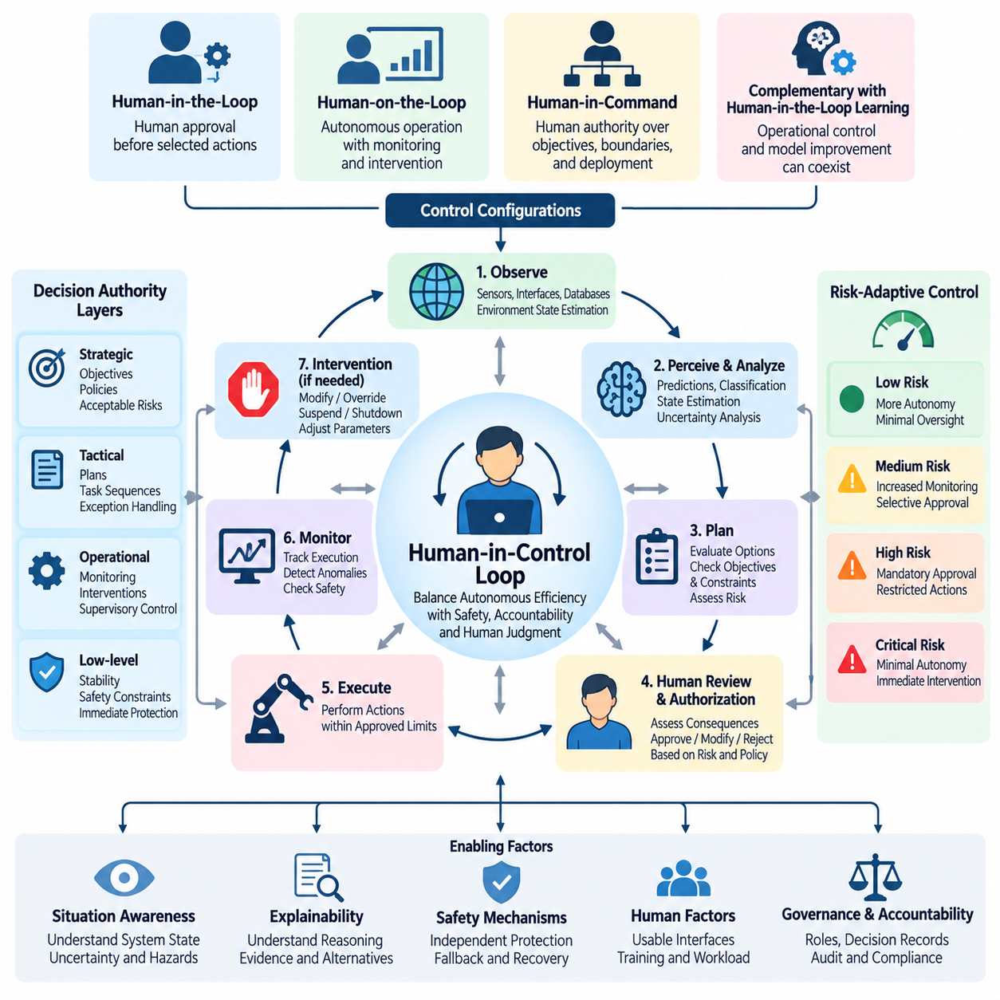
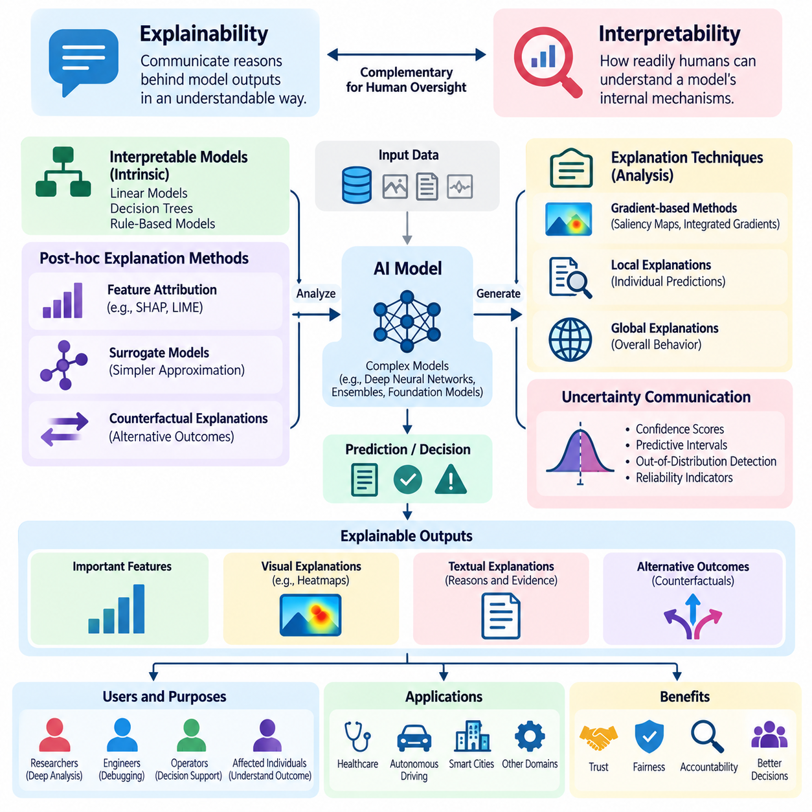
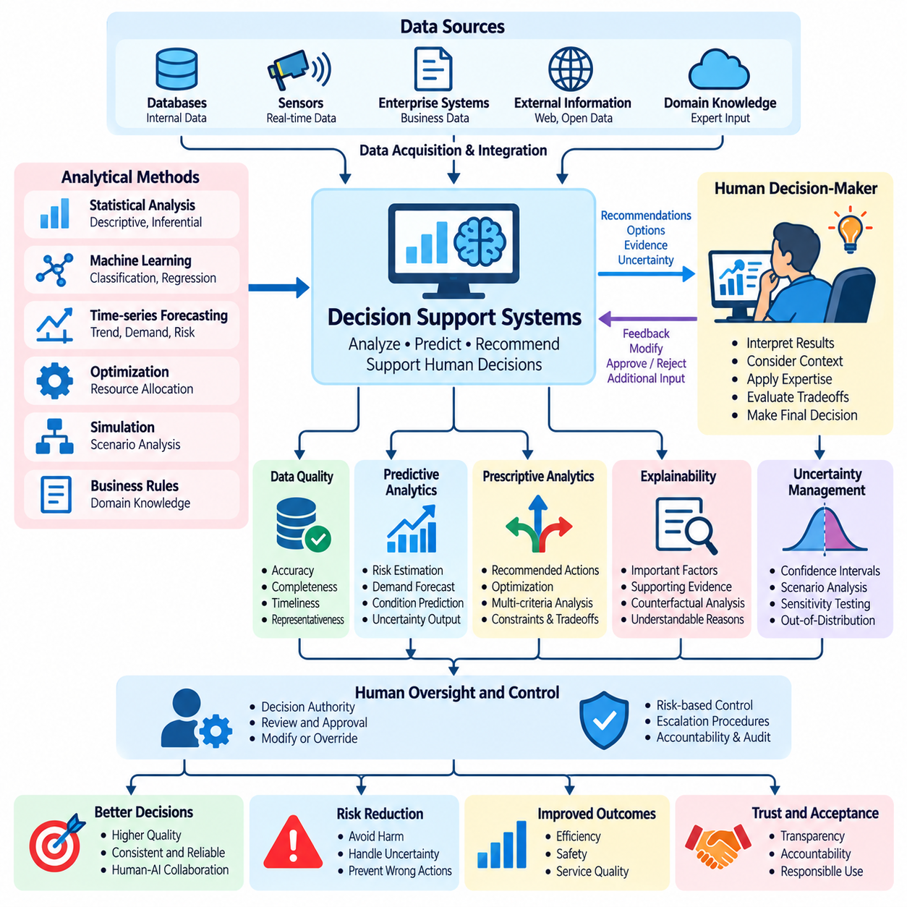
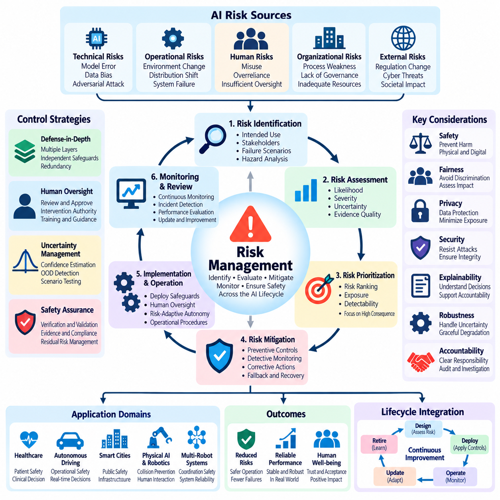
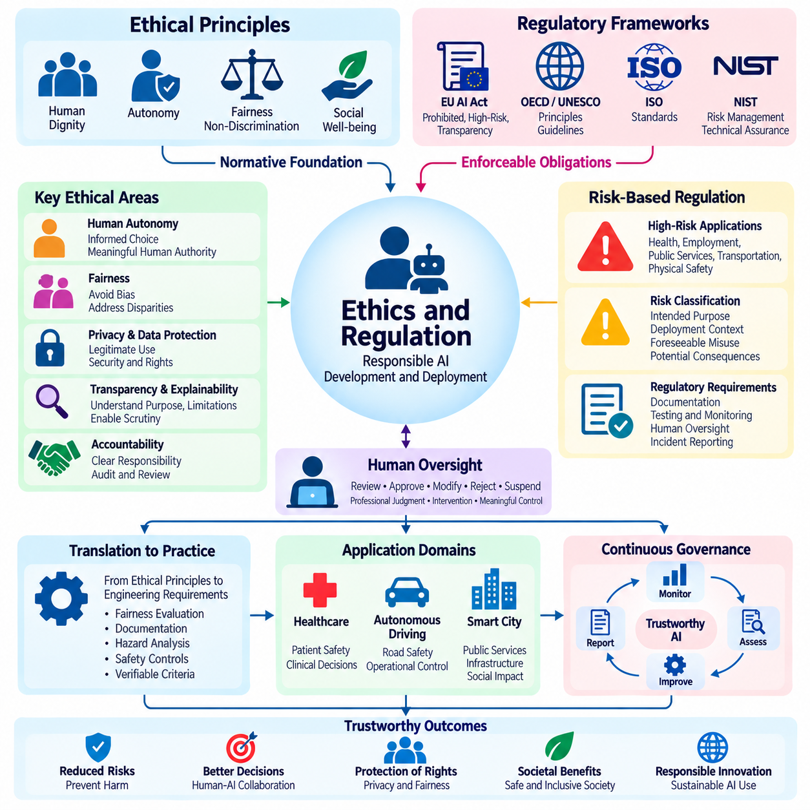
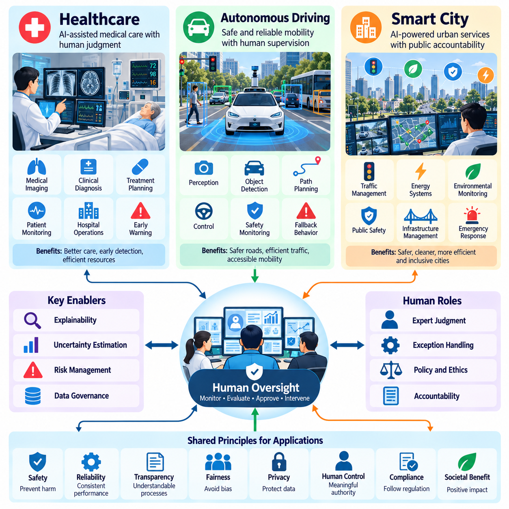

**Volume 41. Human in the Loop Learning**

# 05. Human Oversight

## 05.00 Overview

{width="7.268055555555556in" height="7.268055555555556in"}

인간 감독(Human Oversight)은 인간의 의사결정, 조직 운영, 물리적 환경에 영향을 미치는 인공지능(Artificial Intelligence, AI) 시스템의 개발과 배포에서 핵심적인 원칙이다. 이는 인간이 AI의 행동을 관찰하고, 평가하고, 지도하고, 수정하며, 개입할 수 있도록 하는 메커니즘을 확립한다. 인간 감독은 자동화를 독립적인 권한 주체로 취급하는 대신, 지능형 시스템(Intelligent Systems)이 인간의 목표, 안전 요구사항, 윤리적 기대에 부합하도록 책임성을 유지하는 역할을 수행한다.

인공지능의 자율성(Autonomy)이 증가함에 따라 전통적인 감독 방식만으로는 충분하지 않게 된다. 현대의 AI 시스템은 권고안을 생성하고, 복잡한 작업 흐름(Workflow)을 실행하며, 다수의 에이전트(Agent)를 조정하고, 변화하는 환경에 적응할 수 있다. 이러한 능력은 시스템 행동과 책임 소재에 관한 불확실성을 발생시킨다. 인간 감독은 자율적 실행과 인간의 판단, 승인 또는 개입이 필요한 의사결정 사이에 명확한 경계를 설정함으로써 이러한 문제를 해결한다.

인간 감독은 인간 참여형 학습(Human-in-the-Loop Learning, HITL Learning)과 밀접하게 관련되어 있지만, 두 개념은 서로 다른 목적을 가진다. 인간 참여형 학습은 모델 개선 과정에 인간의 지식과 피드백(Feedback)을 통합하는 반면, 인간 감독은 AI 시스템이 전체 수명주기(Lifecycle)에 걸쳐 어떻게 작동하고 의사결정을 수행하는지를 관리한다. 감독 활동에는 예측 결과 검토, 행동 승인, 운영 상태 감시, 장애 조사, 허용할 수 없는 위험이 발생했을 때 자동화된 프로세스를 중단하는 활동 등이 포함된다.

효과적인 인간 감독을 위해서는 인간의 권한(Human Authority)과 기계의 자율성(Machine Autonomy) 사이의 관계를 명확하게 이해해야 한다. AI 시스템은 일상적인 작업을 독립적으로 수행하면서 중요한 의사결정은 자격을 갖춘 인간 운영자에게 맡길 수 있다. 적절한 책임 분배는 운영 복잡성, 잠재적 피해, 불확실성, 규제 의무에 따라 달라진다. 따라서 인간 감독은 외부의 행정적 절차가 아니라 시스템에 내재된 핵심 아키텍처 역량(Architectural Capability)으로 설계되어야 한다.

신뢰할 수 있는 인공지능(Trustworthy AI)은 신뢰성(Reliability), 안전성(Safety), 투명성(Transparency), 공정성(Fairness), 책임성(Accountability), 강건성(Robustness)을 강조함으로써 인간 감독의 개념적 기반을 제공한다. 기술적으로 정확한 모델이라도 그 의사결정을 검토하거나 이의를 제기할 수 없다면 자동으로 신뢰할 수 있는 시스템이 되는 것은 아니다. 따라서 신뢰성은 모델 성능뿐만 아니라 이를 둘러싼 거버넌스(Governance) 메커니즘에도 의존한다. 인간 감독은 이러한 요구사항을 의미 있는 인간의 권한을 보존하는 운영 관행과 연결한다.

인간 제어 루프(Human-in-Control Loop)는 의사결정과 실행 과정에 인간의 개입을 명시적으로 포함함으로써 기존의 피드백 아키텍처(Feedback Architecture)를 확장한다. 일반적인 시스템은 환경을 관찰하고, 예측을 생성하고, 가능한 행동을 평가한 다음, 선택된 작업을 실행한다. 인간 감독자는 중간 결과를 검토하고, 목표를 수정하고, 제안된 행동을 승인하거나, 자동화된 결정을 재정의할 수 있다. 이러한 구조는 정의된 경계 내에서 자율성을 허용하면서 중요한 결과에 대한 인간의 통제권을 유지한다.

서로 다른 감독 구성은 인간 참여의 수준도 다르게 제공한다. 인간 참여형 시스템(Human-in-the-Loop Systems)에서는 특정 의사결정을 실행하기 전에 인간의 참여가 필요하다. 인간 감시형 시스템(Human-on-the-Loop Systems)은 자율적인 운영을 허용하면서 감독자가 시스템을 감시하고 개입할 수 있도록 한다. 인간 지휘형 구조(Human-in-Command Arrangements)는 시스템 목표, 배포 조건, 운영 경계에 대한 인간의 권한을 강조한다. 이러한 구성은 상호 보완적이며 하나의 지능형 시스템 내에서 함께 적용될 수 있다.

의미 있는 인간 감독(Meaningful Human Oversight)은 단순히 이론적인 재정의 또는 개입 메커니즘(Override Mechanism)을 제공하는 것만으로는 충분하지 않다. 운영자는 충분한 정보를 제공받고, 적절한 전문성을 보유하며, 문제가 있는 행동을 인식할 수 있는 시간을 확보해야 한다. 또한 시스템의 행동을 수정하거나 중단할 수 있는 효과적인 기술적 제어 수단도 필요하다. 실제 운영 조건에서 행사할 수 없는 감독 메커니즘은 아키텍처에 공식적으로 존재하더라도 보호 효과가 제한적이다.

설명가능성(Explainability)과 해석가능성(Interpretability)은 인간 운영자가 AI의 출력과 그 한계를 이해하도록 지원함으로써 감독 기능을 강화한다. 설명가능성은 의사결정과 관련된 이유, 근거 자료, 영향력이 큰 특징(Influential Features), 대안적 결과를 제공할 수 있다. 해석가능성은 모델 내부의 동작을 어느 정도 이해할 수 있는지를 의미한다. 두 특성 모두 정확성을 보장하지는 않지만, 감독자가 이상 현상을 식별하고, 가정에 의문을 제기하며, 의사결정의 적절성을 평가하는 능력을 향상시킬 수 있다.

의사결정 지원 시스템(Decision Support Systems)은 계산 기반 분석과 전문적 판단을 결합하기 때문에 인간 감독의 중요한 응용 분야이다. AI 모델은 대규모 데이터셋(Dataset)을 처리하고, 패턴을 식별하고, 확률을 추정하며, 권고안을 생성할 수 있다. 이후 인간 의사결정자는 이러한 결과를 상황 정보, 조직의 우선순위, 실질적인 제약조건에 비추어 평가한다. 목표는 단순히 의사결정을 자동화하는 것이 아니라 구조화된 인간과 기계의 협업(Human-Machine Collaboration)을 통해 의사결정의 품질을 향상시키는 것이다.

불확실성 추정(Uncertainty Estimation)은 인간의 개입이 필요한 시점을 결정하는 데 핵심적인 역할을 수행한다. 모델은 신뢰도 점수(Confidence Scores), 예측 분포(Predictive Distributions), 이상 징후 지표(Anomaly Indicators), 분포 외 데이터 경고(Out-of-Distribution Warnings)를 생성할 수 있다. 이러한 신호는 추가 검토가 필요한 사례를 식별하는 데 도움이 된다. 그러나 높은 신뢰도의 예측도 잘못될 수 있으므로 신뢰도 값은 보정(Calibration)과 검증(Validation)을 거쳐야 한다. 따라서 감독 정책은 불확실성 측정과 잠재적 오류의 결과를 함께 고려해야 한다.

위험 관리(Risk Management)는 인간 감독의 원칙을 실제 운영 통제 수단으로 전환한다. AI 관련 위험은 부정확한 예측, 분포 변화(Distribution Shift), 편향된 학습 데이터, 사이버보안 취약성, 부적절한 자동화, 외부 시스템과의 예상하지 못한 상호작용에서 발생할 수 있다. 위험 평가(Risk Assessment)는 유해한 결과의 발생 가능성과 심각성을 분석하며, 위험 완화 전략(Risk Mitigation Strategies)은 예방 및 시정 메커니즘을 수립한다. 인간 감독은 잔여 위험(Residual Risk)을 검토하고 자동화된 안전장치만으로 충분하지 않은 상황에 대응하는 수단을 제공한다.

위험 민감형 감독(Risk-Sensitive Oversight)은 AI 행동의 잠재적 결과에 따라 인간의 주의와 감독 자원을 배분해야 한다. 위험이 낮은 작업에는 주기적인 표본 검사와 사후 감사(Retrospective Auditing)를 적용할 수 있지만, 위험이 높은 행동에는 명시적인 승인이나 지속적인 감독이 필요할 수 있다. 이러한 접근 방식은 일상적인 작업에서 불필요한 인간 개입을 줄이면서 중요한 의사결정에는 강력한 통제를 유지한다. 그 효과는 위험 범주를 정확하게 식별하고 신뢰할 수 있는 상위 보고 및 대응 절차(Escalation Procedures)를 유지하는 데 달려 있다.

인적 요인(Human Factors)은 인간 감독의 실제 효과에 큰 영향을 미친다. 과도한 경고, 부적절하게 설계된 인터페이스, 불명확한 책임, 정보 과부하(Information Overload)는 운영자의 상황 인식(Situational Awareness)을 저하시킬 수 있다. 자동화 편향(Automation Bias)은 인간이 AI의 권고를 충분히 검토하지 않고 수용하도록 만들 수 있으며, 지나친 불신은 유용한 정보를 무시하게 만들 수 있다. 따라서 효과적인 시스템은 적절하게 조정된 신뢰(Calibrated Trust), 관리 가능한 업무량, 명확한 의사소통, 이해하기 쉽고 적시에 개입할 수 있는 인터페이스를 지원해야 한다.

윤리적 감독(Ethical Oversight)은 기술적 정확성을 넘어 공정성, 자율성, 개인정보 보호(Privacy), 존엄성(Dignity), 이익과 피해의 분배를 고려한다. AI의 의사결정은 전체적인 성능 지표가 양호하더라도 개인이나 집단에 서로 다른 영향을 미칠 수 있다. 인간 감독자는 운영 효율성이 윤리적 의무와 충돌하는 상황을 인식할 수 있어야 한다. 거버넌스 프로세스는 우려 사항을 기록하고, 이의가 제기된 결정을 검토하며, 부적절한 결과를 시정하는 메커니즘을 제공해야 한다.

규제 준수(Regulatory Compliance)는 책임성, 문서화, 투명성, 인간 통제와 관련된 추가적인 요구사항을 도입한다. 적용되는 의무는 관할권, 산업 분야, 위험 분류에 따라 달라진다. 조직은 관련 법적 요구사항을 식별하고 이를 시스템 사양, 운영 절차, 감사 증거(Audit Evidence)로 전환해야 한다. 인간 감독은 책임 주체의 명확화, 의사결정 기록, 개입 기능, 시스템 성능 검토 메커니즘을 확립함으로써 규제 준수에 기여한다.

의료(Healthcare)는 알고리즘 기반 지원과 자격을 갖춘 전문가의 감독을 결합하는 것이 얼마나 중요한지를 보여준다. AI 시스템은 의료 영상(Medical Imaging), 임상 위험 평가(Clinical Risk Assessment), 환자 모니터링(Patient Monitoring), 치료 계획(Treatment Planning)을 지원할 수 있다. 그러나 의료 의사결정에는 상황에 대한 해석, 환자별 특수성의 고려, 불확실성 평가가 필요한 경우가 많다. 인간 감독은 자동화된 권고가 적절한 임상적 판단과 확립된 환자 안전 절차에 따라 검토되도록 지원한다.

자율주행(Autonomous Driving)은 인간이 안정적으로 대응할 수 있는 속도보다 빠르게 의사결정이 이루어져야 할 수 있기 때문에 특별한 감독 과제를 제기한다. 차량 자동화 시스템은 안전하게 자율 운영할 수 있는 기능과 인간의 참여가 필요한 상황을 구분해야 한다. 운전자 모니터링(Driver Monitoring), 운행 설계 영역(Operational Design Domain, ODD), 제어권 전환 절차(Transition Procedures), 대체 안전 대응 메커니즘(Fallback Mechanisms)은 중요한 고려사항이다. 인간 감독은 마지막 순간의 인간 개입에만 의존하지 않고 시스템 수준의 안전 공학(System-Level Safety Engineering)에 의해 뒷받침되어야 한다.

스마트 시티(Smart City) 시스템은 지능형 인프라가 교통, 에너지, 감시, 환경 모니터링, 공공서비스를 조정할 수 있기 때문에 추가적인 감독 과제를 발생시킨다. 자동화된 의사결정은 대규모 인구와 상호 연결된 물리적 시스템에 영향을 미칠 수 있다. 따라서 감독은 개별 모델의 예측뿐만 아니라 시스템 전체의 결과, 기관별 책임, 공공 책임성(Public Accountability)까지 다루어야 한다. 투명한 거버넌스와 통제된 개입은 도시 AI 인프라의 필수 구성요소가 된다.

운영 구현(Operational Implementation)에는 지속적인 모니터링(Continuous Monitoring), 이벤트 로깅(Event Logging), 상위 보고 및 대응 관리(Escalation Management), 구조화된 검토 프로세스(Structured Review Processes)가 필요하다. AI 시스템은 적절하고 합법적인 범위에서 관련 입력, 모델 버전, 의사결정, 불확실성 지표, 인간의 개입, 최종 결과를 기록해야 한다. 이러한 기록은 사고 조사, 성능 평가, 조직 학습을 지원한다. 감독 결과는 이후 데이터 큐레이션(Data Curation), 모델 재학습(Model Retraining), 인터페이스 개선, 운영 정책 개정에 활용될 수 있다.

지속 학습(Continuous Learning)은 배포 이후 모델의 행동이 변화할 수 있기 때문에 특히 중요한 감독 과제를 발생시킨다. 피드백 기반 업데이트(Feedback-Driven Updates)는 성능을 향상시킬 수 있지만, 예상하지 못한 성능 회귀(Regression)나 새로운 실패 유형(Failure Modes)을 도입할 수도 있다. 인간 감독자는 업데이트 정책 정의, 평가 근거 검토, 중요한 변경사항 승인, 롤백 기준(Rollback Criteria) 수립에 참여해야 한다. 따라서 감독은 초기 배포 단계에만 집중하지 않고 전체 모델 수명주기(Model Lifecycle)에 걸쳐 적용되어야 한다.

인간 감독의 효과는 측정 가능한 운영 결과를 통해 평가되어야 한다. 관련 지표에는 개입 정확도(Intervention Accuracy), 응답 지연시간(Response Latency), 상위 보고 및 대응 품질(Escalation Quality), 오경보율(False Alarm Rate), 운영자 업무량(Operator Workload), 예방되거나 수정된 유해한 의사결정의 빈도가 포함된다. 또한 평가는 감독자가 시스템의 한계를 이해하고 실제 운영 조건에서 의미 있는 권한을 행사할 수 있는지를 검토해야 한다. 이러한 측정은 실질적으로 작동하는 감독과 단순한 절차적 준수(Procedural Compliance)를 구분하는 데 도움이 된다.

인간 감독의 장기적인 목표는 AI 시스템의 능력이 향상되더라도 유용성, 적응성, 통제가능성(Controllability)을 유지하는 것이다. 이를 위해 신뢰할 수 있는 AI 원칙, 인간 제어 아키텍처(Human Control Architectures), 설명가능성 기법, 의사결정 지원 메커니즘, 위험 관리 관행, 윤리적 거버넌스를 조화롭게 발전시켜야 한다. 이러한 요소를 통합함으로써 인간 감독은 점점 더 자율화되는 기술 환경 전반에서 책임 있는 인간-AI 협업(Responsible Human-AI Collaboration)을 실현하기 위한 핵심 역량이 된다.

## 05.01 Trustworthy AI

{width="7.268055555555556in" height="7.268055555555556in"}

신뢰할 수 있는 인공지능(Trustworthy AI)은 인간의 가치와 정당한 목표에 부합하면서 신뢰성(Reliability), 안전성(Safety), 투명성(Transparency), 책임성(Accountability)을 갖추고 작동하는 인공지능 시스템을 의미한다. 신뢰성은 예측 정확도(Predictive Accuracy)나 계산 효율성(Computational Efficiency)을 넘어서는 개념이다. 기술적으로 우수한 모델도 유해하거나 부적절한 결과를 생성할 수 있기 때문이다. 신뢰할 수 있는 시스템은 의도된 운영 조건에서 일관된 동작을 입증하고 의미 있는 인간 감독(Human Oversight)을 지원해야 한다.

신뢰성(Trustworthiness)은 모델, 데이터, 인프라, 사용자, 거버넌스 프로세스(Governance Processes)의 상호작용에서 형성되는 시스템 수준의 특성(System-Level Property)이다. 정확도가 높은 알고리즘이라도 학습 데이터에 편향이 존재하거나, 배포 환경이 불안정하거나, 적절한 안전장치 없이 출력이 사용된다면 신뢰할 수 있는 운영을 보장할 수 없다. 따라서 신뢰할 수 있는 AI 엔지니어링(Trustworthy AI Engineering)은 기술적 성능, 조직적 책임, 운영 절차, 인간의 의사결정을 통합적으로 고려해야 한다.

운영 신뢰성(Reliability)은 AI 시스템이 지정된 조건에서 의도된 기능을 일관되게 수행하는 능력을 의미한다. 신뢰성이 높은 시스템은 입력 품질, 작업 부하(Workload), 환경 조건의 변화에도 허용 가능한 성능을 유지한다. 신뢰성 평가(Reliability Assessment)에는 대표성 있는 테스트, 지속적인 모니터링(Continuous Monitoring), 명확하게 정의된 운영 한계가 필요하다. 검증된 경계를 벗어나는 상황에서는 신뢰할 수 없는 동작을 조용히 지속하는 대신 잠재적인 성능 저하를 감지하고 적절한 대응을 시작해야 한다.

안전성(Safety)은 AI의 행동으로 발생할 수 있는 허용할 수 없는 피해를 예방하거나 감소시키는 것과 관련된다. 피해에는 신체적 부상, 재정적 손실, 개인정보 침해, 차별적 대우, 필수 서비스의 중단 등이 포함될 수 있다. 안전 공학(Safety Engineering)은 위험 요인(Hazards)을 식별하고 그 결과를 평가하며 예방 또는 보호 메커니즘을 구현한다. 안전 필수 환경(Safety-Critical Environments)에서는 AI 구성요소가 독립적인 안전장치, 대체 대응 절차(Fallback Procedures), 인간 개입 기능을 포함하는 상위 아키텍처 내에서 작동해야 한다.

강건성(Robustness)은 교란(Disturbances), 불확실성(Uncertainty), 예상하지 못한 입력이 발생하더라도 AI 시스템이 허용 가능한 동작을 유지하는 능력을 의미한다. 이러한 조건에는 센서 잡음(Sensor Noise), 손상된 측정값, 분포 변화(Distribution Shift), 적대적 조작(Adversarial Manipulation), 불완전한 정보가 포함된다. 강건성 평가는 평균 성능뿐만 아니라 어려운 조건에서 나타나는 실패 행동도 분석한다. 강건한 시스템은 자신의 한계를 인식하고 근거의 신뢰성이 저하되었을 때 정당화할 수 없는 높은 확신으로 의사결정을 수행하지 않아야 한다.

투명성(Transparency)은 관련 이해관계자(Stakeholders)가 AI 시스템이 어떻게 개발되고, 평가되고, 배포되고, 관리되는지를 이해할 수 있도록 한다. 여기에는 의도된 목적, 데이터 출처, 모델의 한계, 성능 특성, 운영 책임에 관한 정보가 포함된다. 투명성이 반드시 독점 알고리즘이나 민감한 정보의 무제한 공개를 의미하는 것은 아니다. 대신 정보에 기반한 평가, 책임성 확보, 감독에 필요한 근거와 프로세스를 적절하게 확인할 수 있도록 하는 것을 의미한다.

설명가능성(Explainability)은 개별 예측, 권고 또는 의사결정에 대해 이해할 수 있는 설명을 제공함으로써 투명성을 보완한다. 설명은 영향력이 큰 입력 특징(Influential Input Features), 뒷받침하는 근거, 의사결정 경계(Decision Boundaries), 대안적 결과를 식별할 수 있다. 설명의 유용성은 대상 사용자와 운영 상황에 따라 달라진다. 엔지니어는 상세한 진단 정보를 필요로 할 수 있지만, 운영자는 즉각적인 의사결정을 지원하는 간결한 설명을 필요로 할 수 있다. 설명은 불확실성을 전달하고 잘못된 인과적 해석(Causal Interpretation)을 제시하지 않아야 한다.

공정성(Fairness)은 AI 시스템이 개인이나 집단에 대해 체계적으로 불평등하거나 정당화되지 않은 결과를 생성할 가능성을 다룬다. 편향(Bias)은 데이터 수집, 어노테이션(Annotation) 관행, 모델 설계, 평가 방법, 배포 조건에서 발생할 수 있다. 공정성 평가(Fairness Assessment)는 관련 인구집단, 응용 상황, 잠재적 결과를 검토해야 한다. 공정성 기준들은 서로 충돌할 수 있으므로 신뢰할 수 있는 AI 개발에서는 상충관계(Tradeoffs)를 명확하게 드러내고 중요한 의사결정에 대해 적절한 인간 검토를 수행해야 한다.

개인정보 보호(Privacy)와 데이터 보호(Data Protection)는 AI 시스템이 개인 정보, 기밀 정보 또는 민감한 정보를 처리할 때 필수적이다. 신뢰할 수 있는 시스템은 데이터 최소화(Data Minimization), 목적 제한(Purpose Limitation), 접근 통제(Access Controls), 안전한 저장, 적절한 보존 정책을 적용해야 한다. 개인정보 보호 기술(Privacy-Preserving Techniques)은 학습이나 추론 과정에서 불필요한 정보 노출을 줄일 수 있다. 그러나 기술적 안전장치만으로는 충분하지 않으며, 허용된 사용 범위, 책임, 잠재적 침해에 대한 대응 절차를 정의하는 조직 정책이 필요하다.

보안(Security)은 무단 접근, 조작, 데이터 오염(Data Poisoning), 모델 추출(Model Extraction), 적대적 공격(Adversarial Attacks)으로부터 AI 시스템을 보호한다. 위협은 학습 파이프라인(Training Pipelines), 배포된 모델, 통신 인터페이스, 연결된 인프라에 영향을 미칠 수 있다. 따라서 보안 엔지니어링(Security Engineering)에는 지속적인 취약점 평가, 접근 통제, 무결성 검증(Integrity Verification), 사고 대응(Incident Response) 기능이 필요하다. 손상된 구성요소는 다른 측면에서 신뢰성과 안전성을 갖춘 시스템의 동작까지 훼손할 수 있으므로 보안은 전체 수명주기에서 고려되어야 한다.

책임성(Accountability)은 AI 관련 의사결정, 운영 결과, 시정 조치에 대한 책임 주체를 명확하게 설정한다. 책임은 개발자, 시스템 통합자(System Integrators), 운영자, 조직 관리자, 관련 거버넌스 기관에 걸쳐 할당되어야 한다. 명확한 책임성을 확보하려면 문서화된 역할, 의사결정 기록, 검토 절차, 실패 조사 메커니즘이 필요하다. 권한을 가진 개인이 자동화된 행동에 이의를 제기하거나 이를 수정할 책임과 실질적인 능력을 모두 보유할 때 인간 감독은 의미 있게 작동한다.

인간의 주체성(Human Agency)과 통제(Human Control)는 자동화 시스템이 인간의 판단을 무분별하게 대체하는 대신 정당한 인간의 목표를 지원해야 한다는 점에서 신뢰할 수 있는 AI의 핵심 요소이다. 적절한 통제 메커니즘에는 승인 요구사항, 조정 가능한 자율성 수준(Adjustable Autonomy Levels), 개입 인터페이스(Intervention Interfaces), 비상 정지(Emergency Shutdown) 기능이 포함될 수 있다. 이러한 메커니즘의 효과는 운영자의 역량, 이용 가능한 정보, 대응 시간에 따라 달라진다. 따라서 인간의 권한은 현실적인 운영 조건을 반영한 시스템 설계에 의해 뒷받침되어야 한다.

신뢰 보정(Trust Calibration)은 실제 AI 능력과 사용자가 그 능력에 부여하는 신뢰 수준 사이의 관계를 의미한다. 과도한 신뢰는 자동화 편향(Automation Bias)을 유발할 수 있으며, 불충분한 신뢰는 유용한 시스템의 효과적인 도입을 방해할 수 있다. 적절한 신뢰는 사용자가 시스템의 강점, 한계, 불확실성, 실패 조건을 이해할 때 형성된다. 인터페이스 설계, 교육, 성능 정보 전달, 피드백 메커니즘은 인간의 기대와 실제로 입증된 시스템 동작 사이의 균형 잡힌 관계를 구축하는 데 도움이 된다.

신뢰할 수 있는 AI 평가(Trustworthy AI Evaluation)에는 단일 정확도 점수에 의존하지 않고 여러 상호 보완적인 지표가 필요하다. 관련 측정 항목에는 운영 신뢰성, 강건성, 보정(Calibration), 공정성, 안전 사고(Safety Incidents), 개입 효과(Intervention Effectiveness), 운영 가용성(Operational Availability)이 포함된다. 평가는 정상 조건, 예측 가능한 교란, 대표적인 고위험 시나리오를 포함해야 한다. 만족스러운 벤치마크(Benchmark) 성능이 실제 배포 환경의 안전성을 자동으로 입증하는 것은 아니므로 평가 근거는 의도된 사용 목적과 연계하여 해석해야 한다.

수명주기 거버넌스(Lifecycle Governance)는 초기 설계부터 개발, 배포, 모니터링, 폐기에 이르기까지 신뢰성이 유지되도록 한다. 요구사항은 측정 가능한 수용 기준(Acceptance Criteria)으로 전환되어야 하며 문서와 검증 근거(Verification Evidence)에 의해 뒷받침되어야 한다. 모델, 데이터셋, 인프라 또는 운영 환경의 변경은 이전의 가정을 무효화할 수 있다. 따라서 중요한 변경사항에는 재평가(Reassessment), 통제된 배포(Controlled Deployment), 예상하지 못한 성능 저하를 감지하고 수정하는 절차가 필요하다.

의료(Healthcare) 분야에서 신뢰할 수 있는 AI는 임상 안전성(Clinical Safety), 환자 개인정보 보호, 신뢰할 수 있는 권고, 전문적 책임성을 지원해야 한다. 자율주행(Autonomous Driving)에서는 인지 불확실성(Perception Uncertainty), 환경 변화, 시스템 장애, 안전한 운영 경계를 다루어야 한다. 스마트 시티(Smart Cities)에서는 공공 책임성(Public Accountability), 공정한 서비스 제공, 사이버보안(Cybersecurity), 상호 연결된 자동화 의사결정의 결과도 중요하다. 각 분야에는 고유한 위험과 책임에 비례하는 통제 수단이 필요하다.

피지컬 AI(Physical AI)는 지능형 의사결정이 기계적 행동과 물리적 환경에 직접적인 영향을 미치기 때문에 추가적인 신뢰성 요구사항을 발생시킨다. 로봇은 사람, 인프라, 장비, 예측하기 어려운 장애물과 상호작용할 수 있다. 따라서 신뢰할 수 있는 운영을 위해서는 인지 검증(Perception Validation), 운동 제약(Motion Constraints), 충돌 회피(Collision Avoidance), 고장 감지(Fault Detection), 안전 복구 동작(Safe Recovery Behavior)이 통합적으로 이루어져야 한다. 인간 감독자는 자율적 실행이 허용되는 시점과 개입 또는 통제된 정지가 필요한 시점을 이해해야 한다.

신뢰할 수 있는 AI는 단일 인증(Certification), 벤치마크 또는 개발 이정표(Milestone)만으로 영구적으로 확립될 수 없다. 신뢰성은 지속적인 근거 수집(Evidence Collection), 운영 모니터링, 사고 분석(Incident Analysis), 조직 학습(Organizational Learning)을 통해 유지되어야 한다. 인간 피드백(Human Feedback)은 테스트 과정에서 발견하지 못한 실패를 드러낼 수 있으며, 구조화된 검토 프로세스는 이러한 관찰을 시정 개선(Corrective Improvements)으로 전환할 수 있다. 기술적 보증(Technical Assurance)과 인간 감독 사이의 지속적인 관계는 책임 있는 적응을 지원한다.

궁극적으로 신뢰할 수 있는 AI는 책임성이나 의미 있는 인간 통제권을 포기하지 않으면서 점점 더 높은 능력을 갖춘 지능형 시스템을 배포하기 위한 기반을 제공한다. 운영 신뢰성, 안전성, 강건성, 투명성, 공정성, 개인정보 보호, 보안, 설명가능성은 서로를 강화하는 요구사항으로 작동해야 한다. 이러한 원칙을 위험 관리(Risk Management) 및 인간 감독(Human Oversight)과 통합함으로써 조직은 전체 운영 수명주기에 걸쳐 일관되게 작동하고, 이해할 수 있으며, 적절하게 관리되는 AI 시스템을 개발할 수 있다.

## 05.02 Human in Control Loop

{width="7.268055555555556in" height="7.268055555555556in"}

인간 제어 루프(Human-in-Control Loop)는 인공지능(Artificial Intelligence, AI) 시스템의 의사결정과 실행 과정 전반에서 의미 있는 인간의 권한을 유지하도록 설계된 거버넌스 및 운영 아키텍처(Governance and Operational Architecture)이다. 독립적인 기계 운영을 강조하는 기존 자동화 방식과 달리, 이 접근 방식은 인간의 감독(Supervision), 개입(Intervention), 승인(Authorization)을 제어 구조에 통합한다. 주요 목표는 자율적 운영의 효율성과 안전성(Safety), 책임성(Accountability), 인간의 판단(Human Judgment) 사이에 균형을 유지하는 것이다.

인간 제어 루프는 기계 인지(Machine Perception), 자동화된 추론(Automated Reasoning), 행동 계획(Action Planning), 실행 모니터링(Execution Monitoring), 인간의 의사결정(Human Decision-Making)을 하나의 조정된 프로세스로 결합한다. AI 시스템은 정보를 수집하고, 환경 조건을 해석하며, 사전에 정의된 권한에 따라 행동을 제안하거나 실행한다. 인간 운영자는 관련 시스템 상태를 관찰하고, 잠재적인 결과를 평가하며, 필요한 경우 개입한다. 이러한 상호작용은 계산 기반 자율성(Computational Autonomy)과 인간의 책임(Human Responsibility) 사이에 지속적인 관계를 형성한다.

이 아키텍처는 모델 학습보다 운영 통제(Operational Control)를 중심 목적으로 한다는 점에서 기존의 인간 참여형 학습(Human-in-the-Loop Learning)과 구별된다. 인간 참여형 학습은 어노테이션(Annotation), 수정(Correction), 선호도(Preference)를 활용하여 예측 모델이나 정책(Policy)을 개선한다. 반면 인간 제어 시스템(Human-in-Control Systems)은 자율적인 의사결정을 언제 진행할 수 있는지, 언제 승인이 필요한지, 언제 작업을 수정하거나 중단해야 하는지를 결정한다. 두 접근 방식은 통합된 AI 수명주기(AI Lifecycle) 내에서 함께 적용될 수 있다.

인간의 참여는 여러 제어 구성(Control Configurations)을 통해 조직화할 수 있다. 인간 참여형 운영(Human-in-the-Loop Operation)은 특정 행동을 실행하기 전에 명시적인 인간의 참여를 요구한다. 인간 감시형 운영(Human-on-the-Loop Operation)은 자율적인 실행을 허용하면서 감독을 위한 모니터링과 개입 기능을 유지한다. 인간 지휘형 거버넌스(Human-in-Command Governance)는 시스템 목표, 운영 경계, 배포 결정에 대한 인간의 권한을 확립한다. 적절한 구성은 작업의 복잡성, 위험의 심각도, 이용 가능한 대응 시간에 따라 결정된다.

일반적인 제어 주기(Control Cycle)는 환경 관찰(Environmental Observation)과 상태 추정(State Estimation)으로 시작된다. 센서, 소프트웨어 인터페이스, 운영 데이터베이스는 현재 조건에 관한 정보를 제공한다. AI 모델은 이러한 입력을 예측, 분류 또는 추정된 시스템 상태로 변환한다. 이후 의사결정 모듈(Decision Modules)은 목표와 제약조건을 기준으로 가능한 행동을 평가한다. 실행에 앞서 제어 아키텍처는 제안된 행동이 사전에 정의된 자율성 및 안전 요구사항을 충족하는지 판단한다.

승인 메커니즘(Authorization Mechanisms)은 어떤 의사결정에 인간의 승인이 필요하고 어떤 의사결정을 자동으로 진행할 수 있는지를 정의한다. 일상적이고 위험이 낮은 작업은 직접적인 개입 없이 실행할 수 있지만, 중대한 결과를 초래하거나 불확실성이 높은 행동은 감독자의 검토를 요구할 수 있다. 승인 정책(Authorization Policies)은 모델 신뢰도(Model Confidence), 추정 위험(Estimated Risk), 운영 상황(Operational Context), 규제 요구사항을 고려할 수 있다. 이러한 정책은 자율 시스템이 필수적인 인간 승인을 우회할 수 없도록 이해 가능하고 강제할 수 있어야 한다.

인간 개입 메커니즘(Human Intervention Mechanisms)은 운영자가 자동화된 의사결정을 수정, 거부, 일시 중단 또는 대체할 수 있도록 한다. 개입에는 작업 우선순위 변경, 운영 매개변수(Operating Parameters) 조정, 대안적 행동 선택, 통제된 정지 절차(Controlled Shutdown Procedures) 시작 등이 포함될 수 있다. 효과적인 개입을 위해서는 신뢰할 수 있는 통신 채널(Communication Channels)과 명확하게 정의된 제어 권한(Control Authority)이 필요하다. 또한 시스템은 일반적인 감독 명령과 즉각적인 실행이 필요한 안전 필수 행동(Safety-Critical Actions)을 구분해야 한다.

실시간 제어(Real-Time Control)는 인간의 반응 시간이 일반적으로 자동화된 계산과 기계 구동보다 느리기 때문에 중요한 제약조건을 발생시킨다. 로봇공학(Robotics)과 자율주행 차량(Autonomous Vehicles)에서는 일부 위험 상황이 인간이 직접 개입할 수 있는 시간보다 빠르게 전개된다. 따라서 즉각적인 보호가 필요한 경우 저수준 안전 기능(Low-Level Safety Functions)은 감독자의 승인과 독립적으로 작동해야 한다. 인간 제어는 시간적으로 긴급한 보호 메커니즘을 대체하는 대신 목표, 권한, 복구 전략을 관리해야 한다.

의사결정 권한(Decision Authority)은 여러 아키텍처 계층(Architectural Layers)에 분산될 수 있다. 전략적 감독(Strategic Supervision)은 임무 목표, 허용 가능한 위험, 운영 정책을 정의한다. 전술적 감독(Tactical Supervision)은 계획, 작업 순서, 예외 상황을 평가한다. 운영 감독(Operational Supervision)은 실행을 모니터링하고 개입을 관리한다. 저수준 제어기(Low-Level Controllers)는 안정성을 유지하고 즉각적인 안전 제약조건을 강제한다. 이러한 계층적 구조(Hierarchical Arrangement)는 적절한 인간의 권한을 유지하면서 확장 가능한 자율성(Scalable Autonomy)을 지원한다.

상황 인식(Situation Awareness)은 효과적인 인간 감독을 위한 필수 요소이다. 운영자는 AI 시스템이 무엇을 수행하고 있는지, 특정 행동이 고려되는 이유가 무엇인지, 현재 조건이 검증된 한계 내에 있는지를 이해해야 한다. 인터페이스는 관련 상태 정보, 불확실성 추정값(Uncertainty Estimates), 활성 제약조건(Active Constraints), 새롭게 발생하는 위험 요인을 제공해야 한다. 지나치게 상세한 기술 정보는 중요한 신호를 가릴 수 있으며, 정보가 부족하면 충분한 근거에 기반한 개입(Informed Intervention)이 어려워진다.

설명가능성(Explainability)은 자동화된 권고를 이해할 수 있는 근거와 연결함으로써 인간 제어 루프를 지원한다. 제안된 행동을 검토하는 운영자는 예측 결과(Predicted Outcomes), 대안 전략(Alternative Strategies), 불확실성, 위반된 제약조건(Violated Constraints)에 관한 정보를 필요로 할 수 있다. 설명은 운영자의 책임과 이용 가능한 의사결정 시간에 맞게 조정되어야 한다. 설명의 목적은 확실하다는 착각을 유발하거나 정확성을 보장하는 것이 아니라 충분한 정보를 바탕으로 한 판단(Informed Judgment)을 지원하는 것이다.

위험 적응형 제어(Risk-Adaptive Control)는 운영 조건에 따라 인간의 참여 수준을 조정한다. 시스템 행동을 예측할 수 있고 잠재적인 결과가 제한적일 때는 더 높은 수준의 자율성이 적절할 수 있다. 불확실성, 환경 복잡성(Environmental Complexity), 잠재적 피해가 증가하면 아키텍처는 추가 확인을 요구하거나 사용 가능한 행동을 제한할 수 있다. 이러한 전환은 보정되지 않은 신뢰도 점수(Uncalibrated Confidence Scores)에만 의존하지 않고 검증된 정책(Validated Policies)에 따라 이루어져야 한다.

상위 보고 및 대응 절차(Escalation Procedures)는 해결되지 않은 불확실성, 비정상적인 행동, 정책 위반을 책임 있는 인간 권한자에게 전달하는 방법을 정의한다. 상위 보고 및 대응(Escalation)에는 운영자에게 알림을 전송하거나, 제어권을 이전하거나, 전문적인 검토를 요청하거나, 사전에 정의된 안전 상태(Safe State)로 전환하는 과정이 포함될 수 있다. 시스템은 상위 보고 및 대응 임계값(Escalation Thresholds), 응답 기한(Response Deadlines), 권한을 가진 담당자가 없는 경우의 대체 동작(Fallback Behavior)을 명시해야 한다. 이러한 규정이 없다면 중요한 상황에서 인간 감독의 효과가 저하될 수 있다.

인적 요인(Human Factors)은 제어 메커니즘이 실제 환경에서 안정적으로 작동하는지에 영향을 미친다. 자동화 편향(Automation Bias)은 운영자가 충분한 검토 없이 권고를 수용하도록 만들 수 있으며, 경보 피로(Alarm Fatigue)는 실제 위험에 대한 대응성을 떨어뜨릴 수 있다. 부적절한 인터페이스 설계, 과도한 업무량, 불명확한 권한 역시 감독 기능을 약화시킬 수 있다. 따라서 효과적인 아키텍처에는 운영자 교육(Operator Training), 업무량 관리(Workload Management), 사용하기 쉬운 인터페이스(Usable Interfaces), 현실적인 개입 테스트(Intervention Testing)가 포함되어야 한다.

책임성(Accountability)을 확보하려면 자동화된 의사결정과 인간의 행동에 관한 명확한 기록이 필요하다. 이벤트 로그(Event Logs)는 관련 관찰 정보, 모델 출력, 제안된 행동, 승인 결정, 개입 내용, 실행 결과를 기록해야 한다. 이러한 기록은 사고 조사(Incident Investigation), 운영 감사(Operational Auditing), 지속적인 개선(Continuous Improvement)을 지원한다. 로깅(Logging)은 중요한 의사결정을 재구성할 수 있는 충분한 근거를 유지하면서 개인정보 보호, 보안, 데이터 보존 요구사항을 준수해야 한다.

의료(Healthcare) 분야에서 인간 제어 아키텍처(Human-in-Control Architectures)는 자격을 갖춘 전문가가 중요한 권고를 검토하도록 요구함으로써 임상 의사결정 시스템(Clinical Decision Systems)을 지원할 수 있다. 자율주행(Autonomous Driving)에서는 운영 경계, 감독 책임, 안전한 대체 대응 동작(Safe Fallback Behavior)을 정의할 수 있다. 산업 자동화(Industrial Automation)에서는 독립적인 제어기가 즉각적인 보호 한계를 강제하는 동안 운영자가 위험한 작업을 승인할 수 있다. 각 응용 분야에는 고유한 위험에 맞게 조정된 감독 메커니즘이 필요하다.

피지컬 AI(Physical AI) 시스템에서는 소프트웨어의 의사결정이 직접적인 기계적 결과를 발생시킬 수 있기 때문에 인간 제어가 특히 중요하다. 이동 로봇(Mobile Robots), 매니퓰레이터(Manipulators), 자율 기계(Autonomous Machines)는 불확실한 환경과 물리적 인프라에서 상호작용한다. 감독자는 임무를 승인하고, 내비게이션 목표(Navigation Objectives)를 수정하거나, 작업을 일시 중단할 수 있으며, 온보드 제어기(Onboard Controllers)는 충돌 회피(Collision Avoidance)와 안정성(Stability)을 유지한다. 신뢰할 수 있는 운영을 위해서는 감독 권한과 시간적으로 긴급한 제어 책임을 분리해야 한다.

다중 로봇 시스템(Multi-Robot Systems)은 한 명의 운영자가 여러 자율 에이전트(Autonomous Agents)를 동시에 감독할 수 있기 때문에 추가적인 복잡성을 발생시킨다. 중앙 집중형 인터페이스(Centralized Interfaces)는 플릿 상태(Fleet Status), 임무 진행 상황(Mission Progress), 자원 할당(Resource Allocation), 비정상 이벤트(Abnormal Events)를 제공할 수 있다. 인간 감독자는 모든 움직임을 지속적으로 지시하기보다 중요한 예외 상황에 집중해야 한다. 확장 가능한 감독(Scalable Oversight)을 위해서는 우선순위 지정 메커니즘(Prioritization Mechanisms), 명확한 책임 경계, 개별 에이전트를 정지하거나 격리할 수 있는 신뢰할 수 있는 방법이 필요하다.

인간 제어 루프의 효과는 개입 지연시간(Intervention Latency), 승인 정확성(Authorization Correctness), 운영자 업무량(Operator Workload), 상위 보고 및 대응 신뢰성(Escalation Reliability), 복구 성능(Recovery Performance)을 통해 평가해야 한다. 테스트에는 정상 운영, 통신 장애(Communication Failures), 예상하지 못한 환경 변화, 상충되는 명령(Conflicting Commands)이 발생하는 상황이 포함되어야 한다. 시뮬레이션 및 실제 환경 평가(Simulated and Real-World Evaluations)는 운영자가 형식적인 권한만 보유하는 것이 아니라 현실적인 제약조건에서도 실질적인 통제권을 유지하는지 확인할 수 있도록 한다.

궁극적으로 인간 제어 루프(Human-in-Control Loop)는 자율 지능(Autonomous Intelligence)과 인간의 책임(Human Responsibility) 사이에 구조화된 관계를 확립한다. 그 효과는 명시적인 의사결정 경계(Decision Boundaries), 신뢰할 수 있는 개입 메커니즘, 위험 민감형 승인(Risk-Sensitive Authorization), 이해 가능한 시스템 동작, 독립적인 안전 보호장치(Independent Safety Protections)에 달려 있다. 이러한 기능을 AI 아키텍처에 통합함으로써 조직은 의미 있는 자율성(Meaningful Autonomy)을 확보하는 동시에 중요한 의사결정이 적절한 인간의 권한 아래에서 이루어지도록 보장할 수 있다.

## 05.03 Explainability and Interpretability

{width="7.268055555555556in" height="7.268055555555556in"}

설명가능성(Explainability)과 해석가능성(Interpretability)은 인간이 자동화된 의사결정을 검토하고, 이해하며, 이의를 제기할 수 있도록 한다는 점에서 신뢰할 수 있는 인공지능(Trustworthy Artificial Intelligence)의 핵심 특성이다. 설명가능성은 모델 출력의 근거를 전달하는 능력과 관련되며, 해석가능성은 인간이 모델의 내부 작동 메커니즘을 얼마나 쉽게 이해할 수 있는지를 의미한다. 두 개념 모두 지능형 시스템과 운영자 사이의 정보 비대칭(Information Asymmetry)을 줄임으로써 인간 감독(Human Oversight)을 지원한다.

현대 AI 모델은 복잡한 계산 구조(Computational Structures)를 포함하는 경우가 많아 의사결정 과정을 직접 이해하기 어렵다. 심층 신경망(Deep Neural Networks), 앙상블 기법(Ensemble Methods), 파운데이션 모델(Foundation Models)은 투명한 추론 절차를 제공하지 않으면서도 정교한 관계를 학습할 수 있다. 높은 예측 정확도(Predictive Accuracy)가 반드시 모델이 적절한 근거에 의존하고 있음을 의미하지는 않는다. 설명가능성 기법은 모델 출력이 의미 있는 패턴, 무관한 상관관계 또는 의도하지 않은 편향(Bias)을 반영하는지 조사하는 데 도움이 된다.

해석가능성은 본질적으로 이해하기 쉬운 모델을 사용하거나 복잡한 아키텍처를 분석함으로써 확보할 수 있다. 선형 모델(Linear Models), 얕은 의사결정 트리(Shallow Decision Trees), 규칙 기반 시스템(Rule-Based Systems)은 인간이 직접 검토할 수 있는 관계를 드러낼 수 있다. 그러나 이러한 모델의 투명성은 모델의 크기, 특징(Feature)의 의미, 응용 분야의 복잡성에 따라 달라진다. 표현력이 더 높은 모델은 동작의 중요한 측면을 드러내기 위해 추가적인 분석 기법이 필요할 수 있다.

사후 설명가능성 기법(Post-hoc Explainability Techniques)은 기본 아키텍처를 반드시 변경하지 않고 학습된 모델을 분석한다. 특징 기여도 분석(Feature Attribution Methods)은 개별 입력이 예측에 얼마나 기여하는지를 추정하며, 대리 모델(Surrogate Models)은 단순한 표현을 사용하여 복잡한 의사결정 경계(Decision Boundaries)를 근사한다. 반사실적 설명(Counterfactual Explanations)은 입력 조건의 변화가 결과를 어떻게 바꿀 수 있는지 검토한다. 이러한 기법은 유용한 분석 관점을 제공하지만 모델의 전체 추론 과정을 자동으로 드러내지는 않는다.

국소적 설명(Local Explanations)은 개별 예측에 초점을 맞추는 반면, 전역적 설명(Global Explanations)은 모델 동작의 광범위한 패턴을 설명한다. 국소적 설명은 특정 분류나 권고에 영향을 미친 특징을 식별할 수 있다. 전역적 분석(Global Analysis)은 여러 사례에 걸친 전체적인 특징 중요도(Feature Importance), 의사결정 경향, 특징 간 상호작용을 검토한다. 개별 예측이 합리적으로 보이더라도 체계적인 약점을 숨길 수 있으므로 효과적인 감독에는 두 관점이 모두 필요한 경우가 많다.

SHAP과 LIME 같은 특징 기여도 분석 기법(Feature Attribution Methods)은 모델 예측을 조사하는 데 널리 사용된다. SHAP은 게임 이론적 프레임워크(Game-Theoretic Framework)에 따라 기여도를 할당하며, LIME은 선택된 입력 주변의 모델 동작을 단순한 국소 모델(Local Models)로 근사한다. 이러한 결과는 가정(Assumptions), 배경 분포(Background Distributions), 교란 전략(Perturbation Strategies)에 따라 달라진다. 따라서 설명은 확정적인 인과적 설명이 아니라 분석적 추정값(Analytical Estimates)으로 해석해야 한다.

기울기 기반 기법(Gradient-Based Techniques)은 미분 가능한 신경망(Differentiable Neural Networks)을 이해하기 위한 또 다른 접근 방식이다. 중요도 지도(Saliency Maps), 적분 기울기(Integrated Gradients) 및 관련 기법은 입력 특징에 대한 모델 출력의 민감도(Sensitivity)를 추정한다. 컴퓨터 비전(Computer Vision)에서는 이러한 기법을 통해 예측과 관련된 이미지 영역을 강조할 수 있다. 그러나 시각적으로 설득력 있는 설명도 불안정하거나 오해를 유발할 수 있으므로 민감도 분석(Sensitivity Analysis)과 독립적인 검증(Independent Validation)이 필요하다.

반사실적 설명(Counterfactual Explanations)은 모델이 다른 결과를 생성할 수 있는 대안적 조건을 설명하므로 의사결정 지원(Decision Support)에 특히 유용하다. 예를 들어 시스템은 권고가 변경되기 위해 어떤 측정 가능한 요인이 달라져야 하는지 제시할 수 있다. 반사실적 설명은 실현 가능한 제약조건(Feasible Constraints)과 변수 사이의 의미 있는 관계를 준수해야 한다. 그렇지 않으면 비현실적인 개입을 제안하거나 근거가 부족한 인과적 결론을 암시할 수 있다.

설명가능성은 상관관계(Correlation)와 인과관계(Causation)를 구분해야 한다. 모델은 특정 특징과 결과 사이의 연관성을 학습할 수 있지만, 이것이 해당 특징이 결과의 원인임을 입증하는 것은 아니다. 특징 중요도(Feature Importance)나 어텐션 가중치(Attention Weights)에 기반한 설명을 자동으로 인과적 메커니즘(Causal Mechanisms)으로 해석해서는 안 된다. 인과적 해석(Causal Interpretation)에는 추가적인 가정, 실험적 근거 또는 적절한 인과 모델(Causal Models)이 필요하다. 인간 감독자는 자동화된 권고를 평가할 때 이러한 한계를 인식해야 한다.

설명의 유용성은 대상 사용자(Intended Audience)에 따라 크게 달라진다. 연구자는 내부 표현(Internal Representations), 최적화 동작(Optimization Behavior), 실패 패턴(Failure Patterns)에 관한 상세한 정보를 필요로 할 수 있다. 엔지니어는 디버깅(Debugging), 강건성(Robustness), 데이터 품질(Data Quality)에 집중할 수 있다. 운영 감독자는 즉각적인 의사결정을 지원하는 간결한 근거를 필요로 하며, 의사결정의 영향을 받는 개인은 중요한 결과에 대한 이해 가능한 이유를 요구할 수 있다. 따라서 설명 설계(Explanation Design)는 서로 다른 정보 요구사항을 반영해야 한다.

인간 중심 설명 인터페이스(Human-Centered Explanation Interfaces)는 사용자에게 과도한 부담을 주지 않으면서 모델 출력, 관련 근거, 불확실성(Uncertainty), 운영 한계(Operational Limitations)를 전달해야 한다. 설명은 현실적인 시간 제약과 업무량 조건에서도 이해할 수 있어야 한다. 지나치게 상세한 기술 정보는 중요한 경고를 가릴 수 있으며, 과도하게 단순화된 설명은 잘못된 확신을 형성할 수 있다. 효과적인 인터페이스는 자동화된 의사결정의 수용도를 높이는 데 그치지 않고 적절한 신뢰(Appropriate Trust)를 형성하도록 지원한다.

불확실성 전달(Uncertainty Communication)은 설명 가능한 의사결정 지원(Explainable Decision Support)의 중요한 구성요소이다. 신뢰도 추정값(Confidence Estimates), 예측 구간(Predictive Intervals), 분포 외 입력 지표(Out-of-Distribution Indicators)는 운영자가 예측의 신뢰성이 낮아지는 상황을 인식하도록 도울 수 있다. 그러나 신뢰도 점수(Confidence Scores)는 보정(Calibration)이 충분하지 않을 수 있으므로 보장된 결과처럼 제시해서는 안 된다. 설명과 검증된 불확실성 측정값을 결합하면 감독자는 일상적인 의사결정과 추가 조사가 필요한 사례를 구분할 수 있다.

설명가능성은 모델 예측과 민감한 특징(Sensitive Features) 또는 상황에 부적절한 특징 사이의 잠재적으로 문제가 되는 관계를 드러냄으로써 공정성 평가(Fairness Assessment)에도 기여한다. 분석가는 의사결정이 보호 대상 특성(Protected Characteristics)의 대리 변수(Proxy Variables)에 의존하거나 집단 간 체계적인 차이를 반영하는지 조사할 수 있다. 그러나 특징 기여도 분석만으로 공정성을 입증할 수는 없다. 적절한 평가에는 대표성 있는 데이터셋(Representative Datasets), 관련 공정성 지표(Fairness Metrics), 상황을 고려한 인간의 판단(Contextual Human Judgment)이 필요하다.

안전 필수 시스템(Safety-Critical Systems)에서 설명은 사후적인 기술에 그치지 않고 운영 개입(Operational Intervention)을 지원해야 한다. 감독자는 로봇이 특정 경로를 선택한 이유, 자율주행 차량이 위험을 감지한 이유, 산업용 제어기가 장비 정지를 권고한 이유를 이해해야 할 수 있다. 유용한 설명은 관련 제약조건, 감지된 이상 상태(Detected Abnormalities), 이용 가능한 대안을 식별한다. 즉각적인 안전 메커니즘(Safety Mechanisms)은 설명을 사용할 수 없는 상황에서도 효과적으로 작동해야 한다.

피지컬 AI(Physical AI)는 지능형 의사결정이 인지(Perception), 상태 추정(State Estimation), 계획(Planning), 제어(Control)의 상호작용에서 발생하기 때문에 추가적인 해석가능성 문제를 제기한다. 로봇의 실패는 센서 오류(Sensor Errors), 잘못된 환경 가정(Environmental Assumptions), 계획의 한계(Planning Limitations), 구동기 동작(Actuator Behavior)에서 비롯될 수 있다. 따라서 설명가능성은 단일 신경망이 아니라 전체 의사결정 파이프라인(Decision Pipeline)을 검토해야 한다. 시간적 맥락(Temporal Context)과 물리적 제약조건(Physical Constraints)은 시스템 동작을 이해하는 데 필수적이다.

인간 감독(Human Oversight)은 예측 결과를 승인된 행동(Authorized Actions) 및 운영 정책(Operational Policies)과 연결하는 설명을 통해 강화된다. AI 시스템이 중요한 의사결정을 제안할 때 감독자는 이를 뒷받침하는 근거, 적용 가능한 제약조건, 대안적 대응(Alternative Responses)을 검토할 수 있어야 한다. 설명 메커니즘은 불확실성이나 정책 위반이 사전에 정의된 임계값을 초과할 때 상위 보고 및 대응(Escalation)을 지원할 수도 있다. 이러한 통합은 설명가능성을 인간 제어(Human Control)의 실질적인 구성요소로 전환한다.

설명 품질(Explanation Quality)을 평가하려면 시각적 명확성(Visual Clarity)이나 사용자 만족도(User Satisfaction)를 측정하는 것 이상이 필요하다. 관련 평가 기준에는 실제 모델 동작에 대한 충실도(Fidelity), 작은 입력 변화에 대한 안정성(Stability), 완전성(Completeness), 유용성(Usefulness), 계산 효율성(Computational Efficiency)이 포함된다. 인간 중심 평가(Human-Centered Evaluation)는 설명이 오류 탐지(Error Detection)와 의사결정 품질(Decision Quality)을 개선하는지 검토해야 한다. 직관적으로 보이지만 모델의 동작을 잘못 표현하는 설명은 해석가능성의 부족을 명확하게 인정하는 것보다 더 해로울 수 있다.

설명가능성 시스템(Explainability Systems)은 개인정보 보호(Privacy), 보안(Security), 정보 공개(Information Disclosure) 문제도 다루어야 한다. 상세한 설명은 민감한 입력 속성(Sensitive Input Attributes), 기밀 운영 정보(Confidential Operational Information), 독점 모델(Proprietary Models)의 일부 특성을 노출할 수 있다. 조직은 사용자의 책임에 따라 적절한 접근 권한(Access Permissions)과 설명의 상세 수준을 정의해야 한다. 감사 기록(Audit Records)은 다른 이해관계자에게 불필요한 정보 공개를 제한하면서도 승인된 조사를 위한 근거를 보존할 수 있다.

모델이 재학습되거나 데이터셋이 변화하거나 운영 환경이 달라지면 설명도 변경될 수 있으므로 지속적인 모니터링(Continuous Monitoring)이 필요하다. 설명 드리프트(Explanation Drift)는 특징 간 의존성(Feature Dependencies)의 변화나 예상하지 못한 의사결정 패턴을 드러낼 수 있지만, 반드시 성능 저하를 의미하는 것은 아니다. 모델 버전 간 설명 비교는 회귀 분석(Regression Analysis)과 변경 검토(Change Review)를 지원할 수 있다. 이러한 모니터링은 직접적인 성능 평가(Performance Evaluation), 강건성 평가(Robustness Evaluation), 안전성 평가(Safety Evaluation)를 보완해야 한다.

궁극적으로 설명가능성(Explainability)과 해석가능성(Interpretability)은 의미 있는 인간 감독(Meaningful Human Oversight)을 위한 상호 보완적인 기반을 제공한다. 이들은 인간이 모델 동작을 조사하고, 한계를 식별하며, 의심스러운 의사결정에 이의를 제기하고, 개입이 필요한 시점을 판단하도록 돕는다. 그 가치는 기술적 충실도(Technical Fidelity), 적절한 정보 전달(Appropriate Communication), 상황에 대한 이해(Contextual Understanding), 운영 안전장치(Operational Safeguards)와의 통합에 달려 있다. 효과적인 AI 거버넌스(AI Governance)는 설명을 검증(Validation)이나 책임성(Accountability)의 대체 수단이 아니라 인간의 판단을 지원하는 근거로 취급한다.

## 05.04 Decision Support Systems

{width="7.268055555555556in" height="7.268055555555556in"}

의사결정 지원 시스템(Decision Support Systems, DSS)은 인간이 정보를 평가하고, 대안을 비교하며, 충분한 근거를 바탕으로 의사결정을 내릴 수 있도록 지원하는 컴퓨팅 프레임워크(Computational Frameworks)이다. 완전 자율 의사결정 시스템(Fully Autonomous Decision-Making Systems)과 달리, 의사결정 지원 시스템은 일관성, 효율성, 상황 이해(Situational Understanding)를 향상시키는 분석 기능을 제공하면서 인간의 판단(Human Judgment)을 강조한다. AI 기반 의사결정 지원 시스템은 예측 모델링(Predictive Modeling), 적응형 추론(Adaptive Reasoning), 지능형 권고(Intelligent Recommendations)를 통해 기존 접근 방식을 확장한다.

현대적인 의사결정 지원 시스템은 데이터 수집(Data Acquisition), 정보 처리(Information Processing), 예측 분석(Predictive Analytics), 권고 생성(Recommendation Generation), 인간 상호작용(Human Interaction)을 통합한다. 데이터는 데이터베이스, 센서, 기업용 애플리케이션(Enterprise Applications), 외부 정보 서비스에서 수집될 수 있다. 분석 모델(Analytical Models)은 이러한 입력을 추정값, 예측 결과, 의사결정 대안으로 변환한다. 인간 사용자는 결과를 해석하고 상황적 요인(Contextual Factors)을 고려하며 중요한 의사결정에 대한 권한을 유지한다.

전통적인 의사결정 지원 시스템은 통계 분석(Statistical Analysis), 최적화 알고리즘(Optimization Algorithms), 시뮬레이션(Simulation), 사전 정의된 비즈니스 규칙(Business Rules)에 의존하는 경우가 많다. AI 기반 시스템은 기계학습(Machine Learning), 자연어 처리(Natural Language Processing), 지식 표현(Knowledge Representation), 확률적 추론(Probabilistic Inference)을 통합한다. 이러한 기술은 복잡한 패턴과 부분적으로 구조화된 정보(Partially Structured Information)의 분석을 가능하게 한다. 그러나 분석 능력이 고도화될수록 투명성(Transparency), 검증(Validation), 인간 감독(Human Oversight)에 대한 추가적인 요구사항도 발생한다.

의사결정 지원 시스템의 근본적인 목표는 제한 없는 의사결정 자동화(Decision Automation)가 아니라 의사결정 증강(Decision Augmentation)이다. 의사결정 증강은 패턴 인식(Pattern Recognition), 정보 검색(Information Retrieval), 정량적 분석(Quantitative Analysis)에 강점을 가진 컴퓨팅 기술을 인간의 전문성, 상황 이해, 윤리적 판단(Ethical Judgment)과 결합한다. 효과적인 시스템은 인간과 기계의 능력이 상호 보완적이라는 점을 인식한다. 따라서 시스템 아키텍처는 자동화된 권고를 수동적으로 수용하도록 유도하는 대신 충분한 정보에 기반한 인간의 의사결정을 지원해야 한다.

의사결정 지원은 의사결정 문제(Decision Problem)를 명확하게 표현하는 것에서 시작된다. 시스템은 목표(Objectives), 이용 가능한 대안(Available Alternatives), 관련 제약조건(Relevant Constraints), 평가 기준(Evaluation Criteria)을 식별해야 한다. 목표가 모호하면 기술적으로는 최적이지만 실제 운영 요구사항을 충족하지 못하는 권고가 생성될 수 있다. 따라서 분석 모델을 배포하기 전에 인간 이해관계자(Human Stakeholders)가 우선순위, 허용 가능한 상충관계(Tradeoffs), 의사결정 경계(Decision Boundaries)를 정의하는 과정에 참여해야 한다.

데이터 품질(Data Quality)은 의사결정 지원의 신뢰성(Reliability)에 직접적인 영향을 미친다. 불완전한 기록, 일관되지 않은 측정값, 오래된 정보, 편향된 표본(Biased Samples)은 분석 결과를 왜곡할 수 있다. 데이터 검증 절차(Data Validation Procedures)는 정확성(Accuracy), 완전성(Completeness), 적시성(Timeliness), 대표성(Representativeness)을 검토해야 한다. 겉으로 정밀해 보이는 권고에도 상당한 불확실성이나 근거가 부족한 가정이 숨겨져 있을 수 있으므로 시스템은 중요한 데이터의 한계를 사용자에게 전달해야 한다.

예측 모델(Predictive Models)은 의사결정과 관련된 미래 결과나 알려지지 않은 조건을 추정한다. 분류 모델(Classification Models)은 위험 범주(Risk Categories)를 식별할 수 있으며, 회귀 모델(Regression Models)은 수요, 비용, 장비 성능 저하(Equipment Degradation)와 같은 수량을 추정한다. 시계열 예측(Time-Series Forecasting)은 변화하는 조건에서 계획 수립을 지원할 수 있다. 예측에는 적절한 불확실성 정보(Uncertainty Information)가 포함되어야 하며, 보장된 결과나 상황적 평가(Contextual Evaluation)를 대체하는 수단으로 취급해서는 안 된다.

처방적 분석(Prescriptive Analytics)은 선택된 목표를 개선할 수 있는 행동을 권고함으로써 예측을 확장한다. 최적화 기법(Optimization Techniques)은 자원 제약(Resource Limitations), 운영 제약조건(Operational Constraints), 경쟁하는 우선순위(Competing Priorities) 아래에서 대안을 비교할 수 있다. 다기준 의사결정 분석(Multi-Criteria Decision Analysis)은 안전성, 비용, 효율성, 서비스 품질을 함께 고려하는 선택을 지원한다. 권고는 사용된 가정과 목적함수(Objective Functions)에 따라 달라지므로 이러한 요소를 투명하게 명시하는 것이 필수적이다.

불확실성 인식형 의사결정 지원(Uncertainty-Aware Decision Support)은 불완전한 지식(Incomplete Knowledge), 무작위 변동(Random Variability), 변화하는 환경 조건을 구분한다. 확률적 추정(Probabilistic Estimates), 신뢰구간(Confidence Intervals), 시나리오 분석(Scenario Analysis), 민감도 테스트(Sensitivity Testing)는 사용자가 가능한 결과를 이해하도록 도울 수 있다. 불확실성이 검증된 임계값(Validated Thresholds)을 초과하면 시스템은 추가 정보를 요청하거나 추가 검토를 권고할 수 있다. 불확실성을 적절하게 전달하면 과도한 확신에 기반한 의사결정의 위험을 줄일 수 있다.

설명가능성(Explainability)은 의사결정 지원 시스템의 권고가 중대한 행동에 영향을 미칠 때 특히 중요하다. 사용자는 권고를 뒷받침하는 근거, 권고 순위에 영향을 미친 요인, 예상 결과의 기반이 되는 가정을 이해해야 한다. 반사실적 분석(Counterfactual Analysis)은 서로 다른 조건에서 선호되는 대안이 어떻게 달라질 수 있는지 보여줄 수 있다. 설명은 통계적 연관성(Statistical Associations)이 인과관계(Causal Relationships)를 입증한다는 잘못된 인상을 주지 않으면서 비판적 평가(Critical Evaluation)를 지원해야 한다.

인간 중심 인터페이스(Human-Centered Interfaces)는 분석적 통찰(Analytical Insights)이 실제로 유용한 의사결정으로 연결될 수 있는지를 결정한다. 효과적인 인터페이스는 관련 대안, 예상 결과(Expected Consequences), 불확실성, 적용 가능한 제약조건을 이해하기 쉬운 형태로 제시한다. 대화형 탐색(Interactive Exploration)을 통해 사용자는 가정을 수정하고 시나리오를 비교할 수 있다. 인터페이스의 복잡성은 사용자의 전문성과 운영상 긴급성에 맞게 조정되어야 하며, 인지적 업무량(Cognitive Workload)을 증가시키거나 중요한 경고를 가리는 과도한 정보 제공을 피해야 한다.

인간 감독 메커니즘(Human Oversight Mechanisms)은 권고에 대한 승인(Approval), 수정(Modification), 거부(Rejection), 상위 보고 및 대응(Escalation)이 필요한 시점을 정의한다. 일상적인 의사결정에는 간소화된 검토가 적용될 수 있지만, 고위험 권고(High-Risk Recommendations)에는 명시적인 승인이 필요하다. 운영자는 권고를 뒷받침하는 근거를 검토하고 시스템의 제안을 재정의하거나 거부한 이유를 문서화할 수 있어야 한다. 이러한 메커니즘은 책임성(Accountability)을 유지하고 의사결정 지원이 검토되지 않은 자동화로 변질되는 것을 방지한다.

자동화 편향(Automation Bias)은 상충되는 근거가 존재하더라도 사용자가 알고리즘의 권고를 수용할 수 있다는 점에서 중요한 문제이다. 반대로 알고리즘 기피(Algorithm Aversion)는 사용자가 간헐적인 오류를 관찰한 이후 유용한 권고까지 거부하도록 만들 수 있다. 적절한 신뢰 보정(Trust Calibration)을 위해서는 명확한 성능 정보 전달(Performance Communication), 현실적인 교육, 시스템의 한계를 검토할 기회가 필요하다. 의사결정 지원은 잘못된 확신으로 인간의 판단을 대체하는 대신 인간의 판단 능력을 향상시켜야 한다.

의료(Healthcare) 분야에서 임상 의사결정 지원 시스템(Clinical Decision Support Systems)은 전문가의 진단(Diagnosis), 치료 계획(Treatment Planning), 위험 평가(Risk Assessment), 자원 할당(Resource Allocation)을 지원한다. 권고는 환자별 정보(Patient-Specific Information), 임상적 불확실성(Clinical Uncertainty), 확립된 전문적 책임을 고려해야 한다. 의료 전문가는 보다 광범위한 임상적 맥락(Clinical Context)에서 시스템 출력을 해석할 책임을 유지한다. 신뢰할 수 있는 배포를 위해서는 엄격한 평가(Rigorous Evaluation), 개인정보 보호장치(Privacy Safeguards), 잠재적으로 유해한 권고에 대한 모니터링이 필요하다.

자율주행(Autonomous Driving)과 지능형 교통(Intelligent Transportation) 분야에서 의사결정 지원 시스템은 경로 선택(Route Selection), 교통 관리(Traffic Management), 사고 대응(Incident Response), 플릿 조정(Fleet Coordination)을 지원할 수 있다. 예측 모델은 교통 혼잡(Congestion), 주행 조건(Travel Conditions), 운영 위험(Operational Risks)을 추정한다. 인간 감독자는 예외적인 상황을 검토하거나 시스템 목표의 변경을 승인할 수 있다. 시간적으로 긴급한 안전 기능(Time-Critical Safety Functions)은 지연되는 인간의 승인과 독립적으로 유지되어야 하며, 감독을 위한 의사결정 지원이 즉각적인 보호 기능을 저해하지 않도록 해야 한다.

산업 및 피지컬 AI(Physical AI) 응용 분야에서는 의사결정 지원 시스템을 예지보전(Predictive Maintenance), 임무 계획(Mission Planning), 생산 일정 관리(Production Scheduling), 로봇 플릿 관리(Robotic Fleet Management)에 활용한다. 센서 정보와 장비 이력(Equipment Histories)은 구성요소의 성능 저하나 운영 위험에 대한 추정을 지원할 수 있다. 최적화 모델은 유지보수 시점(Maintenance Windows), 작업 할당(Task Assignments), 자원 분배(Resource Distribution)를 권고한다. 인간 운영자는 실제 제약조건, 안전 요구사항, 변화하는 운영 우선순위를 기준으로 이러한 권고를 평가한다.

다중 에이전트(Multi-Agent) 및 다중 로봇(Multi-Robot) 환경에서는 감독자에게 과도한 부담을 주지 않으면서 분산된 정보를 요약하는 의사결정 지원이 필요하다. 중앙 집중형 시스템(Centralized System)은 로봇 상태(Robot Health), 임무 진행 상황(Mission Progress), 환경 위험(Environmental Hazards), 자원 가용성(Resource Availability)을 통합할 수 있다. AI는 예외 상황의 우선순위를 지정하고 조정된 대응(Coordinated Responses)을 제안할 수 있으며, 인간은 임무 수준의 변경(Mission-Level Changes)에 대한 권한을 유지한다. 확장 가능한 인터페이스(Scalable Interfaces)는 개별 에이전트의 모든 저수준 행동보다 중요한 의사결정에 집중해야 한다.

의사결정 지원 시스템의 평가(Evaluation)는 모델 정확도(Model Accuracy)나 권고 품질(Recommendation Quality)만을 측정해서는 안 된다. 관련 평가 항목에는 의사결정 효과성(Decision Effectiveness), 응답 시간(Response Time), 운영자 업무량(Operator Workload), 오류 탐지(Error Detection), 개입 품질(Intervention Quality), 사용자 신뢰 보정(User Trust Calibration)이 포함된다. 통제 실험(Controlled Experiments)은 인간 단독(Human-Only), AI 단독(AI-Only), 인간-AI 협업(Human-AI Collaborative) 방식의 성능을 비교할 수 있다. 현실적인 평가에는 실패, 비정상적인 조건, 잘못된 권고의 결과도 포함되어야 한다.

운영 거버넌스(Operational Governance)에는 추적 가능한 의사결정 기록(Traceable Decision Records), 모델 버전 관리(Model Version Control), 접근 관리(Access Management), 발견된 문제를 수정하기 위한 절차가 필요하다. 로그(Logs)는 모델의 권고, 인간의 의사결정, 이후의 실행 결과를 구분해야 한다. 모니터링(Monitoring)은 성능 드리프트(Performance Drift), 사용자 행동 변화, 새롭게 발생하는 위험을 식별할 수 있다. 실제 의사결정에서 수집된 피드백(Feedback)은 안전 필수 워크플로(Safety-Critical Workflows)에 검증되지 않은 변경사항을 도입하지 않으면서 통제된 개선(Controlled Improvement)을 지원해야 한다.

궁극적으로 의사결정 지원 시스템(Decision Support Systems)은 인간-AI 협업 지능(Collaborative Human-AI Intelligence)을 위한 실질적인 기반을 제공한다. 그 가치는 신뢰할 수 있는 데이터, 예측 및 처방적 분석(Predictive and Prescriptive Analytics), 이해 가능한 권고, 의미 있는 인간의 권한(Meaningful Human Authority)을 통합하는 데서 발생한다. 효과적인 시스템은 책임성(Accountability)과 적응성(Adaptability)을 유지하면서 의사결정의 품질과 일관성을 향상시킨다. AI의 능력이 확장됨에 따라 의사결정 지원은 계산 지능(Computational Intelligence)을 인간의 목표 및 책임 있는 운영 통제(Responsible Operational Control)와 일치시키는 데 필수적인 역할을 계속 수행할 것이다.

## 05.05 Risk Management

{width="7.268055555555556in" height="7.268055555555556in"}

위험 관리(Risk Management)는 신뢰할 수 있는 인공지능(Trustworthy Artificial Intelligence)의 핵심 구성요소로, 잠재적인 피해를 식별하고, 평가하고, 완화하며, 모니터링하기 위한 체계적인 방법을 제공한다. AI 위험은 기술적 장애(Technical Failures), 불확실한 예측(Uncertain Predictions), 인간의 오용(Human Misuse), 조직적 취약성(Organizational Weaknesses), 변화하는 운영 환경에서 발생한다. 효과적인 위험 관리는 AI 수명주기(AI Lifecycle) 전반에 걸쳐 시스템의 능력을 안전 요구사항(Safety Requirements), 인간 감독(Human Oversight), 책임성(Accountability)과 연결한다.

AI 위험은 학습 기반 시스템(Learning-Based Systems)이 학습 분포(Training Distributions)를 벗어난 환경에서 예상하지 못한 행동을 보일 수 있다는 점에서 기존 소프트웨어 위험(Conventional Software Risk)과 차이가 있다. 모델 오류(Model Errors), 데이터 편향(Data Bias), 적대적 조작(Adversarial Manipulation), 환경 변화(Environmental Changes)는 전통적인 테스트만으로 예측하기 어려운 실패를 발생시킬 수 있다. 따라서 위험 평가(Risk Assessment)는 결정론적 공학적 장애(Deterministic Engineering Failures)와 학습 기반 의사결정(Learned Decision-Making)에 수반되는 확률적 불확실성(Probabilistic Uncertainties)을 모두 고려해야 한다.

위험 식별(Risk Identification)은 의도된 사용 목적(Intended Use), 운영 조건(Operating Conditions), 영향을 받는 이해관계자(Affected Stakeholders), 잠재적인 실패 시나리오(Failure Scenarios)를 검토하는 것에서 시작된다. 위험 요인(Hazards)에는 잘못된 예측, 안전하지 않은 행동, 개인정보 침해, 차별적 결과, 필수 서비스의 중단 등이 포함될 수 있다. 위험 요인 분석(Hazard Analysis), 고장 형태 및 영향 분석(Failure Mode and Effects Analysis), 시나리오 탐색(Scenario Exploration)과 같은 구조화된 기법은 취약성을 발견하는 데 도움이 된다. 인간 전문가는 자동화된 도구가 놓칠 수 있는 상황적 위험(Contextual Risks)을 식별하는 데 필수적인 역할을 한다.

위험 평가(Risk Assessment)는 불확실성과 노출 수준(Exposure)을 고려하면서 잠재적 결과의 발생 가능성(Likelihood)과 심각도(Severity)를 평가한다. 발생 확률이 낮은 사건이라도 그 결과가 치명적이라면 강력한 통제 수단이 필요할 수 있다. 정량적 방법(Quantitative Methods)은 장애 발생 빈도(Failure Frequencies)나 예상 손실(Expected Losses)을 추정하며, 정성적 접근 방식(Qualitative Approaches)은 구조화된 범주를 사용하여 위험을 분류한다. 평가 결과에는 가정(Assumptions), 근거의 품질(Evidence Quality), 한계(Limitations)를 명시적으로 문서화해야 한다.

위험 우선순위 지정(Risk Prioritization)은 어떤 위협에 즉각적인 완화 조치가 필요하고 어떤 위협을 일상적인 통제 수단으로 관리할 수 있는지를 결정한다. 우선순위는 잠재적 피해(Potential Harm), 운영상 노출(Operational Exposure), 탐지 가능성(Detectability), 기존 안전장치(Existing Safeguards)의 효과에 따라 달라진다. 위험 매트릭스(Risk Matrices)는 의사소통을 지원할 수 있지만, 단순화된 범주가 불확실성을 감추거나 잘못된 순위를 생성할 수 있다. 신뢰할 수 있는 발생 확률 추정값이 없더라도 결과가 심각한 위험 요인에는 특별한 주의를 기울여야 한다.

위험 완화(Risk Mitigation)는 유해한 사건의 발생 가능성이나 결과를 줄이기 위해 예방적 통제(Preventive Controls), 탐지적 통제(Detective Controls), 시정적 통제(Corrective Controls)를 결합한다. 예방 조치에는 데이터 검증(Data Validation), 모델 제약조건(Model Constraints), 접근 제한(Access Restrictions), 강건한 엔지니어링 관행(Robust Engineering Practices)이 포함된다. 탐지적 통제는 모니터링과 진단을 통해 비정상적인 행동을 식별한다. 시정 메커니즘은 대체 운영(Fallback Operations), 인간 개입(Human Intervention), 복구 절차(Recovery Procedures), 통제된 정지 기능(Controlled Shutdown Capabilities)을 제공한다.

심층 방어(Defense-in-Depth)는 개별 안전장치가 실패하거나 공통적인 취약성을 공유할 수 있는 상황에서 특히 중요하다. 여러 보호 계층(Protection Layers)에는 입력 검증(Input Validation), 불확실성 추정(Uncertainty Estimation), 정책 강제(Policy Enforcement), 독립적인 안전 감시기(Independent Safety Monitors), 비상 정지 메커니즘(Emergency Stopping Mechanisms)이 포함될 수 있다. 이러한 보호 계층의 효과는 충분한 독립성과 검증된 상호작용에 달려 있다. 중복 구성요소(Redundant Components)가 동일한 잘못된 가정에 의존한다면 반드시 보호 효과를 제공하는 것은 아니다.

인간 감독(Human Oversight)은 권한을 가진 개인이 중요한 의사결정을 검토하고 필요한 경우 개입할 수 있도록 함으로써 추가적인 위험 통제 수단(Risk Control)을 제공한다. 그러나 인간의 참여가 위험을 자동으로 제거하는 것은 아니다. 운영자는 자동화 편향(Automation Bias), 과도한 업무량(Excessive Workload), 불완전한 정보(Incomplete Information), 부족한 대응 시간(Insufficient Response Time)에 직면할 수 있다. 효과적인 감독을 위해서는 명확한 권한(Clear Authority), 이해 가능한 인터페이스(Understandable Interfaces), 현실적인 교육(Realistic Training), 운영 위험에 적합한 상위 보고 및 대응 절차(Escalation Procedures)가 필요하다.

위험 적응형 자율성(Risk-Adaptive Autonomy)은 현재 조건과 평가된 결과에 따라 시스템의 권한을 조정한다. 검증된 경계(Validated Boundaries) 내에서 수행되는 일상적인 작업은 자율적으로 진행될 수 있지만, 불확실하거나 위험이 높은 상황에서는 추가 승인이 필요하다. 시스템은 속도를 줄이거나, 행동을 제한하거나, 지원을 요청하거나, 더 안전한 운영 모드(Safer Operating Modes)로 전환할 수 있다. 이러한 적응은 보정되지 않은 신뢰도 추정값(Uncalibrated Confidence Estimates)에만 의존하지 않고 검증된 위험 지표(Validated Risk Indicators)를 기반으로 이루어져야 한다.

불확실성 관리(Uncertainty Management)는 제한된 지식에서 발생하는 불확실성과 환경에 내재된 변동성을 구분한다. 인식론적 불확실성(Epistemic Uncertainty)은 데이터나 모델링의 개선을 통해 감소할 수 있지만, 우연적 불확실성(Aleatoric Uncertainty)은 항상 제거할 수 없는 확률적 조건(Stochastic Conditions)을 반영한다. 보정(Calibration), 분포 외 입력 탐지(Out-of-Distribution Detection), 시나리오 테스트(Scenario Testing)는 이러한 불확실성의 특성을 파악하는 데 도움이 된다. 인간 감독자는 이러한 기법의 한계를 명확하게 인식할 수 있어야 한다.

안전성 보증(Safety Assurance)은 식별된 위험이 의도된 응용 분야에서 허용 가능한 수준으로 통제되고 있음을 뒷받침하는 근거를 요구한다. 보증 논증(Assurance Arguments)은 안전성 주장(Safety Claims)을 설계 요구사항(Design Requirements), 검증 결과(Verification Results), 운영 제한(Operational Restrictions), 지원 근거(Supporting Evidence)와 연결한다. 테스트만으로 모든 가능한 실패가 존재하지 않음을 입증할 수는 없다. 따라서 안전성 보증은 분석적 평가(Analytical Evaluation), 시뮬레이션(Simulation), 통제 실험(Controlled Experiments), 운영 모니터링(Operational Monitoring), 문서화된 잔여 위험(Residual Risks)을 결합해야 한다.

피지컬 AI(Physical AI)는 지능형 의사결정이 움직이는 장비와 물리적 인프라에 영향을 미치기 때문에 직접적인 기계적 및 환경적 위험을 발생시킨다. 이동 로봇(Mobile Robots)과 매니퓰레이터(Manipulators)는 예상하지 못한 장애물, 센서 성능 저하(Sensor Degradation), 구동기 고장(Actuator Faults), 사람과의 근접 상황(Human Proximity)에 직면할 수 있다. 위험 관리는 인지 검증(Perception Validation), 충돌 방지(Collision Prevention), 운동 제약조건(Motion Constraints), 독립적인 보호 기능(Independent Protective Functions)을 통합해야 한다. 감독자의 승인이 즉각적인 안전 대응을 대체할 수는 없다.

다중 로봇 시스템(Multi-Robot Systems)은 조정 실패(Coordination Failures), 통신 지연(Communication Delays), 공유 인프라(Shared Infrastructure), 연쇄적인 운영 오류(Cascading Operational Errors)로 인해 추가적인 위험을 발생시킨다. 잘못된 임무 할당(Mission Assignment)은 여러 에이전트(Agents)에 영향을 미칠 수 있으며, 네트워크 장애(Network Disruptions)는 플릿 전체의 조정 기능(Fleet-Wide Coordination)을 저하시킬 수 있다. 위험 통제는 에이전트 격리(Agent Isolation), 통신 손실(Communication Loss), 자원 충돌(Resource Conflicts), 안전한 성능 저하(Safe Degradation)를 다루어야 한다. 인간 감독자에게는 시스템 전체의 위험과 개입 우선순위를 통합적으로 파악할 수 있는 가시성이 필요하다.

운영 모니터링(Operational Monitoring)은 배포 이후 새롭게 발생하는 위험을 식별하며, 여기에는 데이터 드리프트(Data Drift), 성능 저하(Performance Degradation), 사용 패턴 변화(Changing Usage Patterns), 이전에 관찰되지 않은 실패 유형(Failure Modes)이 포함된다. 모니터링 임계값(Monitoring Thresholds)은 과도한 경보를 발생시키기보다 실행 가능한 대응(Actionable Responses)과 연결되어야 한다. 사고 보고서(Incident Reports), 아차사고 관찰(Near-Miss Observations), 운영자 피드백(Operator Feedback)은 중요한 근거를 제공한다. 이러한 발견 사항은 구조화된 조사(Structured Investigation)와 통제된 개선(Controlled Improvements)으로 이어져야 한다.

사고 대응(Incident Response)은 조직이 AI 관련 실패를 탐지하고, 확산을 억제하고, 조사하고, 복구하는 방법을 정의한다. 효과적인 절차는 책임(Responsibilities), 통신 채널(Communication Channels), 상위 보고 및 대응 임계값(Escalation Thresholds), 증거 보존 요구사항(Evidence Preservation Requirements)을 명확하게 설정한다. 복구에는 영향을 받은 기능의 비활성화(Disabling Affected Capabilities), 모델 버전 복원(Reverting Model Versions), 검증된 운영 구성(Validated Operating Configurations)의 복원이 포함될 수 있다. 사고 후 분석(Post-Incident Analysis)은 개인의 실수에만 집중하지 않고 기술적 및 조직적 기여 요인을 식별해야 한다.

거버넌스(Governance)는 위험 수용(Risk Acceptance), 완화 결정(Mitigation Decisions), 지속적인 감독(Ongoing Oversight)에 대한 조직의 책임을 확립한다. 위험 책임자(Risk Owners)는 문서화된 평가, 통제 수단(Control Measures), 검증 근거(Verification Evidence), 검토 일정(Review Schedules)을 유지해야 한다. 관련 프레임워크(Frameworks)와 표준(Standards)은 구조화된 지침을 제공할 수 있지만, 규정 준수(Compliance)만으로 안전한 운영이 보장되는 것은 아니다. 조직은 통제 수단이 실제 배포 조건과 이해관계자의 요구에 여전히 적합한지 평가해야 한다.

위험 관리는 성능(Performance), 효율성(Efficiency), 비용(Cost), 개인정보 보호(Privacy), 공정성(Fairness), 안전성(Safety)과 같은 경쟁하는 목표 사이의 균형을 유지하는 과정도 포함한다. 한 영역을 개선하면 다른 영역에 추가적인 위험이 발생할 수 있다. 예를 들어 공격적인 자동화(Aggressive Automation)는 운영 비용을 줄이는 동시에 감독 부담이나 실패의 결과를 증가시킬 수 있다. 투명한 상충관계 분석(Tradeoff Analysis)은 의사결정자가 선택한 통제 수단의 타당성을 설명하고 남아 있는 위험이 허용 가능한지 판단하도록 지원한다.

평가(Evaluation)는 위험 감소(Risk Reduction)뿐만 아니라 보호 메커니즘(Protective Mechanisms)의 실질적인 효과도 검토해야 한다. 관련 측정 항목에는 사고 발생 빈도(Incident Frequency), 실패 심각도(Failure Severity), 탐지 지연시간(Detection Latency), 개입 성공률(Intervention Success), 복구 시간(Recovery Time), 잔여 위험 노출(Residual Exposure)이 포함된다. 스트레스 테스트(Stress Testing)와 희귀 사건 시뮬레이션(Rare-Event Simulations)은 일반적인 평가에서 발견하지 못한 취약점을 드러낼 수 있다. 시스템 아키텍처, 모델 동작 또는 운영 조건이 크게 변경될 때마다 평가 근거를 갱신해야 한다.

지속적인 위험 관리(Continuous Risk Management)는 AI 안전성을 일회성 인증 활동(One-Time Certification Activity)이 아니라 지속적으로 발전하는 운영 책임(Operational Responsibility)으로 취급한다. 새로운 데이터셋, 모델 업데이트(Model Updates), 하드웨어 변경(Hardware Modifications), 환경 변화(Environmental Changes)는 이전의 가정을 무효화할 수 있다. 변경 관리 절차(Change Management Procedures)는 중요한 변경사항을 배포하기 전에 영향 평가(Impact Assessment), 회귀 테스트(Regression Testing), 승인(Authorization)을 요구해야 한다. 인간 피드백(Human Feedback)과 운영 근거(Operational Evidence)는 안전장치의 지속적인 개선을 지원한다.

궁극적으로 효과적인 AI 위험 관리(AI Risk Management)는 기술적 보증(Technical Assurance), 조직적 거버넌스(Organizational Governance), 인간 감독(Human Oversight), 지속적인 운영 학습(Continuous Operational Learning)을 통합한다. 그 목적은 모든 불확실성을 제거할 수 있다고 주장하는 것이 아니라 예측 가능한 피해를 식별하고, 위험에 비례하는 통제 수단(Proportionate Controls)을 확립하며, 잔여 위험에 대한 책임성을 유지하는 것이다. AI 시스템의 자율성이 높아질수록 체계적인 위험 관리는 안전성(Safety), 신뢰성(Trustworthiness), 의미 있는 인간 통제(Meaningful Human Control)를 유지하기 위한 필수 요소가 된다.

## 05.06 Ethics and Regulation

{width="7.268055555555556in" height="7.268055555555556in"}

윤리(Ethics)와 규제(Regulation)는 책임 있는 인공지능(Responsible Artificial Intelligence)의 개발과 배포를 위한 규범적 및 제도적 기반(Normative and Institutional Foundations)을 제공한다. 윤리는 AI의 행동이 인간의 존엄성(Human Dignity), 자율성(Autonomy), 공정성(Fairness), 사회적 복지(Societal Well-Being)를 존중하는지를 검토하며, 규제는 법적으로 집행 가능한 의무(Enforceable Obligations)와 책임성 메커니즘(Accountability Mechanisms)을 확립한다. 두 요소는 특히 자동화된 의사결정이 기본권(Fundamental Rights)이나 물리적 안전(Physical Safety)에 영향을 미치는 경우 지능형 시스템을 어떻게 설계하고, 평가하고, 관리해야 하는지에 대한 방향을 제시한다.

AI 윤리(AI Ethics)는 정확한 예측이 반드시 도덕적으로 수용 가능한 결과를 만들어내는 것은 아니므로 기술적 성능을 넘어서는 개념이다. 시스템은 효율성을 최적화하면서도 불공정한 대우(Unfair Treatment), 개인정보 침해(Privacy Violations), 자동화에 대한 과도한 의존(Excessive Dependence on Automation)을 초래할 수 있다. 따라서 윤리적 평가(Ethical Evaluation)는 영향을 받는 개인의 이해관계, 이익과 피해의 분배, 의사결정 과정의 정당성(Legitimacy)을 고려한다. 인간 감독(Human Oversight)은 이러한 문제를 해결하기 위한 필수적인 메커니즘을 제공한다.

인간의 자율성(Human Autonomy)은 개인이 자신의 삶에 영향을 미치는 의사결정에 대해 의미 있는 영향력을 유지해야 한다는 점에서 핵심적인 윤리 원칙(Ethical Principle)이다. AI 시스템은 행동을 조작하거나 중요한 대안을 숨기는 대신 충분한 정보에 기반한 선택(Informed Choice)을 지원해야 한다. 운영 환경에서 자율성은 목표, 권한, 개입에 대한 인간의 권한(Human Authority)을 명확하게 정의하는 것도 요구한다. 효과적인 거버넌스(Governance)는 자동화된 권고에 이의를 제기할 수 있도록 하고 적절한 인간 검토(Human Review) 메커니즘이 존재하도록 보장한다.

공정성(Fairness)과 비차별(Non-Discrimination)은 AI 시스템이 대우나 결과에서 정당화되지 않은 차이를 발생시키는지 검토할 것을 요구한다. 편향(Bias)은 과거 데이터(Historical Data), 표본 추출 관행(Sampling Practices), 레이블링 결정(Labeling Decisions), 배포 조건(Deployment Conditions)에서 발생할 수 있다. 윤리적 평가(Ethical Assessment)는 관련 사회적 맥락(Social Contexts)과 영향을 받는 집단에 대한 결과를 고려해야 한다. 공정성의 정의가 서로 충돌할 수 있으므로 조직은 선택한 기준을 문서화하고, 경쟁하는 기준을 평가하며, 유해한 격차(Harmful Disparities)를 해결하기 위한 절차를 수립해야 한다.

개인정보 보호(Privacy)와 데이터 보호(Data Protection)는 정보의 윤리적인 수집, 처리, 저장, 공유와 관련된다. 책임 있는 AI 시스템은 데이터 수집을 정당한 목적(Legitimate Purposes)으로 제한하고, 적절한 보안 통제(Security Controls)를 적용하며, 개인정보와 관련된 법적 권리를 존중해야 한다. 특히 개인이 데이터 처리 관행에 대해 실질적으로 협상할 수 없는 상황에서는 동의(Consent)만으로 모든 윤리적 문제가 해결되지 않을 수 있다. 따라서 거버넌스는 권력 불균형(Power Imbalances), 비례성(Proportionality), 잠재적인 2차 이용(Secondary Uses)을 고려해야 한다.

투명성(Transparency)과 설명가능성(Explainability)은 이해관계자가 AI 시스템의 목적, 한계, 결과를 이해할 수 있도록 함으로써 윤리적 책임성(Ethical Accountability)을 지원한다. 투명성에는 학습 데이터(Training Data), 평가 방법(Evaluation Methods), 의도된 응용 분야(Intended Applications), 운영 책임(Operational Responsibilities)에 관한 문서화가 포함될 수 있다. 설명가능성은 특정 출력이나 권고에 대해 이해할 수 있는 설명을 제공한다. 이러한 메커니즘은 기밀 정보를 노출하거나 확실성에 대한 잘못된 인상을 만들지 않으면서 의미 있는 검토(Meaningful Scrutiny)를 가능하게 해야 한다.

책임성(Accountability)은 AI의 중요한 의사결정에 대해 식별 가능한 개인과 조직이 계속 책임을 지도록 요구한다. 자동화 시스템은 독립적으로 제도적 권한(Institutional Authority)이나 법적 의무(Legal Obligations)를 보유하지 않으므로 책임을 알고리즘에 완전히 이전할 수 없다. 개발자(Developers), 배포 주체(Deployers), 운영자(Operators), 관리 기관(Governing Bodies)은 수명주기(Lifecycle) 전반에 걸쳐 서로 다른 책임을 가질 수 있다. 명확한 문서화(Documentation), 감사 추적 기록(Audit Trails), 사고 대응 절차(Incident Procedures), 접근 가능한 검토 메커니즘(Review Mechanisms)은 효과적인 책임성을 지원한다.

규제 접근 방식(Regulatory Approaches)은 모든 AI 응용 분야를 동일하게 취급하기보다 위험 기반 의무(Risk-Based Obligations)를 점점 더 강조하고 있다. 의료, 고용, 공공 서비스, 교통 또는 물리적 안전에 영향을 미치는 시스템은 영향이 작은 응용 분야보다 강력한 안전장치(Safeguards)를 요구할 수 있다. 위험 분류(Risk Classification)는 의도된 목적, 배포 상황, 예측 가능한 오용(Foreseeable Misuse), 잠재적인 결과를 고려한다. 규제 요구사항에는 문서화, 테스트, 모니터링, 인간 감독, 사고 보고(Incident Reporting)가 포함될 수 있다.

유럽연합 인공지능법(European Union AI Act)은 금지된 관행(Prohibited Practices), 고위험 응용 분야(High-Risk Applications), 특정 투명성 의무(Transparency Obligations)가 적용되는 시스템을 구분하는 구조화된 규제 접근 방식을 보여준다. 고위험 시스템에는 위험 관리(Risk Management), 데이터 거버넌스(Data Governance), 기술 문서(Technical Documentation), 기록 보존(Recordkeeping), 인간 감독(Human Oversight), 강건성(Robustness), 사이버보안(Cybersecurity)에 관한 요구사항이 적용될 수 있다. 실제 적용 의무는 시스템의 분류, 조직의 역할, 시행 일정(Implementation Timelines)에 따라 달라진다.

국제적 거버넌스(International Governance)는 경제협력개발기구(OECD), 유네스코(UNESCO), 국제표준화기구(ISO), 미국 국립표준기술연구소(NIST)와 같은 기관이 개발한 프레임워크(Frameworks)와 원칙(Principles)도 활용한다. 이러한 이니셔티브(Initiatives)는 신뢰할 수 있는 AI(Trustworthy AI), 인권(Human Rights), 위험 관리, 조직 거버넌스(Organizational Governance), 기술적 보증(Technical Assurance)을 다룬다. 이들의 법적 지위와 적용 범위는 서로 다르며, 자발적 지침(Voluntary Guidance)을 법적 구속력이 있는 법률(Binding Legislation)과 혼동해서는 안 된다. 조직은 해당 관할권(Jurisdictions)과 운영 상황에 적용되는 요구사항을 판단해야 한다.

윤리 원칙(Ethical Principles)은 측정 가능한 엔지니어링 요구사항(Measurable Engineering Requirements)으로 전환될 때 운영상 의미를 갖게 된다. 공정성 목표(Fairness Objectives)는 하위 집단 평가(Subgroup Evaluation)를 요구할 수 있으며, 투명성에 대한 약속은 문서화와 사용자 대상 설명(User-Facing Explanations)을 요구할 수 있다. 안전 의무(Safety Obligations)는 위험 요인 분석(Hazard Analysis), 독립적인 보호 통제(Independent Protective Controls), 검증된 개입 절차(Validated Intervention Procedures)로 이어질 수 있다. 이러한 전환은 추상적인 가치(Abstract Values)를 기술적 근거, 운영 책임, 검증 가능한 수용 기준(Verifiable Acceptance Criteria)과 연결한다.

인간 감독(Human Oversight)은 중요한 결과에 전문적 판단(Professional Judgment)이나 승인된 개입(Authorized Intervention)이 필요할 수 있기 때문에 규제 대상 의사결정(Regulated Decision-Making)에서 특히 중요하다. 감독 메커니즘(Oversight Mechanisms)은 자동화된 행동을 승인, 거부, 수정 또는 일시 중단할 수 있는 주체를 정의해야 한다. 그 효과는 충분한 정보, 적절한 역량(Appropriate Competence), 현실적인 대응 시간(Realistic Response Times)에 달려 있다. 인간 운영자를 단순히 업무 흐름(Workflow)에 포함하는 것만으로는 개입이 실질적으로 불가능한 상황에서 의미 있는 통제(Meaningful Control)가 확립되지 않는다.

윤리적 거버넌스(Ethical Governance)는 자동화 편향(Automation Bias), 책임 공백(Responsibility Gaps), AI 권고에 대한 과도한 의존(Excessive Reliance)을 다루어야 한다. 운영자는 관련 근거가 시스템 출력과 모순되더라도 권위 있는 것으로 인식되는 시스템의 판단에 따를 수 있다. 교육(Training), 인터페이스 설계(Interface Design), 불확실성 전달(Uncertainty Communication), 독립적인 검토(Independent Review)는 이러한 위험을 줄일 수 있다. 조직은 인간 감독자가 현실적인 운영 조건에서 오류를 식별하고 권한을 행사할 수 있는지 평가해야 한다.

피지컬 AI(Physical AI)는 소프트웨어의 의사결정이 기계적 행동(Mechanical Actions)에 직접적인 영향을 미치기 때문에 고유한 윤리적 및 규제적 과제(Ethical and Regulatory Challenges)를 발생시킨다. 로봇과 자율 기계(Autonomous Machines)는 근로자, 보행자, 환자, 공공 인프라(Public Infrastructure)와 상호작용할 수 있다. 안전 거버넌스(Safety Governance)는 예측 가능한 물리적 피해(Foreseeable Physical Harm), 운영 경계(Operational Boundaries), 비상 정지(Emergency Stopping), 자율적 행동에 대한 책임을 다루어야 한다. AI 거버넌스와 함께 적용 가능한 기계류 안전(Machinery Safety), 제품 안전(Product Safety), 작업장 안전(Workplace Safety), 분야별 요구사항(Sector-Specific Requirements)을 고려해야 한다.

다중 에이전트(Multi-Agent) 및 로봇 플릿 시스템(Robotic Fleet Systems)은 분산된 책임(Distributed Responsibility)과 조정된 자율성(Coordinated Autonomy)에 관한 추가적인 문제를 발생시킨다. 임무 수준의 의사결정(Mission-Level Decision)은 여러 기계에 영향을 미칠 수 있으므로 실패의 원인을 하나의 구성요소에 귀속하기 어려울 수 있다. 거버넌스는 중앙 집중형 계획(Centralized Planning), 로컬 제어(Local Control), 통신(Communications), 안전 강제(Safety Enforcement)에 대한 책임을 구분해야 한다. 추적 가능한 실행 기록(Traceable Execution Records)과 명확하게 할당된 개입 권한(Intervention Authority)은 사고 조사와 책임성 유지에 필요하다.

윤리적 영향 평가(Ethical Impact Assessment)는 기존의 성능 테스트(Performance Testing)가 놓칠 수 있는 결과를 검토한다. 관련 문제에는 접근성(Accessibility), 사회적 불평등(Social Inequality), 노동자 대체(Worker Displacement), 환경 비용(Environmental Costs), 의사결정 권한의 집중(Concentration of Decision-Making Power)이 포함된다. 이해관계자 참여(Stakeholder Engagement)는 개발자가 예상하지 못한 위험을 드러낼 수 있다. 평가는 의도된 이익과 예측 가능한 부정적 영향(Foreseeable Negative Effects)을 모두 고려해야 하며, 특히 취약 계층(Vulnerable Populations)이나 불균형적으로 영향을 받는 집단에 주의를 기울여야 한다.

규제 준수(Regulatory Compliance)는 일회성 문서화 활동이 아니라 지속적인 조직 프로세스(Ongoing Organizational Processes)를 요구한다. 모델 업데이트(Model Updates), 운영 조건의 변화, 새로운 데이터셋(New Datasets), 응용 범위의 확대(Expanded Applications)는 시스템의 위험 분류나 규제 준수 의무(Compliance Obligations)를 변경할 수 있다. 따라서 변경 관리(Change Management)에는 영향 평가(Impact Assessment), 검증(Verification), 승인(Approval), 기록 갱신(Updated Records)이 포함되어야 한다. 지속적인 모니터링(Continuous Monitoring)과 사고 조사(Incident Investigation)는 기존에 확립된 안전장치가 계속 효과적으로 작동하는지 확인하는 데 도움이 된다.

윤리적 및 법적 요구사항(Ethical and Legal Requirements)은 관할권에 따라 달라질 수 있으며, 이는 국제적으로 배포되는 AI 시스템에 과제를 발생시킨다. 개인정보 보호 규칙(Privacy Rules), 제품 안전 의무(Product Safety Obligations), 법적 책임 체계(Liability Frameworks), 분야별 표준(Sector-Specific Standards)은 서로 다른 요구사항을 부과할 수 있다. 조직은 일관된 내부 원칙(Consistent Internal Principles)을 확립하면서 관할권별 규제 준수 평가(Jurisdiction-Specific Compliance Assessments)를 유지해야 한다. 통합된 거버넌스 아키텍처(Unified Governance Architecture)는 모든 지역의 법적 의무가 동일하다고 가정하지 않으면서 공통적인 안전 및 책임성 관행을 지원할 수 있다.

윤리적 거버넌스의 평가(Evaluation of Ethical Governance)는 정책 선언(Policy Statements)에만 의존하지 않고 실제 결과(Actual Outcomes)를 검토해야 한다. 유용한 근거에는 공정성 평가(Fairness Assessments), 개인정보 침해 사고(Privacy Incidents), 개입 효과(Intervention Effectiveness), 감사 결과(Audit Findings), 민원 해결(Complaint Resolution), 문서화된 시정 조치(Corrective Actions)가 포함된다. 독립적인 검토(Independent Review)는 적절한 전문성과 접근 권한을 바탕으로 수행될 때 신뢰성을 강화할 수 있다. 거버넌스의 효과는 궁극적으로 식별된 문제가 시스템 동작의 측정 가능한 개선(Measurable Improvements)으로 이어지는지에 달려 있다.

궁극적으로 윤리(Ethics)와 규제(Regulation)는 자율성이 점점 높아지는 AI 시스템이 사회 안에서 책임 있게 운영될 수 있는 조건을 확립한다. 윤리 원칙(Ethical Principles)은 바람직한 행동(Desirable Conduct)을 정의하며, 법적 요구사항(Legal Requirements)은 집행 가능한 경계(Enforceable Boundaries)와 제도적 책임(Institutional Responsibilities)을 설정한다. 이들의 실질적인 효과는 엔지니어링 프로세스(Engineering Processes), 위험 관리(Risk Management), 인간 감독(Human Oversight), 지속적인 평가(Continuous Evaluation)와의 통합에 달려 있다. 책임 있는 AI 거버넌스(Responsible AI Governance)는 혁신(Innovation)을 유지하면서 인권(Human Rights), 안전성(Safety), 의미 있는 인간 통제(Meaningful Human Control)를 보호한다.

## 05.07 Applications

{width="7.268055555555556in" height="7.268055555555556in"}

인간 감독(Human Oversight)은 인공지능(Artificial Intelligence)이 인간의 건강, 물리적 안전(Physical Safety), 공공 복지(Public Welfare)에 직접적인 영향을 미치는 의사결정을 수행하는 환경에서 특히 중요하다. 의료(Healthcare), 자율주행(Autonomous Driving), 스마트 시티(Smart Cities)는 서로 다른 운영 요구사항을 가지면서도 책임성(Accountability), 투명성(Transparency), 위험 관리(Risk Management)라는 공통 원칙을 공유하는 세 가지 주요 응용 분야이다. 효과적인 감독은 의미 있는 인간의 권한(Meaningful Human Authority)을 유지하면서 각 분야의 고유한 위험 요인에 적응해야 한다.

이러한 응용 사례는 신뢰할 수 있는 AI(Trustworthy AI)가 모델 정확도(Model Accuracy)나 자율적 성능(Autonomous Performance)에만 의존할 수 없음을 보여준다. 지능형 시스템은 명확하게 정의된 책임(Responsibilities), 안전 제약조건(Safety Constraints), 개입 절차(Intervention Procedures) 내에서 작동해야 한다. 인간 감독자는 시스템 동작, 불확실성(Uncertainty), 잠재적인 결과에 관한 신뢰할 수 있는 정보를 필요로 한다. 적절한 감독 수준은 의사결정의 긴급성(Decision Urgency), 환경 복잡성(Environmental Complexity), 발생 가능한 실패의 심각도에 따라 달라진다.

의료(Healthcare) 분야에서 AI는 의료 영상(Medical Imaging), 임상 진단(Clinical Diagnosis), 치료 계획(Treatment Planning), 환자 모니터링(Patient Monitoring), 병원 자원 관리(Hospital Resource Management)를 지원한다. 기계학습 모델(Machine Learning Models)은 의료 기록에서 패턴을 식별하고, 질병 위험을 추정하며, 임상의가 복잡한 정보를 해석하도록 도울 수 있다. 그러나 의료 의사결정에는 학습 데이터(Training Data)에 완전히 반영되지 않을 수 있는 환자별 상황(Patient-Specific Circumstances)이 포함된다. 따라서 임상 전문성(Clinical Expertise)과 전문적 판단(Professional Judgment)은 책임 있는 AI 지원 의료의 필수 구성요소로 유지되어야 한다.

임상 의사결정 지원 시스템(Clinical Decision Support Systems)은 예측을 의심할 여지 없는 결론이 아니라 전문가 평가를 위한 근거로 제시해야 한다. 진단 모델(Diagnostic Model)은 의심스러운 영상 영역을 강조하거나 특정 질환의 발생 확률을 추정할 수 있다. 의사는 치료 방법을 선택하기 전에 증상, 병력(Medical History), 검사실 검사 결과(Laboratory Findings), 대안적 설명(Alternative Explanations)을 고려해야 한다. 설명가능성(Explainability)과 불확실성 전달(Uncertainty Communication)은 임상의가 권고의 신뢰성을 판단하거나 추가 조사가 필요한 시점을 결정하도록 돕는다.

의료 분야의 감독은 데이터 품질(Data Quality), 집단 간 차이(Population Differences), 개인정보 보호(Privacy), 잘못된 권고의 결과를 다루어야 한다. 제한된 환자 집단을 대상으로 학습된 모델은 다른 병원이나 인구통계학적 집단(Demographic Groups)에 배포되었을 때 성능이 저하될 수 있다. 지속적인 검증(Continuous Validation)은 진단 정확도(Diagnostic Accuracy), 보정(Calibration), 하위 집단별 성능(Subgroup Performance), 임상 결과(Clinical Outcomes)를 검토해야 한다. 인간 검토 메커니즘(Human Review Mechanisms)은 비정상적인 사례를 식별하고 잠재적으로 유해한 의사결정을 수정할 수 있도록 지원해야 한다.

AI 기반 환자 모니터링(AI-Assisted Patient Monitoring)은 적시에 개입하기 위한 추가적인 요구사항을 발생시킨다. 지능형 시스템은 생리학적 신호(Physiological Signals)를 분석하고, 환자 상태 악화(Deterioration)를 감지하며, 의료진에게 조기 경고(Early Warnings)를 생성할 수 있다. 과도한 오경보(False Alarms)는 경보 피로(Alert Fatigue)를 유발할 수 있으며, 탐지 실패(Missed Detections)는 필요한 치료를 지연시킬 수 있다. 따라서 효과적인 모니터링 시스템에는 검증된 경보 임계값(Validated Alert Thresholds), 명확한 상위 보고 및 대응 절차(Escalation Procedures), 의료 전문가에게 과도한 부담을 주지 않으면서 긴급성을 전달하는 인터페이스가 필요하다.

자율주행(Autonomous Driving)은 지능형 의사결정이 역동적인 물리적 환경(Dynamic Physical Environments)과 지속적으로 상호작용해야 한다는 점에서 다른 감독 과제를 제시한다. 인지 모델(Perception Models)은 차량, 보행자, 교통 신호, 도로 경계, 잠재적 장애물을 식별한다. 계획 알고리즘(Planning Algorithms)은 주행 궤적(Trajectories)을 선택하며, 제어 시스템(Control Systems)은 조향(Steering), 제동(Braking), 가속(Acceleration) 명령을 실행한다. 오류는 빠르게 발전할 수 있으므로 인간 감독과 자동화된 안전 기능 사이의 관계가 특히 중요하다.

자율주행에서 인간의 참여는 시스템의 운영 설계 영역(Operational Design Domain)과 자동화 수준(Level of Automation)에 따라 달라진다. 운전자 지원 시스템(Driver Assistance Systems)은 운전자의 지속적인 주의를 요구할 수 있지만, 고도 자동화 시스템(Highly Automated Systems)은 정의된 조건 내에서 주행 작업을 수행할 수 있다. 감독 책임(Supervisory Responsibilities)은 실제 시스템 능력에 부합해야 한다. 자동화 차량은 급격하게 전개되는 비상 상황에서 주의를 기울이지 않고 있던 인간이 즉시 제어권을 회복할 수 있다고 가정해서는 안 된다.

안전한 자율주행을 위해서는 명시적인 운영 경계(Operational Boundaries), 강건한 인지(Robust Perception), 불확실성 추정(Uncertainty Estimation), 신뢰할 수 있는 대체 대응 동작(Fallback Behavior)이 필요하다. 폭우, 센서 가림(Sensor Obstruction), 비정상적인 도로 구조, 예상하지 못한 인간의 행동은 학습된 모델에 어려움을 줄 수 있다. 조건이 검증된 시스템 능력을 초과하면 시스템은 적절한 최소 위험 대응(Minimal-Risk Response)을 시작해야 한다. 인간 감독은 운영 거버넌스(Operational Governance), 사고 조사(Incident Investigation), 중요한 시스템 변경에 대한 승인을 지원한다.

자율주행에서 설명가능성(Explainability)은 즉각적인 운영 동작과 사후 책임성(Retrospective Accountability)을 모두 다루어야 한다. 엔지니어는 차량이 객체를 잘못 분류하거나 안전하지 않은 주행 궤적을 선택한 이유를 조사할 수 있다. 감독자는 활성 제약조건(Active Constraints), 감지된 위험 요인(Detected Hazards), 시스템 성능 저하(System Degradation)에 관한 정보를 필요로 할 수 있다. 이벤트 기록(Event Records)은 센서 관찰(Sensor Observations), 모델 출력(Model Outputs), 계획 결정(Planning Decisions), 제어 행동(Control Actions)을 연결하여 안전 관련 사고를 신뢰성 있게 재구성할 수 있도록 지원해야 한다.

스마트 시티(Smart Cities)는 AI 감독의 범위를 개별 기계에서 상호 연결된 공공 인프라(Interconnected Public Infrastructure)와 도시 서비스(Urban Services)로 확장한다. 지능형 시스템은 교통 최적화(Traffic Optimization), 에너지 분배(Energy Distribution), 환경 모니터링(Environmental Monitoring), 비상 대응(Emergency Response), 공공 자원 할당(Public Resource Allocation)을 지원할 수 있다. 이러한 응용 분야는 분산 센서(Distributed Sensors), 도시 행정 데이터베이스(Municipal Databases), 연결된 인프라에서 수집된 정보를 결합한다. 의사결정이 대규모 인구에 영향을 미칠 수 있으므로 투명성과 공공 책임성(Public Accountability)에 대한 중요한 요구사항이 발생한다.

도시 교통 관리 시스템(Urban Traffic Management Systems)은 교통 혼잡(Congestion)을 예측하고, 신호 주기(Signal Timing)를 조정하며, 대체 경로(Alternative Routes)를 권고할 수 있다. 인간 운영자는 네트워크 전체의 성능(Network-Wide Performance)을 감독하고 사고, 공사 또는 비상 상황에서 개입할 수 있다. 최적화(Optimization)는 차량 처리량(Vehicle Throughput)만이 아니라 보행자 안전(Pedestrian Safety), 접근성(Accessibility), 대중교통(Public Transportation), 공정한 서비스 제공(Equitable Service Delivery)을 고려해야 한다. 특정 지역의 개선이 다른 지역에 의도하지 않은 결과를 발생시킬 수 있으므로 의사결정은 감사 가능성(Auditability)을 유지해야 한다.

스마트 에너지 시스템(Smart Energy Systems)은 예측 분석(Predictive Analytics)을 활용하여 전력 수요(Electricity Demand)를 추정하고, 인프라 장애(Infrastructure Faults)를 식별하며, 분산 에너지 자원(Distributed Energy Resources)을 조정한다. 자동화된 권고는 효율성(Efficiency)과 복원력(Resilience)을 향상시킬 수 있지만, 부적절한 행동은 필수 서비스(Essential Services)를 중단시킬 수 있다. 인간 감독자는 중요한 운영 변경을 검토하고 비상 대응을 조정해야 한다. 통신이나 AI 의사결정의 신뢰성이 저하되더라도 독립적인 보호 메커니즘(Independent Protective Mechanisms)은 인프라의 안전을 유지해야 한다.

AI 기반 공공 안전 및 비상 관리(AI-Supported Public Safety and Emergency Management)에는 특히 신중한 거버넌스가 필요하다. 시스템은 환경 위험(Environmental Hazards)을 분석하고, 인프라 이상 상태(Infrastructure Abnormalities)를 탐지하거나, 비상 자원(Emergency Resources)의 우선순위를 지정할 수 있다. 그러나 부정확한 예측과 편향된 데이터(Biased Data)는 취약한 지역사회(Vulnerable Communities)에 영향을 미치는 의사결정을 왜곡할 수 있다. 인간 당국(Human Authorities)은 중요한 개입에 대한 책임을 유지해야 하며, 투명한 절차는 공공의 검토(Public Scrutiny), 민원 처리(Complaint Handling), 유해한 결과의 시정을 지원해야 한다.

스마트 시티 응용 분야에서는 도시 시스템이 주민과 공공장소에 관한 광범위한 정보를 처리할 수 있으므로 개인정보 보호(Privacy)와 공정성(Fairness)이 핵심적인 문제이다. 데이터 수집은 정당한 목적(Legitimate Purposes), 비례성(Proportionality), 적용 가능한 법적 요구사항(Applicable Legal Requirements)을 따라야 한다. 자동화된 자원 할당(Automated Resource Allocation)은 지역이나 인구 집단에 미치는 불평등한 영향(Unequal Impacts)을 평가해야 한다. 공공 거버넌스 메커니즘(Public Governance Mechanisms)은 참여(Participation), 책임성(Accountability), 의미 있는 검토(Meaningful Review)를 위한 기회를 제공해야 한다.

세 가지 응용 분야 모두에서 인간 감독 아키텍처(Human Oversight Architecture)는 전략적 권한(Strategic Authority), 운영 감독(Operational Supervision), 즉각적인 안전 제어(Immediate Safety Control)를 구분해야 한다. 의료 전문가는 임상적 행동(Clinical Actions)을 결정하고, 자율주행 시스템은 시간적으로 긴급한 안전 대응(Time-Critical Safety Responses)을 수행하며, 도시 운영자는 인프라 목표(Infrastructure Objectives)를 감독한다. 권한의 분배는 서로 다르지만 각 응용 분야에는 명시적인 책임, 신뢰할 수 있는 상위 보고 및 대응 메커니즘(Escalation Mechanisms), 문서화된 개입 절차(Intervention Procedures)가 필요하다.

의사결정 지원 시스템(Decision Support Systems)은 AI 권고와 인간의 전문성을 통합하기 위한 공통 기반을 제공한다. 의료 응용 분야는 임상 근거(Clinical Evidence)를 예측 모델(Predictive Models)과 결합하고, 자율주행 시스템은 인지(Perception)와 운동 계획(Motion Planning)을 통합하며, 스마트 시티는 분산된 운영 정보(Distributed Operational Information)를 조정한다. 효과적인 인터페이스는 관련 대안, 불확실성, 결과를 전달해야 한다. 그 목적은 자동화된 출력에 대한 무비판적인 의존(Uncritical Reliance)을 유도하지 않으면서 의사결정의 품질을 향상시키는 것이다.

위험 관리(Risk Management)에는 각 분야에 특화된 평가 방법(Domain-Specific Evaluation Methods)도 필요하다. 의료 시스템은 임상 안전성(Clinical Safety)과 환자 결과(Patient Outcomes)를 평가해야 하고, 자율주행 차량은 시나리오 기반 테스트(Scenario-Based Testing)와 물리적 안전 검증(Physical Safety Validation)이 필요하며, 스마트 시티는 인프라 복원력(Infrastructure Resilience)과 사회적 결과(Societal Consequences)를 검토해야 한다. 테스트에는 희귀 사건(Rare Events), 분포 변화(Distribution Shifts), 통신 장애(Communication Failures), 예상하지 못한 상호작용이 포함되어야 한다. 배포 근거(Deployment Evidence)는 벤치마크 성능(Benchmark Performance)만이 아니라 실제 운영 조건을 반영해야 한다.

지속적인 모니터링(Continuous Monitoring)은 초기 검증(Initial Validation)과 장기적인 운영 신뢰성(Long-Term Operational Trustworthiness)을 연결한다. 임상 관행(Clinical Practices)은 발전하고, 도로 환경은 변화하며, 도시 인프라는 시간이 지나면서 발전한다. 이러한 변화는 데이터 분포(Data Distributions)를 변경하고 이전의 성능 가정(Performance Assumptions)을 무효화할 수 있다. 모니터링 시스템은 성능 저하를 식별하고, 사고를 문서화하며, 통제된 업데이트(Controlled Updates)를 지원해야 한다. 인간 피드백(Human Feedback)은 모델, 인터페이스, 조직 절차를 개선하기 위한 중요한 근거를 제공한다.

의료, 자율주행, 스마트 시티에서 얻을 수 있는 보다 광범위한 교훈은 의미 있는 인간 감독(Meaningful Human Oversight)이 형식적인 승인 단계로 추가되는 것이 아니라 전체 AI 시스템에 내재되도록 설계되어야 한다는 것이다. 기술적 안전장치(Technical Safeguards), 이해 가능한 권고(Understandable Recommendations), 명확한 권한(Clear Authority), 책임 있는 거버넌스(Accountable Governance)는 함께 작동해야 한다. 이러한 원칙을 각 응용 분야에 맞게 적용함으로써 조직은 인간의 복지(Human Welfare)를 보호하고 책임 있는 통제(Responsible Control)를 유지하면서 점점 더 높은 능력을 갖춘 AI를 배포할 수 있다.
