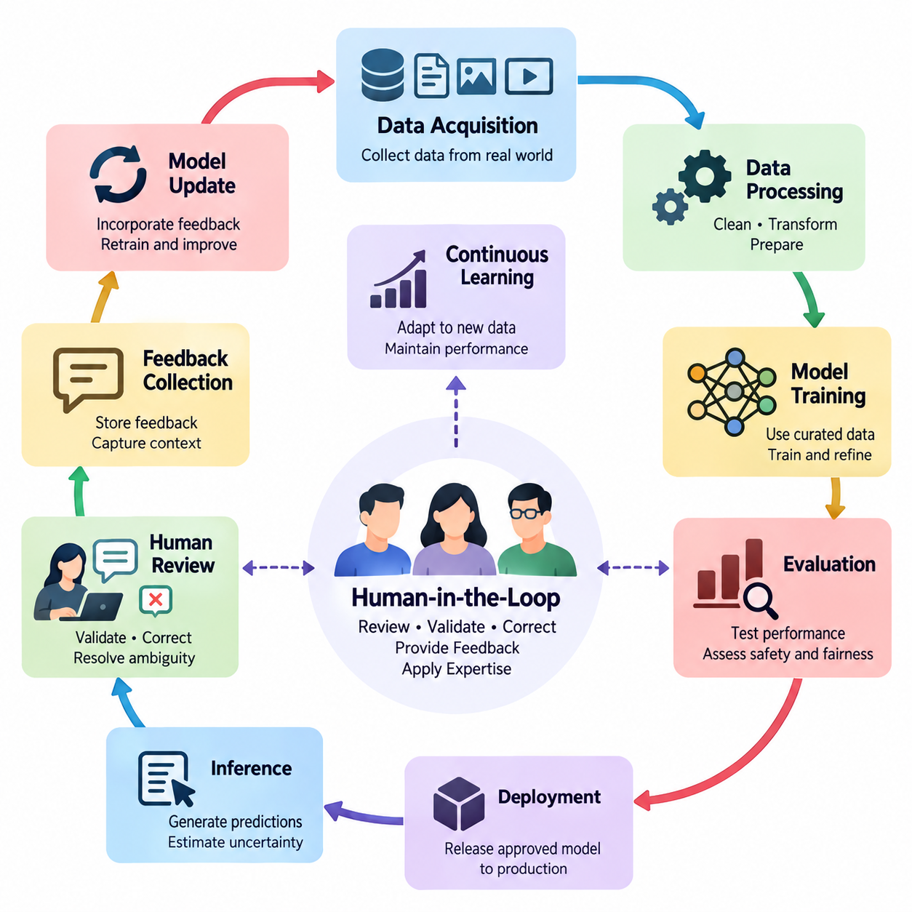
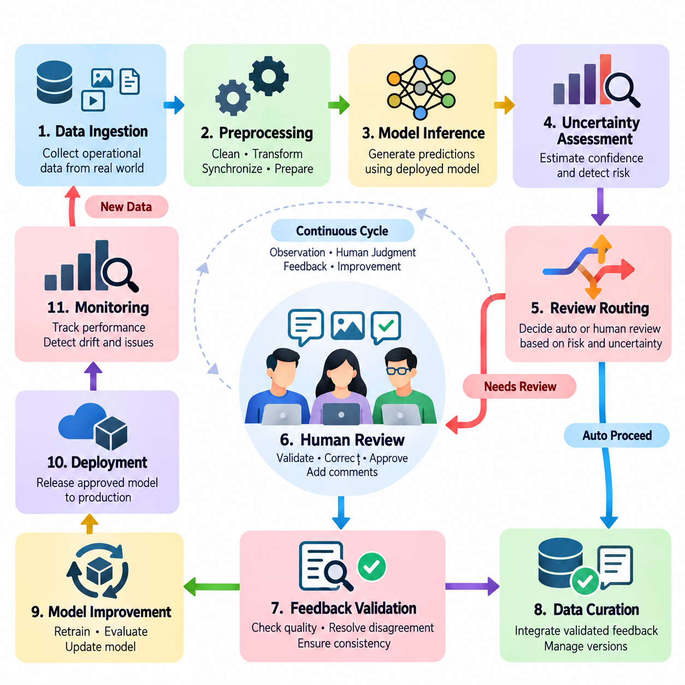
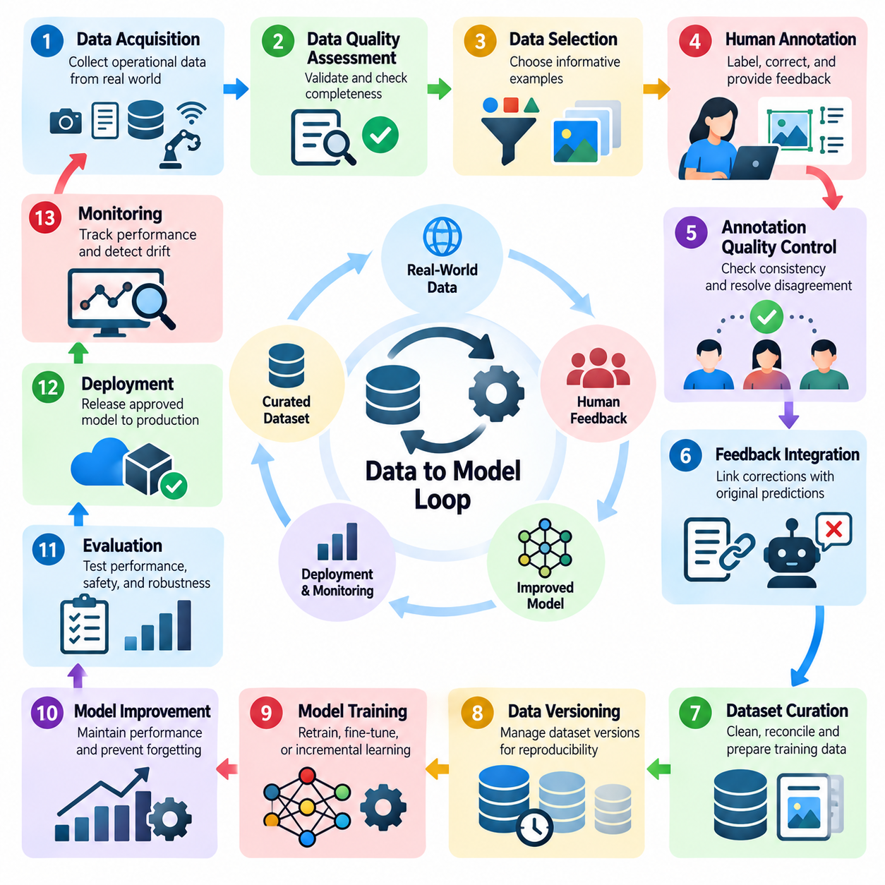
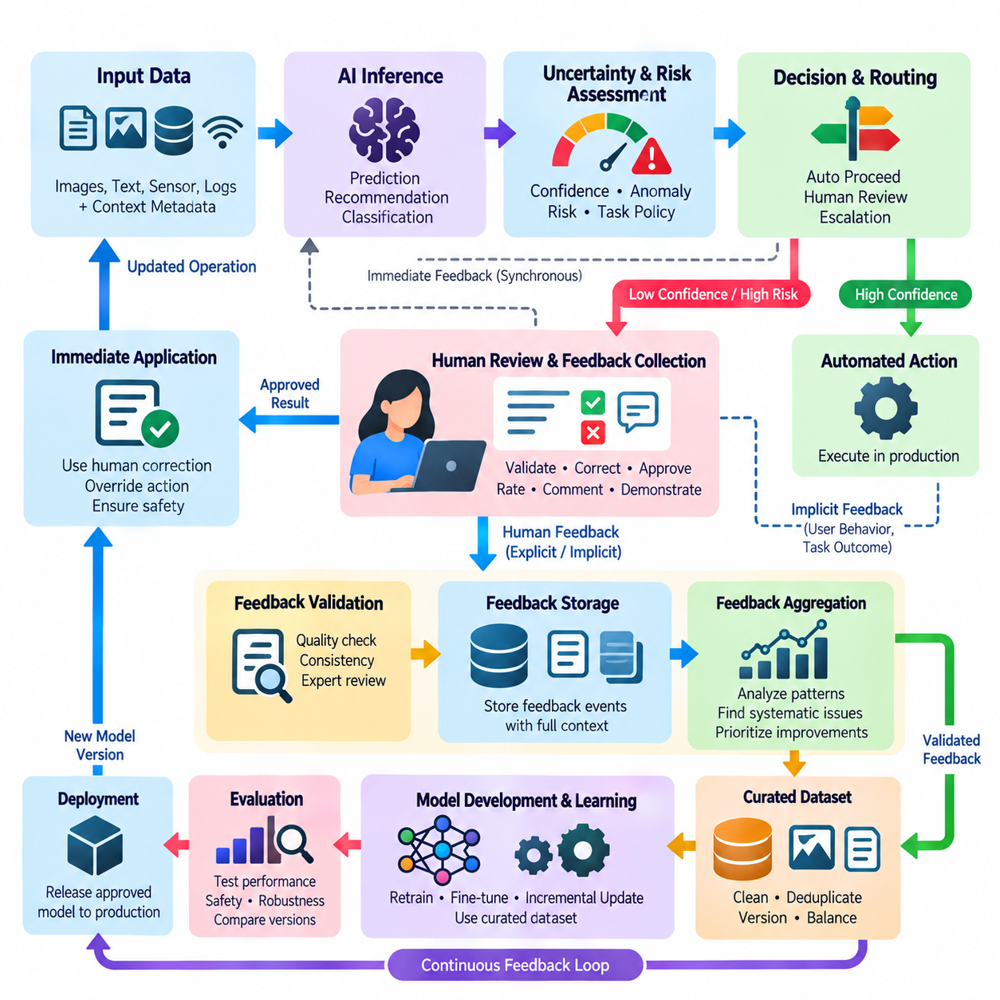
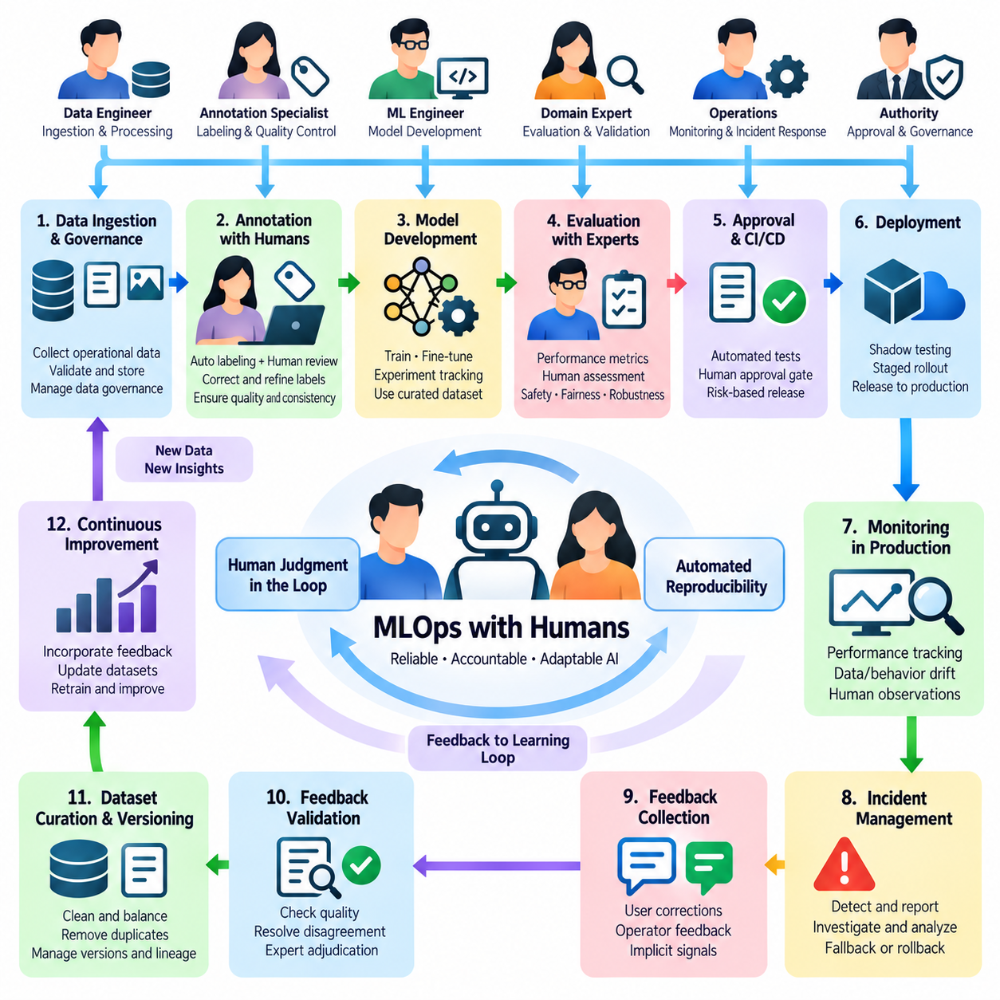
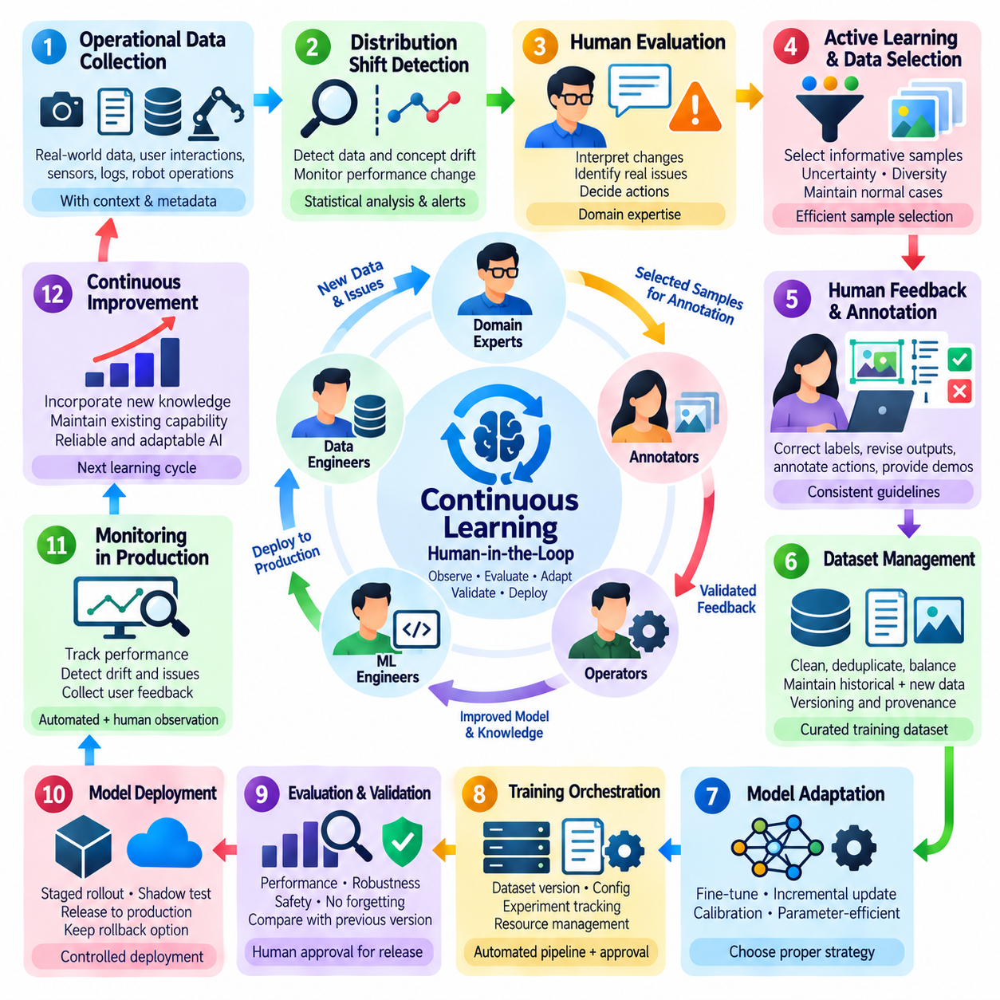
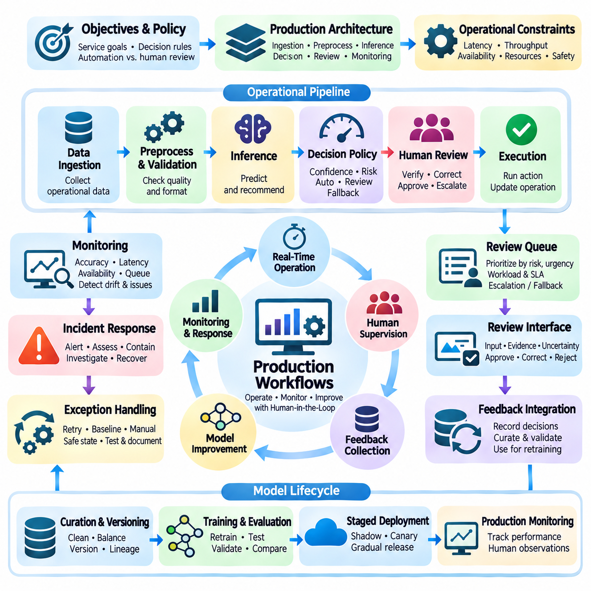
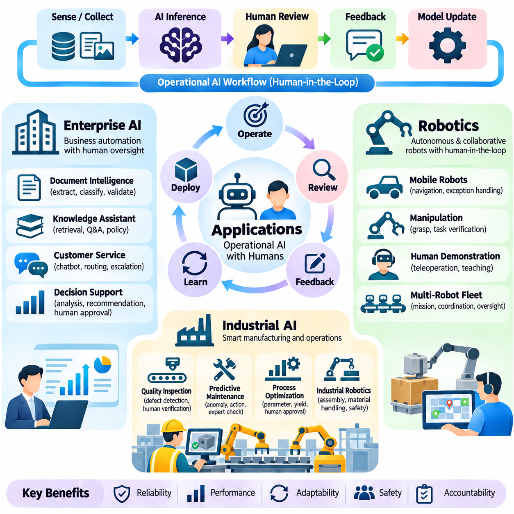

**Volume 41. Human in the Loop Learning**


# 06. Operational AI Workflows

##  

## 06.00 Overview

{width="7.268055555555556in" height="7.268055555555556in"}

Operational AI workflows transform human-in-the-loop learning from an isolated training technique into a coordinated process that supports reliable artificial intelligence throughout its lifecycle. These workflows connect data acquisition, human annotation, model training, evaluation, deployment, monitoring, and feedback collection. Their central objective is to ensure that human expertise remains available wherever automated decisions require correction, validation, or contextual judgment.

Traditional machine learning pipelines often assume that datasets are prepared before training and that deployed models operate with limited human intervention. Operational human-in-the-loop systems replace this linear assumption with a continuous cycle of observation, assessment, correction, and improvement. Human participants contribute not only during initial development but also throughout production, allowing AI systems to respond to changing environments, evolving requirements, and previously unseen situations.

An operational workflow begins by defining the responsibilities of human operators, automated models, and supporting infrastructure. Routine decisions with sufficiently high confidence may be processed automatically, while uncertain, ambiguous, or potentially harmful outcomes are directed toward human review. This allocation of responsibilities must consider prediction confidence, operational risk, review costs, response deadlines, and the consequences of incorrect decisions.

Human-in-the-loop pipeline design establishes the architecture through which information moves between automated processing stages and human decision points. A typical pipeline includes data ingestion, preprocessing, inference, uncertainty estimation, review assignment, human correction, and feedback storage. Each stage requires clearly defined inputs, outputs, quality requirements, and failure-handling procedures to ensure that human participation improves system reliability rather than introducing operational bottlenecks.

The data-to-model loop connects production observations with the datasets used to train and refine AI models. New observations may reveal classification errors, distribution shifts, missing categories, or insufficient representation of rare events. Selected examples are reviewed and labeled by human specialists before entering curated training datasets. Subsequent model updates are evaluated against established benchmarks to determine whether the additional information produces measurable improvements.

Effective data-to-model workflows require more than simply adding corrected examples to a training collection. Data provenance, annotation consistency, dataset versioning, and separation between training and evaluation samples are essential for maintaining experimental validity. Without these controls, repeated feedback cycles may introduce duplicate records, contradictory labels, or evaluation leakage, making apparent improvements difficult to distinguish from genuine generalization.

Feedback loop integration provides the mechanisms through which human observations influence automated behavior. Feedback may consist of corrected labels, preference comparisons, numerical ratings, error reports, or direct modifications to proposed actions. These signals differ in reliability, precision, and interpretation. An operational system must therefore preserve the context of each feedback event and determine how it should influence subsequent learning or decision-making.

Feedback collection interfaces should be designed around the actual responsibilities and cognitive limitations of human reviewers. Clear presentation of model predictions, supporting evidence, uncertainty indicators, and available correction options helps reviewers make informed decisions. Excessive information, confusing controls, and poorly timed review requests can increase cognitive workload. Interface quality consequently becomes an important component of learning efficiency and operational safety.

Human participation also requires explicit mechanisms for resolving disagreement. Different reviewers may interpret ambiguous evidence differently, particularly when tasks involve subjective judgments or incomplete observations. Operational workflows can address these differences through reviewer calibration, consensus procedures, expert escalation, and adjudication. Disagreement records should be retained because they may reveal unclear annotation policies, systematic biases, or genuine uncertainty in the underlying task.

MLOps with humans extends conventional machine learning operations by incorporating human review into automated development and deployment pipelines. Model registries, experiment tracking, data validation, continuous integration, and deployment controls must interact with annotation services and feedback management systems. Human approval may be required before introducing significant model changes, particularly when performance, safety, or regulatory requirements demand documented accountability.

A production-ready workflow should maintain traceability between a model prediction, the data that produced it, any subsequent human correction, and the model version responsible for the decision. This traceability enables engineers to reconstruct incidents, identify recurring failure patterns, and evaluate the effects of retraining. Audit records should distinguish original automated outputs from human-modified results so that operational performance and human intervention effectiveness can be assessed independently.

Continuous learning allows deployed AI systems to incorporate relevant new information without requiring complete redevelopment. However, continuous learning does not imply that every feedback event should immediately modify a production model. Uncontrolled updates can introduce instability, catastrophic forgetting, or unintended behavioral changes. Reliable systems separate feedback acquisition from model promotion and apply validation gates before revised models become operational.

The frequency of model updates depends on application requirements, feedback volume, computational resources, and acceptable operational risk. Some systems benefit from scheduled retraining using accumulated reviewed examples, while others require rapid adaptation to changing conditions. In either case, evaluation should consider performance on recent observations and previously established reference datasets. This combination helps detect improvements in emerging situations without overlooking degradation in familiar operating conditions.

Production workflows introduce additional constraints involving latency, throughput, availability, and service continuity. Human review may take seconds, minutes, or considerably longer depending on task complexity and reviewer availability. Workflow orchestration must therefore distinguish decisions that can wait for human confirmation from those requiring immediate automated handling. Queuing policies, deadlines, fallback behavior, and escalation procedures should be defined before deployment.

Risk-sensitive applications require particular attention to the relationship between automation and human authority. A human reviewer should have sufficient information, time, and practical control to intervene meaningfully. Merely displaying an automated recommendation does not guarantee effective oversight. Systems must specify when decisions are advisory, when explicit authorization is mandatory, and when predefined safety mechanisms should prevent an action regardless of model confidence.

Operational monitoring evaluates both automated model performance and the effectiveness of human participation. Useful measurements include error rates, review frequency, correction acceptance, reviewer agreement, feedback processing time, and the cost of obtaining reliable annotations. Additional measurements may examine escalation delays, unresolved cases, model drift, and the proportion of automated decisions requiring intervention. These indicators help determine whether the combined workflow remains sustainable.

Human effort must be treated as a limited operational resource rather than an unlimited source of supervision. Reviewing every prediction may be economically impractical and can create fatigue that reduces annotation quality. Selective review strategies prioritize cases with high uncertainty, high expected information value, or significant operational consequences. Workload balancing and reviewer specialization further improve efficiency by matching difficult cases with appropriate expertise.

Enterprise AI applications illustrate how operational human-in-the-loop workflows support document processing, customer service, knowledge management, and business decision support. Automated systems may extract information, classify requests, or generate recommendations, while employees validate exceptions and correct inaccurate outputs. These corrections can improve future model behavior when incorporated through controlled learning pipelines, reducing repetitive work while preserving accountability for consequential decisions.

Robotics applications require tighter integration between human feedback and physical system behavior. Autonomous robots may encounter unfamiliar obstacles, uncertain localization, manipulation failures, or changing environmental conditions. Human supervisors can review observations, modify task objectives, approve recovery actions, or provide demonstrations. Because physical actions may have irreversible consequences, intervention mechanisms must account for communication latency, robot dynamics, and immediate safety constraints.

Industrial AI workflows combine automated perception and prediction with domain-specific engineering expertise. Quality inspection systems may flag uncertain defects for specialist review, while predictive maintenance models may request confirmation from equipment technicians. Human corrections become valuable training evidence when linked to sensor measurements, operating conditions, equipment identity, and maintenance outcomes. This contextual information helps distinguish genuine anomalies from normal operational variation.

Operational AI systems must also address security, privacy, and organizational governance. Human reviewers should access only the information necessary for their assigned responsibilities, and sensitive records should be protected throughout feedback collection and storage. Role-based authorization, secure communication, retention policies, and audit mechanisms support responsible operation. Governance procedures should additionally establish ownership of model updates, escalation decisions, and unresolved safety concerns.

The long-term effectiveness of operational human-in-the-loop learning depends on coordinating technical automation with organizational processes. Data engineers, machine learning specialists, domain experts, reviewers, and operational managers must share consistent definitions of quality, responsibility, and success. Clear procedures for reviewing failures, updating annotation policies, validating models, and approving deployment changes transform individual corrections into systematic improvements.

The following sections develop this operational perspective through human-in-the-loop pipeline design, data-to-model loops, feedback integration, human-centered MLOps, continuous learning, and production workflow management. Enterprise AI, robotics, and industrial AI provide application contexts for examining these principles. Together, these topics establish a foundation for building adaptive AI systems that combine automated scalability with human expertise, oversight, and accountable decision-making.

운영형 인공지능 워크플로(Operational AI Workflows)는 인간 참여형 학습(Human-in-the-Loop Learning)을 독립적인 학습 기법에서 벗어나, 인공지능(Artificial Intelligence)의 전체 생명주기(Lifecycle)에 걸쳐 신뢰할 수 있는 운영을 지원하는 통합 프로세스(Integrated Process)로 발전시킨다. 이러한 워크플로는 데이터 수집(Data Acquisition), 인간 주석(Human Annotation), 모델 학습(Model Training), 평가(Evaluation), 배포(Deployment), 모니터링(Monitoring), 피드백 수집(Feedback Collection)을 연결하며, 자동화된 의사결정에 수정, 검증 또는 상황적 판단이 필요한 경우 인간의 전문성을 활용하도록 보장하는 것을 핵심 목표로 한다.

전통적인 기계학습 파이프라인(Machine Learning Pipeline)은 일반적으로 학습 이전에 데이터셋(Dataset)이 준비되고, 배포된 모델은 제한적인 인간 개입(Human Intervention)만으로 작동한다고 가정한다. 운영형 인간 참여형 시스템(Operational Human-in-the-Loop System)은 이러한 선형적 접근을 관찰(Observation), 평가(Assessment), 수정(Correction), 개선(Improvement)이 반복되는 지속적인 순환 구조로 전환한다. 인간 참여자는 초기 개발 단계뿐만 아니라 실제 운영 환경에서도 기여하며, 이를 통해 인공지능 시스템은 변화하는 환경, 새로운 요구사항, 이전에 경험하지 못한 상황에 대응할 수 있다.

운영 워크플로(Operational Workflow)는 인간 운영자(Human Operator), 자동화 모델(Automated Model), 지원 인프라(Supporting Infrastructure)의 책임을 정의하는 것에서 시작한다. 충분히 높은 신뢰도(Confidence)를 가진 일상적인 의사결정은 자동으로 처리할 수 있지만, 불확실하거나 모호하거나 잠재적으로 위험한 결과는 인간 검토(Human Review) 대상으로 전달한다. 이러한 책임 배분은 예측 신뢰도(Prediction Confidence), 운영 위험(Operational Risk), 검토 비용(Review Cost), 응답 기한(Response Deadline), 잘못된 의사결정의 결과를 종합적으로 고려해야 한다.

인간 참여형 파이프라인 설계(Human-in-the-Loop Pipeline Design)는 자동화 처리 단계와 인간 의사결정 지점 사이에서 정보가 이동하는 아키텍처(Architecture)를 정의한다. 일반적인 파이프라인은 데이터 수집(Data Ingestion), 전처리(Preprocessing), 추론(Inference), 불확실성 추정(Uncertainty Estimation), 검토 할당(Review Assignment), 인간 수정(Human Correction), 피드백 저장(Feedback Storage)으로 구성된다. 각 단계에는 명확한 입력과 출력, 품질 요구사항(Quality Requirements), 장애 처리 절차(Failure-Handling Procedures)가 필요하며, 이를 통해 인간 참여가 운영 병목현상(Operational Bottleneck)을 발생시키지 않고 시스템 신뢰성을 향상하도록 설계해야 한다.

데이터-모델 순환(Data-to-Model Loop)은 실제 운영 환경에서 관찰된 데이터를 인공지능 모델의 학습과 개선에 사용되는 데이터셋과 연결한다. 새로운 관찰 데이터는 분류 오류(Classification Error), 데이터 분포 변화(Distribution Shift), 누락된 범주(Missing Category), 희귀 사건(Rare Event)에 대한 표현 부족을 드러낼 수 있다. 선택된 사례는 인간 전문가(Human Specialist)의 검토와 주석을 거쳐 정제된 학습 데이터셋(Curated Training Dataset)에 포함된다. 이후 모델 업데이트(Model Update)는 기존 벤치마크(Benchmark)를 기준으로 평가하여 추가 정보가 측정 가능한 성능 향상을 제공하는지 확인한다.

효과적인 데이터-모델 워크플로(Data-to-Model Workflow)는 단순히 수정된 사례를 학습 데이터에 추가하는 것 이상의 관리 기능을 요구한다. 데이터 출처 추적(Data Provenance), 주석 일관성(Annotation Consistency), 데이터셋 버전 관리(Dataset Versioning), 학습 데이터와 평가 데이터의 분리(Training-Evaluation Separation)는 실험적 타당성(Experimental Validity)을 유지하는 데 필수적이다. 이러한 통제가 없으면 반복적인 피드백 과정에서 중복 데이터, 상충되는 레이블(Conflicting Labels), 평가 데이터 누출(Evaluation Leakage)이 발생하여 실제 일반화 성능(Generalization Performance)의 향상 여부를 판단하기 어려워진다.

피드백 루프 통합(Feedback Loop Integration)은 인간의 관찰과 판단이 자동화 시스템의 동작에 영향을 미치는 메커니즘(Mechanism)을 제공한다. 피드백은 수정된 레이블(Corrected Label), 선호도 비교(Preference Comparison), 수치 평가(Numerical Rating), 오류 보고(Error Report), 제안된 행동에 대한 직접적인 수정 등으로 구성될 수 있다. 이러한 신호는 신뢰성(Reliability), 정밀도(Precision), 해석 방식(Interpretation)이 서로 다르므로, 운영 시스템은 각 피드백 사건의 맥락(Context)을 보존하고 이후 학습이나 의사결정에 어떻게 반영할지 결정해야 한다.

피드백 수집 인터페이스(Feedback Collection Interface)는 인간 검토자의 실제 업무 책임과 인지적 한계(Cognitive Limitations)를 고려하여 설계해야 한다. 모델 예측(Model Prediction), 근거 자료(Supporting Evidence), 불확실성 지표(Uncertainty Indicator), 수정 가능한 선택지를 명확하게 제시하면 검토자가 충분한 정보를 바탕으로 판단할 수 있다. 반대로 과도한 정보, 혼란스러운 조작 방식, 부적절한 검토 요청 시점은 인지 부하(Cognitive Workload)를 증가시킨다. 따라서 인터페이스 품질(Interface Quality)은 학습 효율성과 운영 안전성을 결정하는 중요한 요소가 된다.

인간 참여 과정에서는 검토자 간 의견 불일치(Reviewer Disagreement)를 해결하기 위한 명시적인 메커니즘도 필요하다. 특히 주관적인 판단이나 불완전한 관찰이 포함된 작업에서는 동일한 증거를 서로 다르게 해석할 수 있다. 운영 워크플로는 검토자 보정(Reviewer Calibration), 합의 절차(Consensus Procedure), 전문가 상향 검토(Expert Escalation), 최종 판정(Adjudication)을 통해 이러한 차이를 관리할 수 있다. 의견 불일치 기록은 불명확한 주석 정책(Annotation Policy), 체계적인 편향(Systematic Bias), 실제 작업에 존재하는 불확실성을 드러낼 수 있으므로 보존해야 한다.

인간 참여형 기계학습 운영(MLOps with Humans)은 기존 기계학습 운영(Machine Learning Operations)에 인간 검토 절차를 통합하여 자동화된 개발 및 배포 파이프라인을 확장한다. 모델 레지스트리(Model Registry), 실험 추적(Experiment Tracking), 데이터 검증(Data Validation), 지속적 통합(Continuous Integration), 배포 통제(Deployment Control)는 주석 서비스(Annotation Service) 및 피드백 관리 시스템(Feedback Management System)과 연동되어야 한다. 특히 성능, 안전성 또는 규제 요구사항에 따라 책임성(Accountability)을 문서화해야 하는 경우, 중요한 모델 변경에는 인간 승인(Human Approval)이 필요할 수 있다.

실제 운영이 가능한 워크플로(Production-Ready Workflow)는 모델 예측, 예측에 사용된 데이터, 이후 발생한 인간 수정, 해당 의사결정을 수행한 모델 버전(Model Version) 사이의 추적 가능성(Traceability)을 유지해야 한다. 이를 통해 엔지니어는 사고를 재구성하고 반복적인 실패 패턴(Failure Pattern)을 식별하며 재학습(Retraining)의 효과를 평가할 수 있다. 감사 기록(Audit Record)은 최초 자동화 출력과 인간이 수정한 결과를 구분하여 자동화 성능과 인간 개입의 효과를 독립적으로 평가할 수 있도록 해야 한다.

지속 학습(Continuous Learning)은 배포된 인공지능 시스템이 전체 시스템을 다시 개발하지 않고도 새로운 정보를 반영할 수 있도록 한다. 그러나 지속 학습이 모든 피드백 사건을 즉시 운영 모델에 반영해야 한다는 의미는 아니다. 통제되지 않은 업데이트는 불안정성(Instability), 파국적 망각(Catastrophic Forgetting), 의도하지 않은 행동 변화(Unintended Behavioral Change)를 초래할 수 있다. 신뢰할 수 있는 시스템은 피드백 수집과 모델 운영 승격(Model Promotion)을 분리하고, 수정된 모델을 실제 운영에 적용하기 전에 검증 관문(Validation Gate)을 통과하도록 한다.

모델 업데이트 주기(Model Update Frequency)는 응용 분야의 요구사항, 피드백 양(Feedback Volume), 계산 자원(Computational Resources), 허용 가능한 운영 위험에 따라 달라진다. 일부 시스템은 누적된 검토 사례를 활용하는 정기 재학습(Scheduled Retraining)에 적합하지만, 다른 시스템은 변화하는 조건에 빠르게 적응해야 한다. 어느 경우든 평가는 최근 관찰 데이터와 기존 기준 데이터셋(Reference Dataset)의 성능을 함께 고려해야 한다. 이러한 접근은 새로운 상황에 대한 개선을 확인하면서 기존 환경에서의 성능 저하를 놓치지 않도록 한다.

운영 환경의 워크플로(Production Workflow)는 지연시간(Latency), 처리량(Throughput), 가용성(Availability), 서비스 연속성(Service Continuity)과 관련된 추가 제약을 가진다. 인간 검토에는 작업 복잡도와 검토자 가용성에 따라 수초에서 수분 또는 그 이상의 시간이 필요할 수 있다. 따라서 워크플로 오케스트레이션(Workflow Orchestration)은 인간 확인을 기다릴 수 있는 의사결정과 즉각적인 자동 처리가 필요한 의사결정을 구분해야 한다. 대기열 정책(Queuing Policy), 처리 기한(Deadline), 대체 동작(Fallback Behavior), 상향 보고 절차(Escalation Procedure)는 배포 이전에 정의되어야 한다.

위험에 민감한 응용 분야(Risk-Sensitive Application)에서는 자동화와 인간 권한(Human Authority)의 관계를 특별히 고려해야 한다. 인간 검토자는 실질적으로 개입할 수 있도록 충분한 정보, 시간, 제어 권한(Control Authority)을 확보해야 한다. 자동화된 권고사항을 단순히 화면에 표시하는 것만으로 효과적인 감독(Effective Oversight)이 보장되지는 않는다. 시스템은 의사결정이 자문적 성격인지, 명시적인 승인이 필수인지, 또는 모델 신뢰도와 관계없이 사전 정의된 안전 메커니즘(Safety Mechanism)이 특정 행동을 차단해야 하는지를 명확하게 규정해야 한다.

운영 모니터링(Operational Monitoring)은 자동화 모델의 성능뿐만 아니라 인간 참여의 효과도 평가한다. 주요 측정 지표에는 오류율(Error Rate), 검토 빈도(Review Frequency), 수정 수용률(Correction Acceptance Rate), 검토자 간 일치도(Reviewer Agreement), 피드백 처리 시간(Feedback Processing Time), 신뢰할 수 있는 주석 확보 비용(Annotation Cost)이 포함된다. 추가적으로 상향 검토 지연(Escalation Delay), 미해결 사례(Unresolved Case), 모델 드리프트(Model Drift), 인간 개입이 필요한 자동화 의사결정 비율을 측정할 수 있다. 이러한 지표는 통합 워크플로의 지속 가능성을 판단하는 데 활용된다.

인간의 노력(Human Effort)은 무제한으로 활용할 수 있는 감독 자원이 아니라 제한된 운영 자원(Operational Resource)으로 관리해야 한다. 모든 예측을 검토하는 방식은 경제적으로 비효율적일 수 있으며, 검토자 피로(Reviewer Fatigue)를 증가시켜 주석 품질을 저하시킬 수 있다. 선택적 검토 전략(Selective Review Strategy)은 높은 불확실성, 높은 기대 정보 가치(Expected Information Value), 중대한 운영 결과를 가진 사례에 우선순위를 부여한다. 작업량 균형 조정(Workload Balancing)과 검토자 전문화(Reviewer Specialization)는 어려운 사례를 적절한 전문가에게 배정하여 효율성을 높인다.

기업 인공지능(Enterprise AI) 응용 분야는 운영형 인간 참여형 워크플로가 문서 처리(Document Processing), 고객 서비스(Customer Service), 지식 관리(Knowledge Management), 업무 의사결정 지원(Business Decision Support)에 어떻게 활용되는지 보여준다. 자동화 시스템은 정보를 추출하거나 요청을 분류하고 권고사항을 생성하며, 직원은 예외 상황을 검증하고 부정확한 출력을 수정한다. 이러한 수정 결과를 통제된 학습 파이프라인(Controlled Learning Pipeline)에 반영하면 반복적인 업무를 줄이면서 중요한 의사결정에 대한 책임성을 유지할 수 있다.

로보틱스(Robotics) 응용 분야에서는 인간 피드백과 물리적 시스템 동작(Physical System Behavior) 사이의 더욱 긴밀한 통합이 필요하다. 자율 로봇(Autonomous Robot)은 익숙하지 않은 장애물, 불확실한 위치 추정(Localization), 조작 실패(Manipulation Failure), 변화하는 환경 조건을 경험할 수 있다. 인간 감독자(Human Supervisor)는 관찰 결과를 검토하고 작업 목표를 수정하며 복구 행동(Recovery Action)을 승인하거나 시연(Demonstration)을 제공할 수 있다. 물리적 행동은 되돌릴 수 없는 결과를 초래할 수 있으므로 개입 메커니즘은 통신 지연(Communication Latency), 로봇 동역학(Robot Dynamics), 즉각적인 안전 제약(Safety Constraints)을 고려해야 한다.

산업 인공지능(Industrial AI) 워크플로는 자동화된 인식과 예측을 산업 분야별 엔지니어링 전문성(Domain-Specific Engineering Expertise)과 결합한다. 품질 검사 시스템(Quality Inspection System)은 불확실한 결함을 전문가 검토 대상으로 지정할 수 있으며, 예지보전 모델(Predictive Maintenance Model)은 설비 기술자(Equipment Technician)의 확인을 요청할 수 있다. 인간 수정 결과는 센서 측정값(Sensor Measurements), 운영 조건(Operating Conditions), 설비 식별 정보(Equipment Identity), 유지보수 결과(Maintenance Outcomes)와 연결될 때 가치 있는 학습 증거가 된다. 이러한 맥락 정보는 실제 이상 현상과 정상적인 운영 변동을 구분하는 데 도움을 준다.

운영형 인공지능 시스템은 보안(Security), 개인정보 보호(Privacy), 조직 거버넌스(Organizational Governance)도 고려해야 한다. 인간 검토자는 할당된 업무 수행에 필요한 정보에만 접근해야 하며, 민감한 기록(Sensitive Record)은 피드백 수집과 저장의 전체 과정에서 보호되어야 한다. 역할 기반 접근 권한(Role-Based Authorization), 보안 통신(Secure Communication), 데이터 보존 정책(Retention Policy), 감사 메커니즘(Audit Mechanism)은 책임 있는 운영을 지원한다. 또한 거버넌스 절차는 모델 업데이트, 상향 검토 의사결정, 해결되지 않은 안전 문제에 대한 책임 주체를 명확하게 정의해야 한다.

운영형 인간 참여형 학습의 장기적인 효과는 기술적 자동화(Technical Automation)와 조직 프로세스(Organizational Process)를 얼마나 효과적으로 조정하는지에 달려 있다. 데이터 엔지니어(Data Engineer), 기계학습 전문가(Machine Learning Specialist), 도메인 전문가(Domain Expert), 검토자(Reviewer), 운영 관리자(Operational Manager)는 품질, 책임, 성공 기준에 대한 일관된 정의를 공유해야 한다. 실패 검토, 주석 정책 업데이트, 모델 검증, 배포 변경 승인에 대한 명확한 절차는 개별적인 수정 작업을 체계적인 개선으로 전환한다.

이후 절에서는 인간 참여형 파이프라인 설계(Human-in-the-Loop Pipeline Design), 데이터-모델 순환(Data-to-Model Loop), 피드백 통합(Feedback Integration), 인간 중심 기계학습 운영(Human-Centered MLOps), 지속 학습(Continuous Learning), 운영 워크플로 관리(Production Workflow Management)를 통해 이러한 운영 관점을 구체적으로 발전시킨다. 기업 인공지능(Enterprise AI), 로보틱스(Robotics), 산업 인공지능(Industrial AI)은 이러한 원칙을 검토하기 위한 응용 환경을 제공한다. 이들 주제는 자동화의 확장성(Automated Scalability)과 인간의 전문성(Human Expertise), 감독(Oversight), 책임 있는 의사결정(Accountable Decision-Making)을 결합하는 적응형 인공지능 시스템(Adaptive AI System)을 구축하기 위한 기반을 형성한다.

##  

## 06.01 HITL Pipeline Design

{width="7.268055555555556in" height="7.268055555555556in"}

Human-in-the-loop (HITL) pipeline design establishes a systematic architecture for integrating human judgment into automated artificial intelligence processes. Unlike conventional pipelines that primarily transfer data between computational components, HITL pipelines coordinate machine predictions, human evaluations, corrective actions, and learning updates. Their primary purpose is to improve reliability, adaptability, and accountability while preserving the efficiency advantages of automation.

A well-designed HITL pipeline begins with clearly defined operational objectives and decision boundaries. System architects must identify which tasks can be automated, which require human verification, and which demand direct human authorization. These decisions depend on model confidence, operational risk, task complexity, regulatory requirements, and available human expertise. The resulting architecture should balance automated throughput with the quality and timeliness of human intervention.

The fundamental pipeline typically includes data ingestion, preprocessing, model inference, uncertainty assessment, human review, feedback validation, data curation, and model improvement. These stages form a continuous operational cycle rather than a strictly linear sequence. Each component exchanges structured information through defined interfaces, enabling observations and corrections to influence subsequent decisions without disrupting ongoing production activities.

Data ingestion provides the initial connection between operational environments and the HITL system. Incoming information may consist of images, text, sensor measurements, transaction records, or robot observations. Before processing, data should be checked for completeness, consistency, timestamps, source identity, and structural validity. Reliable ingestion mechanisms preserve contextual metadata so that human reviewers can interpret model predictions within their original operational conditions.

Preprocessing transforms incoming observations into representations suitable for automated inference and human inspection. Typical operations include normalization, filtering, synchronization, feature extraction, and format conversion. However, transformations must preserve information relevant to human judgment and downstream learning. Excessive preprocessing may remove subtle anomalies, contextual relationships, or physical characteristics that are essential for accurate review and correction.

The inference stage generates predictions, classifications, recommendations, or proposed actions using the deployed AI model. Each output should be associated with its originating input, model version, execution timestamp, and relevant confidence information. This metadata supports traceability and enables later analysis of incorrect decisions. In operational systems, inference results should also include sufficient contextual evidence to support meaningful human verification.

Uncertainty assessment determines whether an automated output can proceed independently or requires additional review. Common approaches include predictive confidence, entropy, ensemble disagreement, anomaly scores, and out-of-distribution detection. These indicators provide different perspectives on model uncertainty and should not be treated as interchangeable. Thresholds must be calibrated against observed performance, operational consequences, and the costs associated with human intervention.

Human review routing converts uncertainty and risk assessments into actionable workflow decisions. High-confidence, low-risk outputs may proceed automatically, while ambiguous or consequential cases are assigned to qualified reviewers. Routing policies can consider reviewer specialization, workload, task urgency, and historical agreement. Effective assignment mechanisms prevent excessive review queues while ensuring that difficult cases receive appropriate attention.

The human review interface represents a critical interaction boundary between automated intelligence and domain expertise. Reviewers should receive the original observation, model output, supporting evidence, and clearly defined correction options. Interfaces should distinguish confirmed information from uncertain predictions and avoid presenting model suggestions as unquestionable conclusions. Thoughtful interaction design reduces cognitive burden and supports consistent, defensible judgments.

Human feedback may take the form of corrected labels, revised predictions, preference rankings, approval decisions, or direct demonstrations. Each feedback event should be recorded with sufficient metadata to identify its source, context, and relationship to the original model output. Structured feedback schemas simplify downstream processing and enable different forms of human input to be incorporated into appropriate learning and evaluation procedures.

Feedback validation ensures that human corrections meet established quality requirements before they influence training datasets or operational decisions. Validation mechanisms may include consistency checks, reviewer agreement, expert adjudication, and automated constraint verification. Human feedback is not inherently error-free, particularly when tasks involve ambiguity or specialized knowledge. Quality assurance procedures must therefore evaluate both machine-generated outputs and human-provided corrections.

Data curation transforms validated feedback into reusable learning resources. Corrected examples are associated with their original observations, annotation histories, operational contexts, and dataset versions. Duplicate detection, label reconciliation, and provenance tracking help maintain dataset integrity. Carefully managed curation prevents feedback loops from accumulating contradictory evidence and supports reproducible experiments across successive model generations.

The model improvement stage uses curated feedback to refine predictive behavior through supervised learning, active learning, preference optimization, or other suitable methods. Training procedures should reflect the nature and reliability of the collected feedback rather than assuming that all corrections provide equivalent information. Updated models must undergo independent validation before deployment, ensuring that improvements on reviewed cases do not conceal broader performance degradation.

Pipeline orchestration coordinates the timing, dependencies, and execution states of automated and human activities. Workflow engines may manage asynchronous review queues, retries, deadlines, notifications, and escalation paths. Because human response times differ substantially from computational processing times, orchestration must accommodate delayed feedback without blocking unrelated operations. Clear state transitions also prevent incomplete reviews from being mistaken for approved decisions.

Operational resilience requires explicit handling of missing feedback, unavailable reviewers, communication failures, and unexpected model behavior. Depending on application risk, the system may defer a decision, request alternative review, revert to a validated baseline, or enter a predefined safe state. Failure-handling policies should be established before deployment and tested under realistic conditions. Such mechanisms are particularly important when automated outputs influence physical equipment or consequential decisions.

HITL pipeline design must distinguish immediate operational correction from long-term model learning. A reviewer may correct an individual prediction without authorizing any modification to the deployed model. Conversely, accumulated corrections may later support controlled retraining and validation. Separating these pathways prevents unverified feedback from producing uncontrolled behavioral changes and enables organizations to maintain stable production systems while continuously improving their models.

Scalability becomes increasingly important as the number of observations, models, and reviewers grows. Effective architectures use selective sampling, priority-based review, workload distribution, and asynchronous processing to limit unnecessary human effort. Resource allocation should account for both computational capacity and human availability. A scalable HITL system increases automated processing volume without requiring human review effort to grow proportionally with every additional prediction.

Monitoring provides continuous visibility into pipeline performance and human participation. Relevant indicators include review rates, correction frequencies, processing latency, reviewer agreement, queue length, model accuracy, and feedback utilization. These measurements reveal whether human intervention produces meaningful improvements and whether operational constraints are being satisfied. Monitoring should also detect changes in data distributions and review workloads that may require workflow adjustments.

Security and governance requirements extend across every pipeline component. Access controls should restrict sensitive observations to authorized personnel, while audit records document prediction histories, review decisions, and model changes. Data retention policies and privacy protections must apply to both automated outputs and human-generated feedback. Clear accountability structures define responsibility for approving corrections, resolving disputes, and authorizing deployment of updated models.

In enterprise applications, HITL pipelines support document processing, customer service, financial analysis, and decision-support workflows by routing uncertain outputs to knowledgeable employees. In robotics, they enable operators to inspect navigation failures, approve recovery strategies, and correct perception results. Industrial applications use similar mechanisms for defect inspection, equipment monitoring, and process optimization, where expert judgment contributes to reliable operation under changing conditions.

The effectiveness of a HITL pipeline ultimately depends on the coordination of data engineering, model inference, uncertainty estimation, human interaction, feedback management, and operational governance. Each component must support traceability, controlled improvement, and measurable performance. A carefully designed pipeline transforms isolated human corrections into a sustainable learning process, allowing AI systems to become more capable while maintaining human oversight and operational reliability.

인간 참여형(Human-in-the-Loop, HITL) 파이프라인 설계(Pipeline Design)는 자동화된 인공지능(Artificial Intelligence) 프로세스에 인간의 판단(Human Judgment)을 통합하기 위한 체계적인 아키텍처(Systematic Architecture)를 구축한다. 주로 컴퓨팅 구성요소 사이에서 데이터를 전달하는 기존 파이프라인과 달리, 인간 참여형 파이프라인은 기계 예측(Machine Prediction), 인간 평가(Human Evaluation), 수정 조치(Corrective Action), 학습 업데이트(Learning Update)를 조정한다. 주요 목적은 자동화의 효율성 이점을 유지하면서 신뢰성(Reliability), 적응성(Adaptability), 책임성(Accountability)을 향상하는 것이다.

잘 설계된 인간 참여형 파이프라인(HITL Pipeline)은 명확하게 정의된 운영 목표(Operational Objectives)와 의사결정 경계(Decision Boundaries)에서 시작한다. 시스템 아키텍트(System Architect)는 자동화할 수 있는 작업, 인간 검증(Human Verification)이 필요한 작업, 직접적인 인간 승인(Human Authorization)이 요구되는 작업을 식별해야 한다. 이러한 결정은 모델 신뢰도(Model Confidence), 운영 위험(Operational Risk), 작업 복잡도(Task Complexity), 규제 요구사항(Regulatory Requirements), 활용 가능한 인간 전문성(Human Expertise)에 따라 달라진다. 결과적으로 아키텍처는 자동화 처리량(Automated Throughput)과 인간 개입(Human Intervention)의 품질 및 적시성 사이에서 균형을 유지해야 한다.

기본적인 파이프라인은 일반적으로 데이터 수집(Data Ingestion), 전처리(Preprocessing), 모델 추론(Model Inference), 불확실성 평가(Uncertainty Assessment), 인간 검토(Human Review), 피드백 검증(Feedback Validation), 데이터 정제(Data Curation), 모델 개선(Model Improvement)으로 구성된다. 이러한 단계는 엄격한 선형적 순서가 아니라 지속적인 운영 순환(Continuous Operational Cycle)을 형성한다. 각 구성요소는 정의된 인터페이스(Interface)를 통해 구조화된 정보(Structured Information)를 교환하며, 이를 통해 관찰 결과와 수정 사항이 지속적인 운영 활동을 방해하지 않으면서 이후 의사결정에 영향을 미칠 수 있다.

데이터 수집(Data Ingestion)은 운영 환경(Operational Environment)과 인간 참여형 시스템(HITL System) 사이의 초기 연결을 제공한다. 입력 정보는 이미지(Image), 텍스트(Text), 센서 측정값(Sensor Measurements), 거래 기록(Transaction Records), 로봇 관찰 데이터(Robot Observations) 등으로 구성될 수 있다. 처리 이전에는 데이터의 완전성(Completeness), 일관성(Consistency), 타임스탬프(Timestamp), 출처 식별(Source Identity), 구조적 유효성(Structural Validity)을 확인해야 한다. 신뢰할 수 있는 데이터 수집 메커니즘은 인간 검토자가 원래의 운영 조건에서 모델 예측을 해석할 수 있도록 맥락 메타데이터(Contextual Metadata)를 보존한다.

전처리(Preprocessing)는 입력 관찰 데이터를 자동화된 추론(Automated Inference)과 인간 검토(Human Inspection)에 적합한 표현(Representation)으로 변환한다. 일반적인 작업에는 정규화(Normalization), 필터링(Filtering), 동기화(Synchronization), 특징 추출(Feature Extraction), 형식 변환(Format Conversion)이 포함된다. 그러나 이러한 변환은 인간 판단과 후속 학습(Downstream Learning)에 필요한 정보를 보존해야 한다. 과도한 전처리는 정확한 검토와 수정에 필수적인 미세한 이상 현상(Subtle Anomalies), 맥락적 관계(Contextual Relationships), 물리적 특성(Physical Characteristics)을 제거할 수 있다.

추론 단계(Inference Stage)는 배포된 인공지능 모델(Deployed AI Model)을 사용하여 예측(Prediction), 분류(Classification), 권고(Recommendation), 제안된 행동(Proposed Action)을 생성한다. 각 출력은 원본 입력(Originating Input), 모델 버전(Model Version), 실행 타임스탬프(Execution Timestamp), 관련 신뢰도 정보(Confidence Information)와 연결되어야 한다. 이러한 메타데이터는 추적 가능성(Traceability)을 지원하고 잘못된 의사결정에 대한 사후 분석을 가능하게 한다. 운영 시스템에서는 추론 결과에 인간이 의미 있는 검증을 수행할 수 있도록 충분한 맥락적 근거(Contextual Evidence)도 포함해야 한다.

불확실성 평가(Uncertainty Assessment)는 자동화된 출력이 독립적으로 처리될 수 있는지, 추가 검토가 필요한지를 결정한다. 일반적인 접근법에는 예측 신뢰도(Predictive Confidence), 엔트로피(Entropy), 앙상블 불일치(Ensemble Disagreement), 이상 점수(Anomaly Score), 분포 외 탐지(Out-of-Distribution Detection)가 포함된다. 이러한 지표는 모델 불확실성(Model Uncertainty)에 대해 서로 다른 관점을 제공하므로 동일한 것으로 취급해서는 안 된다. 임계값(Threshold)은 관찰된 성능, 운영상의 결과, 인간 개입에 수반되는 비용을 기준으로 보정(Calibration)해야 한다.

인간 검토 라우팅(Human Review Routing)은 불확실성과 위험 평가를 실행 가능한 워크플로 의사결정(Actionable Workflow Decision)으로 변환한다. 신뢰도가 높고 위험이 낮은 출력은 자동으로 처리할 수 있지만, 모호하거나 중대한 결과를 초래할 수 있는 사례는 자격을 갖춘 검토자(Qualified Reviewer)에게 할당된다. 라우팅 정책(Routing Policy)은 검토자의 전문 분야(Reviewer Specialization), 작업량(Workload), 작업 긴급도(Task Urgency), 과거 일치도(Historical Agreement)를 고려할 수 있다. 효과적인 할당 메커니즘은 과도한 검토 대기열(Review Queue)을 방지하면서 어려운 사례가 적절한 검토를 받도록 보장한다.

인간 검토 인터페이스(Human Review Interface)는 자동화된 지능(Automated Intelligence)과 도메인 전문성(Domain Expertise) 사이의 중요한 상호작용 경계(Interaction Boundary)를 형성한다. 검토자는 원본 관찰 데이터(Original Observation), 모델 출력(Model Output), 근거 자료(Supporting Evidence), 명확하게 정의된 수정 옵션(Correction Options)을 제공받아야 한다. 인터페이스는 확인된 정보(Confirmed Information)와 불확실한 예측(Uncertain Prediction)을 구분해야 하며, 모델의 제안을 의심할 여지가 없는 결론처럼 제시해서는 안 된다. 신중한 상호작용 설계(Interaction Design)는 인지적 부담(Cognitive Burden)을 줄이고 일관되며 정당화할 수 있는 판단을 지원한다.

인간 피드백(Human Feedback)은 수정된 레이블(Corrected Labels), 수정된 예측(Revised Predictions), 선호도 순위(Preference Rankings), 승인 결정(Approval Decisions), 직접 시연(Direct Demonstrations) 등의 형태로 제공될 수 있다. 각 피드백 사건(Feedback Event)은 출처(Source), 맥락(Context), 원래 모델 출력과의 관계를 식별할 수 있는 충분한 메타데이터와 함께 기록되어야 한다. 구조화된 피드백 스키마(Structured Feedback Schema)는 후속 처리(Downstream Processing)를 단순화하며, 서로 다른 형태의 인간 입력을 적절한 학습 및 평가 절차에 통합할 수 있도록 한다.

피드백 검증(Feedback Validation)은 인간의 수정 사항이 학습 데이터셋이나 운영 의사결정에 영향을 미치기 전에 설정된 품질 요구사항(Quality Requirements)을 충족하는지 확인한다. 검증 메커니즘(Validation Mechanism)에는 일관성 검사(Consistency Checks), 검토자 간 일치도(Reviewer Agreement), 전문가 최종 판정(Expert Adjudication), 자동화된 제약조건 검증(Automated Constraint Verification)이 포함될 수 있다. 특히 모호하거나 전문 지식이 필요한 작업에서는 인간 피드백도 오류가 발생할 수 있다. 따라서 품질 보증 절차(Quality Assurance Procedures)는 기계가 생성한 출력과 인간이 제공한 수정 사항을 모두 평가해야 한다.

데이터 정제(Data Curation)는 검증된 피드백을 재사용 가능한 학습 자원(Reusable Learning Resources)으로 변환한다. 수정된 사례는 원본 관찰 데이터, 주석 이력(Annotation Histories), 운영 맥락(Operational Contexts), 데이터셋 버전(Dataset Versions)과 연결된다. 중복 탐지(Duplicate Detection), 레이블 조정(Label Reconciliation), 데이터 출처 추적(Provenance Tracking)은 데이터셋 무결성(Dataset Integrity)을 유지하는 데 도움을 준다. 체계적으로 관리되는 데이터 정제는 피드백 루프(Feedback Loop)에 상충되는 증거가 누적되는 것을 방지하고, 연속적인 모델 세대(Model Generations)에 걸쳐 재현 가능한 실험(Reproducible Experiments)을 지원한다.

모델 개선 단계(Model Improvement Stage)는 정제된 피드백을 사용하여 지도학습(Supervised Learning), 능동학습(Active Learning), 선호도 최적화(Preference Optimization) 또는 기타 적절한 방법을 통해 예측 행동(Predictive Behavior)을 개선한다. 학습 절차(Training Procedures)는 모든 수정 사항이 동일한 정보를 제공한다고 가정하지 않고, 수집된 피드백의 특성과 신뢰성을 반영해야 한다. 업데이트된 모델은 배포 이전에 독립적인 검증(Independent Validation)을 거쳐야 하며, 검토된 사례에서의 개선이 전반적인 성능 저하(Broader Performance Degradation)를 은폐하지 않도록 해야 한다.

파이프라인 오케스트레이션(Pipeline Orchestration)은 자동화된 활동과 인간 활동의 실행 시점(Timing), 의존성(Dependencies), 실행 상태(Execution States)를 조정한다. 워크플로 엔진(Workflow Engine)은 비동기 검토 대기열(Asynchronous Review Queues), 재시도(Retries), 처리 기한(Deadlines), 알림(Notifications), 상향 검토 경로(Escalation Paths)를 관리할 수 있다. 인간 응답 시간(Human Response Time)은 컴퓨팅 처리 시간(Computational Processing Time)과 상당한 차이가 있으므로, 오케스트레이션은 관련 없는 작업을 차단하지 않으면서 지연된 피드백(Delayed Feedback)을 처리할 수 있어야 한다. 명확한 상태 전이(State Transitions)는 완료되지 않은 검토가 승인된 의사결정으로 잘못 인식되는 것을 방지한다.

운영 복원력(Operational Resilience)을 확보하려면 누락된 피드백(Missing Feedback), 검토자 부재(Unavailable Reviewers), 통신 장애(Communication Failures), 예상하지 못한 모델 동작(Unexpected Model Behavior)에 대한 명시적인 처리 절차가 필요하다. 응용 분야의 위험 수준에 따라 시스템은 의사결정을 연기하거나, 대체 검토(Alternative Review)를 요청하거나, 검증된 기준 모델(Validated Baseline)로 복귀하거나, 사전에 정의된 안전 상태(Predefined Safe State)로 전환할 수 있다. 장애 처리 정책(Failure-Handling Policies)은 배포 이전에 수립하고 현실적인 조건에서 시험해야 한다. 이러한 메커니즘은 자동화된 출력이 물리적 장비나 중대한 의사결정에 영향을 미치는 경우 특히 중요하다.

인간 참여형 파이프라인 설계(HITL Pipeline Design)는 즉각적인 운영 수정(Immediate Operational Correction)과 장기적인 모델 학습(Long-Term Model Learning)을 구분해야 한다. 검토자는 배포된 모델의 변경을 승인하지 않고도 개별 예측을 수정할 수 있다. 반대로 누적된 수정 사항은 이후 통제된 재학습(Controlled Retraining)과 검증(Validation)에 활용될 수 있다. 이러한 경로를 분리하면 검증되지 않은 피드백이 통제되지 않은 행동 변화(Uncontrolled Behavioral Changes)를 발생시키는 것을 방지하고, 조직이 안정적인 운영 시스템을 유지하면서 모델을 지속적으로 개선할 수 있다.

관찰 데이터, 모델, 검토자의 수가 증가함에 따라 확장성(Scalability)은 더욱 중요해진다. 효과적인 아키텍처는 선택적 샘플링(Selective Sampling), 우선순위 기반 검토(Priority-Based Review), 작업량 분산(Workload Distribution), 비동기 처리(Asynchronous Processing)를 활용하여 불필요한 인간의 노력을 줄인다. 자원 할당(Resource Allocation)은 계산 용량(Computational Capacity)과 인간의 가용성(Human Availability)을 모두 고려해야 한다. 확장 가능한 인간 참여형 시스템(Scalable HITL System)은 추가되는 모든 예측에 비례하여 인간 검토 작업량을 증가시키지 않으면서 자동화 처리량을 확대할 수 있다.

모니터링(Monitoring)은 파이프라인 성능(Pipeline Performance)과 인간 참여(Human Participation)에 대한 지속적인 가시성(Visibility)을 제공한다. 관련 지표에는 검토율(Review Rate), 수정 빈도(Correction Frequency), 처리 지연시간(Processing Latency), 검토자 간 일치도(Reviewer Agreement), 대기열 길이(Queue Length), 모델 정확도(Model Accuracy), 피드백 활용도(Feedback Utilization)가 포함된다. 이러한 측정값은 인간 개입이 의미 있는 개선을 제공하는지, 운영 제약조건(Operational Constraints)이 충족되고 있는지를 보여준다. 또한 모니터링은 워크플로 조정이 필요할 수 있는 데이터 분포(Data Distribution)와 검토 작업량의 변화를 탐지해야 한다.

보안(Security)과 거버넌스(Governance) 요구사항은 파이프라인의 모든 구성요소에 적용된다. 접근 제어(Access Control)는 민감한 관찰 데이터에 대한 접근을 승인된 인력으로 제한해야 하며, 감사 기록(Audit Records)은 예측 이력(Prediction Histories), 검토 결정(Review Decisions), 모델 변경(Model Changes)을 문서화해야 한다. 데이터 보존 정책(Data Retention Policies)과 개인정보 보호 조치(Privacy Protections)는 자동화된 출력과 인간이 생성한 피드백 모두에 적용되어야 한다. 명확한 책임 구조(Accountability Structures)는 수정 승인, 분쟁 해결, 업데이트된 모델의 배포 승인에 대한 책임을 정의한다.

기업 인공지능(Enterprise AI) 응용 분야에서 인간 참여형 파이프라인은 불확실한 출력을 전문 지식을 가진 직원에게 전달함으로써 문서 처리(Document Processing), 고객 서비스(Customer Service), 재무 분석(Financial Analysis), 의사결정 지원 워크플로(Decision-Support Workflows)를 지원한다. 로보틱스(Robotics)에서는 운영자가 내비게이션 실패(Navigation Failures)를 검토하고, 복구 전략(Recovery Strategies)을 승인하며, 인식 결과(Perception Results)를 수정할 수 있도록 한다. 산업 응용 분야(Industrial Applications)에서는 결함 검사(Defect Inspection), 설비 모니터링(Equipment Monitoring), 공정 최적화(Process Optimization)에 유사한 메커니즘을 활용하며, 전문가 판단(Expert Judgment)은 변화하는 조건에서 신뢰할 수 있는 운영을 지원한다.

인간 참여형 파이프라인의 효과는 궁극적으로 데이터 엔지니어링(Data Engineering), 모델 추론(Model Inference), 불확실성 추정(Uncertainty Estimation), 인간 상호작용(Human Interaction), 피드백 관리(Feedback Management), 운영 거버넌스(Operational Governance)의 조정에 달려 있다. 각 구성요소는 추적 가능성(Traceability), 통제된 개선(Controlled Improvement), 측정 가능한 성능(Measurable Performance)을 지원해야 한다. 신중하게 설계된 파이프라인은 개별적인 인간 수정 사항을 지속 가능한 학습 프로세스(Sustainable Learning Process)로 전환하여, 인공지능 시스템이 인간 감독(Human Oversight)과 운영 신뢰성(Operational Reliability)을 유지하면서 더욱 높은 역량을 확보하도록 한다.

## 06.02 Data to Model Loop [w/Code]

{width="7.268055555555556in" height="7.268055555555556in"}

The data-to-model loop is a fundamental mechanism in human-in-the-loop learning that transforms operational observations and human feedback into measurable improvements in artificial intelligence systems. Rather than treating model training as a one-time activity, this approach establishes a continuous relationship between data collection, human annotation, dataset refinement, model optimization, and deployment. Its purpose is to maintain adaptability while preserving reliability and accountability.

Traditional machine learning pipelines often depend on static datasets collected before model development. Once deployed, these models may encounter unfamiliar conditions, changing user behavior, or previously unrepresented situations. The data-to-model loop addresses these limitations by capturing operational evidence and incorporating selected observations into subsequent learning cycles. Human expertise helps determine which examples are meaningful and how they should influence model behavior.

The loop begins with data acquisition from production environments, user interactions, automated sensors, or operational monitoring systems. Incoming observations may include images, text, numerical measurements, event logs, and robot trajectories. Each observation should retain contextual metadata such as timestamps, source identifiers, environmental conditions, and model versions. These records establish the foundation for interpreting errors and reconstructing decisions.

Data quality assessment determines whether collected observations are suitable for further processing. Missing values, corrupted records, inconsistent formats, duplicated samples, and synchronization errors can undermine subsequent learning. Automated validation mechanisms identify obvious defects, while human specialists examine ambiguous or domain-specific inconsistencies. Preserving original observations alongside processed representations supports traceability and later investigation.

Not every collected observation should enter the annotation process. Data selection mechanisms prioritize examples according to uncertainty, diversity, operational relevance, and expected learning value. Active learning strategies can identify samples for which human labels are particularly informative. However, selection policies must also preserve representative coverage of routine conditions, preventing the training dataset from becoming excessively concentrated on difficult or unusual cases.

Human annotation converts selected observations into structured learning signals. Depending on the application, reviewers may assign classification labels, correct bounding boxes, validate generated responses, rank alternatives, or annotate robot actions. Clear annotation guidelines are necessary to maintain consistency across reviewers and time. The system should also preserve reviewer identity, annotation timestamps, confidence assessments, and relevant contextual explanations.

Annotation quality control evaluates whether human-provided information is sufficiently reliable for model improvement. Inter-annotator agreement, expert adjudication, consistency checks, and targeted reinspection can identify ambiguous or contradictory labels. Disagreements should not automatically be interpreted as reviewer errors because they may reflect genuine uncertainty. Recording such cases helps refine annotation policies and improve future data collection.

Feedback integration connects validated human annotations with their originating model predictions and operational contexts. Each correction should identify the original input, predicted output, corrected result, and reason for modification when available. This association enables error analysis and supports targeted model improvements. Structured feedback records also make it possible to distinguish isolated mistakes from systematic weaknesses affecting particular environments or user groups.

Dataset curation transforms validated observations into coherent training resources. Curation procedures address duplicate removal, label reconciliation, class balance, metadata completeness, and dataset versioning. Historical examples should remain available when necessary to preserve previously acquired capabilities. A well-managed dataset maintains explicit relationships between raw observations, processed samples, annotations, and the model versions that generated them.

Data versioning provides reproducibility across successive learning cycles. Each training run should reference an identifiable dataset snapshot, annotation policy, preprocessing configuration, and selection procedure. Without these records, performance differences between model versions may be difficult to explain. Versioned datasets also support rollback, auditing, and systematic comparison when newly incorporated feedback produces unexpected outcomes.

The transition from curated data to model training requires deliberate decisions about learning strategy. Depending on feedback volume and model architecture, organizations may perform full retraining, incremental learning, fine-tuning, or parameter-efficient adaptation. Training objectives should reflect the reliability and meaning of available labels. Sampling weights and loss functions may also require adjustment when selected feedback differs substantially from the production distribution.

Continuous model improvement introduces the risk of catastrophic forgetting, overfitting, and unintended changes in behavior. A model optimized primarily on recently corrected examples may lose accuracy on previously well-supported tasks. Mitigation strategies include replaying representative historical samples, regularization, balanced training mixtures, and independent validation. These techniques help maintain existing capabilities while incorporating useful new information.

Evaluation is the critical boundary between model improvement and operational deployment. Updated models should be tested against stable reference datasets, recent production samples, and relevant edge cases. Performance comparisons must consider accuracy, calibration, robustness, fairness, latency, and application-specific safety requirements. Improvements on selected feedback samples alone do not establish that a new model is suitable for production.

Human evaluation remains important when automated metrics cannot fully capture task quality or operational consequences. Domain experts may examine representative outputs, compare model behavior, and assess whether corrections improve practical usefulness. In robotics and industrial systems, evaluation may additionally involve simulation, controlled physical trials, and safety verification. Human approval should be required when deployment decisions exceed predefined risk thresholds.

Deployment closes one learning cycle while initiating the next. A validated model may be introduced through staged rollout, shadow testing, or controlled replacement of an existing version. Monitoring systems compare observed behavior with expected performance and detect emerging failures. New observations then become candidates for data selection and human review, establishing the recurring relationship between production experience and model development.

Operational monitoring should distinguish model errors from data pipeline failures and environmental changes. A sudden increase in incorrect predictions may result from sensor degradation, preprocessing inconsistencies, distribution shifts, or genuine model limitations. Root-cause analysis prevents unnecessary retraining when the underlying problem lies elsewhere. Human specialists contribute contextual knowledge that automated monitoring systems may not possess.

The effectiveness of the data-to-model loop depends on balancing learning benefits against annotation costs and computational requirements. Useful indicators include model improvement per reviewed sample, annotation turnaround time, retraining frequency, data processing latency, and performance stability. These measurements support decisions about when to collect additional labels, initiate training, or stop an unproductive feedback cycle.

Automation improves operational efficiency by coordinating data ingestion, sample selection, annotation queues, dataset validation, training jobs, and evaluation reports. Workflow orchestration systems can maintain dependencies and record execution outcomes across these stages. However, automation should not eliminate human checkpoints where interpretation, quality assurance, or deployment authorization is necessary. The objective is coordinated intelligence rather than unrestricted automation.

Security and governance requirements apply throughout the loop because operational observations and human feedback may contain sensitive information. Access controls, data minimization, retention policies, and audit trails help protect information while preserving learning traceability. Organizations must also define responsibility for annotation standards, dataset approval, model validation, and production promotion. These controls support accountable continuous improvement.

Enterprise AI systems use data-to-model loops to improve document extraction, customer support, recommendation quality, and decision assistance. Robotics applications transform navigation failures, manipulation corrections, and operator demonstrations into learning examples. Industrial AI systems incorporate reviewed inspection results, equipment anomalies, and maintenance outcomes. Although these applications differ operationally, they share the same principle of converting verified experience into controlled model improvement.

A mature data-to-model loop integrates data engineering, active learning, human feedback, dataset governance, model training, evaluation, and deployment into a traceable operational process. Its success is measured not by the quantity of accumulated feedback but by reliable improvements in real-world performance. By maintaining disciplined validation and human oversight, the loop enables AI systems to evolve with changing conditions without sacrificing stability, reproducibility, or operational trust.

데이터-모델 순환(Data-to-Model Loop)은 운영 환경에서 수집된 관찰 데이터(Operational Observations)와 인간 피드백(Human Feedback)을 인공지능 시스템(Artificial Intelligence Systems)의 측정 가능한 개선으로 전환하는 인간 참여형 학습(Human-in-the-Loop Learning)의 핵심 메커니즘이다. 이 접근법은 모델 학습(Model Training)을 일회성 활동으로 취급하지 않고, 데이터 수집(Data Collection), 인간 주석(Human Annotation), 데이터셋 정제(Dataset Refinement), 모델 최적화(Model Optimization), 배포(Deployment) 사이에 지속적인 관계를 구축한다. 주요 목적은 신뢰성(Reliability)과 책임성(Accountability)을 유지하면서 적응성(Adaptability)을 확보하는 것이다.

전통적인 기계학습 파이프라인(Machine Learning Pipeline)은 모델 개발 이전에 수집된 정적 데이터셋(Static Dataset)에 의존하는 경우가 많다. 이러한 모델은 배포 이후 익숙하지 않은 조건, 변화하는 사용자 행동(User Behavior), 이전에 표현되지 않은 상황에 직면할 수 있다. 데이터-모델 순환은 운영 환경에서 발생하는 증거(Operational Evidence)를 수집하고 선택된 관찰 데이터를 후속 학습 주기(Learning Cycle)에 통합함으로써 이러한 한계를 해결한다. 인간의 전문성(Human Expertise)은 어떤 사례가 의미 있는지, 해당 사례가 모델 행동(Model Behavior)에 어떻게 영향을 미쳐야 하는지 결정하는 데 도움을 준다.

순환 과정은 운영 환경(Production Environment), 사용자 상호작용(User Interaction), 자동화 센서(Automated Sensors), 운영 모니터링 시스템(Operational Monitoring Systems)으로부터 데이터를 수집하는 단계에서 시작한다. 입력 관찰 데이터(Incoming Observations)에는 이미지(Image), 텍스트(Text), 수치 측정값(Numerical Measurements), 이벤트 로그(Event Logs), 로봇 궤적(Robot Trajectories)이 포함될 수 있다. 각 관찰 데이터는 타임스탬프(Timestamp), 출처 식별자(Source Identifier), 환경 조건(Environmental Conditions), 모델 버전(Model Version) 등의 맥락 메타데이터(Contextual Metadata)를 유지해야 한다. 이러한 기록은 오류를 해석하고 의사결정을 재구성하기 위한 기반을 제공한다.

데이터 품질 평가(Data Quality Assessment)는 수집된 관찰 데이터가 후속 처리에 적합한지를 판단한다. 누락값(Missing Values), 손상된 기록(Corrupted Records), 일관되지 않은 형식(Inconsistent Formats), 중복 샘플(Duplicated Samples), 동기화 오류(Synchronization Errors)는 후속 학습의 신뢰성을 저하시킬 수 있다. 자동화된 검증 메커니즘(Automated Validation Mechanisms)은 명확한 결함을 식별하고, 인간 전문가(Human Specialists)는 모호하거나 도메인별 불일치(Domain-Specific Inconsistencies)를 검토한다. 처리된 표현(Processed Representations)과 함께 원본 관찰 데이터(Original Observations)를 보존하면 추적 가능성(Traceability)과 사후 조사를 지원할 수 있다.

수집된 모든 관찰 데이터를 주석 처리 과정(Annotation Process)에 포함해야 하는 것은 아니다. 데이터 선택 메커니즘(Data Selection Mechanisms)은 불확실성(Uncertainty), 다양성(Diversity), 운영 관련성(Operational Relevance), 기대 학습 가치(Expected Learning Value)를 기준으로 사례의 우선순위를 결정한다. 능동학습 전략(Active Learning Strategies)은 인간 레이블(Human Labels)이 특히 유용한 정보를 제공하는 샘플을 식별할 수 있다. 그러나 선택 정책(Selection Policies)은 일반적인 운영 조건(Routine Conditions)에 대한 대표성(Representative Coverage)도 유지해야 하며, 학습 데이터셋이 어렵거나 비정상적인 사례에 지나치게 집중되는 것을 방지해야 한다.

인간 주석(Human Annotation)은 선택된 관찰 데이터를 구조화된 학습 신호(Structured Learning Signals)로 변환한다. 응용 분야에 따라 검토자는 분류 레이블(Classification Labels)을 할당하거나, 경계 상자(Bounding Boxes)를 수정하거나, 생성된 응답(Generated Responses)을 검증하거나, 대안의 순위를 지정하거나, 로봇 행동(Robot Actions)에 주석을 부여할 수 있다. 명확한 주석 지침(Annotation Guidelines)은 검토자 간 및 시간 경과에 따른 일관성(Consistency)을 유지하는 데 필요하다. 또한 시스템은 검토자 식별 정보(Reviewer Identity), 주석 타임스탬프(Annotation Timestamps), 신뢰도 평가(Confidence Assessments), 관련 맥락 설명(Contextual Explanations)을 보존해야 한다.

주석 품질 관리(Annotation Quality Control)는 인간이 제공한 정보가 모델 개선에 충분히 신뢰할 수 있는지를 평가한다. 주석자 간 일치도(Inter-Annotator Agreement), 전문가 최종 판정(Expert Adjudication), 일관성 검사(Consistency Checks), 표적 재검토(Targeted Reinspection)는 모호하거나 상충되는 레이블(Ambiguous or Contradictory Labels)을 식별하는 데 활용될 수 있다. 의견 불일치(Disagreement)는 실제 불확실성을 반영할 수도 있으므로 자동으로 검토자 오류(Reviewer Error)로 해석해서는 안 된다. 이러한 사례를 기록하면 주석 정책(Annotation Policies)을 개선하고 향후 데이터 수집의 품질을 높이는 데 도움이 된다.

피드백 통합(Feedback Integration)은 검증된 인간 주석(Validated Human Annotations)을 원래의 모델 예측(Model Predictions) 및 운영 맥락(Operational Contexts)과 연결한다. 각 수정 사항은 원본 입력(Original Input), 예측 출력(Predicted Output), 수정 결과(Corrected Result), 가능한 경우 수정 이유(Reason for Modification)를 식별할 수 있어야 한다. 이러한 연결은 오류 분석(Error Analysis)을 가능하게 하고 목표 지향적인 모델 개선(Targeted Model Improvement)을 지원한다. 구조화된 피드백 기록(Structured Feedback Records)은 개별적인 오류(Isolated Mistakes)와 특정 환경이나 사용자 집단에 영향을 미치는 체계적인 약점(Systematic Weaknesses)을 구분하는 데에도 활용된다.

데이터셋 정제(Dataset Curation)는 검증된 관찰 데이터를 일관된 학습 자원(Coherent Training Resources)으로 변환한다. 정제 절차(Curation Procedures)는 중복 제거(Duplicate Removal), 레이블 조정(Label Reconciliation), 클래스 균형(Class Balance), 메타데이터 완전성(Metadata Completeness), 데이터셋 버전 관리(Dataset Versioning)를 다룬다. 이전에 획득한 능력을 유지하기 위해 필요한 경우 과거 사례(Historical Examples)도 계속 활용할 수 있어야 한다. 잘 관리된 데이터셋은 원시 관찰 데이터(Raw Observations), 처리된 샘플(Processed Samples), 주석(Annotations), 해당 데이터를 생성한 모델 버전 사이의 명시적인 관계를 유지한다.

데이터 버전 관리(Data Versioning)는 연속적인 학습 주기(Successive Learning Cycles)에 걸쳐 재현성(Reproducibility)을 제공한다. 각 학습 실행(Training Run)은 식별 가능한 데이터셋 스냅샷(Dataset Snapshot), 주석 정책(Annotation Policy), 전처리 설정(Preprocessing Configuration), 선택 절차(Selection Procedure)를 참조해야 한다. 이러한 기록이 없으면 모델 버전 간 성능 차이(Performance Differences)를 설명하기 어려울 수 있다. 버전이 관리된 데이터셋(Versioned Datasets)은 새롭게 통합된 피드백이 예상하지 못한 결과를 발생시켰을 때 롤백(Rollback), 감사(Auditing), 체계적인 비교(Systematic Comparison)도 지원한다.

정제된 데이터에서 모델 학습(Model Training)으로 전환하려면 학습 전략(Learning Strategy)에 대한 신중한 결정이 필요하다. 피드백 양(Feedback Volume)과 모델 아키텍처(Model Architecture)에 따라 전체 재학습(Full Retraining), 점진적 학습(Incremental Learning), 미세조정(Fine-Tuning), 매개변수 효율적 적응(Parameter-Efficient Adaptation)을 수행할 수 있다. 학습 목표(Training Objectives)는 사용 가능한 레이블의 신뢰성과 의미를 반영해야 한다. 선택된 피드백의 분포가 실제 운영 데이터 분포(Production Distribution)와 크게 다를 경우 샘플링 가중치(Sampling Weights)와 손실 함수(Loss Functions)도 조정해야 할 수 있다.

지속적인 모델 개선(Continuous Model Improvement)은 파국적 망각(Catastrophic Forgetting), 과적합(Overfitting), 의도하지 않은 행동 변화(Unintended Behavioral Changes)의 위험을 수반한다. 최근 수정된 사례에 주로 최적화된 모델은 이전에 충분히 학습된 작업에서 정확도가 저하될 수 있다. 완화 전략(Mitigation Strategies)에는 대표적인 과거 샘플의 재생(Replay), 정규화(Regularization), 균형 잡힌 학습 데이터 혼합(Balanced Training Mixtures), 독립적인 검증(Independent Validation)이 포함된다. 이러한 기법은 유용한 새로운 정보를 통합하면서 기존 능력을 유지하는 데 도움을 준다.

평가(Evaluation)는 모델 개선(Model Improvement)과 운영 배포(Operational Deployment) 사이의 핵심 경계이다. 업데이트된 모델(Updated Models)은 안정적인 기준 데이터셋(Stable Reference Datasets), 최근 운영 샘플(Recent Production Samples), 관련 경계 사례(Edge Cases)를 대상으로 시험해야 한다. 성능 비교(Performance Comparison)는 정확도(Accuracy), 보정(Calibration), 강건성(Robustness), 공정성(Fairness), 지연시간(Latency), 응용 분야별 안전 요구사항(Application-Specific Safety Requirements)을 고려해야 한다. 선택된 피드백 샘플에서의 성능 향상만으로 새로운 모델이 실제 운영에 적합하다고 판단할 수는 없다.

자동화된 평가 지표(Automated Metrics)가 작업 품질(Task Quality)이나 운영 결과(Operational Consequences)를 충분히 반영하지 못하는 경우에는 인간 평가(Human Evaluation)가 여전히 중요하다. 도메인 전문가(Domain Experts)는 대표적인 출력(Representative Outputs)을 검토하고 모델 행동을 비교하며 수정 사항이 실제 활용성(Practical Usefulness)을 개선하는지 평가할 수 있다. 로보틱스(Robotics)와 산업 시스템(Industrial Systems)에서는 시뮬레이션(Simulation), 통제된 물리적 시험(Controlled Physical Trials), 안전 검증(Safety Verification)이 추가로 필요할 수 있다. 배포 결정이 사전에 정의된 위험 임계값(Risk Thresholds)을 초과하는 경우 인간 승인(Human Approval)을 요구해야 한다.

배포(Deployment)는 하나의 학습 주기(Learning Cycle)를 종료하는 동시에 다음 주기를 시작한다. 검증된 모델(Validated Model)은 단계적 출시(Staged Rollout), 섀도 테스트(Shadow Testing), 기존 버전의 통제된 교체(Controlled Replacement)를 통해 도입할 수 있다. 모니터링 시스템(Monitoring Systems)은 관찰된 행동(Observed Behavior)을 예상 성능(Expected Performance)과 비교하고 새로운 실패(Emerging Failures)를 탐지한다. 이후 새로운 관찰 데이터는 데이터 선택(Data Selection)과 인간 검토(Human Review)의 후보가 되며, 실제 운영 경험(Production Experience)과 모델 개발(Model Development) 사이의 반복적인 관계를 형성한다.

운영 모니터링(Operational Monitoring)은 모델 오류(Model Errors)를 데이터 파이프라인 장애(Data Pipeline Failures) 및 환경 변화(Environmental Changes)와 구분해야 한다. 잘못된 예측이 갑자기 증가하는 현상은 센서 성능 저하(Sensor Degradation), 전처리 불일치(Preprocessing Inconsistencies), 분포 변화(Distribution Shifts), 실제 모델의 한계(Model Limitations)로 인해 발생할 수 있다. 근본 원인 분석(Root-Cause Analysis)은 근본적인 문제가 다른 곳에 존재하는 상황에서 불필요한 재학습(Unnecessary Retraining)을 수행하는 것을 방지한다. 인간 전문가(Human Specialists)는 자동화된 모니터링 시스템이 확보하지 못한 맥락적 지식(Contextual Knowledge)을 제공한다.

데이터-모델 순환의 효과는 학습 이점(Learning Benefits)과 주석 비용(Annotation Costs), 계산 요구사항(Computational Requirements) 사이의 균형에 달려 있다. 유용한 지표에는 검토된 샘플당 모델 성능 향상(Model Improvement per Reviewed Sample), 주석 처리 소요시간(Annotation Turnaround Time), 재학습 빈도(Retraining Frequency), 데이터 처리 지연시간(Data Processing Latency), 성능 안정성(Performance Stability)이 포함된다. 이러한 측정값은 추가 레이블을 수집할 시점, 학습을 시작할 시점, 생산성이 낮은 피드백 순환(Unproductive Feedback Cycle)을 중단할 시점을 결정하는 데 도움을 준다.

자동화(Automation)는 데이터 수집(Data Ingestion), 샘플 선택(Sample Selection), 주석 대기열(Annotation Queues), 데이터셋 검증(Dataset Validation), 학습 작업(Training Jobs), 평가 보고서(Evaluation Reports)를 조정하여 운영 효율성(Operational Efficiency)을 향상한다. 워크플로 오케스트레이션 시스템(Workflow Orchestration Systems)은 이러한 단계 사이의 의존성(Dependencies)을 관리하고 실행 결과(Execution Outcomes)를 기록할 수 있다. 그러나 자동화는 해석(Interpretation), 품질 보증(Quality Assurance), 배포 승인(Deployment Authorization)이 필요한 인간 검토 지점(Human Checkpoints)을 제거해서는 안 된다. 목표는 제한 없는 자동화(Unrestricted Automation)가 아니라 조정된 지능(Coordinated Intelligence)을 구현하는 것이다.

보안(Security)과 거버넌스(Governance) 요구사항은 운영 관찰 데이터와 인간 피드백에 민감한 정보(Sensitive Information)가 포함될 수 있으므로 전체 순환 과정에 적용된다. 접근 제어(Access Controls), 데이터 최소화(Data Minimization), 보존 정책(Retention Policies), 감사 추적(Audit Trails)은 학습 과정의 추적 가능성(Learning Traceability)을 유지하면서 정보를 보호하는 데 도움을 준다. 조직은 주석 표준(Annotation Standards), 데이터셋 승인(Dataset Approval), 모델 검증(Model Validation), 운영 모델 승격(Production Promotion)에 대한 책임도 정의해야 한다. 이러한 통제는 책임 있는 지속적 개선(Accountable Continuous Improvement)을 지원한다.

기업 인공지능 시스템(Enterprise AI Systems)은 데이터-모델 순환을 활용하여 문서 정보 추출(Document Extraction), 고객 지원(Customer Support), 추천 품질(Recommendation Quality), 의사결정 지원(Decision Assistance)을 개선한다. 로보틱스 응용 분야(Robotics Applications)는 내비게이션 실패(Navigation Failures), 조작 수정(Manipulation Corrections), 운영자 시연(Operator Demonstrations)을 학습 사례(Learning Examples)로 전환한다. 산업 인공지능 시스템(Industrial AI Systems)은 검토된 검사 결과(Reviewed Inspection Results), 설비 이상(Equipment Anomalies), 유지보수 결과(Maintenance Outcomes)를 통합한다. 이러한 응용 분야는 운영 방식이 서로 다르지만, 검증된 경험(Verified Experience)을 통제된 모델 개선(Controlled Model Improvement)으로 전환한다는 공통 원칙을 공유한다.

성숙한 데이터-모델 순환(Mature Data-to-Model Loop)은 데이터 엔지니어링(Data Engineering), 능동학습(Active Learning), 인간 피드백(Human Feedback), 데이터셋 거버넌스(Dataset Governance), 모델 학습(Model Training), 평가(Evaluation), 배포(Deployment)를 추적 가능한 운영 프로세스(Traceable Operational Process)로 통합한다. 성공 여부는 누적된 피드백의 양이 아니라 실제 환경 성능(Real-World Performance)의 신뢰할 수 있는 개선으로 측정된다. 체계적인 검증(Disciplined Validation)과 인간 감독(Human Oversight)을 유지함으로써 이 순환 구조는 안정성(Stability), 재현성(Reproducibility), 운영 신뢰(Operational Trust)를 희생하지 않으면서 인공지능 시스템이 변화하는 조건에 따라 발전하도록 지원한다.

## 06.03 Feedback Loop Integration [w/Code]

{width="7.268055555555556in" height="7.268055555555556in"}

Feedback loop integration is a central component of human-in-the-loop learning that connects human observations, corrections, and evaluations with automated AI decision-making. It establishes structured pathways through which operational feedback can influence immediate outputs, future predictions, and model development. Effective integration ensures that human expertise contributes to continuous improvement without compromising system stability, accountability, or operational efficiency.

A feedback loop begins when an AI system produces a prediction, recommendation, classification, or proposed action. The output may be accepted automatically, reviewed by a human, or escalated according to predefined conditions. Human feedback becomes particularly valuable when predictions are uncertain, operational consequences are significant, or contextual knowledge is unavailable to the model. The workflow must define how feedback is requested, captured, interpreted, and applied.

Feedback integration distinguishes between explicit and implicit signals. Explicit feedback includes corrected labels, approval decisions, numerical ratings, preference rankings, and written explanations. Implicit feedback may be inferred from user behavior, task completion, repeated corrections, or operator interventions. Because implicit signals can have multiple interpretations, they require careful validation before being treated as reliable evidence of model performance or user preferences.

The architecture of a feedback integration system typically connects inference services, feedback interfaces, event storage, validation components, and learning pipelines. Each component performs a distinct responsibility while exchanging structured records through defined interfaces. This separation allows feedback to be collected continuously without requiring immediate model updates. It also supports independent scaling of inference workloads, human review operations, and training infrastructure.

Feedback events should contain sufficient information to reconstruct the circumstances surrounding a decision. Relevant fields include the original input reference, model identifier, prediction, confidence estimate, reviewer response, timestamp, and operational context. Additional metadata may describe task priority, environmental conditions, and the reason for correction. Consistent event schemas enable reliable processing, auditing, and comparison across successive model versions.

Feedback collection interfaces determine how efficiently human participants can communicate corrections. Reviewers should receive understandable predictions, relevant evidence, and clearly defined response options. Interface designs must avoid encouraging automatic acceptance of model recommendations, particularly when outputs are uncertain. Clear uncertainty indicators, accessible correction controls, and concise explanations help reduce cognitive workload and improve feedback quality.

Feedback routing determines which observations require human attention and which can proceed through automated processing. Routing decisions may combine confidence thresholds, anomaly detection, risk classification, and task-specific policies. High-risk cases may require mandatory review even when confidence is high. Efficient routing also considers reviewer availability, specialization, response deadlines, and the operational consequences of delayed decisions.

The timing of feedback introduces important architectural considerations. Synchronous feedback requires human confirmation before a decision proceeds, making it appropriate for selected high-consequence operations. Asynchronous feedback allows the system to continue while corrections are collected for later analysis. Hybrid workflows combine both approaches, using immediate intervention for critical decisions and delayed review for model improvement or quality monitoring.

Feedback validation protects the learning process from inaccurate, inconsistent, or malicious inputs. Automated checks can identify missing fields, invalid labels, contradictory records, and violations of domain constraints. Human adjudication may be necessary when reviewers disagree or contextual interpretation is required. Validation policies should reflect the reliability of feedback sources and the potential consequences of incorporating incorrect corrections.

Human disagreement provides useful information about task ambiguity and model limitations. When multiple reviewers produce different judgments, the system should preserve their individual responses rather than immediately discarding minority opinions. Consensus procedures, expert escalation, and uncertainty-aware labeling can help resolve conflicts. Persistent disagreement may indicate unclear annotation guidelines, insufficient evidence, or inherently subjective evaluation criteria.

Feedback aggregation transforms individual observations into patterns suitable for operational analysis and learning. Repeated corrections may reveal systematic classification errors, environmental weaknesses, or recurring failures associated with particular user groups or operating conditions. Aggregation methods should account for reviewer reliability, sample frequency, and contextual differences. Otherwise, frequently observed but low-impact errors may dominate improvement priorities.

Immediate feedback application must be distinguished from long-term model adaptation. A human correction may modify a single output, approve a proposed action, or prevent an unsafe operation without changing model parameters. Long-term adaptation instead uses accumulated validated feedback to construct training datasets and optimize future model behavior. Maintaining separate pathways reduces the risk of uncontrolled updates and supports predictable production performance.

The feedback-to-learning pathway converts validated records into reusable training examples. This process may include deduplication, label reconciliation, contextual filtering, and dataset versioning. Feedback samples should remain linked to their originating predictions and operational conditions. Such relationships support targeted error analysis and help determine whether model improvements generalize beyond the specific cases that triggered human intervention.

Integration with MLOps enables feedback to participate in established model lifecycle procedures. Workflow orchestration can connect feedback repositories with dataset registries, training pipelines, experiment tracking, evaluation services, and deployment approval mechanisms. Automated triggers may initiate analysis or retraining when sufficient evidence accumulates. However, promotion of an updated model should remain subject to predefined validation and governance requirements.

Feedback loops can support continuous learning, but learning frequency must be controlled. Immediate retraining after every correction may introduce instability, excessive computational costs, and catastrophic forgetting. Scheduled or threshold-based updates allow feedback to accumulate into more representative datasets. Historical examples and independent evaluation sets help preserve existing capabilities while enabling adaptation to emerging operational conditions.

Monitoring feedback effectiveness requires measurements beyond the volume of collected corrections. Useful indicators include review completion time, correction acceptance rate, reviewer agreement, feedback utilization, and model improvement per reviewed example. Operational metrics should also examine queue delays, unresolved cases, and the frequency of human intervention. These measurements reveal whether the feedback process produces meaningful benefits relative to its cost.

Feedback loop integration must address potential selection bias. Cases routed for review often contain unusually difficult or uncertain examples and may not represent the complete production distribution. Training exclusively on such feedback can distort model behavior or degrade performance on routine observations. Representative sampling, unbiased evaluation datasets, and carefully designed weighting strategies help maintain balanced learning across operational conditions.

In robotics, feedback integration connects human supervision with perception, planning, and action execution. Operators may correct object recognition results, modify navigation goals, approve recovery procedures, or provide demonstrations after task failures. Feedback records should preserve relevant sensor observations, robot states, and environmental conditions. Safety-critical interventions must remain separate from slower learning processes so that corrective actions can occur within operational deadlines.

Industrial AI systems apply feedback loops to quality inspection, anomaly detection, predictive maintenance, and process monitoring. Engineers may confirm suspected defects, reject false alarms, or provide explanations for equipment behavior. Linking these corrections with production parameters and sensor histories enables systematic failure analysis. Feedback integration consequently becomes a mechanism for incorporating domain expertise into increasingly reliable industrial automation.

Enterprise AI applications use feedback integration to improve document analysis, customer assistance, recommendation systems, and decision-support tools. Employees can correct extracted information, evaluate generated responses, and identify inappropriate recommendations. These corrections provide valuable evidence for subsequent model refinement. However, feedback collection must respect organizational permissions, confidentiality requirements, and the boundaries of automated decision authority.

A mature feedback integration architecture combines structured event capture, selective human review, validation, aggregation, learning pipelines, and operational monitoring. Its effectiveness depends on preserving the meaning and provenance of human judgments while controlling how those judgments influence automated behavior. By separating immediate correction from validated model improvement, feedback loops enable AI systems to learn from operational experience while maintaining reliability, traceability, and human oversight.

피드백 루프 통합(Feedback Loop Integration)은 인간의 관찰(Human Observations), 수정(Corrections), 평가(Evaluations)를 자동화된 인공지능 의사결정(Automated AI Decision-Making)과 연결하는 인간 참여형 학습(Human-in-the-Loop Learning)의 핵심 구성요소이다. 이는 운영 피드백(Operational Feedback)이 즉각적인 출력, 미래 예측(Future Predictions), 모델 개발(Model Development)에 영향을 미칠 수 있도록 구조화된 경로(Structured Pathways)를 구축한다. 효과적인 통합은 시스템 안정성(System Stability), 책임성(Accountability), 운영 효율성(Operational Efficiency)을 저해하지 않으면서 인간 전문성(Human Expertise)이 지속적인 개선(Continuous Improvement)에 기여하도록 보장한다.

피드백 루프(Feedback Loop)는 인공지능 시스템(AI System)이 예측(Prediction), 권고(Recommendation), 분류(Classification), 제안된 행동(Proposed Action)을 생성할 때 시작된다. 출력은 사전에 정의된 조건(Predefined Conditions)에 따라 자동으로 승인되거나, 인간의 검토(Human Review)를 받거나, 상위 단계로 전달(Escalation)될 수 있다. 인간 피드백(Human Feedback)은 예측이 불확실하거나, 운영상의 결과가 중대하거나, 모델이 활용할 수 없는 맥락적 지식(Contextual Knowledge)이 필요한 경우 특히 중요하다. 워크플로(Workflow)는 피드백을 요청하고, 수집하고, 해석하고, 적용하는 방법을 정의해야 한다.

피드백 통합(Feedback Integration)은 명시적 신호(Explicit Signals)와 암묵적 신호(Implicit Signals)를 구분한다. 명시적 피드백(Explicit Feedback)에는 수정된 레이블(Corrected Labels), 승인 결정(Approval Decisions), 수치 평가(Numerical Ratings), 선호도 순위(Preference Rankings), 서면 설명(Written Explanations)이 포함된다. 암묵적 피드백(Implicit Feedback)은 사용자 행동(User Behavior), 작업 완료(Task Completion), 반복적인 수정(Repeated Corrections), 운영자 개입(Operator Interventions)으로부터 추론될 수 있다. 암묵적 신호는 여러 방식으로 해석될 수 있으므로, 모델 성능(Model Performance)이나 사용자 선호도(User Preferences)에 대한 신뢰할 수 있는 증거로 취급하기 전에 신중한 검증(Validation)이 필요하다.

피드백 통합 시스템(Feedback Integration System)의 아키텍처(Architecture)는 일반적으로 추론 서비스(Inference Services), 피드백 인터페이스(Feedback Interfaces), 이벤트 저장소(Event Storage), 검증 구성요소(Validation Components), 학습 파이프라인(Learning Pipelines)을 연결한다. 각 구성요소는 서로 다른 책임을 수행하면서 정의된 인터페이스(Defined Interfaces)를 통해 구조화된 기록(Structured Records)을 교환한다. 이러한 분리는 즉각적인 모델 업데이트(Model Updates) 없이도 피드백을 지속적으로 수집할 수 있도록 한다. 또한 추론 작업량(Inference Workloads), 인간 검토 작업(Human Review Operations), 학습 인프라(Training Infrastructure)를 독립적으로 확장할 수 있도록 지원한다.

피드백 이벤트(Feedback Events)에는 의사결정이 이루어진 상황을 재구성할 수 있는 충분한 정보가 포함되어야 한다. 관련 필드(Fields)에는 원본 입력 참조(Original Input Reference), 모델 식별자(Model Identifier), 예측(Prediction), 신뢰도 추정값(Confidence Estimate), 검토자 응답(Reviewer Response), 타임스탬프(Timestamp), 운영 맥락(Operational Context)이 포함된다. 추가 메타데이터(Additional Metadata)는 작업 우선순위(Task Priority), 환경 조건(Environmental Conditions), 수정 이유(Reason for Correction)를 설명할 수 있다. 일관된 이벤트 스키마(Event Schemas)는 연속적인 모델 버전(Successive Model Versions)에 걸쳐 신뢰할 수 있는 처리, 감사(Auditing), 비교(Comparison)를 가능하게 한다.

피드백 수집 인터페이스(Feedback Collection Interfaces)는 인간 참여자(Human Participants)가 수정 사항을 얼마나 효율적으로 전달할 수 있는지를 결정한다. 검토자는 이해하기 쉬운 예측(Understandable Predictions), 관련 근거(Relevant Evidence), 명확하게 정의된 응답 옵션(Response Options)을 제공받아야 한다. 인터페이스 설계(Interface Design)는 특히 출력이 불확실한 경우 모델 권고(Model Recommendations)를 자동으로 수용하도록 유도해서는 안 된다. 명확한 불확실성 지표(Uncertainty Indicators), 접근하기 쉬운 수정 제어 기능(Correction Controls), 간결한 설명(Concise Explanations)은 인지적 작업량(Cognitive Workload)을 줄이고 피드백 품질(Feedback Quality)을 향상하는 데 도움을 준다.

피드백 라우팅(Feedback Routing)은 어떤 관찰 데이터가 인간의 주의(Human Attention)를 필요로 하고, 어떤 데이터가 자동화된 처리(Automated Processing)를 통해 진행될 수 있는지를 결정한다. 라우팅 결정(Routing Decisions)은 신뢰도 임계값(Confidence Thresholds), 이상 탐지(Anomaly Detection), 위험 분류(Risk Classification), 작업별 정책(Task-Specific Policies)을 결합할 수 있다. 고위험 사례(High-Risk Cases)는 신뢰도가 높더라도 의무적인 검토(Mandatory Review)가 필요할 수 있다. 효율적인 라우팅은 검토자 가용성(Reviewer Availability), 전문성(Specialization), 응답 기한(Response Deadlines), 의사결정 지연(Delayed Decisions)에 따른 운영상의 결과도 고려한다.

피드백의 시점(Timing of Feedback)은 중요한 아키텍처 설계 고려사항(Architectural Considerations)을 발생시킨다. 동기식 피드백(Synchronous Feedback)은 의사결정이 진행되기 전에 인간의 확인(Human Confirmation)을 요구하므로, 중대한 결과를 초래할 수 있는 특정 운영에 적합하다. 비동기식 피드백(Asynchronous Feedback)은 이후 분석을 위한 수정 사항을 수집하는 동안 시스템이 계속 작동하도록 한다. 하이브리드 워크플로(Hybrid Workflows)는 두 접근법을 결합하여 중요한 의사결정에는 즉각적인 개입(Immediate Intervention)을 적용하고, 모델 개선(Model Improvement)이나 품질 모니터링(Quality Monitoring)에는 지연 검토(Delayed Review)를 활용한다.

피드백 검증(Feedback Validation)은 부정확하거나, 일관되지 않거나, 악의적인 입력(Malicious Inputs)으로부터 학습 과정(Learning Process)을 보호한다. 자동화된 검사(Automated Checks)는 누락된 필드(Missing Fields), 유효하지 않은 레이블(Invalid Labels), 상충되는 기록(Contradictory Records), 도메인 제약조건(Domain Constraints) 위반을 식별할 수 있다. 검토자 간 의견이 다르거나 맥락적 해석(Contextual Interpretation)이 필요한 경우에는 인간의 최종 판정(Human Adjudication)이 필요할 수 있다. 검증 정책(Validation Policies)은 피드백 출처(Feedback Sources)의 신뢰성과 잘못된 수정 사항을 통합했을 때 발생할 수 있는 결과를 반영해야 한다.

인간의 의견 불일치(Human Disagreement)는 작업의 모호성(Task Ambiguity)과 모델의 한계(Model Limitations)에 대한 유용한 정보를 제공한다. 여러 검토자가 서로 다른 판단을 내리는 경우, 시스템은 소수 의견(Minority Opinions)을 즉시 폐기하지 않고 개별 응답(Individual Responses)을 보존해야 한다. 합의 절차(Consensus Procedures), 전문가 상향 검토(Expert Escalation), 불확실성 인식 레이블링(Uncertainty-Aware Labeling)은 충돌을 해결하는 데 도움을 줄 수 있다. 지속적인 의견 불일치는 불명확한 주석 지침(Annotation Guidelines), 불충분한 근거(Insufficient Evidence), 본질적으로 주관적인 평가 기준(Subjective Evaluation Criteria)을 나타낼 수 있다.

피드백 집계(Feedback Aggregation)는 개별 관찰 결과를 운영 분석(Operational Analysis)과 학습(Learning)에 적합한 패턴(Patterns)으로 변환한다. 반복적인 수정은 체계적인 분류 오류(Systematic Classification Errors), 환경적 취약점(Environmental Weaknesses), 특정 사용자 집단(User Groups)이나 운영 조건(Operating Conditions)과 관련된 반복적인 실패(Recurring Failures)를 드러낼 수 있다. 집계 방법(Aggregation Methods)은 검토자 신뢰성(Reviewer Reliability), 샘플 빈도(Sample Frequency), 맥락적 차이(Contextual Differences)를 고려해야 한다. 그렇지 않으면 자주 관찰되지만 영향이 작은 오류가 개선 우선순위(Improvement Priorities)를 지배할 수 있다.

즉각적인 피드백 적용(Immediate Feedback Application)은 장기적인 모델 적응(Long-Term Model Adaptation)과 구분해야 한다. 인간의 수정은 모델 매개변수(Model Parameters)를 변경하지 않고도 개별 출력(Single Output)을 수정하거나, 제안된 행동을 승인하거나, 안전하지 않은 작업(Unsafe Operation)을 방지할 수 있다. 반면 장기적인 적응은 누적되고 검증된 피드백(Accumulated Validated Feedback)을 사용하여 학습 데이터셋(Training Datasets)을 구축하고 미래의 모델 행동(Future Model Behavior)을 최적화한다. 별도의 경로를 유지하면 통제되지 않은 업데이트(Uncontrolled Updates)의 위험을 줄이고 예측 가능한 운영 성능(Predictable Production Performance)을 지원할 수 있다.

피드백-학습 경로(Feedback-to-Learning Pathway)는 검증된 기록(Validated Records)을 재사용 가능한 학습 사례(Reusable Training Examples)로 변환한다. 이 과정에는 중복 제거(Deduplication), 레이블 조정(Label Reconciliation), 맥락 기반 필터링(Contextual Filtering), 데이터셋 버전 관리(Dataset Versioning)가 포함될 수 있다. 피드백 샘플(Feedback Samples)은 원래의 예측(Originating Predictions) 및 운영 조건(Operational Conditions)과 연결된 상태로 유지되어야 한다. 이러한 관계는 목표 지향적인 오류 분석(Targeted Error Analysis)을 지원하고, 모델 개선이 인간 개입을 유발한 특정 사례를 넘어 일반화(Generalization)되는지 판단하는 데 도움을 준다.

기계학습 운영(Machine Learning Operations, MLOps)과의 통합은 피드백이 확립된 모델 수명주기 절차(Model Lifecycle Procedures)에 참여하도록 한다. 워크플로 오케스트레이션(Workflow Orchestration)은 피드백 저장소(Feedback Repositories)를 데이터셋 레지스트리(Dataset Registries), 학습 파이프라인(Training Pipelines), 실험 추적(Experiment Tracking), 평가 서비스(Evaluation Services), 배포 승인 메커니즘(Deployment Approval Mechanisms)과 연결할 수 있다. 자동화된 트리거(Automated Triggers)는 충분한 증거가 축적되면 분석이나 재학습(Retraining)을 시작할 수 있다. 그러나 업데이트된 모델의 운영 승격(Model Promotion)은 사전에 정의된 검증 및 거버넌스 요구사항(Validation and Governance Requirements)을 충족해야 한다.

피드백 루프는 지속학습(Continuous Learning)을 지원할 수 있지만, 학습 빈도(Learning Frequency)는 통제되어야 한다. 모든 수정 이후 즉시 재학습(Immediate Retraining)을 수행하면 불안정성(Instability), 과도한 계산 비용(Computational Costs), 파국적 망각(Catastrophic Forgetting)이 발생할 수 있다. 일정 기반 업데이트(Scheduled Updates) 또는 임계값 기반 업데이트(Threshold-Based Updates)를 활용하면 피드백을 보다 대표성 있는 데이터셋(Representative Datasets)으로 축적할 수 있다. 과거 사례(Historical Examples)와 독립적인 평가 데이터셋(Independent Evaluation Sets)은 새로운 운영 조건(Emerging Operational Conditions)에 적응하면서 기존 능력(Existing Capabilities)을 유지하는 데 도움을 준다.

피드백 효과성 모니터링(Monitoring Feedback Effectiveness)에는 수집된 수정 사항의 양을 넘어서는 측정값이 필요하다. 유용한 지표에는 검토 완료 시간(Review Completion Time), 수정 수용률(Correction Acceptance Rate), 검토자 간 일치도(Reviewer Agreement), 피드백 활용도(Feedback Utilization), 검토된 사례당 모델 개선도(Model Improvement per Reviewed Example)가 포함된다. 운영 지표(Operational Metrics)는 대기열 지연(Queue Delays), 미해결 사례(Unresolved Cases), 인간 개입 빈도(Frequency of Human Intervention)도 검토해야 한다. 이러한 측정값은 피드백 프로세스(Feedback Process)가 비용에 비해 의미 있는 이점을 제공하는지 보여준다.

피드백 루프 통합은 잠재적인 선택 편향(Selection Bias)을 해결해야 한다. 검토 대상으로 전달된 사례는 일반적으로 어렵거나 불확실한 사례가 많으므로 전체 운영 데이터 분포(Production Distribution)를 대표하지 않을 수 있다. 이러한 피드백만으로 학습하면 모델 행동(Model Behavior)이 왜곡되거나 일반적인 관찰 데이터(Routine Observations)에 대한 성능이 저하될 수 있다. 대표성 있는 샘플링(Representative Sampling), 편향되지 않은 평가 데이터셋(Unbiased Evaluation Datasets), 신중하게 설계된 가중치 전략(Weighting Strategies)은 다양한 운영 조건에 걸쳐 균형 잡힌 학습(Balanced Learning)을 유지하는 데 도움을 준다.

로보틱스(Robotics)에서 피드백 통합은 인간 감독(Human Supervision)을 인식(Perception), 계획(Planning), 행동 실행(Action Execution)과 연결한다. 운영자는 객체 인식 결과(Object Recognition Results)를 수정하거나, 내비게이션 목표(Navigation Goals)를 변경하거나, 복구 절차(Recovery Procedures)를 승인하거나, 작업 실패(Task Failures) 이후 시연(Demonstrations)을 제공할 수 있다. 피드백 기록(Feedback Records)은 관련 센서 관찰 데이터(Sensor Observations), 로봇 상태(Robot States), 환경 조건(Environmental Conditions)을 보존해야 한다. 안전 필수 개입(Safety-Critical Interventions)은 더 느린 학습 프로세스(Slower Learning Processes)와 분리하여, 운영 마감시간(Operational Deadlines) 내에 수정 조치(Corrective Actions)가 수행될 수 있도록 해야 한다.

산업 인공지능 시스템(Industrial AI Systems)은 품질 검사(Quality Inspection), 이상 탐지(Anomaly Detection), 예지보전(Predictive Maintenance), 공정 모니터링(Process Monitoring)에 피드백 루프를 적용한다. 엔지니어(Engineers)는 의심되는 결함(Suspected Defects)을 확인하거나, 오경보(False Alarms)를 기각하거나, 설비 동작(Equipment Behavior)에 대한 설명을 제공할 수 있다. 이러한 수정 사항을 생산 매개변수(Production Parameters) 및 센서 이력(Sensor Histories)과 연결하면 체계적인 고장 분석(Systematic Failure Analysis)이 가능해진다. 따라서 피드백 통합은 도메인 전문성(Domain Expertise)을 점점 더 신뢰할 수 있는 산업 자동화(Industrial Automation)에 반영하는 메커니즘이 된다.

기업 인공지능 응용 분야(Enterprise AI Applications)는 피드백 통합을 활용하여 문서 분석(Document Analysis), 고객 지원(Customer Assistance), 추천 시스템(Recommendation Systems), 의사결정 지원 도구(Decision-Support Tools)를 개선한다. 직원들은 추출된 정보(Extracted Information)를 수정하고, 생성된 응답(Generated Responses)을 평가하며, 부적절한 권고(Inappropriate Recommendations)를 식별할 수 있다. 이러한 수정 사항은 후속 모델 개선(Subsequent Model Refinement)을 위한 유용한 증거를 제공한다. 그러나 피드백 수집(Feedback Collection)은 조직의 접근 권한(Organizational Permissions), 기밀 유지 요구사항(Confidentiality Requirements), 자동화된 의사결정 권한의 경계(Boundaries of Automated Decision Authority)를 준수해야 한다.

성숙한 피드백 통합 아키텍처(Mature Feedback Integration Architecture)는 구조화된 이벤트 수집(Structured Event Capture), 선택적 인간 검토(Selective Human Review), 검증(Validation), 집계(Aggregation), 학습 파이프라인(Learning Pipelines), 운영 모니터링(Operational Monitoring)을 결합한다. 효과성은 인간 판단(Human Judgments)의 의미와 출처(Provenance)를 보존하면서 이러한 판단이 자동화된 행동(Automated Behavior)에 영향을 미치는 방식을 통제하는 데 달려 있다. 즉각적인 수정(Immediate Correction)과 검증된 모델 개선(Validated Model Improvement)을 분리함으로써 피드백 루프는 인공지능 시스템이 신뢰성(Reliability), 추적 가능성(Traceability), 인간 감독(Human Oversight)을 유지하면서 운영 경험(Operational Experience)으로부터 학습할 수 있도록 한다.

## 06.04 MLOps with Humans

{width="7.268055555555556in" height="7.268055555555556in"}

Machine Learning Operations (MLOps) with humans extends conventional model lifecycle management by integrating human judgment into data preparation, training, evaluation, deployment, and monitoring. Rather than treating people as external reviewers, this approach recognizes them as operational participants in AI governance and improvement. Its objective is to combine automated reproducibility with human expertise, ensuring that models remain reliable, accountable, and adaptable throughout production.

Traditional MLOps emphasizes automated pipelines, version control, continuous integration, and deployment orchestration. Human-centered MLOps preserves these capabilities while introducing structured review points, approval responsibilities, and feedback mechanisms. Human involvement becomes especially important when automated metrics cannot fully represent decision quality, contextual relevance, or operational risk. Effective architectures therefore coordinate computational workflows with human decision-making processes.

The integration begins with clearly defined responsibilities across the model lifecycle. Data engineers manage ingestion and transformation, annotation specialists establish reliable labels, machine learning engineers develop models, and domain experts evaluate practical correctness. Operations personnel monitor deployed behavior, while designated authorities approve consequential changes. Explicit responsibility assignments prevent ambiguous ownership and establish accountable transitions between automated and human activities.

Human participation should be incorporated into pipeline design rather than added after automation has been implemented. Workflow specifications must identify mandatory review stages, escalation conditions, expected response times, and fallback procedures. Each checkpoint should have a documented purpose and measurable acceptance criteria. This structure allows human decisions to influence operational outcomes without introducing unnecessary delays or inconsistent approval practices.

Data governance represents an important foundation for human-centered MLOps. Training datasets may contain incomplete annotations, conflicting labels, distributional imbalances, or sensitive operational information. Human reviewers assess ambiguous records and establish appropriate correction policies. Dataset versions should preserve annotation histories, reviewer decisions, provenance information, and preprocessing configurations so that training outcomes can be reconstructed and audited.

Annotation workflows require coordination between automated labeling systems and human specialists. Machine-generated labels can accelerate processing, but uncertain or high-impact cases require verification. Review interfaces should provide relevant evidence, confidence indicators, and standardized correction options. Quality control mechanisms such as reviewer agreement analysis and expert adjudication help ensure that human feedback contributes consistent information to subsequent model training.

Model development benefits from structured collaboration between automated experimentation and expert interpretation. Training systems can evaluate parameter configurations, compare architectures, and generate performance reports at scale. Human specialists examine unexpected outcomes, identify misleading metrics, and determine whether apparent improvements reflect meaningful operational progress. Experiment tracking should record both computational results and relevant human assessments.

Continuous integration procedures can incorporate human approval gates alongside automated tests. Code validation, dataset integrity checks, reproducibility tests, and model evaluations establish technical readiness. Human reviewers then assess application-specific risks, unresolved limitations, and operational consequences. These approval gates should be risk-based, allowing routine low-impact updates to proceed efficiently while requiring stronger oversight for consequential changes.

Model evaluation must extend beyond aggregate accuracy or benchmark performance. Human-centered MLOps considers robustness, uncertainty calibration, fairness, interpretability, operational usability, and safety requirements. Domain experts can assess cases that automated metrics overlook, including ambiguous outputs and context-dependent failures. Evaluation reports should distinguish measured results from expert judgments and document the evidence supporting deployment decisions.

Deployment management requires coordination between technical validation and organizational authorization. Updated models may enter shadow operation, staged rollout, or controlled production trials before replacing established versions. Human operators should understand the expected changes, known limitations, and available recovery procedures. Release records must identify the deployed model, supporting datasets, evaluation results, approval history, and rollback conditions.

Production monitoring combines automated telemetry with human observations from real operating environments. Monitoring systems detect changes in prediction distributions, processing latency, error frequency, and infrastructure behavior. Human operators contribute contextual information about unusual events, workflow disruptions, or degraded task quality. Integrating these perspectives helps distinguish model weaknesses from sensor failures, data pipeline defects, and environmental changes.

Incident management is a critical responsibility within human-centered MLOps. When a deployed model produces unacceptable behavior, the workflow should support incident reporting, severity classification, escalation, containment, and investigation. Depending on risk, operators may suspend automated decisions, activate fallback procedures, or restore a previously validated model. Incident records should preserve relevant inputs, model outputs, human interventions, and corrective actions.

Human feedback must be connected to controlled improvement mechanisms rather than applied directly to production models without validation. Corrections collected during operation can enter curated datasets, retraining pipelines, and subsequent evaluation cycles. Each transition should preserve traceability between the original observation, reviewer decision, and resulting model change. This separation enables continuous learning while protecting deployed systems from uncontrolled behavioral modifications.

Operational efficiency depends on allocating human attention where it produces the greatest benefit. Selective review policies can prioritize uncertain predictions, safety-relevant events, distribution shifts, and cases with high expected learning value. Reviewer workload, expertise, and availability should influence task assignment. Monitoring review queues and turnaround times helps prevent human checkpoints from becoming bottlenecks that undermine automated processing capacity.

Human-centered MLOps also requires attention to reviewer reliability and organizational consistency. Different specialists may interpret ambiguous cases differently, particularly when evaluation standards are incomplete. Calibration sessions, shared annotation guidelines, disagreement analysis, and expert escalation procedures can improve decision consistency. Reviewer assessments should be treated as evidence requiring quality management rather than unquestionable ground truth.

Security and compliance requirements extend across the complete human-machine workflow. Access controls must restrict sensitive datasets, model artifacts, and review interfaces to authorized participants. Audit trails should document approvals, annotation changes, model promotions, and operational interventions. Data minimization, retention policies, and separation of duties reduce unnecessary exposure while supporting investigation and regulatory accountability.

Governance structures define who can modify datasets, approve training configurations, accept evaluation results, and authorize deployment. These responsibilities may be distributed across technical teams, domain specialists, safety personnel, and management. Approval authority should correspond to operational consequences rather than organizational convenience. Clear governance prevents automated pipeline efficiency from obscuring responsibility for decisions affecting users, equipment, or critical services.

In enterprise AI, human-centered MLOps supports document processing, decision assistance, customer interactions, and knowledge systems. Business specialists validate outputs and contribute feedback about contextual correctness. In robotics, operators and engineers assess navigation failures, manipulation performance, and recovery behavior. Industrial AI applications involve quality engineers, maintenance personnel, and safety specialists who evaluate models against physical operating constraints.

The maturity of human-centered MLOps can be assessed through both technical and organizational indicators. Relevant measures include deployment frequency, rollback rate, model stability, review latency, annotation agreement, incident resolution time, and improvement per human review. These metrics should be interpreted together because faster deployment does not necessarily imply better governance, and extensive review does not automatically produce higher reliability.

A mature MLOps architecture with humans establishes a coordinated system of automated pipelines, expert evaluation, controlled deployment, feedback integration, and accountable governance. Its defining characteristic is not the quantity of human intervention but the placement of meaningful judgment at appropriate decision boundaries. By combining reproducible automation with informed human authority, organizations can sustain AI improvement while preserving operational safety, transparency, and trust.

인간 참여형 기계학습 운영(Machine Learning Operations with Humans, MLOps)은 데이터 준비(Data Preparation), 학습(Training), 평가(Evaluation), 배포(Deployment), 모니터링(Monitoring)에 인간의 판단(Human Judgment)을 통합함으로써 기존 모델 수명주기 관리(Model Lifecycle Management)를 확장한다. 이 접근법은 인간을 외부 검토자(External Reviewers)로 취급하는 대신, 인공지능 거버넌스(AI Governance)와 개선 과정(Improvement Process)에 참여하는 운영 주체(Operational Participants)로 인식한다. 주요 목표는 자동화된 재현성(Automated Reproducibility)과 인간 전문성(Human Expertise)을 결합하여 모델이 실제 운영 환경에서 신뢰성(Reliability), 책임성(Accountability), 적응성(Adaptability)을 지속적으로 유지하도록 하는 것이다.

전통적인 기계학습 운영(MLOps)은 자동화된 파이프라인(Automated Pipelines), 버전 관리(Version Control), 지속적 통합(Continuous Integration), 배포 오케스트레이션(Deployment Orchestration)을 강조한다. 인간 중심 기계학습 운영(Human-Centered MLOps)은 이러한 기능을 유지하면서 구조화된 검토 지점(Structured Review Points), 승인 책임(Approval Responsibilities), 피드백 메커니즘(Feedback Mechanisms)을 도입한다. 인간의 참여는 자동화된 평가 지표(Automated Metrics)가 의사결정 품질(Decision Quality), 맥락적 관련성(Contextual Relevance), 운영 위험(Operational Risk)을 충분히 표현하지 못하는 경우 특히 중요하다. 따라서 효과적인 아키텍처(Architecture)는 계산 워크플로(Computational Workflows)와 인간 의사결정 프로세스(Human Decision-Making Processes)를 조정한다.

통합 과정은 모델 수명주기(Model Lifecycle) 전반에 걸쳐 명확하게 정의된 책임(Responsibilities)에서 시작한다. 데이터 엔지니어(Data Engineers)는 데이터 수집(Ingestion)과 변환(Transformation)을 관리하고, 주석 전문가(Annotation Specialists)는 신뢰할 수 있는 레이블(Labels)을 구축하며, 기계학습 엔지니어(Machine Learning Engineers)는 모델을 개발하고, 도메인 전문가(Domain Experts)는 실제적인 정확성(Practical Correctness)을 평가한다. 운영 담당자(Operations Personnel)는 배포된 모델의 행동(Deployed Behavior)을 모니터링하고, 지정된 승인 권한자(Designated Authorities)는 중대한 변경 사항을 승인한다. 명시적인 책임 할당(Responsibility Assignments)은 불명확한 소유권(Ambiguous Ownership)을 방지하고 자동화된 활동과 인간 활동 사이의 책임 있는 전환(Accountable Transitions)을 확립한다.

인간 참여(Human Participation)는 자동화가 구현된 이후 추가되는 것이 아니라 파이프라인 설계(Pipeline Design)에 포함되어야 한다. 워크플로 명세(Workflow Specifications)는 필수 검토 단계(Mandatory Review Stages), 상향 보고 조건(Escalation Conditions), 예상 응답 시간(Expected Response Times), 대체 처리 절차(Fallback Procedures)를 식별해야 한다. 각 검토 지점(Checkpoint)은 문서화된 목적(Documented Purpose)과 측정 가능한 수용 기준(Measurable Acceptance Criteria)을 가져야 한다. 이러한 구조는 불필요한 지연이나 일관되지 않은 승인 관행(Inconsistent Approval Practices)을 발생시키지 않으면서 인간의 결정이 운영 결과(Operational Outcomes)에 영향을 미칠 수 있도록 한다.

데이터 거버넌스(Data Governance)는 인간 중심 기계학습 운영(Human-Centered MLOps)의 중요한 기반이다. 학습 데이터셋(Training Datasets)에는 불완전한 주석(Incomplete Annotations), 상충되는 레이블(Conflicting Labels), 분포 불균형(Distributional Imbalances), 민감한 운영 정보(Sensitive Operational Information)가 포함될 수 있다. 인간 검토자(Human Reviewers)는 모호한 기록(Ambiguous Records)을 평가하고 적절한 수정 정책(Correction Policies)을 수립한다. 데이터셋 버전(Dataset Versions)은 학습 결과(Training Outcomes)를 재구성하고 감사할 수 있도록 주석 이력(Annotation Histories), 검토자 결정(Reviewer Decisions), 데이터 출처 정보(Provenance Information), 전처리 설정(Preprocessing Configurations)을 보존해야 한다.

주석 워크플로(Annotation Workflows)는 자동화된 레이블링 시스템(Automated Labeling Systems)과 인간 전문가(Human Specialists) 사이의 조정이 필요하다. 기계가 생성한 레이블(Machine-Generated Labels)은 처리 속도를 높일 수 있지만, 불확실하거나 영향이 큰 사례(Uncertain or High-Impact Cases)는 검증이 필요하다. 검토 인터페이스(Review Interfaces)는 관련 근거(Relevant Evidence), 신뢰도 지표(Confidence Indicators), 표준화된 수정 옵션(Standardized Correction Options)을 제공해야 한다. 검토자 간 일치도 분석(Reviewer Agreement Analysis)과 전문가 최종 판정(Expert Adjudication) 같은 품질 관리 메커니즘(Quality Control Mechanisms)은 인간 피드백(Human Feedback)이 후속 모델 학습(Subsequent Model Training)에 일관된 정보를 제공하도록 지원한다.

모델 개발(Model Development)은 자동화된 실험(Automated Experimentation)과 전문가 해석(Expert Interpretation) 사이의 구조화된 협업(Structured Collaboration)을 통해 이점을 얻는다. 학습 시스템(Training Systems)은 매개변수 설정(Parameter Configurations)을 평가하고, 아키텍처(Architectures)를 비교하며, 대규모 성능 보고서(Performance Reports)를 생성할 수 있다. 인간 전문가(Human Specialists)는 예상하지 못한 결과(Unexpected Outcomes)를 검토하고, 오해를 유발하는 평가 지표(Misleading Metrics)를 식별하며, 겉으로 드러난 성능 향상(Apparent Improvements)이 의미 있는 운영 개선(Operational Progress)을 반영하는지 판단한다. 실험 추적(Experiment Tracking)은 계산 결과(Computational Results)와 관련 인간 평가(Human Assessments)를 모두 기록해야 한다.

지속적 통합 절차(Continuous Integration Procedures)는 자동화된 테스트(Automated Tests)와 함께 인간 승인 게이트(Human Approval Gates)를 포함할 수 있다. 코드 검증(Code Validation), 데이터셋 무결성 검사(Dataset Integrity Checks), 재현성 테스트(Reproducibility Tests), 모델 평가(Model Evaluations)는 기술적 준비 상태(Technical Readiness)를 확립한다. 이후 인간 검토자는 응용 분야별 위험(Application-Specific Risks), 해결되지 않은 한계(Unresolved Limitations), 운영상의 결과(Operational Consequences)를 평가한다. 이러한 승인 게이트는 위험 기반(Risk-Based)으로 설계되어 일상적이고 영향이 작은 업데이트(Routine Low-Impact Updates)는 효율적으로 진행하도록 하고, 중대한 변경 사항(Consequential Changes)에는 강화된 감독(Stronger Oversight)을 요구해야 한다.

모델 평가(Model Evaluation)는 전체 정확도(Aggregate Accuracy)나 벤치마크 성능(Benchmark Performance)을 넘어 확장되어야 한다. 인간 중심 기계학습 운영(Human-Centered MLOps)은 강건성(Robustness), 불확실성 보정(Uncertainty Calibration), 공정성(Fairness), 해석 가능성(Interpretability), 운영 사용성(Operational Usability), 안전 요구사항(Safety Requirements)을 고려한다. 도메인 전문가(Domain Experts)는 모호한 출력(Ambiguous Outputs)과 맥락 의존적 실패(Context-Dependent Failures)를 포함하여 자동화된 평가 지표가 놓치는 사례를 평가할 수 있다. 평가 보고서(Evaluation Reports)는 측정된 결과(Measured Results)와 전문가 판단(Expert Judgments)을 구분하고 배포 결정(Deployment Decisions)을 뒷받침하는 근거를 문서화해야 한다.

배포 관리(Deployment Management)는 기술적 검증(Technical Validation)과 조직적 승인(Organizational Authorization) 사이의 조정이 필요하다. 업데이트된 모델(Updated Models)은 기존 버전을 대체하기 전에 섀도 운영(Shadow Operation), 단계적 배포(Staged Rollout), 통제된 운영 시험(Controlled Production Trials)을 거칠 수 있다. 인간 운영자(Human Operators)는 예상되는 변경 사항(Expected Changes), 알려진 한계(Known Limitations), 사용 가능한 복구 절차(Recovery Procedures)를 이해해야 한다. 릴리스 기록(Release Records)은 배포된 모델(Deployed Model), 관련 데이터셋(Supporting Datasets), 평가 결과(Evaluation Results), 승인 이력(Approval History), 롤백 조건(Rollback Conditions)을 식별해야 한다.

운영 모니터링(Production Monitoring)은 자동화된 원격 측정(Automated Telemetry)과 실제 운영 환경(Real Operating Environments)에서 수집된 인간 관찰(Human Observations)을 결합한다. 모니터링 시스템(Monitoring Systems)은 예측 분포(Prediction Distributions), 처리 지연시간(Processing Latency), 오류 빈도(Error Frequency), 인프라 동작(Infrastructure Behavior)의 변화를 탐지한다. 인간 운영자는 비정상적인 사건(Unusual Events), 워크플로 중단(Workflow Disruptions), 작업 품질 저하(Degraded Task Quality)에 관한 맥락적 정보(Contextual Information)를 제공한다. 이러한 관점을 통합하면 모델의 약점(Model Weaknesses)을 센서 장애(Sensor Failures), 데이터 파이프라인 결함(Data Pipeline Defects), 환경 변화(Environmental Changes)와 구분하는 데 도움이 된다.

사고 관리(Incident Management)는 인간 중심 기계학습 운영(Human-Centered MLOps)의 핵심 책임이다. 배포된 모델이 허용할 수 없는 행동(Unacceptable Behavior)을 생성하면 워크플로는 사고 보고(Incident Reporting), 심각도 분류(Severity Classification), 상향 보고(Escalation), 피해 확산 방지(Containment), 조사(Investigation)를 지원해야 한다. 위험 수준에 따라 운영자는 자동화된 의사결정(Automated Decisions)을 중단하거나, 대체 처리 절차(Fallback Procedures)를 활성화하거나, 이전에 검증된 모델(Previously Validated Model)을 복원할 수 있다. 사고 기록(Incident Records)은 관련 입력(Relevant Inputs), 모델 출력(Model Outputs), 인간 개입(Human Interventions), 수정 조치(Corrective Actions)를 보존해야 한다.

인간 피드백(Human Feedback)은 검증 없이 운영 모델(Production Models)에 직접 적용되는 것이 아니라 통제된 개선 메커니즘(Controlled Improvement Mechanisms)과 연결되어야 한다. 운영 중 수집된 수정 사항(Corrections)은 정제된 데이터셋(Curated Datasets), 재학습 파이프라인(Retraining Pipelines), 후속 평가 주기(Subsequent Evaluation Cycles)에 포함될 수 있다. 각 전환 단계는 원본 관찰 데이터(Original Observation), 검토자 결정(Reviewer Decision), 결과적인 모델 변경(Resulting Model Change) 사이의 추적 가능성(Traceability)을 보존해야 한다. 이러한 분리는 배포된 시스템을 통제되지 않은 행동 수정(Uncontrolled Behavioral Modifications)으로부터 보호하면서 지속학습(Continuous Learning)을 가능하게 한다.

운영 효율성(Operational Efficiency)은 인간의 주의(Human Attention)를 가장 큰 이점을 제공하는 곳에 할당하는 데 달려 있다. 선택적 검토 정책(Selective Review Policies)은 불확실한 예측(Uncertain Predictions), 안전 관련 사건(Safety-Relevant Events), 분포 변화(Distribution Shifts), 기대 학습 가치(Expected Learning Value)가 높은 사례에 우선순위를 부여할 수 있다. 검토자 작업량(Reviewer Workload), 전문성(Expertise), 가용성(Availability)은 작업 할당(Task Assignment)에 영향을 미쳐야 한다. 검토 대기열(Review Queues)과 처리 소요시간(Turnaround Times)을 모니터링하면 인간 검토 지점(Human Checkpoints)이 자동화된 처리 용량(Automated Processing Capacity)을 저해하는 병목 현상(Bottlenecks)으로 발전하는 것을 방지할 수 있다.

인간 중심 기계학습 운영(Human-Centered MLOps)은 검토자 신뢰성(Reviewer Reliability)과 조직적 일관성(Organizational Consistency)에도 주의를 기울여야 한다. 평가 기준(Evaluation Standards)이 불완전한 경우 서로 다른 전문가가 모호한 사례(Ambiguous Cases)를 다르게 해석할 수 있다. 보정 회의(Calibration Sessions), 공통 주석 지침(Shared Annotation Guidelines), 의견 불일치 분석(Disagreement Analysis), 전문가 상향 검토 절차(Expert Escalation Procedures)는 의사결정 일관성(Decision Consistency)을 향상할 수 있다. 검토자 평가(Reviewer Assessments)는 의심의 여지가 없는 정답(Unquestionable Ground Truth)이 아니라 품질 관리(Quality Management)가 필요한 증거(Evidence)로 취급해야 한다.

보안(Security)과 규정 준수(Compliance) 요구사항은 전체 인간-기계 워크플로(Human-Machine Workflow)에 적용된다. 접근 제어(Access Controls)는 민감한 데이터셋(Sensitive Datasets), 모델 산출물(Model Artifacts), 검토 인터페이스(Review Interfaces)에 대한 접근을 승인된 참여자(Authorized Participants)로 제한해야 한다. 감사 추적(Audit Trails)은 승인(Approvals), 주석 변경(Annotation Changes), 모델 운영 승격(Model Promotions), 운영 개입(Operational Interventions)을 문서화해야 한다. 데이터 최소화(Data Minimization), 보존 정책(Retention Policies), 직무 분리(Separation of Duties)는 조사(Investigation)와 규제 책임성(Regulatory Accountability)을 지원하면서 불필요한 정보 노출(Unnecessary Exposure)을 줄인다.

거버넌스 구조(Governance Structures)는 누가 데이터셋을 수정하고, 학습 설정(Training Configurations)을 승인하고, 평가 결과(Evaluation Results)를 수용하고, 배포(Deployment)를 허가할 수 있는지 정의한다. 이러한 책임은 기술팀(Technical Teams), 도메인 전문가(Domain Specialists), 안전 담당자(Safety Personnel), 경영진(Management)에 분산될 수 있다. 승인 권한(Approval Authority)은 조직적 편의(Organizational Convenience)가 아니라 운영상의 결과(Operational Consequences)에 상응해야 한다. 명확한 거버넌스는 자동화된 파이프라인 효율성(Automated Pipeline Efficiency)이 사용자(Users), 장비(Equipment), 핵심 서비스(Critical Services)에 영향을 미치는 의사결정의 책임을 불분명하게 만드는 것을 방지한다.

기업 인공지능(Enterprise AI)에서 인간 중심 기계학습 운영(Human-Centered MLOps)은 문서 처리(Document Processing), 의사결정 지원(Decision Assistance), 고객 상호작용(Customer Interactions), 지식 시스템(Knowledge Systems)을 지원한다. 비즈니스 전문가(Business Specialists)는 출력을 검증하고 맥락적 정확성(Contextual Correctness)에 관한 피드백을 제공한다. 로보틱스(Robotics)에서는 운영자와 엔지니어가 내비게이션 실패(Navigation Failures), 조작 성능(Manipulation Performance), 복구 행동(Recovery Behavior)을 평가한다. 산업 인공지능(Industrial AI) 응용 분야에는 물리적 운영 제약조건(Physical Operating Constraints)을 기준으로 모델을 평가하는 품질 엔지니어(Quality Engineers), 유지보수 담당자(Maintenance Personnel), 안전 전문가(Safety Specialists)가 참여한다.

인간 중심 기계학습 운영(Human-Centered MLOps)의 성숙도(Maturity)는 기술적 지표(Technical Indicators)와 조직적 지표(Organizational Indicators)를 함께 활용하여 평가할 수 있다. 관련 측정값에는 배포 빈도(Deployment Frequency), 롤백 비율(Rollback Rate), 모델 안정성(Model Stability), 검토 지연시간(Review Latency), 주석 일치도(Annotation Agreement), 사고 해결 시간(Incident Resolution Time), 인간 검토당 개선도(Improvement per Human Review)가 포함된다. 이러한 지표는 함께 해석해야 한다. 더 빠른 배포가 반드시 더 나은 거버넌스를 의미하는 것은 아니며, 광범위한 검토가 자동으로 더 높은 신뢰성을 제공하는 것도 아니기 때문이다.

성숙한 인간 참여형 기계학습 운영 아키텍처(Mature MLOps Architecture with Humans)는 자동화된 파이프라인(Automated Pipelines), 전문가 평가(Expert Evaluation), 통제된 배포(Controlled Deployment), 피드백 통합(Feedback Integration), 책임 있는 거버넌스(Accountable Governance)로 구성된 조정된 시스템(Coordinated System)을 구축한다. 이를 구별하는 핵심 특징은 인간 개입(Human Intervention)의 양이 아니라 적절한 의사결정 경계(Decision Boundaries)에 의미 있는 판단(Meaningful Judgment)을 배치하는 것이다. 재현 가능한 자동화(Reproducible Automation)와 충분한 정보를 바탕으로 한 인간의 권한(Informed Human Authority)을 결합함으로써 조직은 운영 안전성(Operational Safety), 투명성(Transparency), 신뢰(Trust)를 유지하면서 인공지능의 지속적인 개선을 실현할 수 있다.

## 06.05 Continuous Learning

{width="7.268055555555556in" height="7.268055555555556in"}

Continuous learning enables artificial intelligence systems to improve their capabilities as new data, human feedback, and operational experiences become available. Unlike static learning approaches that depend on fixed training datasets, continuous learning establishes recurring cycles of observation, evaluation, adaptation, and validation. In human-in-the-loop environments, human expertise guides these cycles to ensure that model improvements remain relevant, reliable, and aligned with operational objectives.

The fundamental challenge of continuous learning is adapting to changing conditions without degrading previously acquired capabilities. Production environments evolve through new user behaviors, equipment modifications, environmental changes, and emerging task requirements. Models trained on historical distributions may gradually become less effective. Continuous learning addresses this problem by identifying meaningful changes and incorporating verified information into controlled model updates.

Continuous learning should be distinguished from unrestricted online learning. Online learning may update model parameters as individual observations arrive, whereas operational continuous learning can employ scheduled retraining, incremental updates, or periodic fine-tuning. Human-in-the-loop systems often favor controlled update intervals because human validation, safety assessment, and reproducibility are essential. Learning frequency should reflect operational risk and the availability of reliable feedback.

Data collection provides the foundation for continuous adaptation. Deployed systems generate observations, predictions, uncertainty estimates, and operational outcomes that can reveal emerging limitations. These records should preserve timestamps, model versions, environmental conditions, and relevant contextual information. Reliable provenance allows engineers to reconstruct failures and determine whether newly collected examples represent genuine changes or isolated anomalies.

Distribution shift detection identifies changes between training data and current operational observations. Covariate shift, label distribution changes, and concept drift can affect model reliability in different ways. Statistical monitoring, embedding comparisons, and performance measurements help identify suspicious patterns. However, detecting a distribution change does not automatically establish that retraining is necessary, since some changes have little practical impact.

Human evaluation plays an essential role in interpreting detected changes. Domain experts can distinguish genuine operational failures from sensor artifacts, temporary disturbances, or harmless variations. They may also identify new task requirements that automated monitoring cannot recognize. Their judgments help determine whether additional data collection, annotation refinement, model adaptation, or changes to operational procedures are appropriate.

Active learning improves continuous learning efficiency by selecting informative observations for human review. Uncertainty sampling, diversity-based selection, and disagreement analysis can identify cases likely to reveal model weaknesses. However, selection policies must preserve representative examples of normal operation. Combining informative sampling with periodic random sampling reduces the risk of constructing datasets dominated by unusual or difficult observations.

Human feedback transforms selected operational experiences into validated learning signals. Reviewers may correct classifications, revise generated responses, annotate sensor observations, or demonstrate appropriate robot actions. Annotation guidelines and quality assurance procedures help maintain consistency. Feedback records should remain linked to the original model outputs, allowing subsequent training processes to distinguish confirmed errors from ambiguous judgments.

Dataset management is particularly important because continuous learning introduces information from multiple time periods. Training repositories must preserve historical examples, newly validated observations, annotation revisions, and dataset versions. Data curation should address duplication, conflicting labels, and class imbalance. Maintaining representative historical samples helps prevent recent operational experiences from overwhelming previously established knowledge.

Catastrophic forgetting occurs when adaptation to new information reduces performance on earlier tasks or conditions. This problem is especially relevant when incremental learning uses limited recent datasets. Experience replay, regularization, knowledge distillation, and parameter isolation can help preserve established capabilities. The appropriate strategy depends on model architecture, computational resources, task relationships, and the importance of retaining historical performance.

Model adaptation strategies should reflect the scale and urgency of observed changes. Minor distribution shifts may require calibration adjustments or targeted fine-tuning, while substantial changes may justify broader retraining. Parameter-efficient methods can reduce computational demands when only limited adaptation is necessary. Human specialists should evaluate whether observed weaknesses originate from model limitations or upstream data and sensor problems.

Training orchestration coordinates validated datasets, model configurations, computational resources, and experiment tracking. Each learning cycle should record its dataset snapshot, initialization checkpoint, training parameters, evaluation results, and approval history. Automated workflows improve consistency, but critical transitions may require human authorization. This combination supports repeatable improvement while preventing unverified models from entering production.

Evaluation must determine whether newly adapted models improve current performance without introducing unacceptable regressions. Stable reference benchmarks measure retained capabilities, while recent operational datasets assess adaptation to emerging conditions. Stress tests and out-of-distribution evaluations examine robustness. Human reviewers contribute contextual assessments when numerical metrics cannot adequately represent task quality or safety consequences.

Continuous learning requires explicit deployment criteria. A model should not replace its predecessor merely because training loss decreases or performance improves on recently corrected examples. Deployment decisions must consider comparative evaluation, operational latency, resource consumption, and application-specific risks. Shadow deployment, canary releases, and rollback mechanisms provide additional protection during transitions between model versions.

Feedback latency influences how quickly a system can adapt. Some corrections become available immediately, while others require expert investigation or confirmation of long-term outcomes. Learning pipelines must accommodate delayed labels and incomplete feedback without treating missing information as negative evidence. Event-driven processing and versioned feedback repositories help maintain consistent learning histories across asynchronous operational workflows.

Monitoring continues after every model update because adaptation can introduce unexpected behavior. Operational dashboards should track accuracy, calibration, intervention frequency, failure severity, and data distribution changes. Comparisons between successive model versions reveal whether improvements persist under real conditions. When performance deteriorates, operators should be able to suspend updates, restore validated checkpoints, and investigate the underlying causes.

The economic efficiency of continuous learning depends on balancing adaptation benefits with human labor and computational costs. Useful indicators include improvement per annotated example, retraining frequency, review turnaround time, and retained performance on historical tasks. Excessive updates can consume resources without producing meaningful benefits. Organizations should establish update triggers based on measurable operational needs rather than fixed assumptions about learning frequency.

Robotics introduces additional complexity because continuous learning interacts with physical dynamics and safety constraints. Changes in terrain, payload, lighting, or sensor calibration may affect perception and control. Human operators can review navigation failures, validate recovery actions, and contribute demonstrations. Updated policies should undergo simulation and controlled physical testing before broader deployment, with immediate safety mechanisms remaining independent of learning updates.

Industrial AI applications use continuous learning to adapt inspection models, anomaly detectors, and maintenance predictions to evolving production conditions. New materials, equipment wear, process adjustments, and environmental changes can alter observed data distributions. Engineers provide verified defect labels and operational explanations. Controlled retraining allows models to incorporate these changes while maintaining stable quality standards and traceable deployment decisions.

Enterprise AI systems apply continuous learning to document understanding, customer assistance, recommendation, and decision-support tasks. Human feedback identifies inaccurate outputs, outdated knowledge, and changing organizational requirements. Model adaptation must respect data privacy, authorization boundaries, and evaluation standards. Continuous improvement should enhance practical usefulness without allowing unverified user interactions to modify production behavior directly.

A mature continuous learning architecture integrates monitoring, change detection, active learning, human validation, dataset governance, controlled training, evaluation, and deployment into a repeatable operational cycle. Its success depends on learning selectively rather than updating continuously without justification. By preserving historical capabilities and maintaining human oversight, AI systems can adapt to changing environments while sustaining reliability, reproducibility, and operational trust.

지속학습(Continuous Learning)은 새로운 데이터(New Data), 인간 피드백(Human Feedback), 운영 경험(Operational Experiences)이 확보됨에 따라 인공지능 시스템(Artificial Intelligence Systems)이 자신의 역량을 개선할 수 있도록 한다. 고정된 학습 데이터셋(Fixed Training Datasets)에 의존하는 정적 학습 접근법(Static Learning Approaches)과 달리, 지속학습은 관찰(Observation), 평가(Evaluation), 적응(Adaptation), 검증(Validation)의 반복적인 순환 구조를 구축한다. 인간 참여형 환경(Human-in-the-Loop Environments)에서는 인간 전문성(Human Expertise)이 이러한 순환 과정을 안내하여 모델 개선이 운영 목표(Operational Objectives)에 부합하면서 관련성(Relevance)과 신뢰성(Reliability)을 유지하도록 한다.

지속학습의 근본적인 과제는 이전에 획득한 능력(Previously Acquired Capabilities)을 저하시키지 않으면서 변화하는 조건에 적응하는 것이다. 실제 운영 환경(Production Environments)은 새로운 사용자 행동(User Behaviors), 장비 변경(Equipment Modifications), 환경 변화(Environmental Changes), 새로운 작업 요구사항(Emerging Task Requirements)에 따라 진화한다. 과거 데이터 분포(Historical Distributions)를 기반으로 학습된 모델은 시간이 지남에 따라 효과성이 점차 감소할 수 있다. 지속학습은 의미 있는 변화를 식별하고 검증된 정보(Verified Information)를 통제된 모델 업데이트(Controlled Model Updates)에 통합함으로써 이러한 문제를 해결한다.

지속학습(Continuous Learning)은 제한 없는 온라인 학습(Unrestricted Online Learning)과 구분해야 한다. 온라인 학습(Online Learning)은 개별 관찰 데이터가 입력될 때마다 모델 매개변수(Model Parameters)를 업데이트할 수 있지만, 운영 중심 지속학습(Operational Continuous Learning)은 일정 기반 재학습(Scheduled Retraining), 점진적 업데이트(Incremental Updates), 주기적 미세조정(Periodic Fine-Tuning)을 활용할 수 있다. 인간 참여형 시스템(Human-in-the-Loop Systems)은 인간 검증(Human Validation), 안전성 평가(Safety Assessment), 재현성(Reproducibility)이 필수적이므로 통제된 업데이트 주기(Controlled Update Intervals)를 선호하는 경우가 많다. 학습 빈도(Learning Frequency)는 운영 위험(Operational Risk)과 신뢰할 수 있는 피드백의 가용성(Availability of Reliable Feedback)을 반영해야 한다.

데이터 수집(Data Collection)은 지속적인 적응(Continuous Adaptation)의 기반을 제공한다. 배포된 시스템(Deployed Systems)은 새로운 한계를 드러낼 수 있는 관찰 데이터(Observations), 예측(Predictions), 불확실성 추정값(Uncertainty Estimates), 운영 결과(Operational Outcomes)를 생성한다. 이러한 기록은 타임스탬프(Timestamps), 모델 버전(Model Versions), 환경 조건(Environmental Conditions), 관련 맥락 정보(Contextual Information)를 보존해야 한다. 신뢰할 수 있는 데이터 출처 추적(Reliable Provenance)은 엔지니어가 실패를 재구성하고 새롭게 수집된 사례가 실제 변화(Genuine Changes)를 나타내는지, 개별적인 이상 현상(Isolated Anomalies)에 해당하는지 판단할 수 있도록 한다.

분포 변화 탐지(Distribution Shift Detection)는 학습 데이터(Training Data)와 현재 운영 관찰 데이터(Current Operational Observations) 사이의 변화를 식별한다. 공변량 변화(Covariate Shift), 레이블 분포 변화(Label Distribution Changes), 개념 드리프트(Concept Drift)는 서로 다른 방식으로 모델 신뢰성(Model Reliability)에 영향을 미칠 수 있다. 통계적 모니터링(Statistical Monitoring), 임베딩 비교(Embedding Comparisons), 성능 측정(Performance Measurements)은 의심스러운 패턴(Suspicious Patterns)을 식별하는 데 도움을 준다. 그러나 일부 변화는 실제 운영에 미치는 영향이 작기 때문에 분포 변화가 탐지되었다는 사실만으로 재학습(Retraining)이 필요하다고 단정할 수는 없다.

인간 평가(Human Evaluation)는 탐지된 변화를 해석하는 데 필수적인 역할을 한다. 도메인 전문가(Domain Experts)는 실제 운영 실패(Genuine Operational Failures)를 센서 인공물(Sensor Artifacts), 일시적인 교란(Temporary Disturbances), 무해한 변동(Harmless Variations)과 구분할 수 있다. 또한 자동화된 모니터링(Automated Monitoring)이 인식하지 못하는 새로운 작업 요구사항(New Task Requirements)을 식별할 수 있다. 이러한 판단은 추가 데이터 수집(Additional Data Collection), 주석 개선(Annotation Refinement), 모델 적응(Model Adaptation), 운영 절차 변경(Changes to Operational Procedures) 중 어떤 조치가 적절한지 결정하는 데 도움을 준다.

능동학습(Active Learning)은 인간 검토(Human Review)를 위해 정보 가치가 높은 관찰 데이터를 선택함으로써 지속학습 효율성(Continuous Learning Efficiency)을 향상한다. 불확실성 샘플링(Uncertainty Sampling), 다양성 기반 선택(Diversity-Based Selection), 불일치 분석(Disagreement Analysis)은 모델의 약점(Model Weaknesses)을 드러낼 가능성이 높은 사례를 식별할 수 있다. 그러나 선택 정책(Selection Policies)은 정상 운영(Normal Operation)을 대표하는 사례도 유지해야 한다. 정보 가치 기반 샘플링(Informative Sampling)과 주기적인 무작위 샘플링(Periodic Random Sampling)을 결합하면 비정상적이거나 어려운 관찰 데이터가 데이터셋을 지배하는 위험을 줄일 수 있다.

인간 피드백(Human Feedback)은 선택된 운영 경험(Selected Operational Experiences)을 검증된 학습 신호(Validated Learning Signals)로 변환한다. 검토자는 분류 결과(Classifications)를 수정하거나, 생성된 응답(Generated Responses)을 개선하거나, 센서 관찰 데이터(Sensor Observations)에 주석을 부여하거나, 적절한 로봇 행동(Robot Actions)을 시연할 수 있다. 주석 지침(Annotation Guidelines)과 품질 보증 절차(Quality Assurance Procedures)는 일관성(Consistency)을 유지하는 데 도움을 준다. 피드백 기록(Feedback Records)은 원래 모델 출력(Original Model Outputs)과 연결된 상태로 유지되어야 하며, 이를 통해 후속 학습 과정(Subsequent Training Processes)에서 확인된 오류(Confirmed Errors)와 모호한 판단(Ambiguous Judgments)을 구분할 수 있다.

데이터셋 관리(Dataset Management)는 지속학습이 여러 시점의 정보를 도입하기 때문에 특히 중요하다. 학습 저장소(Training Repositories)는 과거 사례(Historical Examples), 새롭게 검증된 관찰 데이터(Newly Validated Observations), 주석 수정 이력(Annotation Revisions), 데이터셋 버전(Dataset Versions)을 보존해야 한다. 데이터 정제(Data Curation)는 중복(Duplication), 상충되는 레이블(Conflicting Labels), 클래스 불균형(Class Imbalance)을 처리해야 한다. 대표성 있는 과거 샘플(Representative Historical Samples)을 유지하면 최근 운영 경험이 이전에 확립된 지식(Previously Established Knowledge)을 압도하는 현상을 방지하는 데 도움이 된다.

파국적 망각(Catastrophic Forgetting)은 새로운 정보에 적응하는 과정에서 이전 작업이나 조건에 대한 성능이 감소하는 현상이다. 이 문제는 점진적 학습(Incremental Learning)이 제한된 최근 데이터셋(Limited Recent Datasets)을 사용하는 경우 특히 중요하다. 경험 재생(Experience Replay), 정규화(Regularization), 지식 증류(Knowledge Distillation), 매개변수 분리(Parameter Isolation)는 기존 능력(Established Capabilities)을 보존하는 데 도움을 줄 수 있다. 적절한 전략은 모델 아키텍처(Model Architecture), 계산 자원(Computational Resources), 작업 간 관계(Task Relationships), 과거 성능 유지의 중요성(Importance of Retaining Historical Performance)에 따라 달라진다.

모델 적응 전략(Model Adaptation Strategies)은 관찰된 변화의 규모(Scale)와 긴급성(Urgency)을 반영해야 한다. 작은 분포 변화(Minor Distribution Shifts)는 보정 조정(Calibration Adjustments)이나 목표 지향적 미세조정(Targeted Fine-Tuning)으로 대응할 수 있지만, 상당한 변화(Substantial Changes)는 더 광범위한 재학습(Broader Retraining)을 정당화할 수 있다. 매개변수 효율적 방법(Parameter-Efficient Methods)은 제한적인 적응만 필요한 경우 계산 요구량(Computational Demands)을 줄일 수 있다. 인간 전문가(Human Specialists)는 관찰된 약점이 모델의 한계(Model Limitations)에서 비롯된 것인지, 상위 단계의 데이터 및 센서 문제(Upstream Data and Sensor Problems)에서 발생한 것인지 평가해야 한다.

학습 오케스트레이션(Training Orchestration)은 검증된 데이터셋(Validated Datasets), 모델 설정(Model Configurations), 계산 자원(Computational Resources), 실험 추적(Experiment Tracking)을 조정한다. 각 학습 주기(Learning Cycle)는 데이터셋 스냅샷(Dataset Snapshot), 초기화 체크포인트(Initialization Checkpoint), 학습 매개변수(Training Parameters), 평가 결과(Evaluation Results), 승인 이력(Approval History)을 기록해야 한다. 자동화된 워크플로(Automated Workflows)는 일관성을 향상하지만, 중요한 전환 단계(Critical Transitions)에서는 인간 승인(Human Authorization)이 필요할 수 있다. 이러한 결합은 검증되지 않은 모델이 운영 환경에 도입되는 것을 방지하면서 반복 가능한 개선(Repeatable Improvement)을 지원한다.

평가(Evaluation)는 새롭게 적응된 모델(Newly Adapted Models)이 허용할 수 없는 성능 퇴행(Unacceptable Regressions)을 발생시키지 않으면서 현재 성능(Current Performance)을 개선하는지 판단해야 한다. 안정적인 기준 벤치마크(Stable Reference Benchmarks)는 유지된 능력(Retained Capabilities)을 측정하고, 최근 운영 데이터셋(Recent Operational Datasets)은 새로운 조건에 대한 적응(Adaptation)을 평가한다. 스트레스 테스트(Stress Tests)와 분포 외 평가(Out-of-Distribution Evaluations)는 강건성(Robustness)을 검토한다. 수치 지표(Numerical Metrics)가 작업 품질(Task Quality)이나 안전상의 결과(Safety Consequences)를 충분히 표현하지 못하는 경우 인간 검토자(Human Reviewers)는 맥락적 평가(Contextual Assessments)를 제공한다.

지속학습(Continuous Learning)에는 명시적인 배포 기준(Explicit Deployment Criteria)이 필요하다. 학습 손실(Training Loss)이 감소하거나 최근 수정된 사례에서 성능이 향상되었다는 이유만으로 새로운 모델이 이전 모델을 대체해서는 안 된다. 배포 결정(Deployment Decisions)은 비교 평가(Comparative Evaluation), 운영 지연시간(Operational Latency), 자원 소비(Resource Consumption), 응용 분야별 위험(Application-Specific Risks)을 고려해야 한다. 섀도 배포(Shadow Deployment), 카나리 릴리스(Canary Releases), 롤백 메커니즘(Rollback Mechanisms)은 모델 버전 간 전환(Transitions Between Model Versions) 과정에서 추가적인 보호 기능을 제공한다.

피드백 지연시간(Feedback Latency)은 시스템이 얼마나 빠르게 적응할 수 있는지에 영향을 미친다. 일부 수정 사항(Corrections)은 즉시 확보되지만, 다른 수정 사항은 전문가 조사(Expert Investigation)나 장기적인 결과(Long-Term Outcomes)에 대한 확인이 필요하다. 학습 파이프라인(Learning Pipelines)은 누락된 정보를 부정적인 증거(Negative Evidence)로 취급하지 않으면서 지연된 레이블(Delayed Labels)과 불완전한 피드백(Incomplete Feedback)을 처리할 수 있어야 한다. 이벤트 기반 처리(Event-Driven Processing)와 버전 관리형 피드백 저장소(Versioned Feedback Repositories)는 비동기 운영 워크플로(Asynchronous Operational Workflows) 전반에서 일관된 학습 이력(Consistent Learning Histories)을 유지하는 데 도움을 준다.

모든 모델 업데이트(Model Update) 이후에도 모니터링(Monitoring)은 계속되어야 한다. 적응 과정에서 예상하지 못한 행동(Unexpected Behavior)이 발생할 수 있기 때문이다. 운영 대시보드(Operational Dashboards)는 정확도(Accuracy), 보정(Calibration), 개입 빈도(Intervention Frequency), 실패 심각도(Failure Severity), 데이터 분포 변화(Data Distribution Changes)를 추적해야 한다. 연속적인 모델 버전(Successive Model Versions) 간 비교는 개선 효과가 실제 조건에서 지속되는지 보여준다. 성능이 저하되는 경우 운영자는 업데이트를 중단하고, 검증된 체크포인트(Validated Checkpoints)를 복원하며, 근본 원인(Underlying Causes)을 조사할 수 있어야 한다.

지속학습의 경제적 효율성(Economic Efficiency)은 적응 이점(Adaptation Benefits)과 인간 노동(Human Labor), 계산 비용(Computational Costs) 사이의 균형에 달려 있다. 유용한 지표에는 주석이 부여된 사례당 개선도(Improvement per Annotated Example), 재학습 빈도(Retraining Frequency), 검토 처리 소요시간(Review Turnaround Time), 과거 작업에 대한 유지 성능(Retained Performance on Historical Tasks)이 포함된다. 과도한 업데이트(Excessive Updates)는 의미 있는 이점을 제공하지 못하면서 자원을 소비할 수 있다. 조직은 학습 빈도에 대한 고정된 가정(Fixed Assumptions)이 아니라 측정 가능한 운영 요구사항(Measurable Operational Needs)을 기준으로 업데이트 트리거(Update Triggers)를 설정해야 한다.

로보틱스(Robotics)는 지속학습이 물리적 동역학(Physical Dynamics) 및 안전 제약조건(Safety Constraints)과 상호작용하기 때문에 추가적인 복잡성을 수반한다. 지형(Terrain), 적재하중(Payload), 조명(Lighting), 센서 보정(Sensor Calibration)의 변화는 인식(Perception)과 제어(Control)에 영향을 미칠 수 있다. 인간 운영자(Human Operators)는 내비게이션 실패(Navigation Failures)를 검토하고, 복구 행동(Recovery Actions)을 검증하며, 시연(Demonstrations)을 제공할 수 있다. 업데이트된 정책(Updated Policies)은 광범위한 배포 이전에 시뮬레이션(Simulation)과 통제된 물리적 시험(Controlled Physical Testing)을 거쳐야 하며, 즉각적인 안전 메커니즘(Immediate Safety Mechanisms)은 학습 업데이트(Learning Updates)와 독립적으로 유지되어야 한다.

산업 인공지능(Industrial AI) 응용 분야는 지속학습을 활용하여 검사 모델(Inspection Models), 이상 탐지기(Anomaly Detectors), 유지보수 예측(Maintenance Predictions)을 변화하는 생산 조건(Evolving Production Conditions)에 적응시킨다. 새로운 소재(New Materials), 장비 마모(Equipment Wear), 공정 조정(Process Adjustments), 환경 변화(Environmental Changes)는 관찰되는 데이터 분포(Observed Data Distributions)를 변화시킬 수 있다. 엔지니어(Engineers)는 검증된 결함 레이블(Verified Defect Labels)과 운영상의 설명(Operational Explanations)을 제공한다. 통제된 재학습(Controlled Retraining)은 안정적인 품질 기준(Stable Quality Standards)과 추적 가능한 배포 결정(Traceable Deployment Decisions)을 유지하면서 이러한 변화를 모델에 통합할 수 있도록 한다.

기업 인공지능 시스템(Enterprise AI Systems)은 문서 이해(Document Understanding), 고객 지원(Customer Assistance), 추천(Recommendation), 의사결정 지원(Decision-Support) 작업에 지속학습을 적용한다. 인간 피드백(Human Feedback)은 부정확한 출력(Inaccurate Outputs), 오래된 지식(Outdated Knowledge), 변화하는 조직 요구사항(Changing Organizational Requirements)을 식별한다. 모델 적응(Model Adaptation)은 데이터 개인정보 보호(Data Privacy), 권한 경계(Authorization Boundaries), 평가 기준(Evaluation Standards)을 준수해야 한다. 지속적인 개선(Continuous Improvement)은 검증되지 않은 사용자 상호작용(Unverified User Interactions)이 운영 모델의 행동(Production Behavior)을 직접 수정하도록 허용하지 않으면서 실제 활용성(Practical Usefulness)을 향상해야 한다.

성숙한 지속학습 아키텍처(Mature Continuous Learning Architecture)는 모니터링(Monitoring), 변화 탐지(Change Detection), 능동학습(Active Learning), 인간 검증(Human Validation), 데이터셋 거버넌스(Dataset Governance), 통제된 학습(Controlled Training), 평가(Evaluation), 배포(Deployment)를 반복 가능한 운영 주기(Repeatable Operational Cycle)로 통합한다. 성공 여부는 정당한 근거 없이 지속적으로 업데이트하는 것이 아니라 선택적으로 학습(Learning Selectively)하는 데 달려 있다. 과거 능력(Historical Capabilities)을 보존하고 인간 감독(Human Oversight)을 유지함으로써 인공지능 시스템은 신뢰성(Reliability), 재현성(Reproducibility), 운영 신뢰(Operational Trust)를 지속하면서 변화하는 환경에 적응할 수 있다.

## 06.06 Production Workflows

{width="7.268055555555556in" height="7.268055555555556in"}

Production workflows translate human-in-the-loop learning principles into reliable operational processes that support deployed artificial intelligence systems. These workflows coordinate automated inference, human supervision, feedback collection, incident handling, and model improvement under real-world constraints. Their primary objective is to maintain predictable performance while enabling human expertise to intervene when uncertainty, operational risk, or unexpected conditions exceed acceptable boundaries.

A production workflow begins with clearly defined service objectives, operating conditions, and decision responsibilities. System designers must establish which predictions can be processed automatically, which require human verification, and which demand explicit authorization. These boundaries depend on task criticality, model reliability, regulatory obligations, and potential consequences of failure. Well-defined responsibilities prevent ambiguity during routine operation and exceptional events.

Production architecture typically connects data ingestion services, preprocessing components, inference engines, decision policies, human review interfaces, and monitoring systems. Each component exchanges structured information through controlled interfaces and maintains identifiable execution states. Modular design allows individual services to scale or recover independently. It also separates immediate operational decisions from slower feedback processing and model retraining activities.

Incoming production data must be validated before reaching inference services. Validation checks may examine data completeness, timestamps, sensor availability, schema compatibility, and synchronization quality. Invalid or incomplete observations should follow explicit exception-handling procedures rather than silently entering the prediction pipeline. Preserving source metadata and processing histories enables operators to distinguish model failures from upstream data problems.

Inference execution must satisfy operational requirements for latency, throughput, availability, and computational resource consumption. Production systems may use synchronous requests for immediate decisions and asynchronous processing for tasks that tolerate delays. Resource scheduling, batching, caching, and workload isolation can improve efficiency. However, performance optimization must not compromise prediction integrity or the ability to identify which model generated each result.

Decision policies determine how model outputs influence subsequent operations. Confidence thresholds, anomaly indicators, contextual constraints, and risk classifications may be combined to select automated execution, human review, or safe fallback behavior. High confidence does not necessarily imply low risk, particularly when incorrect decisions have severe consequences. Decision policies should therefore incorporate operational impact rather than relying exclusively on predictive uncertainty.

Human review queues connect automated processing with qualified operators. Cases may be prioritized according to urgency, expected impact, uncertainty, and required expertise. Queue management should account for reviewer availability, workload distribution, and maximum acceptable waiting times. When deadlines cannot be satisfied, predefined escalation or fallback procedures should apply. This prevents human supervision from becoming an unpredictable operational bottleneck.

Human review interfaces must present the information necessary for accurate and timely decisions. Operators should receive the original observation, model recommendation, relevant evidence, uncertainty indicators, and available response options. Interfaces should clearly distinguish approval, correction, rejection, and escalation actions. Recording the reviewer decision and its supporting context establishes accountability and creates reusable feedback for later analysis.

Production workflows require careful coordination between synchronous and asynchronous human participation. Synchronous review blocks a consequential action until authorization is received, while asynchronous review examines completed predictions for quality improvement. Hybrid architectures apply immediate supervision to critical decisions and delayed evaluation to lower-risk observations. This separation supports operational responsiveness without sacrificing opportunities for continuous learning.

Exception handling defines system behavior when predictions are unavailable, reviewers cannot respond, or infrastructure components fail. Depending on operational risk, the workflow may retry processing, use a validated baseline, request manual control, or enter a safe state. Recovery procedures should be tested before deployment and documented for operators. In physical AI systems, emergency stopping and protective controls must remain independent of model retraining processes.

Monitoring provides continuous visibility into production performance and operational health. Relevant measurements include prediction accuracy, inference latency, service availability, review frequency, queue delays, and intervention outcomes. Monitoring should also examine input distributions, confidence calibration, and unusual failure patterns. Combining automated telemetry with human observations helps identify emerging problems before they cause widespread operational degradation.

Incident response connects monitoring alerts with accountable corrective action. Significant failures should trigger severity assessment, notification, containment, investigation, and recovery procedures. Incident records should preserve relevant inputs, model versions, predictions, operator decisions, and system states. Root-cause analysis must distinguish model defects from infrastructure failures, data corruption, and environmental changes before corrective measures are selected.

Feedback collection transforms production experience into evidence for subsequent model improvement. Human corrections, rejected recommendations, task failures, and successful recoveries may become candidates for annotation and training. Feedback events should retain provenance and links to their original operational contexts. Validation and curation must occur before these records enter learning datasets, preventing unverified observations from directly modifying deployed models.

Model updates should follow controlled release procedures rather than automatically replacing production systems after retraining. Candidate models require independent evaluation against historical benchmarks, recent observations, and application-specific safety criteria. Shadow testing, staged rollout, and canary deployment can reveal unexpected behavior before widespread adoption. Release authorization should document evaluation evidence, responsible reviewers, and rollback conditions.

Version management is essential for reproducibility and operational accountability. Every production prediction should be traceable to its model version, preprocessing configuration, relevant dataset lineage, and execution environment. Deployment records should also preserve configuration changes and approval histories. When performance deteriorates, these records allow engineers to compare versions, reproduce failures, and restore previously validated configurations.

Security controls must protect production data, model artifacts, feedback records, and human review interfaces. Role-based permissions, encrypted communication, audit logging, and data retention policies reduce exposure to unauthorized access. Human reviewers should receive only the information necessary for their assigned responsibilities. Governance procedures must define who can approve operational actions, modify decision policies, and authorize model deployment.

Operational scalability requires coordination between computational capacity and human review resources. Increasing inference throughput without adjusting review policies may overwhelm available operators. Selective routing, priority scheduling, workload balancing, and asynchronous feedback processing help maintain efficiency. Capacity planning should consider peak demand, review turnaround time, and recovery requirements rather than relying only on average processing performance.

Robotics production workflows introduce physical timing constraints and safety responsibilities. Perception, localization, planning, and control components must coordinate with operator supervision without disrupting real-time execution. Human intervention may approve recovery actions, modify mission objectives, or assume control during exceptional situations. Safety-critical functions should operate through validated control mechanisms, while learning updates remain subject to separate testing and authorization.

Industrial AI production workflows connect automated inspection, equipment monitoring, and process optimization with human expertise. Quality engineers may verify uncertain defects, maintenance specialists may investigate anomalies, and supervisors may authorize process adjustments. Production records should link model outputs with equipment states, sensor histories, and operating parameters. These relationships support failure analysis, traceable decisions, and controlled improvements to industrial reliability.

Enterprise AI production workflows integrate automated document processing, customer assistance, and decision support with established organizational procedures. Employees may validate extracted information, correct generated responses, or approve consequential recommendations. Workflow integration should preserve authorization boundaries, confidentiality requirements, and service-level commitments. Human supervision becomes an operational capability rather than an informal correction mechanism.

A mature production workflow combines reliable infrastructure, risk-aware decision policies, structured human participation, continuous monitoring, controlled model updates, and accountable governance. Its effectiveness depends on maintaining operational continuity while converting verified experience into future improvements. By coordinating automated execution with meaningful human authority, production systems can achieve scalable performance without sacrificing safety, traceability, or trust.

운영 워크플로(Production Workflows)는 인간 참여형 학습(Human-in-the-Loop Learning)의 원칙을 배포된 인공지능 시스템(Deployed Artificial Intelligence Systems)을 지원하는 신뢰할 수 있는 운영 프로세스(Operational Processes)로 전환한다. 이러한 워크플로는 실제 환경의 제약조건(Real-World Constraints) 아래에서 자동화된 추론(Automated Inference), 인간 감독(Human Supervision), 피드백 수집(Feedback Collection), 사고 처리(Incident Handling), 모델 개선(Model Improvement)을 조정한다. 주요 목표는 불확실성(Uncertainty), 운영 위험(Operational Risk), 예상하지 못한 조건(Unexpected Conditions)이 허용 가능한 경계를 초과할 때 인간 전문성(Human Expertise)이 개입할 수 있도록 하면서 예측 가능한 성능(Predictable Performance)을 유지하는 것이다.

운영 워크플로(Production Workflow)는 명확하게 정의된 서비스 목표(Service Objectives), 운영 조건(Operating Conditions), 의사결정 책임(Decision Responsibilities)에서 시작한다. 시스템 설계자(System Designers)는 어떤 예측을 자동으로 처리할 수 있는지, 어떤 예측에 인간 검증(Human Verification)이 필요한지, 어떤 예측에 명시적인 승인(Explicit Authorization)이 요구되는지 설정해야 한다. 이러한 경계는 작업 중요도(Task Criticality), 모델 신뢰성(Model Reliability), 규제 의무(Regulatory Obligations), 실패의 잠재적 결과(Potential Consequences of Failure)에 따라 결정된다. 명확하게 정의된 책임은 일상적인 운영과 예외적인 사건(Exceptional Events)에서 발생할 수 있는 모호성을 방지한다.

운영 아키텍처(Production Architecture)는 일반적으로 데이터 수집 서비스(Data Ingestion Services), 전처리 구성요소(Preprocessing Components), 추론 엔진(Inference Engines), 의사결정 정책(Decision Policies), 인간 검토 인터페이스(Human Review Interfaces), 모니터링 시스템(Monitoring Systems)을 연결한다. 각 구성요소는 통제된 인터페이스(Controlled Interfaces)를 통해 구조화된 정보(Structured Information)를 교환하고 식별 가능한 실행 상태(Identifiable Execution States)를 유지한다. 모듈식 설계(Modular Design)는 개별 서비스가 독립적으로 확장되거나 복구될 수 있도록 한다. 또한 즉각적인 운영 의사결정(Immediate Operational Decisions)을 상대적으로 느린 피드백 처리(Feedback Processing) 및 모델 재학습(Model Retraining) 활동과 분리한다.

입력되는 운영 데이터(Incoming Production Data)는 추론 서비스(Inference Services)에 전달되기 전에 검증되어야 한다. 검증 검사(Validation Checks)는 데이터 완전성(Data Completeness), 타임스탬프(Timestamps), 센서 가용성(Sensor Availability), 스키마 호환성(Schema Compatibility), 동기화 품질(Synchronization Quality)을 확인할 수 있다. 유효하지 않거나 불완전한 관찰 데이터(Invalid or Incomplete Observations)는 예측 파이프라인(Prediction Pipeline)에 아무런 경고 없이 입력되는 대신 명시적인 예외 처리 절차(Exception-Handling Procedures)를 따라야 한다. 출처 메타데이터(Source Metadata)와 처리 이력(Processing Histories)을 보존하면 운영자가 모델 실패(Model Failures)를 상위 단계의 데이터 문제(Upstream Data Problems)와 구분할 수 있다.

추론 실행(Inference Execution)은 지연시간(Latency), 처리량(Throughput), 가용성(Availability), 계산 자원 소비(Computational Resource Consumption)에 대한 운영 요구사항(Operational Requirements)을 충족해야 한다. 운영 시스템(Production Systems)은 즉각적인 의사결정에는 동기식 요청(Synchronous Requests)을 사용하고, 지연을 허용할 수 있는 작업에는 비동기 처리(Asynchronous Processing)를 활용할 수 있다. 자원 스케줄링(Resource Scheduling), 배치 처리(Batching), 캐싱(Caching), 작업 부하 격리(Workload Isolation)는 효율성을 향상할 수 있다. 그러나 성능 최적화(Performance Optimization)가 예측 무결성(Prediction Integrity)이나 각 결과를 생성한 모델을 식별하는 능력을 저해해서는 안 된다.

의사결정 정책(Decision Policies)은 모델 출력(Model Outputs)이 후속 운영에 어떤 영향을 미치는지 결정한다. 신뢰도 임계값(Confidence Thresholds), 이상 지표(Anomaly Indicators), 맥락적 제약조건(Contextual Constraints), 위험 분류(Risk Classifications)를 결합하여 자동 실행(Automated Execution), 인간 검토(Human Review), 안전 대체 동작(Safe Fallback Behavior) 중 하나를 선택할 수 있다. 특히 잘못된 의사결정이 심각한 결과를 초래하는 경우 높은 신뢰도(High Confidence)가 반드시 낮은 위험(Low Risk)을 의미하지는 않는다. 따라서 의사결정 정책은 예측 불확실성(Predictive Uncertainty)에만 의존하지 않고 운영상 영향(Operational Impact)을 반영해야 한다.

인간 검토 대기열(Human Review Queues)은 자동화된 처리(Automated Processing)를 자격을 갖춘 운영자(Qualified Operators)와 연결한다. 사례는 긴급성(Urgency), 예상 영향(Expected Impact), 불확실성(Uncertainty), 요구되는 전문성(Required Expertise)에 따라 우선순위가 지정될 수 있다. 대기열 관리(Queue Management)는 검토자 가용성(Reviewer Availability), 작업량 분산(Workload Distribution), 최대 허용 대기시간(Maximum Acceptable Waiting Times)을 고려해야 한다. 처리 기한(Deadlines)을 충족할 수 없는 경우 사전에 정의된 상향 보고(Escalation) 또는 대체 처리 절차(Fallback Procedures)를 적용해야 한다. 이를 통해 인간 감독(Human Supervision)이 예측하기 어려운 운영 병목 현상(Operational Bottleneck)으로 발전하는 것을 방지한다.

인간 검토 인터페이스(Human Review Interfaces)는 정확하고 시의적절한 의사결정(Accurate and Timely Decisions)에 필요한 정보를 제공해야 한다. 운영자는 원본 관찰 데이터(Original Observation), 모델 권고(Model Recommendation), 관련 근거(Relevant Evidence), 불확실성 지표(Uncertainty Indicators), 사용 가능한 응답 옵션(Available Response Options)을 제공받아야 한다. 인터페이스는 승인(Approval), 수정(Correction), 거부(Rejection), 상향 보고(Escalation)를 명확하게 구분해야 한다. 검토자 결정(Reviewer Decision)과 이를 뒷받침하는 맥락(Supporting Context)을 기록하면 책임성(Accountability)이 확립되고 이후 분석에 재사용할 수 있는 피드백(Reusable Feedback)이 생성된다.

운영 워크플로(Production Workflows)는 동기식 인간 참여(Synchronous Human Participation)와 비동기식 인간 참여(Asynchronous Human Participation)를 신중하게 조정해야 한다. 동기식 검토(Synchronous Review)는 승인이 이루어질 때까지 중대한 행동(Consequential Action)을 차단하는 반면, 비동기식 검토(Asynchronous Review)는 품질 개선(Quality Improvement)을 위해 완료된 예측을 평가한다. 하이브리드 아키텍처(Hybrid Architectures)는 중요한 의사결정에 즉각적인 감독(Immediate Supervision)을 적용하고 위험이 낮은 관찰 데이터에는 지연 평가(Delayed Evaluation)를 적용한다. 이러한 분리는 지속학습(Continuous Learning)의 기회를 유지하면서 운영 응답성(Operational Responsiveness)을 지원한다.

예외 처리(Exception Handling)는 예측을 사용할 수 없거나, 검토자가 응답할 수 없거나, 인프라 구성요소(Infrastructure Components)에 장애가 발생했을 때 시스템의 동작을 정의한다. 운영 위험(Operational Risk)에 따라 워크플로는 처리를 재시도하거나, 검증된 기준 모델(Validated Baseline)을 사용하거나, 수동 제어(Manual Control)를 요청하거나, 안전 상태(Safe State)로 전환할 수 있다. 복구 절차(Recovery Procedures)는 배포 이전에 시험하고 운영자를 위해 문서화해야 한다. 물리적 인공지능 시스템(Physical AI Systems)에서는 비상 정지(Emergency Stopping)와 보호 제어(Protective Controls)가 모델 재학습(Model Retraining) 프로세스와 독립적으로 유지되어야 한다.

모니터링(Monitoring)은 운영 성능(Production Performance)과 운영 상태(Operational Health)에 대한 지속적인 가시성(Visibility)을 제공한다. 관련 측정값에는 예측 정확도(Prediction Accuracy), 추론 지연시간(Inference Latency), 서비스 가용성(Service Availability), 검토 빈도(Review Frequency), 대기열 지연(Queue Delays), 개입 결과(Intervention Outcomes)가 포함된다. 모니터링은 입력 분포(Input Distributions), 신뢰도 보정(Confidence Calibration), 비정상적인 실패 패턴(Unusual Failure Patterns)도 검토해야 한다. 자동화된 원격 측정(Automated Telemetry)과 인간 관찰(Human Observations)을 결합하면 광범위한 운영 성능 저하(Operational Degradation)가 발생하기 전에 새로운 문제를 식별하는 데 도움이 된다.

사고 대응(Incident Response)은 모니터링 경보(Monitoring Alerts)를 책임 있는 수정 조치(Accountable Corrective Action)와 연결한다. 중대한 실패(Significant Failures)가 발생하면 심각도 평가(Severity Assessment), 통보(Notification), 피해 확산 방지(Containment), 조사(Investigation), 복구 절차(Recovery Procedures)가 시작되어야 한다. 사고 기록(Incident Records)은 관련 입력(Relevant Inputs), 모델 버전(Model Versions), 예측(Predictions), 운영자 결정(Operator Decisions), 시스템 상태(System States)를 보존해야 한다. 근본 원인 분석(Root-Cause Analysis)은 수정 조치를 선택하기 전에 모델 결함(Model Defects)을 인프라 장애(Infrastructure Failures), 데이터 손상(Data Corruption), 환경 변화(Environmental Changes)와 구분해야 한다.

피드백 수집(Feedback Collection)은 운영 경험(Production Experience)을 후속 모델 개선(Subsequent Model Improvement)을 위한 증거(Evidence)로 전환한다. 인간의 수정(Human Corrections), 거부된 권고(Rejected Recommendations), 작업 실패(Task Failures), 성공적인 복구(Successful Recoveries)는 주석 처리(Annotation)와 학습(Training)의 후보가 될 수 있다. 피드백 이벤트(Feedback Events)는 데이터 출처(Provenance)와 원래 운영 맥락(Original Operational Contexts)에 대한 연결을 유지해야 한다. 이러한 기록이 학습 데이터셋(Learning Datasets)에 포함되기 전에 검증(Validation)과 데이터 정제(Curation)가 수행되어야 하며, 이를 통해 검증되지 않은 관찰 데이터가 배포된 모델을 직접 수정하는 것을 방지한다.

모델 업데이트(Model Updates)는 재학습 이후 운영 시스템(Production Systems)을 자동으로 대체하는 대신 통제된 릴리스 절차(Controlled Release Procedures)를 따라야 한다. 후보 모델(Candidate Models)은 과거 벤치마크(Historical Benchmarks), 최근 관찰 데이터(Recent Observations), 응용 분야별 안전 기준(Application-Specific Safety Criteria)에 대한 독립적인 평가(Independent Evaluation)를 거쳐야 한다. 섀도 테스트(Shadow Testing), 단계적 배포(Staged Rollout), 카나리 배포(Canary Deployment)는 광범위하게 적용하기 전에 예상하지 못한 행동(Unexpected Behavior)을 발견하는 데 도움을 줄 수 있다. 릴리스 승인(Release Authorization)은 평가 근거(Evaluation Evidence), 책임 검토자(Responsible Reviewers), 롤백 조건(Rollback Conditions)을 문서화해야 한다.

버전 관리(Version Management)는 재현성(Reproducibility)과 운영 책임성(Operational Accountability)을 확보하는 데 필수적이다. 모든 운영 예측(Production Prediction)은 모델 버전(Model Version), 전처리 설정(Preprocessing Configuration), 관련 데이터셋 계보(Dataset Lineage), 실행 환경(Execution Environment)까지 추적할 수 있어야 한다. 배포 기록(Deployment Records)은 설정 변경(Configuration Changes)과 승인 이력(Approval Histories)도 보존해야 한다. 성능이 저하되면 이러한 기록을 통해 엔지니어가 버전을 비교하고, 실패를 재현하며, 이전에 검증된 설정(Previously Validated Configurations)을 복원할 수 있다.

보안 제어(Security Controls)는 운영 데이터(Production Data), 모델 산출물(Model Artifacts), 피드백 기록(Feedback Records), 인간 검토 인터페이스(Human Review Interfaces)를 보호해야 한다. 역할 기반 권한(Role-Based Permissions), 암호화된 통신(Encrypted Communication), 감사 로깅(Audit Logging), 데이터 보존 정책(Data Retention Policies)은 무단 접근(Unauthorized Access)에 따른 정보 노출을 줄인다. 인간 검토자는 할당된 책임(Assigned Responsibilities)을 수행하는 데 필요한 정보만 제공받아야 한다. 거버넌스 절차(Governance Procedures)는 누가 운영 행동(Operational Actions)을 승인하고, 의사결정 정책(Decision Policies)을 수정하며, 모델 배포(Model Deployment)를 허가할 수 있는지 정의해야 한다.

운영 확장성(Operational Scalability)은 계산 용량(Computational Capacity)과 인간 검토 자원(Human Review Resources) 사이의 조정을 요구한다. 검토 정책(Review Policies)을 조정하지 않고 추론 처리량(Inference Throughput)만 증가시키면 가용한 운영자에게 과도한 부담이 발생할 수 있다. 선택적 라우팅(Selective Routing), 우선순위 스케줄링(Priority Scheduling), 작업량 균형(Workload Balancing), 비동기식 피드백 처리(Asynchronous Feedback Processing)는 효율성을 유지하는 데 도움을 준다. 용량 계획(Capacity Planning)은 평균 처리 성능(Average Processing Performance)에만 의존하지 않고 최대 수요(Peak Demand), 검토 처리 소요시간(Review Turnaround Time), 복구 요구사항(Recovery Requirements)을 고려해야 한다.

로보틱스 운영 워크플로(Robotics Production Workflows)는 물리적 시간 제약(Physical Timing Constraints)과 안전 책임(Safety Responsibilities)을 추가로 수반한다. 인식(Perception), 위치 추정(Localization), 계획(Planning), 제어(Control) 구성요소는 실시간 실행(Real-Time Execution)을 방해하지 않으면서 운영자 감독(Operator Supervision)과 조정되어야 한다. 인간 개입(Human Intervention)은 복구 행동(Recovery Actions)을 승인하거나, 임무 목표(Mission Objectives)를 수정하거나, 예외적인 상황(Exceptional Situations)에서 제어권을 인수하는 형태로 이루어질 수 있다. 안전 필수 기능(Safety-Critical Functions)은 검증된 제어 메커니즘(Validated Control Mechanisms)을 통해 작동해야 하며, 학습 업데이트(Learning Updates)는 별도의 시험과 승인 절차를 따라야 한다.

산업 인공지능 운영 워크플로(Industrial AI Production Workflows)는 자동화된 검사(Automated Inspection), 설비 모니터링(Equipment Monitoring), 공정 최적화(Process Optimization)를 인간 전문성(Human Expertise)과 연결한다. 품질 엔지니어(Quality Engineers)는 불확실한 결함(Uncertain Defects)을 검증하고, 유지보수 전문가(Maintenance Specialists)는 이상 현상(Anomalies)을 조사하며, 감독자(Supervisors)는 공정 조정(Process Adjustments)을 승인할 수 있다. 생산 기록(Production Records)은 모델 출력을 장비 상태(Equipment States), 센서 이력(Sensor Histories), 운영 매개변수(Operating Parameters)와 연결해야 한다. 이러한 관계는 고장 분석(Failure Analysis), 추적 가능한 의사결정(Traceable Decisions), 산업 신뢰성(Industrial Reliability)의 통제된 개선을 지원한다.

기업 인공지능 운영 워크플로(Enterprise AI Production Workflows)는 자동화된 문서 처리(Automated Document Processing), 고객 지원(Customer Assistance), 의사결정 지원(Decision Support)을 기존 조직 절차(Established Organizational Procedures)와 통합한다. 직원들은 추출된 정보(Extracted Information)를 검증하거나, 생성된 응답(Generated Responses)을 수정하거나, 중대한 권고(Consequential Recommendations)를 승인할 수 있다. 워크플로 통합(Workflow Integration)은 권한 경계(Authorization Boundaries), 기밀 유지 요구사항(Confidentiality Requirements), 서비스 수준 약속(Service-Level Commitments)을 보존해야 한다. 인간 감독(Human Supervision)은 비공식적인 수정 메커니즘(Informal Correction Mechanism)이 아니라 운영 역량(Operational Capability)으로 자리 잡게 된다.

성숙한 운영 워크플로(Mature Production Workflow)는 신뢰할 수 있는 인프라(Reliable Infrastructure), 위험 인식 의사결정 정책(Risk-Aware Decision Policies), 구조화된 인간 참여(Structured Human Participation), 지속적인 모니터링(Continuous Monitoring), 통제된 모델 업데이트(Controlled Model Updates), 책임 있는 거버넌스(Accountable Governance)를 결합한다. 효과성은 검증된 경험(Verified Experience)을 미래의 개선(Future Improvements)으로 전환하면서 운영 연속성(Operational Continuity)을 유지하는 데 달려 있다. 자동화된 실행(Automated Execution)과 의미 있는 인간 권한(Meaningful Human Authority)을 조정함으로써 운영 시스템은 안전성(Safety), 추적 가능성(Traceability), 신뢰(Trust)를 희생하지 않으면서 확장 가능한 성능(Scalable Performance)을 달성할 수 있다.

## 06.07 Applications

{width="7.268055555555556in" height="7.268055555555556in"}

Applications of human-in-the-loop operational AI workflows span enterprise systems, robotics, and industrial environments, where automated intelligence must interact with human expertise and established procedures. Although these domains differ in data characteristics, execution constraints, and operational risks, they share a common architecture. Reliable applications combine automated inference, selective human intervention, feedback collection, controlled model improvement, and continuous performance monitoring.

Enterprise AI integrates intelligent automation into document processing, customer service, knowledge management, and organizational decision support. These applications process large volumes of structured and unstructured information while maintaining business requirements for accuracy, confidentiality, and accountability. Human participation becomes essential when outputs contain ambiguity, incomplete context, or consequences that require organizational authorization.

Document intelligence systems use language models and computer vision to extract, classify, summarize, and validate information from contracts, invoices, reports, and business correspondence. Automated processing handles routine cases, while uncertain extractions and conflicting interpretations are routed to qualified reviewers. Human corrections become validated training examples, allowing subsequent model versions to improve without bypassing document governance requirements.

Enterprise knowledge assistants combine retrieval, language generation, and organizational information systems to support employee productivity. Their responses must remain grounded in authorized documents and current business policies. Human experts evaluate factual accuracy, contextual relevance, and unsupported claims. Feedback workflows identify outdated sources, retrieval failures, and recurring reasoning errors, enabling controlled improvements to knowledge repositories and model configurations.

Customer interaction systems apply human-in-the-loop workflows to conversational assistants, service classification, and recommendation processes. Automated agents resolve predictable requests, while complex or sensitive cases are transferred to human representatives. Escalation records preserve conversation context and previous recommendations. Reviewer feedback supports improvements in response quality, routing accuracy, and service consistency without allowing unverified interactions to alter production models directly.

Enterprise decision-support applications require stronger governance because recommendations may influence financial, legal, operational, or personnel decisions. Predictive models can organize evidence and identify patterns, but authorized professionals remain responsible for consequential judgments. Review interfaces should expose relevant data, uncertainty, and limitations. Audit trails connect model recommendations with human decisions, supporting accountability and subsequent performance analysis.

Robotics applications introduce physical interaction, real-time constraints, and environmental uncertainty into human-in-the-loop workflows. Mobile robots, manipulators, and autonomous platforms must coordinate perception, planning, and control while preserving operator supervision. Human participation may occur through mission approval, exception handling, teleoperation, or demonstration collection. Safety-critical control must remain reliable even when communication or learning services become unavailable.

Autonomous mobile robots use perception and localization models to navigate warehouses, campuses, factories, and outdoor environments. Human operators intervene when localization confidence deteriorates, routes become obstructed, or unfamiliar terrain exceeds validated operating conditions. Intervention records capture sensor observations, robot states, and recovery actions. These experiences support dataset expansion, navigation policy evaluation, and controlled adaptation to changing environments.

Robotic manipulation workflows combine object recognition, grasp planning, motion generation, and task verification. Automated execution handles familiar objects and validated procedures, while uncertain grasps or unexpected contact events trigger human review. Operators may correct object poses, select alternative grasp strategies, or provide demonstrations. Verified interactions improve manipulation datasets and policy training while preserving physical safety constraints.

Human demonstration is especially valuable when robotic tasks are difficult to specify through explicit rules. Teleoperation, kinesthetic teaching, and corrective interventions generate examples of successful actions and recovery behavior. Learning systems can transform these demonstrations into imitation learning datasets or reinforcement learning guidance. However, demonstrations require quality assessment because inconsistent operator behavior and incomplete task coverage can reduce policy reliability.

Multi-robot systems extend human supervision across coordinated fleets rather than individual machines. Mission orchestration services distribute tasks, monitor robot availability, and manage exceptions. Human supervisors establish priorities, approve significant mission changes, and intervene during coordination failures. Feedback from fleet operations reveals recurring bottlenecks, communication weaknesses, and planning limitations that can guide subsequent system improvements.

Robotics continuous learning must separate experimental adaptation from safety-critical execution. Updated perception models and control policies should undergo offline evaluation, simulation testing, and controlled physical trials before deployment. Operators validate recovery procedures and monitor unexpected behaviors during staged releases. Version tracking connects operational incidents to specific model configurations, enabling reproducible investigations and reliable rollback decisions.

Industrial AI applies human-in-the-loop workflows to manufacturing inspection, predictive maintenance, process monitoring, and operational optimization. These environments demand consistent quality, equipment availability, traceable decisions, and compliance with safety procedures. Automated models analyze sensor streams, production images, and historical records, while engineers and operators interpret uncertain results within the context of physical processes.

Visual quality inspection systems detect surface defects, assembly errors, missing components, and product variations. Automated classification accelerates inspection, but ambiguous cases require verification by quality specialists. Human reviewers distinguish genuine defects from lighting artifacts, material variations, and sensor noise. Verified corrections support active learning and controlled retraining, improving defect recognition while maintaining consistent acceptance standards.

Predictive maintenance systems analyze vibration, temperature, electrical signals, and equipment operating histories to estimate degradation and potential failures. Automated anomaly detection identifies suspicious patterns, but maintenance engineers determine whether intervention is necessary. Their assessments incorporate equipment condition, production schedules, and inspection findings. Confirmed maintenance outcomes provide feedback for improving failure prediction and reducing unnecessary service actions.

Industrial process optimization uses predictive models to recommend adjustments to production parameters, energy consumption, and resource allocation. Human supervisors evaluate recommendations against quality requirements, equipment limits, and operational constraints. Significant adjustments may require explicit authorization and controlled testing. Feedback from production outcomes helps refine optimization models while preventing unverified recommendations from directly changing critical equipment settings.

Industrial robotics combines autonomous inspection, material handling, assembly, and mobile transportation within coordinated production workflows. Human operators manage exceptions, verify task completion, and authorize recovery when unexpected conditions occur. Sensor records and operational logs support failure reconstruction and model improvement. Integration with industrial controllers ensures that learning components do not override validated safety interlocks or deterministic control requirements.

Across enterprise AI, robotics, and industrial AI, the balance between automation and human authority depends on operational consequences. Enterprise applications emphasize information integrity and organizational accountability, robotics emphasizes physical interaction and real-time safety, and industrial systems emphasize process stability and equipment reliability. Each domain therefore requires specialized review criteria, feedback mechanisms, deployment controls, and performance indicators.

Scalable applications require standardized interfaces between inference services, human review systems, feedback repositories, and model lifecycle management. Common metadata should identify model versions, input conditions, reviewer decisions, and operational outcomes. Shared infrastructure can support monitoring and auditability across domains, while domain-specific policies preserve appropriate safety and authorization boundaries. This architecture reduces duplication without forcing different applications into identical workflows.

The effectiveness of these applications should be measured through both automation performance and the value of human participation. Relevant indicators include task success, error reduction, intervention frequency, review latency, recovery effectiveness, and improvement per validated feedback event. Evaluation must also consider operational cost and residual risk. High automation rates alone do not demonstrate success when critical failures remain undetected or human workloads become unsustainable.

Mature human-in-the-loop applications establish a closed operational cycle connecting real-world execution, human judgment, validated feedback, model adaptation, and controlled redeployment. Enterprise systems improve information-based decisions, robotic systems enhance autonomous physical behavior, and industrial systems strengthen production reliability. Their common principle is to use human expertise selectively and systematically, enabling AI capabilities to evolve without sacrificing accountability, safety, or operational trust.

인간 참여형 운영 인공지능 워크플로(Human-in-the-Loop Operational AI Workflows)의 응용 분야는 기업 인공지능(Enterprise AI), 로보틱스(Robotics), 산업 환경(Industrial Environments)에 걸쳐 있으며, 이러한 환경에서는 자동화된 지능(Automated Intelligence)이 인간 전문성(Human Expertise) 및 기존 운영 절차(Established Procedures)와 상호작용해야 한다. 각 분야는 데이터 특성(Data Characteristics), 실행 제약조건(Execution Constraints), 운영 위험(Operational Risks)에서 차이가 있지만 공통적인 아키텍처(Common Architecture)를 공유한다. 신뢰할 수 있는 응용 시스템(Reliable Applications)은 자동화된 추론(Automated Inference), 선택적 인간 개입(Selective Human Intervention), 피드백 수집(Feedback Collection), 통제된 모델 개선(Controlled Model Improvement), 지속적인 성능 모니터링(Continuous Performance Monitoring)을 결합한다.

기업 인공지능(Enterprise AI)은 지능형 자동화(Intelligent Automation)를 문서 처리(Document Processing), 고객 서비스(Customer Service), 지식 관리(Knowledge Management), 조직적 의사결정 지원(Organizational Decision Support)에 통합한다. 이러한 응용 시스템은 정확성(Accuracy), 기밀성(Confidentiality), 책임성(Accountability)에 대한 비즈니스 요구사항(Business Requirements)을 유지하면서 대량의 정형 및 비정형 정보(Structured and Unstructured Information)를 처리한다. 출력에 모호성(Ambiguity), 불완전한 맥락(Incomplete Context), 조직적 승인(Organizational Authorization)이 필요한 결과가 포함될 때 인간 참여(Human Participation)는 필수적이다.

문서 지능 시스템(Document Intelligence Systems)은 언어 모델(Language Models)과 컴퓨터 비전(Computer Vision)을 사용하여 계약서(Contracts), 송장(Invoices), 보고서(Reports), 업무 서신(Business Correspondence)에서 정보를 추출(Extraction), 분류(Classification), 요약(Summarization), 검증(Validation)한다. 자동화된 처리는 일상적인 사례(Routine Cases)를 담당하며, 불확실한 정보 추출(Uncertain Extractions)과 상충되는 해석(Conflicting Interpretations)은 자격을 갖춘 검토자(Qualified Reviewers)에게 전달된다. 인간의 수정 사항(Human Corrections)은 검증된 학습 사례(Validated Training Examples)가 되어 후속 모델 버전(Subsequent Model Versions)이 문서 거버넌스 요구사항(Document Governance Requirements)을 우회하지 않으면서 성능을 개선할 수 있도록 한다.

기업 지식 보조 시스템(Enterprise Knowledge Assistants)은 검색(Retrieval), 언어 생성(Language Generation), 조직 정보 시스템(Organizational Information Systems)을 결합하여 직원 생산성(Employee Productivity)을 지원한다. 시스템의 응답은 승인된 문서(Authorized Documents)와 최신 비즈니스 정책(Current Business Policies)에 근거해야 한다. 인간 전문가(Human Experts)는 사실적 정확성(Factual Accuracy), 맥락적 관련성(Contextual Relevance), 근거 없는 주장(Unsupported Claims)을 평가한다. 피드백 워크플로(Feedback Workflows)는 오래된 정보 출처(Outdated Sources), 검색 실패(Retrieval Failures), 반복적인 추론 오류(Recurring Reasoning Errors)를 식별하여 지식 저장소(Knowledge Repositories)와 모델 설정(Model Configurations)의 통제된 개선을 가능하게 한다.

고객 상호작용 시스템(Customer Interaction Systems)은 대화형 보조 시스템(Conversational Assistants), 서비스 분류(Service Classification), 추천 프로세스(Recommendation Processes)에 인간 참여형 워크플로(Human-in-the-Loop Workflows)를 적용한다. 자동화된 에이전트(Automated Agents)는 예측 가능한 요청(Predictable Requests)을 해결하고, 복잡하거나 민감한 사례(Complex or Sensitive Cases)는 인간 상담원(Human Representatives)에게 전달된다. 상향 보고 기록(Escalation Records)은 대화 맥락(Conversation Context)과 이전 권고(Previous Recommendations)를 보존한다. 검토자 피드백(Reviewer Feedback)은 검증되지 않은 상호작용(Unverified Interactions)이 운영 모델(Production Models)을 직접 변경하지 않도록 하면서 응답 품질(Response Quality), 라우팅 정확도(Routing Accuracy), 서비스 일관성(Service Consistency)의 개선을 지원한다.

기업 의사결정 지원 응용 시스템(Enterprise Decision-Support Applications)은 권고가 재무(Financial), 법률(Legal), 운영(Operational), 인사(Personnel) 관련 의사결정에 영향을 미칠 수 있으므로 더욱 강력한 거버넌스(Governance)가 필요하다. 예측 모델(Predictive Models)은 근거를 정리하고 패턴을 식별할 수 있지만, 중대한 판단(Consequential Judgments)에 대한 책임은 승인된 전문가(Authorized Professionals)에게 남아 있다. 검토 인터페이스(Review Interfaces)는 관련 데이터(Relevant Data), 불확실성(Uncertainty), 한계(Limitations)를 제시해야 한다. 감사 추적(Audit Trails)은 모델 권고(Model Recommendations)를 인간 의사결정(Human Decisions)과 연결하여 책임성(Accountability)과 후속 성능 분석(Subsequent Performance Analysis)을 지원한다.

로보틱스 응용 시스템(Robotics Applications)은 물리적 상호작용(Physical Interaction), 실시간 제약조건(Real-Time Constraints), 환경적 불확실성(Environmental Uncertainty)을 인간 참여형 워크플로(Human-in-the-Loop Workflows)에 도입한다. 이동 로봇(Mobile Robots), 매니퓰레이터(Manipulators), 자율 플랫폼(Autonomous Platforms)은 운영자 감독(Operator Supervision)을 유지하면서 인식(Perception), 계획(Planning), 제어(Control)를 조정해야 한다. 인간 참여(Human Participation)는 임무 승인(Mission Approval), 예외 처리(Exception Handling), 원격 조작(Teleoperation), 시연 데이터 수집(Demonstration Collection)의 형태로 이루어질 수 있다. 안전 필수 제어(Safety-Critical Control)는 통신 서비스(Communication Services)나 학습 서비스(Learning Services)를 사용할 수 없는 상황에서도 신뢰성 있게 작동해야 한다.

자율 이동 로봇(Autonomous Mobile Robots)은 인식 모델(Perception Models)과 위치 추정 모델(Localization Models)을 사용하여 창고(Warehouses), 캠퍼스(Campuses), 공장(Factories), 실외 환경(Outdoor Environments)을 주행한다. 위치 추정 신뢰도(Localization Confidence)가 저하되거나, 경로가 차단되거나, 익숙하지 않은 지형(Unfamiliar Terrain)이 검증된 운영 조건(Validated Operating Conditions)을 초과하면 인간 운영자(Human Operators)가 개입한다. 개입 기록(Intervention Records)은 센서 관찰 데이터(Sensor Observations), 로봇 상태(Robot States), 복구 행동(Recovery Actions)을 수집한다. 이러한 경험은 데이터셋 확장(Dataset Expansion), 주행 정책 평가(Navigation Policy Evaluation), 변화하는 환경에 대한 통제된 적응(Controlled Adaptation)을 지원한다.

로봇 조작 워크플로(Robotic Manipulation Workflows)는 객체 인식(Object Recognition), 파지 계획(Grasp Planning), 동작 생성(Motion Generation), 작업 검증(Task Verification)을 결합한다. 자동화된 실행(Automated Execution)은 익숙한 객체와 검증된 절차(Validated Procedures)를 처리하며, 불확실한 파지(Uncertain Grasps)나 예상하지 못한 접촉 사건(Unexpected Contact Events)은 인간 검토(Human Review)를 유발한다. 운영자는 객체 자세(Object Poses)를 수정하거나, 대체 파지 전략(Alternative Grasp Strategies)을 선택하거나, 시연(Demonstrations)을 제공할 수 있다. 검증된 상호작용(Verified Interactions)은 물리적 안전 제약조건(Physical Safety Constraints)을 유지하면서 조작 데이터셋(Manipulation Datasets)과 정책 학습(Policy Training)을 개선한다.

인간 시연(Human Demonstration)은 명시적인 규칙(Explicit Rules)으로 정의하기 어려운 로봇 작업에서 특히 가치가 높다. 원격 조작(Teleoperation), 운동감각적 교시(Kinesthetic Teaching), 수정 개입(Corrective Interventions)은 성공적인 행동(Successful Actions)과 복구 행동(Recovery Behavior)의 사례를 생성한다. 학습 시스템(Learning Systems)은 이러한 시연을 모방학습 데이터셋(Imitation Learning Datasets)이나 강화학습 지침(Reinforcement Learning Guidance)으로 변환할 수 있다. 그러나 일관되지 않은 운영자 행동(Inconsistent Operator Behavior)과 불완전한 작업 범위(Incomplete Task Coverage)는 정책 신뢰성(Policy Reliability)을 저하시킬 수 있으므로 시연에 대한 품질 평가(Quality Assessment)가 필요하다.

다중 로봇 시스템(Multi-Robot Systems)은 개별 로봇이 아니라 조정된 로봇 편대(Coordinated Fleets) 전체로 인간 감독(Human Supervision)을 확장한다. 임무 오케스트레이션 서비스(Mission Orchestration Services)는 작업을 분배하고, 로봇 가용성(Robot Availability)을 모니터링하며, 예외 상황(Exceptions)을 관리한다. 인간 감독자(Human Supervisors)는 우선순위(Priorities)를 설정하고, 중대한 임무 변경(Significant Mission Changes)을 승인하며, 협조 실패(Coordination Failures)가 발생하면 개입한다. 로봇 편대 운영(Fleet Operations)에서 수집된 피드백은 반복적인 병목 현상(Recurring Bottlenecks), 통신 취약점(Communication Weaknesses), 계획상의 한계(Planning Limitations)를 드러내어 후속 시스템 개선을 안내할 수 있다.

로보틱스 지속학습(Robotics Continuous Learning)은 실험적 적응(Experimental Adaptation)을 안전 필수 실행(Safety-Critical Execution)과 분리해야 한다. 업데이트된 인식 모델(Perception Models)과 제어 정책(Control Policies)은 배포 전에 오프라인 평가(Offline Evaluation), 시뮬레이션 시험(Simulation Testing), 통제된 물리적 시험(Controlled Physical Trials)을 거쳐야 한다. 운영자는 복구 절차(Recovery Procedures)를 검증하고 단계적 릴리스(Staged Releases) 중 예상하지 못한 행동(Unexpected Behaviors)을 모니터링한다. 버전 추적(Version Tracking)은 운영 사고(Operational Incidents)를 특정 모델 설정(Model Configurations)과 연결하여 재현 가능한 조사(Reproducible Investigations)와 신뢰할 수 있는 롤백 결정(Reliable Rollback Decisions)을 가능하게 한다.

산업 인공지능(Industrial AI)은 제조 검사(Manufacturing Inspection), 예지보전(Predictive Maintenance), 공정 모니터링(Process Monitoring), 운영 최적화(Operational Optimization)에 인간 참여형 워크플로(Human-in-the-Loop Workflows)를 적용한다. 이러한 환경은 일관된 품질(Consistent Quality), 장비 가용성(Equipment Availability), 추적 가능한 의사결정(Traceable Decisions), 안전 절차 준수(Compliance with Safety Procedures)를 요구한다. 자동화된 모델(Automated Models)은 센서 스트림(Sensor Streams), 생산 이미지(Production Images), 과거 기록(Historical Records)을 분석하고, 엔지니어와 운영자는 물리적 공정(Physical Processes)의 맥락에서 불확실한 결과를 해석한다.

시각적 품질 검사 시스템(Visual Quality Inspection Systems)은 표면 결함(Surface Defects), 조립 오류(Assembly Errors), 누락된 구성요소(Missing Components), 제품 변형(Product Variations)을 탐지한다. 자동화된 분류(Automated Classification)는 검사 속도를 높이지만, 모호한 사례(Ambiguous Cases)는 품질 전문가(Quality Specialists)의 검증이 필요하다. 인간 검토자(Human Reviewers)는 실제 결함(Genuine Defects)을 조명 인공물(Lighting Artifacts), 소재 변동(Material Variations), 센서 잡음(Sensor Noise)과 구분한다. 검증된 수정 사항(Verified Corrections)은 능동학습(Active Learning)과 통제된 재학습(Controlled Retraining)을 지원하여 일관된 합격 판정 기준(Consistent Acceptance Standards)을 유지하면서 결함 인식(Defect Recognition)을 개선한다.

예지보전 시스템(Predictive Maintenance Systems)은 진동(Vibration), 온도(Temperature), 전기 신호(Electrical Signals), 장비 운영 이력(Equipment Operating Histories)을 분석하여 열화(Degradation)와 잠재적 고장(Potential Failures)을 추정한다. 자동화된 이상 탐지(Automated Anomaly Detection)는 의심스러운 패턴(Suspicious Patterns)을 식별하지만, 유지보수 엔지니어(Maintenance Engineers)는 실제 개입이 필요한지 판단한다. 이들의 평가는 장비 상태(Equipment Condition), 생산 일정(Production Schedules), 검사 결과(Inspection Findings)를 종합한다. 확인된 유지보수 결과(Confirmed Maintenance Outcomes)는 고장 예측(Failure Prediction)을 개선하고 불필요한 정비 조치(Unnecessary Service Actions)를 줄이기 위한 피드백을 제공한다.

산업 공정 최적화(Industrial Process Optimization)는 예측 모델(Predictive Models)을 사용하여 생산 매개변수(Production Parameters), 에너지 소비(Energy Consumption), 자원 할당(Resource Allocation)의 조정을 권고한다. 인간 감독자(Human Supervisors)는 품질 요구사항(Quality Requirements), 장비 한계(Equipment Limits), 운영 제약조건(Operational Constraints)을 기준으로 권고를 평가한다. 중대한 조정(Significant Adjustments)에는 명시적인 승인(Explicit Authorization)과 통제된 시험(Controlled Testing)이 필요할 수 있다. 생산 결과(Production Outcomes)에서 얻은 피드백은 검증되지 않은 권고(Unverified Recommendations)가 핵심 장비 설정(Critical Equipment Settings)을 직접 변경하지 못하도록 하면서 최적화 모델(Optimization Models)을 개선하는 데 도움을 준다.

산업용 로보틱스(Industrial Robotics)는 자동화된 검사(Autonomous Inspection), 자재 취급(Material Handling), 조립(Assembly), 이동 운송(Mobile Transportation)을 조정된 생산 워크플로(Coordinated Production Workflows) 내에서 결합한다. 인간 운영자(Human Operators)는 예외 상황(Exceptions)을 관리하고, 작업 완료(Task Completion)를 검증하며, 예상하지 못한 조건(Unexpected Conditions)이 발생하면 복구(Recovery)를 승인한다. 센서 기록(Sensor Records)과 운영 로그(Operational Logs)는 실패 재구성(Failure Reconstruction)과 모델 개선(Model Improvement)을 지원한다. 산업용 제어기(Industrial Controllers)와의 통합은 학습 구성요소(Learning Components)가 검증된 안전 인터록(Safety Interlocks)이나 결정론적 제어 요구사항(Deterministic Control Requirements)을 무시하지 못하도록 보장한다.

기업 인공지능(Enterprise AI), 로보틱스(Robotics), 산업 인공지능(Industrial AI) 전반에서 자동화(Automation)와 인간 권한(Human Authority) 사이의 균형은 운영상의 결과(Operational Consequences)에 따라 결정된다. 기업 응용 시스템(Enterprise Applications)은 정보 무결성(Information Integrity)과 조직적 책임성(Organizational Accountability)을 강조하고, 로보틱스는 물리적 상호작용(Physical Interaction)과 실시간 안전성(Real-Time Safety)을 강조하며, 산업 시스템(Industrial Systems)은 공정 안정성(Process Stability)과 장비 신뢰성(Equipment Reliability)을 강조한다. 따라서 각 분야에는 특화된 검토 기준(Review Criteria), 피드백 메커니즘(Feedback Mechanisms), 배포 통제(Deployment Controls), 성능 지표(Performance Indicators)가 필요하다.

확장 가능한 응용 시스템(Scalable Applications)은 추론 서비스(Inference Services), 인간 검토 시스템(Human Review Systems), 피드백 저장소(Feedback Repositories), 모델 수명주기 관리(Model Lifecycle Management) 사이의 표준화된 인터페이스(Standardized Interfaces)를 요구한다. 공통 메타데이터(Common Metadata)는 모델 버전(Model Versions), 입력 조건(Input Conditions), 검토자 결정(Reviewer Decisions), 운영 결과(Operational Outcomes)를 식별해야 한다. 공유 인프라(Shared Infrastructure)는 여러 분야에 걸쳐 모니터링(Monitoring)과 감사 가능성(Auditability)을 지원할 수 있으며, 분야별 정책(Domain-Specific Policies)은 적절한 안전 경계(Safety Boundaries)와 승인 경계(Authorization Boundaries)를 유지한다. 이러한 아키텍처는 서로 다른 응용 시스템에 동일한 워크플로를 강제하지 않으면서 중복(Duplication)을 줄인다.

이러한 응용 시스템의 효과성(Effectiveness)은 자동화 성능(Automation Performance)과 인간 참여의 가치(Value of Human Participation)를 함께 고려하여 측정해야 한다. 관련 지표에는 작업 성공률(Task Success), 오류 감소(Error Reduction), 개입 빈도(Intervention Frequency), 검토 지연시간(Review Latency), 복구 효과성(Recovery Effectiveness), 검증된 피드백 이벤트당 개선도(Improvement per Validated Feedback Event)가 포함된다. 평가는 운영 비용(Operational Cost)과 잔여 위험(Residual Risk)도 고려해야 한다. 중대한 실패(Critical Failures)가 탐지되지 않거나 인간 작업량(Human Workloads)이 지속 불가능한 수준에 도달한다면 높은 자동화율(High Automation Rates)만으로 성공을 입증할 수 없다.

성숙한 인간 참여형 응용 시스템(Mature Human-in-the-Loop Applications)은 실제 환경 실행(Real-World Execution), 인간 판단(Human Judgment), 검증된 피드백(Validated Feedback), 모델 적응(Model Adaptation), 통제된 재배포(Controlled Redeployment)를 연결하는 폐루프 운영 주기(Closed Operational Cycle)를 구축한다. 기업 시스템(Enterprise Systems)은 정보 기반 의사결정(Information-Based Decisions)을 개선하고, 로봇 시스템(Robotic Systems)은 자율적인 물리적 행동(Autonomous Physical Behavior)을 향상하며, 산업 시스템(Industrial Systems)은 생산 신뢰성(Production Reliability)을 강화한다. 이들의 공통 원칙은 인간 전문성(Human Expertise)을 선택적이고 체계적으로 활용하여 책임성(Accountability), 안전성(Safety), 운영 신뢰(Operational Trust)를 희생하지 않으면서 인공지능 역량(AI Capabilities)이 지속적으로 발전하도록 하는 것이다.
