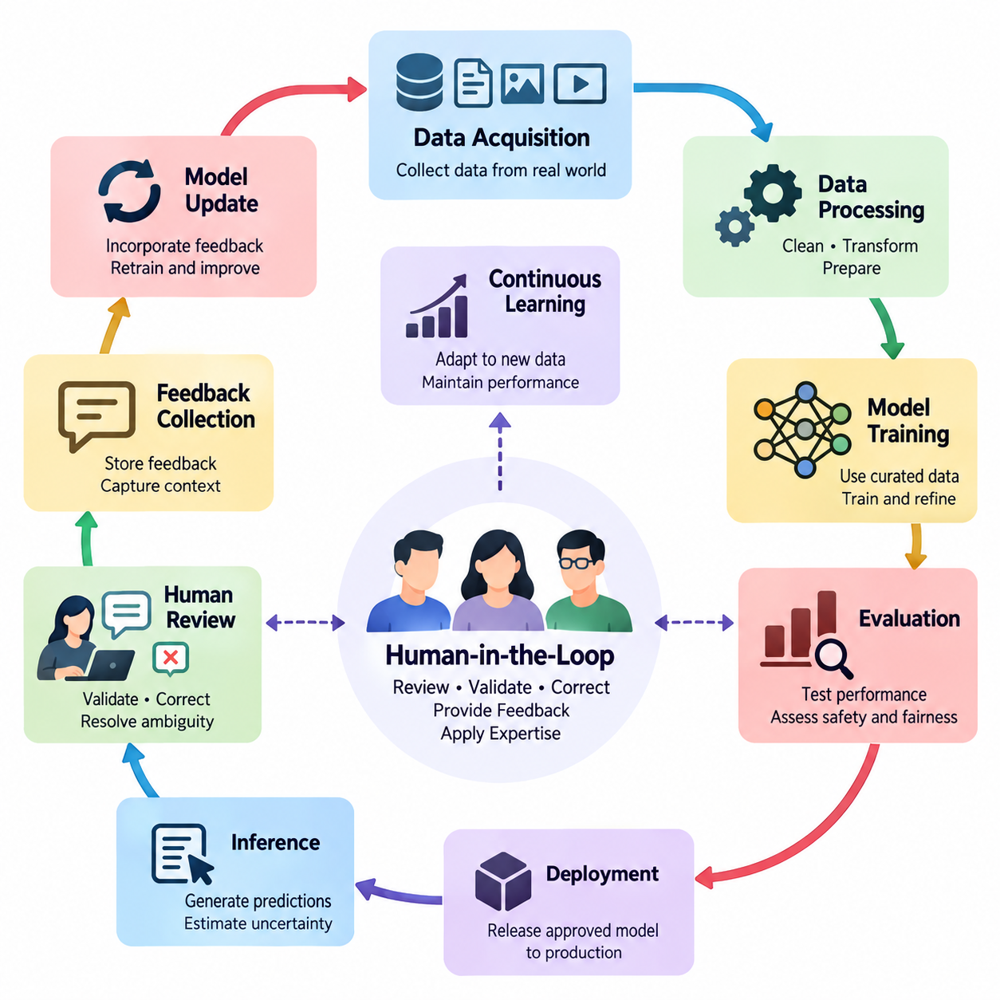
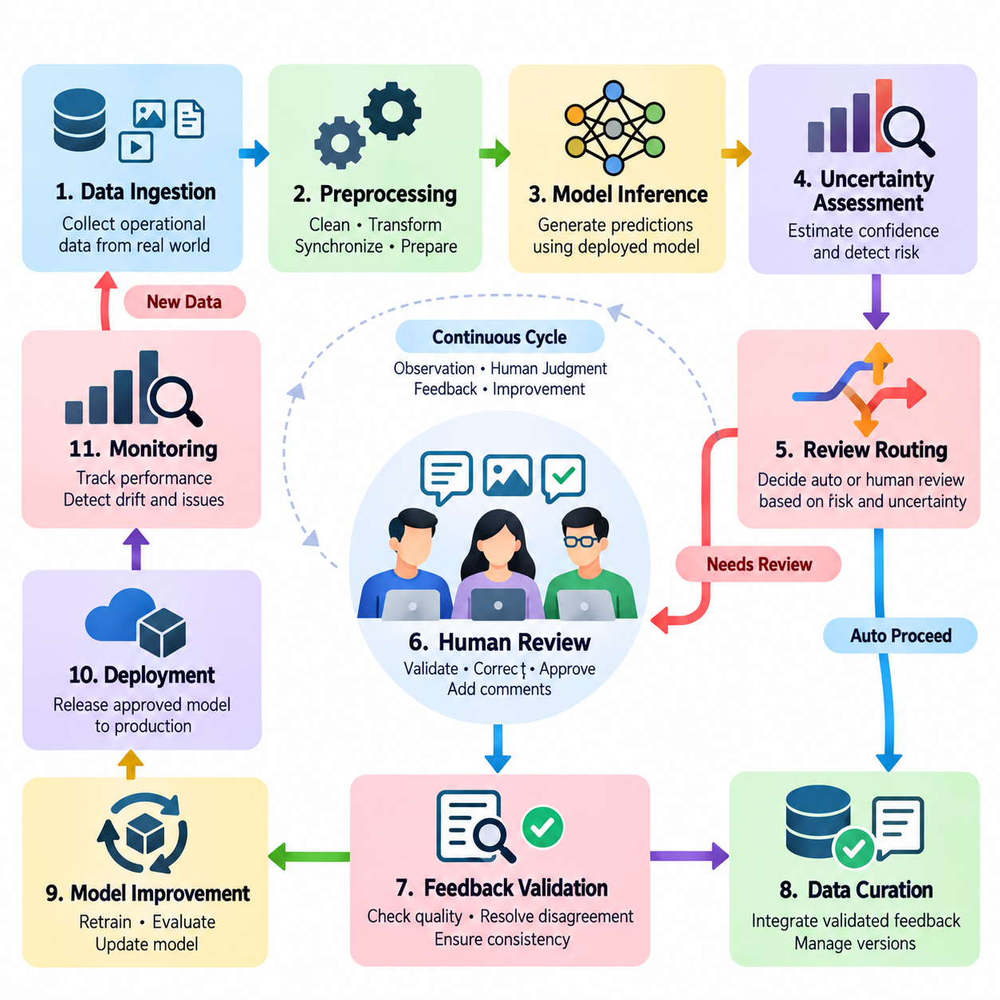
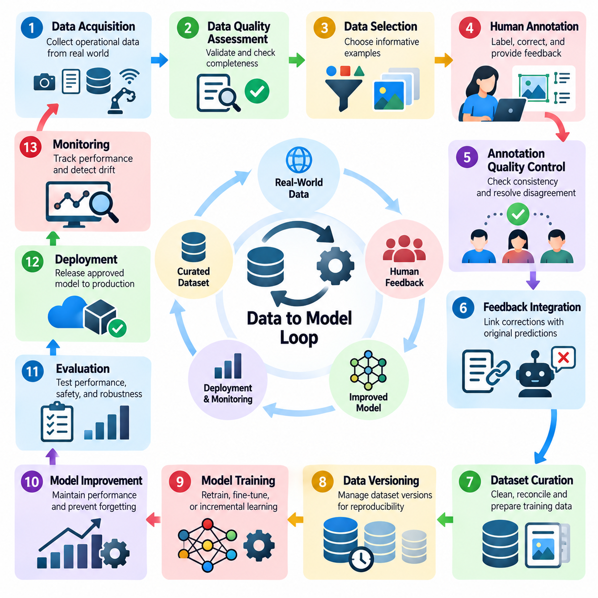
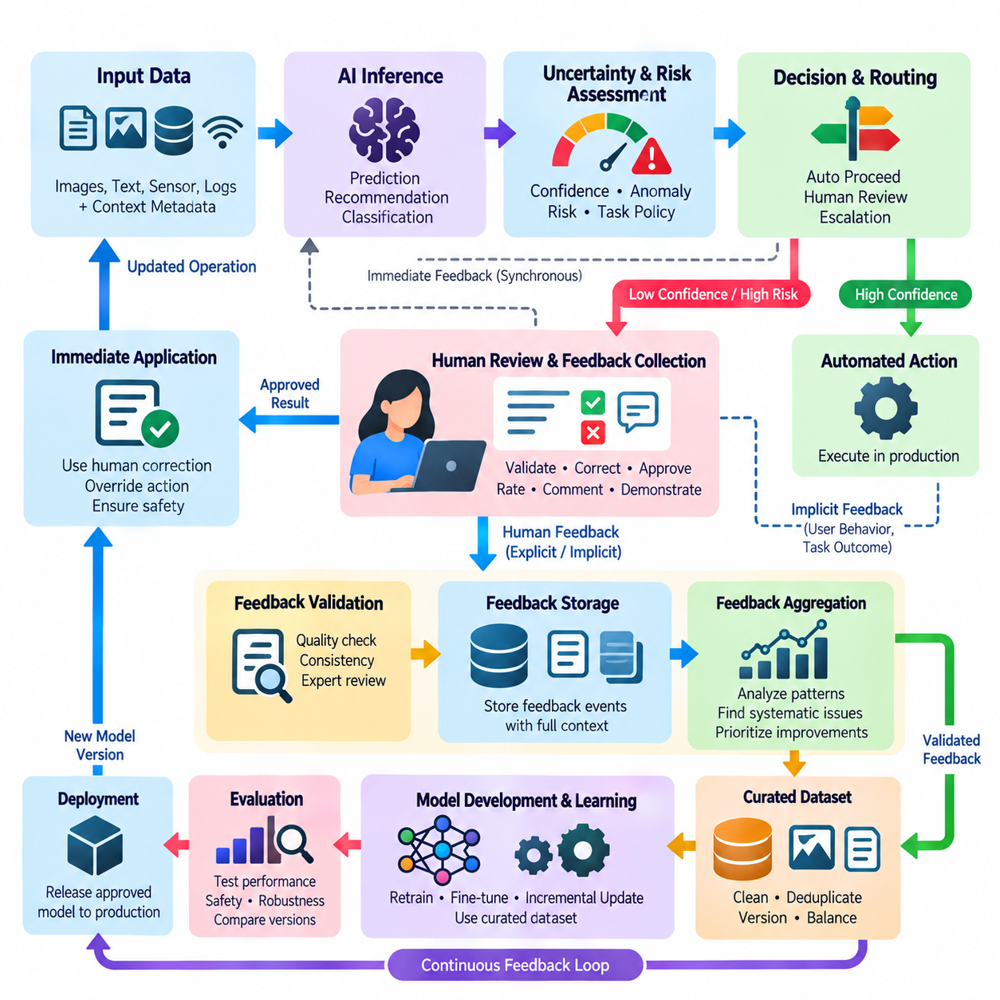
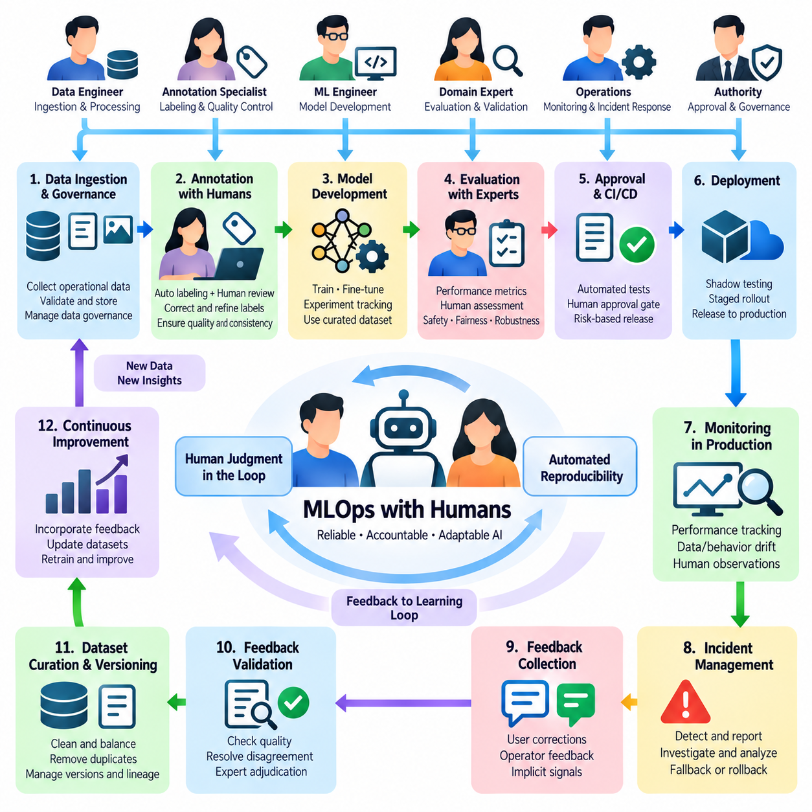
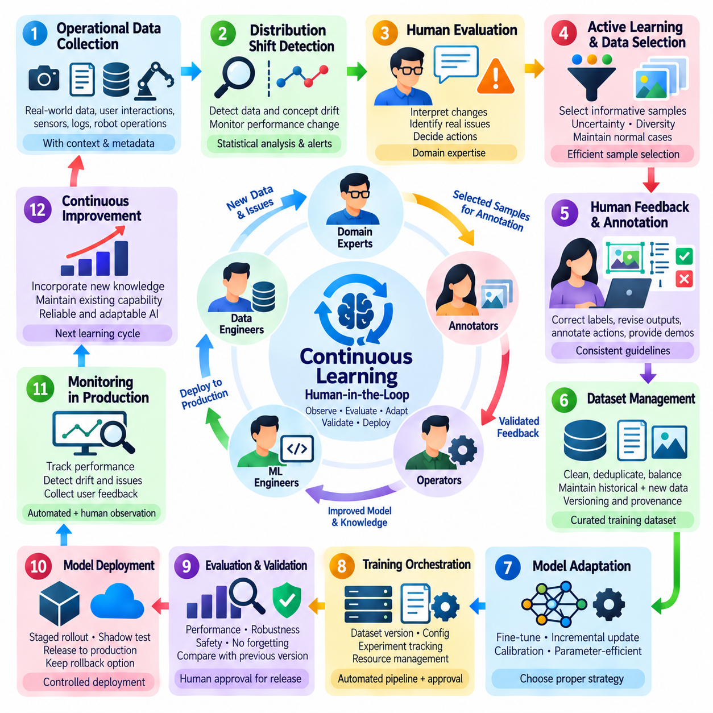
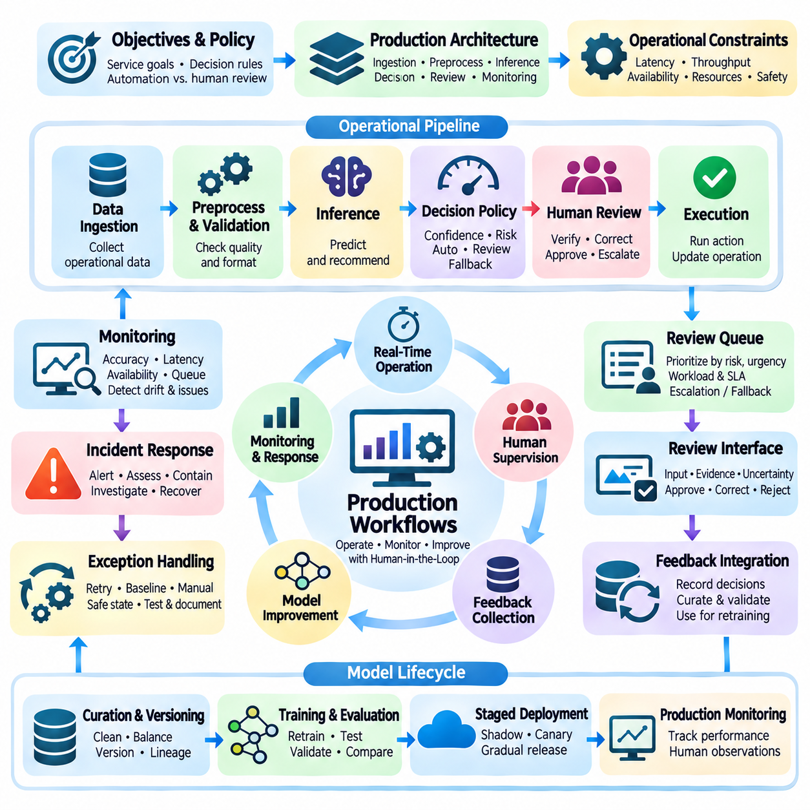
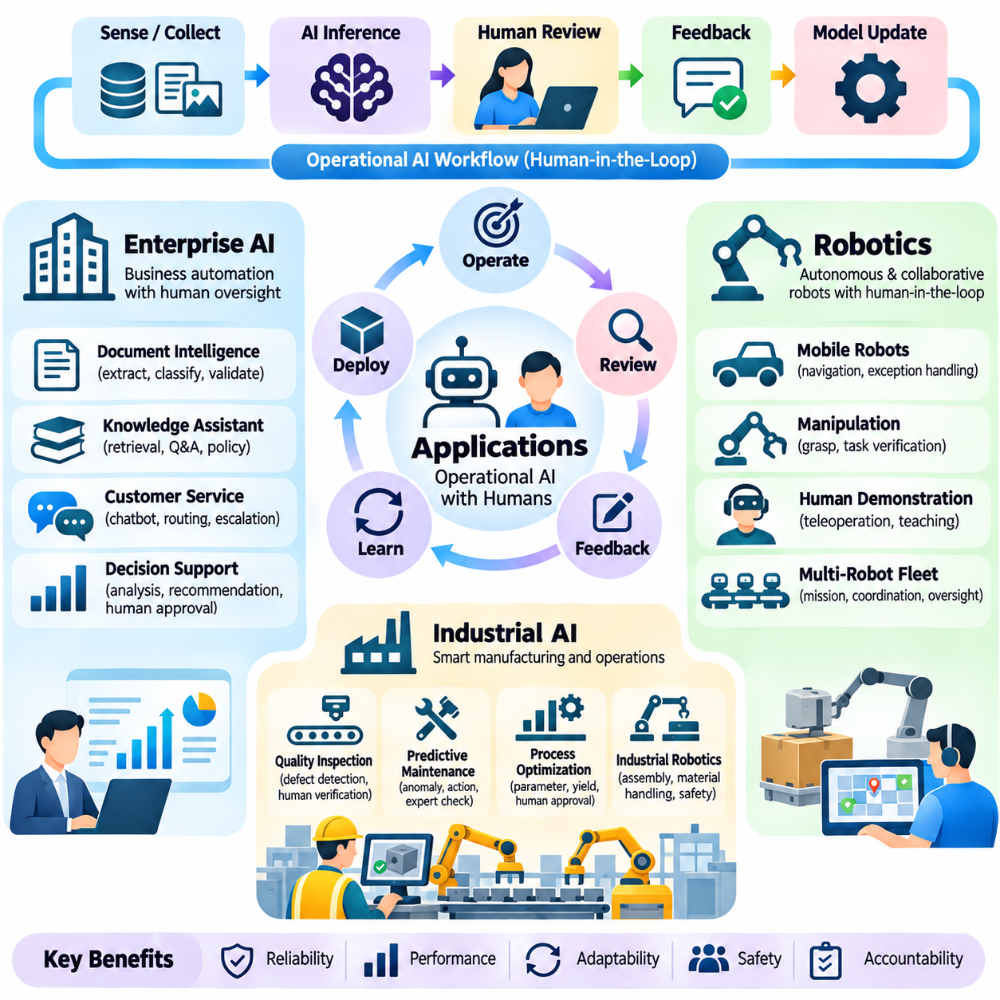

**Volume 41. Human in the Loop Learning**

# 06. Operational AI Workflows

## 06.00 Overview

{width="7.268055555555556in" height="7.268055555555556in"}

Operational AI workflows transform human-in-the-loop learning from an isolated training technique into a coordinated process that supports reliable artificial intelligence throughout its lifecycle. These workflows connect data acquisition, human annotation, model training, evaluation, deployment, monitoring, and feedback collection. Their central objective is to ensure that human expertise remains available wherever automated decisions require correction, validation, or contextual judgment.

Traditional machine learning pipelines often assume that datasets are prepared before training and that deployed models operate with limited human intervention. Operational human-in-the-loop systems replace this linear assumption with a continuous cycle of observation, assessment, correction, and improvement. Human participants contribute not only during initial development but also throughout production, allowing AI systems to respond to changing environments, evolving requirements, and previously unseen situations.

An operational workflow begins by defining the responsibilities of human operators, automated models, and supporting infrastructure. Routine decisions with sufficiently high confidence may be processed automatically, while uncertain, ambiguous, or potentially harmful outcomes are directed toward human review. This allocation of responsibilities must consider prediction confidence, operational risk, review costs, response deadlines, and the consequences of incorrect decisions.

Human-in-the-loop pipeline design establishes the architecture through which information moves between automated processing stages and human decision points. A typical pipeline includes data ingestion, preprocessing, inference, uncertainty estimation, review assignment, human correction, and feedback storage. Each stage requires clearly defined inputs, outputs, quality requirements, and failure-handling procedures to ensure that human participation improves system reliability rather than introducing operational bottlenecks.

The data-to-model loop connects production observations with the datasets used to train and refine AI models. New observations may reveal classification errors, distribution shifts, missing categories, or insufficient representation of rare events. Selected examples are reviewed and labeled by human specialists before entering curated training datasets. Subsequent model updates are evaluated against established benchmarks to determine whether the additional information produces measurable improvements.

Effective data-to-model workflows require more than simply adding corrected examples to a training collection. Data provenance, annotation consistency, dataset versioning, and separation between training and evaluation samples are essential for maintaining experimental validity. Without these controls, repeated feedback cycles may introduce duplicate records, contradictory labels, or evaluation leakage, making apparent improvements difficult to distinguish from genuine generalization.

Feedback loop integration provides the mechanisms through which human observations influence automated behavior. Feedback may consist of corrected labels, preference comparisons, numerical ratings, error reports, or direct modifications to proposed actions. These signals differ in reliability, precision, and interpretation. An operational system must therefore preserve the context of each feedback event and determine how it should influence subsequent learning or decision-making.

Feedback collection interfaces should be designed around the actual responsibilities and cognitive limitations of human reviewers. Clear presentation of model predictions, supporting evidence, uncertainty indicators, and available correction options helps reviewers make informed decisions. Excessive information, confusing controls, and poorly timed review requests can increase cognitive workload. Interface quality consequently becomes an important component of learning efficiency and operational safety.

Human participation also requires explicit mechanisms for resolving disagreement. Different reviewers may interpret ambiguous evidence differently, particularly when tasks involve subjective judgments or incomplete observations. Operational workflows can address these differences through reviewer calibration, consensus procedures, expert escalation, and adjudication. Disagreement records should be retained because they may reveal unclear annotation policies, systematic biases, or genuine uncertainty in the underlying task.

MLOps with humans extends conventional machine learning operations by incorporating human review into automated development and deployment pipelines. Model registries, experiment tracking, data validation, continuous integration, and deployment controls must interact with annotation services and feedback management systems. Human approval may be required before introducing significant model changes, particularly when performance, safety, or regulatory requirements demand documented accountability.

A production-ready workflow should maintain traceability between a model prediction, the data that produced it, any subsequent human correction, and the model version responsible for the decision. This traceability enables engineers to reconstruct incidents, identify recurring failure patterns, and evaluate the effects of retraining. Audit records should distinguish original automated outputs from human-modified results so that operational performance and human intervention effectiveness can be assessed independently.

Continuous learning allows deployed AI systems to incorporate relevant new information without requiring complete redevelopment. However, continuous learning does not imply that every feedback event should immediately modify a production model. Uncontrolled updates can introduce instability, catastrophic forgetting, or unintended behavioral changes. Reliable systems separate feedback acquisition from model promotion and apply validation gates before revised models become operational.

The frequency of model updates depends on application requirements, feedback volume, computational resources, and acceptable operational risk. Some systems benefit from scheduled retraining using accumulated reviewed examples, while others require rapid adaptation to changing conditions. In either case, evaluation should consider performance on recent observations and previously established reference datasets. This combination helps detect improvements in emerging situations without overlooking degradation in familiar operating conditions.

Production workflows introduce additional constraints involving latency, throughput, availability, and service continuity. Human review may take seconds, minutes, or considerably longer depending on task complexity and reviewer availability. Workflow orchestration must therefore distinguish decisions that can wait for human confirmation from those requiring immediate automated handling. Queuing policies, deadlines, fallback behavior, and escalation procedures should be defined before deployment.

Risk-sensitive applications require particular attention to the relationship between automation and human authority. A human reviewer should have sufficient information, time, and practical control to intervene meaningfully. Merely displaying an automated recommendation does not guarantee effective oversight. Systems must specify when decisions are advisory, when explicit authorization is mandatory, and when predefined safety mechanisms should prevent an action regardless of model confidence.

Operational monitoring evaluates both automated model performance and the effectiveness of human participation. Useful measurements include error rates, review frequency, correction acceptance, reviewer agreement, feedback processing time, and the cost of obtaining reliable annotations. Additional measurements may examine escalation delays, unresolved cases, model drift, and the proportion of automated decisions requiring intervention. These indicators help determine whether the combined workflow remains sustainable.

Human effort must be treated as a limited operational resource rather than an unlimited source of supervision. Reviewing every prediction may be economically impractical and can create fatigue that reduces annotation quality. Selective review strategies prioritize cases with high uncertainty, high expected information value, or significant operational consequences. Workload balancing and reviewer specialization further improve efficiency by matching difficult cases with appropriate expertise.

Enterprise AI applications illustrate how operational human-in-the-loop workflows support document processing, customer service, knowledge management, and business decision support. Automated systems may extract information, classify requests, or generate recommendations, while employees validate exceptions and correct inaccurate outputs. These corrections can improve future model behavior when incorporated through controlled learning pipelines, reducing repetitive work while preserving accountability for consequential decisions.

Robotics applications require tighter integration between human feedback and physical system behavior. Autonomous robots may encounter unfamiliar obstacles, uncertain localization, manipulation failures, or changing environmental conditions. Human supervisors can review observations, modify task objectives, approve recovery actions, or provide demonstrations. Because physical actions may have irreversible consequences, intervention mechanisms must account for communication latency, robot dynamics, and immediate safety constraints.

Industrial AI workflows combine automated perception and prediction with domain-specific engineering expertise. Quality inspection systems may flag uncertain defects for specialist review, while predictive maintenance models may request confirmation from equipment technicians. Human corrections become valuable training evidence when linked to sensor measurements, operating conditions, equipment identity, and maintenance outcomes. This contextual information helps distinguish genuine anomalies from normal operational variation.

Operational AI systems must also address security, privacy, and organizational governance. Human reviewers should access only the information necessary for their assigned responsibilities, and sensitive records should be protected throughout feedback collection and storage. Role-based authorization, secure communication, retention policies, and audit mechanisms support responsible operation. Governance procedures should additionally establish ownership of model updates, escalation decisions, and unresolved safety concerns.

The long-term effectiveness of operational human-in-the-loop learning depends on coordinating technical automation with organizational processes. Data engineers, machine learning specialists, domain experts, reviewers, and operational managers must share consistent definitions of quality, responsibility, and success. Clear procedures for reviewing failures, updating annotation policies, validating models, and approving deployment changes transform individual corrections into systematic improvements.

The following sections develop this operational perspective through human-in-the-loop pipeline design, data-to-model loops, feedback integration, human-centered MLOps, continuous learning, and production workflow management. Enterprise AI, robotics, and industrial AI provide application contexts for examining these principles. Together, these topics establish a foundation for building adaptive AI systems that combine automated scalability with human expertise, oversight, and accountable decision-making.

## 06.01 HITL Pipeline Design

{width="7.268055555555556in" height="7.268055555555556in"}

Human-in-the-loop (HITL) pipeline design establishes a systematic architecture for integrating human judgment into automated artificial intelligence processes. Unlike conventional pipelines that primarily transfer data between computational components, HITL pipelines coordinate machine predictions, human evaluations, corrective actions, and learning updates. Their primary purpose is to improve reliability, adaptability, and accountability while preserving the efficiency advantages of automation.

A well-designed HITL pipeline begins with clearly defined operational objectives and decision boundaries. System architects must identify which tasks can be automated, which require human verification, and which demand direct human authorization. These decisions depend on model confidence, operational risk, task complexity, regulatory requirements, and available human expertise. The resulting architecture should balance automated throughput with the quality and timeliness of human intervention.

The fundamental pipeline typically includes data ingestion, preprocessing, model inference, uncertainty assessment, human review, feedback validation, data curation, and model improvement. These stages form a continuous operational cycle rather than a strictly linear sequence. Each component exchanges structured information through defined interfaces, enabling observations and corrections to influence subsequent decisions without disrupting ongoing production activities.

Data ingestion provides the initial connection between operational environments and the HITL system. Incoming information may consist of images, text, sensor measurements, transaction records, or robot observations. Before processing, data should be checked for completeness, consistency, timestamps, source identity, and structural validity. Reliable ingestion mechanisms preserve contextual metadata so that human reviewers can interpret model predictions within their original operational conditions.

Preprocessing transforms incoming observations into representations suitable for automated inference and human inspection. Typical operations include normalization, filtering, synchronization, feature extraction, and format conversion. However, transformations must preserve information relevant to human judgment and downstream learning. Excessive preprocessing may remove subtle anomalies, contextual relationships, or physical characteristics that are essential for accurate review and correction.

The inference stage generates predictions, classifications, recommendations, or proposed actions using the deployed AI model. Each output should be associated with its originating input, model version, execution timestamp, and relevant confidence information. This metadata supports traceability and enables later analysis of incorrect decisions. In operational systems, inference results should also include sufficient contextual evidence to support meaningful human verification.

Uncertainty assessment determines whether an automated output can proceed independently or requires additional review. Common approaches include predictive confidence, entropy, ensemble disagreement, anomaly scores, and out-of-distribution detection. These indicators provide different perspectives on model uncertainty and should not be treated as interchangeable. Thresholds must be calibrated against observed performance, operational consequences, and the costs associated with human intervention.

Human review routing converts uncertainty and risk assessments into actionable workflow decisions. High-confidence, low-risk outputs may proceed automatically, while ambiguous or consequential cases are assigned to qualified reviewers. Routing policies can consider reviewer specialization, workload, task urgency, and historical agreement. Effective assignment mechanisms prevent excessive review queues while ensuring that difficult cases receive appropriate attention.

The human review interface represents a critical interaction boundary between automated intelligence and domain expertise. Reviewers should receive the original observation, model output, supporting evidence, and clearly defined correction options. Interfaces should distinguish confirmed information from uncertain predictions and avoid presenting model suggestions as unquestionable conclusions. Thoughtful interaction design reduces cognitive burden and supports consistent, defensible judgments.

Human feedback may take the form of corrected labels, revised predictions, preference rankings, approval decisions, or direct demonstrations. Each feedback event should be recorded with sufficient metadata to identify its source, context, and relationship to the original model output. Structured feedback schemas simplify downstream processing and enable different forms of human input to be incorporated into appropriate learning and evaluation procedures.

Feedback validation ensures that human corrections meet established quality requirements before they influence training datasets or operational decisions. Validation mechanisms may include consistency checks, reviewer agreement, expert adjudication, and automated constraint verification. Human feedback is not inherently error-free, particularly when tasks involve ambiguity or specialized knowledge. Quality assurance procedures must therefore evaluate both machine-generated outputs and human-provided corrections.

Data curation transforms validated feedback into reusable learning resources. Corrected examples are associated with their original observations, annotation histories, operational contexts, and dataset versions. Duplicate detection, label reconciliation, and provenance tracking help maintain dataset integrity. Carefully managed curation prevents feedback loops from accumulating contradictory evidence and supports reproducible experiments across successive model generations.

The model improvement stage uses curated feedback to refine predictive behavior through supervised learning, active learning, preference optimization, or other suitable methods. Training procedures should reflect the nature and reliability of the collected feedback rather than assuming that all corrections provide equivalent information. Updated models must undergo independent validation before deployment, ensuring that improvements on reviewed cases do not conceal broader performance degradation.

Pipeline orchestration coordinates the timing, dependencies, and execution states of automated and human activities. Workflow engines may manage asynchronous review queues, retries, deadlines, notifications, and escalation paths. Because human response times differ substantially from computational processing times, orchestration must accommodate delayed feedback without blocking unrelated operations. Clear state transitions also prevent incomplete reviews from being mistaken for approved decisions.

Operational resilience requires explicit handling of missing feedback, unavailable reviewers, communication failures, and unexpected model behavior. Depending on application risk, the system may defer a decision, request alternative review, revert to a validated baseline, or enter a predefined safe state. Failure-handling policies should be established before deployment and tested under realistic conditions. Such mechanisms are particularly important when automated outputs influence physical equipment or consequential decisions.

HITL pipeline design must distinguish immediate operational correction from long-term model learning. A reviewer may correct an individual prediction without authorizing any modification to the deployed model. Conversely, accumulated corrections may later support controlled retraining and validation. Separating these pathways prevents unverified feedback from producing uncontrolled behavioral changes and enables organizations to maintain stable production systems while continuously improving their models.

Scalability becomes increasingly important as the number of observations, models, and reviewers grows. Effective architectures use selective sampling, priority-based review, workload distribution, and asynchronous processing to limit unnecessary human effort. Resource allocation should account for both computational capacity and human availability. A scalable HITL system increases automated processing volume without requiring human review effort to grow proportionally with every additional prediction.

Monitoring provides continuous visibility into pipeline performance and human participation. Relevant indicators include review rates, correction frequencies, processing latency, reviewer agreement, queue length, model accuracy, and feedback utilization. These measurements reveal whether human intervention produces meaningful improvements and whether operational constraints are being satisfied. Monitoring should also detect changes in data distributions and review workloads that may require workflow adjustments.

Security and governance requirements extend across every pipeline component. Access controls should restrict sensitive observations to authorized personnel, while audit records document prediction histories, review decisions, and model changes. Data retention policies and privacy protections must apply to both automated outputs and human-generated feedback. Clear accountability structures define responsibility for approving corrections, resolving disputes, and authorizing deployment of updated models.

In enterprise applications, HITL pipelines support document processing, customer service, financial analysis, and decision-support workflows by routing uncertain outputs to knowledgeable employees. In robotics, they enable operators to inspect navigation failures, approve recovery strategies, and correct perception results. Industrial applications use similar mechanisms for defect inspection, equipment monitoring, and process optimization, where expert judgment contributes to reliable operation under changing conditions.

The effectiveness of a HITL pipeline ultimately depends on the coordination of data engineering, model inference, uncertainty estimation, human interaction, feedback management, and operational governance. Each component must support traceability, controlled improvement, and measurable performance. A carefully designed pipeline transforms isolated human corrections into a sustainable learning process, allowing AI systems to become more capable while maintaining human oversight and operational reliability.

## 06.02 Data to Model Loop [w/Code]

{width="7.268055555555556in" height="7.268055555555556in"}

The data-to-model loop is a fundamental mechanism in human-in-the-loop learning that transforms operational observations and human feedback into measurable improvements in artificial intelligence systems. Rather than treating model training as a one-time activity, this approach establishes a continuous relationship between data collection, human annotation, dataset refinement, model optimization, and deployment. Its purpose is to maintain adaptability while preserving reliability and accountability.

Traditional machine learning pipelines often depend on static datasets collected before model development. Once deployed, these models may encounter unfamiliar conditions, changing user behavior, or previously unrepresented situations. The data-to-model loop addresses these limitations by capturing operational evidence and incorporating selected observations into subsequent learning cycles. Human expertise helps determine which examples are meaningful and how they should influence model behavior.

The loop begins with data acquisition from production environments, user interactions, automated sensors, or operational monitoring systems. Incoming observations may include images, text, numerical measurements, event logs, and robot trajectories. Each observation should retain contextual metadata such as timestamps, source identifiers, environmental conditions, and model versions. These records establish the foundation for interpreting errors and reconstructing decisions.

Data quality assessment determines whether collected observations are suitable for further processing. Missing values, corrupted records, inconsistent formats, duplicated samples, and synchronization errors can undermine subsequent learning. Automated validation mechanisms identify obvious defects, while human specialists examine ambiguous or domain-specific inconsistencies. Preserving original observations alongside processed representations supports traceability and later investigation.

Not every collected observation should enter the annotation process. Data selection mechanisms prioritize examples according to uncertainty, diversity, operational relevance, and expected learning value. Active learning strategies can identify samples for which human labels are particularly informative. However, selection policies must also preserve representative coverage of routine conditions, preventing the training dataset from becoming excessively concentrated on difficult or unusual cases.

Human annotation converts selected observations into structured learning signals. Depending on the application, reviewers may assign classification labels, correct bounding boxes, validate generated responses, rank alternatives, or annotate robot actions. Clear annotation guidelines are necessary to maintain consistency across reviewers and time. The system should also preserve reviewer identity, annotation timestamps, confidence assessments, and relevant contextual explanations.

Annotation quality control evaluates whether human-provided information is sufficiently reliable for model improvement. Inter-annotator agreement, expert adjudication, consistency checks, and targeted reinspection can identify ambiguous or contradictory labels. Disagreements should not automatically be interpreted as reviewer errors because they may reflect genuine uncertainty. Recording such cases helps refine annotation policies and improve future data collection.

Feedback integration connects validated human annotations with their originating model predictions and operational contexts. Each correction should identify the original input, predicted output, corrected result, and reason for modification when available. This association enables error analysis and supports targeted model improvements. Structured feedback records also make it possible to distinguish isolated mistakes from systematic weaknesses affecting particular environments or user groups.

Dataset curation transforms validated observations into coherent training resources. Curation procedures address duplicate removal, label reconciliation, class balance, metadata completeness, and dataset versioning. Historical examples should remain available when necessary to preserve previously acquired capabilities. A well-managed dataset maintains explicit relationships between raw observations, processed samples, annotations, and the model versions that generated them.

Data versioning provides reproducibility across successive learning cycles. Each training run should reference an identifiable dataset snapshot, annotation policy, preprocessing configuration, and selection procedure. Without these records, performance differences between model versions may be difficult to explain. Versioned datasets also support rollback, auditing, and systematic comparison when newly incorporated feedback produces unexpected outcomes.

The transition from curated data to model training requires deliberate decisions about learning strategy. Depending on feedback volume and model architecture, organizations may perform full retraining, incremental learning, fine-tuning, or parameter-efficient adaptation. Training objectives should reflect the reliability and meaning of available labels. Sampling weights and loss functions may also require adjustment when selected feedback differs substantially from the production distribution.

Continuous model improvement introduces the risk of catastrophic forgetting, overfitting, and unintended changes in behavior. A model optimized primarily on recently corrected examples may lose accuracy on previously well-supported tasks. Mitigation strategies include replaying representative historical samples, regularization, balanced training mixtures, and independent validation. These techniques help maintain existing capabilities while incorporating useful new information.

Evaluation is the critical boundary between model improvement and operational deployment. Updated models should be tested against stable reference datasets, recent production samples, and relevant edge cases. Performance comparisons must consider accuracy, calibration, robustness, fairness, latency, and application-specific safety requirements. Improvements on selected feedback samples alone do not establish that a new model is suitable for production.

Human evaluation remains important when automated metrics cannot fully capture task quality or operational consequences. Domain experts may examine representative outputs, compare model behavior, and assess whether corrections improve practical usefulness. In robotics and industrial systems, evaluation may additionally involve simulation, controlled physical trials, and safety verification. Human approval should be required when deployment decisions exceed predefined risk thresholds.

Deployment closes one learning cycle while initiating the next. A validated model may be introduced through staged rollout, shadow testing, or controlled replacement of an existing version. Monitoring systems compare observed behavior with expected performance and detect emerging failures. New observations then become candidates for data selection and human review, establishing the recurring relationship between production experience and model development.

Operational monitoring should distinguish model errors from data pipeline failures and environmental changes. A sudden increase in incorrect predictions may result from sensor degradation, preprocessing inconsistencies, distribution shifts, or genuine model limitations. Root-cause analysis prevents unnecessary retraining when the underlying problem lies elsewhere. Human specialists contribute contextual knowledge that automated monitoring systems may not possess.

The effectiveness of the data-to-model loop depends on balancing learning benefits against annotation costs and computational requirements. Useful indicators include model improvement per reviewed sample, annotation turnaround time, retraining frequency, data processing latency, and performance stability. These measurements support decisions about when to collect additional labels, initiate training, or stop an unproductive feedback cycle.

Automation improves operational efficiency by coordinating data ingestion, sample selection, annotation queues, dataset validation, training jobs, and evaluation reports. Workflow orchestration systems can maintain dependencies and record execution outcomes across these stages. However, automation should not eliminate human checkpoints where interpretation, quality assurance, or deployment authorization is necessary. The objective is coordinated intelligence rather than unrestricted automation.

Security and governance requirements apply throughout the loop because operational observations and human feedback may contain sensitive information. Access controls, data minimization, retention policies, and audit trails help protect information while preserving learning traceability. Organizations must also define responsibility for annotation standards, dataset approval, model validation, and production promotion. These controls support accountable continuous improvement.

Enterprise AI systems use data-to-model loops to improve document extraction, customer support, recommendation quality, and decision assistance. Robotics applications transform navigation failures, manipulation corrections, and operator demonstrations into learning examples. Industrial AI systems incorporate reviewed inspection results, equipment anomalies, and maintenance outcomes. Although these applications differ operationally, they share the same principle of converting verified experience into controlled model improvement.

A mature data-to-model loop integrates data engineering, active learning, human feedback, dataset governance, model training, evaluation, and deployment into a traceable operational process. Its success is measured not by the quantity of accumulated feedback but by reliable improvements in real-world performance. By maintaining disciplined validation and human oversight, the loop enables AI systems to evolve with changing conditions without sacrificing stability, reproducibility, or operational trust.

## 06.03 Feedback Loop Integration [w/Code]

{width="7.268055555555556in" height="7.268055555555556in"}

Feedback loop integration is a central component of human-in-the-loop learning that connects human observations, corrections, and evaluations with automated AI decision-making. It establishes structured pathways through which operational feedback can influence immediate outputs, future predictions, and model development. Effective integration ensures that human expertise contributes to continuous improvement without compromising system stability, accountability, or operational efficiency.

A feedback loop begins when an AI system produces a prediction, recommendation, classification, or proposed action. The output may be accepted automatically, reviewed by a human, or escalated according to predefined conditions. Human feedback becomes particularly valuable when predictions are uncertain, operational consequences are significant, or contextual knowledge is unavailable to the model. The workflow must define how feedback is requested, captured, interpreted, and applied.

Feedback integration distinguishes between explicit and implicit signals. Explicit feedback includes corrected labels, approval decisions, numerical ratings, preference rankings, and written explanations. Implicit feedback may be inferred from user behavior, task completion, repeated corrections, or operator interventions. Because implicit signals can have multiple interpretations, they require careful validation before being treated as reliable evidence of model performance or user preferences.

The architecture of a feedback integration system typically connects inference services, feedback interfaces, event storage, validation components, and learning pipelines. Each component performs a distinct responsibility while exchanging structured records through defined interfaces. This separation allows feedback to be collected continuously without requiring immediate model updates. It also supports independent scaling of inference workloads, human review operations, and training infrastructure.

Feedback events should contain sufficient information to reconstruct the circumstances surrounding a decision. Relevant fields include the original input reference, model identifier, prediction, confidence estimate, reviewer response, timestamp, and operational context. Additional metadata may describe task priority, environmental conditions, and the reason for correction. Consistent event schemas enable reliable processing, auditing, and comparison across successive model versions.

Feedback collection interfaces determine how efficiently human participants can communicate corrections. Reviewers should receive understandable predictions, relevant evidence, and clearly defined response options. Interface designs must avoid encouraging automatic acceptance of model recommendations, particularly when outputs are uncertain. Clear uncertainty indicators, accessible correction controls, and concise explanations help reduce cognitive workload and improve feedback quality.

Feedback routing determines which observations require human attention and which can proceed through automated processing. Routing decisions may combine confidence thresholds, anomaly detection, risk classification, and task-specific policies. High-risk cases may require mandatory review even when confidence is high. Efficient routing also considers reviewer availability, specialization, response deadlines, and the operational consequences of delayed decisions.

The timing of feedback introduces important architectural considerations. Synchronous feedback requires human confirmation before a decision proceeds, making it appropriate for selected high-consequence operations. Asynchronous feedback allows the system to continue while corrections are collected for later analysis. Hybrid workflows combine both approaches, using immediate intervention for critical decisions and delayed review for model improvement or quality monitoring.

Feedback validation protects the learning process from inaccurate, inconsistent, or malicious inputs. Automated checks can identify missing fields, invalid labels, contradictory records, and violations of domain constraints. Human adjudication may be necessary when reviewers disagree or contextual interpretation is required. Validation policies should reflect the reliability of feedback sources and the potential consequences of incorporating incorrect corrections.

Human disagreement provides useful information about task ambiguity and model limitations. When multiple reviewers produce different judgments, the system should preserve their individual responses rather than immediately discarding minority opinions. Consensus procedures, expert escalation, and uncertainty-aware labeling can help resolve conflicts. Persistent disagreement may indicate unclear annotation guidelines, insufficient evidence, or inherently subjective evaluation criteria.

Feedback aggregation transforms individual observations into patterns suitable for operational analysis and learning. Repeated corrections may reveal systematic classification errors, environmental weaknesses, or recurring failures associated with particular user groups or operating conditions. Aggregation methods should account for reviewer reliability, sample frequency, and contextual differences. Otherwise, frequently observed but low-impact errors may dominate improvement priorities.

Immediate feedback application must be distinguished from long-term model adaptation. A human correction may modify a single output, approve a proposed action, or prevent an unsafe operation without changing model parameters. Long-term adaptation instead uses accumulated validated feedback to construct training datasets and optimize future model behavior. Maintaining separate pathways reduces the risk of uncontrolled updates and supports predictable production performance.

The feedback-to-learning pathway converts validated records into reusable training examples. This process may include deduplication, label reconciliation, contextual filtering, and dataset versioning. Feedback samples should remain linked to their originating predictions and operational conditions. Such relationships support targeted error analysis and help determine whether model improvements generalize beyond the specific cases that triggered human intervention.

Integration with MLOps enables feedback to participate in established model lifecycle procedures. Workflow orchestration can connect feedback repositories with dataset registries, training pipelines, experiment tracking, evaluation services, and deployment approval mechanisms. Automated triggers may initiate analysis or retraining when sufficient evidence accumulates. However, promotion of an updated model should remain subject to predefined validation and governance requirements.

Feedback loops can support continuous learning, but learning frequency must be controlled. Immediate retraining after every correction may introduce instability, excessive computational costs, and catastrophic forgetting. Scheduled or threshold-based updates allow feedback to accumulate into more representative datasets. Historical examples and independent evaluation sets help preserve existing capabilities while enabling adaptation to emerging operational conditions.

Monitoring feedback effectiveness requires measurements beyond the volume of collected corrections. Useful indicators include review completion time, correction acceptance rate, reviewer agreement, feedback utilization, and model improvement per reviewed example. Operational metrics should also examine queue delays, unresolved cases, and the frequency of human intervention. These measurements reveal whether the feedback process produces meaningful benefits relative to its cost.

Feedback loop integration must address potential selection bias. Cases routed for review often contain unusually difficult or uncertain examples and may not represent the complete production distribution. Training exclusively on such feedback can distort model behavior or degrade performance on routine observations. Representative sampling, unbiased evaluation datasets, and carefully designed weighting strategies help maintain balanced learning across operational conditions.

In robotics, feedback integration connects human supervision with perception, planning, and action execution. Operators may correct object recognition results, modify navigation goals, approve recovery procedures, or provide demonstrations after task failures. Feedback records should preserve relevant sensor observations, robot states, and environmental conditions. Safety-critical interventions must remain separate from slower learning processes so that corrective actions can occur within operational deadlines.

Industrial AI systems apply feedback loops to quality inspection, anomaly detection, predictive maintenance, and process monitoring. Engineers may confirm suspected defects, reject false alarms, or provide explanations for equipment behavior. Linking these corrections with production parameters and sensor histories enables systematic failure analysis. Feedback integration consequently becomes a mechanism for incorporating domain expertise into increasingly reliable industrial automation.

Enterprise AI applications use feedback integration to improve document analysis, customer assistance, recommendation systems, and decision-support tools. Employees can correct extracted information, evaluate generated responses, and identify inappropriate recommendations. These corrections provide valuable evidence for subsequent model refinement. However, feedback collection must respect organizational permissions, confidentiality requirements, and the boundaries of automated decision authority.

A mature feedback integration architecture combines structured event capture, selective human review, validation, aggregation, learning pipelines, and operational monitoring. Its effectiveness depends on preserving the meaning and provenance of human judgments while controlling how those judgments influence automated behavior. By separating immediate correction from validated model improvement, feedback loops enable AI systems to learn from operational experience while maintaining reliability, traceability, and human oversight.

## 06.04 MLOps with Humans

{width="7.268055555555556in" height="7.268055555555556in"}

Machine Learning Operations (MLOps) with humans extends conventional model lifecycle management by integrating human judgment into data preparation, training, evaluation, deployment, and monitoring. Rather than treating people as external reviewers, this approach recognizes them as operational participants in AI governance and improvement. Its objective is to combine automated reproducibility with human expertise, ensuring that models remain reliable, accountable, and adaptable throughout production.

Traditional MLOps emphasizes automated pipelines, version control, continuous integration, and deployment orchestration. Human-centered MLOps preserves these capabilities while introducing structured review points, approval responsibilities, and feedback mechanisms. Human involvement becomes especially important when automated metrics cannot fully represent decision quality, contextual relevance, or operational risk. Effective architectures therefore coordinate computational workflows with human decision-making processes.

The integration begins with clearly defined responsibilities across the model lifecycle. Data engineers manage ingestion and transformation, annotation specialists establish reliable labels, machine learning engineers develop models, and domain experts evaluate practical correctness. Operations personnel monitor deployed behavior, while designated authorities approve consequential changes. Explicit responsibility assignments prevent ambiguous ownership and establish accountable transitions between automated and human activities.

Human participation should be incorporated into pipeline design rather than added after automation has been implemented. Workflow specifications must identify mandatory review stages, escalation conditions, expected response times, and fallback procedures. Each checkpoint should have a documented purpose and measurable acceptance criteria. This structure allows human decisions to influence operational outcomes without introducing unnecessary delays or inconsistent approval practices.

Data governance represents an important foundation for human-centered MLOps. Training datasets may contain incomplete annotations, conflicting labels, distributional imbalances, or sensitive operational information. Human reviewers assess ambiguous records and establish appropriate correction policies. Dataset versions should preserve annotation histories, reviewer decisions, provenance information, and preprocessing configurations so that training outcomes can be reconstructed and audited.

Annotation workflows require coordination between automated labeling systems and human specialists. Machine-generated labels can accelerate processing, but uncertain or high-impact cases require verification. Review interfaces should provide relevant evidence, confidence indicators, and standardized correction options. Quality control mechanisms such as reviewer agreement analysis and expert adjudication help ensure that human feedback contributes consistent information to subsequent model training.

Model development benefits from structured collaboration between automated experimentation and expert interpretation. Training systems can evaluate parameter configurations, compare architectures, and generate performance reports at scale. Human specialists examine unexpected outcomes, identify misleading metrics, and determine whether apparent improvements reflect meaningful operational progress. Experiment tracking should record both computational results and relevant human assessments.

Continuous integration procedures can incorporate human approval gates alongside automated tests. Code validation, dataset integrity checks, reproducibility tests, and model evaluations establish technical readiness. Human reviewers then assess application-specific risks, unresolved limitations, and operational consequences. These approval gates should be risk-based, allowing routine low-impact updates to proceed efficiently while requiring stronger oversight for consequential changes.

Model evaluation must extend beyond aggregate accuracy or benchmark performance. Human-centered MLOps considers robustness, uncertainty calibration, fairness, interpretability, operational usability, and safety requirements. Domain experts can assess cases that automated metrics overlook, including ambiguous outputs and context-dependent failures. Evaluation reports should distinguish measured results from expert judgments and document the evidence supporting deployment decisions.

Deployment management requires coordination between technical validation and organizational authorization. Updated models may enter shadow operation, staged rollout, or controlled production trials before replacing established versions. Human operators should understand the expected changes, known limitations, and available recovery procedures. Release records must identify the deployed model, supporting datasets, evaluation results, approval history, and rollback conditions.

Production monitoring combines automated telemetry with human observations from real operating environments. Monitoring systems detect changes in prediction distributions, processing latency, error frequency, and infrastructure behavior. Human operators contribute contextual information about unusual events, workflow disruptions, or degraded task quality. Integrating these perspectives helps distinguish model weaknesses from sensor failures, data pipeline defects, and environmental changes.

Incident management is a critical responsibility within human-centered MLOps. When a deployed model produces unacceptable behavior, the workflow should support incident reporting, severity classification, escalation, containment, and investigation. Depending on risk, operators may suspend automated decisions, activate fallback procedures, or restore a previously validated model. Incident records should preserve relevant inputs, model outputs, human interventions, and corrective actions.

Human feedback must be connected to controlled improvement mechanisms rather than applied directly to production models without validation. Corrections collected during operation can enter curated datasets, retraining pipelines, and subsequent evaluation cycles. Each transition should preserve traceability between the original observation, reviewer decision, and resulting model change. This separation enables continuous learning while protecting deployed systems from uncontrolled behavioral modifications.

Operational efficiency depends on allocating human attention where it produces the greatest benefit. Selective review policies can prioritize uncertain predictions, safety-relevant events, distribution shifts, and cases with high expected learning value. Reviewer workload, expertise, and availability should influence task assignment. Monitoring review queues and turnaround times helps prevent human checkpoints from becoming bottlenecks that undermine automated processing capacity.

Human-centered MLOps also requires attention to reviewer reliability and organizational consistency. Different specialists may interpret ambiguous cases differently, particularly when evaluation standards are incomplete. Calibration sessions, shared annotation guidelines, disagreement analysis, and expert escalation procedures can improve decision consistency. Reviewer assessments should be treated as evidence requiring quality management rather than unquestionable ground truth.

Security and compliance requirements extend across the complete human-machine workflow. Access controls must restrict sensitive datasets, model artifacts, and review interfaces to authorized participants. Audit trails should document approvals, annotation changes, model promotions, and operational interventions. Data minimization, retention policies, and separation of duties reduce unnecessary exposure while supporting investigation and regulatory accountability.

Governance structures define who can modify datasets, approve training configurations, accept evaluation results, and authorize deployment. These responsibilities may be distributed across technical teams, domain specialists, safety personnel, and management. Approval authority should correspond to operational consequences rather than organizational convenience. Clear governance prevents automated pipeline efficiency from obscuring responsibility for decisions affecting users, equipment, or critical services.

In enterprise AI, human-centered MLOps supports document processing, decision assistance, customer interactions, and knowledge systems. Business specialists validate outputs and contribute feedback about contextual correctness. In robotics, operators and engineers assess navigation failures, manipulation performance, and recovery behavior. Industrial AI applications involve quality engineers, maintenance personnel, and safety specialists who evaluate models against physical operating constraints.

The maturity of human-centered MLOps can be assessed through both technical and organizational indicators. Relevant measures include deployment frequency, rollback rate, model stability, review latency, annotation agreement, incident resolution time, and improvement per human review. These metrics should be interpreted together because faster deployment does not necessarily imply better governance, and extensive review does not automatically produce higher reliability.

A mature MLOps architecture with humans establishes a coordinated system of automated pipelines, expert evaluation, controlled deployment, feedback integration, and accountable governance. Its defining characteristic is not the quantity of human intervention but the placement of meaningful judgment at appropriate decision boundaries. By combining reproducible automation with informed human authority, organizations can sustain AI improvement while preserving operational safety, transparency, and trust.

## 06.05 Continuous Learning

{width="7.268055555555556in" height="7.268055555555556in"}

Continuous learning enables artificial intelligence systems to improve their capabilities as new data, human feedback, and operational experiences become available. Unlike static learning approaches that depend on fixed training datasets, continuous learning establishes recurring cycles of observation, evaluation, adaptation, and validation. In human-in-the-loop environments, human expertise guides these cycles to ensure that model improvements remain relevant, reliable, and aligned with operational objectives.

The fundamental challenge of continuous learning is adapting to changing conditions without degrading previously acquired capabilities. Production environments evolve through new user behaviors, equipment modifications, environmental changes, and emerging task requirements. Models trained on historical distributions may gradually become less effective. Continuous learning addresses this problem by identifying meaningful changes and incorporating verified information into controlled model updates.

Continuous learning should be distinguished from unrestricted online learning. Online learning may update model parameters as individual observations arrive, whereas operational continuous learning can employ scheduled retraining, incremental updates, or periodic fine-tuning. Human-in-the-loop systems often favor controlled update intervals because human validation, safety assessment, and reproducibility are essential. Learning frequency should reflect operational risk and the availability of reliable feedback.

Data collection provides the foundation for continuous adaptation. Deployed systems generate observations, predictions, uncertainty estimates, and operational outcomes that can reveal emerging limitations. These records should preserve timestamps, model versions, environmental conditions, and relevant contextual information. Reliable provenance allows engineers to reconstruct failures and determine whether newly collected examples represent genuine changes or isolated anomalies.

Distribution shift detection identifies changes between training data and current operational observations. Covariate shift, label distribution changes, and concept drift can affect model reliability in different ways. Statistical monitoring, embedding comparisons, and performance measurements help identify suspicious patterns. However, detecting a distribution change does not automatically establish that retraining is necessary, since some changes have little practical impact.

Human evaluation plays an essential role in interpreting detected changes. Domain experts can distinguish genuine operational failures from sensor artifacts, temporary disturbances, or harmless variations. They may also identify new task requirements that automated monitoring cannot recognize. Their judgments help determine whether additional data collection, annotation refinement, model adaptation, or changes to operational procedures are appropriate.

Active learning improves continuous learning efficiency by selecting informative observations for human review. Uncertainty sampling, diversity-based selection, and disagreement analysis can identify cases likely to reveal model weaknesses. However, selection policies must preserve representative examples of normal operation. Combining informative sampling with periodic random sampling reduces the risk of constructing datasets dominated by unusual or difficult observations.

Human feedback transforms selected operational experiences into validated learning signals. Reviewers may correct classifications, revise generated responses, annotate sensor observations, or demonstrate appropriate robot actions. Annotation guidelines and quality assurance procedures help maintain consistency. Feedback records should remain linked to the original model outputs, allowing subsequent training processes to distinguish confirmed errors from ambiguous judgments.

Dataset management is particularly important because continuous learning introduces information from multiple time periods. Training repositories must preserve historical examples, newly validated observations, annotation revisions, and dataset versions. Data curation should address duplication, conflicting labels, and class imbalance. Maintaining representative historical samples helps prevent recent operational experiences from overwhelming previously established knowledge.

Catastrophic forgetting occurs when adaptation to new information reduces performance on earlier tasks or conditions. This problem is especially relevant when incremental learning uses limited recent datasets. Experience replay, regularization, knowledge distillation, and parameter isolation can help preserve established capabilities. The appropriate strategy depends on model architecture, computational resources, task relationships, and the importance of retaining historical performance.

Model adaptation strategies should reflect the scale and urgency of observed changes. Minor distribution shifts may require calibration adjustments or targeted fine-tuning, while substantial changes may justify broader retraining. Parameter-efficient methods can reduce computational demands when only limited adaptation is necessary. Human specialists should evaluate whether observed weaknesses originate from model limitations or upstream data and sensor problems.

Training orchestration coordinates validated datasets, model configurations, computational resources, and experiment tracking. Each learning cycle should record its dataset snapshot, initialization checkpoint, training parameters, evaluation results, and approval history. Automated workflows improve consistency, but critical transitions may require human authorization. This combination supports repeatable improvement while preventing unverified models from entering production.

Evaluation must determine whether newly adapted models improve current performance without introducing unacceptable regressions. Stable reference benchmarks measure retained capabilities, while recent operational datasets assess adaptation to emerging conditions. Stress tests and out-of-distribution evaluations examine robustness. Human reviewers contribute contextual assessments when numerical metrics cannot adequately represent task quality or safety consequences.

Continuous learning requires explicit deployment criteria. A model should not replace its predecessor merely because training loss decreases or performance improves on recently corrected examples. Deployment decisions must consider comparative evaluation, operational latency, resource consumption, and application-specific risks. Shadow deployment, canary releases, and rollback mechanisms provide additional protection during transitions between model versions.

Feedback latency influences how quickly a system can adapt. Some corrections become available immediately, while others require expert investigation or confirmation of long-term outcomes. Learning pipelines must accommodate delayed labels and incomplete feedback without treating missing information as negative evidence. Event-driven processing and versioned feedback repositories help maintain consistent learning histories across asynchronous operational workflows.

Monitoring continues after every model update because adaptation can introduce unexpected behavior. Operational dashboards should track accuracy, calibration, intervention frequency, failure severity, and data distribution changes. Comparisons between successive model versions reveal whether improvements persist under real conditions. When performance deteriorates, operators should be able to suspend updates, restore validated checkpoints, and investigate the underlying causes.

The economic efficiency of continuous learning depends on balancing adaptation benefits with human labor and computational costs. Useful indicators include improvement per annotated example, retraining frequency, review turnaround time, and retained performance on historical tasks. Excessive updates can consume resources without producing meaningful benefits. Organizations should establish update triggers based on measurable operational needs rather than fixed assumptions about learning frequency.

Robotics introduces additional complexity because continuous learning interacts with physical dynamics and safety constraints. Changes in terrain, payload, lighting, or sensor calibration may affect perception and control. Human operators can review navigation failures, validate recovery actions, and contribute demonstrations. Updated policies should undergo simulation and controlled physical testing before broader deployment, with immediate safety mechanisms remaining independent of learning updates.

Industrial AI applications use continuous learning to adapt inspection models, anomaly detectors, and maintenance predictions to evolving production conditions. New materials, equipment wear, process adjustments, and environmental changes can alter observed data distributions. Engineers provide verified defect labels and operational explanations. Controlled retraining allows models to incorporate these changes while maintaining stable quality standards and traceable deployment decisions.

Enterprise AI systems apply continuous learning to document understanding, customer assistance, recommendation, and decision-support tasks. Human feedback identifies inaccurate outputs, outdated knowledge, and changing organizational requirements. Model adaptation must respect data privacy, authorization boundaries, and evaluation standards. Continuous improvement should enhance practical usefulness without allowing unverified user interactions to modify production behavior directly.

A mature continuous learning architecture integrates monitoring, change detection, active learning, human validation, dataset governance, controlled training, evaluation, and deployment into a repeatable operational cycle. Its success depends on learning selectively rather than updating continuously without justification. By preserving historical capabilities and maintaining human oversight, AI systems can adapt to changing environments while sustaining reliability, reproducibility, and operational trust.

## 06.06 Production Workflows

{width="7.268055555555556in" height="7.268055555555556in"}

Production workflows translate human-in-the-loop learning principles into reliable operational processes that support deployed artificial intelligence systems. These workflows coordinate automated inference, human supervision, feedback collection, incident handling, and model improvement under real-world constraints. Their primary objective is to maintain predictable performance while enabling human expertise to intervene when uncertainty, operational risk, or unexpected conditions exceed acceptable boundaries.

A production workflow begins with clearly defined service objectives, operating conditions, and decision responsibilities. System designers must establish which predictions can be processed automatically, which require human verification, and which demand explicit authorization. These boundaries depend on task criticality, model reliability, regulatory obligations, and potential consequences of failure. Well-defined responsibilities prevent ambiguity during routine operation and exceptional events.

Production architecture typically connects data ingestion services, preprocessing components, inference engines, decision policies, human review interfaces, and monitoring systems. Each component exchanges structured information through controlled interfaces and maintains identifiable execution states. Modular design allows individual services to scale or recover independently. It also separates immediate operational decisions from slower feedback processing and model retraining activities.

Incoming production data must be validated before reaching inference services. Validation checks may examine data completeness, timestamps, sensor availability, schema compatibility, and synchronization quality. Invalid or incomplete observations should follow explicit exception-handling procedures rather than silently entering the prediction pipeline. Preserving source metadata and processing histories enables operators to distinguish model failures from upstream data problems.

Inference execution must satisfy operational requirements for latency, throughput, availability, and computational resource consumption. Production systems may use synchronous requests for immediate decisions and asynchronous processing for tasks that tolerate delays. Resource scheduling, batching, caching, and workload isolation can improve efficiency. However, performance optimization must not compromise prediction integrity or the ability to identify which model generated each result.

Decision policies determine how model outputs influence subsequent operations. Confidence thresholds, anomaly indicators, contextual constraints, and risk classifications may be combined to select automated execution, human review, or safe fallback behavior. High confidence does not necessarily imply low risk, particularly when incorrect decisions have severe consequences. Decision policies should therefore incorporate operational impact rather than relying exclusively on predictive uncertainty.

Human review queues connect automated processing with qualified operators. Cases may be prioritized according to urgency, expected impact, uncertainty, and required expertise. Queue management should account for reviewer availability, workload distribution, and maximum acceptable waiting times. When deadlines cannot be satisfied, predefined escalation or fallback procedures should apply. This prevents human supervision from becoming an unpredictable operational bottleneck.

Human review interfaces must present the information necessary for accurate and timely decisions. Operators should receive the original observation, model recommendation, relevant evidence, uncertainty indicators, and available response options. Interfaces should clearly distinguish approval, correction, rejection, and escalation actions. Recording the reviewer decision and its supporting context establishes accountability and creates reusable feedback for later analysis.

Production workflows require careful coordination between synchronous and asynchronous human participation. Synchronous review blocks a consequential action until authorization is received, while asynchronous review examines completed predictions for quality improvement. Hybrid architectures apply immediate supervision to critical decisions and delayed evaluation to lower-risk observations. This separation supports operational responsiveness without sacrificing opportunities for continuous learning.

Exception handling defines system behavior when predictions are unavailable, reviewers cannot respond, or infrastructure components fail. Depending on operational risk, the workflow may retry processing, use a validated baseline, request manual control, or enter a safe state. Recovery procedures should be tested before deployment and documented for operators. In physical AI systems, emergency stopping and protective controls must remain independent of model retraining processes.

Monitoring provides continuous visibility into production performance and operational health. Relevant measurements include prediction accuracy, inference latency, service availability, review frequency, queue delays, and intervention outcomes. Monitoring should also examine input distributions, confidence calibration, and unusual failure patterns. Combining automated telemetry with human observations helps identify emerging problems before they cause widespread operational degradation.

Incident response connects monitoring alerts with accountable corrective action. Significant failures should trigger severity assessment, notification, containment, investigation, and recovery procedures. Incident records should preserve relevant inputs, model versions, predictions, operator decisions, and system states. Root-cause analysis must distinguish model defects from infrastructure failures, data corruption, and environmental changes before corrective measures are selected.

Feedback collection transforms production experience into evidence for subsequent model improvement. Human corrections, rejected recommendations, task failures, and successful recoveries may become candidates for annotation and training. Feedback events should retain provenance and links to their original operational contexts. Validation and curation must occur before these records enter learning datasets, preventing unverified observations from directly modifying deployed models.

Model updates should follow controlled release procedures rather than automatically replacing production systems after retraining. Candidate models require independent evaluation against historical benchmarks, recent observations, and application-specific safety criteria. Shadow testing, staged rollout, and canary deployment can reveal unexpected behavior before widespread adoption. Release authorization should document evaluation evidence, responsible reviewers, and rollback conditions.

Version management is essential for reproducibility and operational accountability. Every production prediction should be traceable to its model version, preprocessing configuration, relevant dataset lineage, and execution environment. Deployment records should also preserve configuration changes and approval histories. When performance deteriorates, these records allow engineers to compare versions, reproduce failures, and restore previously validated configurations.

Security controls must protect production data, model artifacts, feedback records, and human review interfaces. Role-based permissions, encrypted communication, audit logging, and data retention policies reduce exposure to unauthorized access. Human reviewers should receive only the information necessary for their assigned responsibilities. Governance procedures must define who can approve operational actions, modify decision policies, and authorize model deployment.

Operational scalability requires coordination between computational capacity and human review resources. Increasing inference throughput without adjusting review policies may overwhelm available operators. Selective routing, priority scheduling, workload balancing, and asynchronous feedback processing help maintain efficiency. Capacity planning should consider peak demand, review turnaround time, and recovery requirements rather than relying only on average processing performance.

Robotics production workflows introduce physical timing constraints and safety responsibilities. Perception, localization, planning, and control components must coordinate with operator supervision without disrupting real-time execution. Human intervention may approve recovery actions, modify mission objectives, or assume control during exceptional situations. Safety-critical functions should operate through validated control mechanisms, while learning updates remain subject to separate testing and authorization.

Industrial AI production workflows connect automated inspection, equipment monitoring, and process optimization with human expertise. Quality engineers may verify uncertain defects, maintenance specialists may investigate anomalies, and supervisors may authorize process adjustments. Production records should link model outputs with equipment states, sensor histories, and operating parameters. These relationships support failure analysis, traceable decisions, and controlled improvements to industrial reliability.

Enterprise AI production workflows integrate automated document processing, customer assistance, and decision support with established organizational procedures. Employees may validate extracted information, correct generated responses, or approve consequential recommendations. Workflow integration should preserve authorization boundaries, confidentiality requirements, and service-level commitments. Human supervision becomes an operational capability rather than an informal correction mechanism.

A mature production workflow combines reliable infrastructure, risk-aware decision policies, structured human participation, continuous monitoring, controlled model updates, and accountable governance. Its effectiveness depends on maintaining operational continuity while converting verified experience into future improvements. By coordinating automated execution with meaningful human authority, production systems can achieve scalable performance without sacrificing safety, traceability, or trust.

## 06.07 Applications

{width="7.268055555555556in" height="7.268055555555556in"}

Applications of human-in-the-loop operational AI workflows span enterprise systems, robotics, and industrial environments, where automated intelligence must interact with human expertise and established procedures. Although these domains differ in data characteristics, execution constraints, and operational risks, they share a common architecture. Reliable applications combine automated inference, selective human intervention, feedback collection, controlled model improvement, and continuous performance monitoring.

Enterprise AI integrates intelligent automation into document processing, customer service, knowledge management, and organizational decision support. These applications process large volumes of structured and unstructured information while maintaining business requirements for accuracy, confidentiality, and accountability. Human participation becomes essential when outputs contain ambiguity, incomplete context, or consequences that require organizational authorization.

Document intelligence systems use language models and computer vision to extract, classify, summarize, and validate information from contracts, invoices, reports, and business correspondence. Automated processing handles routine cases, while uncertain extractions and conflicting interpretations are routed to qualified reviewers. Human corrections become validated training examples, allowing subsequent model versions to improve without bypassing document governance requirements.

Enterprise knowledge assistants combine retrieval, language generation, and organizational information systems to support employee productivity. Their responses must remain grounded in authorized documents and current business policies. Human experts evaluate factual accuracy, contextual relevance, and unsupported claims. Feedback workflows identify outdated sources, retrieval failures, and recurring reasoning errors, enabling controlled improvements to knowledge repositories and model configurations.

Customer interaction systems apply human-in-the-loop workflows to conversational assistants, service classification, and recommendation processes. Automated agents resolve predictable requests, while complex or sensitive cases are transferred to human representatives. Escalation records preserve conversation context and previous recommendations. Reviewer feedback supports improvements in response quality, routing accuracy, and service consistency without allowing unverified interactions to alter production models directly.

Enterprise decision-support applications require stronger governance because recommendations may influence financial, legal, operational, or personnel decisions. Predictive models can organize evidence and identify patterns, but authorized professionals remain responsible for consequential judgments. Review interfaces should expose relevant data, uncertainty, and limitations. Audit trails connect model recommendations with human decisions, supporting accountability and subsequent performance analysis.

Robotics applications introduce physical interaction, real-time constraints, and environmental uncertainty into human-in-the-loop workflows. Mobile robots, manipulators, and autonomous platforms must coordinate perception, planning, and control while preserving operator supervision. Human participation may occur through mission approval, exception handling, teleoperation, or demonstration collection. Safety-critical control must remain reliable even when communication or learning services become unavailable.

Autonomous mobile robots use perception and localization models to navigate warehouses, campuses, factories, and outdoor environments. Human operators intervene when localization confidence deteriorates, routes become obstructed, or unfamiliar terrain exceeds validated operating conditions. Intervention records capture sensor observations, robot states, and recovery actions. These experiences support dataset expansion, navigation policy evaluation, and controlled adaptation to changing environments.

Robotic manipulation workflows combine object recognition, grasp planning, motion generation, and task verification. Automated execution handles familiar objects and validated procedures, while uncertain grasps or unexpected contact events trigger human review. Operators may correct object poses, select alternative grasp strategies, or provide demonstrations. Verified interactions improve manipulation datasets and policy training while preserving physical safety constraints.

Human demonstration is especially valuable when robotic tasks are difficult to specify through explicit rules. Teleoperation, kinesthetic teaching, and corrective interventions generate examples of successful actions and recovery behavior. Learning systems can transform these demonstrations into imitation learning datasets or reinforcement learning guidance. However, demonstrations require quality assessment because inconsistent operator behavior and incomplete task coverage can reduce policy reliability.

Multi-robot systems extend human supervision across coordinated fleets rather than individual machines. Mission orchestration services distribute tasks, monitor robot availability, and manage exceptions. Human supervisors establish priorities, approve significant mission changes, and intervene during coordination failures. Feedback from fleet operations reveals recurring bottlenecks, communication weaknesses, and planning limitations that can guide subsequent system improvements.

Robotics continuous learning must separate experimental adaptation from safety-critical execution. Updated perception models and control policies should undergo offline evaluation, simulation testing, and controlled physical trials before deployment. Operators validate recovery procedures and monitor unexpected behaviors during staged releases. Version tracking connects operational incidents to specific model configurations, enabling reproducible investigations and reliable rollback decisions.

Industrial AI applies human-in-the-loop workflows to manufacturing inspection, predictive maintenance, process monitoring, and operational optimization. These environments demand consistent quality, equipment availability, traceable decisions, and compliance with safety procedures. Automated models analyze sensor streams, production images, and historical records, while engineers and operators interpret uncertain results within the context of physical processes.

Visual quality inspection systems detect surface defects, assembly errors, missing components, and product variations. Automated classification accelerates inspection, but ambiguous cases require verification by quality specialists. Human reviewers distinguish genuine defects from lighting artifacts, material variations, and sensor noise. Verified corrections support active learning and controlled retraining, improving defect recognition while maintaining consistent acceptance standards.

Predictive maintenance systems analyze vibration, temperature, electrical signals, and equipment operating histories to estimate degradation and potential failures. Automated anomaly detection identifies suspicious patterns, but maintenance engineers determine whether intervention is necessary. Their assessments incorporate equipment condition, production schedules, and inspection findings. Confirmed maintenance outcomes provide feedback for improving failure prediction and reducing unnecessary service actions.

Industrial process optimization uses predictive models to recommend adjustments to production parameters, energy consumption, and resource allocation. Human supervisors evaluate recommendations against quality requirements, equipment limits, and operational constraints. Significant adjustments may require explicit authorization and controlled testing. Feedback from production outcomes helps refine optimization models while preventing unverified recommendations from directly changing critical equipment settings.

Industrial robotics combines autonomous inspection, material handling, assembly, and mobile transportation within coordinated production workflows. Human operators manage exceptions, verify task completion, and authorize recovery when unexpected conditions occur. Sensor records and operational logs support failure reconstruction and model improvement. Integration with industrial controllers ensures that learning components do not override validated safety interlocks or deterministic control requirements.

Across enterprise AI, robotics, and industrial AI, the balance between automation and human authority depends on operational consequences. Enterprise applications emphasize information integrity and organizational accountability, robotics emphasizes physical interaction and real-time safety, and industrial systems emphasize process stability and equipment reliability. Each domain therefore requires specialized review criteria, feedback mechanisms, deployment controls, and performance indicators.

Scalable applications require standardized interfaces between inference services, human review systems, feedback repositories, and model lifecycle management. Common metadata should identify model versions, input conditions, reviewer decisions, and operational outcomes. Shared infrastructure can support monitoring and auditability across domains, while domain-specific policies preserve appropriate safety and authorization boundaries. This architecture reduces duplication without forcing different applications into identical workflows.

The effectiveness of these applications should be measured through both automation performance and the value of human participation. Relevant indicators include task success, error reduction, intervention frequency, review latency, recovery effectiveness, and improvement per validated feedback event. Evaluation must also consider operational cost and residual risk. High automation rates alone do not demonstrate success when critical failures remain undetected or human workloads become unsustainable.

Mature human-in-the-loop applications establish a closed operational cycle connecting real-world execution, human judgment, validated feedback, model adaptation, and controlled redeployment. Enterprise systems improve information-based decisions, robotic systems enhance autonomous physical behavior, and industrial systems strengthen production reliability. Their common principle is to use human expertise selectively and systematically, enabling AI capabilities to evolve without sacrificing accountability, safety, or operational trust.
