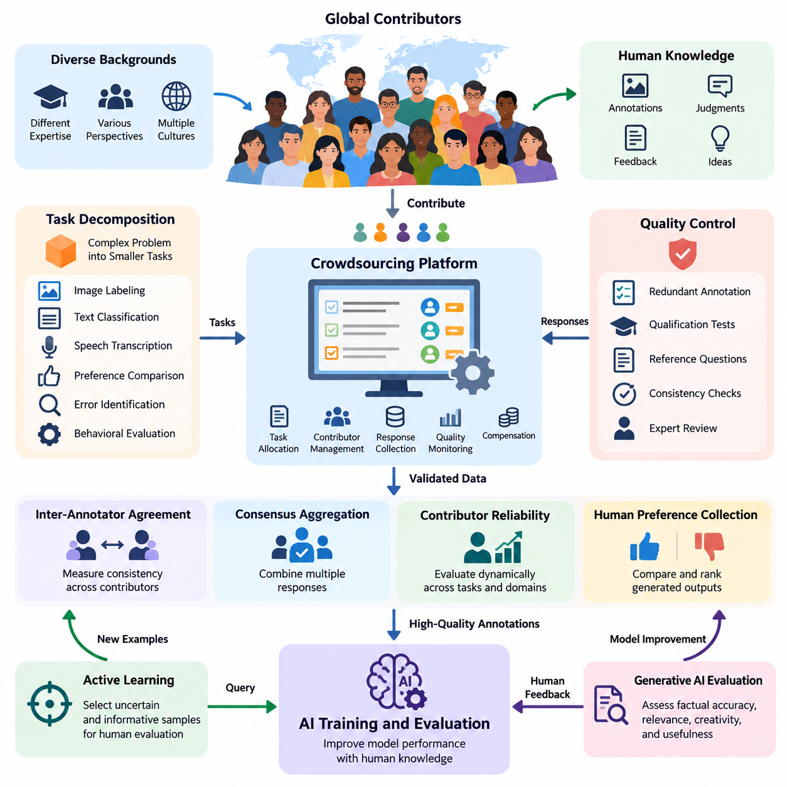
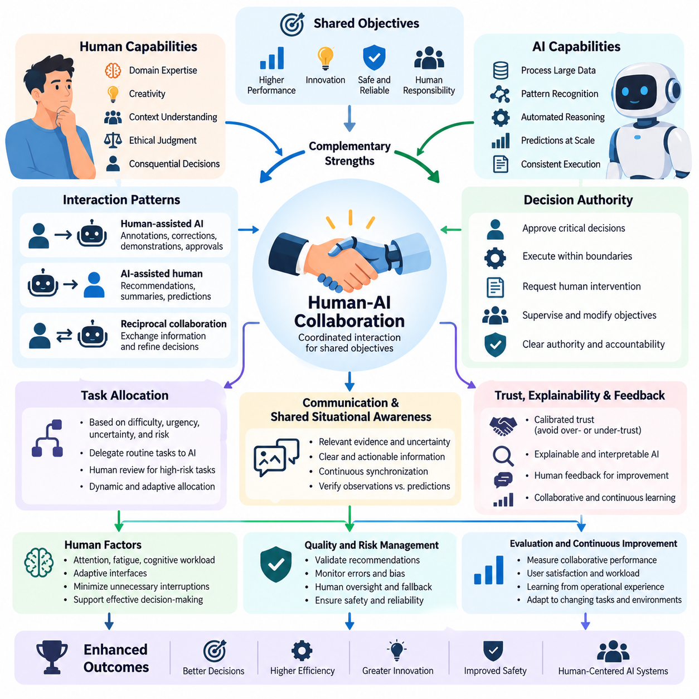
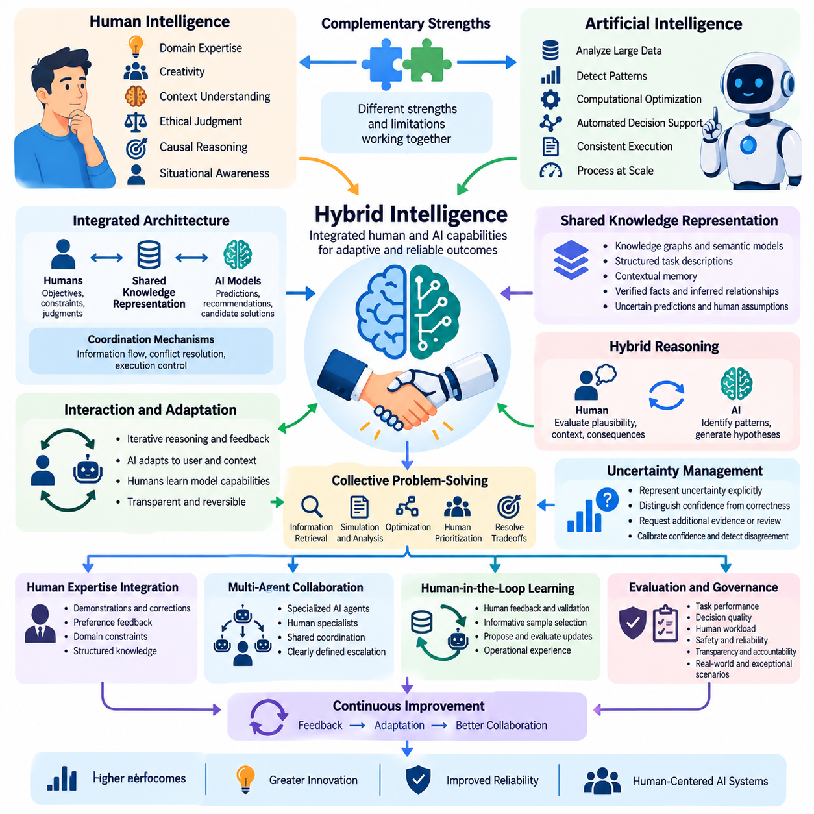
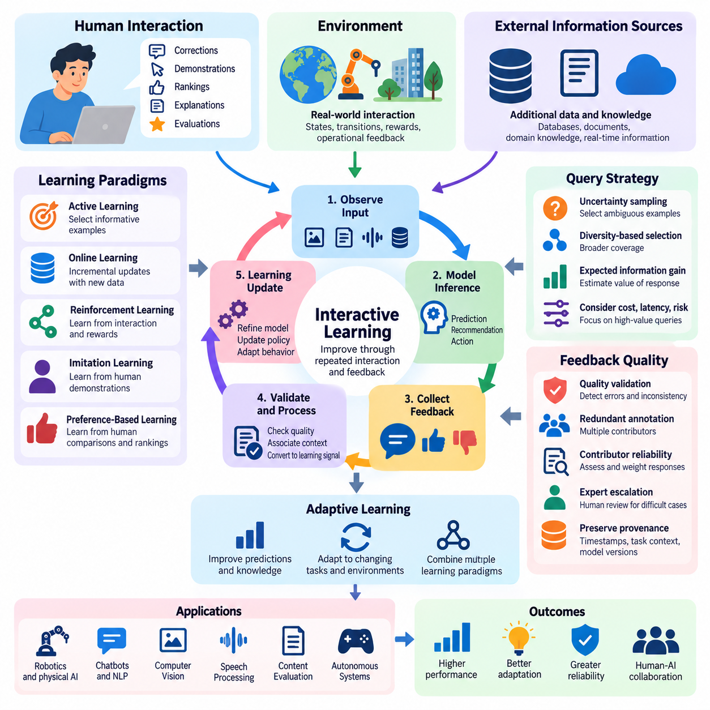
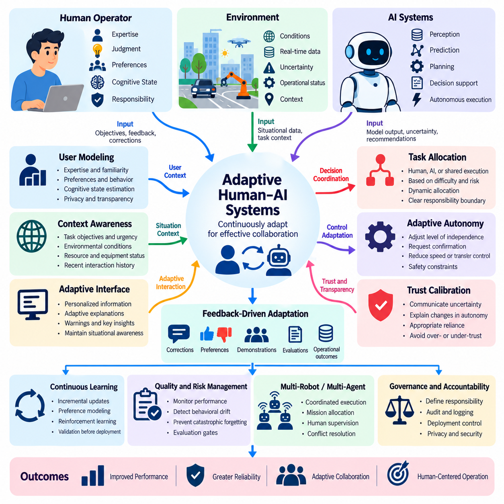
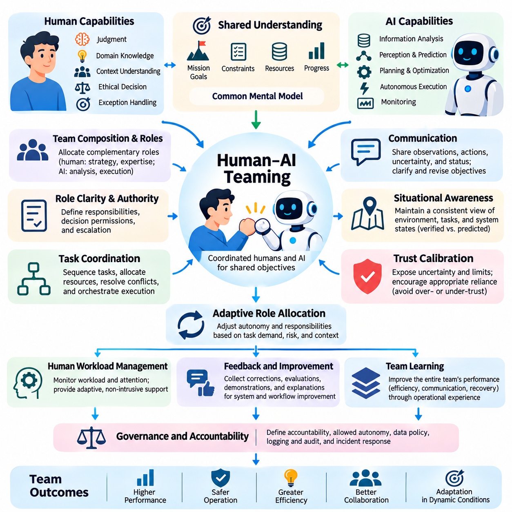

**Volume 41. Human in the Loop Learning**

# 07. Advanced Human AI Systems

## 07.01 Crowdsourcing

{width="7.268055555555556in" height="7.268055555555556in"}

Crowdsourcing is a distributed approach to collecting human knowledge, judgments, annotations, and feedback from a large population of contributors. Within Human-in-the-Loop (HITL) learning, crowdsourcing extends human participation beyond specialized development teams, enabling AI systems to acquire diverse perspectives and continuously improve through structured human contributions across different environments and application domains.

The fundamental principle of crowdsourcing is to divide a complex problem into smaller tasks that can be completed independently or collaboratively. These tasks may involve image labeling, text classification, speech transcription, preference comparison, error identification, or behavioral evaluation. A coordination platform distributes assignments, collects responses, validates contributions, and integrates the resulting information into AI training and evaluation workflows.

Crowdsourcing differs from conventional expert annotation because it emphasizes scalable participation, distributed task execution, and collective intelligence. Instead of relying exclusively on a limited number of specialists, organizations can engage contributors with different backgrounds and experiences. However, greater participation does not automatically guarantee higher accuracy, making contributor selection, task design, and quality assurance essential components of the overall system.

Task decomposition is one of the most important design considerations in crowdsourced AI development. Complex annotation problems must be transformed into understandable instructions with clearly defined outputs and acceptance criteria. For example, identifying objects in an industrial image may require separate tasks for object detection, category classification, defect assessment, and uncertainty reporting, allowing different contributors to perform complementary activities.

Effective crowdsourcing platforms provide task allocation, contributor management, response collection, quality monitoring, and compensation mechanisms. Task allocation may consider contributor expertise, historical accuracy, language proficiency, availability, and workload. Adaptive assignment strategies can direct difficult examples toward experienced annotators while distributing routine examples among a broader population, improving resource utilization and reducing unnecessary annotation costs.

Quality control is a central challenge because crowdsourced responses frequently contain errors, inconsistencies, subjective interpretations, and occasional malicious submissions. Common safeguards include redundant annotation, qualification tests, hidden reference questions, response consistency checks, and expert review. Combining these mechanisms helps distinguish reliable contributions from uncertain or low-quality responses without assuming that majority agreement always represents ground truth.

Inter-annotator agreement measures the consistency of judgments across multiple contributors. Metrics such as Cohen\'s kappa, Fleiss\' kappa, and Krippendorff\'s alpha provide different approaches to quantifying agreement while accounting for aspects of chance agreement or annotation structure. Low agreement may indicate ambiguous instructions, insufficient expertise, subjective categories, or genuinely difficult examples rather than simply poor contributor performance.

Consensus aggregation converts multiple human responses into a consolidated annotation or decision. Majority voting provides a simple baseline, while weighted voting assigns greater influence to contributors with demonstrated reliability. Probabilistic approaches, including the Dawid--Skene model, estimate latent labels and annotator error characteristics. These methods can improve aggregation when contributors have different capabilities, although their effectiveness depends on suitable modeling assumptions.

Contributor reliability should be evaluated dynamically rather than treated as a permanent attribute. Performance may vary across domains, task complexity, fatigue levels, and changes in annotation instructions. A contributor who performs well on general image classification may struggle with specialized medical or industrial imagery. Domain-specific reliability estimation enables crowdsourcing systems to allocate work more appropriately and identify situations requiring expert intervention.

Crowdsourcing becomes particularly valuable when integrated with active learning. Instead of requesting labels for randomly selected examples, an AI model identifies uncertain, informative, or underrepresented samples and submits them for human evaluation. The resulting annotations are incorporated into subsequent training cycles. This approach can reduce labeling requirements, although the overall benefit depends on query quality, annotation cost, and the reliability of human responses.

Human preference collection represents another important application. Contributors may compare alternative chatbot responses, rank generated outputs, assess instruction compliance, or evaluate perceived usefulness. These judgments can support preference modeling and reinforcement learning from human feedback. Because preferences may vary across individuals and cultures, collection procedures should preserve disagreement information and avoid treating aggregated preferences as universally valid objectives.

Crowdsourcing also supports the evaluation of generative AI systems, where automated metrics cannot fully capture factual accuracy, contextual appropriateness, creativity, or practical usefulness. Human evaluators can assess multiple dimensions using structured rubrics and comparative judgments. Carefully designed evaluation protocols reduce ambiguity, while randomized presentation and independent review help limit positional bias, anchoring effects, and contamination between assessments.

Diversity among contributors can improve dataset coverage by exposing AI systems to different languages, cultural conventions, environmental conditions, and user expectations. However, demographic diversity alone does not eliminate bias. Sampling strategies must consider which populations are represented, which perspectives are missing, and whether task instructions systematically favor particular interpretations. Transparent dataset documentation helps reveal these limitations during model development.

In robotics and Physical AI, crowdsourcing can support visual annotation, environmental understanding, human preference assessment, and evaluation of robot behavior. Contributors may identify obstacles, classify terrain conditions, assess navigation outcomes, or compare alternative robot actions using recorded demonstrations. Such contributions help construct datasets for perception and decision-making, while safety-critical control judgments still require appropriately qualified validation.

Crowdsourced feedback from robot operators and field personnel can capture operational knowledge that is difficult to represent through predefined rules. Workers may identify unsafe maneuvers, inefficient routes, confusing interaction patterns, or environmental conditions associated with repeated failures. When this feedback is linked to sensor recordings, timestamps, robot states, and task outcomes, it becomes valuable evidence for improving autonomous system performance.

Privacy and security must be incorporated into crowdsourcing architecture from the beginning. Contributors may encounter sensitive images, personal information, proprietary documents, or industrial operational data. Appropriate safeguards include data minimization, access controls, anonymization where feasible, secure transmission, and contractual restrictions. Highly sensitive tasks may require vetted internal contributors rather than unrestricted public crowdsourcing platforms.

Ethical crowdsourcing requires attention to fair compensation, informed participation, accessibility, and contributor well-being. Tasks involving disturbing content, repetitive judgments, or excessive time pressure can create psychological and operational risks. Transparent instructions, reasonable workloads, appeal mechanisms, and clear compensation policies contribute to sustainable participation while improving the reliability and legitimacy of collected human feedback.

Economic efficiency should be evaluated using more than the cost of an individual annotation. Total expenditure includes task preparation, platform administration, contributor qualification, redundant labeling, expert adjudication, data integration, and subsequent correction. A low initial annotation price may become expensive when error rates are high. Cost optimization therefore requires balancing annotation throughput, final dataset quality, and downstream model performance.

A mature crowdsourcing system should maintain provenance records connecting each annotation to its task definition, contributor qualifications, review history, and dataset version. These records support traceability, reproducibility, error analysis, and accountability. When model failures reveal problematic training examples, provenance information allows engineers to investigate whether the underlying cause involves ambiguous instructions, annotation mistakes, or systematic sampling bias.

Crowdsourcing infrastructure can be integrated with MLOps pipelines to enable continuous data improvement. Newly collected examples are prioritized, assigned, annotated, reviewed, and incorporated into versioned datasets before retraining. Automated validation checks and controlled model promotion prevent unverified contributions from directly affecting production behavior. Monitoring then identifies new failure patterns that can initiate additional human annotation cycles.

The effectiveness of crowdsourcing should be measured through annotation accuracy, agreement, throughput, latency, cost, contributor retention, and downstream model improvement. Evaluation must also examine performance across difficult samples and underrepresented populations. Controlled comparisons against expert-only annotation and alternative labeling strategies can establish whether distributed human participation produces meaningful improvements rather than merely increasing dataset volume.

Advanced crowdsourcing systems increasingly combine human contributors with AI-assisted annotation, automated quality estimation, and adaptive task routing. AI models can propose preliminary labels, highlight uncertain regions, and identify potentially inconsistent responses. Human contributors verify or correct these suggestions, while independent audits help detect automation bias. This collaboration allows human effort to focus on cases where judgment adds the greatest value.

Ultimately, crowdsourcing transforms distributed human knowledge into a structured learning resource for intelligent systems. Its long-term value depends on reliable coordination, rigorous quality assurance, responsible contributor management, and integration with continuous learning processes. Within advanced Human-AI systems, crowdsourcing provides a scalable foundation for collective feedback, collaborative evaluation, and the progressive improvement of AI capabilities under meaningful human oversight.

## 07.02 Human AI Collaboration

{width="7.268055555555556in" height="7.268055555555556in"}

Human-AI collaboration refers to the coordinated interaction between human intelligence and artificial intelligence systems to accomplish shared objectives. Rather than treating AI as a complete replacement for human decision-making, collaboration combines computational efficiency, pattern recognition, and automated reasoning with human judgment, contextual understanding, creativity, and ethical responsibility. The objective is to achieve outcomes that neither humans nor AI systems could consistently produce as effectively alone.

The foundation of effective Human-AI collaboration is complementary capability allocation. AI systems excel at processing large datasets, identifying statistical patterns, maintaining consistent computational procedures, and generating predictions at scale. Humans contribute domain expertise, causal interpretation, situational awareness, and responsibility for consequential decisions. Collaborative architectures should assign responsibilities according to demonstrated capabilities, limitations, uncertainty, and operational risk.

Human-AI collaboration can operate through several interaction patterns, including human assistance to AI, AI assistance to humans, and reciprocal decision-making. In human-assisted AI, people provide annotations, corrections, demonstrations, or approvals that improve automated behavior. In AI-assisted human workflows, models generate recommendations, summaries, predictions, or candidate actions. Reciprocal collaboration enables both participants to exchange information and progressively refine decisions.

A central architectural requirement is the explicit definition of decision authority. AI systems may recommend actions, execute bounded operations, or request human intervention depending on their assigned permissions. Humans may supervise execution, approve critical decisions, modify objectives, or override automated behavior. Clear authority boundaries prevent ambiguous responsibility and support accountability when decisions produce unexpected consequences or operational failures.

Task allocation should adapt to the difficulty, urgency, uncertainty, and consequences of each decision. Routine tasks with validated automation performance can be delegated to AI, while ambiguous or high-risk situations may require human review. Dynamic allocation mechanisms evaluate model confidence, environmental conditions, workload, and available expertise. However, confidence estimates must be calibrated because numerical certainty does not necessarily indicate prediction correctness.

Communication quality strongly influences collaborative performance. AI systems should present relevant evidence, uncertainty estimates, proposed actions, and operational limitations in formats that humans can interpret efficiently. Excessive information can increase cognitive workload, while insufficient explanations can encourage inappropriate reliance. Effective interfaces therefore prioritize actionable information, contextual relevance, and the ability to investigate model recommendations when necessary.

Trust calibration is essential because both excessive trust and insufficient trust can degrade collaborative outcomes. Automation bias occurs when users accept AI recommendations without adequate verification, while algorithm aversion may cause users to reject reliable assistance after observing errors. Well-designed systems communicate uncertainty, expose meaningful limitations, and provide opportunities for independent assessment, encouraging reliance that corresponds to demonstrated system reliability.

Explainability and interpretability support collaboration by making AI behavior easier to understand and evaluate. Feature attribution, example-based explanations, counterfactual analysis, and uncertainty visualization can help users investigate predictions. Nevertheless, explanations must be assessed for faithfulness and usefulness rather than visual appeal alone. An explanation that appears convincing but misrepresents the model\'s actual decision process may undermine effective human oversight.

Shared situational awareness enables humans and AI systems to maintain compatible interpretations of tasks, environments, and operational states. In dynamic settings, collaboration requires continuous synchronization of observations, objectives, constraints, and execution progress. State representations should distinguish verified observations from predictions and assumptions. This distinction helps prevent coordination failures when environmental conditions change or information becomes outdated.

Human feedback provides a mechanism for improving collaboration over time. Corrections, preference judgments, demonstrations, and operational evaluations can reveal systematic model weaknesses or changing user requirements. Feedback collection should preserve context, timestamps, task conditions, and outcome information. These records enable subsequent analysis and controlled model updates while reducing the risk of learning from incomplete or misleading observations.

Collaborative learning extends beyond isolated feedback events by incorporating repeated interaction into model improvement. AI systems may adapt recommendations, interaction policies, or task strategies based on accumulated evidence. However, adaptation must be constrained by validation procedures, privacy requirements, and deployment controls. Unrestricted online learning can introduce instability, reinforce user-specific biases, or degrade previously reliable capabilities.

Human factors are particularly important in prolonged collaboration. Attention, fatigue, cognitive workload, expertise, and time pressure influence how effectively people evaluate AI recommendations. Interface design should reduce unnecessary interruptions and avoid overwhelming users with low-value notifications. Adaptive interaction mechanisms can prioritize critical alerts and schedule nonurgent reviews, but they must preserve human awareness and the ability to intervene.

In robotics and Physical AI, Human-AI collaboration connects human supervision with autonomous perception, planning, and control. Operators may specify mission objectives, approve navigation plans, resolve ambiguous environmental interpretations, or intervene during exceptional events. Robots execute validated actions while reporting progress, uncertainty, and safety conditions. This arrangement supports operational efficiency without assuming that autonomous systems can independently resolve every real-world contingency.

Collaborative robotic systems often employ shared autonomy, where control authority is distributed between human operators and automated controllers. A human may provide high-level goals while the robot handles motion planning, obstacle avoidance, and trajectory execution. Control allocation can change according to environmental uncertainty and operator intervention. Safety-critical transitions require predictable behavior, clear feedback, and mechanisms that prevent conflicting commands.

Multi-agent environments introduce additional coordination challenges because humans may supervise several AI agents or robots simultaneously. Effective collaboration requires mission-level task allocation, shared status monitoring, exception management, and coordinated recovery procedures. Human supervisors should receive consolidated operational information rather than independently monitoring every low-level action. Escalation policies must identify situations where automated coordination is insufficient.

Decision support systems demonstrate how collaboration can improve complex analytical workflows. AI models may identify anomalies, estimate risks, compare alternatives, or summarize evidence, while human specialists interpret implications and select actions. Evaluation should examine whether assistance improves actual decisions rather than merely increasing prediction accuracy. Human expertise and AI recommendations must be assessed together under realistic operational conditions.

Safety and accountability require collaboration protocols that specify responsibilities before deployment. These protocols should define permissible automated actions, human approval requirements, emergency intervention procedures, and audit mechanisms. High-impact decisions may require independent verification or multiple authorization levels. Logging human instructions, AI recommendations, overrides, and execution outcomes supports incident investigation and continuous safety improvement.

Evaluating Human-AI collaboration requires metrics that extend beyond standalone model performance. Relevant measures include joint task success, decision quality, completion time, human workload, intervention frequency, error recovery, trust calibration, and safety outcomes. Controlled experiments should compare human-only, AI-only, and collaborative configurations where appropriate. Such comparisons reveal whether collaboration provides measurable benefits and under which conditions those benefits disappear.

Advanced Human-AI collaboration increasingly incorporates personalized interfaces, adaptive autonomy, multimodal interaction, and context-aware assistance. Language, vision, gesture, and operational telemetry can support richer communication between humans and intelligent machines. However, personalization should not obscure system limitations or weaken consistent safety requirements. Adaptation must remain observable, reversible, and compatible with organizational governance.

Ultimately, Human-AI collaboration represents a shift from isolated automation toward coordinated intelligence. Its effectiveness depends on complementary capabilities, calibrated trust, transparent communication, adaptable task allocation, and clearly defined human authority. Within Human-in-the-Loop learning, collaboration establishes the interaction foundation for hybrid intelligence, interactive learning, adaptive Human-AI systems, and increasingly sophisticated human-machine teams.

## 07.03 Hybrid Intelligence

{width="7.268055555555556in" height="7.268055555555556in"}

Hybrid intelligence refers to an integrated form of intelligence in which human cognitive capabilities and artificial intelligence systems operate as complementary components of a unified problem-solving process. Rather than simply exchanging recommendations, hybrid intelligence combines human reasoning, contextual knowledge, creativity, and ethical judgment with machine learning, computational optimization, and automated decision support to achieve adaptive and reliable outcomes.

The central principle of hybrid intelligence is that human and artificial capabilities possess different strengths and limitations. AI systems can analyze large datasets, detect complex statistical relationships, and execute repetitive computations consistently. Humans contribute experience-based intuition, causal understanding, social awareness, and the ability to interpret ambiguous situations. Effective hybrid systems coordinate these capabilities instead of assuming that either participant is universally superior.

Hybrid intelligence extends conventional Human-AI collaboration by emphasizing integrated cognitive processes and mutual adaptation. In basic collaboration, humans and AI systems may perform separate tasks and exchange outputs. In hybrid intelligence, their contributions become interconnected through shared representations, iterative reasoning, and continuous feedback. The resulting system develops solutions through coordinated interaction rather than independent decision-making alone.

A hybrid intelligence architecture typically incorporates human participants, AI models, shared knowledge representations, interaction interfaces, and coordination mechanisms. Human participants contribute objectives, constraints, judgments, and domain expertise, while AI components generate predictions, recommendations, or candidate solutions. Coordination mechanisms determine how information flows between participants and how conflicting interpretations are resolved during execution.

Shared knowledge representation is essential for maintaining consistency between human understanding and machine-generated information. Knowledge graphs, semantic models, structured task descriptions, and contextual memory can provide common reference structures. These representations should distinguish verified facts, inferred relationships, uncertain predictions, and human assumptions. Maintaining these distinctions reduces misunderstanding and supports transparent collaborative reasoning.

Hybrid reasoning combines human conceptual understanding with computational inference. AI models may identify patterns, estimate probabilities, or generate hypotheses, while humans evaluate causal plausibility, contextual relevance, and practical consequences. This interaction is especially useful when available data is incomplete or environmental conditions are unfamiliar. The reasoning process becomes iterative as human judgments refine machine-generated alternatives.

Collective problem-solving in hybrid intelligence involves distributing cognitive activities according to task requirements. Machines may perform information retrieval, simulation, optimization, and large-scale comparison, while humans interpret objectives, establish priorities, and resolve ambiguous tradeoffs. Task responsibilities can change dynamically as uncertainty or operational conditions evolve. Successful allocation requires explicit authority boundaries and reliable communication between participants.

Uncertainty management is a fundamental requirement because both human judgments and AI predictions can be incorrect. Hybrid systems should represent uncertainty explicitly and distinguish statistical confidence from verified correctness. When uncertainty exceeds acceptable thresholds, additional evidence, human review, or alternative computational analysis may be required. Confidence calibration and disagreement detection help prevent unsupported conclusions from propagating through the system.

Human expertise can be integrated into AI systems through demonstrations, preference feedback, corrections, constraints, and structured knowledge. Expert demonstrations may guide imitation learning, while preference judgments can support reward modeling and policy optimization. Domain constraints can restrict unacceptable solutions during planning or inference. These mechanisms transform human knowledge into reusable computational guidance without assuming that every human judgment is infallible.

Mutual adaptation distinguishes advanced hybrid intelligence from static decision-support systems. AI components may adjust their recommendations according to user expertise, task context, and observed feedback, while human participants develop improved understanding of model capabilities and limitations. Such adaptation should remain transparent and reversible. Continuous monitoring is necessary to detect behavioral drift, inappropriate reliance, or degradation in collaborative performance.

Hybrid intelligence can incorporate multiple AI agents and human specialists working through shared coordination structures. Specialized agents may handle perception, planning, knowledge retrieval, simulation, or evaluation, while humans supervise strategic decisions and exceptional situations. Effective orchestration requires consistent state information, conflict resolution, and clearly defined escalation procedures. Without these mechanisms, increasing the number of participants can introduce coordination overhead.

In Human-in-the-Loop learning, hybrid intelligence establishes a continuous relationship between model development and operational experience. Human feedback identifies errors, clarifies objectives, and provides contextual interpretations that automated metrics may overlook. AI systems prioritize informative examples, propose improvements, and evaluate candidate updates. Validated feedback becomes part of controlled learning cycles, connecting human expertise with measurable model development.

Hybrid intelligence is particularly relevant to robotics and Physical AI because real-world environments contain uncertainty, changing conditions, and safety constraints. Autonomous robots can perform perception, localization, planning, and control, while human operators contribute mission intent, environmental knowledge, and exception handling. Hybrid architectures connect these functions through shared operational states, enabling coordinated decisions across perception, planning, and execution.

Shared autonomy represents an important implementation of hybrid intelligence in robotic control. Humans may define high-level goals or corrective commands while automated controllers manage trajectory generation, obstacle avoidance, and low-level execution. Control authority can shift according to task complexity, environmental uncertainty, and safety requirements. Predictable transitions and independent safety mechanisms are essential when human and automated commands interact.

At the fleet level, hybrid intelligence supports coordinated management of multiple robots and autonomous agents. AI orchestration systems can distribute missions, optimize resource utilization, monitor operational conditions, and recommend recovery strategies. Human supervisors evaluate mission priorities, resolve exceptional conflicts, and authorize consequential changes. This arrangement reduces the need for continuous manual control while preserving meaningful human responsibility.

Hybrid intelligence also supports scientific discovery, healthcare, industrial engineering, and complex decision-support applications. AI systems can analyze observations, generate hypotheses, compare alternatives, and identify anomalies, while specialists assess domain validity and practical implications. The objective is not merely faster computation but improved reasoning quality. Collaborative evaluation should determine whether the integrated system produces more accurate and useful outcomes.

Trust and accountability remain essential because integrated intelligence can make responsibility difficult to trace. Hybrid architectures should record human instructions, AI-generated recommendations, decision revisions, approvals, and execution results. Explainable interfaces and provenance tracking support investigation when failures occur. Responsibility must remain explicitly assigned to authorized individuals and organizations rather than being attributed vaguely to the combined system.

Evaluation of hybrid intelligence requires examining the performance of the integrated human-machine configuration. Relevant metrics include joint task success, decision accuracy, completion time, cognitive workload, intervention frequency, robustness, and safety. Comparisons with human-only and AI-only baselines can reveal whether integration produces genuine benefits. Experiments should also investigate performance under uncertainty, conflicting recommendations, and changing operational conditions.

An important research challenge is determining when hybrid intelligence produces complementary gains rather than unnecessary complexity. Human involvement can improve contextual judgment but may introduce delays, inconsistency, and cognitive overload. Automation can increase throughput but may reinforce systematic errors. Effective systems therefore optimize the balance between human effort, computational resources, task quality, and operational risk instead of maximizing interaction frequency.

Future hybrid intelligence systems may integrate multimodal foundation models, persistent contextual memory, adaptive interfaces, and coordinated autonomous agents. These capabilities could support richer shared understanding and more flexible allocation of cognitive responsibilities. However, greater integration also increases requirements for validation, privacy, security, and governance. Adaptation and autonomy must remain observable, controllable, and compatible with human oversight.

Ultimately, hybrid intelligence provides a framework for combining human understanding and machine computation into a coordinated intelligence system. Its value emerges from complementary reasoning, shared knowledge, adaptive coordination, and continuous learning rather than automation alone. Within advanced Human-AI systems, hybrid intelligence forms a conceptual foundation for interactive learning, adaptive Human-AI architectures, and increasingly capable human-machine teams operating under accountable human governance.

## 07.04 Interactive Learning

{width="7.268055555555556in" height="7.268055555555556in"}

Interactive learning is an adaptive approach to artificial intelligence in which models improve through repeated interaction with humans, environments, or external information sources. Unlike conventional training that relies primarily on fixed datasets, interactive learning incorporates feedback during the learning process. This enables AI systems to refine predictions, acquire new knowledge, and adjust behavior according to evolving objectives and operational conditions.

The central principle of interactive learning is the continuous exchange of information between a learning system and its surrounding environment. An AI model generates predictions, recommendations, or actions, while humans or environmental processes provide responses that indicate their usefulness or correctness. These interactions produce new learning signals, allowing the system to update its internal representations and improve subsequent decisions through repeated feedback cycles.

Interactive learning encompasses several complementary paradigms, including active learning, online learning, reinforcement learning, imitation learning, and preference-based learning. Although these approaches use different optimization mechanisms, they share an emphasis on information acquired through interaction. Their integration allows AI systems to select informative experiences, incorporate corrective guidance, and improve policies while adapting to changing task requirements.

Human interaction plays a particularly important role when automated learning signals are incomplete, ambiguous, or difficult to define. Users may provide corrections, demonstrations, rankings, explanations, or explicit evaluations of system behavior. These contributions supply contextual information that cannot always be inferred from numerical rewards or predefined labels. Effective systems transform such feedback into structured learning signals while accounting for human uncertainty and inconsistency.

A fundamental architectural component is the interaction loop connecting observation, model inference, feedback collection, and learning updates. The system observes relevant inputs, produces an output, and receives feedback about its performance. Feedback is validated, associated with the original context, and incorporated into an appropriate training process. Subsequent evaluations determine whether the resulting model changes improve performance without introducing unacceptable regressions.

Active learning contributes to interactive learning by enabling models to request information selectively. Instead of labeling every available sample, the system identifies examples that are uncertain, diverse, or expected to improve model performance. Human annotators then provide the requested information. This strategy can reduce annotation effort and accelerate learning, although its effectiveness depends on query selection, annotation reliability, and the distribution of incoming data.

Online learning enables models to incorporate newly available observations without repeating the entire training process from the beginning. Incremental updates can help systems respond to changing environments, emerging patterns, and evolving user preferences. However, online adaptation introduces risks such as catastrophic forgetting, sensitivity to noisy observations, and unintended behavioral drift. Controlled updates and periodic evaluation are therefore essential for maintaining reliability.

Reinforcement learning provides an interaction framework in which an agent selects actions, observes environmental transitions, and receives rewards or penalties. The agent learns a policy intended to maximize expected cumulative reward. Human guidance can supplement environmental rewards through preference judgments, demonstrations, or corrective interventions. This combination is valuable when reward functions are incomplete or when exploration may produce undesirable outcomes.

Imitation learning incorporates expert behavior into interactive learning by allowing models to learn from human demonstrations. In behavior cloning, recorded state-action pairs provide supervised training examples. Interactive approaches such as Dataset Aggregation, commonly known as DAgger, collect expert corrections on states encountered by the learner. These methods can reduce distribution mismatch between training demonstrations and autonomous execution, although expert availability and safety remain important constraints.

Preference-based interactive learning enables humans to compare alternative model outputs without specifying exact target responses. A user may indicate which generated explanation, action sequence, or robot trajectory is preferable. These comparisons can support preference models and reward estimation. Nevertheless, preference information may be subjective, inconsistent, or dependent on context, requiring careful aggregation and evaluation before influencing deployed behavior.

Query strategies determine when and how interactive systems request additional information. Uncertainty sampling prioritizes ambiguous predictions, while diversity-based selection seeks broader coverage of the input space. Expected information gain estimates how much a response could reduce uncertainty. More advanced strategies consider annotation cost, response latency, task importance, and operational risk, ensuring that interaction effort is concentrated where it provides meaningful value.

Feedback quality is a critical determinant of learning effectiveness. Human responses may contain mistakes, incomplete explanations, inconsistent preferences, or systematic biases. Interactive systems should therefore support confidence estimation, redundant review, contributor reliability assessment, and expert escalation. Preserving feedback provenance, including timestamps, task conditions, and model versions, enables engineers to investigate learning failures and distinguish reliable corrections from misleading signals.

Interactive learning requires balancing exploration and exploitation. Exploration gathers information about unfamiliar states, actions, or alternatives, while exploitation uses existing knowledge to achieve current objectives. Excessive exploration may increase cost or operational risk, whereas insufficient exploration can prevent adaptation. In safety-critical applications, exploration should be constrained by validated safety mechanisms, operational boundaries, and appropriate human supervision.

Human-AI interfaces strongly influence the efficiency of interactive learning. Feedback mechanisms should allow users to correct outputs, compare alternatives, explain preferences, and report uncertainty without excessive cognitive effort. Context-sensitive prompts can request clarification when the model encounters ambiguous situations. However, frequent interruptions may reduce productivity and encourage superficial responses, making interaction timing and information presentation important design considerations.

Adaptive interaction policies determine the appropriate level of human involvement according to model uncertainty, task complexity, and consequences of failure. Routine decisions may proceed automatically when performance is sufficiently validated, while unfamiliar or high-risk situations trigger human review. Such policies should distinguish model confidence from actual reliability and provide explicit escalation mechanisms when automated decisions exceed established operational limits.

In robotics and Physical AI, interactive learning connects autonomous behavior with human demonstrations, corrections, and environmental experience. Robots may learn manipulation strategies, navigation preferences, or task execution procedures through supervised interaction. Operators can correct unsuccessful actions or provide demonstrations for unfamiliar tasks. Learning updates must be separated from safety-critical control execution unless appropriate validation and safeguards are established.

Shared autonomy provides a practical environment for interactive robotic learning. Human operators specify goals or corrective commands while autonomous controllers manage perception, planning, and motion execution. The system can record interventions and successful trajectories as potential training data. However, interventions must be interpreted within their original operational context because a correction suitable for one environment may be unsafe or ineffective in another.

Multi-agent interactive learning extends these principles to environments containing several AI agents, robots, and human supervisors. Agents may exchange observations, coordinate tasks, and learn from shared operational experiences. Human feedback can resolve conflicting objectives or identify failures in collective behavior. Effective coordination requires consistent state representations, communication protocols, and safeguards against propagating incorrect information across the system.

Continuous evaluation is essential because interactive learning modifies system behavior over time. Performance should be assessed using task success, adaptation speed, sample efficiency, feedback cost, robustness, and safety outcomes. Evaluation must include previously learned tasks to detect catastrophic forgetting and regression. Controlled experiments comparing static models with interactively updated models help determine whether adaptation produces measurable benefits.

Deployment architectures should integrate interactive learning with data management, model versioning, monitoring, and controlled release procedures. Feedback records are validated and stored before contributing to training datasets or model updates. Candidate models undergo offline testing, simulation, and staged deployment where appropriate. Rollback mechanisms allow organizations to restore previously validated behavior when unexpected performance degradation occurs.

Ultimately, interactive learning transforms AI development from a fixed training process into an ongoing cycle of observation, interaction, feedback, and adaptation. Its effectiveness depends on informative queries, reliable human guidance, safe exploration, and rigorous evaluation. Within advanced Human-AI systems, interactive learning provides a foundation for adaptive intelligence, continuous capability improvement, and increasingly responsive human-machine collaboration under accountable human oversight.

## 07.05 Adaptive Human AI Systems

{width="7.268055555555556in" height="7.268055555555556in"}

Adaptive Human-AI systems are intelligent environments in which human participants and artificial intelligence components continuously adjust their behavior, responsibilities, and interaction strategies according to changing conditions. Unlike static automation, these systems respond to user expertise, task complexity, environmental uncertainty, and operational feedback. Their objective is to maintain effective collaboration while improving performance, reliability, and human control over time.

The foundation of adaptive Human-AI systems is the ability to recognize changes in both human and machine capabilities. AI models may improve through learning or experience performance degradation under unfamiliar conditions. Human operators may develop expertise, experience fatigue, or face increasing cognitive demands. Adaptive systems monitor these variations and modify assistance levels, information presentation, and task allocation to maintain appropriate collaboration.

A typical adaptive architecture integrates user modeling, context awareness, AI inference, feedback processing, decision coordination, and continuous evaluation. User models represent relevant expertise, preferences, and interaction patterns, while context models describe task objectives and environmental conditions. Coordination mechanisms combine these representations to determine appropriate system responses. Monitoring components assess whether adaptations improve outcomes or introduce unintended consequences.

User modeling enables AI systems to personalize assistance according to individual capabilities and operational needs. Models may estimate familiarity with a task, preferred explanation detail, response patterns, and observed interaction difficulties. However, these estimates should remain uncertain and revisable rather than becoming permanent assumptions about users. Privacy safeguards and transparent controls are necessary when collecting behavioral information for personalization.

Context awareness allows adaptive systems to interpret information beyond isolated user commands. Relevant context may include task urgency, environmental conditions, equipment status, available resources, and recent interaction history. A recommendation suitable under normal conditions may become inappropriate during an emergency or system malfunction. Context-aware adaptation therefore requires reliable sensing, current state information, and mechanisms for detecting incomplete or outdated observations.

Adaptive task allocation determines whether humans, AI systems, or shared processes should perform particular activities. Routine operations may be delegated to validated automation, while ambiguous decisions may require human judgment. Allocation policies can consider uncertainty, task importance, operator workload, and the consequences of failure. Clear responsibility boundaries remain essential because changing task ownership must not create confusion about decision authority.

Adaptive autonomy extends task allocation by modifying the degree of independent action permitted to AI systems. Under stable conditions, an autonomous agent may execute approved plans with limited intervention. When uncertainty increases, the system may request confirmation, reduce operating speed, or transfer control to a human. These transitions should be predictable, reversible, and governed by explicit safety constraints rather than model confidence alone.

Human state estimation provides additional information for adapting collaborative behavior. Interaction timing, response accuracy, task completion patterns, and other authorized observations may indicate changing workload or attention. Such estimates are inherently uncertain and should not be treated as definitive psychological measurements. Systems should avoid intrusive monitoring and use human-state information only when it meaningfully improves safety, usability, or task performance.

Adaptive interfaces modify information presentation according to user needs and operational circumstances. Experienced operators may prefer concise status summaries, while less familiar users may benefit from detailed explanations and guided procedures. During critical events, interfaces can prioritize warnings, actionable recommendations, and essential system states. Adaptation should preserve consistency so that users can understand interface changes without losing situational awareness.

Feedback-driven adaptation enables systems to learn from corrections, preferences, demonstrations, and operational outcomes. Human feedback can identify inappropriate recommendations, inefficient workflows, or missing contextual knowledge. AI components may use this information to refine assistance policies or propose model updates. However, feedback should be validated and associated with its original context before influencing future decisions or automated behavior.

Continuous learning allows adaptive Human-AI systems to improve as tasks, users, and environments evolve. Incremental learning, preference modeling, and reinforcement learning may support changes in interaction policies or predictive models. Nevertheless, unrestricted adaptation can introduce catastrophic forgetting, bias reinforcement, and unstable behavior. Controlled training pipelines and evaluation gates are required before significant model changes reach operational systems.

Trust calibration is particularly important because adaptive behavior can change how users perceive system reliability. An AI system that performs well in familiar situations may become unreliable when conditions shift. Interfaces should communicate meaningful uncertainty, explain important changes in autonomy, and indicate when human verification is required. Trust should reflect demonstrated performance rather than persuasive explanations or consistently confident outputs.

Explainability supports adaptive collaboration by helping users understand why recommendations or interaction strategies have changed. Systems may identify relevant contextual factors, updated constraints, or detected uncertainty that influenced a decision. Explanations should remain faithful to the underlying process and appropriate to the user\'s expertise. Providing explanations without overwhelming users requires balancing transparency, relevance, and cognitive workload.

Adaptive Human-AI systems must manage conflicting objectives such as efficiency, safety, accuracy, user autonomy, and operational cost. Increasing automation may improve throughput while reducing opportunities for human verification. Frequent requests for approval may strengthen oversight but introduce delays and fatigue. Multi-objective optimization can help evaluate these tradeoffs, although safety constraints and human authority should not be treated as freely interchangeable performance metrics.

In robotics and Physical AI, adaptive Human-AI systems coordinate human supervision with autonomous perception, planning, navigation, and control. A robot may adjust its operational strategy according to terrain conditions, sensor uncertainty, or mission changes. Human operators can revise objectives, approve recovery actions, or intervene during exceptional events. Adaptation must remain compatible with validated safety mechanisms and real-time control requirements.

Shared autonomy provides a practical implementation of adaptive Human-AI interaction. Human operators define mission goals or corrective actions, while autonomous controllers execute lower-level tasks within authorized limits. The system may modify assistance levels when obstacle complexity, localization uncertainty, or operator intervention changes. Control transitions require clear communication, predictable behavior, and safeguards against conflicting commands.

Multi-robot environments increase the importance of adaptive coordination because one human may supervise numerous autonomous agents. Mission orchestration systems can prioritize tasks, allocate resources, and identify situations requiring intervention. Adaptive supervision interfaces should consolidate routine status information while highlighting meaningful exceptions. Escalation mechanisms must prevent critical events from being hidden by excessive notifications or unreliable automated summaries.

Safety assurance requires adaptive systems to operate within explicitly defined constraints. Changes to interaction policies, control authority, or model behavior should undergo appropriate validation before deployment. Runtime monitoring can detect deviations from expected operating conditions and trigger predefined fallback procedures. Independent safety controllers may be necessary when adaptive AI components influence physical equipment or other consequential processes.

Evaluation of adaptive Human-AI systems must examine both immediate performance and behavior over time. Relevant measures include joint task success, adaptation speed, decision quality, operator workload, intervention frequency, robustness, and safety outcomes. Testing should cover changing environments, varying user expertise, unexpected failures, and recovery scenarios. Comparisons with fixed collaboration policies can reveal whether adaptation provides measurable improvements.

Governance and accountability remain necessary even when adaptation is highly automated. Systems should record relevant context, model versions, adaptation decisions, human approvals, and operational outcomes. Authorized users must be able to inspect important changes, correct inappropriate behavior, and restore previously validated configurations. Privacy, security, and organizational policies should determine which information may be collected and how adaptation is permitted.

Ultimately, adaptive Human-AI systems transform collaboration from a fixed division of responsibilities into a continuously coordinated process. Their effectiveness depends on reliable context awareness, calibrated autonomy, meaningful human feedback, controlled learning, and transparent governance. Within advanced Human-AI architectures, these capabilities establish the foundation for resilient human-machine teams that can respond to changing conditions while preserving safety and human responsibility.

## 07.06 Human AI Teaming

{width="7.268055555555556in" height="7.268055555555556in"}

Human-AI teaming refers to the coordinated organization of humans and artificial intelligence systems as interdependent participants working toward shared objectives. Unlike conventional automation, where machines execute predefined functions, teaming emphasizes mutual awareness, coordinated responsibilities, and collective performance. Effective teams combine human judgment, contextual understanding, and ethical responsibility with AI capabilities in perception, prediction, planning, and computational execution.

The foundation of Human-AI teaming is a shared understanding of mission goals, operational constraints, and expected outcomes. Human participants and AI agents must maintain compatible representations of task priorities, available resources, and execution progress. Shared mental models help team members anticipate actions and recognize emerging problems. However, AI representations should not be assumed to possess human understanding merely because they generate convincing explanations.

Team composition determines how human expertise and AI capabilities are distributed across operational roles. Humans may provide strategic direction, domain knowledge, ethical evaluation, and exception handling, while AI agents perform information analysis, monitoring, optimization, and bounded autonomous execution. Effective role assignment considers demonstrated competence, uncertainty, workload, and consequences of failure rather than relying on fixed assumptions about human or machine superiority.

Role clarity is essential because ambiguous authority can undermine coordination and accountability. Each team participant should understand assigned responsibilities, decision permissions, communication obligations, and escalation procedures. AI systems may recommend actions or execute approved tasks, but consequential decisions require clearly designated authorization. Responsibility for deployment and operational governance remains with accountable individuals and organizations.

Communication provides the operational foundation for coordinated Human-AI teams. AI agents should communicate relevant observations, proposed actions, uncertainty, and execution status in forms that humans can interpret efficiently. Human participants must be able to clarify objectives, revise instructions, and correct system assumptions. Communication protocols should minimize ambiguity while preventing excessive notifications from overwhelming human attention.

Shared situational awareness allows team members to maintain a consistent understanding of environmental conditions and ongoing activities. AI systems may integrate sensor measurements, operational telemetry, and historical information into consolidated state estimates. Humans interpret these estimates using contextual experience and mission knowledge. Reliable teaming requires distinguishing verified observations from predictions, assumptions, and potentially outdated information.

Team coordination involves sequencing activities, allocating resources, and resolving dependencies between participants. AI agents can schedule tasks, evaluate alternatives, and monitor progress, while humans determine priorities and address conflicting objectives. Coordination mechanisms should identify delayed operations, resource conflicts, and emerging risks. Effective orchestration enables the team to respond coherently rather than allowing individual components to optimize incompatible goals.

Trust calibration is necessary because team performance depends on appropriate reliance between human and artificial participants. Excessive trust may encourage automation bias, while insufficient trust can cause unnecessary intervention or rejection of useful recommendations. AI systems should expose meaningful uncertainty and operational limitations. Human operators should receive sufficient evidence to evaluate recommendations without being required to inspect every internal computational process.

Adaptive role allocation enables Human-AI teams to respond to changing task demands and environmental conditions. Under routine circumstances, validated AI agents may perform activities independently within authorized boundaries. During ambiguous or high-risk situations, responsibility may shift toward human supervision. Such transitions require explicit communication, predictable control behavior, and mechanisms for restoring previously validated operating configurations.

Human workload management is an important consideration when designing sustained teaming arrangements. Operators may experience fatigue, divided attention, or information overload while supervising multiple AI agents. Intelligent interfaces can consolidate routine updates and prioritize critical exceptions. However, workload estimates remain uncertain and should not justify intrusive monitoring or unsupported assumptions about an individual\'s psychological state.

Human-AI teams can improve through structured feedback and repeated operational experience. Humans provide corrections, evaluations, demonstrations, and explanations that reveal limitations in AI behavior. AI systems can identify recurring operational patterns and propose workflow improvements. Feedback should preserve task context, model versions, and observed outcomes so that learning mechanisms can distinguish useful adaptations from misleading or inconsistent information.

Team learning differs from isolated model training because improvements must account for the performance of the entire collaborative configuration. An AI model may become more accurate while increasing human workload or reducing coordination efficiency. Evaluation should therefore examine shared task success, communication quality, intervention frequency, and recovery performance. Learning objectives must reflect collective outcomes rather than individual component optimization alone.

Conflict resolution is essential when human judgments and AI recommendations disagree. Differences may arise from incomplete information, conflicting objectives, uncertainty, or incorrect assumptions. Teams should use defined procedures for reviewing evidence, requesting clarification, and escalating consequential decisions. Disagreement should be treated as a potential source of information rather than automatically favoring either human intuition or model predictions.

In robotics and Physical AI, Human-AI teaming integrates operators, autonomous robots, perception systems, planning agents, and mission coordination services. Humans establish mission objectives and supervise exceptional situations, while robots perform navigation, manipulation, inspection, and other authorized activities. Shared operational representations connect these participants, supporting coordinated execution across changing physical environments.

Multi-robot teaming introduces additional requirements for mission allocation, fleet monitoring, communication reliability, and resource coordination. AI orchestration systems may assign tasks according to robot capabilities, location, battery status, and operational constraints. Human supervisors resolve exceptional conflicts and approve significant mission changes. The objective is to scale operational capability without requiring continuous manual control of every robot.

Shared autonomy supports Human-AI teaming by distributing control between human operators and autonomous systems. Humans may specify high-level intentions while robots manage local perception, motion planning, and execution. Control authority can change when environmental uncertainty or safety risk increases. Reliable implementations require predictable handovers, bounded autonomy, and independent mechanisms for preventing unsafe actions.

Resilience becomes increasingly important as teams operate in uncertain environments. Communication failures, sensor degradation, unexpected obstacles, or unavailable participants can disrupt coordinated execution. Robust teams detect these conditions and activate predefined recovery procedures. AI agents may reorganize noncritical tasks, but safety-critical changes must respect authorization boundaries and validated fallback strategies.

Team performance evaluation should extend beyond individual model accuracy or task completion speed. Relevant measures include collective mission success, decision quality, coordination latency, human workload, resource efficiency, intervention frequency, and safety outcomes. Controlled comparisons with human-only, AI-only, and alternative teaming configurations help identify genuine benefits. Testing should include exceptional events and degraded operating conditions.

Governance establishes the institutional foundation for responsible Human-AI teaming. Organizations should define accountability, permitted autonomy levels, data access policies, audit requirements, and incident response procedures. Operational logs should preserve significant human instructions, AI recommendations, approvals, and execution outcomes. These records support traceability, performance analysis, and corrective action when collaborative systems fail.

Advanced Human-AI teams may incorporate multimodal foundation models, specialized AI agents, adaptive interfaces, and distributed robotic platforms. Such systems can support natural-language coordination, shared planning, and dynamic task assignment across complex operations. Nevertheless, increasing agent autonomy and team size also increases verification and coordination requirements. Human authority, cybersecurity, and operational safety must remain explicit architectural constraints.

Ultimately, Human-AI teaming represents the evolution from isolated assistance toward organized collective intelligence. Its effectiveness depends on shared objectives, complementary roles, calibrated trust, reliable communication, adaptive coordination, and accountable decision authority. Within advanced Human-AI systems, teaming integrates collaboration, hybrid intelligence, interactive learning, and adaptive autonomy into operational structures capable of achieving complex objectives while preserving meaningful human oversight.
