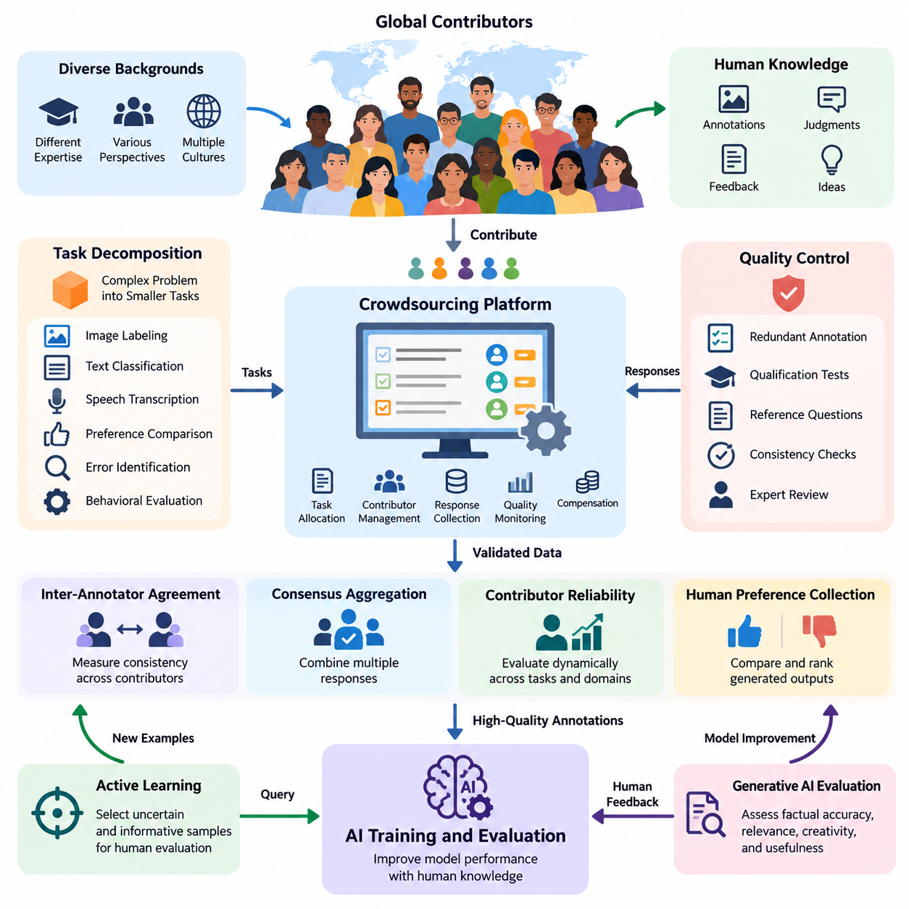
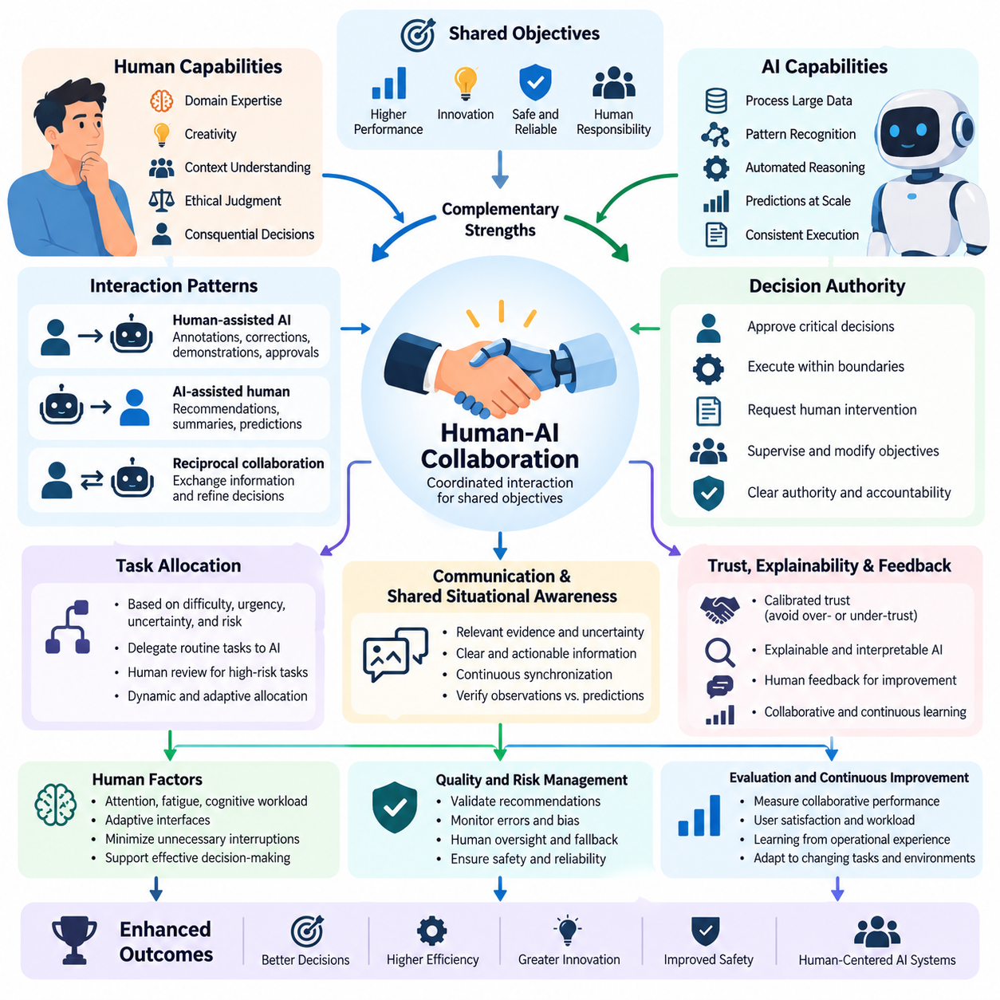
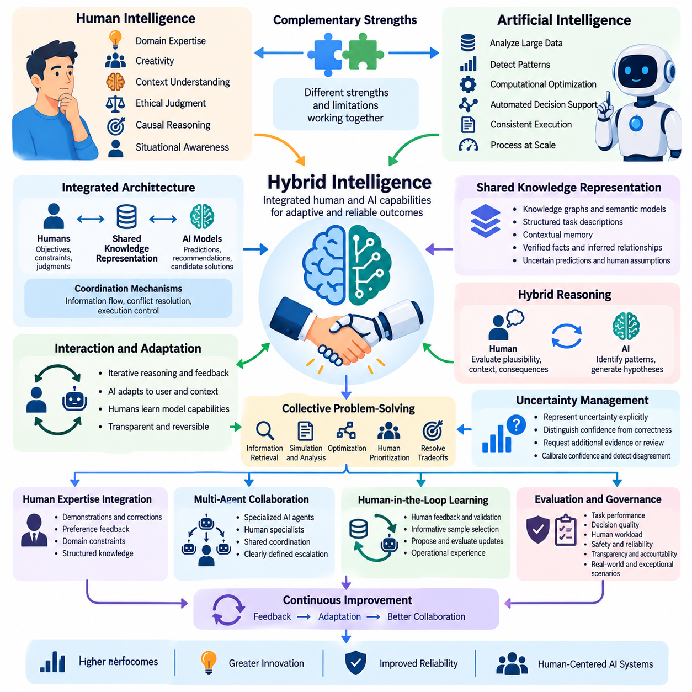
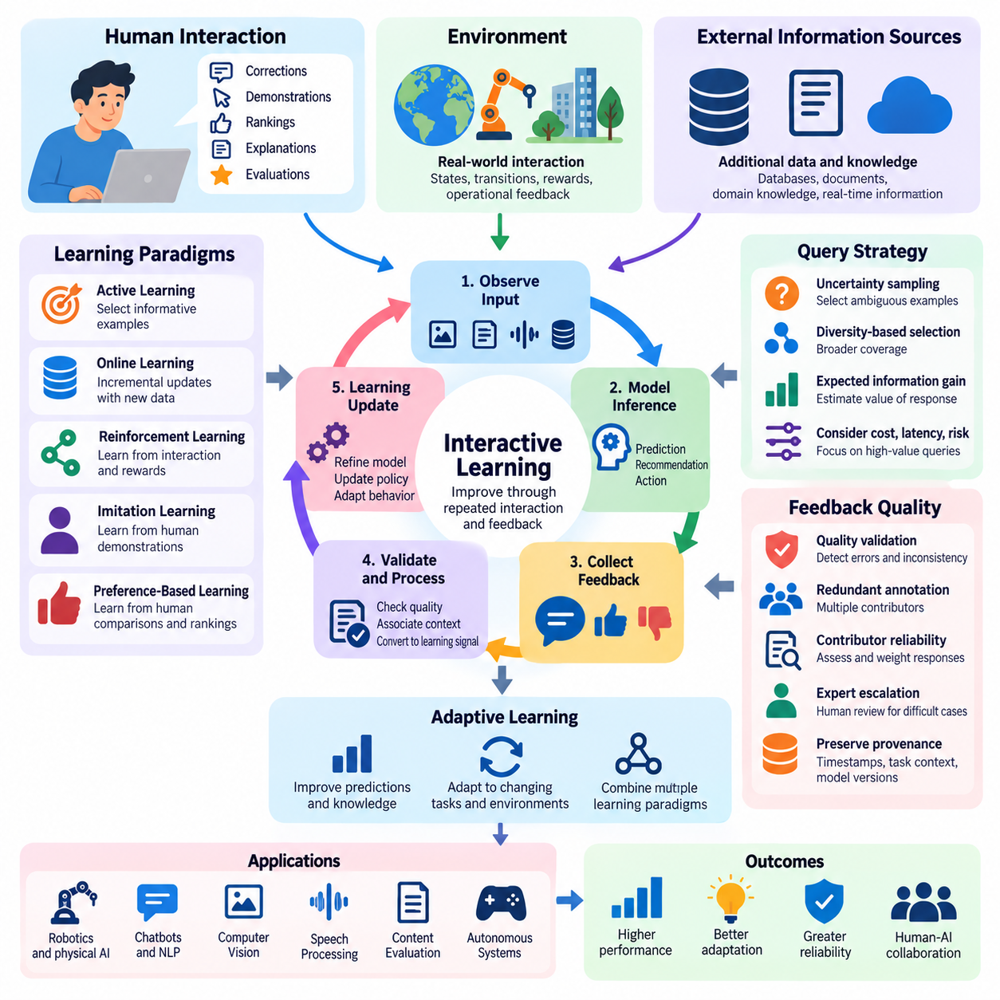
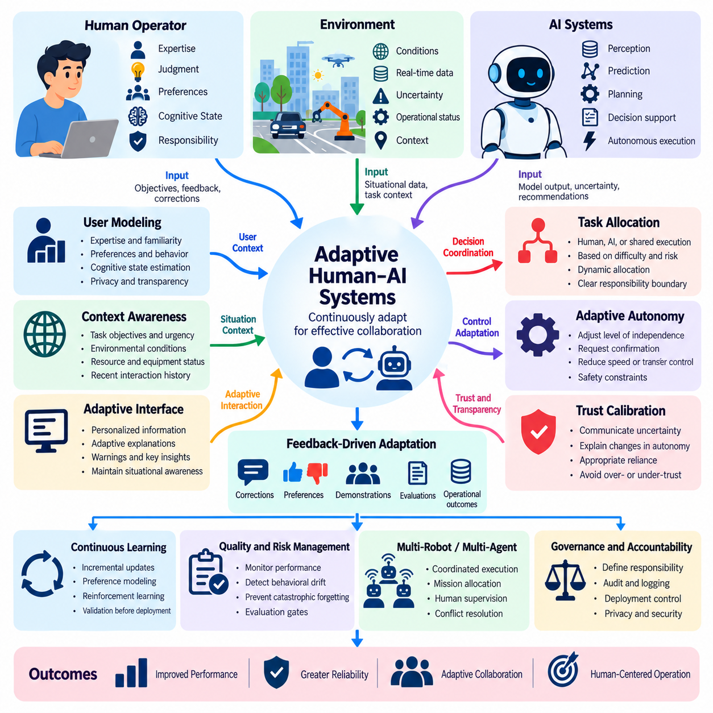
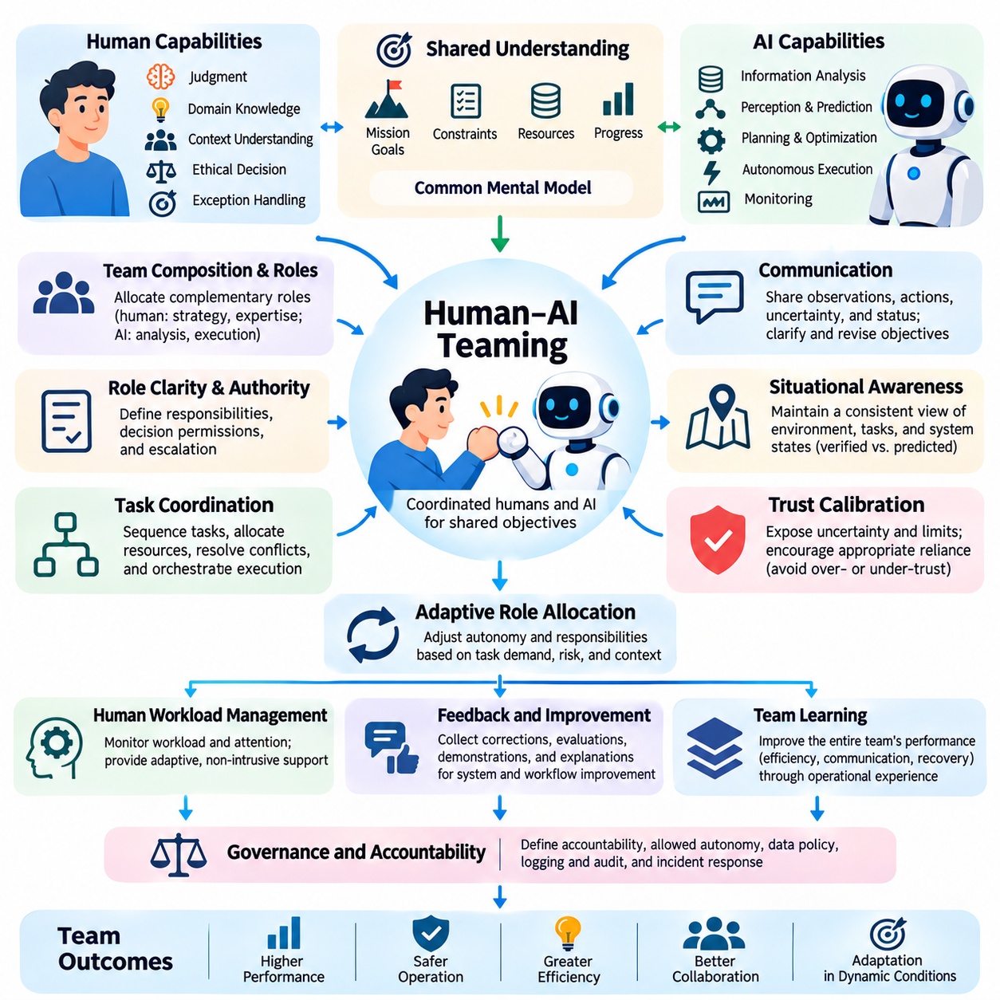

**Volume 41. Human in the Loop Learning**

# 07. Advanced Human AI Systems

## 07.01 Crowdsourcing

{width="7.268055555555556in" height="7.268055555555556in"}

크라우드소싱(Crowdsourcing)은 대규모 참여자 집단으로부터 인간의 지식(Knowledge), 판단(Judgment), 주석(Annotation), 피드백(Feedback)을 수집하는 분산형 접근 방식(Distributed Approach)이다. 인간 참여형 학습(Human-in-the-Loop Learning, HITL)에서 크라우드소싱은 전문 개발팀을 넘어 인간의 참여 범위를 확장하며, 인공지능(AI) 시스템이 다양한 관점을 확보하고 여러 환경과 응용 분야에서 구조화된 인간의 기여를 통해 지속적으로 개선될 수 있도록 한다.

크라우드소싱의 기본 원리는 복잡한 문제를 독립적 또는 협력적으로 수행할 수 있는 작은 작업(Task)으로 분할하는 것이다. 이러한 작업에는 이미지 레이블링(Image Labeling), 텍스트 분류(Text Classification), 음성 전사(Speech Transcription), 선호도 비교(Preference Comparison), 오류 식별(Error Identification), 행동 평가(Behavioral Evaluation) 등이 포함된다. 조정 플랫폼(Coordination Platform)은 작업을 배분하고 응답을 수집하며, 기여 결과를 검증한 후 AI 학습 및 평가 워크플로(Workflow)에 통합한다.

크라우드소싱은 확장 가능한 참여(Scalable Participation), 분산 작업 수행(Distributed Task Execution), 집단지성(Collective Intelligence)을 강조한다는 점에서 기존의 전문가 주석(Expert Annotation) 방식과 구별된다. 조직은 제한된 수의 전문가에게만 의존하는 대신 서로 다른 배경과 경험을 가진 참여자를 활용할 수 있다. 그러나 참여자 수의 증가가 반드시 정확도 향상을 보장하지는 않으므로, 참여자 선정(Contributor Selection), 작업 설계(Task Design), 품질 보증(Quality Assurance)이 핵심 요소가 된다.

작업 분해(Task Decomposition)는 크라우드소싱 기반 AI 개발에서 가장 중요한 설계 고려사항 중 하나이다. 복잡한 주석 문제는 명확한 출력 형식과 수용 기준(Acceptance Criteria)을 갖춘 이해하기 쉬운 지침으로 변환되어야 한다. 예를 들어 산업용 이미지에서 객체를 식별하는 작업은 객체 탐지(Object Detection), 범주 분류(Category Classification), 결함 평가(Defect Assessment), 불확실성 보고(Uncertainty Reporting)로 분리할 수 있으며, 서로 다른 참여자가 상호 보완적인 작업을 수행하도록 구성할 수 있다.

효과적인 크라우드소싱 플랫폼은 작업 할당(Task Allocation), 참여자 관리(Contributor Management), 응답 수집(Response Collection), 품질 모니터링(Quality Monitoring), 보상 체계(Compensation Mechanism)를 제공한다. 작업 할당에는 참여자의 전문성, 과거 정확도, 언어 능력, 가용성, 작업량 등을 고려할 수 있다. 적응형 할당 전략(Adaptive Assignment Strategy)은 어려운 사례를 숙련된 주석자에게 배정하고 일반적인 사례는 더 넓은 참여자 집단에 분산함으로써 자원 활용도를 높이고 불필요한 주석 비용을 줄인다.

품질 관리(Quality Control)는 크라우드소싱 응답에 오류, 불일치, 주관적 해석, 때로는 악의적인 제출이 포함될 수 있기 때문에 핵심적인 과제이다. 일반적인 보호 장치에는 중복 주석(Redundant Annotation), 자격 평가(Qualification Test), 숨겨진 기준 문제(Hidden Reference Question), 응답 일관성 검사(Response Consistency Check), 전문가 검토(Expert Review)가 포함된다. 이러한 메커니즘을 결합하면 다수결 결과가 항상 정답(Ground Truth)을 의미한다고 가정하지 않으면서 신뢰할 수 있는 기여와 불확실하거나 품질이 낮은 응답을 구별할 수 있다.

주석자 간 일치도(Inter-Annotator Agreement)는 여러 참여자의 판단이 얼마나 일관적인지를 측정한다. 코헨의 카파(Cohen\'s Kappa), 플라이스의 카파(Fleiss\' Kappa), 크리펜도르프의 알파(Krippendorff\'s Alpha)와 같은 지표는 우연에 의한 일치 또는 주석 구조의 특성을 고려하여 일치도를 정량화하는 서로 다른 접근 방식을 제공한다. 낮은 일치도는 단순히 참여자의 성능이 부족하다는 의미가 아니라 모호한 지침, 전문성 부족, 주관적인 범주, 실제로 판단하기 어려운 사례를 나타낼 수 있다.

합의 집계(Consensus Aggregation)는 여러 인간의 응답을 하나의 통합된 주석 또는 의사결정으로 변환한다. 다수결 투표(Majority Voting)는 간단한 기준 방법을 제공하며, 가중 투표(Weighted Voting)는 검증된 신뢰도가 높은 참여자에게 더 큰 영향력을 부여한다. 도스--스킨 모델(Dawid--Skene Model)을 포함한 확률적 접근 방식(Probabilistic Approach)은 잠재 레이블(Latent Label)과 주석자의 오류 특성을 추정한다. 이러한 방법은 참여자별 역량이 다를 때 집계 성능을 개선할 수 있지만, 효과는 적절한 모델링 가정에 따라 달라진다.

참여자 신뢰도(Contributor Reliability)는 영구적으로 고정된 속성이 아니라 동적으로 평가되어야 한다. 성능은 도메인(Domain), 작업 복잡도(Task Complexity), 피로 수준(Fatigue Level), 주석 지침의 변화에 따라 달라질 수 있다. 일반 이미지 분류에서 우수한 성능을 보이는 참여자도 전문 의료 영상이나 산업용 이미지에서는 어려움을 겪을 수 있다. 도메인별 신뢰도 추정(Domain-Specific Reliability Estimation)은 작업을 적절하게 할당하고 전문가 개입이 필요한 상황을 식별하도록 지원한다.

크라우드소싱은 능동 학습(Active Learning)과 통합될 때 특히 높은 가치를 제공한다. AI 모델은 무작위로 선택한 사례에 대한 레이블을 요청하는 대신, 불확실하거나 정보량이 많거나 충분히 대표되지 않은 샘플을 식별하여 인간 평가에 제출한다. 이후 수집된 주석은 후속 학습 주기(Training Cycle)에 반영된다. 이러한 접근 방식은 레이블링 요구량을 줄일 수 있지만, 전체적인 효과는 질의 품질(Query Quality), 주석 비용(Annotation Cost), 인간 응답의 신뢰도에 따라 결정된다.

인간 선호도 수집(Human Preference Collection)은 또 다른 중요한 응용 분야이다. 참여자는 챗봇(Chatbot)의 대안 응답을 비교하거나 생성 결과의 순위를 매기고, 지시 준수 여부(Instruction Compliance)와 인지된 유용성(Perceived Usefulness)을 평가할 수 있다. 이러한 판단은 선호도 모델링(Preference Modeling)과 인간 피드백 기반 강화학습(Reinforcement Learning from Human Feedback, RLHF)을 지원한다. 선호도는 개인과 문화에 따라 달라질 수 있으므로 의견 불일치 정보를 보존하고 집계된 선호도를 보편적으로 유효한 목표로 간주하지 않아야 한다.

크라우드소싱은 자동화된 평가 지표(Automated Evaluation Metrics)만으로 사실적 정확성(Factual Accuracy), 맥락적 적절성(Contextual Appropriateness), 창의성(Creativity), 실용적 유용성(Practical Usefulness)을 충분히 포착하기 어려운 생성형 AI(Generative AI) 시스템의 평가에도 활용된다. 인간 평가자는 구조화된 평가 기준표(Structured Rubric)와 비교 판단(Comparative Judgment)을 사용하여 여러 차원을 평가할 수 있다. 신중하게 설계된 평가 프로토콜(Evaluation Protocol)은 모호성을 줄이고, 무작위 제시(Randomized Presentation)와 독립 검토(Independent Review)는 위치 편향(Position Bias), 앵커링 효과(Anchoring Effect), 평가 간 오염을 제한하는 데 도움을 준다.

참여자 다양성(Contributor Diversity)은 서로 다른 언어, 문화적 관습, 환경 조건, 사용자 기대를 AI 시스템에 반영함으로써 데이터셋 포괄성(Dataset Coverage)을 개선할 수 있다. 그러나 인구통계학적 다양성(Demographic Diversity)만으로 편향(Bias)이 제거되는 것은 아니다. 샘플링 전략(Sampling Strategy)은 어떤 집단이 대표되는지, 어떤 관점이 누락되는지, 작업 지침이 특정 해석을 체계적으로 선호하는지를 고려해야 한다. 투명한 데이터셋 문서화(Dataset Documentation)는 모델 개발 과정에서 이러한 한계를 드러내는 데 도움이 된다.

로보틱스(Robotics)와 피지컬 AI(Physical AI)에서 크라우드소싱은 시각적 주석(Visual Annotation), 환경 이해(Environmental Understanding), 인간 선호도 평가(Human Preference Assessment), 로봇 행동 평가(Robot Behavior Evaluation)를 지원할 수 있다. 참여자는 기록된 시연(Demonstration)을 사용하여 장애물을 식별하고, 지형 조건을 분류하며, 주행 결과를 평가하거나 대안적인 로봇 행동을 비교할 수 있다. 이러한 기여는 인식(Perception)과 의사결정(Decision-Making)을 위한 데이터셋 구축에 도움이 되지만, 안전 필수 제어 판단(Safety-Critical Control Judgment)은 적절한 자격을 갖춘 전문가의 검증이 필요하다.

로봇 운영자(Robot Operator)와 현장 인력(Field Personnel)으로부터 수집된 크라우드소싱 피드백은 사전에 정의된 규칙으로 표현하기 어려운 운영 지식(Operational Knowledge)을 포착할 수 있다. 작업자는 위험한 기동(Unsafe Maneuver), 비효율적인 경로(Inefficient Route), 혼란스러운 상호작용 패턴(Interaction Pattern), 반복적인 실패와 관련된 환경 조건을 식별할 수 있다. 이러한 피드백이 센서 기록(Sensor Recording), 타임스탬프(Timestamp), 로봇 상태(Robot State), 작업 결과(Task Outcome)와 연결되면 자율 시스템(Autonomous System)의 성능을 개선하는 중요한 근거가 된다.

개인정보 보호(Privacy)와 보안(Security)은 크라우드소싱 아키텍처(Crowdsourcing Architecture)의 초기 단계부터 통합되어야 한다. 참여자는 민감한 이미지, 개인정보(Personal Information), 독점 문서(Proprietary Document), 산업 운영 데이터(Industrial Operational Data)를 접할 수 있다. 적절한 보호 조치에는 데이터 최소화(Data Minimization), 접근 제어(Access Control), 가능한 경우 익명화(Anonymization), 안전한 전송(Secure Transmission), 계약상 제한(Contractual Restriction)이 포함된다. 매우 민감한 작업에는 제한 없는 공개 크라우드소싱 플랫폼보다 검증된 내부 참여자가 필요할 수 있다.

윤리적인 크라우드소싱(Ethical Crowdsourcing)은 공정한 보상(Fair Compensation), 충분한 정보에 기반한 참여(Informed Participation), 접근성(Accessibility), 참여자 복지(Contributor Well-Being)를 고려해야 한다. 불쾌감을 유발하는 콘텐츠, 반복적인 판단, 과도한 시간 압박이 포함된 작업은 심리적 위험(Psychological Risk)과 운영상 위험(Operational Risk)을 초래할 수 있다. 투명한 지침, 합리적인 작업량, 이의 제기 절차(Appeal Mechanism), 명확한 보상 정책은 지속 가능한 참여를 지원하면서 수집된 인간 피드백의 신뢰성과 정당성을 높인다.

경제적 효율성(Economic Efficiency)은 개별 주석의 비용만으로 평가해서는 안 된다. 총비용(Total Expenditure)에는 작업 준비, 플랫폼 관리, 참여자 자격 검증, 중복 레이블링(Redundant Labeling), 전문가 판정(Expert Adjudication), 데이터 통합(Data Integration), 후속 수정 작업이 포함된다. 초기 주석 단가가 낮더라도 오류율이 높으면 전체 비용은 증가할 수 있다. 따라서 비용 최적화(Cost Optimization)는 주석 처리량(Annotation Throughput), 최종 데이터셋 품질(Dataset Quality), 다운스트림 모델 성능(Downstream Model Performance) 사이의 균형을 요구한다.

성숙한 크라우드소싱 시스템은 각 주석을 작업 정의(Task Definition), 참여자 자격(Contributor Qualification), 검토 이력(Review History), 데이터셋 버전(Dataset Version)과 연결하는 출처 추적 기록(Provenance Record)을 유지해야 한다. 이러한 기록은 추적 가능성(Traceability), 재현성(Reproducibility), 오류 분석(Error Analysis), 책임성(Accountability)을 지원한다. 모델 실패로 문제가 있는 학습 사례가 발견되면 출처 정보를 통해 근본 원인이 모호한 지침, 주석 오류, 체계적인 샘플링 편향 중 어디에 있는지 조사할 수 있다.

크라우드소싱 인프라(Crowdsourcing Infrastructure)는 MLOps 파이프라인(MLOps Pipeline)과 통합되어 지속적인 데이터 개선(Continuous Data Improvement)을 가능하게 한다. 새롭게 수집된 사례는 우선순위가 결정되고, 할당과 주석 및 검토를 거친 후 재학습(Retraining) 전에 버전이 관리되는 데이터셋(Versioned Dataset)에 통합된다. 자동 검증 검사(Automated Validation Check)와 통제된 모델 승격(Controlled Model Promotion)은 검증되지 않은 기여가 운영 환경의 동작에 직접적인 영향을 미치지 않도록 한다. 이후 모니터링(Monitoring)은 추가적인 인간 주석 주기를 시작할 수 있는 새로운 실패 패턴(Failure Pattern)을 식별한다.

크라우드소싱의 효과는 주석 정확도(Annotation Accuracy), 일치도(Agreement), 처리량(Throughput), 지연시간(Latency), 비용(Cost), 참여자 유지율(Contributor Retention), 다운스트림 모델 개선(Downstream Model Improvement)을 통해 측정해야 한다. 평가에서는 어려운 샘플과 충분히 대표되지 않은 집단에 대한 성능도 검토해야 한다. 전문가 전용 주석(Expert-Only Annotation) 및 대안적인 레이블링 전략과의 통제된 비교(Controlled Comparison)를 통해 분산형 인간 참여가 단순히 데이터셋 규모만 늘리는 것이 아니라 실질적인 개선을 만들어 내는지 확인할 수 있다.

고급 크라우드소싱 시스템(Advanced Crowdsourcing System)은 인간 참여자와 AI 지원 주석(AI-Assisted Annotation), 자동 품질 추정(Automated Quality Estimation), 적응형 작업 라우팅(Adaptive Task Routing)을 점점 더 긴밀하게 결합하고 있다. AI 모델은 예비 레이블(Preliminary Label)을 제안하고 불확실한 영역을 강조하며 잠재적으로 일관성이 없는 응답을 식별할 수 있다. 인간 참여자는 이러한 제안을 검증하거나 수정하고, 독립적인 감사(Independent Audit)는 자동화 편향(Automation Bias)을 탐지하는 데 도움을 준다. 이러한 협력은 인간의 판단이 가장 큰 가치를 제공하는 사례에 노력을 집중할 수 있도록 한다.

궁극적으로 크라우드소싱은 분산된 인간 지식(Distributed Human Knowledge)을 지능형 시스템(Intelligent System)을 위한 구조화된 학습 자원(Structured Learning Resource)으로 변환한다. 장기적인 가치는 신뢰할 수 있는 조정(Reliable Coordination), 엄격한 품질 보증(Rigorous Quality Assurance), 책임 있는 참여자 관리(Responsible Contributor Management), 지속 학습 프로세스(Continuous Learning Process)와의 통합에 달려 있다. 고급 인간-AI 시스템(Advanced Human-AI Systems)에서 크라우드소싱은 집단 피드백(Collective Feedback), 협력적 평가(Collaborative Evaluation), 의미 있는 인간 감독(Human Oversight) 아래에서 AI 역량을 점진적으로 개선하기 위한 확장 가능한 기반을 제공한다.

## 07.02 Human AI Collaboration

{width="7.268055555555556in" height="7.268055555555556in"}

인간-AI 협업(Human-AI Collaboration)은 공동의 목표를 달성하기 위해 인간 지능(Human Intelligence)과 인공지능(Artificial Intelligence, AI) 시스템이 조정된 방식으로 상호작용하는 것을 의미한다. AI를 인간 의사결정(Human Decision-Making)의 완전한 대체 수단으로 간주하는 대신, 협업은 컴퓨팅 효율성(Computational Efficiency), 패턴 인식(Pattern Recognition), 자동화된 추론(Automated Reasoning)을 인간의 판단력(Judgment), 맥락 이해(Contextual Understanding), 창의성(Creativity), 윤리적 책임(Ethical Responsibility)과 결합한다. 그 목적은 인간이나 AI가 단독으로 수행할 때보다 일관되게 우수한 결과를 달성하는 것이다.

효과적인 인간-AI 협업의 기반은 상호 보완적 역량 할당(Complementary Capability Allocation)이다. AI 시스템은 대규모 데이터셋 처리(Large-Scale Dataset Processing), 통계적 패턴 식별(Statistical Pattern Identification), 일관된 계산 절차 수행(Consistent Computational Procedures), 대규모 예측 생성(Scalable Prediction Generation)에 강점을 가진다. 인간은 도메인 전문성(Domain Expertise), 인과적 해석(Causal Interpretation), 상황 인식(Situational Awareness), 중요한 의사결정에 대한 책임을 제공한다. 협업 아키텍처(Collaborative Architecture)는 검증된 역량, 한계, 불확실성(Uncertainty), 운영 위험(Operational Risk)에 따라 책임을 할당해야 한다.

인간-AI 협업은 인간의 AI 지원(Human Assistance to AI), AI의 인간 지원(AI Assistance to Humans), 상호 의사결정(Reciprocal Decision-Making)을 포함한 여러 상호작용 패턴(Interaction Pattern)을 통해 이루어질 수 있다. 인간 지원형 AI(Human-Assisted AI)에서는 사람이 주석(Annotation), 수정(Correction), 시연(Demonstration), 승인(Approval)을 제공하여 자동화된 동작을 개선한다. AI 지원형 인간 워크플로(AI-Assisted Human Workflow)에서는 모델이 권고안(Recommendation), 요약(Summary), 예측(Prediction), 후보 행동(Candidate Action)을 생성한다. 상호 협업(Reciprocal Collaboration)은 양측이 정보를 교환하고 의사결정을 점진적으로 개선하도록 한다.

핵심적인 아키텍처 요구사항(Architectural Requirement)은 의사결정 권한(Decision Authority)을 명시적으로 정의하는 것이다. AI 시스템은 부여된 권한(Permission)에 따라 행동을 권고하거나, 제한된 범위의 작업을 실행하거나, 인간의 개입(Human Intervention)을 요청할 수 있다. 인간은 실행을 감독하고, 중요한 결정을 승인하며, 목표를 수정하거나 자동화된 동작을 재정의할 수 있다. 명확한 권한 경계(Authority Boundary)는 책임의 모호성을 방지하고 예상하지 못한 결과나 운영 실패가 발생했을 때 책임성(Accountability)을 확보하도록 지원한다.

작업 할당(Task Allocation)은 각 의사결정의 난이도(Difficulty), 긴급성(Urgency), 불확실성(Uncertainty), 결과의 중대성(Consequence)에 따라 적응적으로 이루어져야 한다. 자동화 성능이 검증된 반복 작업(Routine Task)은 AI에 위임할 수 있지만, 모호하거나 위험도가 높은 상황에서는 인간 검토(Human Review)가 필요할 수 있다. 동적 할당 메커니즘(Dynamic Allocation Mechanism)은 모델 신뢰도(Model Confidence), 환경 조건(Environmental Condition), 작업 부하(Workload), 가용 전문성(Available Expertise)을 평가한다. 다만 수치적 확신이 반드시 예측의 정확성을 의미하지 않으므로 신뢰도 추정은 보정(Calibration)되어야 한다.

의사소통 품질(Communication Quality)은 협업 성능(Collaborative Performance)에 큰 영향을 미친다. AI 시스템은 관련 근거(Relevant Evidence), 불확실성 추정(Uncertainty Estimate), 제안된 행동(Proposed Action), 운영상 한계(Operational Limitation)를 인간이 효율적으로 해석할 수 있는 형태로 제시해야 한다. 과도한 정보는 인지 부하(Cognitive Workload)를 증가시키며, 설명이 부족하면 부적절한 의존(Inappropriate Reliance)을 유발할 수 있다. 따라서 효과적인 인터페이스(Interface)는 실행 가능한 정보(Actionable Information), 맥락적 관련성(Contextual Relevance), 필요할 때 모델 권고안을 조사할 수 있는 기능을 우선해야 한다.

신뢰 보정(Trust Calibration)은 과도한 신뢰와 불충분한 신뢰 모두 협업 결과를 악화시킬 수 있기 때문에 필수적이다. 자동화 편향(Automation Bias)은 사용자가 충분한 검증 없이 AI 권고안을 수용할 때 발생하며, 알고리즘 회피(Algorithm Aversion)는 오류를 경험한 사용자가 신뢰할 수 있는 AI 지원까지 거부하는 현상을 의미한다. 잘 설계된 시스템은 불확실성을 전달하고 의미 있는 한계를 공개하며 독립적인 평가 기회를 제공함으로써 실제로 입증된 시스템 신뢰성(System Reliability)에 부합하는 의존 수준을 유도한다.

설명 가능성(Explainability)과 해석 가능성(Interpretability)은 AI의 동작을 이해하고 평가하기 쉽게 만들어 협업을 지원한다. 특징 기여도(Feature Attribution), 사례 기반 설명(Example-Based Explanation), 반사실적 분석(Counterfactual Analysis), 불확실성 시각화(Uncertainty Visualization)는 사용자가 예측 결과를 조사하는 데 도움을 줄 수 있다. 그러나 설명은 시각적 설득력만이 아니라 충실성(Faithfulness)과 유용성(Usefulness)을 기준으로 평가해야 한다. 설득력 있게 보이더라도 실제 모델의 의사결정 과정을 잘못 표현하는 설명은 효과적인 인간 감독(Human Oversight)을 약화시킬 수 있다.

공유 상황 인식(Shared Situational Awareness)은 인간과 AI 시스템이 작업, 환경, 운영 상태에 대해 서로 양립 가능한 해석을 유지하도록 한다. 동적인 환경(Dynamic Environment)에서 협업하려면 관측(Observation), 목표(Objective), 제약조건(Constraint), 실행 진행 상태(Execution Progress)를 지속적으로 동기화해야 한다. 상태 표현(State Representation)은 검증된 관측과 예측 및 가정을 구별해야 한다. 이러한 구분은 환경 조건이 변화하거나 정보가 오래되었을 때 조정 실패(Coordination Failure)를 방지하는 데 도움이 된다.

인간 피드백(Human Feedback)은 시간이 지남에 따라 협업을 개선하는 메커니즘을 제공한다. 수정(Correction), 선호도 판단(Preference Judgment), 시연(Demonstration), 운영 평가(Operational Evaluation)는 체계적인 모델 약점(Systematic Model Weakness)이나 변화하는 사용자 요구사항(User Requirement)을 드러낼 수 있다. 피드백 수집(Feedback Collection)은 맥락(Context), 타임스탬프(Timestamp), 작업 조건(Task Condition), 결과 정보(Outcome Information)를 보존해야 한다. 이러한 기록은 후속 분석과 통제된 모델 업데이트(Controlled Model Update)를 가능하게 하며, 불완전하거나 오해의 소지가 있는 관측으로부터 학습할 위험을 줄인다.

협력 학습(Collaborative Learning)은 반복적인 상호작용을 모델 개선에 통합함으로써 개별적인 피드백 사건을 넘어선다. AI 시스템은 축적된 근거를 바탕으로 권고안(Recommendation), 상호작용 정책(Interaction Policy), 작업 전략(Task Strategy)을 조정할 수 있다. 그러나 이러한 적응(Adaptation)은 검증 절차(Validation Procedure), 개인정보 보호 요구사항(Privacy Requirement), 배포 통제(Deployment Control)에 의해 제한되어야 한다. 제약 없는 온라인 학습(Unrestricted Online Learning)은 불안정성을 유발하거나 사용자별 편향(User-Specific Bias)을 강화하고 기존에 신뢰할 수 있었던 역량을 저하시킬 수 있다.

인간 요인(Human Factors)은 장기간 지속되는 협업에서 특히 중요하다. 주의력(Attention), 피로(Fatigue), 인지 부하(Cognitive Workload), 전문성(Expertise), 시간 압박(Time Pressure)은 사람이 AI 권고안을 얼마나 효과적으로 평가하는지에 영향을 미친다. 인터페이스 설계(Interface Design)는 불필요한 중단을 줄이고 가치가 낮은 알림으로 사용자를 압도하지 않아야 한다. 적응형 상호작용 메커니즘(Adaptive Interaction Mechanism)은 중요한 경고의 우선순위를 높이고 긴급하지 않은 검토를 적절한 시점에 배치할 수 있지만, 인간의 상황 인식과 개입 능력을 유지해야 한다.

로보틱스(Robotics)와 피지컬 AI(Physical AI)에서 인간-AI 협업은 인간 감독(Human Supervision)을 자율 인식(Autonomous Perception), 계획(Planning), 제어(Control)와 연결한다. 운영자(Operator)는 임무 목표(Mission Objective)를 지정하고, 주행 계획(Navigation Plan)을 승인하며, 모호한 환경 해석을 해결하거나 예외 상황(Exceptional Event)에 개입할 수 있다. 로봇은 검증된 행동(Validated Action)을 실행하면서 진행 상태, 불확실성, 안전 조건(Safety Condition)을 보고한다. 이러한 구성은 자율 시스템이 모든 실제 환경의 돌발 상황을 독립적으로 해결할 수 있다고 가정하지 않으면서 운영 효율성을 지원한다.

협력 로봇 시스템(Collaborative Robotic System)은 인간 운영자와 자동화된 제어기(Automated Controller) 사이에 제어 권한을 분산하는 공유 자율성(Shared Autonomy)을 활용하는 경우가 많다. 인간은 상위 수준의 목표(High-Level Goal)를 제공하고, 로봇은 동작 계획(Motion Planning), 장애물 회피(Obstacle Avoidance), 궤적 실행(Trajectory Execution)을 처리할 수 있다. 제어 권한 할당(Control Allocation)은 환경의 불확실성과 운영자의 개입에 따라 변경될 수 있다. 안전 필수 전환(Safety-Critical Transition)에는 예측 가능한 동작, 명확한 피드백, 충돌하는 명령을 방지하는 메커니즘이 필요하다.

다중 에이전트 환경(Multi-Agent Environment)에서는 인간이 여러 AI 에이전트(AI Agent) 또는 로봇을 동시에 감독할 수 있으므로 추가적인 조정 문제가 발생한다. 효과적인 협업에는 임무 수준 작업 할당(Mission-Level Task Allocation), 공유 상태 모니터링(Shared Status Monitoring), 예외 관리(Exception Management), 조정된 복구 절차(Coordinated Recovery Procedure)가 필요하다. 인간 감독자는 모든 하위 수준 행동을 개별적으로 감시하기보다 통합된 운영 정보(Consolidated Operational Information)를 제공받아야 한다. 에스컬레이션 정책(Escalation Policy)은 자동화된 조정만으로 충분하지 않은 상황을 식별해야 한다.

의사결정 지원 시스템(Decision Support System)은 협업이 복잡한 분석 워크플로(Analytical Workflow)를 어떻게 개선할 수 있는지 보여준다. AI 모델은 이상 현상(Anomaly)을 식별하고, 위험을 추정하며, 대안을 비교하거나 근거를 요약할 수 있고, 인간 전문가는 그 의미를 해석하고 행동을 선택한다. 평가는 단순히 예측 정확도(Prediction Accuracy)가 증가했는지가 아니라 실제 의사결정(Actual Decision)이 개선되었는지를 검토해야 한다. 인간 전문성과 AI 권고안은 현실적인 운영 조건(Realistic Operational Condition)에서 함께 평가되어야 한다.

안전성(Safety)과 책임성(Accountability)을 확보하려면 배포(Deployment) 전에 책임을 명시한 협업 프로토콜(Collaboration Protocol)이 필요하다. 이러한 프로토콜은 허용되는 자동화 행동(Permissible Automated Action), 인간 승인 요구사항(Human Approval Requirement), 비상 개입 절차(Emergency Intervention Procedure), 감사 메커니즘(Audit Mechanism)을 정의해야 한다. 영향력이 큰 의사결정(High-Impact Decision)에는 독립 검증(Independent Verification)이나 다단계 승인(Multiple Authorization Levels)이 필요할 수 있다. 인간 지시, AI 권고안, 재정의 조치(Override), 실행 결과를 기록하면 사고 조사(Incident Investigation)와 지속적인 안전 개선을 지원할 수 있다.

인간-AI 협업의 평가에는 독립적인 모델 성능(Standalone Model Performance)을 넘어서는 지표가 필요하다. 관련 측정 항목에는 공동 작업 성공률(Joint Task Success), 의사결정 품질(Decision Quality), 완료 시간(Completion Time), 인간 작업 부하(Human Workload), 개입 빈도(Intervention Frequency), 오류 복구(Error Recovery), 신뢰 보정(Trust Calibration), 안전 결과(Safety Outcome)가 포함된다. 통제 실험(Controlled Experiment)은 적절한 경우 인간 단독(Human-Only), AI 단독(AI-Only), 협업 구성(Collaborative Configuration)을 비교해야 한다. 이러한 비교를 통해 협업이 측정 가능한 이점을 제공하는지와 그 이점이 사라지는 조건을 파악할 수 있다.

고급 인간-AI 협업(Advanced Human-AI Collaboration)은 개인화된 인터페이스(Personalized Interface), 적응형 자율성(Adaptive Autonomy), 멀티모달 상호작용(Multimodal Interaction), 맥락 인식 지원(Context-Aware Assistance)을 점점 더 많이 통합하고 있다. 언어(Language), 시각(Vision), 제스처(Gesture), 운영 원격측정 데이터(Operational Telemetry)는 인간과 지능형 기계 사이의 더욱 풍부한 의사소통을 지원할 수 있다. 그러나 개인화(Personalization)가 시스템의 한계를 가리거나 일관된 안전 요구사항을 약화시켜서는 안 된다. 적응 과정은 관찰 가능하고(Observable), 되돌릴 수 있으며(Reversible), 조직 거버넌스(Organizational Governance)와 양립할 수 있어야 한다.

궁극적으로 인간-AI 협업은 고립된 자동화(Isolated Automation)에서 조정된 지능(Coordinated Intelligence)으로의 전환을 의미한다. 그 효과는 상호 보완적 역량(Complementary Capabilities), 보정된 신뢰(Calibrated Trust), 투명한 의사소통(Transparent Communication), 적응형 작업 할당(Adaptive Task Allocation), 명확하게 정의된 인간 권한(Human Authority)에 달려 있다. 인간 참여형 학습(Human-in-the-Loop Learning)에서 협업은 하이브리드 지능(Hybrid Intelligence), 상호작용 학습(Interactive Learning), 적응형 인간-AI 시스템(Adaptive Human-AI Systems), 더욱 정교한 인간-기계 팀(Human-Machine Team)을 위한 상호작용 기반을 형성한다.

## 07.03 Hybrid Intelligence

{width="7.268055555555556in" height="7.268055555555556in"}

하이브리드 지능(Hybrid Intelligence)은 인간의 인지 능력(Human Cognitive Capabilities)과 인공지능(Artificial Intelligence, AI) 시스템이 통합된 문제 해결 과정(Unified Problem-Solving Process)의 상호 보완적 구성요소로 작동하는 지능의 통합 형태를 의미한다. 하이브리드 지능은 단순히 권고안을 교환하는 수준을 넘어 인간의 추론(Human Reasoning), 맥락적 지식(Contextual Knowledge), 창의성(Creativity), 윤리적 판단(Ethical Judgment)을 기계학습(Machine Learning), 계산 최적화(Computational Optimization), 자동화된 의사결정 지원(Automated Decision Support)과 결합하여 적응적이고 신뢰할 수 있는 결과를 달성한다.

하이브리드 지능의 핵심 원리는 인간과 인공지능의 역량이 서로 다른 강점과 한계를 가진다는 것이다. AI 시스템은 대규모 데이터셋(Large-Scale Dataset)을 분석하고, 복잡한 통계적 관계(Statistical Relationships)를 탐지하며, 반복적인 계산을 일관되게 수행할 수 있다. 인간은 경험 기반 직관(Experience-Based Intuition), 인과적 이해(Causal Understanding), 사회적 인식(Social Awareness), 모호한 상황을 해석하는 능력을 제공한다. 효과적인 하이브리드 시스템(Hybrid System)은 어느 한쪽이 보편적으로 우월하다고 가정하는 대신 이러한 역량을 조정하고 결합한다.

하이브리드 지능은 통합된 인지 과정(Integrated Cognitive Processes)과 상호 적응(Mutual Adaptation)을 강조한다는 점에서 기존의 인간-AI 협업(Human-AI Collaboration)을 확장한다. 기본적인 협업에서는 인간과 AI 시스템이 별도의 작업을 수행하고 결과를 교환할 수 있다. 반면 하이브리드 지능에서는 공유 표현(Shared Representation), 반복적 추론(Iterative Reasoning), 지속적인 피드백(Continuous Feedback)을 통해 양측의 기여가 상호 연결된다. 그 결과 시스템은 독립적인 의사결정만이 아니라 조정된 상호작용(Coordinated Interaction)을 통해 해결책을 발전시킨다.

하이브리드 지능 아키텍처(Hybrid Intelligence Architecture)는 일반적으로 인간 참여자(Human Participant), AI 모델(AI Model), 공유 지식 표현(Shared Knowledge Representation), 상호작용 인터페이스(Interaction Interface), 조정 메커니즘(Coordination Mechanism)으로 구성된다. 인간 참여자는 목표(Objective), 제약조건(Constraint), 판단(Judgment), 도메인 전문성(Domain Expertise)을 제공하고, AI 구성요소는 예측(Prediction), 권고안(Recommendation), 후보 해결책(Candidate Solution)을 생성한다. 조정 메커니즘은 참여자 간 정보 흐름과 실행 과정에서 발생하는 상충된 해석의 해결 방식을 결정한다.

공유 지식 표현(Shared Knowledge Representation)은 인간의 이해와 기계가 생성한 정보 사이의 일관성을 유지하는 데 필수적이다. 지식 그래프(Knowledge Graph), 의미 모델(Semantic Model), 구조화된 작업 설명(Structured Task Description), 맥락 기억(Contextual Memory)은 공통 참조 구조(Common Reference Structure)를 제공할 수 있다. 이러한 표현은 검증된 사실(Verified Fact), 추론된 관계(Inferred Relationship), 불확실한 예측(Uncertain Prediction), 인간의 가정(Human Assumption)을 구별해야 한다. 이러한 구분을 유지하면 오해를 줄이고 투명한 협력적 추론(Collaborative Reasoning)을 지원할 수 있다.

하이브리드 추론(Hybrid Reasoning)은 인간의 개념적 이해(Conceptual Understanding)와 계산적 추론(Computational Inference)을 결합한다. AI 모델은 패턴을 식별하고 확률을 추정하거나 가설(Hypothesis)을 생성할 수 있으며, 인간은 인과적 타당성(Causal Plausibility), 맥락적 관련성(Contextual Relevance), 실제적 결과(Practical Consequence)를 평가한다. 이러한 상호작용은 사용 가능한 데이터가 불완전하거나 환경 조건이 익숙하지 않을 때 특히 유용하다. 인간의 판단이 기계가 생성한 대안을 개선함에 따라 추론 과정은 반복적으로 발전한다.

하이브리드 지능의 집단적 문제 해결(Collective Problem-Solving)은 작업 요구사항(Task Requirement)에 따라 인지 활동(Cognitive Activity)을 분산하는 방식으로 이루어진다. 기계는 정보 검색(Information Retrieval), 시뮬레이션(Simulation), 최적화(Optimization), 대규모 비교(Large-Scale Comparison)를 수행하고, 인간은 목표를 해석하고 우선순위를 설정하며 모호한 상충관계(Tradeoff)를 해결할 수 있다. 작업 책임은 불확실성이나 운영 조건이 변화함에 따라 동적으로 변경될 수 있다. 성공적인 할당에는 명확한 권한 경계(Authority Boundary)와 참여자 간 신뢰할 수 있는 의사소통이 필요하다.

불확실성 관리(Uncertainty Management)는 인간의 판단과 AI의 예측이 모두 잘못될 수 있기 때문에 기본적인 요구사항이다. 하이브리드 시스템은 불확실성을 명시적으로 표현하고 통계적 신뢰도(Statistical Confidence)와 검증된 정확성(Verified Correctness)을 구별해야 한다. 불확실성이 허용 가능한 임계값(Acceptable Threshold)을 초과하면 추가 근거(Additional Evidence), 인간 검토(Human Review), 대안적인 계산 분석(Alternative Computational Analysis)이 필요할 수 있다. 신뢰도 보정(Confidence Calibration)과 의견 불일치 탐지(Disagreement Detection)는 근거가 부족한 결론이 시스템 전체로 확산되는 것을 방지한다.

인간의 전문성(Human Expertise)은 시연(Demonstration), 선호도 피드백(Preference Feedback), 수정(Correction), 제약조건(Constraint), 구조화된 지식(Structured Knowledge)을 통해 AI 시스템에 통합될 수 있다. 전문가 시연(Expert Demonstration)은 모방학습(Imitation Learning)을 안내하고, 선호도 판단(Preference Judgment)은 보상 모델링(Reward Modeling)과 정책 최적화(Policy Optimization)를 지원할 수 있다. 도메인 제약조건(Domain Constraint)은 계획이나 추론 과정에서 허용할 수 없는 해결책을 제한할 수 있다. 이러한 메커니즘은 모든 인간의 판단이 반드시 옳다고 가정하지 않으면서 인간의 지식을 재사용 가능한 계산적 지침(Computational Guidance)으로 변환한다.

상호 적응(Mutual Adaptation)은 고급 하이브리드 지능(Advanced Hybrid Intelligence)을 정적인 의사결정 지원 시스템(Static Decision-Support System)과 구별하는 특징이다. AI 구성요소는 사용자 전문성(User Expertise), 작업 맥락(Task Context), 관측된 피드백(Observed Feedback)에 따라 권고안을 조정할 수 있으며, 인간 참여자는 모델의 역량과 한계에 대한 이해를 발전시킬 수 있다. 이러한 적응은 투명하고 되돌릴 수 있어야 한다. 행동 드리프트(Behavioral Drift), 부적절한 의존(Inappropriate Reliance), 협업 성능 저하(Collaborative Performance Degradation)를 탐지하기 위해 지속적인 모니터링(Continuous Monitoring)이 필요하다.

하이브리드 지능은 공유 조정 구조(Shared Coordination Structure)를 통해 여러 AI 에이전트(AI Agent)와 인간 전문가(Human Specialist)를 통합할 수 있다. 전문화된 에이전트(Specialized Agent)는 인식(Perception), 계획(Planning), 지식 검색(Knowledge Retrieval), 시뮬레이션(Simulation), 평가(Evaluation)를 담당하고, 인간은 전략적 의사결정(Strategic Decision-Making)과 예외 상황(Exceptional Situation)을 감독할 수 있다. 효과적인 오케스트레이션(Orchestration)에는 일관된 상태 정보(Consistent State Information), 충돌 해결(Conflict Resolution), 명확한 에스컬레이션 절차(Escalation Procedure)가 필요하다. 이러한 메커니즘이 없다면 참여자 수의 증가는 조정 오버헤드(Coordination Overhead)를 발생시킬 수 있다.

인간 참여형 학습(Human-in-the-Loop Learning, HITL)에서 하이브리드 지능은 모델 개발(Model Development)과 운영 경험(Operational Experience) 사이에 지속적인 관계를 형성한다. 인간 피드백(Human Feedback)은 오류를 식별하고 목표를 명확하게 하며, 자동화된 평가 지표(Automated Metrics)가 놓칠 수 있는 맥락적 해석(Contextual Interpretation)을 제공한다. AI 시스템은 정보량이 높은 사례(Informative Example)의 우선순위를 결정하고 개선안을 제안하며 후보 업데이트(Candidate Update)를 평가한다. 검증된 피드백은 통제된 학습 주기(Controlled Learning Cycle)의 일부가 되어 인간 전문성과 측정 가능한 모델 개발을 연결한다.

하이브리드 지능은 실제 환경(Real-World Environment)에 불확실성, 변화하는 조건, 안전 제약조건(Safety Constraint)이 존재하기 때문에 로보틱스(Robotics)와 피지컬 AI(Physical AI)에서 특히 중요하다. 자율 로봇(Autonomous Robot)은 인식(Perception), 위치 추정(Localization), 계획(Planning), 제어(Control)를 수행할 수 있으며, 인간 운영자(Human Operator)는 임무 의도(Mission Intent), 환경 지식(Environmental Knowledge), 예외 처리(Exception Handling)를 제공한다. 하이브리드 아키텍처는 공유 운영 상태(Shared Operational State)를 통해 이러한 기능을 연결하여 인식, 계획, 실행 전반에 걸친 조정된 의사결정을 가능하게 한다.

공유 자율성(Shared Autonomy)은 로봇 제어(Robotic Control)에서 하이브리드 지능을 구현하는 중요한 방식이다. 인간은 상위 수준 목표(High-Level Goal)나 수정 명령(Corrective Command)을 정의하고, 자동화된 제어기(Automated Controller)는 궤적 생성(Trajectory Generation), 장애물 회피(Obstacle Avoidance), 하위 수준 실행(Low-Level Execution)을 관리할 수 있다. 제어 권한(Control Authority)은 작업 복잡도(Task Complexity), 환경 불확실성(Environmental Uncertainty), 안전 요구사항(Safety Requirement)에 따라 전환될 수 있다. 인간과 자동화된 명령이 상호작용할 때는 예측 가능한 전환(Predictable Transition)과 독립적인 안전 메커니즘(Independent Safety Mechanism)이 필수적이다.

플릿 수준(Fleet Level)에서 하이브리드 지능은 여러 로봇과 자율 에이전트(Autonomous Agent)의 조정된 관리를 지원한다. AI 오케스트레이션 시스템(AI Orchestration System)은 임무를 분배하고 자원 활용(Resource Utilization)을 최적화하며 운영 조건(Operational Condition)을 모니터링하고 복구 전략(Recovery Strategy)을 권고할 수 있다. 인간 감독자(Human Supervisor)는 임무 우선순위(Mission Priority)를 평가하고 예외적인 충돌을 해결하며 중대한 변경을 승인한다. 이러한 구성은 지속적인 수동 제어(Manual Control)의 필요성을 줄이면서 의미 있는 인간의 책임을 유지한다.

하이브리드 지능은 과학적 발견(Scientific Discovery), 의료(Healthcare), 산업공학(Industrial Engineering), 복잡한 의사결정 지원(Complex Decision Support) 응용 분야도 지원한다. AI 시스템은 관측을 분석하고 가설을 생성하며 대안을 비교하고 이상 현상(Anomaly)을 식별할 수 있으며, 전문가는 도메인 타당성(Domain Validity)과 실제적 의미(Practical Implication)를 평가한다. 목표는 단순히 계산 속도를 높이는 것이 아니라 추론 품질(Reasoning Quality)을 개선하는 것이다. 협업 평가(Collaborative Evaluation)는 통합 시스템이 더 정확하고 유용한 결과를 생성하는지 판단해야 한다.

신뢰(Trust)와 책임성(Accountability)은 통합된 지능이 책임 소재를 추적하기 어렵게 만들 수 있기 때문에 여전히 필수적이다. 하이브리드 아키텍처는 인간의 지시(Human Instruction), AI가 생성한 권고안(AI-Generated Recommendation), 의사결정 수정(Decision Revision), 승인(Approval), 실행 결과(Execution Result)를 기록해야 한다. 설명 가능한 인터페이스(Explainable Interface)와 출처 추적(Provenance Tracking)은 실패 발생 시 조사를 지원한다. 책임은 결합된 시스템에 모호하게 귀속시키는 대신 권한을 부여받은 개인과 조직에 명시적으로 할당되어야 한다.

하이브리드 지능의 평가(Evaluation)는 통합된 인간-기계 구성(Integrated Human-Machine Configuration)의 성능을 검토해야 한다. 관련 지표에는 공동 작업 성공률(Joint Task Success), 의사결정 정확도(Decision Accuracy), 완료 시간(Completion Time), 인지 부하(Cognitive Workload), 개입 빈도(Intervention Frequency), 강건성(Robustness), 안전성(Safety)이 포함된다. 인간 단독(Human-Only) 및 AI 단독(AI-Only) 기준선(Baseline)과의 비교는 통합이 실질적인 이점을 제공하는지 확인하는 데 도움이 된다. 실험은 불확실성, 상충되는 권고안, 변화하는 운영 조건에서의 성능도 조사해야 한다.

중요한 연구 과제(Research Challenge)는 하이브리드 지능이 불필요한 복잡성(Unnecessary Complexity)이 아니라 상호 보완적 이득(Complementary Gain)을 만들어 내는 시점을 판단하는 것이다. 인간의 참여는 맥락적 판단(Contextual Judgment)을 개선할 수 있지만 지연(Delay), 불일치(Inconsistency), 인지 과부하(Cognitive Overload)를 초래할 수도 있다. 자동화(Automation)는 처리량(Throughput)을 증가시킬 수 있지만 체계적인 오류(Systematic Error)를 강화할 수 있다. 따라서 효과적인 시스템은 상호작용 빈도를 최대화하는 대신 인간의 노력(Human Effort), 계산 자원(Computational Resource), 작업 품질(Task Quality), 운영 위험(Operational Risk) 사이의 균형을 최적화한다.

미래의 하이브리드 지능 시스템(Future Hybrid Intelligence System)은 멀티모달 파운데이션 모델(Multimodal Foundation Model), 지속적 맥락 기억(Persistent Contextual Memory), 적응형 인터페이스(Adaptive Interface), 조정된 자율 에이전트(Coordinated Autonomous Agent)를 통합할 수 있다. 이러한 역량은 더욱 풍부한 공유 이해(Shared Understanding)와 인지적 책임(Cognitive Responsibility)의 유연한 할당을 지원할 수 있다. 그러나 통합 수준이 높아질수록 검증(Validation), 개인정보 보호(Privacy), 보안(Security), 거버넌스(Governance)에 대한 요구사항도 증가한다. 적응성과 자율성은 관찰 가능하고, 제어 가능하며, 인간 감독(Human Oversight)과 양립할 수 있어야 한다.

궁극적으로 하이브리드 지능은 인간의 이해(Human Understanding)와 기계의 계산 능력(Machine Computation)을 조정된 지능 시스템(Coordinated Intelligence System)으로 결합하기 위한 프레임워크(Framework)를 제공한다. 그 가치는 단순한 자동화가 아니라 상호 보완적 추론(Complementary Reasoning), 공유 지식(Shared Knowledge), 적응형 조정(Adaptive Coordination), 지속 학습(Continuous Learning)에서 발생한다. 고급 인간-AI 시스템(Advanced Human-AI Systems)에서 하이브리드 지능은 책임 있는 인간 거버넌스(Accountable Human Governance) 아래에서 작동하는 상호작용 학습(Interactive Learning), 적응형 인간-AI 아키텍처(Adaptive Human-AI Architecture), 더욱 높은 역량을 갖춘 인간-기계 팀(Human-Machine Team)을 위한 개념적 기반을 형성한다.

## 07.04 Interactive Learning

{width="7.268055555555556in" height="7.268055555555556in"}

상호작용 학습(Interactive Learning)은 모델이 인간, 환경 또는 외부 정보원(External Information Source)과의 반복적인 상호작용을 통해 성능을 개선하는 적응형 인공지능 접근 방식(Adaptive Artificial Intelligence Approach)이다. 주로 고정된 데이터셋(Fixed Dataset)에 의존하는 기존 학습(Conventional Training)과 달리, 상호작용 학습은 학습 과정에서 피드백(Feedback)을 통합한다. 이를 통해 AI 시스템은 변화하는 목표(Objective)와 운영 조건(Operational Condition)에 따라 예측을 개선하고 새로운 지식을 습득하며 행동을 조정할 수 있다.

상호작용 학습의 핵심 원리는 학습 시스템(Learning System)과 주변 환경(Surrounding Environment) 사이의 지속적인 정보 교환(Continuous Information Exchange)이다. AI 모델은 예측(Prediction), 권고안(Recommendation), 행동(Action)을 생성하고, 인간이나 환경 프로세스(Environmental Process)는 그 유용성이나 정확성을 나타내는 반응을 제공한다. 이러한 상호작용은 새로운 학습 신호(Learning Signal)를 생성하여 시스템이 내부 표현(Internal Representation)을 업데이트하고 반복적인 피드백 주기(Feedback Cycle)를 통해 후속 의사결정을 개선하도록 한다.

상호작용 학습은 능동학습(Active Learning), 온라인 학습(Online Learning), 강화학습(Reinforcement Learning), 모방학습(Imitation Learning), 선호도 기반 학습(Preference-Based Learning)을 포함하는 여러 상호 보완적 패러다임(Complementary Paradigm)을 포괄한다. 이러한 접근 방식은 서로 다른 최적화 메커니즘(Optimization Mechanism)을 사용하지만 상호작용을 통해 획득한 정보를 중시한다는 공통점이 있다. 이들을 통합하면 AI 시스템은 정보 가치가 높은 경험(Informative Experience)을 선택하고, 수정 지침(Corrective Guidance)을 반영하며, 변화하는 작업 요구사항에 적응하면서 정책(Policy)을 개선할 수 있다.

인간 상호작용(Human Interaction)은 자동화된 학습 신호(Automated Learning Signal)가 불완전하거나 모호하거나 정의하기 어려운 경우에 특히 중요한 역할을 한다. 사용자는 시스템 행동에 대한 수정(Correction), 시연(Demonstration), 순위 평가(Ranking), 설명(Explanation), 명시적 평가(Explicit Evaluation)를 제공할 수 있다. 이러한 기여는 수치적 보상(Numerical Reward)이나 사전 정의된 레이블(Predefined Label)만으로 항상 추론할 수 없는 맥락적 정보(Contextual Information)를 제공한다. 효과적인 시스템은 인간의 불확실성과 비일관성을 고려하면서 이러한 피드백을 구조화된 학습 신호(Structured Learning Signal)로 변환한다.

기본적인 아키텍처 구성요소(Architectural Component)는 관측(Observation), 모델 추론(Model Inference), 피드백 수집(Feedback Collection), 학습 업데이트(Learning Update)를 연결하는 상호작용 루프(Interaction Loop)이다. 시스템은 관련 입력을 관측하고 출력을 생성한 다음 성능에 대한 피드백을 수신한다. 피드백은 검증되고 원래 맥락과 연결된 후 적절한 학습 과정에 반영된다. 이후 평가는 모델 변경이 허용할 수 없는 성능 퇴행(Performance Regression)을 유발하지 않으면서 성능을 개선했는지 판단한다.

능동학습(Active Learning)은 모델이 필요한 정보를 선택적으로 요청할 수 있도록 하여 상호작용 학습에 기여한다. 모든 가용 샘플(Available Sample)에 레이블을 부여하는 대신, 시스템은 불확실하거나 다양성이 높거나 모델 성능 개선에 기여할 것으로 예상되는 사례를 식별한다. 이후 인간 주석자(Human Annotator)가 요청된 정보를 제공한다. 이러한 전략은 주석 작업량(Annotation Effort)을 줄이고 학습을 가속할 수 있지만, 그 효과는 질의 선택(Query Selection), 주석 신뢰성(Annotation Reliability), 유입 데이터 분포(Incoming Data Distribution)에 따라 달라진다.

온라인 학습(Online Learning)은 전체 학습 과정을 처음부터 반복하지 않고 새롭게 확보된 관측을 모델에 반영할 수 있도록 한다. 점진적 업데이트(Incremental Update)는 시스템이 변화하는 환경, 새롭게 나타나는 패턴(Emerging Pattern), 진화하는 사용자 선호도(User Preference)에 대응하도록 지원한다. 그러나 온라인 적응(Online Adaptation)은 파국적 망각(Catastrophic Forgetting), 잡음이 포함된 관측(Noisy Observation)에 대한 민감성, 의도하지 않은 행동 드리프트(Behavioral Drift)와 같은 위험을 수반한다. 따라서 신뢰성을 유지하려면 통제된 업데이트(Controlled Update)와 주기적 평가(Periodic Evaluation)가 필수적이다.

강화학습(Reinforcement Learning)은 에이전트(Agent)가 행동을 선택하고 환경 상태 전이(Environmental Transition)를 관측하며 보상(Reward)이나 페널티(Penalty)를 받는 상호작용 프레임워크(Interaction Framework)를 제공한다. 에이전트는 기대 누적 보상(Expected Cumulative Reward)을 최대화하도록 설계된 정책(Policy)을 학습한다. 인간의 지침(Human Guidance)은 선호도 판단(Preference Judgment), 시연(Demonstration), 수정 개입(Corrective Intervention)을 통해 환경 보상을 보완할 수 있다. 이러한 결합은 보상 함수(Reward Function)가 불완전하거나 탐색(Exploration)이 바람직하지 않은 결과를 초래할 수 있는 상황에서 유용하다.

모방학습(Imitation Learning)은 모델이 인간의 시연(Human Demonstration)으로부터 학습하도록 하여 전문가 행동(Expert Behavior)을 상호작용 학습에 통합한다. 행동 복제(Behavior Cloning)에서는 기록된 상태-행동 쌍(State-Action Pair)이 지도학습(Supervised Learning)의 학습 사례로 사용된다. 일반적으로 DAgger라고 알려진 데이터셋 집계(Dataset Aggregation)와 같은 상호작용 접근 방식은 학습자가 실제로 방문한 상태에서 전문가의 수정 정보를 수집한다. 이러한 방법은 학습 시연과 자율 실행 사이의 분포 불일치(Distribution Mismatch)를 줄일 수 있지만, 전문가 가용성(Expert Availability)과 안전성(Safety)은 여전히 중요한 제약조건이다.

선호도 기반 상호작용 학습(Preference-Based Interactive Learning)은 인간이 정확한 목표 응답(Target Response)을 지정하지 않고도 대안적인 모델 출력을 비교할 수 있도록 한다. 사용자는 생성된 설명(Generated Explanation), 행동 시퀀스(Action Sequence), 로봇 궤적(Robot Trajectory) 중 어느 것이 더 바람직한지 표시할 수 있다. 이러한 비교는 선호도 모델(Preference Model)과 보상 추정(Reward Estimation)을 지원할 수 있다. 그러나 선호도 정보는 주관적이거나 비일관적이거나 맥락에 의존할 수 있으므로 배포된 시스템의 행동에 영향을 미치기 전에 신중한 집계(Aggregation)와 평가가 필요하다.

질의 전략(Query Strategy)은 상호작용 시스템이 언제, 어떤 방식으로 추가 정보를 요청할지 결정한다. 불확실성 샘플링(Uncertainty Sampling)은 모호한 예측을 우선하며, 다양성 기반 선택(Diversity-Based Selection)은 입력 공간(Input Space)의 폭넓은 범위 확보를 추구한다. 기대 정보 이득(Expected Information Gain)은 응답이 불확실성을 얼마나 감소시킬 수 있는지 추정한다. 더욱 발전된 전략은 주석 비용(Annotation Cost), 응답 지연(Response Latency), 작업 중요도(Task Importance), 운영 위험(Operational Risk)을 고려하여 상호작용 노력이 실질적인 가치를 제공하는 영역에 집중되도록 한다.

피드백 품질(Feedback Quality)은 학습 효과를 결정하는 핵심 요인이다. 인간의 응답에는 오류(Mistake), 불완전한 설명(Incomplete Explanation), 일관되지 않은 선호도(Inconsistent Preference), 체계적 편향(Systematic Bias)이 포함될 수 있다. 따라서 상호작용 시스템은 신뢰도 추정(Confidence Estimation), 중복 검토(Redundant Review), 기여자 신뢰성 평가(Contributor Reliability Assessment), 전문가 에스컬레이션(Expert Escalation)을 지원해야 한다. 타임스탬프(Timestamp), 작업 조건(Task Condition), 모델 버전(Model Version)을 포함한 피드백 출처 정보(Feedback Provenance)를 보존하면 엔지니어가 학습 실패를 조사하고 신뢰할 수 있는 수정 정보와 오해를 유발하는 신호를 구별할 수 있다.

상호작용 학습은 탐색(Exploration)과 활용(Exploitation) 사이의 균형을 요구한다. 탐색은 익숙하지 않은 상태(State), 행동(Action), 대안(Alternative)에 대한 정보를 수집하고, 활용은 기존 지식을 사용하여 현재 목표를 달성한다. 과도한 탐색은 비용이나 운영 위험을 증가시킬 수 있으며, 불충분한 탐색은 적응을 방해할 수 있다. 안전 필수 응용 분야(Safety-Critical Application)에서는 검증된 안전 메커니즘(Validated Safety Mechanism), 운영 경계(Operational Boundary), 적절한 인간 감독(Human Supervision)을 통해 탐색을 제한해야 한다.

인간-AI 인터페이스(Human-AI Interface)는 상호작용 학습의 효율성에 큰 영향을 미친다. 피드백 메커니즘(Feedback Mechanism)은 사용자가 과도한 인지적 노력(Cognitive Effort) 없이 출력을 수정하고, 대안을 비교하고, 선호도를 설명하고, 불확실성을 보고할 수 있도록 해야 한다. 맥락 민감형 프롬프트(Context-Sensitive Prompt)는 모델이 모호한 상황에 직면했을 때 명확화를 요청할 수 있다. 그러나 잦은 중단은 생산성을 낮추고 피상적인 응답(Superficial Response)을 유도할 수 있으므로 상호작용 시점(Interaction Timing)과 정보 제시 방식(Information Presentation)이 중요한 설계 고려사항이 된다.

적응형 상호작용 정책(Adaptive Interaction Policy)은 모델 불확실성(Model Uncertainty), 작업 복잡도(Task Complexity), 실패 결과(Failure Consequence)에 따라 적절한 인간 참여 수준(Human Involvement Level)을 결정한다. 성능이 충분히 검증된 반복적인 의사결정은 자동으로 진행할 수 있지만, 익숙하지 않거나 위험도가 높은 상황에서는 인간 검토(Human Review)가 실행된다. 이러한 정책은 모델 신뢰도(Model Confidence)와 실제 신뢰성(Actual Reliability)을 구별해야 하며, 자동화된 의사결정이 설정된 운영 한계(Operational Limit)를 초과할 때 명시적인 에스컬레이션 메커니즘(Escalation Mechanism)을 제공해야 한다.

로보틱스(Robotics)와 피지컬 AI(Physical AI)에서 상호작용 학습은 자율 행동(Autonomous Behavior)을 인간의 시연, 수정, 환경 경험(Environmental Experience)과 연결한다. 로봇은 감독된 상호작용(Supervised Interaction)을 통해 조작 전략(Manipulation Strategy), 주행 선호도(Navigation Preference), 작업 실행 절차(Task Execution Procedure)를 학습할 수 있다. 운영자(Operator)는 실패한 행동을 수정하거나 익숙하지 않은 작업에 대한 시연을 제공할 수 있다. 적절한 검증과 보호장치(Safeguard)가 마련되지 않은 경우, 학습 업데이트는 안전 필수 제어 실행(Safety-Critical Control Execution)과 분리되어야 한다.

공유 자율성(Shared Autonomy)은 상호작용 로봇 학습(Interactive Robotic Learning)을 위한 실용적인 환경을 제공한다. 인간 운영자는 목표나 수정 명령(Corrective Command)을 지정하고, 자율 제어기(Autonomous Controller)는 인식(Perception), 계획(Planning), 동작 실행(Motion Execution)을 관리한다. 시스템은 개입(Intervention)과 성공적인 궤적(Successful Trajectory)을 잠재적인 학습 데이터(Training Data)로 기록할 수 있다. 그러나 특정 환경에 적합한 수정이 다른 환경에서는 안전하지 않거나 효과적이지 않을 수 있으므로 개입은 원래의 운영 맥락(Operational Context)에서 해석되어야 한다.

다중 에이전트 상호작용 학습(Multi-Agent Interactive Learning)은 이러한 원리를 여러 AI 에이전트(AI Agent), 로봇, 인간 감독자(Human Supervisor)가 존재하는 환경으로 확장한다. 에이전트는 관측(Observation)을 교환하고 작업을 조정하며 공유 운영 경험(Shared Operational Experience)으로부터 학습할 수 있다. 인간 피드백(Human Feedback)은 상충되는 목표(Conflicting Objective)를 해결하거나 집단 행동(Collective Behavior)의 실패를 식별할 수 있다. 효과적인 조정에는 일관된 상태 표현(Consistent State Representation), 통신 프로토콜(Communication Protocol), 잘못된 정보가 시스템 전체로 전파되는 것을 방지하는 보호장치가 필요하다.

상호작용 학습은 시간이 지남에 따라 시스템 행동을 변경하므로 지속적 평가(Continuous Evaluation)가 필수적이다. 성능은 작업 성공률(Task Success), 적응 속도(Adaptation Speed), 샘플 효율성(Sample Efficiency), 피드백 비용(Feedback Cost), 강건성(Robustness), 안전 결과(Safety Outcome)를 사용하여 평가해야 한다. 파국적 망각(Catastrophic Forgetting)과 성능 퇴행(Regression)을 탐지하기 위해 이전에 학습한 작업도 평가에 포함해야 한다. 정적 모델(Static Model)과 상호작용 방식으로 업데이트된 모델(Interactively Updated Model)을 비교하는 통제 실험(Controlled Experiment)은 적응이 측정 가능한 이점을 제공하는지 판단하는 데 도움이 된다.

배포 아키텍처(Deployment Architecture)는 상호작용 학습을 데이터 관리(Data Management), 모델 버전 관리(Model Versioning), 모니터링(Monitoring), 통제된 릴리스 절차(Controlled Release Procedure)와 통합해야 한다. 피드백 기록(Feedback Record)은 학습 데이터셋(Training Dataset)이나 모델 업데이트(Model Update)에 기여하기 전에 검증되고 저장된다. 후보 모델(Candidate Model)은 적절한 경우 오프라인 테스트(Offline Testing), 시뮬레이션(Simulation), 단계적 배포(Staged Deployment)를 거친다. 롤백 메커니즘(Rollback Mechanism)은 예상하지 못한 성능 저하(Performance Degradation)가 발생했을 때 조직이 이전에 검증된 동작을 복원할 수 있도록 한다.

궁극적으로 상호작용 학습은 AI 개발을 고정된 학습 과정(Fixed Training Process)에서 관측(Observation), 상호작용(Interaction), 피드백(Feedback), 적응(Adaptation)의 지속적인 주기로 전환한다. 그 효과는 정보 가치가 높은 질의(Informative Query), 신뢰할 수 있는 인간 지침(Reliable Human Guidance), 안전한 탐색(Safe Exploration), 엄격한 평가(Rigorous Evaluation)에 달려 있다. 고급 인간-AI 시스템(Advanced Human-AI Systems)에서 상호작용 학습은 책임 있는 인간 감독(Accountable Human Oversight) 아래에서 적응형 지능(Adaptive Intelligence), 지속적인 역량 개선(Continuous Capability Improvement), 더욱 반응성이 높은 인간-기계 협업(Human-Machine Collaboration)을 구현하기 위한 기반을 제공한다.

## 07.05 Adaptive Human AI Systems

{width="7.268055555555556in" height="7.268055555555556in"}

적응형 인간-AI 시스템(Adaptive Human-AI Systems)은 인간 참여자(Human Participant)와 인공지능(Artificial Intelligence, AI) 구성요소가 변화하는 조건에 따라 행동(Behavior), 책임(Responsibility), 상호작용 전략(Interaction Strategy)을 지속적으로 조정하는 지능형 환경(Intelligent Environment)이다. 정적 자동화(Static Automation)와 달리 이러한 시스템은 사용자 전문성(User Expertise), 작업 복잡도(Task Complexity), 환경 불확실성(Environmental Uncertainty), 운영 피드백(Operational Feedback)에 대응한다. 그 목적은 시간이 지남에 따라 성능(Performance), 신뢰성(Reliability), 인간의 통제권(Human Control)을 개선하면서 효과적인 협업을 유지하는 것이다.

적응형 인간-AI 시스템의 기반은 인간과 기계의 역량 변화를 인식하는 능력이다. AI 모델은 학습이나 경험을 통해 개선될 수 있지만, 익숙하지 않은 조건에서는 성능 저하(Performance Degradation)를 경험할 수 있다. 인간 운영자(Human Operator)는 전문성을 발전시키거나 피로(Fatigue)를 경험하거나 증가하는 인지적 요구(Cognitive Demand)에 직면할 수 있다. 적응형 시스템은 이러한 변화를 모니터링하고 지원 수준(Assistance Level), 정보 제시 방식(Information Presentation), 작업 할당(Task Allocation)을 수정하여 적절한 협업을 유지한다.

일반적인 적응형 아키텍처(Adaptive Architecture)는 사용자 모델링(User Modeling), 맥락 인식(Context Awareness), AI 추론(AI Inference), 피드백 처리(Feedback Processing), 의사결정 조정(Decision Coordination), 지속적 평가(Continuous Evaluation)를 통합한다. 사용자 모델(User Model)은 관련 전문성, 선호도(Preference), 상호작용 패턴(Interaction Pattern)을 표현하고, 맥락 모델(Context Model)은 작업 목표(Task Objective)와 환경 조건(Environmental Condition)을 설명한다. 조정 메커니즘(Coordination Mechanism)은 이러한 표현을 결합하여 적절한 시스템 응답(System Response)을 결정한다. 모니터링 구성요소(Monitoring Component)는 적응이 결과를 개선하는지 또는 의도하지 않은 결과(Unintended Consequence)를 유발하는지 평가한다.

사용자 모델링(User Modeling)은 AI 시스템이 개인의 역량(Individual Capability)과 운영 요구사항(Operational Need)에 따라 지원을 개인화(Personalization)할 수 있도록 한다. 모델은 작업에 대한 친숙도(Task Familiarity), 선호하는 설명의 상세 수준(Explanation Detail), 응답 패턴(Response Pattern), 관측된 상호작용의 어려움(Interaction Difficulty)을 추정할 수 있다. 그러나 이러한 추정은 사용자에 대한 영구적인 가정이 아니라 불확실하고 수정 가능한 정보로 유지되어야 한다. 개인화를 위해 행동 정보(Behavioral Information)를 수집할 때는 개인정보 보호장치(Privacy Safeguard)와 투명한 통제 기능(Transparent Control)이 필요하다.

맥락 인식(Context Awareness)은 적응형 시스템이 개별 사용자 명령(User Command)을 넘어서는 정보를 해석하도록 한다. 관련 맥락에는 작업 긴급성(Task Urgency), 환경 조건(Environmental Condition), 장비 상태(Equipment Status), 가용 자원(Available Resource), 최근 상호작용 이력(Interaction History)이 포함될 수 있다. 정상적인 조건에서 적절한 권고안(Recommendation)도 비상 상황(Emergency Situation)이나 시스템 오작동(System Malfunction) 중에는 부적절해질 수 있다. 따라서 맥락 인식 적응(Context-Aware Adaptation)에는 신뢰할 수 있는 센싱(Reliable Sensing), 최신 상태 정보(Current State Information), 불완전하거나 오래된 관측을 탐지하는 메커니즘이 필요하다.

적응형 작업 할당(Adaptive Task Allocation)은 특정 활동을 인간, AI 시스템 또는 공유 프로세스(Shared Process) 중 누가 수행해야 하는지 결정한다. 반복적인 작업(Routine Operation)은 검증된 자동화(Validated Automation)에 위임할 수 있지만, 모호한 의사결정(Ambiguous Decision)에는 인간의 판단(Human Judgment)이 필요할 수 있다. 할당 정책(Allocation Policy)은 불확실성(Uncertainty), 작업 중요도(Task Importance), 운영자 작업 부하(Operator Workload), 실패의 결과(Consequence of Failure)를 고려할 수 있다. 작업 소유권(Task Ownership)이 변경되더라도 의사결정 권한(Decision Authority)에 혼란이 발생해서는 안 되므로 명확한 책임 경계(Responsibility Boundary)가 필수적이다.

적응형 자율성(Adaptive Autonomy)은 AI 시스템에 허용되는 독립적인 행동(Independent Action)의 수준을 조정함으로써 작업 할당을 확장한다. 안정적인 조건(Stable Condition)에서는 자율 에이전트(Autonomous Agent)가 제한된 개입만으로 승인된 계획(Approved Plan)을 실행할 수 있다. 불확실성이 증가하면 시스템은 확인(Confirmation)을 요청하거나 운영 속도(Operating Speed)를 낮추거나 인간에게 제어권(Control Authority)을 이전할 수 있다. 이러한 전환(Transition)은 예측 가능하고 되돌릴 수 있어야 하며, 모델 신뢰도(Model Confidence)만이 아니라 명시적인 안전 제약조건(Safety Constraint)에 의해 관리되어야 한다.

인간 상태 추정(Human State Estimation)은 협업 행동(Collaborative Behavior)을 조정하기 위한 추가 정보를 제공한다. 상호작용 시점(Interaction Timing), 응답 정확도(Response Accuracy), 작업 완료 패턴(Task Completion Pattern), 기타 승인된 관측(Authorized Observation)은 변화하는 작업 부하(Workload)나 주의력(Attention)을 나타낼 수 있다. 이러한 추정에는 본질적으로 불확실성이 존재하므로 확정적인 심리적 측정(Psychological Measurement)으로 취급해서는 안 된다. 시스템은 침해적인 모니터링(Intrusive Monitoring)을 피하고 인간 상태 정보를 안전성(Safety), 사용성(Usability), 작업 성능(Task Performance)을 실질적으로 개선하는 경우에만 활용해야 한다.

적응형 인터페이스(Adaptive Interface)는 사용자 요구사항(User Need)과 운영 상황(Operational Circumstance)에 따라 정보 제시 방식(Information Presentation)을 변경한다. 숙련된 운영자(Experienced Operator)는 간결한 상태 요약(Status Summary)을 선호할 수 있지만, 경험이 부족한 사용자는 상세한 설명(Detailed Explanation)과 안내 절차(Guided Procedure)를 통해 도움을 받을 수 있다. 중요한 사건(Critical Event)이 발생하면 인터페이스는 경고(Warning), 실행 가능한 권고안(Actionable Recommendation), 필수 시스템 상태(Essential System State)를 우선적으로 표시할 수 있다. 적응 과정은 사용자가 상황 인식(Situational Awareness)을 잃지 않고 인터페이스의 변화를 이해할 수 있도록 일관성(Consistency)을 유지해야 한다.

피드백 기반 적응(Feedback-Driven Adaptation)은 시스템이 수정(Correction), 선호도(Preference), 시연(Demonstration), 운영 결과(Operational Outcome)로부터 학습할 수 있도록 한다. 인간 피드백(Human Feedback)은 부적절한 권고안(Inappropriate Recommendation), 비효율적인 워크플로(Inefficient Workflow), 누락된 맥락적 지식(Missing Contextual Knowledge)을 식별할 수 있다. AI 구성요소는 이러한 정보를 활용하여 지원 정책(Assistance Policy)을 개선하거나 모델 업데이트(Model Update)를 제안할 수 있다. 그러나 피드백은 향후 의사결정이나 자동화된 행동에 영향을 미치기 전에 검증되고 원래의 맥락(Original Context)과 연결되어야 한다.

지속 학습(Continuous Learning)은 적응형 인간-AI 시스템이 작업, 사용자, 환경의 변화에 따라 성능을 개선하도록 한다. 점진적 학습(Incremental Learning), 선호도 모델링(Preference Modeling), 강화학습(Reinforcement Learning)은 상호작용 정책(Interaction Policy)이나 예측 모델(Predictive Model)의 변경을 지원할 수 있다. 그러나 제한 없는 적응(Unrestricted Adaptation)은 파국적 망각(Catastrophic Forgetting), 편향 강화(Bias Reinforcement), 불안정한 행동(Unstable Behavior)을 유발할 수 있다. 따라서 중요한 모델 변경이 운영 시스템에 적용되기 전에 통제된 학습 파이프라인(Controlled Training Pipeline)과 평가 게이트(Evaluation Gate)가 필요하다.

신뢰 보정(Trust Calibration)은 적응형 행동(Adaptive Behavior)이 사용자의 시스템 신뢰성(System Reliability) 인식을 변화시킬 수 있기 때문에 특히 중요하다. 익숙한 상황에서 우수한 성능을 보이는 AI 시스템도 조건이 변화하면 신뢰성이 낮아질 수 있다. 인터페이스는 의미 있는 불확실성(Meaningful Uncertainty)을 전달하고, 자율성의 중요한 변화(Autonomy Change)를 설명하며, 인간 검증(Human Verification)이 필요한 시점을 알려야 한다. 신뢰(Trust)는 설득력 있는 설명(Persuasive Explanation)이나 일관되게 확신에 찬 출력(Confident Output)이 아니라 입증된 성능(Demonstrated Performance)을 반영해야 한다.

설명 가능성(Explainability)은 권고안이나 상호작용 전략이 변경된 이유를 사용자가 이해하도록 지원함으로써 적응형 협업(Adaptive Collaboration)에 기여한다. 시스템은 의사결정에 영향을 미친 관련 맥락 요인(Contextual Factor), 업데이트된 제약조건(Updated Constraint), 탐지된 불확실성(Detected Uncertainty)을 제시할 수 있다. 설명은 실제 내부 처리 과정(Underlying Process)에 충실해야 하며 사용자의 전문성(User Expertise)에 적합해야 한다. 사용자를 과도한 정보로 압도하지 않으면서 설명을 제공하려면 투명성(Transparency), 관련성(Relevance), 인지 부하(Cognitive Workload) 사이의 균형이 필요하다.

적응형 인간-AI 시스템은 효율성(Efficiency), 안전성(Safety), 정확도(Accuracy), 사용자 자율성(User Autonomy), 운영 비용(Operational Cost)과 같은 상충되는 목표(Conflicting Objective)를 관리해야 한다. 자동화 수준(Automation Level)을 높이면 처리량(Throughput)이 개선될 수 있지만 인간 검증(Human Verification)의 기회는 줄어들 수 있다. 빈번한 승인 요청(Approval Request)은 감독을 강화할 수 있지만 지연(Delay)과 피로(Fatigue)를 유발할 수 있다. 다목적 최적화(Multi-Objective Optimization)는 이러한 상충관계를 평가하는 데 도움이 되지만, 안전 제약조건과 인간 권한을 자유롭게 교환할 수 있는 성능 지표로 취급해서는 안 된다.

로보틱스(Robotics)와 피지컬 AI(Physical AI)에서 적응형 인간-AI 시스템은 인간 감독(Human Supervision)을 자율 인식(Autonomous Perception), 계획(Planning), 주행(Navigation), 제어(Control)와 조정한다. 로봇은 지형 조건(Terrain Condition), 센서 불확실성(Sensor Uncertainty), 임무 변경(Mission Change)에 따라 운영 전략(Operational Strategy)을 조정할 수 있다. 인간 운영자는 목표를 수정하고 복구 행동(Recovery Action)을 승인하거나 예외적인 사건(Exceptional Event)에 개입할 수 있다. 적응은 검증된 안전 메커니즘(Validated Safety Mechanism)과 실시간 제어 요구사항(Real-Time Control Requirement)에 부합해야 한다.

공유 자율성(Shared Autonomy)은 적응형 인간-AI 상호작용(Adaptive Human-AI Interaction)의 실용적인 구현 방식이다. 인간 운영자는 임무 목표(Mission Goal)나 수정 행동(Corrective Action)을 정의하고, 자율 제어기(Autonomous Controller)는 승인된 한계(Authorized Limit) 내에서 하위 수준 작업(Lower-Level Task)을 실행한다. 시스템은 장애물 복잡도(Obstacle Complexity), 위치 추정 불확실성(Localization Uncertainty), 운영자 개입(Operator Intervention)의 변화에 따라 지원 수준(Assistance Level)을 조정할 수 있다. 제어권 전환(Control Transition)에는 명확한 의사소통(Clear Communication), 예측 가능한 행동(Predictable Behavior), 상충되는 명령(Conflicting Command)을 방지하는 보호장치(Safeguard)가 필요하다.

다중 로봇 환경(Multi-Robot Environment)에서는 한 명의 인간이 여러 자율 에이전트(Autonomous Agent)를 감독할 수 있으므로 적응형 조정(Adaptive Coordination)의 중요성이 더욱 커진다. 임무 오케스트레이션 시스템(Mission Orchestration System)은 작업 우선순위(Task Priority)를 결정하고 자원을 할당하며 개입이 필요한 상황을 식별할 수 있다. 적응형 감독 인터페이스(Adaptive Supervision Interface)는 반복적인 상태 정보(Routine Status Information)를 통합하면서 의미 있는 예외 상황(Meaningful Exception)을 강조해야 한다. 에스컬레이션 메커니즘(Escalation Mechanism)은 과도한 알림(Excessive Notification)이나 신뢰할 수 없는 자동 요약(Unreliable Automated Summary)으로 인해 중요한 사건이 가려지는 것을 방지해야 한다.

안전 보증(Safety Assurance)을 위해서는 적응형 시스템이 명시적으로 정의된 제약조건(Explicitly Defined Constraint) 내에서 작동해야 한다. 상호작용 정책(Interaction Policy), 제어 권한(Control Authority), 모델 행동(Model Behavior)의 변경은 배포 전에 적절한 검증(Validation)을 거쳐야 한다. 런타임 모니터링(Runtime Monitoring)은 예상된 운영 조건(Expected Operating Condition)으로부터의 이탈을 탐지하고 사전 정의된 대체 절차(Fallback Procedure)를 실행할 수 있다. 적응형 AI 구성요소가 물리적 장비(Physical Equipment)나 중대한 결과를 초래할 수 있는 프로세스(Consequential Process)에 영향을 미치는 경우 독립적인 안전 제어기(Independent Safety Controller)가 필요할 수 있다.

적응형 인간-AI 시스템의 평가(Evaluation)는 즉각적인 성능(Immediate Performance)뿐 아니라 시간에 따른 행동 변화(Behavior Over Time)도 검토해야 한다. 관련 측정 항목에는 공동 작업 성공률(Joint Task Success), 적응 속도(Adaptation Speed), 의사결정 품질(Decision Quality), 운영자 작업 부하(Operator Workload), 개입 빈도(Intervention Frequency), 강건성(Robustness), 안전 결과(Safety Outcome)가 포함된다. 테스트는 변화하는 환경(Changing Environment), 다양한 사용자 전문성(Varying User Expertise), 예상하지 못한 실패(Unexpected Failure), 복구 시나리오(Recovery Scenario)를 포함해야 한다. 고정된 협업 정책(Fixed Collaboration Policy)과의 비교는 적응이 측정 가능한 개선을 제공하는지 확인할 수 있도록 한다.

거버넌스(Governance)와 책임성(Accountability)은 적응이 고도로 자동화된 경우에도 여전히 필요하다. 시스템은 관련 맥락(Relevant Context), 모델 버전(Model Version), 적응 결정(Adaptation Decision), 인간 승인(Human Approval), 운영 결과(Operational Outcome)를 기록해야 한다. 권한을 부여받은 사용자(Authorized User)는 중요한 변경을 검토하고 부적절한 행동을 수정하며 이전에 검증된 구성(Previously Validated Configuration)을 복원할 수 있어야 한다. 개인정보 보호(Privacy), 보안(Security), 조직 정책(Organizational Policy)은 어떤 정보를 수집할 수 있으며 적응을 어느 범위까지 허용할 것인지 결정해야 한다.

궁극적으로 적응형 인간-AI 시스템은 협업을 고정된 책임 분담(Fixed Division of Responsibilities)에서 지속적으로 조정되는 프로세스(Continuously Coordinated Process)로 전환한다. 그 효과는 신뢰할 수 있는 맥락 인식(Reliable Context Awareness), 보정된 자율성(Calibrated Autonomy), 의미 있는 인간 피드백(Meaningful Human Feedback), 통제된 학습(Controlled Learning), 투명한 거버넌스(Transparent Governance)에 달려 있다. 고급 인간-AI 아키텍처(Advanced Human-AI Architecture)에서 이러한 역량은 안전성과 인간의 책임(Human Responsibility)을 유지하면서 변화하는 조건에 대응할 수 있는 회복탄력적인 인간-기계 팀(Resilient Human-Machine Team)을 위한 기반을 형성한다.

## 07.06 Human AI Teaming

{width="7.268055555555556in" height="7.268055555555556in"}

인간-AI 팀 구성(Human-AI Teaming)은 인간과 인공지능(Artificial Intelligence, AI) 시스템이 공동의 목표(Shared Objective)를 달성하기 위해 상호 의존적인 참여자(Interdependent Participant)로서 조정되고 조직되는 것을 의미한다. 기계가 사전에 정의된 기능(Predefined Function)을 실행하는 기존 자동화(Conventional Automation)와 달리, 팀 구성은 상호 인식(Mutual Awareness), 조정된 책임(Coordinated Responsibility), 집단 성과(Collective Performance)를 강조한다. 효과적인 팀은 인간의 판단(Human Judgment), 맥락적 이해(Contextual Understanding), 윤리적 책임(Ethical Responsibility)을 AI의 인식(Perception), 예측(Prediction), 계획(Planning), 계산적 실행(Computational Execution) 역량과 결합한다.

인간-AI 팀 구성의 기반은 임무 목표(Mission Goal), 운영 제약조건(Operational Constraint), 예상 결과(Expected Outcome)에 대한 공유된 이해(Shared Understanding)이다. 인간 참여자(Human Participant)와 AI 에이전트(AI Agent)는 작업 우선순위(Task Priority), 가용 자원(Available Resource), 실행 진행 상태(Execution Progress)에 대해 서로 양립 가능한 표현을 유지해야 한다. 공유 정신 모델(Shared Mental Model)은 팀 구성원이 행동을 예측하고 새롭게 발생하는 문제를 인식하도록 돕는다. 그러나 AI가 설득력 있는 설명을 생성한다는 이유만으로 인간과 동일한 이해 능력을 가지고 있다고 가정해서는 안 된다.

팀 구성(Team Composition)은 인간의 전문성(Human Expertise)과 AI 역량(AI Capability)이 운영 역할(Operational Role)에 어떻게 분배되는지를 결정한다. 인간은 전략적 방향(Strategic Direction), 도메인 지식(Domain Knowledge), 윤리적 평가(Ethical Evaluation), 예외 처리(Exception Handling)를 제공하고, AI 에이전트는 정보 분석(Information Analysis), 모니터링(Monitoring), 최적화(Optimization), 제한된 자율 실행(Bounded Autonomous Execution)을 수행할 수 있다. 효과적인 역할 할당(Role Assignment)은 인간이나 기계의 우월성에 대한 고정된 가정 대신 검증된 역량(Demonstrated Competence), 불확실성(Uncertainty), 작업 부하(Workload), 실패의 결과(Consequence of Failure)를 고려한다.

역할 명확성(Role Clarity)은 모호한 권한이 조정(Coordination)과 책임성(Accountability)을 약화시킬 수 있기 때문에 필수적이다. 각 팀 참여자는 할당된 책임(Assigned Responsibility), 의사결정 권한(Decision Permission), 의사소통 의무(Communication Obligation), 에스컬레이션 절차(Escalation Procedure)를 이해해야 한다. AI 시스템은 행동을 권고하거나 승인된 작업을 실행할 수 있지만, 중대한 의사결정(Consequential Decision)에는 명확하게 지정된 승인 권한(Designated Authorization)이 필요하다. 배포(Deployment)와 운영 거버넌스(Operational Governance)에 대한 책임은 책임 주체가 명확한 개인과 조직에 남아 있어야 한다.

의사소통(Communication)은 조정된 인간-AI 팀의 운영 기반(Operational Foundation)을 제공한다. AI 에이전트는 관련 관측(Relevant Observation), 제안된 행동(Proposed Action), 불확실성(Uncertainty), 실행 상태(Execution Status)를 인간이 효율적으로 해석할 수 있는 형태로 전달해야 한다. 인간 참여자는 목표를 명확히 하고, 지시를 수정하며, 시스템의 가정(System Assumption)을 바로잡을 수 있어야 한다. 통신 프로토콜(Communication Protocol)은 모호성을 최소화하는 동시에 과도한 알림(Excessive Notification)이 인간의 주의력(Human Attention)을 압도하지 않도록 해야 한다.

공유 상황 인식(Shared Situational Awareness)은 팀 구성원이 환경 조건(Environmental Condition)과 진행 중인 활동(Ongoing Activity)에 대해 일관된 이해를 유지하도록 한다. AI 시스템은 센서 측정값(Sensor Measurement), 운영 원격측정 데이터(Operational Telemetry), 과거 정보(Historical Information)를 통합된 상태 추정(Consolidated State Estimate)으로 결합할 수 있다. 인간은 맥락적 경험(Contextual Experience)과 임무 지식(Mission Knowledge)을 활용하여 이러한 추정 결과를 해석한다. 신뢰할 수 있는 팀 운영을 위해서는 검증된 관측(Verified Observation)을 예측(Prediction), 가정(Assumption), 오래되었을 가능성이 있는 정보(Potentially Outdated Information)와 구별해야 한다.

팀 조정(Team Coordination)은 활동 순서 결정(Activity Sequencing), 자원 할당(Resource Allocation), 참여자 간 의존관계(Dependency) 해결을 포함한다. AI 에이전트는 작업을 일정에 따라 배치하고, 대안을 평가하며, 진행 상황을 모니터링할 수 있고, 인간은 우선순위를 결정하고 상충되는 목표(Conflicting Objective)를 처리한다. 조정 메커니즘(Coordination Mechanism)은 지연된 작업(Delayed Operation), 자원 충돌(Resource Conflict), 새롭게 발생하는 위험(Emerging Risk)을 식별해야 한다. 효과적인 오케스트레이션(Orchestration)은 개별 구성요소가 서로 양립할 수 없는 목표를 최적화하도록 방치하는 대신 팀이 일관되게 대응할 수 있도록 한다.

신뢰 보정(Trust Calibration)은 팀 성과가 인간과 인공지능 참여자 사이의 적절한 의존(Appropriate Reliance)에 달려 있기 때문에 필요하다. 과도한 신뢰(Excessive Trust)는 자동화 편향(Automation Bias)을 유발할 수 있으며, 불충분한 신뢰(Insufficient Trust)는 불필요한 개입(Unnecessary Intervention)이나 유용한 권고안의 거부를 초래할 수 있다. AI 시스템은 의미 있는 불확실성(Meaningful Uncertainty)과 운영상 한계(Operational Limitation)를 공개해야 한다. 인간 운영자는 모든 내부 계산 과정(Internal Computational Process)을 검토하지 않더라도 권고안을 평가할 수 있을 만큼 충분한 근거(Evidence)를 제공받아야 한다.

적응형 역할 할당(Adaptive Role Allocation)은 인간-AI 팀이 변화하는 작업 요구(Task Demand)와 환경 조건(Environmental Condition)에 대응할 수 있도록 한다. 일상적인 상황(Routine Circumstance)에서는 검증된 AI 에이전트가 승인된 경계(Authorized Boundary) 내에서 독립적으로 활동할 수 있다. 모호하거나 위험도가 높은 상황에서는 책임이 인간 감독(Human Supervision)으로 이동할 수 있다. 이러한 전환(Transition)에는 명시적인 의사소통(Explicit Communication), 예측 가능한 제어 행동(Predictable Control Behavior), 이전에 검증된 운영 구성(Previously Validated Operating Configuration)을 복원하는 메커니즘이 필요하다.

인간 작업 부하 관리(Human Workload Management)는 지속적인 팀 운영(Sustained Teaming Arrangement)을 설계할 때 중요한 고려사항이다. 운영자는 여러 AI 에이전트를 감독하면서 피로(Fatigue), 주의력 분산(Divided Attention), 정보 과부하(Information Overload)를 경험할 수 있다. 지능형 인터페이스(Intelligent Interface)는 반복적인 상태 업데이트(Routine Status Update)를 통합하고 중요한 예외 상황(Critical Exception)의 우선순위를 높일 수 있다. 그러나 작업 부하 추정(Workload Estimate)에는 불확실성이 존재하므로 침해적인 모니터링(Intrusive Monitoring)이나 개인의 심리 상태(Psychological State)에 대한 근거 없는 가정을 정당화하는 데 사용해서는 안 된다.

인간-AI 팀은 구조화된 피드백(Structured Feedback)과 반복적인 운영 경험(Operational Experience)을 통해 개선될 수 있다. 인간은 AI 행동의 한계를 드러내는 수정(Correction), 평가(Evaluation), 시연(Demonstration), 설명(Explanation)을 제공한다. AI 시스템은 반복적으로 발생하는 운영 패턴(Operational Pattern)을 식별하고 워크플로 개선안(Workflow Improvement)을 제안할 수 있다. 피드백은 작업 맥락(Task Context), 모델 버전(Model Version), 관측된 결과(Observed Outcome)를 보존하여 학습 메커니즘(Learning Mechanism)이 유용한 적응(Useful Adaptation)과 오해를 유발하거나 일관성이 없는 정보를 구별할 수 있도록 해야 한다.

팀 학습(Team Learning)은 개선 과정에서 전체 협업 구성(Entire Collaborative Configuration)의 성능을 고려해야 한다는 점에서 독립적인 모델 학습(Isolated Model Training)과 다르다. AI 모델의 정확도(Accuracy)가 높아지더라도 인간 작업 부하(Human Workload)가 증가하거나 조정 효율성(Coordination Efficiency)이 감소할 수 있다. 따라서 평가는 공동 작업 성공률(Shared Task Success), 의사소통 품질(Communication Quality), 개입 빈도(Intervention Frequency), 복구 성능(Recovery Performance)을 검토해야 한다. 학습 목표(Learning Objective)는 개별 구성요소의 최적화만이 아니라 집단적 결과(Collective Outcome)를 반영해야 한다.

갈등 해결(Conflict Resolution)은 인간의 판단과 AI 권고안이 일치하지 않을 때 필수적이다. 이러한 차이는 불완전한 정보(Incomplete Information), 상충되는 목표(Conflicting Objective), 불확실성(Uncertainty), 잘못된 가정(Incorrect Assumption)에서 발생할 수 있다. 팀은 근거 검토(Evidence Review), 명확화 요청(Clarification Request), 중대한 의사결정의 상위 단계 이관(Escalation)을 위한 정의된 절차를 사용해야 한다. 의견 불일치(Disagreement)는 인간의 직관(Human Intuition)이나 모델 예측(Model Prediction) 중 어느 한쪽을 자동으로 우선하기보다 잠재적인 정보원(Potential Source of Information)으로 다루어야 한다.

로보틱스(Robotics)와 피지컬 AI(Physical AI)에서 인간-AI 팀 구성은 운영자(Operator), 자율 로봇(Autonomous Robot), 인식 시스템(Perception System), 계획 에이전트(Planning Agent), 임무 조정 서비스(Mission Coordination Service)를 통합한다. 인간은 임무 목표(Mission Objective)를 설정하고 예외적인 상황(Exceptional Situation)을 감독하며, 로봇은 주행(Navigation), 조작(Manipulation), 검사(Inspection), 기타 승인된 활동(Authorized Activity)을 수행한다. 공유 운영 표현(Shared Operational Representation)은 이러한 참여자를 연결하여 변화하는 물리적 환경(Physical Environment) 전반에서 조정된 실행(Coordinated Execution)을 지원한다.

다중 로봇 팀 구성(Multi-Robot Teaming)은 임무 할당(Mission Allocation), 플릿 모니터링(Fleet Monitoring), 통신 신뢰성(Communication Reliability), 자원 조정(Resource Coordination)에 대한 추가 요구사항을 발생시킨다. AI 오케스트레이션 시스템(AI Orchestration System)은 로봇 역량(Robot Capability), 위치(Location), 배터리 상태(Battery Status), 운영 제약조건(Operational Constraint)에 따라 작업을 할당할 수 있다. 인간 감독자(Human Supervisor)는 예외적인 충돌을 해결하고 중요한 임무 변경(Significant Mission Change)을 승인한다. 그 목적은 모든 로봇을 지속적으로 수동 제어(Manual Control)하지 않으면서 운영 역량(Operational Capability)을 확장하는 것이다.

공유 자율성(Shared Autonomy)은 인간 운영자와 자율 시스템 사이에 제어권(Control Authority)을 분배함으로써 인간-AI 팀 구성을 지원한다. 인간은 상위 수준 의도(High-Level Intention)를 지정하고, 로봇은 지역적 인식(Local Perception), 동작 계획(Motion Planning), 실행(Execution)을 관리할 수 있다. 환경 불확실성(Environmental Uncertainty)이나 안전 위험(Safety Risk)이 증가하면 제어 권한이 변경될 수 있다. 신뢰할 수 있는 구현(Reliable Implementation)에는 예측 가능한 제어권 인계(Predictable Handover), 제한된 자율성(Bounded Autonomy), 안전하지 않은 행동을 방지하는 독립적인 메커니즘(Independent Mechanism)이 필요하다.

회복탄력성(Resilience)은 팀이 불확실한 환경(Uncertain Environment)에서 운영될수록 더욱 중요해진다. 통신 장애(Communication Failure), 센서 성능 저하(Sensor Degradation), 예상하지 못한 장애물(Unexpected Obstacle), 참여자 부재(Unavailable Participant)는 조정된 실행을 방해할 수 있다. 강건한 팀(Robust Team)은 이러한 조건을 탐지하고 사전에 정의된 복구 절차(Predefined Recovery Procedure)를 활성화한다. AI 에이전트는 안전에 중요하지 않은 작업(Noncritical Task)을 재구성할 수 있지만, 안전 필수 변경(Safety-Critical Change)은 승인 경계(Authorization Boundary)와 검증된 대체 전략(Validated Fallback Strategy)을 준수해야 한다.

팀 성과 평가(Team Performance Evaluation)는 개별 모델 정확도(Individual Model Accuracy)나 작업 완료 속도(Task Completion Speed)를 넘어서는 범위를 다루어야 한다. 관련 측정 항목에는 집단 임무 성공률(Collective Mission Success), 의사결정 품질(Decision Quality), 조정 지연시간(Coordination Latency), 인간 작업 부하(Human Workload), 자원 효율성(Resource Efficiency), 개입 빈도(Intervention Frequency), 안전 결과(Safety Outcome)가 포함된다. 인간 단독(Human-Only), AI 단독(AI-Only), 대안적인 팀 구성(Alternative Teaming Configuration)과의 통제된 비교(Controlled Comparison)는 실질적인 이점을 식별하는 데 도움이 된다. 테스트에는 예외적인 사건(Exceptional Event)과 성능이 저하된 운영 조건(Degraded Operating Condition)이 포함되어야 한다.

거버넌스(Governance)는 책임 있는 인간-AI 팀 구성(Responsible Human-AI Teaming)을 위한 제도적 기반(Institutional Foundation)을 확립한다. 조직은 책임성(Accountability), 허용된 자율성 수준(Permitted Autonomy Level), 데이터 접근 정책(Data Access Policy), 감사 요구사항(Audit Requirement), 사고 대응 절차(Incident Response Procedure)를 정의해야 한다. 운영 로그(Operational Log)는 중요한 인간 지시(Human Instruction), AI 권고안(AI Recommendation), 승인(Approval), 실행 결과(Execution Outcome)를 보존해야 한다. 이러한 기록은 추적 가능성(Traceability), 성능 분석(Performance Analysis), 협업 시스템 실패 시 시정 조치(Corrective Action)를 지원한다.

고급 인간-AI 팀(Advanced Human-AI Team)은 멀티모달 파운데이션 모델(Multimodal Foundation Model), 전문화된 AI 에이전트(Specialized AI Agent), 적응형 인터페이스(Adaptive Interface), 분산 로봇 플랫폼(Distributed Robotic Platform)을 통합할 수 있다. 이러한 시스템은 복잡한 운영 환경에서 자연어 조정(Natural-Language Coordination), 공유 계획(Shared Planning), 동적 작업 할당(Dynamic Task Assignment)을 지원할 수 있다. 그러나 에이전트 자율성(Agent Autonomy)과 팀 규모(Team Size)가 증가하면 검증(Verification)과 조정(Coordination)에 대한 요구사항도 증가한다. 인간 권한(Human Authority), 사이버보안(Cybersecurity), 운영 안전성(Operational Safety)은 명시적인 아키텍처 제약조건(Architectural Constraint)으로 유지되어야 한다.

궁극적으로 인간-AI 팀 구성은 개별적인 지원(Isolated Assistance)에서 조직화된 집단 지능(Organized Collective Intelligence)으로의 발전을 의미한다. 그 효과는 공유 목표(Shared Objective), 상호 보완적 역할(Complementary Role), 보정된 신뢰(Calibrated Trust), 신뢰할 수 있는 의사소통(Reliable Communication), 적응형 조정(Adaptive Coordination), 책임 있는 의사결정 권한(Accountable Decision Authority)에 달려 있다. 고급 인간-AI 시스템(Advanced Human-AI Systems)에서 팀 구성은 협업(Collaboration), 하이브리드 지능(Hybrid Intelligence), 상호작용 학습(Interactive Learning), 적응형 자율성(Adaptive Autonomy)을 통합하여 의미 있는 인간 감독(Meaningful Human Oversight)을 유지하면서 복잡한 목표를 달성할 수 있는 운영 구조(Operational Structure)를 형성한다.
