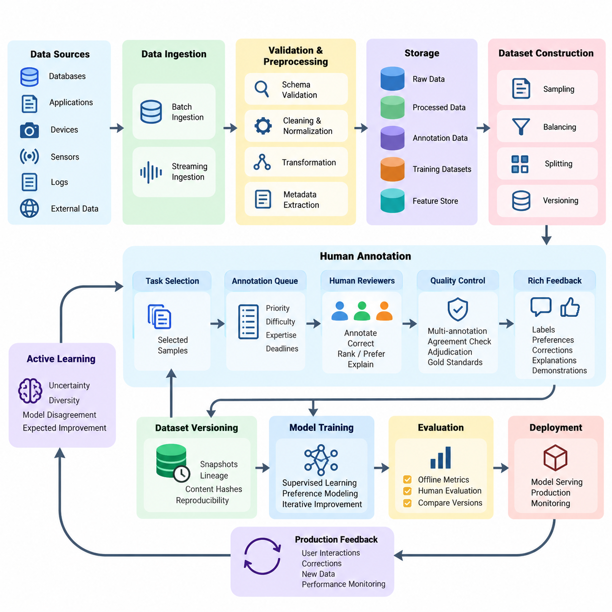
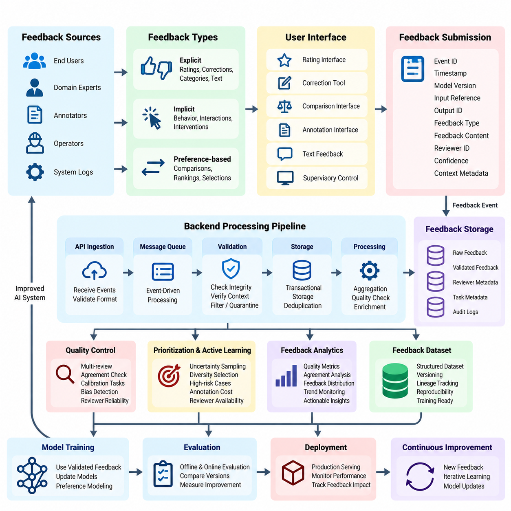
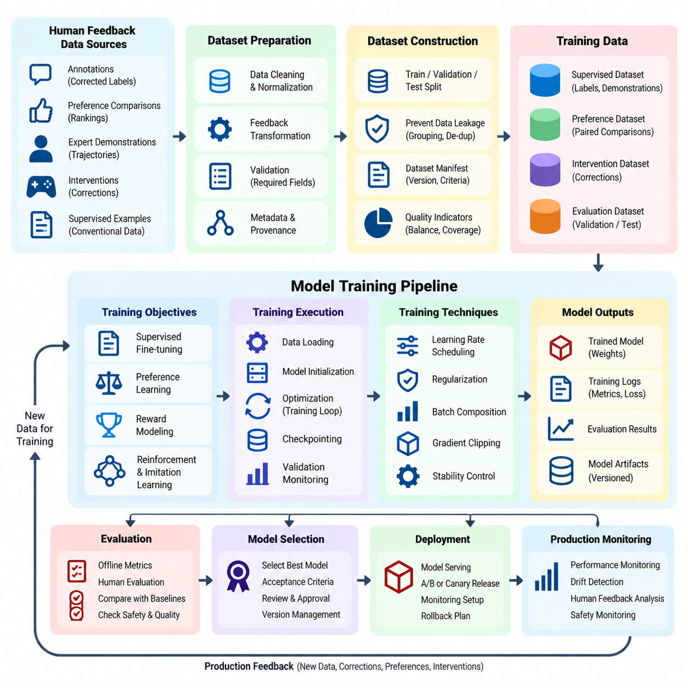
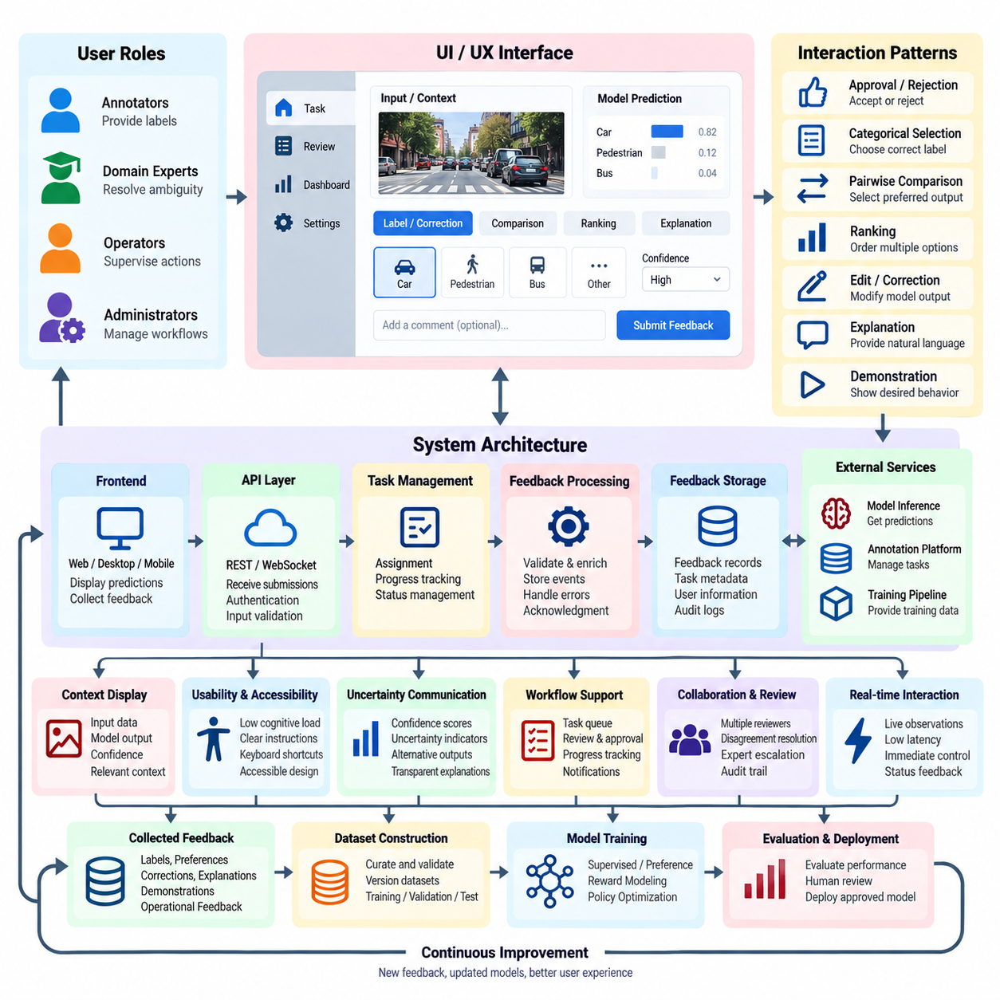
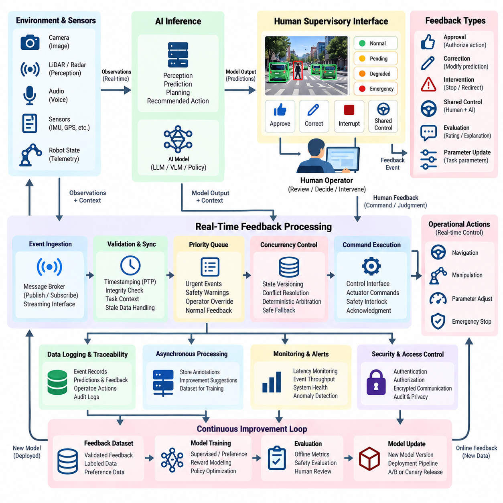
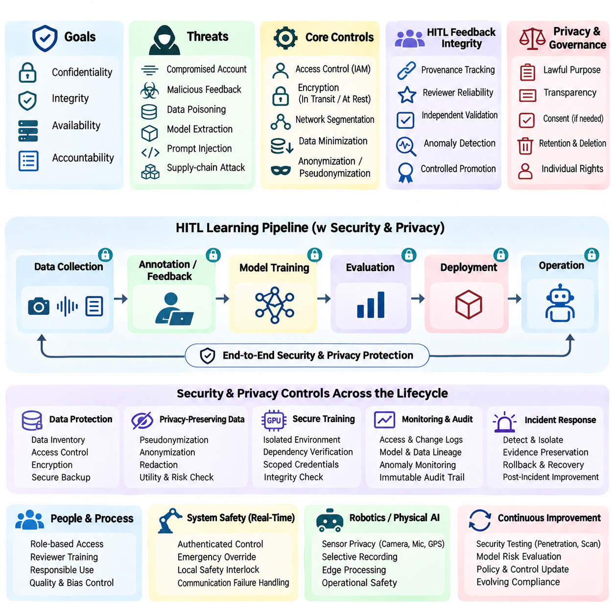
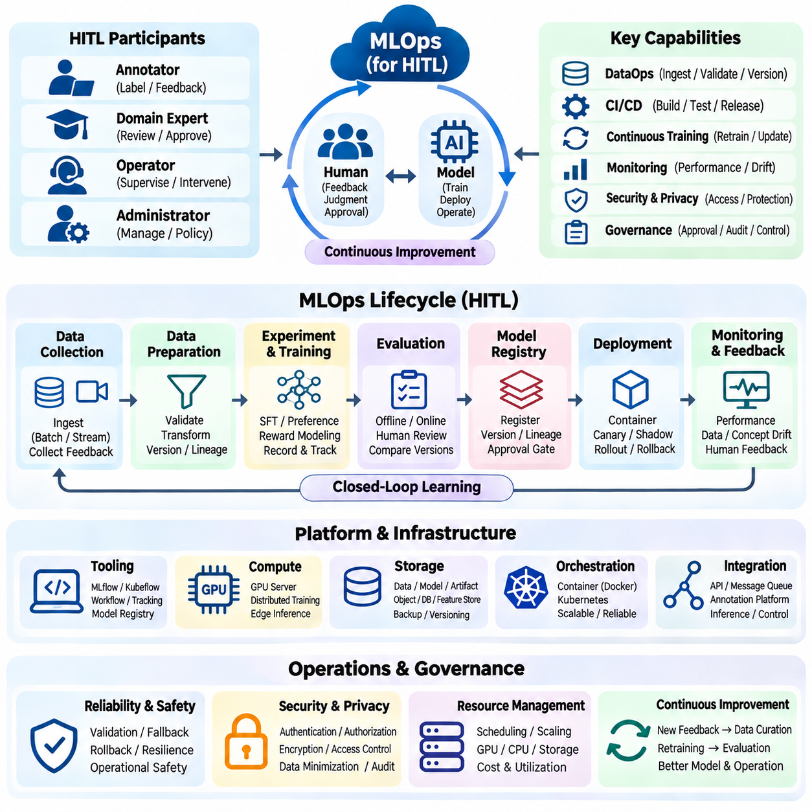

**Volume 41. Human in the Loop Learning**


# 08. Engineering and Deployment

## 08.01 Data Pipeline [w/Code]

{width="7.268055555555556in" height="7.268055555555556in"}

A data pipeline is the operational foundation of a Human-in-the-Loop (HITL) learning system, connecting raw information, human annotations, model training, and production feedback into a continuous learning process. Unlike conventional machine learning pipelines, HITL pipelines must coordinate automated processing with human judgment while maintaining data quality, traceability, reproducibility, and operational efficiency throughout the model lifecycle.

The primary objective of an HITL data pipeline is to transform heterogeneous data into reliable training and evaluation resources. Incoming information may include images, text, audio, sensor measurements, interaction logs, and robotic trajectories. Each source requires appropriate validation, normalization, metadata extraction, and storage procedures before it becomes suitable for annotation, active learning, preference modeling, or supervised model improvement.

Data ingestion begins with collecting information from databases, application interfaces, edge devices, production services, and external datasets. Batch ingestion supports large historical collections, while streaming ingestion processes continuously arriving events. A robust implementation assigns unique identifiers, timestamps, source references, and schema versions to every record, enabling consistent tracking across distributed processing environments and repeated learning cycles.

Schema validation ensures that incoming records satisfy predefined structural and semantic requirements. Validation rules examine field types, missing values, permissible ranges, encoding formats, and relationships between attributes. Records that violate critical requirements should enter a quarantine queue rather than silently contaminating downstream datasets. Validation reports provide engineers with measurable evidence of ingestion reliability and recurring data-quality problems.

Preprocessing converts validated records into representations appropriate for machine learning and human review. Image pipelines may perform resizing, color normalization, and format conversion, while text pipelines handle encoding, segmentation, and sensitive-information masking. Sensor pipelines require timestamp synchronization, calibration metadata, and unit consistency. Transformations must preserve information necessary for annotation and prevent unintended changes to ground-truth meaning.

Human annotation introduces a controlled decision-making stage into the pipeline. Annotation tasks are generated from eligible records and assigned to qualified reviewers according to task complexity, expertise, workload, and quality requirements. The system should preserve annotation instructions, interface versions, reviewer identifiers, and completion timestamps. These records support auditing, disagreement analysis, and subsequent improvements to annotation procedures.

Active learning improves pipeline efficiency by selecting informative samples instead of requesting labels uniformly. Uncertainty sampling identifies predictions with low confidence, while diversity-based selection reduces redundancy among candidate records. More advanced strategies estimate disagreement between models or expected learning improvement. Selection policies should also consider annotation cost, operational risk, and representation of underobserved data populations.

A practical annotation queue separates sample selection from human task execution. Selected records enter a managed queue containing priority, estimated difficulty, required expertise, and processing deadlines. Queue workers distribute tasks across annotation interfaces while preventing accidental duplication or conflicting updates. Retry mechanisms, task expiration, and assignment recovery allow the pipeline to continue operating when reviewers disconnect or processing services fail.

Annotation quality control is essential because human judgments may contain inconsistencies, omissions, or systematic biases. Critical samples can receive multiple independent annotations, followed by agreement measurement and adjudication. Review workflows should distinguish genuine ambiguity from reviewer mistakes. Gold-standard reference examples, calibration exercises, and periodic audits help maintain annotation reliability without assuming that majority agreement always represents correctness.

Human feedback may contain richer information than categorical labels. Reviewers can provide rankings, pairwise preferences, corrections, confidence assessments, natural-language explanations, or demonstrations of desired behavior. The pipeline must represent these feedback types using explicit schemas and preserve their original context. Preference comparisons should retain candidate identifiers and presentation conditions so that reward models can interpret the observations correctly.

Data versioning establishes reproducibility across successive learning iterations. Every dataset release should identify its source records, annotation revisions, preprocessing configuration, selection strategy, and inclusion criteria. Immutable dataset snapshots prevent historical experiments from changing unexpectedly. Content hashes and lineage records connect model checkpoints to the exact training resources used, allowing engineers to investigate performance differences and reproduce earlier results.

Storage architecture should separate raw observations, processed features, annotation records, and finalized training datasets. Object storage is suitable for large media files, while relational or document databases can maintain task metadata and reviewer interactions. Feature stores may provide reusable model inputs when appropriate. Clear separation between these layers prevents accidental overwriting and supports independent scaling of ingestion, annotation, and training services.

Dataset construction requires careful partitioning into training, validation, and test subsets. Splitting policies must account for temporal relationships, shared identities, near-duplicate observations, and correlated acquisition sessions. In robotics, trajectories from the same operating episode should not be distributed carelessly across evaluation partitions. Protected test datasets must remain isolated from active learning decisions to avoid optimistic performance estimates.

Class imbalance and distributional coverage require continuous attention during data preparation. Rare events may be operationally important even when their statistical frequency is low. Sampling strategies can increase the representation of difficult or safety-critical conditions, but artificial changes to class proportions should be documented. Dataset reports should describe coverage across environments, user populations, operating conditions, and relevant failure categories.

Pipeline orchestration coordinates ingestion, validation, preprocessing, annotation, quality review, dataset publication, and model-training triggers. Workflow engines represent dependencies between stages and support scheduled or event-driven execution. Individual tasks should be idempotent wherever possible, allowing safe retries after failures. Explicit state transitions prevent incomplete annotations or unapproved datasets from entering downstream training processes.

An implementation can use Python-based processing services with message queues, database transactions, and workflow orchestration frameworks. Dataset preparation functions should remain modular and independently testable. Configuration files define schemas, storage locations, filtering rules, and annotation policies. Automated tests verify record integrity, transformation behavior, and dataset compatibility before production execution, reducing the risk of silent pipeline failures.

Incremental processing reduces unnecessary computation when only a small portion of the dataset changes. Instead of rebuilding every artifact, the pipeline identifies newly ingested records, revised annotations, and affected derived outputs. Dependency tracking determines which processing stages require re-execution. This approach becomes particularly valuable when large image collections, video sequences, or multimodal robotic datasets are updated continuously.

The relationship between data pipelines and model training should be governed by explicit release criteria. A dataset becomes eligible for training only after required validation, annotation review, and quality checks are completed. Training jobs reference approved dataset versions rather than mutable working directories. Model evaluation results can subsequently identify error clusters and return representative failures to the annotation queue for targeted improvement.

Production inference systems provide another important source of learning data. Predictions, confidence scores, input characteristics, and operational outcomes can reveal distribution shifts or emerging failure patterns. Feedback collection must distinguish observed outcomes from inferred labels and avoid treating every user interaction as reliable supervision. Carefully designed sampling and retention policies limit storage growth while preserving informative examples for future review.

Real-time applications introduce latency constraints that differ from offline annotation workflows. An industrial robot or autonomous platform cannot always wait for human intervention before continuing execution. The pipeline must distinguish immediate operational decisions from asynchronous learning updates. Safety-critical situations may require deterministic fallback behavior, while nonurgent observations can be transferred to human reviewers and incorporated into later model releases.

Security and privacy controls must operate throughout the data lifecycle. Access permissions should reflect reviewer responsibilities and the sensitivity of each record. Encryption, authentication, audit logging, and retention policies reduce unauthorized exposure. Personally identifiable information should be minimized or appropriately protected before annotation. Deletion requests must propagate through derived datasets and relevant processing artifacts according to applicable requirements.

Operational monitoring evaluates both technical performance and human participation. Useful measurements include ingestion throughput, validation failure rates, annotation turnaround time, reviewer agreement, queue backlog, dataset publication latency, and processing cost. These indicators help identify bottlenecks that model accuracy alone cannot reveal. Monitoring should connect data-quality trends with downstream model behavior to support evidence-based pipeline optimization.

A mature HITL data pipeline ultimately functions as a controlled feedback infrastructure rather than a one-directional data preparation process. It connects production observations, automated sample selection, human expertise, quality assurance, and reproducible model updates. Successful engineering depends on maintaining reliable interfaces between these components while balancing annotation effort, computational cost, operational responsiveness, and the long-term trustworthiness of deployed AI systems.

데이터 파이프라인(Data Pipeline)은 인간 참여형 학습(Human-in-the-Loop Learning, HITL) 시스템의 운영 기반으로서, 원시 데이터(Raw Data), 인간 주석(Human Annotation), 모델 학습(Model Training), 운영 환경 피드백(Production Feedback)을 지속적인 학습 프로세스(Continuous Learning Process)로 연결한다. 기존 기계학습(Machine Learning) 파이프라인과 달리, HITL 파이프라인은 자동화된 처리(Automated Processing)와 인간의 판단(Human Judgment)을 조정하면서 모델 생명주기(Model Lifecycle) 전반에 걸쳐 데이터 품질(Data Quality), 추적 가능성(Traceability), 재현성(Reproducibility), 운영 효율성(Operational Efficiency)을 유지해야 한다.

HITL 데이터 파이프라인의 주요 목적은 이질적인 데이터(Heterogeneous Data)를 신뢰할 수 있는 학습 및 평가 자원(Training and Evaluation Resources)으로 변환하는 것이다. 입력 정보에는 이미지(Image), 텍스트(Text), 오디오(Audio), 센서 측정값(Sensor Measurements), 상호작용 로그(Interaction Logs), 로봇 궤적(Robotic Trajectories) 등이 포함될 수 있다. 각 데이터 소스(Data Source)는 주석(Annotation), 능동 학습(Active Learning), 선호도 모델링(Preference Modeling), 지도 학습 기반 모델 개선(Supervised Model Improvement)에 활용되기 전에 적절한 검증(Validation), 정규화(Normalization), 메타데이터 추출(Metadata Extraction), 저장(Storage) 절차를 거쳐야 한다.

데이터 수집 및 적재(Data Ingestion)는 데이터베이스(Database), 애플리케이션 인터페이스(Application Interface), 엣지 장치(Edge Device), 운영 서비스(Production Service), 외부 데이터셋(External Dataset)에서 정보를 수집하는 과정으로 시작된다. 배치 수집(Batch Ingestion)은 대규모 과거 데이터(Historical Data)를 처리하며, 스트리밍 수집(Streaming Ingestion)은 지속적으로 발생하는 이벤트(Event)를 처리한다. 견고한 구현에서는 모든 레코드(Record)에 고유 식별자(Unique Identifier), 타임스탬프(Timestamp), 소스 참조(Source Reference), 스키마 버전(Schema Version)을 부여하여 분산 처리 환경(Distributed Processing Environment)과 반복 학습 주기(Iterative Learning Cycle) 전반에서 일관된 추적을 가능하게 한다.

스키마 검증(Schema Validation)은 입력 레코드가 사전에 정의된 구조적 및 의미적 요구사항(Structural and Semantic Requirements)을 충족하는지 확인한다. 검증 규칙(Validation Rules)은 필드 유형(Field Type), 결측값(Missing Value), 허용 범위(Permissible Range), 인코딩 형식(Encoding Format), 속성 간 관계(Attribute Relationships)를 검사한다. 중요한 요구사항을 위반한 레코드는 후속 데이터셋(Downstream Dataset)을 오염시키지 않도록 격리 대기열(Quarantine Queue)로 이동해야 한다. 검증 보고서(Validation Report)는 데이터 수집의 신뢰성과 반복적으로 발생하는 데이터 품질 문제를 측정할 수 있는 근거를 제공한다.

전처리(Preprocessing)는 검증된 레코드를 기계학습과 인간 검토(Human Review)에 적합한 표현(Representation)으로 변환한다. 이미지 파이프라인(Image Pipeline)은 크기 조정(Resizing), 색상 정규화(Color Normalization), 형식 변환(Format Conversion)을 수행할 수 있으며, 텍스트 파이프라인(Text Pipeline)은 인코딩(Encoding), 분할(Segmentation), 민감정보 마스킹(Sensitive Information Masking)을 처리한다. 센서 파이프라인(Sensor Pipeline)은 타임스탬프 동기화(Timestamp Synchronization), 보정 메타데이터(Calibration Metadata), 단위 일관성(Unit Consistency)을 필요로 한다. 모든 변환은 주석에 필요한 정보를 보존하고 정답 의미(Ground-Truth Meaning)의 의도하지 않은 변경을 방지해야 한다.

인간 주석(Human Annotation)은 파이프라인에 통제된 의사결정 단계(Controlled Decision-Making Stage)를 도입한다. 주석 작업(Annotation Task)은 적격 레코드(Eligible Record)에서 생성되며, 작업 복잡도(Task Complexity), 전문성(Expertise), 업무량(Workload), 품질 요구사항(Quality Requirements)에 따라 자격을 갖춘 검토자(Qualified Reviewer)에게 할당된다. 시스템은 주석 지침(Annotation Instructions), 인터페이스 버전(Interface Version), 검토자 식별자(Reviewer Identifier), 완료 타임스탬프(Completion Timestamp)를 보존해야 한다. 이러한 기록은 감사(Auditing), 의견 불일치 분석(Disagreement Analysis), 주석 절차 개선을 지원한다.

능동 학습(Active Learning)은 모든 샘플(Sample)에 균일하게 레이블(Label)을 요청하는 대신 정보량이 높은 샘플(Informative Sample)을 선택하여 파이프라인 효율성을 향상시킨다. 불확실성 샘플링(Uncertainty Sampling)은 신뢰도(Confidence)가 낮은 예측을 식별하며, 다양성 기반 선택(Diversity-Based Selection)은 후보 레코드 간 중복성(Redundancy)을 감소시킨다. 고급 전략(Advanced Strategy)은 모델 간 불일치(Model Disagreement) 또는 예상 학습 개선(Expected Learning Improvement)을 추정한다. 선택 정책(Selection Policy)은 주석 비용(Annotation Cost), 운영 위험(Operational Risk), 관측이 부족한 데이터 집단(Underobserved Data Populations)의 대표성도 고려해야 한다.

실용적인 주석 대기열(Annotation Queue)은 샘플 선택(Sample Selection)과 인간 작업 실행(Human Task Execution)을 분리한다. 선택된 레코드는 우선순위(Priority), 예상 난이도(Estimated Difficulty), 요구 전문성(Required Expertise), 처리 기한(Processing Deadline)을 포함하는 관리형 대기열(Managed Queue)에 들어간다. 대기열 작업자(Queue Worker)는 의도하지 않은 중복이나 충돌하는 업데이트(Conflicting Updates)를 방지하면서 주석 인터페이스(Annotation Interface)에 작업을 분배한다. 재시도 메커니즘(Retry Mechanism), 작업 만료(Task Expiration), 할당 복구(Assignment Recovery)는 검토자의 연결이 끊어지거나 처리 서비스가 실패하더라도 파이프라인이 계속 작동하도록 지원한다.

주석 품질 관리(Annotation Quality Control)는 인간의 판단에 불일치(Inconsistency), 누락(Omission), 체계적 편향(Systematic Bias)이 포함될 수 있으므로 필수적이다. 중요한 샘플은 여러 독립적인 주석(Independent Annotations)을 받은 후 일치도 측정(Agreement Measurement)과 판정 조정(Adjudication)을 거칠 수 있다. 검토 워크플로(Review Workflow)는 실제 모호성(Genuine Ambiguity)과 검토자 오류(Reviewer Mistake)를 구분해야 한다. 골드 스탠더드 참조 사례(Gold-Standard Reference Examples), 보정 훈련(Calibration Exercises), 정기 감사(Periodic Audits)는 다수결 합의(Majority Agreement)가 항상 정답을 의미한다고 가정하지 않으면서 주석 신뢰성(Annotation Reliability)을 유지하도록 지원한다.

인간 피드백(Human Feedback)은 범주형 레이블(Categorical Label)보다 풍부한 정보를 포함할 수 있다. 검토자는 순위(Ranking), 쌍별 선호도(Pairwise Preference), 수정(Correction), 신뢰도 평가(Confidence Assessment), 자연어 설명(Natural-Language Explanation), 바람직한 행동 시연(Demonstration)을 제공할 수 있다. 파이프라인은 명시적 스키마(Explicit Schema)를 사용하여 이러한 피드백 유형을 표현하고 원래의 맥락(Original Context)을 보존해야 한다. 선호도 비교(Preference Comparison)는 보상 모델(Reward Model)이 관측 결과를 올바르게 해석할 수 있도록 후보 식별자(Candidate Identifier)와 제시 조건(Presentation Conditions)을 유지해야 한다.

데이터 버전 관리(Data Versioning)는 연속적인 학습 반복(Learning Iteration) 전반에서 재현성(Reproducibility)을 확보한다. 모든 데이터셋 릴리스(Dataset Release)는 소스 레코드(Source Record), 주석 수정 이력(Annotation Revision), 전처리 구성(Preprocessing Configuration), 선택 전략(Selection Strategy), 포함 기준(Inclusion Criteria)을 식별해야 한다. 불변 데이터셋 스냅샷(Immutable Dataset Snapshot)은 과거 실험(Historical Experiment)이 예기치 않게 변경되는 것을 방지한다. 콘텐츠 해시(Content Hash)와 데이터 계보 기록(Data Lineage Record)은 모델 체크포인트(Model Checkpoint)를 실제 학습에 사용된 자원과 연결하여 성능 차이(Performance Difference)를 조사하고 이전 결과를 재현할 수 있도록 한다.

저장 아키텍처(Storage Architecture)는 원시 관측 데이터(Raw Observations), 처리된 특징(Processed Features), 주석 레코드(Annotation Records), 최종 학습 데이터셋(Finalized Training Datasets)을 분리해야 한다. 객체 저장소(Object Storage)는 대용량 미디어 파일(Large Media Files)에 적합하며, 관계형 데이터베이스(Relational Database) 또는 문서 데이터베이스(Document Database)는 작업 메타데이터(Task Metadata)와 검토자 상호작용(Reviewer Interactions)을 관리할 수 있다. 필요한 경우 특징 저장소(Feature Store)는 재사용 가능한 모델 입력(Model Inputs)을 제공한다. 이러한 계층 간 명확한 분리는 의도하지 않은 덮어쓰기(Accidental Overwriting)를 방지하고 데이터 수집, 주석, 학습 서비스의 독립적인 확장(Independent Scaling)을 지원한다.

데이터셋 구성(Dataset Construction)은 학습(Training), 검증(Validation), 테스트(Test) 하위 집합으로 신중하게 분할해야 한다. 분할 정책(Splitting Policy)은 시간적 관계(Temporal Relationships), 공유 식별성(Shared Identities), 유사 중복 관측(Near-Duplicate Observations), 상관관계가 있는 수집 세션(Correlated Acquisition Sessions)을 고려해야 한다. 로보틱스(Robotics)에서는 동일한 운영 에피소드(Operating Episode)의 궤적을 평가 분할(Evaluation Partition) 사이에 부주의하게 배분해서는 안 된다. 보호된 테스트 데이터셋(Protected Test Dataset)은 지나치게 낙관적인 성능 추정(Optimistic Performance Estimate)을 방지하기 위해 능동 학습 의사결정에서 격리되어야 한다.

클래스 불균형(Class Imbalance)과 분포적 포괄성(Distributional Coverage)은 데이터 준비 과정에서 지속적인 관리가 필요하다. 희귀 이벤트(Rare Event)는 통계적 발생 빈도(Statistical Frequency)가 낮더라도 운영상 중요할 수 있다. 샘플링 전략(Sampling Strategy)은 어렵거나 안전이 중요한 조건(Safety-Critical Conditions)의 대표성을 높일 수 있지만, 클래스 비율(Class Proportions)의 인위적인 변경은 문서화해야 한다. 데이터셋 보고서(Dataset Report)는 환경(Environment), 사용자 집단(User Populations), 운영 조건(Operating Conditions), 관련 실패 범주(Failure Categories)에 대한 포괄성을 설명해야 한다.

파이프라인 오케스트레이션(Pipeline Orchestration)은 데이터 수집, 검증, 전처리, 주석, 품질 검토(Quality Review), 데이터셋 게시(Dataset Publication), 모델 학습 트리거(Model-Training Trigger)를 조정한다. 워크플로 엔진(Workflow Engine)은 단계 간 의존성(Dependencies)을 표현하고 예약 실행(Scheduled Execution) 또는 이벤트 기반 실행(Event-Driven Execution)을 지원한다. 개별 작업은 가능한 한 멱등성(Idempotency)을 갖도록 설계하여 실패 이후에도 안전하게 재시도할 수 있어야 한다. 명시적 상태 전이(Explicit State Transition)는 미완료 주석이나 승인되지 않은 데이터셋이 후속 학습 프로세스에 유입되는 것을 방지한다.

구현에는 메시지 대기열(Message Queue), 데이터베이스 트랜잭션(Database Transaction), 워크플로 오케스트레이션 프레임워크(Workflow Orchestration Framework)와 결합된 파이썬 기반 처리 서비스(Python-Based Processing Service)를 사용할 수 있다. 데이터셋 준비 함수(Dataset Preparation Function)는 모듈화(Modularity)되어 독립적으로 테스트할 수 있어야 한다. 구성 파일(Configuration File)은 스키마(Schema), 저장 위치(Storage Location), 필터링 규칙(Filtering Rules), 주석 정책(Annotation Policies)을 정의한다. 자동화 테스트(Automated Test)는 운영 실행 전에 레코드 무결성(Record Integrity), 변환 동작(Transformation Behavior), 데이터셋 호환성(Dataset Compatibility)을 검증하여 발견하기 어려운 파이프라인 실패 위험을 줄인다.

증분 처리(Incremental Processing)는 데이터셋의 일부만 변경되었을 때 불필요한 계산을 감소시킨다. 모든 산출물(Artifact)을 다시 생성하는 대신 파이프라인은 새롭게 수집된 레코드(Newly Ingested Records), 수정된 주석(Revised Annotations), 영향을 받는 파생 출력(Derived Outputs)을 식별한다. 의존성 추적(Dependency Tracking)은 재실행이 필요한 처리 단계를 결정한다. 이러한 접근 방식은 대규모 이미지 컬렉션(Image Collection), 비디오 시퀀스(Video Sequence), 다중모달 로봇 데이터셋(Multimodal Robotic Dataset)이 지속적으로 업데이트되는 환경에서 특히 유용하다.

데이터 파이프라인과 모델 학습(Model Training)의 관계는 명시적인 릴리스 기준(Release Criteria)에 따라 관리되어야 한다. 데이터셋은 필수 검증(Required Validation), 주석 검토(Annotation Review), 품질 검사(Quality Checks)가 완료된 후에만 학습에 사용할 수 있다. 학습 작업(Training Job)은 변경 가능한 작업 디렉터리(Mutable Working Directory)가 아니라 승인된 데이터셋 버전(Approved Dataset Version)을 참조해야 한다. 이후 모델 평가 결과(Model Evaluation Results)는 오류 군집(Error Cluster)을 식별하고 대표적인 실패 사례(Representative Failures)를 주석 대기열로 반환하여 목표 지향적 개선(Targeted Improvement)을 수행할 수 있다.

운영 추론 시스템(Production Inference System)은 또 다른 중요한 학습 데이터 소스(Learning Data Source)를 제공한다. 예측 결과(Predictions), 신뢰도 점수(Confidence Scores), 입력 특성(Input Characteristics), 운영 결과(Operational Outcomes)는 분포 변화(Distribution Shift)나 새롭게 나타나는 실패 패턴(Emerging Failure Patterns)을 드러낼 수 있다. 피드백 수집(Feedback Collection)은 관측된 결과(Observed Outcomes)와 추론된 레이블(Inferred Labels)을 구분해야 하며, 모든 사용자 상호작용(User Interaction)을 신뢰할 수 있는 지도 신호(Supervision)로 간주해서는 안 된다. 신중하게 설계된 샘플링 및 보존 정책(Sampling and Retention Policies)은 향후 검토에 유용한 사례를 유지하면서 저장 용량 증가를 제한한다.

실시간 애플리케이션(Real-Time Application)은 오프라인 주석 워크플로(Offline Annotation Workflow)와 다른 지연시간 제약(Latency Constraints)을 가진다. 산업용 로봇(Industrial Robot)이나 자율 플랫폼(Autonomous Platform)은 실행을 계속하기 전에 항상 인간의 개입(Human Intervention)을 기다릴 수 있는 것은 아니다. 파이프라인은 즉각적인 운영 의사결정(Immediate Operational Decisions)과 비동기 학습 업데이트(Asynchronous Learning Updates)를 구분해야 한다. 안전이 중요한 상황(Safety-Critical Situation)에서는 결정론적 대체 동작(Deterministic Fallback Behavior)이 필요할 수 있으며, 긴급하지 않은 관측 데이터는 인간 검토자에게 전달하여 이후 모델 릴리스(Model Release)에 반영할 수 있다.

보안 및 개인정보 보호 통제(Security and Privacy Controls)는 데이터 생명주기(Data Lifecycle) 전체에서 적용되어야 한다. 접근 권한(Access Permissions)은 검토자의 책임(Reviewer Responsibilities)과 각 레코드의 민감도(Sensitivity)를 반영해야 한다. 암호화(Encryption), 인증(Authentication), 감사 로깅(Audit Logging), 보존 정책(Retention Policies)은 무단 노출(Unauthorized Exposure)을 줄인다. 개인 식별 정보(Personally Identifiable Information, PII)는 주석 작업 전에 최소화하거나 적절히 보호해야 한다. 삭제 요청(Deletion Request)은 적용 가능한 요구사항에 따라 파생 데이터셋(Derived Dataset)과 관련 처리 산출물(Processing Artifacts)에 전파되어야 한다.

운영 모니터링(Operational Monitoring)은 기술적 성능(Technical Performance)과 인간 참여(Human Participation)를 모두 평가한다. 유용한 측정 지표(Metrics)에는 데이터 수집 처리량(Ingestion Throughput), 검증 실패율(Validation Failure Rate), 주석 처리 소요 시간(Annotation Turnaround Time), 검토자 일치도(Reviewer Agreement), 대기열 적체(Queue Backlog), 데이터셋 게시 지연시간(Dataset Publication Latency), 처리 비용(Processing Cost)이 포함된다. 이러한 지표는 모델 정확도(Model Accuracy)만으로는 확인할 수 없는 병목 현상(Bottleneck)을 식별하는 데 도움이 된다. 모니터링은 데이터 품질 추세(Data-Quality Trends)를 후속 모델 동작(Downstream Model Behavior)과 연결하여 근거 기반 파이프라인 최적화(Evidence-Based Pipeline Optimization)를 지원해야 한다.

성숙한 HITL 데이터 파이프라인은 궁극적으로 단방향 데이터 준비 프로세스(One-Directional Data Preparation Process)가 아니라 통제된 피드백 인프라(Controlled Feedback Infrastructure)로 기능한다. 이는 운영 관측(Production Observations), 자동화된 샘플 선택(Automated Sample Selection), 인간 전문성(Human Expertise), 품질 보증(Quality Assurance), 재현 가능한 모델 업데이트(Reproducible Model Updates)를 연결한다. 성공적인 엔지니어링(Engineering)은 이러한 구성요소 사이에 신뢰할 수 있는 인터페이스(Reliable Interfaces)를 유지하면서 주석 작업량(Annotation Effort), 계산 비용(Computational Cost), 운영 응답성(Operational Responsiveness), 배포된 인공지능 시스템의 장기적 신뢰성(Long-Term Trustworthiness) 사이의 균형을 확보하는 데 달려 있다.

## 08.02 Feedback Collection System [w/Code]

{width="7.268055555555556in" height="7.268055555555556in"}

A Feedback Collection System is a fundamental component of Human-in-the-Loop (HITL) learning, enabling artificial intelligence systems to capture, organize, and utilize human judgments throughout their operational lifecycle. It establishes a structured communication channel between users, domain experts, annotators, and machine learning models. Effective feedback collection transforms human experience into measurable signals that support model refinement, reliability, and continuous improvement.

The primary objective of a feedback collection system is to obtain meaningful human evaluations while minimizing cognitive effort and operational disruption. Feedback may originate from direct user interactions, expert assessments, annotation platforms, or supervisory control interfaces. System design must consider feedback relevance, consistency, timeliness, and interpretability. These characteristics determine whether collected information can reliably guide subsequent learning and deployment decisions.

Feedback can be categorized into explicit, implicit, and preference-based signals. Explicit feedback includes ratings, corrections, categorical judgments, and written evaluations. Implicit feedback derives from observable behavior, such as task completion, repeated interactions, or intervention frequency. Preference-based feedback compares alternative model outputs or actions. Each category requires distinct collection mechanisms and interpretation rules to prevent misleading conclusions.

A well-designed collection architecture separates feedback presentation, event capture, validation, storage, and downstream processing. User interfaces present evaluation tasks, while backend services receive feedback events through standardized application programming interfaces. Processing components verify event integrity and associate responses with relevant model predictions. This modular separation supports independent scaling, maintainability, and integration with existing AI infrastructure.

Feedback events should follow a standardized data schema that preserves both the evaluation result and its operational context. Typical attributes include event identifiers, timestamps, model versions, input references, output identifiers, feedback categories, reviewer identifiers, and confidence assessments. Contextual metadata may describe environmental conditions, task difficulty, or interface configuration. Consistent schemas enable reliable aggregation, auditing, and comparison across learning iterations.

Feedback interfaces should reduce ambiguity and unnecessary interaction complexity. Rating scales require clearly defined meanings, while correction tools should make the original model prediction visible. Preference comparison interfaces should present alternatives under equivalent conditions whenever possible. Contextual instructions help reviewers understand evaluation criteria. Accessible design and efficient interaction patterns improve participation without compromising judgment quality.

Feedback collection can operate synchronously or asynchronously depending on application requirements. Synchronous feedback occurs during active interaction and may influence immediate decisions. Asynchronous feedback is collected after execution through review queues, dashboards, or scheduled evaluations. Real-time systems frequently combine both approaches, allowing urgent interventions while transferring noncritical observations into later model improvement workflows.

A reliable backend should support event-driven ingestion, durable message queues, and transactional storage. Incoming feedback events can be published to a message broker and processed by independent validation workers. Unique event identifiers and idempotent operations prevent duplicate records during retries. Acknowledgment mechanisms confirm successful processing, while dead-letter queues isolate malformed events. These mechanisms improve resilience during network interruptions and temporary service failures.

Feedback validation extends beyond checking data formats. The system must verify that referenced model outputs exist, evaluation choices satisfy task constraints, and submitted responses correspond to the correct prediction context. Invalid or incomplete records should be rejected or quarantined with diagnostic information. Validation policies should distinguish technical errors from legitimate reviewer uncertainty, preserving ambiguous judgments when they contain useful information.

Human feedback frequently contains noise, inconsistency, and systematic bias. Different reviewers may interpret instructions differently or apply distinct quality standards. Repeated evaluations, calibration tasks, and agreement analysis help characterize these variations. Statistical aggregation can reduce random disagreement, but systematic bias requires targeted investigation. Reviewer expertise and task-specific reliability should inform feedback interpretation rather than assuming that all judgments are equally informative.

Feedback prioritization determines which observations deserve human attention. Model uncertainty, prediction disagreement, operational risk, and novelty can guide sample selection. High-impact failures may require expert review even when model confidence is high. Priority policies should balance information value against evaluation cost and reviewer availability. This connection between feedback collection and active learning improves the efficiency of human participation.

A practical implementation can use a Python-based API service to receive structured feedback records and store them in a relational database. Request validation may be implemented with typed schemas, while asynchronous workers handle aggregation and quality checks. Each submission should reference an immutable prediction identifier and a specific model version. Automated tests should verify duplicate handling, authorization, invalid payload rejection, and reliable recovery after processing failures.

Feedback storage should preserve raw submissions separately from aggregated labels or preference scores. Raw records provide evidence for auditing and future reinterpretation, while derived datasets support training and evaluation. Versioned transformations document how individual judgments become supervised examples or reward-model preferences. This separation prevents irreversible information loss and allows updated aggregation strategies without recollecting human evaluations.

Integration with model training requires explicit rules for converting feedback into learning signals. Corrections may become supervised labels, pairwise preferences may support reward modeling, and intervention logs may identify difficult operational states. Not every feedback event should automatically trigger training. Quality thresholds, approval procedures, and dataset release controls ensure that unverified or biased judgments do not degrade deployed models.

Production monitoring should measure feedback submission rates, processing latency, reviewer participation, completion time, disagreement frequency, and validation failures. Additional metrics can evaluate feedback usefulness by examining subsequent model improvements. Sudden changes in feedback distributions may indicate interface problems, shifting user expectations, or model degradation. Monitoring should distinguish these possibilities before initiating corrective actions.

Security and privacy are essential because feedback records may contain sensitive user information, proprietary inputs, or operational details. Authentication and role-based authorization restrict access to appropriate participants. Encryption protects stored and transmitted information, while retention policies limit unnecessary exposure. Where appropriate, pseudonymization separates reviewer identities from evaluation content. Audit trails support accountability without granting unrestricted access to personal data.

Feedback collection becomes particularly important in robotics and autonomous systems, where human interventions can reveal limitations that ordinary prediction metrics overlook. Operators may correct navigation decisions, reject unsafe actions, or demonstrate alternative control strategies. Each event should preserve relevant sensor observations, robot state, action history, and intervention timing. These contextual records allow engineers to distinguish perception errors from planning or control failures.

Scalable feedback systems must accommodate changing workloads and heterogeneous evaluation tasks. Distributed queues, stateless API services, and independently scalable processing workers support increasing event volumes. Annotation interfaces may be specialized for text, vision, audio, or physical actions while sharing common backend contracts. Capacity planning should account for peak submission rates, storage growth, reviewer availability, and downstream processing demands.

The long-term effectiveness of a feedback collection system depends on maintaining a closed relationship between human evaluation and measurable model improvement. Collected judgments should inform dataset curation, training priorities, evaluation design, and operational safeguards. Subsequent model releases must be assessed against both automated benchmarks and relevant human criteria. This disciplined feedback cycle converts individual observations into sustained improvements in AI capability, safety, and trustworthiness.

피드백 수집 시스템(Feedback Collection System)은 인간 참여형 학습(Human-in-the-Loop Learning, HITL)의 핵심 구성요소로서, 인공지능 시스템이 운영 생명주기(Operational Lifecycle) 전반에서 인간의 판단(Human Judgment)을 수집, 구성, 활용할 수 있도록 한다. 이 시스템은 사용자(User), 도메인 전문가(Domain Expert), 주석 작업자(Annotator), 기계학습 모델(Machine Learning Model) 사이에 구조화된 의사소통 채널(Structured Communication Channel)을 구축한다. 효과적인 피드백 수집(Feedback Collection)은 인간의 경험을 측정 가능한 신호(Measurable Signals)로 변환하여 모델 개선(Model Refinement), 신뢰성(Reliability), 지속적인 개선(Continuous Improvement)을 지원한다.

피드백 수집 시스템의 주요 목적은 인지적 부담(Cognitive Effort)과 운영 중단(Operational Disruption)을 최소화하면서 의미 있는 인간 평가(Human Evaluation)를 확보하는 것이다. 피드백은 직접적인 사용자 상호작용(Direct User Interaction), 전문가 평가(Expert Assessment), 주석 플랫폼(Annotation Platform), 감독 제어 인터페이스(Supervisory Control Interface)에서 발생할 수 있다. 시스템 설계(System Design)는 피드백 관련성(Feedback Relevance), 일관성(Consistency), 적시성(Timeliness), 해석 가능성(Interpretability)을 고려해야 한다. 이러한 특성은 수집된 정보가 후속 학습 및 배포 의사결정(Deployment Decision)을 얼마나 신뢰성 있게 지원할 수 있는지를 결정한다.

피드백은 명시적 피드백(Explicit Feedback), 암묵적 피드백(Implicit Feedback), 선호도 기반 피드백(Preference-Based Feedback)으로 분류할 수 있다. 명시적 피드백에는 평점(Rating), 수정(Correction), 범주형 판단(Categorical Judgment), 서술형 평가(Written Evaluation)가 포함된다. 암묵적 피드백은 작업 완료(Task Completion), 반복 상호작용(Repeated Interaction), 개입 빈도(Intervention Frequency)와 같은 관측 가능한 행동(Observable Behavior)에서 도출된다. 선호도 기반 피드백은 대안적인 모델 출력(Model Output)이나 행동(Action)을 비교한다. 각 범주는 잘못된 결론을 방지하기 위해 서로 다른 수집 메커니즘(Collection Mechanism)과 해석 규칙(Interpretation Rules)을 필요로 한다.

잘 설계된 수집 아키텍처(Collection Architecture)는 피드백 제시(Feedback Presentation), 이벤트 수집(Event Capture), 검증(Validation), 저장(Storage), 후속 처리(Downstream Processing)를 분리한다. 사용자 인터페이스(User Interface)는 평가 작업(Evaluation Task)을 제시하고, 백엔드 서비스(Backend Service)는 표준화된 응용 프로그래밍 인터페이스(Application Programming Interface, API)를 통해 피드백 이벤트(Feedback Event)를 수신한다. 처리 구성요소(Processing Component)는 이벤트 무결성(Event Integrity)을 검증하고 응답을 관련 모델 예측(Model Prediction)과 연결한다. 이러한 모듈식 분리(Modular Separation)는 독립적인 확장(Independent Scaling), 유지보수성(Maintainability), 기존 인공지능 인프라(AI Infrastructure)와의 통합(Integration)을 지원한다.

피드백 이벤트는 평가 결과(Evaluation Result)와 운영 맥락(Operational Context)을 모두 보존하는 표준화된 데이터 스키마(Standardized Data Schema)를 따라야 한다. 일반적인 속성(Attribute)에는 이벤트 식별자(Event Identifier), 타임스탬프(Timestamp), 모델 버전(Model Version), 입력 참조(Input Reference), 출력 식별자(Output Identifier), 피드백 범주(Feedback Category), 검토자 식별자(Reviewer Identifier), 신뢰도 평가(Confidence Assessment)가 포함된다. 맥락 메타데이터(Contextual Metadata)는 환경 조건(Environmental Conditions), 작업 난이도(Task Difficulty), 인터페이스 구성(Interface Configuration)을 설명할 수 있다. 일관된 스키마(Consistent Schema)는 학습 반복(Learning Iteration) 전반에서 신뢰할 수 있는 집계(Aggregation), 감사(Auditing), 비교(Comparison)를 가능하게 한다.

피드백 인터페이스(Feedback Interface)는 모호성(Ambiguity)과 불필요한 상호작용 복잡성(Interaction Complexity)을 줄여야 한다. 평점 척도(Rating Scale)는 명확하게 정의된 의미를 가져야 하며, 수정 도구(Correction Tool)는 원래의 모델 예측(Original Model Prediction)을 확인할 수 있도록 해야 한다. 선호도 비교 인터페이스(Preference Comparison Interface)는 가능한 경우 동등한 조건(Equivalent Conditions)에서 대안을 제시해야 한다. 맥락 기반 지침(Contextual Instructions)은 검토자가 평가 기준(Evaluation Criteria)을 이해하도록 지원한다. 접근성 높은 설계(Accessible Design)와 효율적인 상호작용 패턴(Efficient Interaction Patterns)은 판단 품질(Judgment Quality)을 저하시키지 않으면서 참여도를 향상시킨다.

피드백 수집은 애플리케이션 요구사항(Application Requirements)에 따라 동기식(Synchronous) 또는 비동기식(Asynchronous)으로 운영될 수 있다. 동기식 피드백(Synchronous Feedback)은 활성 상호작용(Active Interaction) 중에 발생하며 즉각적인 의사결정(Immediate Decision)에 영향을 줄 수 있다. 비동기식 피드백(Asynchronous Feedback)은 실행 이후 검토 대기열(Review Queue), 대시보드(Dashboard), 예약 평가(Scheduled Evaluation)를 통해 수집된다. 실시간 시스템(Real-Time System)은 두 방식을 결합하여 긴급 개입(Urgent Intervention)을 허용하면서 중요도가 낮은 관측(Noncritical Observation)은 이후 모델 개선 워크플로(Model Improvement Workflow)로 전달하는 경우가 많다.

신뢰할 수 있는 백엔드(Backend)는 이벤트 기반 수집(Event-Driven Ingestion), 영속적 메시지 대기열(Durable Message Queue), 트랜잭션 기반 저장(Transactional Storage)을 지원해야 한다. 입력 피드백 이벤트는 메시지 브로커(Message Broker)에 게시되고 독립적인 검증 작업자(Validation Worker)에 의해 처리될 수 있다. 고유 이벤트 식별자(Unique Event Identifier)와 멱등 연산(Idempotent Operation)은 재시도(Retry) 과정에서 중복 레코드(Duplicate Record)가 생성되는 것을 방지한다. 확인 응답 메커니즘(Acknowledgment Mechanism)은 성공적인 처리를 확인하며, 데드 레터 대기열(Dead-Letter Queue)은 형식이 잘못된 이벤트(Malformed Event)를 격리한다. 이러한 메커니즘은 네트워크 중단(Network Interruption)과 일시적인 서비스 장애(Temporary Service Failure) 상황에서 복원력(Resilience)을 향상시킨다.

피드백 검증(Feedback Validation)은 데이터 형식(Data Format)을 확인하는 수준을 넘어선다. 시스템은 참조된 모델 출력(Referenced Model Output)이 존재하는지, 평가 선택(Evaluation Choice)이 작업 제약조건(Task Constraints)을 충족하는지, 제출된 응답(Submitted Response)이 올바른 예측 맥락(Prediction Context)에 대응하는지 검증해야 한다. 유효하지 않거나 불완전한 레코드(Invalid or Incomplete Record)는 진단 정보(Diagnostic Information)와 함께 거부하거나 격리해야 한다. 검증 정책(Validation Policy)은 기술적 오류(Technical Error)와 정당한 검토자 불확실성(Legitimate Reviewer Uncertainty)을 구분하여 유용한 정보를 포함하는 모호한 판단(Ambiguous Judgment)을 보존해야 한다.

인간 피드백에는 잡음(Noise), 불일치(Inconsistency), 체계적 편향(Systematic Bias)이 자주 포함된다. 서로 다른 검토자(Reviewer)는 지침(Instructions)을 다르게 해석하거나 서로 다른 품질 기준(Quality Standards)을 적용할 수 있다. 반복 평가(Repeated Evaluation), 보정 작업(Calibration Task), 일치도 분석(Agreement Analysis)은 이러한 변동을 특성화하는 데 도움이 된다. 통계적 집계(Statistical Aggregation)는 무작위 불일치(Random Disagreement)를 줄일 수 있지만, 체계적 편향은 표적 조사(Targeted Investigation)가 필요하다. 모든 판단이 동일한 정보 가치(Information Value)를 가진다고 가정하기보다는 검토자 전문성(Reviewer Expertise)과 작업별 신뢰성(Task-Specific Reliability)을 피드백 해석에 반영해야 한다.

피드백 우선순위 결정(Feedback Prioritization)은 어떤 관측(Observation)에 인간의 주의(Human Attention)를 집중해야 하는지를 결정한다. 모델 불확실성(Model Uncertainty), 예측 불일치(Prediction Disagreement), 운영 위험(Operational Risk), 신규성(Novelty)은 샘플 선택(Sample Selection)을 안내할 수 있다. 영향도가 높은 실패(High-Impact Failure)는 모델 신뢰도(Model Confidence)가 높더라도 전문가 검토(Expert Review)가 필요할 수 있다. 우선순위 정책(Priority Policy)은 정보 가치(Information Value), 평가 비용(Evaluation Cost), 검토자 가용성(Reviewer Availability) 사이의 균형을 유지해야 한다. 피드백 수집과 능동 학습(Active Learning)의 이러한 연결은 인간 참여(Human Participation)의 효율성을 향상시킨다.

실용적인 구현(Practical Implementation)에서는 파이썬 기반 API 서비스(Python-Based API Service)를 사용하여 구조화된 피드백 레코드(Structured Feedback Record)를 수신하고 관계형 데이터베이스(Relational Database)에 저장할 수 있다. 요청 검증(Request Validation)은 타입이 정의된 스키마(Typed Schema)로 구현할 수 있으며, 비동기 작업자(Asynchronous Worker)는 집계(Aggregation)와 품질 검사(Quality Check)를 처리한다. 각 제출(Submission)은 불변 예측 식별자(Immutable Prediction Identifier)와 특정 모델 버전(Specific Model Version)을 참조해야 한다. 자동화 테스트(Automated Test)는 중복 처리(Duplicate Handling), 권한 부여(Authorization), 유효하지 않은 페이로드 거부(Invalid Payload Rejection), 처리 실패 이후의 신뢰할 수 있는 복구(Reliable Recovery)를 검증해야 한다.

피드백 저장소(Feedback Storage)는 원시 제출 기록(Raw Submission)을 집계된 레이블(Aggregated Label)이나 선호도 점수(Preference Score)와 분리하여 보존해야 한다. 원시 레코드(Raw Record)는 감사(Auditing)와 향후 재해석(Reinterpretation)을 위한 근거를 제공하며, 파생 데이터셋(Derived Dataset)은 학습(Training)과 평가(Evaluation)를 지원한다. 버전이 관리되는 변환(Versioned Transformation)은 개별 판단(Individual Judgment)이 지도 학습 사례(Supervised Example) 또는 보상 모델 선호도(Reward-Model Preference)로 변환되는 과정을 문서화한다. 이러한 분리는 복구할 수 없는 정보 손실(Irreversible Information Loss)을 방지하고 인간 평가를 다시 수집하지 않고도 집계 전략(Aggregation Strategy)을 업데이트할 수 있도록 한다.

모델 학습(Model Training)과의 통합(Integration)에는 피드백을 학습 신호(Learning Signal)로 변환하기 위한 명시적인 규칙(Explicit Rules)이 필요하다. 수정 사항(Correction)은 지도 학습 레이블(Supervised Label)이 될 수 있고, 쌍별 선호도(Pairwise Preference)는 보상 모델링(Reward Modeling)을 지원할 수 있으며, 개입 로그(Intervention Log)는 어려운 운영 상태(Difficult Operational State)를 식별할 수 있다. 모든 피드백 이벤트가 자동으로 학습을 유발해서는 안 된다. 품질 임계값(Quality Threshold), 승인 절차(Approval Procedure), 데이터셋 릴리스 통제(Dataset Release Control)는 검증되지 않았거나 편향된 판단이 배포된 모델(Deployed Model)의 성능을 저하시키지 않도록 보장한다.

운영 모니터링(Production Monitoring)은 피드백 제출률(Feedback Submission Rate), 처리 지연시간(Processing Latency), 검토자 참여도(Reviewer Participation), 완료 시간(Completion Time), 불일치 빈도(Disagreement Frequency), 검증 실패(Validation Failure)를 측정해야 한다. 추가 지표(Additional Metrics)는 후속 모델 개선(Subsequent Model Improvement)을 분석하여 피드백 유용성(Feedback Usefulness)을 평가할 수 있다. 피드백 분포(Feedback Distribution)의 갑작스러운 변화는 인터페이스 문제(Interface Problem), 변화하는 사용자 기대(Shifting User Expectations), 모델 성능 저하(Model Degradation)를 나타낼 수 있다. 모니터링은 시정 조치(Corrective Action)를 시작하기 전에 이러한 가능성을 구분해야 한다.

보안(Security)과 개인정보 보호(Privacy)는 피드백 레코드에 민감한 사용자 정보(Sensitive User Information), 독점적 입력 데이터(Proprietary Input), 운영 세부정보(Operational Details)가 포함될 수 있으므로 필수적이다. 인증(Authentication)과 역할 기반 권한 부여(Role-Based Authorization)는 적절한 참여자에게만 접근을 허용한다. 암호화(Encryption)는 저장 및 전송되는 정보(Stored and Transmitted Information)를 보호하며, 보존 정책(Retention Policy)은 불필요한 노출(Unnecessary Exposure)을 제한한다. 적절한 경우 가명화(Pseudonymization)는 검토자 신원(Reviewer Identity)을 평가 내용(Evaluation Content)과 분리한다. 감사 추적(Audit Trail)은 개인 데이터(Personal Data)에 대한 무제한 접근을 허용하지 않으면서 책임성(Accountability)을 지원한다.

피드백 수집은 일반적인 예측 지표(Prediction Metrics)가 포착하지 못하는 한계를 인간 개입(Human Intervention)을 통해 드러낼 수 있는 로보틱스(Robotics)와 자율 시스템(Autonomous Systems)에서 특히 중요하다. 운영자(Operator)는 내비게이션 의사결정(Navigation Decision)을 수정하거나, 안전하지 않은 행동(Unsafe Action)을 거부하거나, 대체 제어 전략(Alternative Control Strategy)을 시연할 수 있다. 각 이벤트는 관련 센서 관측(Sensor Observation), 로봇 상태(Robot State), 행동 이력(Action History), 개입 시점(Intervention Timing)을 보존해야 한다. 이러한 맥락 기록(Contextual Record)은 엔지니어가 인식 오류(Perception Error)를 계획 오류(Planning Failure) 또는 제어 오류(Control Failure)와 구분할 수 있도록 한다.

확장 가능한 피드백 시스템(Scalable Feedback System)은 변화하는 작업 부하(Changing Workload)와 이질적인 평가 작업(Heterogeneous Evaluation Task)을 수용해야 한다. 분산 대기열(Distributed Queue), 무상태 API 서비스(Stateless API Service), 독립적으로 확장 가능한 처리 작업자(Independently Scalable Processing Worker)는 증가하는 이벤트 처리량(Event Volume)을 지원한다. 주석 인터페이스(Annotation Interface)는 공통 백엔드 계약(Common Backend Contract)을 공유하면서 텍스트(Text), 비전(Vision), 오디오(Audio), 물리적 행동(Physical Action)에 특화될 수 있다. 용량 계획(Capacity Planning)은 최대 제출률(Peak Submission Rate), 저장 용량 증가(Storage Growth), 검토자 가용성(Reviewer Availability), 후속 처리 요구량(Downstream Processing Demands)을 고려해야 한다.

피드백 수집 시스템의 장기적인 효과(Long-Term Effectiveness)는 인간 평가(Human Evaluation)와 측정 가능한 모델 개선(Measurable Model Improvement) 사이의 폐쇄 루프 관계(Closed-Loop Relationship)를 유지하는 데 달려 있다. 수집된 판단(Collected Judgment)은 데이터셋 큐레이션(Dataset Curation), 학습 우선순위(Training Priorities), 평가 설계(Evaluation Design), 운영 안전장치(Operational Safeguards)에 반영되어야 한다. 후속 모델 릴리스(Subsequent Model Release)는 자동화된 벤치마크(Automated Benchmark)와 관련 인간 평가 기준(Human Evaluation Criteria)을 모두 사용하여 평가해야 한다. 이러한 체계적인 피드백 순환(Disciplined Feedback Cycle)은 개별 관측(Individual Observation)을 인공지능 역량(AI Capability), 안전성(Safety), 신뢰성(Trustworthiness)의 지속적인 개선으로 전환한다.

## 08.03 Model Training Pipeline [w/Code]

{width="7.268055555555556in" height="7.268055555555556in"}

A Model Training Pipeline in Human-in-the-Loop (HITL) learning provides a systematic framework for transforming human feedback and curated datasets into improved machine learning models. Unlike conventional training workflows, HITL pipelines incorporate human judgments throughout iterative development. Their primary objective is to combine automated optimization with human expertise while maintaining reproducibility, data quality, computational efficiency, and controlled model deployment.

The training pipeline begins with approved datasets generated through annotation, feedback collection, and quality assurance processes. These datasets may contain corrected labels, preference comparisons, expert demonstrations, intervention records, and conventional supervised examples. Each dataset must preserve source references, annotation provenance, quality indicators, and version information. Such metadata enables engineers to understand how human contributions influence subsequent model behavior.

Dataset preparation converts heterogeneous feedback into consistent training representations. Classification corrections become labeled examples, preference comparisons become ordered response pairs, and expert demonstrations become state-action trajectories. Preprocessing procedures normalize input formats, resolve incompatible annotations, and validate required fields. Training transformations must preserve semantic meaning and avoid introducing artifacts that distort the relationship between human feedback and model objectives.

Training dataset construction requires explicit separation between training, validation, and test partitions. Samples sharing users, acquisition sessions, trajectories, or near-duplicate content should be grouped appropriately to prevent information leakage. Evaluation datasets must remain independent of active learning selection and model optimization. Versioned dataset manifests document partition assignments, filtering criteria, annotation revisions, and preprocessing configurations.

A robust HITL training pipeline supports multiple learning objectives depending on the available feedback. Supervised fine-tuning minimizes prediction errors against verified labels or demonstrations. Preference learning estimates relative desirability between alternative outputs. Reward modeling converts preference judgments into learned evaluation signals, while policy optimization improves decisions under defined objectives. Each approach requires feedback representations and validation procedures appropriate to its assumptions.

Supervised training commonly serves as the initial stage of model adaptation. A pretrained model is updated using high-quality human-labeled examples, with optimization procedures designed to preserve previously acquired capabilities. Learning rates, batch sizes, regularization, and stopping criteria influence stability and generalization. Validation monitoring detects overfitting, while carefully selected baseline models establish whether additional human supervision produces measurable improvements.

Preference-based training introduces a different optimization structure. Human reviewers compare candidate outputs, allowing the system to learn relative quality without requiring absolute numerical scores. A reward model may estimate preference probabilities from these comparisons, or direct preference optimization may update a policy using suitable paired examples. Training quality depends on comparison consistency, representative sampling, and careful handling of ambiguous or contradictory judgments.

Reward-model training requires particular attention to calibration and generalization. A model trained on narrow preference distributions may assign misleading scores to unfamiliar outputs. Regularization, held-out preference evaluation, and disagreement analysis help identify weaknesses. Reward scores should not automatically be interpreted as objective measures of safety or correctness. Independent evaluation remains necessary because optimizing a learned reward can amplify imperfections in the feedback signal.

Human feedback can also guide reinforcement learning and imitation learning in interactive environments. Expert demonstrations provide reference behaviors, while corrective interventions identify undesirable actions and possible alternatives. Robotic applications may combine behavior cloning, offline reinforcement learning, and constrained policy improvement. Training records should preserve observation timing, action semantics, environment state, and intervention context to prevent misleading supervision.

The training execution layer coordinates data loading, model initialization, optimization, checkpointing, and evaluation. Frameworks such as PyTorch, TensorFlow, or JAX can implement the computational components, while workflow orchestration manages dependencies between stages. Configuration-driven execution allows experiments to specify dataset versions, model architectures, optimization settings, and random seeds. Automated validation checks ensure compatibility before expensive training begins.

A practical Python implementation can separate dataset loading, feedback transformation, model training, and evaluation into independently testable modules. Data loaders should support deterministic partitioning and efficient batching. Training loops compute objective functions, update model parameters, and record diagnostic metrics. Checkpoint managers preserve model weights, optimizer states, and training progress. Unit tests verify tensor dimensions, loss calculations, gradient propagation, and checkpoint recovery.

Training stability becomes particularly important when human feedback is sparse, inconsistent, or highly concentrated on difficult examples. Gradient clipping, learning-rate scheduling, regularization, and controlled batch composition can reduce optimization instability. Excessive emphasis on recently corrected samples may cause catastrophic forgetting or distributional imbalance. Replay buffers or carefully constructed mixtures of historical and new data can help preserve broader capabilities during adaptation.

Incremental learning enables models to incorporate new feedback without repeatedly retraining on every historical observation. However, incremental updates require safeguards against feedback contamination, unstable optimization, and unintended behavioral drift. Training schedules may be triggered by dataset releases, accumulated feedback volume, or detected performance degradation. Each update should undergo validation before replacing an existing production model.

Evaluation must examine both conventional predictive performance and the specific improvements expected from human participation. Classification accuracy, regression error, preference agreement, task success, and intervention frequency provide complementary perspectives. Evaluation should also measure robustness, calibration, fairness, and safety where relevant. Comparisons against unchanged baselines determine whether the additional annotation effort and computational expense produce meaningful benefits.

Human evaluation remains necessary when automated metrics cannot adequately represent task quality. Expert reviewers may assess factual correctness, usability, behavioral appropriateness, or operational safety. Blind comparisons reduce some presentation biases, while standardized evaluation instructions improve consistency. Human assessment should remain separate from training feedback whenever possible to avoid evaluating models on judgments that directly shaped their optimization.

Experiment tracking connects training outcomes with their underlying data and configuration. Each run should record dataset identifiers, model versions, hyperparameters, random seeds, evaluation results, and computational resources. Artifact repositories preserve checkpoints, logs, and evaluation summaries. These records support reproducibility, regression investigation, and systematic comparison between feedback strategies, enabling engineers to distinguish genuine improvements from experimental variation.

Resource management determines whether repeated HITL training cycles remain economically sustainable. Distributed training, mixed-precision computation, gradient accumulation, and parameter-efficient fine-tuning can reduce computational requirements when applicable. Scheduling policies should account for GPU availability, memory consumption, data transfer, and annotation throughput. Optimization efficiency must be evaluated alongside model quality rather than treated as an independent engineering objective.

Model release procedures should enforce explicit approval gates between training and deployment. Candidate models must satisfy predefined quality thresholds, safety requirements, and regression tests before promotion. Shadow evaluation or limited rollout can reveal unexpected production behavior without immediately replacing established systems. Versioned deployment artifacts and rollback mechanisms allow operators to restore earlier models if performance deteriorates.

Monitoring closes the training loop by connecting deployed model behavior with future learning requirements. Production errors, uncertain predictions, human corrections, and operational interventions identify candidates for additional annotation. These observations enter the data pipeline, undergo quality review, and become eligible for subsequent training releases. The resulting feedback cycle supports continuous improvement while preventing unverified observations from directly modifying production models.

A mature HITL model training pipeline therefore operates as a governed learning system rather than an isolated optimization script. It integrates verified human feedback, reproducible data preparation, controlled training, independent evaluation, and monitored deployment. Its effectiveness depends on improving model capabilities without sacrificing reliability, interpretability, safety, or operational stability. This engineering discipline enables human expertise to contribute consistently to the long-term evolution of intelligent systems.

인간 참여형 학습(Human-in-the-Loop Learning, HITL)의 모델 학습 파이프라인(Model Training Pipeline)은 인간 피드백(Human Feedback)과 정제된 데이터셋(Curated Dataset)을 개선된 기계학습 모델(Machine Learning Model)로 변환하기 위한 체계적인 프레임워크(Systematic Framework)를 제공한다. 기존 학습 워크플로(Training Workflow)와 달리, HITL 파이프라인은 반복적인 개발 과정(Iterative Development) 전반에 인간의 판단(Human Judgment)을 통합한다. 주요 목적은 재현성(Reproducibility), 데이터 품질(Data Quality), 계산 효율성(Computational Efficiency), 통제된 모델 배포(Controlled Model Deployment)를 유지하면서 자동화된 최적화(Automated Optimization)와 인간 전문성(Human Expertise)을 결합하는 것이다.

학습 파이프라인은 주석(Annotation), 피드백 수집(Feedback Collection), 품질 보증(Quality Assurance) 프로세스를 통해 생성된 승인 데이터셋(Approved Dataset)에서 시작된다. 이러한 데이터셋에는 수정된 레이블(Corrected Label), 선호도 비교(Preference Comparison), 전문가 시연(Expert Demonstration), 개입 기록(Intervention Record), 기존 지도 학습 사례(Supervised Example)가 포함될 수 있다. 각 데이터셋은 소스 참조(Source Reference), 주석 출처(Annotation Provenance), 품질 지표(Quality Indicator), 버전 정보(Version Information)를 보존해야 한다. 이러한 메타데이터(Metadata)는 엔지니어가 인간의 기여가 후속 모델 동작(Subsequent Model Behavior)에 어떤 영향을 미치는지 이해할 수 있도록 한다.

데이터셋 준비(Dataset Preparation)는 이질적인 피드백(Heterogeneous Feedback)을 일관된 학습 표현(Training Representation)으로 변환한다. 분류 수정(Classification Correction)은 레이블이 지정된 학습 사례(Labeled Example)가 되고, 선호도 비교(Preference Comparison)는 순서가 있는 응답 쌍(Ordered Response Pair)이 되며, 전문가 시연(Expert Demonstration)은 상태-행동 궤적(State-Action Trajectory)이 된다. 전처리 절차(Preprocessing Procedure)는 입력 형식(Input Format)을 정규화하고, 호환되지 않는 주석(Incompatible Annotation)을 조정하며, 필수 필드(Required Field)를 검증한다. 학습 변환(Training Transformation)은 의미적 정보(Semantic Meaning)를 보존하고 인간 피드백과 모델 목표(Model Objective) 사이의 관계를 왜곡하는 인위적 요소(Artifact)의 유입을 방지해야 한다.

학습 데이터셋 구성(Training Dataset Construction)에서는 학습(Training), 검증(Validation), 테스트(Test) 분할을 명시적으로 구분해야 한다. 동일한 사용자(User), 데이터 수집 세션(Acquisition Session), 궤적(Trajectory), 유사 중복 콘텐츠(Near-Duplicate Content)를 공유하는 샘플은 정보 누출(Information Leakage)을 방지하도록 적절하게 그룹화해야 한다. 평가 데이터셋(Evaluation Dataset)은 능동 학습 선택(Active Learning Selection)과 모델 최적화(Model Optimization)로부터 독립적으로 유지되어야 한다. 버전이 관리되는 데이터셋 매니페스트(Versioned Dataset Manifest)는 분할 할당(Partition Assignment), 필터링 기준(Filtering Criteria), 주석 수정 이력(Annotation Revision), 전처리 구성(Preprocessing Configuration)을 문서화한다.

견고한 HITL 학습 파이프라인은 사용 가능한 피드백에 따라 여러 학습 목표(Learning Objective)를 지원한다. 지도 미세조정(Supervised Fine-Tuning)은 검증된 레이블(Verified Label)이나 시연(Demonstration)에 대한 예측 오류(Prediction Error)를 최소화한다. 선호도 학습(Preference Learning)은 대안적인 출력(Alternative Output) 사이의 상대적 바람직함(Relative Desirability)을 추정한다. 보상 모델링(Reward Modeling)은 선호도 판단(Preference Judgment)을 학습된 평가 신호(Learned Evaluation Signal)로 변환하며, 정책 최적화(Policy Optimization)는 정의된 목표에 따라 의사결정(Decision)을 개선한다. 각 접근법은 해당 가정(Assumption)에 적합한 피드백 표현과 검증 절차를 필요로 한다.

지도 학습(Supervised Training)은 일반적으로 모델 적응(Model Adaptation)의 초기 단계로 활용된다. 사전 학습된 모델(Pretrained Model)은 고품질 인간 레이블 데이터(High-Quality Human-Labeled Examples)를 사용하여 업데이트되며, 최적화 절차(Optimization Procedure)는 이전에 획득한 능력(Previously Acquired Capabilities)을 보존하도록 설계된다. 학습률(Learning Rate), 배치 크기(Batch Size), 정규화(Regularization), 중단 기준(Stopping Criteria)은 학습 안정성(Training Stability)과 일반화(Generalization)에 영향을 미친다. 검증 모니터링(Validation Monitoring)은 과적합(Overfitting)을 감지하며, 신중하게 선택된 기준 모델(Baseline Model)은 추가적인 인간 지도(Human Supervision)가 측정 가능한 개선을 제공하는지 판단하는 기준이 된다.

선호도 기반 학습(Preference-Based Training)은 다른 최적화 구조(Optimization Structure)를 도입한다. 인간 검토자(Human Reviewer)는 후보 출력(Candidate Output)을 비교하여 절대적인 수치 점수(Absolute Numerical Score)를 요구하지 않고 상대적 품질(Relative Quality)을 학습할 수 있도록 한다. 보상 모델(Reward Model)은 이러한 비교로부터 선호 확률(Preference Probability)을 추정할 수 있으며, 직접 선호도 최적화(Direct Preference Optimization, DPO)는 적절한 응답 쌍(Paired Example)을 사용하여 정책(Policy)을 업데이트할 수 있다. 학습 품질(Training Quality)은 비교의 일관성(Comparison Consistency), 대표성 있는 샘플링(Representative Sampling), 모호하거나 상충하는 판단(Ambiguous or Contradictory Judgment)의 신중한 처리에 달려 있다.

보상 모델 학습(Reward-Model Training)에서는 보정(Calibration)과 일반화(Generalization)에 특별한 주의가 필요하다. 제한된 선호도 분포(Narrow Preference Distribution)로 학습된 모델은 익숙하지 않은 출력(Unfamiliar Output)에 대해 잘못된 점수(Misleading Score)를 부여할 수 있다. 정규화(Regularization), 별도 보류된 선호도 평가(Held-Out Preference Evaluation), 불일치 분석(Disagreement Analysis)은 이러한 약점을 식별하는 데 도움이 된다. 보상 점수(Reward Score)를 안전성(Safety)이나 정확성(Correctness)의 객관적 척도(Objective Measure)로 자동 해석해서는 안 된다. 학습된 보상(Learned Reward)을 최적화하는 과정에서 피드백 신호(Feedback Signal)의 결함이 증폭될 수 있으므로 독립적인 평가(Independent Evaluation)가 여전히 필요하다.

인간 피드백은 상호작용 환경(Interactive Environment)에서 강화학습(Reinforcement Learning)과 모방학습(Imitation Learning)을 안내할 수도 있다. 전문가 시연(Expert Demonstration)은 참조 행동(Reference Behavior)을 제공하며, 교정 개입(Corrective Intervention)은 바람직하지 않은 행동(Undesirable Action)과 가능한 대안(Possible Alternative)을 식별한다. 로보틱스 애플리케이션(Robotic Application)은 행동 복제(Behavior Cloning), 오프라인 강화학습(Offline Reinforcement Learning), 제약 기반 정책 개선(Constrained Policy Improvement)을 결합할 수 있다. 학습 기록(Training Record)은 잘못된 지도 신호(Misleading Supervision)를 방지하기 위해 관측 시점(Observation Timing), 행동 의미(Action Semantics), 환경 상태(Environment State), 개입 맥락(Intervention Context)을 보존해야 한다.

학습 실행 계층(Training Execution Layer)은 데이터 로딩(Data Loading), 모델 초기화(Model Initialization), 최적화(Optimization), 체크포인트 저장(Checkpointing), 평가(Evaluation)를 조정한다. 파이토치(PyTorch), 텐서플로(TensorFlow), 잭스(JAX)와 같은 프레임워크(Framework)는 계산 구성요소(Computational Component)를 구현할 수 있으며, 워크플로 오케스트레이션(Workflow Orchestration)은 단계 간 의존성(Dependencies)을 관리한다. 구성 기반 실행(Configuration-Driven Execution)을 통해 실험(Experiment)은 데이터셋 버전(Dataset Version), 모델 아키텍처(Model Architecture), 최적화 설정(Optimization Settings), 난수 시드(Random Seed)를 지정할 수 있다. 자동화된 검증 검사(Automated Validation Check)는 계산 비용이 높은 학습을 시작하기 전에 호환성(Compatibility)을 확인한다.

실용적인 파이썬 구현(Practical Python Implementation)은 데이터셋 로딩(Dataset Loading), 피드백 변환(Feedback Transformation), 모델 학습(Model Training), 평가(Evaluation)를 독립적으로 테스트할 수 있는 모듈(Module)로 분리할 수 있다. 데이터 로더(Data Loader)는 결정론적 분할(Deterministic Partitioning)과 효율적인 배치 처리(Efficient Batching)를 지원해야 한다. 학습 루프(Training Loop)는 목적함수(Objective Function)를 계산하고 모델 파라미터(Model Parameter)를 업데이트하며 진단 지표(Diagnostic Metric)를 기록한다. 체크포인트 관리자(Checkpoint Manager)는 모델 가중치(Model Weight), 옵티마이저 상태(Optimizer State), 학습 진행 상태(Training Progress)를 보존한다. 단위 테스트(Unit Test)는 텐서 차원(Tensor Dimension), 손실 계산(Loss Calculation), 기울기 전파(Gradient Propagation), 체크포인트 복구(Checkpoint Recovery)를 검증한다.

학습 안정성(Training Stability)은 인간 피드백이 희소(Sparse)하거나 일관되지 않거나 어려운 사례(Difficult Example)에 과도하게 집중되어 있을 때 특히 중요하다. 기울기 클리핑(Gradient Clipping), 학습률 스케줄링(Learning-Rate Scheduling), 정규화(Regularization), 통제된 배치 구성(Controlled Batch Composition)은 최적화 불안정성(Optimization Instability)을 줄일 수 있다. 최근 수정된 샘플(Recently Corrected Sample)에 지나치게 집중하면 파국적 망각(Catastrophic Forgetting)이나 분포 불균형(Distributional Imbalance)이 발생할 수 있다. 리플레이 버퍼(Replay Buffer) 또는 과거 데이터와 신규 데이터를 신중하게 혼합한 구성(Carefully Constructed Data Mixture)은 적응 과정에서 폭넓은 능력(Broader Capabilities)을 보존하는 데 도움이 된다.

증분 학습(Incremental Learning)은 모든 과거 관측(Historical Observation)을 반복적으로 재학습하지 않고도 모델이 새로운 피드백을 반영할 수 있도록 한다. 그러나 증분 업데이트(Incremental Update)에는 피드백 오염(Feedback Contamination), 불안정한 최적화(Unstable Optimization), 의도하지 않은 행동 드리프트(Unintended Behavioral Drift)를 방지하기 위한 안전장치(Safeguard)가 필요하다. 학습 일정(Training Schedule)은 데이터셋 릴리스(Dataset Release), 누적 피드백 양(Accumulated Feedback Volume), 감지된 성능 저하(Detected Performance Degradation)에 따라 시작될 수 있다. 각 업데이트는 기존 운영 모델(Production Model)을 교체하기 전에 검증을 거쳐야 한다.

평가(Evaluation)는 기존 예측 성능(Conventional Predictive Performance)과 인간 참여(Human Participation)를 통해 기대되는 구체적인 개선을 모두 검토해야 한다. 분류 정확도(Classification Accuracy), 회귀 오차(Regression Error), 선호도 일치도(Preference Agreement), 작업 성공률(Task Success), 개입 빈도(Intervention Frequency)는 상호 보완적인 관점을 제공한다. 평가는 필요한 경우 강건성(Robustness), 보정(Calibration), 공정성(Fairness), 안전성(Safety)도 측정해야 한다. 변경되지 않은 기준 모델(Unchanged Baseline Model)과의 비교는 추가적인 주석 작업(Annotation Effort)과 계산 비용(Computational Expense)이 의미 있는 이점을 제공하는지 판단한다.

자동화된 지표(Automated Metric)가 작업 품질(Task Quality)을 충분히 표현하지 못하는 경우에는 인간 평가(Human Evaluation)가 여전히 필요하다. 전문가 검토자(Expert Reviewer)는 사실적 정확성(Factual Correctness), 사용성(Usability), 행동 적절성(Behavioral Appropriateness), 운영 안전성(Operational Safety)을 평가할 수 있다. 블라인드 비교(Blind Comparison)는 일부 제시 편향(Presentation Bias)을 줄이며, 표준화된 평가 지침(Standardized Evaluation Instructions)은 일관성(Consistency)을 향상시킨다. 모델을 직접 최적화하는 데 사용된 판단으로 동일한 모델을 평가하는 상황을 피하기 위해, 가능한 경우 인간 평가는 학습 피드백(Training Feedback)과 분리하여 유지해야 한다.

실험 추적(Experiment Tracking)은 학습 결과(Training Outcome)를 기반 데이터(Underlying Data) 및 구성(Configuration)과 연결한다. 각 실행(Run)은 데이터셋 식별자(Dataset Identifier), 모델 버전(Model Version), 하이퍼파라미터(Hyperparameter), 난수 시드(Random Seed), 평가 결과(Evaluation Result), 계산 자원(Computational Resource)을 기록해야 한다. 산출물 저장소(Artifact Repository)는 체크포인트(Checkpoint), 로그(Log), 평가 요약(Evaluation Summary)을 보존한다. 이러한 기록은 재현성(Reproducibility), 회귀 문제 조사(Regression Investigation), 피드백 전략(Feedback Strategy) 간 체계적인 비교(Systematic Comparison)를 지원하여 엔지니어가 실제 개선(Genuine Improvement)과 실험적 변동(Experimental Variation)을 구분할 수 있도록 한다.

자원 관리(Resource Management)는 반복적인 HITL 학습 주기(Repeated HITL Training Cycle)가 경제적으로 지속 가능한지를 결정한다. 분산 학습(Distributed Training), 혼합 정밀도 연산(Mixed-Precision Computation), 기울기 누적(Gradient Accumulation), 파라미터 효율적 미세조정(Parameter-Efficient Fine-Tuning, PEFT)은 적용 가능한 경우 계산 요구량(Computational Requirements)을 줄일 수 있다. 스케줄링 정책(Scheduling Policy)은 GPU 가용성(GPU Availability), 메모리 사용량(Memory Consumption), 데이터 전송(Data Transfer), 주석 처리량(Annotation Throughput)을 고려해야 한다. 최적화 효율성(Optimization Efficiency)은 독립적인 엔지니어링 목표로 취급하기보다는 모델 품질(Model Quality)과 함께 평가해야 한다.

모델 릴리스 절차(Model Release Procedure)는 학습과 배포(Deployment) 사이에 명시적인 승인 관문(Approval Gate)을 적용해야 한다. 후보 모델(Candidate Model)은 승격(Promotion)되기 전에 사전에 정의된 품질 임계값(Quality Threshold), 안전 요구사항(Safety Requirement), 회귀 테스트(Regression Test)를 충족해야 한다. 섀도 평가(Shadow Evaluation) 또는 제한적 배포(Limited Rollout)는 기존 시스템(Established System)을 즉시 교체하지 않고도 예상하지 못한 운영 동작(Unexpected Production Behavior)을 발견할 수 있다. 버전이 관리되는 배포 산출물(Versioned Deployment Artifact)과 롤백 메커니즘(Rollback Mechanism)은 성능이 저하될 경우 운영자가 이전 모델(Earlier Model)을 복원할 수 있도록 한다.

모니터링(Monitoring)은 배포된 모델의 동작(Deployed Model Behavior)을 향후 학습 요구사항(Future Learning Requirements)과 연결하여 학습 루프(Training Loop)를 완성한다. 운영 오류(Production Error), 불확실한 예측(Uncertain Prediction), 인간 수정(Human Correction), 운영 개입(Operational Intervention)은 추가 주석(Additional Annotation)이 필요한 후보를 식별한다. 이러한 관측은 데이터 파이프라인(Data Pipeline)에 입력되어 품질 검토(Quality Review)를 거친 후 후속 학습 릴리스(Subsequent Training Release)에 활용할 수 있게 된다. 그 결과 형성되는 피드백 순환(Feedback Cycle)은 검증되지 않은 관측이 운영 모델을 직접 수정하는 것을 방지하면서 지속적인 개선(Continuous Improvement)을 지원한다.

따라서 성숙한 HITL 모델 학습 파이프라인(Mature HITL Model Training Pipeline)은 독립적인 최적화 스크립트(Isolated Optimization Script)가 아니라 관리 체계를 갖춘 학습 시스템(Governed Learning System)으로 작동한다. 이 시스템은 검증된 인간 피드백(Verified Human Feedback), 재현 가능한 데이터 준비(Reproducible Data Preparation), 통제된 학습(Controlled Training), 독립적인 평가(Independent Evaluation), 모니터링 기반 배포(Monitored Deployment)를 통합한다. 효과적인 운영은 신뢰성(Reliability), 해석 가능성(Interpretability), 안전성(Safety), 운영 안정성(Operational Stability)을 희생하지 않으면서 모델 역량(Model Capability)을 개선하는 데 달려 있다. 이러한 엔지니어링 체계(Engineering Discipline)는 인간 전문성이 지능형 시스템(Intelligent System)의 장기적인 발전(Long-Term Evolution)에 일관되게 기여할 수 있도록 한다.

## 08.04 UI UX Integration

{width="7.268055555555556in" height="7.268055555555556in"}

UI/UX integration is a critical engineering component of Human-in-the-Loop (HITL) learning systems, connecting human judgment with automated model behavior through accessible and reliable interaction mechanisms. User interfaces provide the operational environment for annotation, feedback, supervision, and correction. Effective integration ensures that human contributions can be captured accurately, interpreted consistently, and incorporated into continuous learning workflows.

The primary objective of HITL interface design is to reduce interaction complexity while preserving the information required for meaningful human decisions. Users must understand what the AI system predicts, why their input is requested, and how their responses affect subsequent processing. Interface design should balance usability, transparency, responsiveness, and cognitive workload. These factors directly influence feedback quality and operational adoption.

User experience architecture begins with identifying participant roles and their responsibilities. Annotators provide labels, domain experts resolve ambiguous cases, operators supervise automated actions, and administrators manage workflows. Each role requires different information, controls, and authorization levels. Role-specific interfaces reduce unnecessary complexity while ensuring that critical decisions remain accessible to appropriately qualified personnel.

A modular UI/UX architecture separates presentation components, interaction logic, backend communication, and feedback storage. Frontend applications display predictions and collect responses, while backend services validate submissions and manage task states. Standardized application programming interfaces connect these components with annotation platforms, model inference services, and training pipelines. Modular integration supports maintainability and independent system evolution.

Feedback interfaces should present model outputs alongside sufficient contextual information for informed evaluation. Classification tasks may display predicted labels and confidence estimates, while language systems can present alternative responses for comparison. Robotic interfaces may show sensor observations, planned actions, and operational constraints. Context must be informative without overwhelming users or unintentionally biasing their judgments.

Interaction patterns should reflect the structure of the requested feedback. Binary approval controls support simple acceptance decisions, while categorical selectors capture discrete corrections. Ranking interfaces and pairwise comparisons support preference learning. More complex tasks may require editable annotations, demonstrations, or natural-language explanations. Interface components should match task semantics rather than forcing every evaluation into a uniform rating scale.

Human-centered design requires careful attention to cognitive load, accessibility, and error prevention. Clear terminology, consistent navigation, readable typography, and predictable control behavior reduce unnecessary effort. Keyboard shortcuts can improve annotation throughput, while accessible input alternatives support different user capabilities. Confirmation mechanisms should protect consequential actions without introducing excessive interruptions into routine workflows.

The interface should communicate model uncertainty in a calibrated and understandable manner. Confidence scores, uncertainty indicators, and alternative predictions can help reviewers prioritize attention. However, numerical confidence must not be presented as guaranteed correctness. Explanations should distinguish observed evidence from model-generated interpretations. Appropriate uncertainty communication encourages critical evaluation rather than automatic acceptance of AI recommendations.

Workflow integration requires explicit management of task assignment, progress, review, and completion states. Users should be able to identify pending tasks, resume interrupted work, and understand whether submissions were accepted. Backend services maintain authoritative task states, preventing conflicting edits or duplicate processing. Clear status feedback improves reliability and reduces confusion in distributed annotation environments.

Real-time interaction introduces additional requirements for latency, synchronization, and responsiveness. Interfaces supervising autonomous systems may need to display continuously updated observations and provide immediate intervention controls. Asynchronous communication can update visual components without blocking user interaction. Critical commands require acknowledgment and deterministic handling, while delayed or disconnected interfaces must clearly indicate stale information.

A practical implementation may use a modern frontend framework connected to Python-based backend services through REST APIs or WebSocket communication. Reusable interface components can represent prediction displays, annotation editors, review dialogs, and operational dashboards. Typed request schemas and consistent error responses improve integration reliability. Automated interface tests should verify validation behavior, task transitions, accessibility, and recovery from communication failures.

Feedback submission must preserve the relationship between user decisions and the model outputs being evaluated. Each interaction should reference a prediction identifier, model version, task identifier, and relevant contextual metadata. Submission timestamps and reviewer identifiers support traceability. The interface should prevent accidental submission against outdated predictions, especially when model outputs change during an active review session.

Collaborative workflows require mechanisms for disagreement resolution and expert escalation. Multiple reviewers may evaluate the same example independently before results are aggregated. Review interfaces can display conflicting annotations and relevant evidence without exposing unnecessary personal information. Expert adjudication tools should record final decisions and their rationale. These mechanisms strengthen data quality while maintaining accountability.

UI/UX integration should also support active learning by presenting selected samples according to their expected information value. Uncertain, novel, or high-risk examples may receive priority in review queues. Interfaces can display task difficulty and estimated completion effort to support workload planning. Selection criteria should be configurable and monitored to prevent systematic neglect of less frequently sampled data populations.

Personalization can improve productivity when interfaces adapt to reviewer expertise and task requirements. Experienced annotators may benefit from advanced controls, while occasional users require guided interactions. Adaptive layouts should preserve consistent evaluation criteria and avoid changing the meaning of feedback options. Personalization must improve usability without introducing hidden differences that compromise annotation comparability.

Security and privacy controls should be integrated into interface behavior rather than treated solely as backend responsibilities. Authentication, role-based permissions, secure sessions, and controlled data visibility protect sensitive information. Interfaces should minimize exposure of personal or proprietary content and provide clear indications when actions are recorded. Audit logging supports accountability, while privacy-aware design reduces unnecessary collection of user information.

Operational monitoring should evaluate both interface performance and human interaction quality. Useful measurements include task completion time, submission errors, abandonment rates, correction frequency, reviewer disagreement, and interaction latency. Usability studies can reveal confusion that automated telemetry cannot explain. Interface changes should be evaluated against feedback accuracy and user effort rather than visual preference alone.

In robotics and industrial AI, UI/UX integration must connect supervisory decisions with physical operational constraints. Operators may approve missions, modify task parameters, pause execution, or initiate emergency procedures. Interface commands must respect authorization policies and safety interlocks. Human control should remain clearly distinguishable from automated recommendations, particularly when delayed communication or uncertain sensor information affects operational decisions.

A mature HITL UI/UX integration strategy treats the interface as an essential component of the learning and governance architecture. Human decisions are transformed into structured feedback, validated through backend services, and connected to model improvement processes. Effective design balances accessibility, interpretability, responsiveness, and safety. This integration enables human expertise to guide AI behavior consistently while preserving operational reliability and trustworthiness.

사용자 인터페이스 및 사용자 경험 통합(UI/UX Integration)은 인간 참여형 학습(Human-in-the-Loop Learning, HITL) 시스템의 핵심 엔지니어링 구성요소로서, 접근 가능하고 신뢰할 수 있는 상호작용 메커니즘(Interaction Mechanism)을 통해 인간의 판단(Human Judgment)과 자동화된 모델 동작(Automated Model Behavior)을 연결한다. 사용자 인터페이스(User Interface)는 주석(Annotation), 피드백(Feedback), 감독(Supervision), 수정(Correction)을 위한 운영 환경(Operational Environment)을 제공한다. 효과적인 통합(Effective Integration)은 인간의 기여(Human Contribution)를 정확하게 수집하고, 일관되게 해석하며, 지속적인 학습 워크플로(Continuous Learning Workflow)에 반영할 수 있도록 보장한다.

HITL 인터페이스 설계(Interface Design)의 주요 목적은 의미 있는 인간 의사결정(Human Decision)에 필요한 정보를 유지하면서 상호작용 복잡성(Interaction Complexity)을 줄이는 것이다. 사용자는 인공지능 시스템(AI System)이 무엇을 예측하는지, 자신의 입력(User Input)이 왜 필요한지, 자신의 응답(Response)이 후속 처리(Subsequent Processing)에 어떤 영향을 미치는지 이해해야 한다. 인터페이스 설계는 사용성(Usability), 투명성(Transparency), 응답성(Responsiveness), 인지적 작업 부하(Cognitive Workload) 사이의 균형을 유지해야 한다. 이러한 요소는 피드백 품질(Feedback Quality)과 운영 환경에서의 도입(Operational Adoption)에 직접적인 영향을 미친다.

사용자 경험 아키텍처(User Experience Architecture)는 참여자 역할(Participant Role)과 책임(Responsibility)을 식별하는 것에서 시작된다. 주석 작업자(Annotator)는 레이블(Label)을 제공하고, 도메인 전문가(Domain Expert)는 모호한 사례(Ambiguous Case)를 해결하며, 운영자(Operator)는 자동화된 행동(Automated Action)을 감독하고, 관리자(Administrator)는 워크플로(Workflow)를 관리한다. 각 역할에는 서로 다른 정보(Information), 제어 기능(Control), 권한 수준(Authorization Level)이 필요하다. 역할별 인터페이스(Role-Specific Interface)는 불필요한 복잡성을 줄이면서 중요한 의사결정(Critical Decision)이 적절한 자격을 갖춘 담당자(Qualified Personnel)에게 제공되도록 보장한다.

모듈식 UI/UX 아키텍처(Modular UI/UX Architecture)는 표현 구성요소(Presentation Component), 상호작용 로직(Interaction Logic), 백엔드 통신(Backend Communication), 피드백 저장소(Feedback Storage)를 분리한다. 프런트엔드 애플리케이션(Frontend Application)은 예측 결과(Prediction)를 표시하고 응답(Response)을 수집하며, 백엔드 서비스(Backend Service)는 제출 내용(Submission)을 검증하고 작업 상태(Task State)를 관리한다. 표준화된 응용 프로그래밍 인터페이스(Application Programming Interface, API)는 이러한 구성요소를 주석 플랫폼(Annotation Platform), 모델 추론 서비스(Model Inference Service), 학습 파이프라인(Training Pipeline)과 연결한다. 모듈식 통합(Modular Integration)은 유지보수성(Maintainability)과 독립적인 시스템 발전(Independent System Evolution)을 지원한다.

피드백 인터페이스(Feedback Interface)는 충분한 맥락 정보(Contextual Information)와 함께 모델 출력(Model Output)을 제시하여 정보에 근거한 평가(Informed Evaluation)를 가능하게 해야 한다. 분류 작업(Classification Task)은 예측 레이블(Predicted Label)과 신뢰도 추정치(Confidence Estimate)를 표시할 수 있으며, 언어 시스템(Language System)은 비교를 위한 대체 응답(Alternative Response)을 제시할 수 있다. 로봇 인터페이스(Robotic Interface)는 센서 관측(Sensor Observation), 계획된 행동(Planned Action), 운영 제약조건(Operational Constraint)을 보여줄 수 있다. 맥락 정보는 사용자에게 과도한 부담을 주거나 의도하지 않게 판단 편향(Judgment Bias)을 유발하지 않으면서 충분한 정보를 제공해야 한다.

상호작용 패턴(Interaction Pattern)은 요청된 피드백(Requested Feedback)의 구조를 반영해야 한다. 이진 승인 제어(Binary Approval Control)는 단순한 수락 결정(Acceptance Decision)을 지원하며, 범주형 선택 도구(Categorical Selector)는 개별적인 수정 사항(Discrete Correction)을 수집한다. 순위 지정 인터페이스(Ranking Interface)와 쌍별 비교(Pairwise Comparison)는 선호도 학습(Preference Learning)을 지원한다. 더 복잡한 작업에는 편집 가능한 주석(Editable Annotation), 시연(Demonstration), 자연어 설명(Natural-Language Explanation)이 필요할 수 있다. 인터페이스 구성요소(Interface Component)는 모든 평가를 동일한 평점 척도(Rating Scale)에 맞추기보다는 작업의 의미적 특성(Task Semantics)에 부합해야 한다.

인간 중심 설계(Human-Centered Design)는 인지 부하(Cognitive Load), 접근성(Accessibility), 오류 예방(Error Prevention)에 세심한 주의를 기울여야 한다. 명확한 용어(Clear Terminology), 일관된 탐색 구조(Consistent Navigation), 읽기 쉬운 타이포그래피(Readable Typography), 예측 가능한 제어 동작(Predictable Control Behavior)은 불필요한 노력을 줄인다. 키보드 단축키(Keyboard Shortcut)는 주석 처리량(Annotation Throughput)을 향상시킬 수 있으며, 접근 가능한 대체 입력 방식(Accessible Input Alternative)은 다양한 사용자 능력(User Capability)을 지원한다. 확인 메커니즘(Confirmation Mechanism)은 일상적인 워크플로에 과도한 중단을 유발하지 않으면서 중요한 행동(Consequential Action)을 보호해야 한다.

인터페이스는 모델 불확실성(Model Uncertainty)을 보정되고 이해하기 쉬운 방식(Calibrated and Understandable Manner)으로 전달해야 한다. 신뢰도 점수(Confidence Score), 불확실성 표시기(Uncertainty Indicator), 대체 예측(Alternative Prediction)은 검토자(Reviewer)가 주의 집중의 우선순위(Priority)를 결정하는 데 도움이 된다. 그러나 수치적 신뢰도(Numerical Confidence)를 정확성이 보장된 값(Guaranteed Correctness)으로 제시해서는 안 된다. 설명(Explanation)은 관측된 증거(Observed Evidence)와 모델이 생성한 해석(Model-Generated Interpretation)을 구분해야 한다. 적절한 불확실성 전달(Uncertainty Communication)은 인공지능 권고(AI Recommendation)를 자동으로 수용하기보다 비판적인 평가(Critical Evaluation)를 수행하도록 유도한다.

워크플로 통합(Workflow Integration)에는 작업 할당(Task Assignment), 진행 상태(Progress), 검토(Review), 완료 상태(Completion State)에 대한 명시적인 관리가 필요하다. 사용자는 대기 중인 작업(Pending Task)을 식별하고, 중단된 작업(Interrupted Work)을 재개하며, 제출 내용(Submission)이 수락되었는지 이해할 수 있어야 한다. 백엔드 서비스(Backend Service)는 권위 있는 작업 상태(Authoritative Task State)를 유지하여 충돌하는 편집(Conflicting Edit)이나 중복 처리(Duplicate Processing)를 방지한다. 명확한 상태 피드백(Status Feedback)은 분산 주석 환경(Distributed Annotation Environment)에서 신뢰성을 높이고 혼란을 줄인다.

실시간 상호작용(Real-Time Interaction)은 지연시간(Latency), 동기화(Synchronization), 응답성(Responsiveness)에 대한 추가 요구사항을 도입한다. 자율 시스템(Autonomous System)을 감독하는 인터페이스는 지속적으로 업데이트되는 관측(Continuously Updated Observation)을 표시하고 즉각적인 개입 제어(Immediate Intervention Control)를 제공해야 할 수 있다. 비동기 통신(Asynchronous Communication)은 사용자 상호작용을 차단하지 않고 시각적 구성요소(Visual Component)를 업데이트할 수 있다. 중요한 명령(Critical Command)에는 확인 응답(Acknowledgment)과 결정론적 처리(Deterministic Handling)가 필요하며, 지연되거나 연결이 끊어진 인터페이스는 오래된 정보(Stale Information)를 명확하게 표시해야 한다.

실용적인 구현(Practical Implementation)에서는 최신 프런트엔드 프레임워크(Modern Frontend Framework)를 REST API 또는 웹소켓 통신(WebSocket Communication)을 통해 파이썬 기반 백엔드 서비스(Python-Based Backend Service)에 연결할 수 있다. 재사용 가능한 인터페이스 구성요소(Reusable Interface Component)는 예측 결과 표시(Prediction Display), 주석 편집기(Annotation Editor), 검토 대화상자(Review Dialog), 운영 대시보드(Operational Dashboard)를 구현할 수 있다. 타입이 정의된 요청 스키마(Typed Request Schema)와 일관된 오류 응답(Consistent Error Response)은 통합 신뢰성(Integration Reliability)을 향상시킨다. 자동화된 인터페이스 테스트(Automated Interface Test)는 검증 동작(Validation Behavior), 작업 상태 전환(Task Transition), 접근성(Accessibility), 통신 장애 복구(Recovery from Communication Failure)를 확인해야 한다.

피드백 제출(Feedback Submission)은 사용자 의사결정(User Decision)과 평가 대상 모델 출력(Evaluated Model Output) 사이의 관계를 보존해야 한다. 각 상호작용(Interaction)은 예측 식별자(Prediction Identifier), 모델 버전(Model Version), 작업 식별자(Task Identifier), 관련 맥락 메타데이터(Contextual Metadata)를 참조해야 한다. 제출 타임스탬프(Submission Timestamp)와 검토자 식별자(Reviewer Identifier)는 추적 가능성(Traceability)을 지원한다. 특히 활성 검토 세션(Active Review Session) 중 모델 출력이 변경되는 경우, 인터페이스는 오래된 예측(Outdated Prediction)에 대해 실수로 피드백이 제출되는 상황을 방지해야 한다.

협업 워크플로(Collaborative Workflow)에는 의견 불일치 해결(Disagreement Resolution)과 전문가 상위 검토(Expert Escalation)를 위한 메커니즘이 필요하다. 여러 검토자(Multiple Reviewer)는 결과가 집계(Aggregation)되기 전에 동일한 사례(Same Example)를 독립적으로 평가할 수 있다. 검토 인터페이스(Review Interface)는 불필요한 개인정보(Personal Information)를 노출하지 않으면서 상충하는 주석(Conflicting Annotation)과 관련 증거(Relevant Evidence)를 표시할 수 있다. 전문가 최종 판정 도구(Expert Adjudication Tool)는 최종 결정(Final Decision)과 그 근거(Rationale)를 기록해야 한다. 이러한 메커니즘은 책임성(Accountability)을 유지하면서 데이터 품질(Data Quality)을 강화한다.

UI/UX 통합은 예상 정보 가치(Expected Information Value)에 따라 선택된 샘플(Selected Sample)을 제시함으로써 능동 학습(Active Learning)도 지원해야 한다. 불확실하거나 새로운 사례(Uncertain or Novel Example), 또는 위험도가 높은 사례(High-Risk Example)는 검토 대기열(Review Queue)에서 우선순위를 부여받을 수 있다. 인터페이스는 작업 난이도(Task Difficulty)와 예상 완료 노력(Estimated Completion Effort)을 표시하여 작업 부하 계획(Workload Planning)을 지원할 수 있다. 선택 기준(Selection Criteria)은 설정 가능해야 하며, 샘플링 빈도가 낮은 데이터 집단(Less Frequently Sampled Data Population)이 체계적으로 소외되는 것을 방지하도록 모니터링해야 한다.

개인화(Personalization)는 인터페이스가 검토자 전문성(Reviewer Expertise)과 작업 요구사항(Task Requirement)에 적응할 때 생산성(Productivity)을 향상시킬 수 있다. 숙련된 주석 작업자(Experienced Annotator)는 고급 제어 기능(Advanced Control)의 이점을 얻을 수 있으며, 비정기적인 사용자(Occasional User)에게는 안내형 상호작용(Guided Interaction)이 필요하다. 적응형 레이아웃(Adaptive Layout)은 일관된 평가 기준(Consistent Evaluation Criteria)을 유지해야 하며 피드백 선택지(Feedback Option)의 의미를 변경해서는 안 된다. 개인화는 주석 간 비교 가능성(Annotation Comparability)을 저해하는 숨겨진 차이(Hidden Difference)를 도입하지 않으면서 사용성(Usability)을 개선해야 한다.

보안(Security)과 개인정보 보호 통제(Privacy Control)는 백엔드의 책임(Backend Responsibility)으로만 취급하지 않고 인터페이스 동작(Interface Behavior)에 통합해야 한다. 인증(Authentication), 역할 기반 권한(Role-Based Permission), 보안 세션(Secure Session), 통제된 데이터 가시성(Controlled Data Visibility)은 민감한 정보(Sensitive Information)를 보호한다. 인터페이스는 개인 콘텐츠(Personal Content)나 독점적 콘텐츠(Proprietary Content)의 노출을 최소화하고, 행동이 기록되는 경우 명확하게 표시해야 한다. 감사 로깅(Audit Logging)은 책임성(Accountability)을 지원하며, 개인정보 보호를 고려한 설계(Privacy-Aware Design)는 불필요한 사용자 정보 수집(Unnecessary Collection of User Information)을 줄인다.

운영 모니터링(Operational Monitoring)은 인터페이스 성능(Interface Performance)과 인간 상호작용 품질(Human Interaction Quality)을 모두 평가해야 한다. 유용한 측정 지표(Measurement Metric)에는 작업 완료 시간(Task Completion Time), 제출 오류(Submission Error), 작업 포기율(Abandonment Rate), 수정 빈도(Correction Frequency), 검토자 불일치(Reviewer Disagreement), 상호작용 지연시간(Interaction Latency)이 포함된다. 사용성 연구(Usability Study)는 자동화된 원격 측정(Automated Telemetry)만으로 설명할 수 없는 혼란을 발견할 수 있다. 인터페이스 변경(Interface Change)은 시각적 선호도(Visual Preference)만이 아니라 피드백 정확성(Feedback Accuracy)과 사용자 노력(User Effort)을 기준으로 평가해야 한다.

로보틱스(Robotics)와 산업용 인공지능(Industrial AI)에서 UI/UX 통합은 감독 의사결정(Supervisory Decision)을 물리적 운영 제약조건(Physical Operational Constraint)과 연결해야 한다. 운영자(Operator)는 미션(Mission)을 승인하고, 작업 파라미터(Task Parameter)를 수정하며, 실행(Execution)을 일시 중지하거나, 비상 절차(Emergency Procedure)를 시작할 수 있다. 인터페이스 명령(Interface Command)은 권한 부여 정책(Authorization Policy)과 안전 인터록(Safety Interlock)을 준수해야 한다. 특히 통신 지연(Delayed Communication)이나 불확실한 센서 정보(Uncertain Sensor Information)가 운영 의사결정(Operational Decision)에 영향을 미치는 경우, 인간 제어(Human Control)는 자동화된 권고(Automated Recommendation)와 명확하게 구분되어야 한다.

성숙한 HITL UI/UX 통합 전략(Mature HITL UI/UX Integration Strategy)은 인터페이스를 학습 및 거버넌스 아키텍처(Learning and Governance Architecture)의 필수 구성요소(Essential Component)로 취급한다. 인간 의사결정(Human Decision)은 구조화된 피드백(Structured Feedback)으로 변환되고, 백엔드 서비스(Backend Service)를 통해 검증되며, 모델 개선 프로세스(Model Improvement Process)와 연결된다. 효과적인 설계(Effective Design)는 접근성(Accessibility), 해석 가능성(Interpretability), 응답성(Responsiveness), 안전성(Safety) 사이의 균형을 유지한다. 이러한 통합은 운영 신뢰성(Operational Reliability)과 신뢰할 수 있는 특성(Trustworthiness)을 보존하면서 인간 전문성(Human Expertise)이 인공지능 동작(AI Behavior)을 일관되게 안내할 수 있도록 한다.

## 08.05 Real Time Feedback

{width="7.268055555555556in" height="7.268055555555556in"}

Real-time feedback is a fundamental capability of Human-in-the-Loop (HITL) learning systems, enabling human observations, corrections, and supervisory decisions to influence AI behavior during active operation. Unlike offline feedback, which is processed after task completion, real-time feedback must operate within defined temporal constraints. Its effectiveness depends on low-latency communication, reliable event processing, clear human authority, and safe coordination between automated and manual decisions.

The primary objective of real-time feedback is to connect human judgment with ongoing model inference and operational control. Feedback may confirm predictions, correct classifications, adjust task parameters, or interrupt unsafe actions. Different feedback types require different response deadlines and authority levels. A system must distinguish immediate operational intervention from feedback intended for later model training, preventing delayed learning processes from interfering with time-critical decisions.

Real-time feedback architecture typically integrates sensor acquisition, model inference, user interfaces, event processing, and control execution. Observations enter the inference service, which produces predictions or recommended actions. Human operators review selected outputs and submit corrections through supervisory interfaces. Feedback events are validated, timestamped, and routed to appropriate components. This architecture supports coordinated decision-making while preserving traceability.

Latency requirements must be established according to application risk and operational dynamics. Interactive recommendation systems may tolerate delays that would be unacceptable in autonomous navigation or robotic manipulation. End-to-end latency includes observation acquisition, inference, communication, interface rendering, human response, and command execution. Engineers should define latency budgets for individual stages and measure worst-case behavior rather than relying only on average response times.

A reliable real-time feedback system separates time-critical control pathways from noncritical data collection and learning workflows. Immediate safety actions should be handled through dedicated control mechanisms, while annotations and improvement suggestions can enter asynchronous processing queues. This separation prevents network congestion, database delays, or training workloads from disrupting essential operations. Safety-critical functions require independently validated protection mechanisms.

Event-driven communication provides a practical foundation for real-time feedback integration. Message brokers, publish-subscribe channels, and streaming interfaces distribute observations, predictions, and human responses among system components. Each event should include a unique identifier, source, timestamp, priority, and relevant task context. Ordering guarantees and delivery policies must be selected according to application requirements, since delayed feedback may become invalid when operational states change.

Time synchronization is particularly important when feedback concerns moving robots or rapidly changing environments. Sensor measurements, model predictions, interface displays, and operator commands should reference a consistent temporal framework. Clock synchronization technologies such as Precision Time Protocol can reduce timestamp discrepancies. Systems must account for communication jitter, buffering delays, and stale observations to prevent human corrections from being applied to incorrect operational states.

Human supervisory interfaces should communicate system status, uncertainty, and available intervention options without overwhelming operators. Visual indicators may distinguish normal execution, pending approval, degraded operation, and emergency conditions. Feedback controls should provide clear acknowledgment when commands are received or rejected. Interfaces must also reveal communication failures and outdated information, ensuring that operators do not mistake delayed displays for current system conditions.

Real-time feedback may be implemented through approval, correction, intervention, or shared-control mechanisms. Approval workflows require human authorization before selected actions proceed. Correction workflows modify predictions or task parameters, while intervention mechanisms suspend or redirect ongoing execution. Shared control combines human guidance with automated assistance under explicit authority rules. The appropriate mechanism depends on task criticality, operator expertise, and system autonomy.

A practical implementation may use Python-based inference services, asynchronous event handlers, and WebSocket communication for supervisory updates. Structured feedback messages can include prediction identifiers, operator actions, timestamps, and confidence assessments. Backend services validate commands against current task states before forwarding them to authorized execution components. Automated tests should examine message ordering, duplicate events, connection loss, and recovery after interrupted communication.

Concurrency management becomes essential when multiple feedback events arrive during the same operational interval. Simultaneous corrections from different operators may conflict, while delayed approvals may reference actions that are no longer valid. State versioning, optimistic concurrency control, and explicit ownership rules help resolve these conditions. Critical decisions should follow deterministic arbitration policies, with unresolved conflicts transferred to a safe operating state.

Feedback prioritization ensures that urgent events receive attention before routine evaluation tasks. Safety warnings, operator overrides, and critical execution failures should be processed through high-priority channels. Lower-priority annotations can be buffered for later review. Priority scheduling must prevent starvation and excessive queue growth while maintaining predictable response behavior. Monitoring queue age and processing deadlines helps detect emerging bottlenecks.

Human response time is an important component of system performance and cannot be treated as a constant. Operator workload, task complexity, interface clarity, and situational awareness influence intervention speed. Systems should avoid requiring instantaneous human decisions when physical dynamics exceed realistic human capabilities. Predictive warnings and appropriate automation can create additional response time, while independent safeguards handle hazards that cannot wait for manual intervention.

Real-time feedback should preserve a complete record of the operational context surrounding each intervention. Relevant information includes model predictions, sensor observations, system state, operator decisions, execution outcomes, and timing measurements. These records support incident investigation, performance evaluation, and subsequent dataset construction. Event correlation identifiers connect related observations and commands, allowing engineers to reconstruct the sequence of decisions.

Integration with online learning requires additional safeguards because immediate parameter updates can destabilize deployed models. Human corrections may be used for rapid adaptation only when validation, bounded updates, and rollback mechanisms are available. In many applications, feedback should first enter a controlled training pipeline rather than directly modifying the active model. Separating operational correction from model adaptation reduces the risk of unintended behavioral changes.

Robotic and autonomous systems introduce physical constraints that make real-time feedback especially consequential. Operators may modify navigation goals, correct object recognition, approve manipulation actions, or stop hazardous movements. Supervisory commands must respect actuator limits, safety interlocks, and communication health. Emergency stopping should not depend solely on a remote user interface or general-purpose AI inference service, because these components may experience unpredictable delays.

Evaluation of real-time feedback systems should measure end-to-end response latency, command acknowledgment time, intervention success, missed deadlines, and recovery behavior. Additional indicators include operator workload, false alarms, correction accuracy, and system availability. Stress testing should simulate communication degradation, simultaneous feedback, high event volumes, and component failures. Results must demonstrate that safety and operational requirements remain satisfied under realistic conditions.

Security and privacy requirements extend to every feedback communication pathway. Authentication and role-based authorization determine which operators may observe data or issue commands. Encrypted communication and message integrity checks protect feedback against unauthorized modification. Audit logs should preserve significant interventions without unnecessarily exposing personal information. High-impact commands may require additional verification, provided that verification does not obstruct essential emergency responses.

A mature real-time feedback system combines responsive human interaction with deterministic operational safeguards and structured learning infrastructure. It continuously connects observations, predictions, human decisions, and execution outcomes while preserving temporal consistency and accountability. Effective engineering separates immediate control from long-term adaptation, measures latency under realistic conditions, and maintains safe behavior during failures. This architecture enables human expertise to improve AI operations without compromising reliability or safety.

실시간 피드백(Real-Time Feedback)은 인간 참여형 학습(Human-in-the-Loop Learning, HITL) 시스템의 핵심 기능으로, 인간의 관측(Human Observation), 수정(Correction), 감독 의사결정(Supervisory Decision)이 실제 운영 중 인공지능 동작(AI Behavior)에 영향을 미칠 수 있도록 한다. 작업 완료 후 처리되는 오프라인 피드백(Offline Feedback)과 달리, 실시간 피드백은 정의된 시간적 제약조건(Temporal Constraints) 내에서 작동해야 한다. 그 효과는 낮은 지연시간(Low-Latency Communication), 신뢰할 수 있는 이벤트 처리(Reliable Event Processing), 명확한 인간 권한(Human Authority), 자동화된 의사결정과 수동 의사결정 사이의 안전한 조정(Safe Coordination)에 달려 있다.

실시간 피드백의 주요 목적은 인간의 판단(Human Judgment)을 진행 중인 모델 추론(Model Inference) 및 운영 제어(Operational Control)와 연결하는 것이다. 피드백은 예측(Prediction)을 확인하거나, 분류(Classification)를 수정하거나, 작업 파라미터(Task Parameter)를 조정하거나, 안전하지 않은 행동(Unsafe Action)을 중단할 수 있다. 서로 다른 피드백 유형(Feedback Type)은 서로 다른 응답 기한(Response Deadline)과 권한 수준(Authority Level)을 필요로 한다. 시스템은 즉각적인 운영 개입(Immediate Operational Intervention)과 후속 모델 학습(Later Model Training)을 위한 피드백을 구분하여, 지연되는 학습 프로세스(Learning Process)가 시간적으로 중요한 의사결정(Time-Critical Decision)을 방해하지 않도록 해야 한다.

실시간 피드백 아키텍처(Real-Time Feedback Architecture)는 일반적으로 센서 데이터 수집(Sensor Acquisition), 모델 추론(Model Inference), 사용자 인터페이스(User Interface), 이벤트 처리(Event Processing), 제어 실행(Control Execution)을 통합한다. 관측 데이터(Observation)는 추론 서비스(Inference Service)에 입력되며, 이 서비스는 예측 결과(Prediction) 또는 권장 행동(Recommended Action)을 생성한다. 인간 운영자(Human Operator)는 선택된 출력을 검토하고 감독 인터페이스(Supervisory Interface)를 통해 수정 사항(Correction)을 제출한다. 피드백 이벤트(Feedback Event)는 검증되고, 타임스탬프(Timestamp)가 부여되며, 적절한 구성요소(Component)로 전달된다. 이러한 아키텍처는 추적 가능성(Traceability)을 유지하면서 조정된 의사결정(Coordinated Decision-Making)을 지원한다.

지연시간 요구사항(Latency Requirement)은 애플리케이션 위험(Application Risk)과 운영 동역학(Operational Dynamics)에 따라 설정해야 한다. 상호작용형 추천 시스템(Interactive Recommendation System)은 자율 내비게이션(Autonomous Navigation)이나 로봇 조작(Robotic Manipulation)에서는 허용할 수 없는 지연을 수용할 수도 있다. 종단 간 지연시간(End-to-End Latency)에는 관측 데이터 수집(Observation Acquisition), 추론(Inference), 통신(Communication), 인터페이스 렌더링(Interface Rendering), 인간 응답(Human Response), 명령 실행(Command Execution)이 포함된다. 엔지니어는 개별 단계에 대한 지연시간 예산(Latency Budget)을 정의하고, 평균 응답시간(Average Response Time)에만 의존하지 않고 최악 조건에서의 동작(Worst-Case Behavior)을 측정해야 한다.

신뢰할 수 있는 실시간 피드백 시스템은 시간적으로 중요한 제어 경로(Time-Critical Control Pathway)를 중요도가 낮은 데이터 수집(Noncritical Data Collection) 및 학습 워크플로(Learning Workflow)와 분리한다. 즉각적인 안전 조치(Immediate Safety Action)는 전용 제어 메커니즘(Dedicated Control Mechanism)을 통해 처리해야 하며, 주석(Annotation)과 개선 제안(Improvement Suggestion)은 비동기 처리 대기열(Asynchronous Processing Queue)로 전달할 수 있다. 이러한 분리는 네트워크 혼잡(Network Congestion), 데이터베이스 지연(Database Delay), 학습 작업 부하(Training Workload)가 필수적인 운영(Essential Operation)을 방해하지 않도록 한다. 안전 필수 기능(Safety-Critical Function)에는 독립적으로 검증된 보호 메커니즘(Independently Validated Protection Mechanism)이 필요하다.

이벤트 기반 통신(Event-Driven Communication)은 실시간 피드백 통합(Real-Time Feedback Integration)을 위한 실용적인 기반을 제공한다. 메시지 브로커(Message Broker), 발행-구독 채널(Publish-Subscribe Channel), 스트리밍 인터페이스(Streaming Interface)는 관측 데이터(Observation), 예측 결과(Prediction), 인간 응답(Human Response)을 시스템 구성요소 사이에 배포한다. 각 이벤트에는 고유 식별자(Unique Identifier), 출처(Source), 타임스탬프(Timestamp), 우선순위(Priority), 관련 작업 맥락(Task Context)이 포함되어야 한다. 운영 상태(Operational State)가 변경되면 지연된 피드백이 무효화될 수 있으므로, 이벤트 순서 보장(Ordering Guarantee)과 전달 정책(Delivery Policy)은 애플리케이션 요구사항에 따라 선택해야 한다.

시간 동기화(Time Synchronization)는 피드백이 이동 중인 로봇(Moving Robot)이나 빠르게 변화하는 환경(Rapidly Changing Environment)과 관련될 때 특히 중요하다. 센서 측정값(Sensor Measurement), 모델 예측(Model Prediction), 인터페이스 표시(Interface Display), 운영자 명령(Operator Command)은 일관된 시간 기준 체계(Consistent Temporal Framework)를 참조해야 한다. 정밀 시간 프로토콜(Precision Time Protocol, PTP)과 같은 시계 동기화 기술(Clock Synchronization Technology)은 타임스탬프 불일치(Timestamp Discrepancy)를 줄일 수 있다. 시스템은 인간의 수정 사항이 잘못된 운영 상태에 적용되는 것을 방지하기 위해 통신 지터(Communication Jitter), 버퍼링 지연(Buffering Delay), 오래된 관측 데이터(Stale Observation)를 고려해야 한다.

인간 감독 인터페이스(Human Supervisory Interface)는 운영자에게 과도한 부담을 주지 않으면서 시스템 상태(System Status), 불확실성(Uncertainty), 사용 가능한 개입 옵션(Intervention Option)을 전달해야 한다. 시각적 표시기(Visual Indicator)는 정상 실행(Normal Execution), 승인 대기(Pending Approval), 성능 저하 상태(Degraded Operation), 비상 상황(Emergency Condition)을 구분할 수 있다. 피드백 제어 기능(Feedback Control)은 명령이 수신되거나 거부되었을 때 명확한 확인 응답(Acknowledgment)을 제공해야 한다. 또한 인터페이스는 통신 장애(Communication Failure)와 오래된 정보(Outdated Information)를 표시하여, 운영자가 지연된 화면을 현재 시스템 상태(Current System Condition)로 오인하지 않도록 해야 한다.

실시간 피드백은 승인(Approval), 수정(Correction), 개입(Intervention), 공유 제어(Shared Control) 메커니즘을 통해 구현할 수 있다. 승인 워크플로(Approval Workflow)는 선택된 행동이 진행되기 전에 인간의 권한 부여(Human Authorization)를 요구한다. 수정 워크플로(Correction Workflow)는 예측 결과(Prediction)나 작업 파라미터(Task Parameter)를 변경하며, 개입 메커니즘(Intervention Mechanism)은 진행 중인 실행(Ongoing Execution)을 일시 중지하거나 방향을 변경한다. 공유 제어는 명시적인 권한 규칙(Explicit Authority Rule)에 따라 인간의 지침(Human Guidance)과 자동화된 지원(Automated Assistance)을 결합한다. 적절한 메커니즘은 작업 중요도(Task Criticality), 운영자 전문성(Operator Expertise), 시스템 자율성(System Autonomy)에 따라 결정된다.

실용적인 구현(Practical Implementation)에서는 파이썬 기반 추론 서비스(Python-Based Inference Service), 비동기 이벤트 처리기(Asynchronous Event Handler), 웹소켓 통신(WebSocket Communication)을 사용하여 감독 업데이트(Supervisory Update)를 제공할 수 있다. 구조화된 피드백 메시지(Structured Feedback Message)에는 예측 식별자(Prediction Identifier), 운영자 행동(Operator Action), 타임스탬프(Timestamp), 신뢰도 평가(Confidence Assessment)가 포함될 수 있다. 백엔드 서비스(Backend Service)는 명령을 승인된 실행 구성요소(Authorized Execution Component)에 전달하기 전에 현재 작업 상태(Current Task State)를 기준으로 검증한다. 자동화 테스트(Automated Test)는 메시지 순서(Message Ordering), 중복 이벤트(Duplicate Event), 연결 손실(Connection Loss), 통신 중단 이후의 복구(Recovery After Interrupted Communication)를 검사해야 한다.

동시성 관리(Concurrency Management)는 동일한 운영 시간 구간(Operational Interval)에 여러 피드백 이벤트가 도착할 때 필수적이다. 서로 다른 운영자가 동시에 제출한 수정 사항(Simultaneous Correction)은 충돌할 수 있으며, 지연된 승인(Delayed Approval)은 더 이상 유효하지 않은 행동(Action)을 참조할 수 있다. 상태 버전 관리(State Versioning), 낙관적 동시성 제어(Optimistic Concurrency Control), 명시적인 소유권 규칙(Explicit Ownership Rule)은 이러한 상황을 해결하는 데 도움이 된다. 중요한 의사결정(Critical Decision)은 결정론적 중재 정책(Deterministic Arbitration Policy)을 따라야 하며, 해결되지 않은 충돌(Unresolved Conflict)은 안전한 운영 상태(Safe Operating State)로 전환하여 처리해야 한다.

피드백 우선순위 결정(Feedback Prioritization)은 긴급 이벤트(Urgent Event)가 일반적인 평가 작업(Routine Evaluation Task)보다 먼저 처리되도록 보장한다. 안전 경고(Safety Warning), 운영자 우선 제어(Operator Override), 중대한 실행 실패(Critical Execution Failure)는 높은 우선순위 채널(High-Priority Channel)을 통해 처리해야 한다. 낮은 우선순위의 주석(Lower-Priority Annotation)은 이후 검토를 위해 버퍼(Buffer)에 저장할 수 있다. 우선순위 스케줄링(Priority Scheduling)은 예측 가능한 응답 동작(Predictable Response Behavior)을 유지하면서 기아 상태(Starvation)와 과도한 대기열 증가(Excessive Queue Growth)를 방지해야 한다. 대기열 체류 시간(Queue Age)과 처리 기한(Processing Deadline)을 모니터링하면 새롭게 발생하는 병목현상(Emerging Bottleneck)을 감지하는 데 도움이 된다.

인간 응답시간(Human Response Time)은 시스템 성능(System Performance)의 중요한 구성요소이며 일정한 값(Constant)으로 취급할 수 없다. 운영자 작업 부하(Operator Workload), 작업 복잡성(Task Complexity), 인터페이스 명확성(Interface Clarity), 상황 인식(Situational Awareness)은 개입 속도(Intervention Speed)에 영향을 미친다. 물리적 동역학(Physical Dynamics)이 현실적인 인간 대응 능력(Realistic Human Capability)을 초과하는 경우, 시스템은 즉각적인 인간 의사결정을 요구하지 않도록 해야 한다. 예측 경고(Predictive Warning)와 적절한 자동화(Appropriate Automation)는 추가적인 대응 시간(Response Time)을 확보할 수 있으며, 독립적인 안전장치(Independent Safeguard)는 수동 개입을 기다릴 수 없는 위험(Hazard)을 처리한다.

실시간 피드백은 각 개입(Intervention)을 둘러싼 운영 맥락(Operational Context)의 완전한 기록(Complete Record)을 보존해야 한다. 관련 정보에는 모델 예측(Model Prediction), 센서 관측(Sensor Observation), 시스템 상태(System State), 운영자 의사결정(Operator Decision), 실행 결과(Execution Outcome), 시간 측정값(Timing Measurement)이 포함된다. 이러한 기록은 사고 조사(Incident Investigation), 성능 평가(Performance Evaluation), 후속 데이터셋 구성(Subsequent Dataset Construction)을 지원한다. 이벤트 상관관계 식별자(Event Correlation Identifier)는 관련 관측과 명령을 연결하여 엔지니어가 의사결정 순서(Decision Sequence)를 재구성할 수 있도록 한다.

온라인 학습(Online Learning)과의 통합에는 즉각적인 파라미터 업데이트(Immediate Parameter Update)가 배포된 모델(Deployed Model)을 불안정하게 만들 수 있으므로 추가적인 안전장치(Additional Safeguard)가 필요하다. 인간의 수정 사항(Human Correction)은 검증(Validation), 제한된 업데이트(Bounded Update), 롤백 메커니즘(Rollback Mechanism)이 제공되는 경우에만 신속한 적응(Rapid Adaptation)에 활용할 수 있다. 많은 애플리케이션에서 피드백은 활성 모델(Active Model)을 직접 수정하기보다 먼저 통제된 학습 파이프라인(Controlled Training Pipeline)에 입력되어야 한다. 운영 수정(Operational Correction)과 모델 적응(Model Adaptation)을 분리하면 의도하지 않은 행동 변화(Unintended Behavioral Change)의 위험을 줄일 수 있다.

로보틱스(Robotics)와 자율 시스템(Autonomous Systems)은 실시간 피드백의 중요성을 더욱 높이는 물리적 제약조건(Physical Constraints)을 수반한다. 운영자는 내비게이션 목표(Navigation Goal)를 수정하고, 객체 인식(Object Recognition)을 교정하며, 조작 행동(Manipulation Action)을 승인하거나, 위험한 움직임(Hazardous Movement)을 중단할 수 있다. 감독 명령(Supervisory Command)은 액추에이터 한계(Actuator Limit), 안전 인터록(Safety Interlock), 통신 상태(Communication Health)를 준수해야 한다. 비상 정지(Emergency Stopping)는 원격 사용자 인터페이스(Remote User Interface)나 범용 인공지능 추론 서비스(General-Purpose AI Inference Service)에만 의존해서는 안 된다. 이러한 구성요소에서는 예측하기 어려운 지연(Unpredictable Delay)이 발생할 수 있기 때문이다.

실시간 피드백 시스템의 평가(Evaluation)는 종단 간 응답 지연시간(End-to-End Response Latency), 명령 확인 응답시간(Command Acknowledgment Time), 개입 성공률(Intervention Success), 기한 초과(Missed Deadline), 복구 동작(Recovery Behavior)을 측정해야 한다. 추가 지표(Additional Indicator)에는 운영자 작업 부하(Operator Workload), 오경보(False Alarm), 수정 정확도(Correction Accuracy), 시스템 가용성(System Availability)이 포함된다. 스트레스 테스트(Stress Testing)는 통신 품질 저하(Communication Degradation), 동시 피드백(Simultaneous Feedback), 높은 이벤트 처리량(High Event Volume), 구성요소 장애(Component Failure)를 시뮬레이션해야 한다. 테스트 결과는 현실적인 조건(Realistic Conditions)에서도 안전 및 운영 요구사항(Safety and Operational Requirements)이 충족됨을 입증해야 한다.

보안(Security)과 개인정보 보호(Privacy) 요구사항은 모든 피드백 통신 경로(Feedback Communication Pathway)에 적용된다. 인증(Authentication)과 역할 기반 권한 부여(Role-Based Authorization)는 어떤 운영자가 데이터를 관측하거나 명령을 실행할 수 있는지를 결정한다. 암호화 통신(Encrypted Communication)과 메시지 무결성 검사(Message Integrity Check)는 승인되지 않은 수정(Unauthorized Modification)으로부터 피드백을 보호한다. 감사 로그(Audit Log)는 개인정보(Personal Information)를 불필요하게 노출하지 않으면서 중요한 개입(Significant Intervention)을 보존해야 한다. 영향도가 높은 명령(High-Impact Command)은 추가 검증(Additional Verification)이 필요할 수 있지만, 이러한 검증이 필수적인 비상 대응(Essential Emergency Response)을 방해해서는 안 된다.

성숙한 실시간 피드백 시스템(Mature Real-Time Feedback System)은 신속하게 반응하는 인간 상호작용(Responsive Human Interaction), 결정론적 운영 안전장치(Deterministic Operational Safeguard), 구조화된 학습 인프라(Structured Learning Infrastructure)를 결합한다. 이 시스템은 시간적 일관성(Temporal Consistency)과 책임성(Accountability)을 유지하면서 관측(Observation), 예측(Prediction), 인간 의사결정(Human Decision), 실행 결과(Execution Outcome)를 지속적으로 연결한다. 효과적인 엔지니어링(Effective Engineering)은 즉각적인 제어(Immediate Control)와 장기적인 적응(Long-Term Adaptation)을 분리하고, 현실적인 조건에서 지연시간(Latency)을 측정하며, 장애 발생 시에도 안전한 동작(Safe Behavior)을 유지한다. 이러한 아키텍처는 신뢰성(Reliability)이나 안전성(Safety)을 저해하지 않으면서 인간 전문성(Human Expertise)이 인공지능 운영(AI Operation)을 개선할 수 있도록 한다.

## 08.06 Security and Privacy

{width="7.268055555555556in" height="7.268055555555556in"}

Security and privacy are essential engineering requirements in Human-in-the-Loop (HITL) learning systems because human feedback workflows frequently process sensitive information, proprietary datasets, and operational decisions. Unlike isolated machine learning pipelines, HITL environments connect human reviewers, model services, annotation platforms, and production infrastructure. This expanded interaction surface requires coordinated protection of data confidentiality, integrity, availability, and accountability.

The security architecture of an HITL system should begin with systematic threat modeling. Engineers must identify valuable assets, potential adversaries, trust boundaries, and attack pathways across data collection, annotation, training, and deployment. Threats may originate from compromised accounts, malicious feedback, insecure interfaces, or vulnerable dependencies. Security controls should reflect operational risk rather than assuming that all components require identical protection.

Privacy engineering begins by identifying what personal information is collected and why it is necessary. Feedback records may contain user identifiers, interaction histories, location traces, images, voice recordings, or sensitive contextual information. Data minimization requires collecting only information essential for defined purposes. Purpose limitation and retention policies reduce unnecessary exposure while supporting legitimate training, evaluation, and auditing requirements.

Identity and access management establishes who can interact with sensitive datasets and operational controls. Authentication verifies participant identities, while role-based or attribute-based authorization restricts permitted actions. Annotators, domain experts, administrators, and operators should receive permissions appropriate to their responsibilities. Least-privilege access and periodic permission reviews reduce the consequences of compromised accounts or accidental misuse.

Secure communication protects feedback events and model interactions as information moves between system components. Transport encryption, authenticated service connections, and integrity verification help prevent interception or unauthorized modification. Sensitive credentials should be managed through dedicated secret-management mechanisms rather than embedded in application code. Network segmentation further limits unauthorized movement between annotation services, training infrastructure, and operational systems.

Data protection must extend beyond communication channels into persistent storage and temporary processing environments. Encryption at rest protects stored feedback, training datasets, and model artifacts when appropriately configured. Access-controlled storage, secure backups, and deletion procedures reduce exposure during normal operation and recovery. Temporary files, cached predictions, and diagnostic logs require equivalent attention because sensitive information can remain outside primary databases.

Privacy-preserving data preparation can reduce the exposure of identifiable information before human review or model training. Pseudonymization replaces direct identifiers with controlled references, while anonymization aims to prevent reasonable reidentification. Redaction may remove faces, names, or confidential document sections when those details are unnecessary. These techniques must be evaluated against data utility, residual identification risk, and the possibility of combining records across sources.

Human annotation introduces additional security risks because reviewers may encounter confidential material or manipulate labels that influence model behavior. Annotation platforms should restrict task visibility, protect downloads, and record consequential changes. Reviewer agreements and training support responsible information handling but cannot replace technical safeguards. Quality controls and anomaly detection can identify suspicious annotation patterns, coordinated manipulation, or unauthorized dataset modifications.

Feedback integrity is particularly important when collected judgments influence model optimization. Malicious participants may submit misleading corrections, fabricated preferences, or strategically selected examples to manipulate future predictions. Such behavior can produce data poisoning and reward manipulation. Provenance tracking, reviewer reliability analysis, independent validation, and controlled dataset promotion help prevent untrusted feedback from becoming authoritative training data.

Machine learning pipelines face security threats beyond conventional application vulnerabilities. Training data poisoning can distort learned behavior, while model extraction and membership inference may expose proprietary information or training-data participation. Prompt injection can influence language-based assistants that process untrusted feedback content. Defensive engineering requires input isolation, controlled tool permissions, secure evaluation, and appropriate testing of model-specific attack scenarios.

Secure model training requires protection of computational infrastructure, dependencies, and generated artifacts. Container isolation, dependency verification, restricted execution privileges, and vulnerability management reduce exposure to software supply-chain attacks. Training jobs should use scoped credentials and reproducible configurations. Model checkpoints and dataset manifests require integrity verification because unauthorized modifications may propagate into production deployments.

Auditability enables organizations to reconstruct how sensitive information was accessed and how consequential decisions were made. Audit records should capture relevant authentication events, dataset changes, feedback approvals, model releases, and operational interventions. Logs must be protected against unauthorized alteration and governed by retention limits. Effective auditing balances accountability with privacy by avoiding unnecessary collection of personal details or sensitive model inputs.

Privacy governance should establish lawful processing purposes, appropriate transparency, and mechanisms for handling applicable individual rights. Consent may be relevant in some contexts, but it is not the only possible legal basis for processing. Requirements vary across jurisdictions and data categories. Systems should support access restrictions, correction workflows, retention enforcement, and deletion procedures where legally required, while documenting exceptions and operational dependencies.

Real-time HITL systems require security mechanisms that do not undermine operational safety. Supervisory commands must be authenticated and authorized, but emergency protection cannot depend entirely on remote authentication services or delayed network responses. Safety interlocks and local protective controllers should remain effective during communication failures. Security and functional safety engineering must therefore coordinate authority boundaries, failure handling, and recovery procedures.

Robotics and autonomous systems introduce additional privacy concerns because sensors continuously observe physical environments. Cameras, microphones, positioning systems, and telemetry may capture bystanders, private spaces, or confidential industrial processes. Collection policies should distinguish information needed for perception and control from information retained for learning. Edge processing, selective recording, and controlled data transfer can reduce unnecessary exposure while preserving operational functionality.

Incident response procedures must address both cybersecurity events and compromised learning integrity. Organizations should define how to detect suspicious activity, isolate affected services, preserve evidence, and restore trusted operation. If poisoned feedback or altered datasets are discovered, affected model versions may require investigation and rollback. Recovery plans should include communication responsibilities, validated backups, and post-incident improvements to technical controls.

Continuous security monitoring should examine authentication failures, unusual data access, unexpected feedback distributions, unauthorized configuration changes, and anomalous model behavior. Automated alerts can identify suspicious patterns, but investigations must distinguish attacks from legitimate operational changes. Security testing should include penetration assessments, dependency scanning, access-control verification, and adversarial evaluation of feedback workflows.

Security and privacy controls must also remain practical for human participants. Excessive authentication friction, unclear permissions, or confusing privacy notices can encourage unsafe workarounds and reduce feedback quality. Interfaces should explain data visibility, recording practices, and the consequences of sensitive actions. Human-centered security design combines understandable workflows with strong technical enforcement, reducing dependence on perfect user behavior.

A mature HITL security and privacy framework integrates protective controls throughout data collection, feedback processing, model training, evaluation, and deployment. Its effectiveness depends on explicit trust boundaries, minimized data exposure, verified feedback integrity, accountable human participation, and resilient operational safeguards. Continuous assessment allows these protections to evolve with changing threats, regulations, and system capabilities while sustaining trustworthy human-AI collaboration.

보안(Security)과 개인정보 보호(Privacy)는 인간 참여형 학습(Human-in-the-Loop Learning, HITL) 시스템에서 필수적인 엔지니어링 요구사항(Engineering Requirements)이다. 인간 피드백 워크플로(Human Feedback Workflow)는 민감한 정보(Sensitive Information), 독점적 데이터셋(Proprietary Dataset), 운영 의사결정(Operational Decision)을 자주 처리하기 때문이다. 독립적인 기계학습 파이프라인(Isolated Machine Learning Pipeline)과 달리, HITL 환경은 인간 검토자(Human Reviewer), 모델 서비스(Model Service), 주석 플랫폼(Annotation Platform), 운영 인프라(Production Infrastructure)를 연결한다. 이렇게 확장된 상호작용 영역(Interaction Surface)은 데이터 기밀성(Data Confidentiality), 무결성(Integrity), 가용성(Availability), 책임성(Accountability)에 대한 통합적인 보호를 필요로 한다.

HITL 시스템의 보안 아키텍처(Security Architecture)는 체계적인 위협 모델링(Threat Modeling)에서 시작해야 한다. 엔지니어는 데이터 수집(Data Collection), 주석(Annotation), 학습(Training), 배포(Deployment) 전반에서 중요한 자산(Valuable Asset), 잠재적 공격자(Potential Adversary), 신뢰 경계(Trust Boundary), 공격 경로(Attack Pathway)를 식별해야 한다. 위협(Threat)은 침해된 계정(Compromised Account), 악의적인 피드백(Malicious Feedback), 안전하지 않은 인터페이스(Insecure Interface), 취약한 의존성(Vulnerable Dependency)에서 발생할 수 있다. 보안 통제(Security Control)는 모든 구성요소에 동일한 수준의 보호가 필요하다고 가정하기보다는 운영 위험(Operational Risk)을 반영해야 한다.

개인정보 보호 엔지니어링(Privacy Engineering)은 어떤 개인정보(Personal Information)가 수집되며 왜 필요한지를 식별하는 것에서 시작된다. 피드백 기록(Feedback Record)에는 사용자 식별자(User Identifier), 상호작용 이력(Interaction History), 위치 추적 기록(Location Trace), 이미지(Image), 음성 녹음(Voice Recording), 민감한 맥락 정보(Sensitive Contextual Information)가 포함될 수 있다. 데이터 최소화(Data Minimization)는 정의된 목적(Defined Purpose)에 필수적인 정보만 수집하도록 요구한다. 목적 제한(Purpose Limitation)과 보존 정책(Retention Policy)은 정당한 학습(Training), 평가(Evaluation), 감사(Auditing) 요구사항을 지원하면서 불필요한 노출(Unnecessary Exposure)을 줄인다.

신원 및 접근 관리(Identity and Access Management)는 누가 민감한 데이터셋(Sensitive Dataset)과 운영 제어 기능(Operational Control)에 접근할 수 있는지를 결정한다. 인증(Authentication)은 참여자의 신원(Participant Identity)을 확인하며, 역할 기반 또는 속성 기반 권한 부여(Role-Based or Attribute-Based Authorization)는 허용된 행동(Permitted Action)을 제한한다. 주석 작업자(Annotator), 도메인 전문가(Domain Expert), 관리자(Administrator), 운영자(Operator)에게는 각자의 책임(Responsibility)에 적합한 권한(Permission)을 부여해야 한다. 최소 권한 접근(Least-Privilege Access)과 정기적인 권한 검토(Periodic Permission Review)는 계정 침해(Compromised Account)나 우발적인 오용(Accidental Misuse)의 영향을 줄인다.

보안 통신(Secure Communication)은 정보가 시스템 구성요소(System Component) 사이를 이동하는 동안 피드백 이벤트(Feedback Event)와 모델 상호작용(Model Interaction)을 보호한다. 전송 구간 암호화(Transport Encryption), 인증된 서비스 연결(Authenticated Service Connection), 무결성 검증(Integrity Verification)은 정보 가로채기(Interception)나 승인되지 않은 수정(Unauthorized Modification)을 방지하는 데 도움이 된다. 민감한 자격 증명(Sensitive Credential)은 애플리케이션 코드(Application Code)에 직접 포함하지 않고 전용 비밀정보 관리 메커니즘(Secret-Management Mechanism)을 통해 관리해야 한다. 네트워크 분할(Network Segmentation)은 주석 서비스(Annotation Service), 학습 인프라(Training Infrastructure), 운영 시스템(Operational System) 사이에서 발생할 수 있는 승인되지 않은 이동(Unauthorized Movement)을 추가로 제한한다.

데이터 보호(Data Protection)는 통신 채널(Communication Channel)을 넘어 영구 저장소(Persistent Storage)와 임시 처리 환경(Temporary Processing Environment)까지 확장되어야 한다. 적절하게 구성된 저장 데이터 암호화(Encryption at Rest)는 저장된 피드백(Stored Feedback), 학습 데이터셋(Training Dataset), 모델 산출물(Model Artifact)을 보호한다. 접근 통제 저장소(Access-Controlled Storage), 보안 백업(Secure Backup), 삭제 절차(Deletion Procedure)는 정상 운영(Normal Operation)과 복구(Recovery) 과정에서 정보 노출을 줄인다. 임시 파일(Temporary File), 캐시된 예측(Cached Prediction), 진단 로그(Diagnostic Log)에도 동일한 수준의 주의가 필요하다. 민감한 정보가 기본 데이터베이스(Primary Database) 외부에 남아 있을 수 있기 때문이다.

개인정보 보호형 데이터 준비(Privacy-Preserving Data Preparation)는 인간 검토(Human Review)나 모델 학습(Model Training) 이전에 식별 가능한 정보(Identifiable Information)의 노출을 줄일 수 있다. 가명화(Pseudonymization)는 직접 식별자(Direct Identifier)를 통제된 참조값(Controlled Reference)으로 대체하며, 익명화(Anonymization)는 합리적으로 가능한 재식별(Reasonable Reidentification)을 방지하는 것을 목표로 한다. 비식별 처리(Redaction)는 해당 정보가 필요하지 않은 경우 얼굴(Face), 이름(Name), 기밀 문서 영역(Confidential Document Section)을 제거할 수 있다. 이러한 기술은 데이터 유용성(Data Utility), 잔여 식별 위험(Residual Identification Risk), 서로 다른 출처의 기록을 결합할 가능성(Possibility of Combining Records Across Sources)을 고려하여 평가해야 한다.

인간 주석(Human Annotation)은 검토자가 기밀 자료(Confidential Material)에 접근하거나 모델 동작(Model Behavior)에 영향을 미치는 레이블(Label)을 조작할 수 있으므로 추가적인 보안 위험(Security Risk)을 발생시킨다. 주석 플랫폼(Annotation Platform)은 작업 가시성(Task Visibility)을 제한하고, 다운로드(Download)를 보호하며, 중요한 변경 사항(Consequential Change)을 기록해야 한다. 검토자 계약(Reviewer Agreement)과 교육(Training)은 책임 있는 정보 처리(Responsible Information Handling)를 지원하지만 기술적 안전장치(Technical Safeguard)를 대체할 수는 없다. 품질 통제(Quality Control)와 이상 탐지(Anomaly Detection)는 의심스러운 주석 패턴(Suspicious Annotation Pattern), 조직적인 조작(Coordinated Manipulation), 승인되지 않은 데이터셋 수정(Unauthorized Dataset Modification)을 식별할 수 있다.

피드백 무결성(Feedback Integrity)은 수집된 판단(Collected Judgment)이 모델 최적화(Model Optimization)에 영향을 미칠 때 특히 중요하다. 악의적인 참여자(Malicious Participant)는 향후 예측(Future Prediction)을 조작하기 위해 잘못된 수정 사항(Misleading Correction), 조작된 선호도(Fabricated Preference), 전략적으로 선택된 사례(Strategically Selected Example)를 제출할 수 있다. 이러한 행동은 데이터 포이즈닝(Data Poisoning)과 보상 조작(Reward Manipulation)을 유발할 수 있다. 출처 추적(Provenance Tracking), 검토자 신뢰성 분석(Reviewer Reliability Analysis), 독립적인 검증(Independent Validation), 통제된 데이터셋 승격(Controlled Dataset Promotion)은 신뢰할 수 없는 피드백(Untrusted Feedback)이 권위 있는 학습 데이터(Authoritative Training Data)로 전환되는 것을 방지하는 데 도움이 된다.

기계학습 파이프라인(Machine Learning Pipeline)은 기존 애플리케이션 취약점(Conventional Application Vulnerability)을 넘어서는 보안 위협(Security Threat)에 직면한다. 학습 데이터 포이즈닝(Training Data Poisoning)은 학습된 동작(Learned Behavior)을 왜곡할 수 있으며, 모델 추출(Model Extraction)과 멤버십 추론(Membership Inference)은 독점적 정보(Proprietary Information)나 특정 데이터의 학습 참여 여부(Training-Data Participation)를 노출할 수 있다. 프롬프트 인젝션(Prompt Injection)은 신뢰할 수 없는 피드백 콘텐츠(Untrusted Feedback Content)를 처리하는 언어 기반 보조 시스템(Language-Based Assistant)에 영향을 미칠 수 있다. 방어적 엔지니어링(Defensive Engineering)에는 입력 격리(Input Isolation), 통제된 도구 권한(Controlled Tool Permission), 보안 평가(Secure Evaluation), 모델별 공격 시나리오(Model-Specific Attack Scenario)에 대한 적절한 테스트가 필요하다.

안전한 모델 학습(Secure Model Training)을 위해서는 계산 인프라(Computational Infrastructure), 의존성(Dependency), 생성된 산출물(Generated Artifact)을 보호해야 한다. 컨테이너 격리(Container Isolation), 의존성 검증(Dependency Verification), 제한된 실행 권한(Restricted Execution Privilege), 취약점 관리(Vulnerability Management)는 소프트웨어 공급망 공격(Software Supply-Chain Attack)에 대한 노출을 줄인다. 학습 작업(Training Job)은 범위가 제한된 자격 증명(Scoped Credential)과 재현 가능한 구성(Reproducible Configuration)을 사용해야 한다. 모델 체크포인트(Model Checkpoint)와 데이터셋 매니페스트(Dataset Manifest)는 무결성 검증(Integrity Verification)이 필요하다. 승인되지 않은 수정이 운영 배포(Production Deployment)까지 전파될 수 있기 때문이다.

감사 가능성(Auditability)은 조직이 민감한 정보(Sensitive Information)에 어떻게 접근했으며 중요한 의사결정(Consequential Decision)이 어떻게 이루어졌는지를 재구성할 수 있도록 한다. 감사 기록(Audit Record)은 관련 인증 이벤트(Authentication Event), 데이터셋 변경(Dataset Change), 피드백 승인(Feedback Approval), 모델 릴리스(Model Release), 운영 개입(Operational Intervention)을 포함해야 한다. 로그(Log)는 승인되지 않은 변경(Unauthorized Alteration)으로부터 보호되어야 하며 보존 기간 제한(Retention Limit)에 따라 관리되어야 한다. 효과적인 감사(Effective Auditing)는 불필요한 개인정보(Personal Detail)나 민감한 모델 입력(Sensitive Model Input)의 수집을 피함으로써 책임성(Accountability)과 개인정보 보호(Privacy) 사이의 균형을 유지한다.

개인정보 보호 거버넌스(Privacy Governance)는 적법한 처리 목적(Lawful Processing Purpose), 적절한 투명성(Appropriate Transparency), 적용 가능한 정보주체 권리(Individual Rights)를 처리하기 위한 메커니즘을 수립해야 한다. 동의(Consent)는 일부 상황에서 관련될 수 있지만 개인정보 처리(Processing)의 유일한 법적 근거(Legal Basis)는 아니다. 요구사항(Requirement)은 관할권(Jurisdiction)과 데이터 범주(Data Category)에 따라 달라진다. 시스템은 법적으로 요구되는 경우 접근 제한(Access Restriction), 정정 워크플로(Correction Workflow), 보존 정책 집행(Retention Enforcement), 삭제 절차(Deletion Procedure)를 지원해야 하며, 예외 사항(Exception)과 운영 의존성(Operational Dependency)을 문서화해야 한다.

실시간 HITL 시스템(Real-Time HITL System)에는 운영 안전성(Operational Safety)을 저해하지 않는 보안 메커니즘(Security Mechanism)이 필요하다. 감독 명령(Supervisory Command)은 인증(Authentication)과 권한 부여(Authorization)를 거쳐야 하지만, 비상 보호(Emergency Protection)가 원격 인증 서비스(Remote Authentication Service)나 지연된 네트워크 응답(Delayed Network Response)에 전적으로 의존해서는 안 된다. 안전 인터록(Safety Interlock)과 로컬 보호 제어기(Local Protective Controller)는 통신 장애(Communication Failure) 중에도 정상적으로 기능해야 한다. 따라서 보안 엔지니어링(Security Engineering)과 기능 안전 엔지니어링(Functional Safety Engineering)은 권한 경계(Authority Boundary), 장애 처리(Failure Handling), 복구 절차(Recovery Procedure)를 함께 조정해야 한다.

로보틱스(Robotics)와 자율 시스템(Autonomous Systems)은 센서(Sensor)가 물리적 환경(Physical Environment)을 지속적으로 관측하기 때문에 추가적인 개인정보 보호 문제(Privacy Concern)를 발생시킨다. 카메라(Camera), 마이크(Microphone), 위치 측정 시스템(Positioning System), 원격 측정(Telemetry)은 주변 사람(Bystander), 사적 공간(Private Space), 기밀 산업 공정(Confidential Industrial Process)을 기록할 수 있다. 수집 정책(Collection Policy)은 인식 및 제어(Perception and Control)에 필요한 정보와 학습을 위해 보존되는 정보(Information Retained for Learning)를 구분해야 한다. 엣지 처리(Edge Processing), 선택적 기록(Selective Recording), 통제된 데이터 전송(Controlled Data Transfer)은 운영 기능(Operational Functionality)을 유지하면서 불필요한 정보 노출을 줄일 수 있다.

사고 대응 절차(Incident Response Procedure)는 사이버보안 사고(Cybersecurity Event)와 학습 무결성 침해(Compromised Learning Integrity)를 모두 다루어야 한다. 조직은 의심스러운 활동(Suspicious Activity)을 탐지하고, 영향을 받은 서비스(Affected Service)를 격리하며, 증거(Evidence)를 보존하고, 신뢰할 수 있는 운영(Trusted Operation)을 복구하는 방법을 정의해야 한다. 오염된 피드백(Poisoned Feedback)이나 변조된 데이터셋(Altered Dataset)이 발견되면 영향을 받은 모델 버전(Affected Model Version)에 대한 조사(Investigation)와 롤백(Rollback)이 필요할 수 있다. 복구 계획(Recovery Plan)에는 의사소통 책임(Communication Responsibility), 검증된 백업(Validated Backup), 사고 이후 기술적 통제 개선(Post-Incident Improvement to Technical Controls)이 포함되어야 한다.

지속적인 보안 모니터링(Continuous Security Monitoring)은 인증 실패(Authentication Failure), 비정상적인 데이터 접근(Unusual Data Access), 예상하지 못한 피드백 분포(Unexpected Feedback Distribution), 승인되지 않은 구성 변경(Unauthorized Configuration Change), 비정상적인 모델 동작(Anomalous Model Behavior)을 검사해야 한다. 자동화된 경고(Automated Alert)는 의심스러운 패턴(Suspicious Pattern)을 식별할 수 있지만, 조사(Investigation)에서는 공격(Attack)과 정당한 운영 변화(Legitimate Operational Change)를 구분해야 한다. 보안 테스트(Security Testing)에는 침투 평가(Penetration Assessment), 의존성 스캐닝(Dependency Scanning), 접근 통제 검증(Access-Control Verification), 피드백 워크플로에 대한 적대적 평가(Adversarial Evaluation)가 포함되어야 한다.

보안 및 개인정보 보호 통제(Security and Privacy Control)는 인간 참여자(Human Participant)가 실용적으로 사용할 수 있도록 설계되어야 한다. 과도한 인증 부담(Excessive Authentication Friction), 불명확한 권한(Unclear Permission), 이해하기 어려운 개인정보 처리 안내(Confusing Privacy Notice)는 안전하지 않은 우회 방법(Unsafe Workaround)을 유발하고 피드백 품질(Feedback Quality)을 저하시킬 수 있다. 인터페이스(Interface)는 데이터 가시성(Data Visibility), 기록 관행(Recording Practice), 민감한 행동(Sensitive Action)의 결과를 설명해야 한다. 인간 중심 보안 설계(Human-Centered Security Design)는 이해하기 쉬운 워크플로(Understandable Workflow)와 강력한 기술적 강제(Strong Technical Enforcement)를 결합하여 완벽한 사용자 행동(Perfect User Behavior)에 대한 의존성을 줄인다.

성숙한 HITL 보안 및 개인정보 보호 프레임워크(Mature HITL Security and Privacy Framework)는 데이터 수집(Data Collection), 피드백 처리(Feedback Processing), 모델 학습(Model Training), 평가(Evaluation), 배포(Deployment) 전반에 보호 통제(Protective Control)를 통합한다. 그 효과는 명시적인 신뢰 경계(Explicit Trust Boundary), 최소화된 데이터 노출(Minimized Data Exposure), 검증된 피드백 무결성(Verified Feedback Integrity), 책임 있는 인간 참여(Accountable Human Participation), 복원력 있는 운영 안전장치(Resilient Operational Safeguard)에 달려 있다. 지속적인 평가(Continuous Assessment)는 신뢰할 수 있는 인간-AI 협업(Trustworthy Human-AI Collaboration)을 유지하면서 변화하는 위협(Changing Threat), 규제(Regulation), 시스템 역량(System Capability)에 맞추어 이러한 보호 체계를 발전시킬 수 있도록 한다.

## 08.07 MLOps

{width="7.268055555555556in" height="7.268055555555556in"}

MLOps provides the operational framework for managing machine learning systems throughout development, deployment, monitoring, and continuous improvement. In Human-in-the-Loop (HITL) environments, MLOps must coordinate automated learning processes with human feedback, expert validation, and operational supervision. Its central objective is to transform experimental models into reliable production services while preserving reproducibility, accountability, and controlled adaptation.

The MLOps lifecycle begins with coordinated management of datasets, model configurations, training experiments, evaluation results, and deployment artifacts. HITL systems introduce additional dependencies involving annotation quality, reviewer decisions, feedback provenance, and approval workflows. These elements must be connected through traceable metadata and versioned records. Effective lifecycle management ensures that every deployed model can be linked to its underlying data and human contributions.

DataOps establishes the foundation for reliable MLOps by organizing data ingestion, validation, transformation, and release procedures. Human feedback enters through annotation platforms, supervisory interfaces, and operational monitoring services. Automated checks verify schemas, completeness, consistency, and data quality before training. Dataset versioning preserves approved snapshots, while provenance records identify how corrections, preferences, and demonstrations were collected and processed.

Continuous integration and continuous delivery support systematic changes to machine learning applications. Continuous integration validates source code, dependencies, configuration files, and data processing components through automated tests. Continuous delivery packages verified models and prepares deployment artifacts for controlled release. In HITL systems, promotion gates should additionally examine feedback quality, human evaluation results, safety requirements, and operational approval conditions.

Continuous training extends conventional CI/CD by enabling model updates when new validated data becomes available. Training workflows may be initiated by approved dataset releases, accumulated feedback volume, or detected performance degradation. Automated orchestration coordinates preprocessing, training, evaluation, and artifact registration. However, retraining should not imply automatic deployment. Candidate models must satisfy explicit acceptance criteria before replacing established production versions.

Experiment tracking enables engineers to reproduce training outcomes and compare alternative feedback strategies. Each experiment should record dataset versions, model architecture, hyperparameters, random seeds, software dependencies, and computational resources. Evaluation metrics and human review outcomes must be associated with the corresponding training run. Structured tracking helps distinguish genuine performance improvements from random variation, data leakage, or inconsistent evaluation procedures.

Model registries provide centralized management of trained models and their lifecycle states. Registered artifacts should include immutable identifiers, version information, training lineage, evaluation reports, and deployment compatibility requirements. Lifecycle stages may distinguish experimental candidates, validated releases, production models, and retired versions. Approval records connect technical verification with accountable human decisions, preventing unreviewed artifacts from entering critical environments.

Deployment engineering converts validated models into operational inference services. Containerized applications, reproducible runtime environments, and infrastructure configuration management support consistent execution across development and production. Deployment strategies may include shadow testing, canary releases, and phased rollouts. HITL interfaces should remain compatible with model outputs and feedback schemas, especially when new versions introduce changes to predictions or interaction behavior.

Monitoring is essential because model performance can deteriorate after deployment despite successful offline evaluation. Production telemetry should capture prediction quality, inference latency, resource utilization, error rates, and service availability. Data drift and concept drift monitoring identify changes in input distributions or relationships between observations and outcomes. Human corrections and intervention frequency provide additional indicators of operational degradation.

Feedback observability extends conventional monitoring by examining how human participants interact with deployed models. Relevant measurements include annotation completion time, reviewer disagreement, correction frequency, escalation rates, and feedback processing latency. Changes in these indicators may reflect model errors, interface problems, or shifting task requirements. Monitoring systems should correlate human feedback with model versions and operating conditions before attributing performance changes.

A practical MLOps implementation may combine Python-based training services, workflow orchestration, experiment tracking, model registries, and automated deployment pipelines. Tools such as MLflow, Kubeflow, or equivalent platforms can support selected lifecycle functions. Container orchestration can manage scalable inference workloads, while message queues process asynchronous feedback. Architectural choices should reflect operational complexity rather than introducing unnecessary infrastructure.

Infrastructure management must account for heterogeneous computing environments and changing workload demands. Centralized GPU servers may support large-scale training, while edge devices execute latency-sensitive inference. Resource scheduling should consider accelerator memory, computational capacity, network bandwidth, storage throughput, and energy constraints. Model packaging and compatibility testing are particularly important when training and deployment hardware differ significantly.

HITL MLOps requires governance mechanisms that define when human review is mandatory and which decisions can be automated. High-risk model releases may require expert approval, while routine data validation can proceed automatically. Review responsibilities, escalation procedures, and release criteria should be documented and enforceable. Governance records must preserve the rationale behind consequential decisions without unnecessarily exposing personal information.

Security and privacy controls must operate throughout the MLOps lifecycle. Authentication, authorization, encryption, and secret management protect datasets, model artifacts, and deployment infrastructure. Software supply-chain verification reduces risks from compromised dependencies or containers. Feedback records may contain sensitive information, requiring controlled access and retention policies. Audit trails support investigations into unauthorized changes, data misuse, and unexpected model behavior.

Rollback and recovery mechanisms protect production systems when newly deployed models fail to meet operational expectations. Previous model versions, compatible configurations, and validated artifacts should remain available for restoration. Rollback decisions may be triggered by automated thresholds or authorized human intervention. Recovery procedures should be tested under realistic failure scenarios, including unavailable services, corrupted artifacts, and interrupted communication.

Robotics and Physical AI introduce additional MLOps requirements because model updates influence actions in physical environments. Deployment validation must consider sensor calibration, actuator constraints, control interfaces, timing requirements, and safety interlocks. Simulation and hardware-in-the-loop testing can identify failures before field deployment. Operators should retain appropriate supervisory authority, while safety-critical protective functions remain independent of experimental learning components.

Edge MLOps extends lifecycle management to distributed devices operating under constrained connectivity and computational resources. Model updates may require signed artifacts, compatibility checks, staged distribution, and local rollback capabilities. Devices should report deployment status, performance metrics, and feedback summaries when communication is available. Offline operation requires defined policies for buffering observations, preserving integrity, and maintaining safe behavior during network interruptions.

Continuous improvement depends on a closed feedback loop connecting production observations with data curation, model training, evaluation, and deployment. Human corrections should enter controlled review processes before becoming training examples. Updated models must demonstrate improvements against representative benchmarks and operational acceptance criteria. This separation between feedback collection and model promotion prevents unverified information from producing uncontrolled changes in production behavior.

A mature HITL MLOps framework integrates technical automation with human accountability across the complete machine learning lifecycle. It connects reliable data pipelines, reproducible experiments, governed model releases, operational monitoring, and structured feedback collection. Its success is measured not only by deployment speed but also by model quality, safety, maintainability, and recovery capability. This operational discipline enables intelligent systems to evolve continuously while remaining trustworthy and controllable.

기계학습 운영(Machine Learning Operations, MLOps)은 개발(Development), 배포(Deployment), 모니터링(Monitoring), 지속적인 개선(Continuous Improvement) 전반에 걸쳐 기계학습 시스템(Machine Learning System)을 관리하기 위한 운영 프레임워크(Operational Framework)를 제공한다. 인간 참여형 학습(Human-in-the-Loop Learning, HITL) 환경에서 MLOps는 자동화된 학습 프로세스(Automated Learning Process)를 인간 피드백(Human Feedback), 전문가 검증(Expert Validation), 운영 감독(Operational Supervision)과 조정해야 한다. 핵심 목표는 재현성(Reproducibility), 책임성(Accountability), 통제된 적응(Controlled Adaptation)을 유지하면서 실험적 모델(Experimental Model)을 신뢰할 수 있는 운영 서비스(Production Service)로 전환하는 것이다.

MLOps 생명주기(MLOps Lifecycle)는 데이터셋(Dataset), 모델 구성(Model Configuration), 학습 실험(Training Experiment), 평가 결과(Evaluation Result), 배포 산출물(Deployment Artifact)의 통합 관리에서 시작된다. HITL 시스템은 주석 품질(Annotation Quality), 검토자 의사결정(Reviewer Decision), 피드백 출처(Feedback Provenance), 승인 워크플로(Approval Workflow)와 관련된 추가적인 의존성(Dependency)을 도입한다. 이러한 요소는 추적 가능한 메타데이터(Traceable Metadata)와 버전 관리 기록(Versioned Record)을 통해 연결되어야 한다. 효과적인 생명주기 관리(Lifecycle Management)는 배포된 모든 모델을 기반 데이터(Underlying Data)와 인간의 기여(Human Contribution)에 연결할 수 있도록 보장한다.

데이터 운영(Data Operations, DataOps)은 데이터 수집(Data Ingestion), 검증(Validation), 변환(Transformation), 릴리스 절차(Release Procedure)를 체계화하여 신뢰할 수 있는 MLOps의 기반을 구축한다. 인간 피드백은 주석 플랫폼(Annotation Platform), 감독 인터페이스(Supervisory Interface), 운영 모니터링 서비스(Operational Monitoring Service)를 통해 입력된다. 자동화된 검사(Automated Check)는 학습 이전에 스키마(Schema), 완전성(Completeness), 일관성(Consistency), 데이터 품질(Data Quality)을 검증한다. 데이터셋 버전 관리(Dataset Versioning)는 승인된 스냅샷(Approved Snapshot)을 보존하며, 출처 기록(Provenance Record)은 수정 사항(Correction), 선호도(Preference), 시연(Demonstration)이 어떻게 수집되고 처리되었는지를 식별한다.

지속적 통합(Continuous Integration, CI)과 지속적 전달(Continuous Delivery, CD)은 기계학습 애플리케이션(Machine Learning Application)의 체계적인 변경을 지원한다. 지속적 통합은 자동화 테스트(Automated Test)를 통해 소스 코드(Source Code), 의존성(Dependency), 구성 파일(Configuration File), 데이터 처리 구성요소(Data Processing Component)를 검증한다. 지속적 전달은 검증된 모델(Verified Model)을 패키징하고 통제된 릴리스(Controlled Release)를 위한 배포 산출물(Deployment Artifact)을 준비한다. HITL 시스템에서 모델 승격 승인 관문(Promotion Gate)은 피드백 품질(Feedback Quality), 인간 평가 결과(Human Evaluation Result), 안전 요구사항(Safety Requirement), 운영 승인 조건(Operational Approval Condition)을 추가로 검토해야 한다.

지속적 학습(Continuous Training, CT)은 새로운 검증 데이터(Validated Data)를 사용할 수 있을 때 모델을 업데이트할 수 있도록 기존 CI/CD를 확장한다. 학습 워크플로(Training Workflow)는 승인된 데이터셋 릴리스(Approved Dataset Release), 누적 피드백 양(Accumulated Feedback Volume), 감지된 성능 저하(Detected Performance Degradation)에 의해 시작될 수 있다. 자동화된 오케스트레이션(Automated Orchestration)은 전처리(Preprocessing), 학습(Training), 평가(Evaluation), 산출물 등록(Artifact Registration)을 조정한다. 그러나 재학습(Retraining)이 자동 배포(Automatic Deployment)를 의미해서는 안 된다. 후보 모델(Candidate Model)은 기존 운영 버전(Production Version)을 교체하기 전에 명시적인 수락 기준(Acceptance Criteria)을 충족해야 한다.

실험 추적(Experiment Tracking)은 엔지니어가 학습 결과(Training Outcome)를 재현하고 대안적인 피드백 전략(Alternative Feedback Strategy)을 비교할 수 있도록 한다. 각 실험(Experiment)은 데이터셋 버전(Dataset Version), 모델 아키텍처(Model Architecture), 하이퍼파라미터(Hyperparameter), 난수 시드(Random Seed), 소프트웨어 의존성(Software Dependency), 계산 자원(Computational Resource)을 기록해야 한다. 평가 지표(Evaluation Metric)와 인간 검토 결과(Human Review Outcome)는 해당 학습 실행(Training Run)과 연결되어야 한다. 구조화된 추적(Structured Tracking)은 실제 성능 개선(Genuine Performance Improvement)을 무작위 변동(Random Variation), 데이터 누출(Data Leakage), 일관되지 않은 평가 절차(Inconsistent Evaluation Procedure)와 구분하는 데 도움이 된다.

모델 레지스트리(Model Registry)는 학습된 모델(Trained Model)과 생명주기 상태(Lifecycle State)를 중앙에서 관리한다. 등록된 산출물(Registered Artifact)에는 불변 식별자(Immutable Identifier), 버전 정보(Version Information), 학습 계보(Training Lineage), 평가 보고서(Evaluation Report), 배포 호환성 요구사항(Deployment Compatibility Requirement)이 포함되어야 한다. 생명주기 단계(Lifecycle Stage)는 실험 후보(Experimental Candidate), 검증된 릴리스(Validated Release), 운영 모델(Production Model), 사용 종료 버전(Retired Version)을 구분할 수 있다. 승인 기록(Approval Record)은 기술적 검증(Technical Verification)을 책임 있는 인간 의사결정(Accountable Human Decision)과 연결하여, 검토되지 않은 산출물(Unreviewed Artifact)이 중요한 운영 환경(Critical Environment)에 도입되는 것을 방지한다.

배포 엔지니어링(Deployment Engineering)은 검증된 모델(Validated Model)을 운영 추론 서비스(Operational Inference Service)로 전환한다. 컨테이너화된 애플리케이션(Containerized Application), 재현 가능한 런타임 환경(Reproducible Runtime Environment), 인프라 구성 관리(Infrastructure Configuration Management)는 개발 환경(Development Environment)과 운영 환경(Production Environment) 전반에서 일관된 실행(Consistent Execution)을 지원한다. 배포 전략(Deployment Strategy)에는 섀도 테스트(Shadow Testing), 카나리 릴리스(Canary Release), 단계적 배포(Phased Rollout)가 포함될 수 있다. 특히 새로운 버전(New Version)이 예측 결과(Prediction)나 상호작용 동작(Interaction Behavior)을 변경하는 경우, HITL 인터페이스는 모델 출력(Model Output) 및 피드백 스키마(Feedback Schema)와의 호환성을 유지해야 한다.

모니터링(Monitoring)은 성공적인 오프라인 평가(Offline Evaluation) 이후에도 배포된 모델(Deployed Model)의 성능이 저하될 수 있으므로 필수적이다. 운영 원격 측정(Production Telemetry)은 예측 품질(Prediction Quality), 추론 지연시간(Inference Latency), 자원 활용률(Resource Utilization), 오류율(Error Rate), 서비스 가용성(Service Availability)을 수집해야 한다. 데이터 드리프트(Data Drift)와 개념 드리프트(Concept Drift) 모니터링은 입력 분포(Input Distribution) 또는 관측(Observation)과 결과(Outcome) 사이의 관계 변화를 식별한다. 인간의 수정 사항(Human Correction)과 개입 빈도(Intervention Frequency)는 운영 성능 저하(Operational Degradation)를 나타내는 추가 지표(Additional Indicator)를 제공한다.

피드백 관측 가능성(Feedback Observability)은 인간 참여자(Human Participant)가 배포된 모델(Deployed Model)과 어떻게 상호작용하는지를 분석하여 기존 모니터링(Conventional Monitoring)을 확장한다. 관련 측정값(Measurement)에는 주석 완료 시간(Annotation Completion Time), 검토자 불일치(Reviewer Disagreement), 수정 빈도(Correction Frequency), 상위 검토 요청률(Escalation Rate), 피드백 처리 지연시간(Feedback Processing Latency)이 포함된다. 이러한 지표의 변화는 모델 오류(Model Error), 인터페이스 문제(Interface Problem), 변화하는 작업 요구사항(Shifting Task Requirement)을 반영할 수 있다. 모니터링 시스템은 성능 변화(Performance Change)의 원인을 판단하기 전에 인간 피드백을 모델 버전(Model Version) 및 운영 조건(Operating Condition)과 연관 지어 분석해야 한다.

실용적인 MLOps 구현(Practical MLOps Implementation)은 파이썬 기반 학습 서비스(Python-Based Training Service), 워크플로 오케스트레이션(Workflow Orchestration), 실험 추적(Experiment Tracking), 모델 레지스트리(Model Registry), 자동화된 배포 파이프라인(Automated Deployment Pipeline)을 결합할 수 있다. MLflow, Kubeflow 또는 동등한 플랫폼(Equivalent Platform)과 같은 도구는 선택된 생명주기 기능(Lifecycle Function)을 지원할 수 있다. 컨테이너 오케스트레이션(Container Orchestration)은 확장 가능한 추론 작업 부하(Scalable Inference Workload)를 관리할 수 있으며, 메시지 대기열(Message Queue)은 비동기 피드백(Asynchronous Feedback)을 처리한다. 아키텍처 선택(Architectural Choice)은 불필요한 인프라(Infrastructure)를 도입하기보다는 운영 복잡성(Operational Complexity)을 반영해야 한다.

인프라 관리(Infrastructure Management)는 이기종 컴퓨팅 환경(Heterogeneous Computing Environment)과 변화하는 작업 부하 요구사항(Changing Workload Demand)을 고려해야 한다. 중앙 집중형 GPU 서버(Centralized GPU Server)는 대규모 학습(Large-Scale Training)을 지원할 수 있으며, 엣지 장치(Edge Device)는 지연시간에 민감한 추론(Latency-Sensitive Inference)을 실행한다. 자원 스케줄링(Resource Scheduling)은 가속기 메모리(Accelerator Memory), 계산 용량(Computational Capacity), 네트워크 대역폭(Network Bandwidth), 저장장치 처리량(Storage Throughput), 에너지 제약조건(Energy Constraint)을 고려해야 한다. 학습 하드웨어(Training Hardware)와 배포 하드웨어(Deployment Hardware)가 크게 다른 경우 모델 패키징(Model Packaging)과 호환성 테스트(Compatibility Testing)가 특히 중요하다.

HITL MLOps에는 인간 검토(Human Review)가 언제 필수적인지, 어떤 의사결정(Decision)을 자동화할 수 있는지를 정의하는 거버넌스 메커니즘(Governance Mechanism)이 필요하다. 고위험 모델 릴리스(High-Risk Model Release)는 전문가 승인(Expert Approval)이 필요할 수 있지만, 일상적인 데이터 검증(Routine Data Validation)은 자동으로 진행될 수 있다. 검토 책임(Review Responsibility), 상위 검토 절차(Escalation Procedure), 릴리스 기준(Release Criteria)은 문서화되고 강제 적용될 수 있어야 한다. 거버넌스 기록(Governance Record)은 개인정보(Personal Information)를 불필요하게 노출하지 않으면서 중요한 의사결정(Consequential Decision)의 근거(Rationale)를 보존해야 한다.

보안(Security)과 개인정보 보호(Privacy) 통제는 MLOps 생명주기(MLOps Lifecycle) 전반에서 작동해야 한다. 인증(Authentication), 권한 부여(Authorization), 암호화(Encryption), 비밀정보 관리(Secret Management)는 데이터셋(Dataset), 모델 산출물(Model Artifact), 배포 인프라(Deployment Infrastructure)를 보호한다. 소프트웨어 공급망 검증(Software Supply-Chain Verification)은 침해된 의존성(Compromised Dependency)이나 컨테이너(Container)로 인한 위험을 줄인다. 피드백 기록(Feedback Record)에는 민감한 정보(Sensitive Information)가 포함될 수 있으므로 통제된 접근(Controlled Access)과 보존 정책(Retention Policy)이 필요하다. 감사 추적(Audit Trail)은 승인되지 않은 변경(Unauthorized Change), 데이터 오용(Data Misuse), 예상하지 못한 모델 동작(Unexpected Model Behavior)에 대한 조사를 지원한다.

롤백 및 복구 메커니즘(Rollback and Recovery Mechanism)은 새롭게 배포된 모델(Newly Deployed Model)이 운영 기대치(Operational Expectation)를 충족하지 못할 때 운영 시스템(Production System)을 보호한다. 이전 모델 버전(Previous Model Version), 호환 가능한 구성(Compatible Configuration), 검증된 산출물(Validated Artifact)은 복원을 위해 사용 가능한 상태로 유지되어야 한다. 롤백 결정(Rollback Decision)은 자동화된 임계값(Automated Threshold) 또는 권한을 부여받은 인간의 개입(Authorized Human Intervention)에 의해 시작될 수 있다. 복구 절차(Recovery Procedure)는 서비스 이용 불가(Unavailable Service), 손상된 산출물(Corrupted Artifact), 통신 중단(Interrupted Communication)을 포함한 현실적인 장애 시나리오(Realistic Failure Scenario)에서 테스트해야 한다.

로보틱스(Robotics)와 피지컬 인공지능(Physical AI)은 모델 업데이트(Model Update)가 물리적 환경(Physical Environment)에서의 행동(Action)에 영향을 미치기 때문에 추가적인 MLOps 요구사항을 도입한다. 배포 검증(Deployment Validation)은 센서 보정(Sensor Calibration), 액추에이터 제약조건(Actuator Constraint), 제어 인터페이스(Control Interface), 시간 요구사항(Timing Requirement), 안전 인터록(Safety Interlock)을 고려해야 한다. 시뮬레이션(Simulation)과 하드웨어 참여형 테스트(Hardware-in-the-Loop Testing)는 현장 배포(Field Deployment) 이전에 장애를 식별할 수 있다. 운영자(Operator)는 적절한 감독 권한(Supervisory Authority)을 유지해야 하며, 안전 필수 보호 기능(Safety-Critical Protective Function)은 실험적 학습 구성요소(Experimental Learning Component)와 독립적으로 유지되어야 한다.

엣지 MLOps(Edge MLOps)는 제한된 연결성(Constrained Connectivity)과 계산 자원(Computational Resource) 아래에서 작동하는 분산 장치(Distributed Device)로 생명주기 관리(Lifecycle Management)를 확장한다. 모델 업데이트(Model Update)에는 서명된 산출물(Signed Artifact), 호환성 검사(Compatibility Check), 단계적 배포(Staged Distribution), 로컬 롤백 기능(Local Rollback Capability)이 필요할 수 있다. 장치는 통신이 가능할 때 배포 상태(Deployment Status), 성능 지표(Performance Metric), 피드백 요약(Feedback Summary)을 보고해야 한다. 오프라인 운영(Offline Operation)에는 관측 데이터 버퍼링(Observation Buffering), 무결성 보존(Integrity Preservation), 네트워크 중단(Network Interruption) 중 안전한 동작(Safe Behavior)을 유지하기 위한 정의된 정책(Defined Policy)이 필요하다.

지속적인 개선(Continuous Improvement)은 운영 관측(Production Observation)을 데이터 큐레이션(Data Curation), 모델 학습(Model Training), 평가(Evaluation), 배포(Deployment)와 연결하는 폐쇄 루프 피드백(Closed Feedback Loop)에 달려 있다. 인간의 수정 사항(Human Correction)은 학습 사례(Training Example)가 되기 전에 통제된 검토 프로세스(Controlled Review Process)에 입력되어야 한다. 업데이트된 모델(Updated Model)은 대표성 있는 벤치마크(Representative Benchmark)와 운영 수락 기준(Operational Acceptance Criteria)에 대해 개선을 입증해야 한다. 피드백 수집(Feedback Collection)과 모델 승격(Model Promotion)을 분리하면 검증되지 않은 정보(Unverified Information)가 운영 동작(Production Behavior)에 통제되지 않은 변경을 일으키는 것을 방지할 수 있다.

성숙한 HITL MLOps 프레임워크(Mature HITL MLOps Framework)는 전체 기계학습 생명주기(Complete Machine Learning Lifecycle)에 걸쳐 기술적 자동화(Technical Automation)와 인간의 책임성(Human Accountability)을 통합한다. 이 프레임워크는 신뢰할 수 있는 데이터 파이프라인(Reliable Data Pipeline), 재현 가능한 실험(Reproducible Experiment), 거버넌스 기반 모델 릴리스(Governed Model Release), 운영 모니터링(Operational Monitoring), 구조화된 피드백 수집(Structured Feedback Collection)을 연결한다. 성공 여부는 배포 속도(Deployment Speed)뿐 아니라 모델 품질(Model Quality), 안전성(Safety), 유지보수성(Maintainability), 복구 능력(Recovery Capability)으로도 측정된다. 이러한 운영 체계(Operational Discipline)는 지능형 시스템(Intelligent System)이 신뢰 가능성(Trustworthiness)과 제어 가능성(Controllability)을 유지하면서 지속적으로 발전할 수 있도록 한다.
