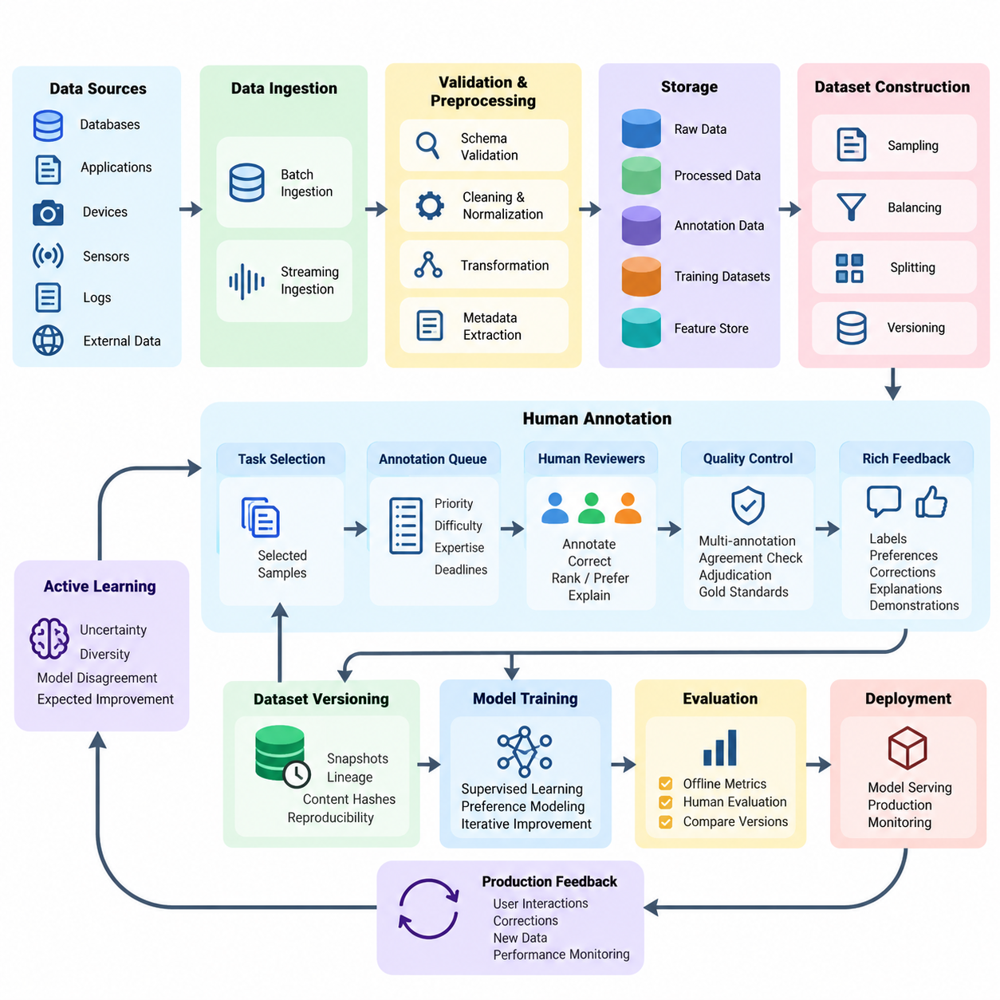
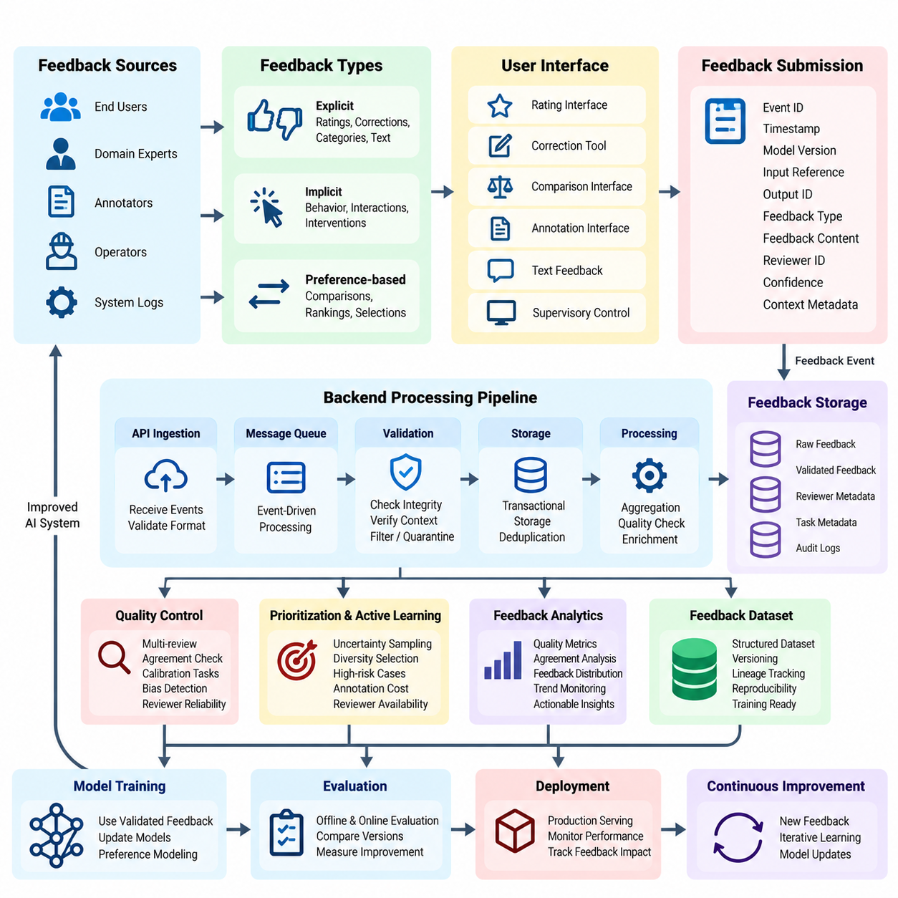
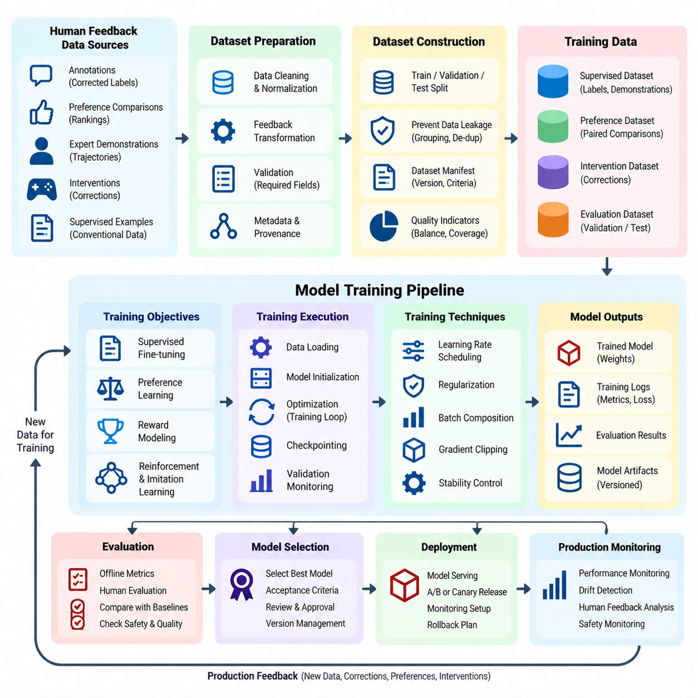
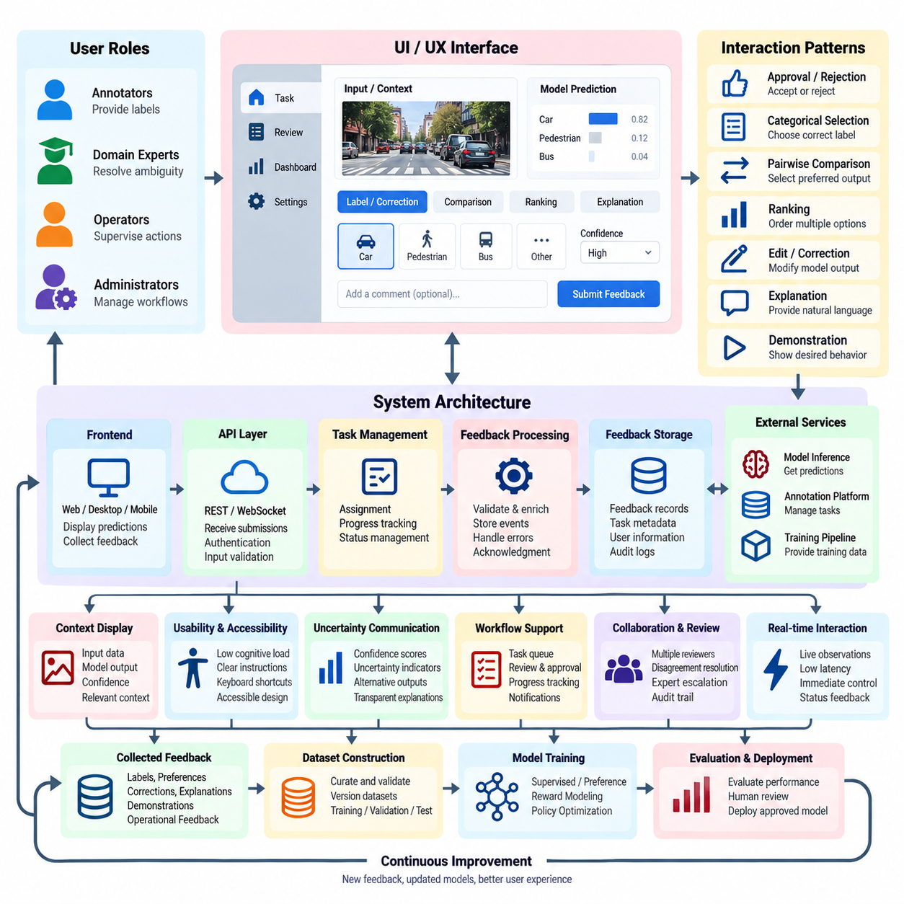
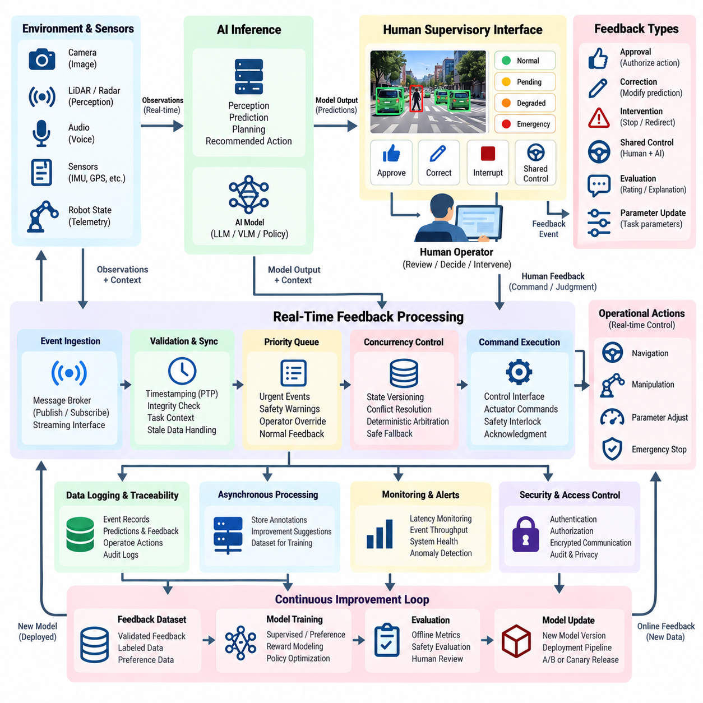
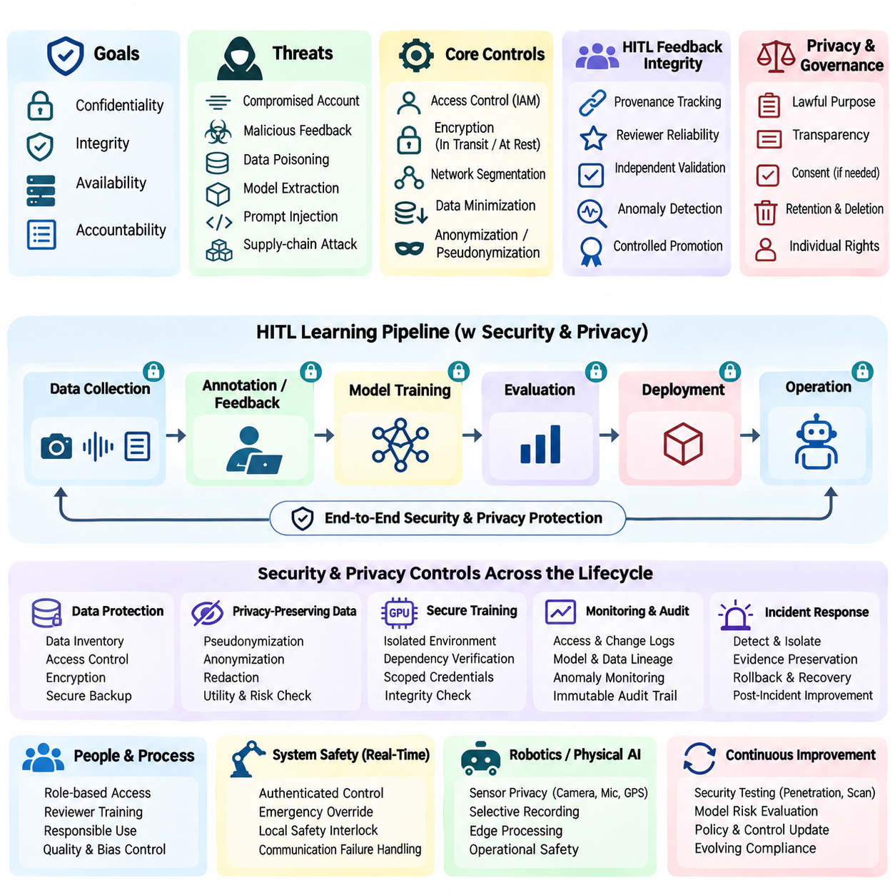
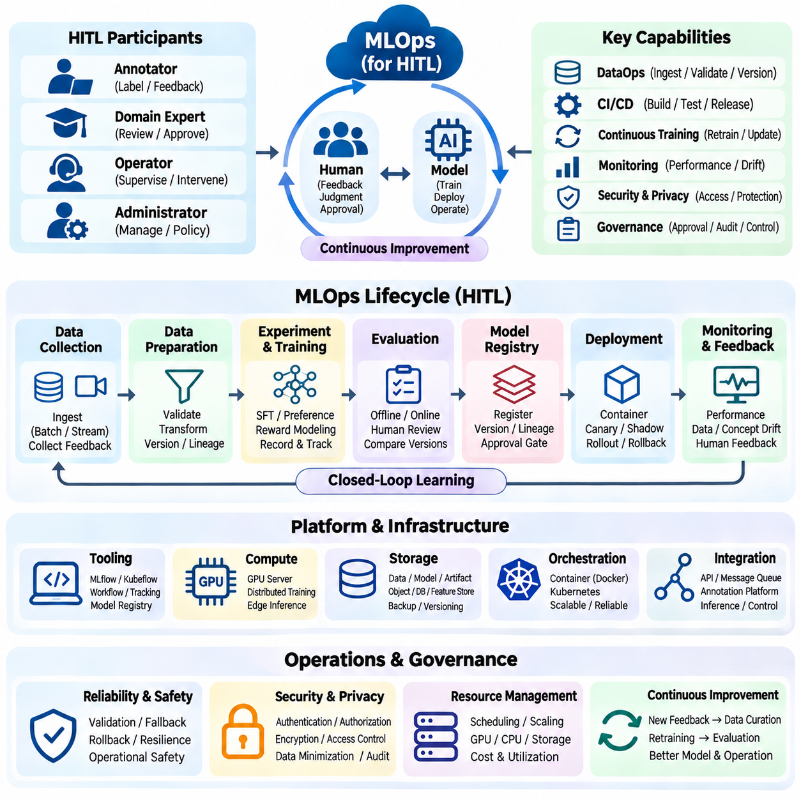

**Volume 41. Human in the Loop Learning**

# 08. Engineering and Deployment

## 08.01 Data Pipeline [w/Code]

{width="7.268055555555556in" height="7.268055555555556in"}

A data pipeline is the operational foundation of a Human-in-the-Loop (HITL) learning system, connecting raw information, human annotations, model training, and production feedback into a continuous learning process. Unlike conventional machine learning pipelines, HITL pipelines must coordinate automated processing with human judgment while maintaining data quality, traceability, reproducibility, and operational efficiency throughout the model lifecycle.

The primary objective of an HITL data pipeline is to transform heterogeneous data into reliable training and evaluation resources. Incoming information may include images, text, audio, sensor measurements, interaction logs, and robotic trajectories. Each source requires appropriate validation, normalization, metadata extraction, and storage procedures before it becomes suitable for annotation, active learning, preference modeling, or supervised model improvement.

Data ingestion begins with collecting information from databases, application interfaces, edge devices, production services, and external datasets. Batch ingestion supports large historical collections, while streaming ingestion processes continuously arriving events. A robust implementation assigns unique identifiers, timestamps, source references, and schema versions to every record, enabling consistent tracking across distributed processing environments and repeated learning cycles.

Schema validation ensures that incoming records satisfy predefined structural and semantic requirements. Validation rules examine field types, missing values, permissible ranges, encoding formats, and relationships between attributes. Records that violate critical requirements should enter a quarantine queue rather than silently contaminating downstream datasets. Validation reports provide engineers with measurable evidence of ingestion reliability and recurring data-quality problems.

Preprocessing converts validated records into representations appropriate for machine learning and human review. Image pipelines may perform resizing, color normalization, and format conversion, while text pipelines handle encoding, segmentation, and sensitive-information masking. Sensor pipelines require timestamp synchronization, calibration metadata, and unit consistency. Transformations must preserve information necessary for annotation and prevent unintended changes to ground-truth meaning.

Human annotation introduces a controlled decision-making stage into the pipeline. Annotation tasks are generated from eligible records and assigned to qualified reviewers according to task complexity, expertise, workload, and quality requirements. The system should preserve annotation instructions, interface versions, reviewer identifiers, and completion timestamps. These records support auditing, disagreement analysis, and subsequent improvements to annotation procedures.

Active learning improves pipeline efficiency by selecting informative samples instead of requesting labels uniformly. Uncertainty sampling identifies predictions with low confidence, while diversity-based selection reduces redundancy among candidate records. More advanced strategies estimate disagreement between models or expected learning improvement. Selection policies should also consider annotation cost, operational risk, and representation of underobserved data populations.

A practical annotation queue separates sample selection from human task execution. Selected records enter a managed queue containing priority, estimated difficulty, required expertise, and processing deadlines. Queue workers distribute tasks across annotation interfaces while preventing accidental duplication or conflicting updates. Retry mechanisms, task expiration, and assignment recovery allow the pipeline to continue operating when reviewers disconnect or processing services fail.

Annotation quality control is essential because human judgments may contain inconsistencies, omissions, or systematic biases. Critical samples can receive multiple independent annotations, followed by agreement measurement and adjudication. Review workflows should distinguish genuine ambiguity from reviewer mistakes. Gold-standard reference examples, calibration exercises, and periodic audits help maintain annotation reliability without assuming that majority agreement always represents correctness.

Human feedback may contain richer information than categorical labels. Reviewers can provide rankings, pairwise preferences, corrections, confidence assessments, natural-language explanations, or demonstrations of desired behavior. The pipeline must represent these feedback types using explicit schemas and preserve their original context. Preference comparisons should retain candidate identifiers and presentation conditions so that reward models can interpret the observations correctly.

Data versioning establishes reproducibility across successive learning iterations. Every dataset release should identify its source records, annotation revisions, preprocessing configuration, selection strategy, and inclusion criteria. Immutable dataset snapshots prevent historical experiments from changing unexpectedly. Content hashes and lineage records connect model checkpoints to the exact training resources used, allowing engineers to investigate performance differences and reproduce earlier results.

Storage architecture should separate raw observations, processed features, annotation records, and finalized training datasets. Object storage is suitable for large media files, while relational or document databases can maintain task metadata and reviewer interactions. Feature stores may provide reusable model inputs when appropriate. Clear separation between these layers prevents accidental overwriting and supports independent scaling of ingestion, annotation, and training services.

Dataset construction requires careful partitioning into training, validation, and test subsets. Splitting policies must account for temporal relationships, shared identities, near-duplicate observations, and correlated acquisition sessions. In robotics, trajectories from the same operating episode should not be distributed carelessly across evaluation partitions. Protected test datasets must remain isolated from active learning decisions to avoid optimistic performance estimates.

Class imbalance and distributional coverage require continuous attention during data preparation. Rare events may be operationally important even when their statistical frequency is low. Sampling strategies can increase the representation of difficult or safety-critical conditions, but artificial changes to class proportions should be documented. Dataset reports should describe coverage across environments, user populations, operating conditions, and relevant failure categories.

Pipeline orchestration coordinates ingestion, validation, preprocessing, annotation, quality review, dataset publication, and model-training triggers. Workflow engines represent dependencies between stages and support scheduled or event-driven execution. Individual tasks should be idempotent wherever possible, allowing safe retries after failures. Explicit state transitions prevent incomplete annotations or unapproved datasets from entering downstream training processes.

An implementation can use Python-based processing services with message queues, database transactions, and workflow orchestration frameworks. Dataset preparation functions should remain modular and independently testable. Configuration files define schemas, storage locations, filtering rules, and annotation policies. Automated tests verify record integrity, transformation behavior, and dataset compatibility before production execution, reducing the risk of silent pipeline failures.

Incremental processing reduces unnecessary computation when only a small portion of the dataset changes. Instead of rebuilding every artifact, the pipeline identifies newly ingested records, revised annotations, and affected derived outputs. Dependency tracking determines which processing stages require re-execution. This approach becomes particularly valuable when large image collections, video sequences, or multimodal robotic datasets are updated continuously.

The relationship between data pipelines and model training should be governed by explicit release criteria. A dataset becomes eligible for training only after required validation, annotation review, and quality checks are completed. Training jobs reference approved dataset versions rather than mutable working directories. Model evaluation results can subsequently identify error clusters and return representative failures to the annotation queue for targeted improvement.

Production inference systems provide another important source of learning data. Predictions, confidence scores, input characteristics, and operational outcomes can reveal distribution shifts or emerging failure patterns. Feedback collection must distinguish observed outcomes from inferred labels and avoid treating every user interaction as reliable supervision. Carefully designed sampling and retention policies limit storage growth while preserving informative examples for future review.

Real-time applications introduce latency constraints that differ from offline annotation workflows. An industrial robot or autonomous platform cannot always wait for human intervention before continuing execution. The pipeline must distinguish immediate operational decisions from asynchronous learning updates. Safety-critical situations may require deterministic fallback behavior, while nonurgent observations can be transferred to human reviewers and incorporated into later model releases.

Security and privacy controls must operate throughout the data lifecycle. Access permissions should reflect reviewer responsibilities and the sensitivity of each record. Encryption, authentication, audit logging, and retention policies reduce unauthorized exposure. Personally identifiable information should be minimized or appropriately protected before annotation. Deletion requests must propagate through derived datasets and relevant processing artifacts according to applicable requirements.

Operational monitoring evaluates both technical performance and human participation. Useful measurements include ingestion throughput, validation failure rates, annotation turnaround time, reviewer agreement, queue backlog, dataset publication latency, and processing cost. These indicators help identify bottlenecks that model accuracy alone cannot reveal. Monitoring should connect data-quality trends with downstream model behavior to support evidence-based pipeline optimization.

A mature HITL data pipeline ultimately functions as a controlled feedback infrastructure rather than a one-directional data preparation process. It connects production observations, automated sample selection, human expertise, quality assurance, and reproducible model updates. Successful engineering depends on maintaining reliable interfaces between these components while balancing annotation effort, computational cost, operational responsiveness, and the long-term trustworthiness of deployed AI systems.

## 08.02 Feedback Collection System [w/Code]

{width="7.268055555555556in" height="7.268055555555556in"}

A Feedback Collection System is a fundamental component of Human-in-the-Loop (HITL) learning, enabling artificial intelligence systems to capture, organize, and utilize human judgments throughout their operational lifecycle. It establishes a structured communication channel between users, domain experts, annotators, and machine learning models. Effective feedback collection transforms human experience into measurable signals that support model refinement, reliability, and continuous improvement.

The primary objective of a feedback collection system is to obtain meaningful human evaluations while minimizing cognitive effort and operational disruption. Feedback may originate from direct user interactions, expert assessments, annotation platforms, or supervisory control interfaces. System design must consider feedback relevance, consistency, timeliness, and interpretability. These characteristics determine whether collected information can reliably guide subsequent learning and deployment decisions.

Feedback can be categorized into explicit, implicit, and preference-based signals. Explicit feedback includes ratings, corrections, categorical judgments, and written evaluations. Implicit feedback derives from observable behavior, such as task completion, repeated interactions, or intervention frequency. Preference-based feedback compares alternative model outputs or actions. Each category requires distinct collection mechanisms and interpretation rules to prevent misleading conclusions.

A well-designed collection architecture separates feedback presentation, event capture, validation, storage, and downstream processing. User interfaces present evaluation tasks, while backend services receive feedback events through standardized application programming interfaces. Processing components verify event integrity and associate responses with relevant model predictions. This modular separation supports independent scaling, maintainability, and integration with existing AI infrastructure.

Feedback events should follow a standardized data schema that preserves both the evaluation result and its operational context. Typical attributes include event identifiers, timestamps, model versions, input references, output identifiers, feedback categories, reviewer identifiers, and confidence assessments. Contextual metadata may describe environmental conditions, task difficulty, or interface configuration. Consistent schemas enable reliable aggregation, auditing, and comparison across learning iterations.

Feedback interfaces should reduce ambiguity and unnecessary interaction complexity. Rating scales require clearly defined meanings, while correction tools should make the original model prediction visible. Preference comparison interfaces should present alternatives under equivalent conditions whenever possible. Contextual instructions help reviewers understand evaluation criteria. Accessible design and efficient interaction patterns improve participation without compromising judgment quality.

Feedback collection can operate synchronously or asynchronously depending on application requirements. Synchronous feedback occurs during active interaction and may influence immediate decisions. Asynchronous feedback is collected after execution through review queues, dashboards, or scheduled evaluations. Real-time systems frequently combine both approaches, allowing urgent interventions while transferring noncritical observations into later model improvement workflows.

A reliable backend should support event-driven ingestion, durable message queues, and transactional storage. Incoming feedback events can be published to a message broker and processed by independent validation workers. Unique event identifiers and idempotent operations prevent duplicate records during retries. Acknowledgment mechanisms confirm successful processing, while dead-letter queues isolate malformed events. These mechanisms improve resilience during network interruptions and temporary service failures.

Feedback validation extends beyond checking data formats. The system must verify that referenced model outputs exist, evaluation choices satisfy task constraints, and submitted responses correspond to the correct prediction context. Invalid or incomplete records should be rejected or quarantined with diagnostic information. Validation policies should distinguish technical errors from legitimate reviewer uncertainty, preserving ambiguous judgments when they contain useful information.

Human feedback frequently contains noise, inconsistency, and systematic bias. Different reviewers may interpret instructions differently or apply distinct quality standards. Repeated evaluations, calibration tasks, and agreement analysis help characterize these variations. Statistical aggregation can reduce random disagreement, but systematic bias requires targeted investigation. Reviewer expertise and task-specific reliability should inform feedback interpretation rather than assuming that all judgments are equally informative.

Feedback prioritization determines which observations deserve human attention. Model uncertainty, prediction disagreement, operational risk, and novelty can guide sample selection. High-impact failures may require expert review even when model confidence is high. Priority policies should balance information value against evaluation cost and reviewer availability. This connection between feedback collection and active learning improves the efficiency of human participation.

A practical implementation can use a Python-based API service to receive structured feedback records and store them in a relational database. Request validation may be implemented with typed schemas, while asynchronous workers handle aggregation and quality checks. Each submission should reference an immutable prediction identifier and a specific model version. Automated tests should verify duplicate handling, authorization, invalid payload rejection, and reliable recovery after processing failures.

Feedback storage should preserve raw submissions separately from aggregated labels or preference scores. Raw records provide evidence for auditing and future reinterpretation, while derived datasets support training and evaluation. Versioned transformations document how individual judgments become supervised examples or reward-model preferences. This separation prevents irreversible information loss and allows updated aggregation strategies without recollecting human evaluations.

Integration with model training requires explicit rules for converting feedback into learning signals. Corrections may become supervised labels, pairwise preferences may support reward modeling, and intervention logs may identify difficult operational states. Not every feedback event should automatically trigger training. Quality thresholds, approval procedures, and dataset release controls ensure that unverified or biased judgments do not degrade deployed models.

Production monitoring should measure feedback submission rates, processing latency, reviewer participation, completion time, disagreement frequency, and validation failures. Additional metrics can evaluate feedback usefulness by examining subsequent model improvements. Sudden changes in feedback distributions may indicate interface problems, shifting user expectations, or model degradation. Monitoring should distinguish these possibilities before initiating corrective actions.

Security and privacy are essential because feedback records may contain sensitive user information, proprietary inputs, or operational details. Authentication and role-based authorization restrict access to appropriate participants. Encryption protects stored and transmitted information, while retention policies limit unnecessary exposure. Where appropriate, pseudonymization separates reviewer identities from evaluation content. Audit trails support accountability without granting unrestricted access to personal data.

Feedback collection becomes particularly important in robotics and autonomous systems, where human interventions can reveal limitations that ordinary prediction metrics overlook. Operators may correct navigation decisions, reject unsafe actions, or demonstrate alternative control strategies. Each event should preserve relevant sensor observations, robot state, action history, and intervention timing. These contextual records allow engineers to distinguish perception errors from planning or control failures.

Scalable feedback systems must accommodate changing workloads and heterogeneous evaluation tasks. Distributed queues, stateless API services, and independently scalable processing workers support increasing event volumes. Annotation interfaces may be specialized for text, vision, audio, or physical actions while sharing common backend contracts. Capacity planning should account for peak submission rates, storage growth, reviewer availability, and downstream processing demands.

The long-term effectiveness of a feedback collection system depends on maintaining a closed relationship between human evaluation and measurable model improvement. Collected judgments should inform dataset curation, training priorities, evaluation design, and operational safeguards. Subsequent model releases must be assessed against both automated benchmarks and relevant human criteria. This disciplined feedback cycle converts individual observations into sustained improvements in AI capability, safety, and trustworthiness.

## 08.03 Model Training Pipeline [w/Code]

{width="7.268055555555556in" height="7.268055555555556in"}

A Model Training Pipeline in Human-in-the-Loop (HITL) learning provides a systematic framework for transforming human feedback and curated datasets into improved machine learning models. Unlike conventional training workflows, HITL pipelines incorporate human judgments throughout iterative development. Their primary objective is to combine automated optimization with human expertise while maintaining reproducibility, data quality, computational efficiency, and controlled model deployment.

The training pipeline begins with approved datasets generated through annotation, feedback collection, and quality assurance processes. These datasets may contain corrected labels, preference comparisons, expert demonstrations, intervention records, and conventional supervised examples. Each dataset must preserve source references, annotation provenance, quality indicators, and version information. Such metadata enables engineers to understand how human contributions influence subsequent model behavior.

Dataset preparation converts heterogeneous feedback into consistent training representations. Classification corrections become labeled examples, preference comparisons become ordered response pairs, and expert demonstrations become state-action trajectories. Preprocessing procedures normalize input formats, resolve incompatible annotations, and validate required fields. Training transformations must preserve semantic meaning and avoid introducing artifacts that distort the relationship between human feedback and model objectives.

Training dataset construction requires explicit separation between training, validation, and test partitions. Samples sharing users, acquisition sessions, trajectories, or near-duplicate content should be grouped appropriately to prevent information leakage. Evaluation datasets must remain independent of active learning selection and model optimization. Versioned dataset manifests document partition assignments, filtering criteria, annotation revisions, and preprocessing configurations.

A robust HITL training pipeline supports multiple learning objectives depending on the available feedback. Supervised fine-tuning minimizes prediction errors against verified labels or demonstrations. Preference learning estimates relative desirability between alternative outputs. Reward modeling converts preference judgments into learned evaluation signals, while policy optimization improves decisions under defined objectives. Each approach requires feedback representations and validation procedures appropriate to its assumptions.

Supervised training commonly serves as the initial stage of model adaptation. A pretrained model is updated using high-quality human-labeled examples, with optimization procedures designed to preserve previously acquired capabilities. Learning rates, batch sizes, regularization, and stopping criteria influence stability and generalization. Validation monitoring detects overfitting, while carefully selected baseline models establish whether additional human supervision produces measurable improvements.

Preference-based training introduces a different optimization structure. Human reviewers compare candidate outputs, allowing the system to learn relative quality without requiring absolute numerical scores. A reward model may estimate preference probabilities from these comparisons, or direct preference optimization may update a policy using suitable paired examples. Training quality depends on comparison consistency, representative sampling, and careful handling of ambiguous or contradictory judgments.

Reward-model training requires particular attention to calibration and generalization. A model trained on narrow preference distributions may assign misleading scores to unfamiliar outputs. Regularization, held-out preference evaluation, and disagreement analysis help identify weaknesses. Reward scores should not automatically be interpreted as objective measures of safety or correctness. Independent evaluation remains necessary because optimizing a learned reward can amplify imperfections in the feedback signal.

Human feedback can also guide reinforcement learning and imitation learning in interactive environments. Expert demonstrations provide reference behaviors, while corrective interventions identify undesirable actions and possible alternatives. Robotic applications may combine behavior cloning, offline reinforcement learning, and constrained policy improvement. Training records should preserve observation timing, action semantics, environment state, and intervention context to prevent misleading supervision.

The training execution layer coordinates data loading, model initialization, optimization, checkpointing, and evaluation. Frameworks such as PyTorch, TensorFlow, or JAX can implement the computational components, while workflow orchestration manages dependencies between stages. Configuration-driven execution allows experiments to specify dataset versions, model architectures, optimization settings, and random seeds. Automated validation checks ensure compatibility before expensive training begins.

A practical Python implementation can separate dataset loading, feedback transformation, model training, and evaluation into independently testable modules. Data loaders should support deterministic partitioning and efficient batching. Training loops compute objective functions, update model parameters, and record diagnostic metrics. Checkpoint managers preserve model weights, optimizer states, and training progress. Unit tests verify tensor dimensions, loss calculations, gradient propagation, and checkpoint recovery.

Training stability becomes particularly important when human feedback is sparse, inconsistent, or highly concentrated on difficult examples. Gradient clipping, learning-rate scheduling, regularization, and controlled batch composition can reduce optimization instability. Excessive emphasis on recently corrected samples may cause catastrophic forgetting or distributional imbalance. Replay buffers or carefully constructed mixtures of historical and new data can help preserve broader capabilities during adaptation.

Incremental learning enables models to incorporate new feedback without repeatedly retraining on every historical observation. However, incremental updates require safeguards against feedback contamination, unstable optimization, and unintended behavioral drift. Training schedules may be triggered by dataset releases, accumulated feedback volume, or detected performance degradation. Each update should undergo validation before replacing an existing production model.

Evaluation must examine both conventional predictive performance and the specific improvements expected from human participation. Classification accuracy, regression error, preference agreement, task success, and intervention frequency provide complementary perspectives. Evaluation should also measure robustness, calibration, fairness, and safety where relevant. Comparisons against unchanged baselines determine whether the additional annotation effort and computational expense produce meaningful benefits.

Human evaluation remains necessary when automated metrics cannot adequately represent task quality. Expert reviewers may assess factual correctness, usability, behavioral appropriateness, or operational safety. Blind comparisons reduce some presentation biases, while standardized evaluation instructions improve consistency. Human assessment should remain separate from training feedback whenever possible to avoid evaluating models on judgments that directly shaped their optimization.

Experiment tracking connects training outcomes with their underlying data and configuration. Each run should record dataset identifiers, model versions, hyperparameters, random seeds, evaluation results, and computational resources. Artifact repositories preserve checkpoints, logs, and evaluation summaries. These records support reproducibility, regression investigation, and systematic comparison between feedback strategies, enabling engineers to distinguish genuine improvements from experimental variation.

Resource management determines whether repeated HITL training cycles remain economically sustainable. Distributed training, mixed-precision computation, gradient accumulation, and parameter-efficient fine-tuning can reduce computational requirements when applicable. Scheduling policies should account for GPU availability, memory consumption, data transfer, and annotation throughput. Optimization efficiency must be evaluated alongside model quality rather than treated as an independent engineering objective.

Model release procedures should enforce explicit approval gates between training and deployment. Candidate models must satisfy predefined quality thresholds, safety requirements, and regression tests before promotion. Shadow evaluation or limited rollout can reveal unexpected production behavior without immediately replacing established systems. Versioned deployment artifacts and rollback mechanisms allow operators to restore earlier models if performance deteriorates.

Monitoring closes the training loop by connecting deployed model behavior with future learning requirements. Production errors, uncertain predictions, human corrections, and operational interventions identify candidates for additional annotation. These observations enter the data pipeline, undergo quality review, and become eligible for subsequent training releases. The resulting feedback cycle supports continuous improvement while preventing unverified observations from directly modifying production models.

A mature HITL model training pipeline therefore operates as a governed learning system rather than an isolated optimization script. It integrates verified human feedback, reproducible data preparation, controlled training, independent evaluation, and monitored deployment. Its effectiveness depends on improving model capabilities without sacrificing reliability, interpretability, safety, or operational stability. This engineering discipline enables human expertise to contribute consistently to the long-term evolution of intelligent systems.

## 08.04 UI UX Integration

{width="7.268055555555556in" height="7.268055555555556in"}

UI/UX integration is a critical engineering component of Human-in-the-Loop (HITL) learning systems, connecting human judgment with automated model behavior through accessible and reliable interaction mechanisms. User interfaces provide the operational environment for annotation, feedback, supervision, and correction. Effective integration ensures that human contributions can be captured accurately, interpreted consistently, and incorporated into continuous learning workflows.

The primary objective of HITL interface design is to reduce interaction complexity while preserving the information required for meaningful human decisions. Users must understand what the AI system predicts, why their input is requested, and how their responses affect subsequent processing. Interface design should balance usability, transparency, responsiveness, and cognitive workload. These factors directly influence feedback quality and operational adoption.

User experience architecture begins with identifying participant roles and their responsibilities. Annotators provide labels, domain experts resolve ambiguous cases, operators supervise automated actions, and administrators manage workflows. Each role requires different information, controls, and authorization levels. Role-specific interfaces reduce unnecessary complexity while ensuring that critical decisions remain accessible to appropriately qualified personnel.

A modular UI/UX architecture separates presentation components, interaction logic, backend communication, and feedback storage. Frontend applications display predictions and collect responses, while backend services validate submissions and manage task states. Standardized application programming interfaces connect these components with annotation platforms, model inference services, and training pipelines. Modular integration supports maintainability and independent system evolution.

Feedback interfaces should present model outputs alongside sufficient contextual information for informed evaluation. Classification tasks may display predicted labels and confidence estimates, while language systems can present alternative responses for comparison. Robotic interfaces may show sensor observations, planned actions, and operational constraints. Context must be informative without overwhelming users or unintentionally biasing their judgments.

Interaction patterns should reflect the structure of the requested feedback. Binary approval controls support simple acceptance decisions, while categorical selectors capture discrete corrections. Ranking interfaces and pairwise comparisons support preference learning. More complex tasks may require editable annotations, demonstrations, or natural-language explanations. Interface components should match task semantics rather than forcing every evaluation into a uniform rating scale.

Human-centered design requires careful attention to cognitive load, accessibility, and error prevention. Clear terminology, consistent navigation, readable typography, and predictable control behavior reduce unnecessary effort. Keyboard shortcuts can improve annotation throughput, while accessible input alternatives support different user capabilities. Confirmation mechanisms should protect consequential actions without introducing excessive interruptions into routine workflows.

The interface should communicate model uncertainty in a calibrated and understandable manner. Confidence scores, uncertainty indicators, and alternative predictions can help reviewers prioritize attention. However, numerical confidence must not be presented as guaranteed correctness. Explanations should distinguish observed evidence from model-generated interpretations. Appropriate uncertainty communication encourages critical evaluation rather than automatic acceptance of AI recommendations.

Workflow integration requires explicit management of task assignment, progress, review, and completion states. Users should be able to identify pending tasks, resume interrupted work, and understand whether submissions were accepted. Backend services maintain authoritative task states, preventing conflicting edits or duplicate processing. Clear status feedback improves reliability and reduces confusion in distributed annotation environments.

Real-time interaction introduces additional requirements for latency, synchronization, and responsiveness. Interfaces supervising autonomous systems may need to display continuously updated observations and provide immediate intervention controls. Asynchronous communication can update visual components without blocking user interaction. Critical commands require acknowledgment and deterministic handling, while delayed or disconnected interfaces must clearly indicate stale information.

A practical implementation may use a modern frontend framework connected to Python-based backend services through REST APIs or WebSocket communication. Reusable interface components can represent prediction displays, annotation editors, review dialogs, and operational dashboards. Typed request schemas and consistent error responses improve integration reliability. Automated interface tests should verify validation behavior, task transitions, accessibility, and recovery from communication failures.

Feedback submission must preserve the relationship between user decisions and the model outputs being evaluated. Each interaction should reference a prediction identifier, model version, task identifier, and relevant contextual metadata. Submission timestamps and reviewer identifiers support traceability. The interface should prevent accidental submission against outdated predictions, especially when model outputs change during an active review session.

Collaborative workflows require mechanisms for disagreement resolution and expert escalation. Multiple reviewers may evaluate the same example independently before results are aggregated. Review interfaces can display conflicting annotations and relevant evidence without exposing unnecessary personal information. Expert adjudication tools should record final decisions and their rationale. These mechanisms strengthen data quality while maintaining accountability.

UI/UX integration should also support active learning by presenting selected samples according to their expected information value. Uncertain, novel, or high-risk examples may receive priority in review queues. Interfaces can display task difficulty and estimated completion effort to support workload planning. Selection criteria should be configurable and monitored to prevent systematic neglect of less frequently sampled data populations.

Personalization can improve productivity when interfaces adapt to reviewer expertise and task requirements. Experienced annotators may benefit from advanced controls, while occasional users require guided interactions. Adaptive layouts should preserve consistent evaluation criteria and avoid changing the meaning of feedback options. Personalization must improve usability without introducing hidden differences that compromise annotation comparability.

Security and privacy controls should be integrated into interface behavior rather than treated solely as backend responsibilities. Authentication, role-based permissions, secure sessions, and controlled data visibility protect sensitive information. Interfaces should minimize exposure of personal or proprietary content and provide clear indications when actions are recorded. Audit logging supports accountability, while privacy-aware design reduces unnecessary collection of user information.

Operational monitoring should evaluate both interface performance and human interaction quality. Useful measurements include task completion time, submission errors, abandonment rates, correction frequency, reviewer disagreement, and interaction latency. Usability studies can reveal confusion that automated telemetry cannot explain. Interface changes should be evaluated against feedback accuracy and user effort rather than visual preference alone.

In robotics and industrial AI, UI/UX integration must connect supervisory decisions with physical operational constraints. Operators may approve missions, modify task parameters, pause execution, or initiate emergency procedures. Interface commands must respect authorization policies and safety interlocks. Human control should remain clearly distinguishable from automated recommendations, particularly when delayed communication or uncertain sensor information affects operational decisions.

A mature HITL UI/UX integration strategy treats the interface as an essential component of the learning and governance architecture. Human decisions are transformed into structured feedback, validated through backend services, and connected to model improvement processes. Effective design balances accessibility, interpretability, responsiveness, and safety. This integration enables human expertise to guide AI behavior consistently while preserving operational reliability and trustworthiness.

## 08.05 Real Time Feedback

{width="7.268055555555556in" height="7.268055555555556in"}

Real-time feedback is a fundamental capability of Human-in-the-Loop (HITL) learning systems, enabling human observations, corrections, and supervisory decisions to influence AI behavior during active operation. Unlike offline feedback, which is processed after task completion, real-time feedback must operate within defined temporal constraints. Its effectiveness depends on low-latency communication, reliable event processing, clear human authority, and safe coordination between automated and manual decisions.

The primary objective of real-time feedback is to connect human judgment with ongoing model inference and operational control. Feedback may confirm predictions, correct classifications, adjust task parameters, or interrupt unsafe actions. Different feedback types require different response deadlines and authority levels. A system must distinguish immediate operational intervention from feedback intended for later model training, preventing delayed learning processes from interfering with time-critical decisions.

Real-time feedback architecture typically integrates sensor acquisition, model inference, user interfaces, event processing, and control execution. Observations enter the inference service, which produces predictions or recommended actions. Human operators review selected outputs and submit corrections through supervisory interfaces. Feedback events are validated, timestamped, and routed to appropriate components. This architecture supports coordinated decision-making while preserving traceability.

Latency requirements must be established according to application risk and operational dynamics. Interactive recommendation systems may tolerate delays that would be unacceptable in autonomous navigation or robotic manipulation. End-to-end latency includes observation acquisition, inference, communication, interface rendering, human response, and command execution. Engineers should define latency budgets for individual stages and measure worst-case behavior rather than relying only on average response times.

A reliable real-time feedback system separates time-critical control pathways from noncritical data collection and learning workflows. Immediate safety actions should be handled through dedicated control mechanisms, while annotations and improvement suggestions can enter asynchronous processing queues. This separation prevents network congestion, database delays, or training workloads from disrupting essential operations. Safety-critical functions require independently validated protection mechanisms.

Event-driven communication provides a practical foundation for real-time feedback integration. Message brokers, publish-subscribe channels, and streaming interfaces distribute observations, predictions, and human responses among system components. Each event should include a unique identifier, source, timestamp, priority, and relevant task context. Ordering guarantees and delivery policies must be selected according to application requirements, since delayed feedback may become invalid when operational states change.

Time synchronization is particularly important when feedback concerns moving robots or rapidly changing environments. Sensor measurements, model predictions, interface displays, and operator commands should reference a consistent temporal framework. Clock synchronization technologies such as Precision Time Protocol can reduce timestamp discrepancies. Systems must account for communication jitter, buffering delays, and stale observations to prevent human corrections from being applied to incorrect operational states.

Human supervisory interfaces should communicate system status, uncertainty, and available intervention options without overwhelming operators. Visual indicators may distinguish normal execution, pending approval, degraded operation, and emergency conditions. Feedback controls should provide clear acknowledgment when commands are received or rejected. Interfaces must also reveal communication failures and outdated information, ensuring that operators do not mistake delayed displays for current system conditions.

Real-time feedback may be implemented through approval, correction, intervention, or shared-control mechanisms. Approval workflows require human authorization before selected actions proceed. Correction workflows modify predictions or task parameters, while intervention mechanisms suspend or redirect ongoing execution. Shared control combines human guidance with automated assistance under explicit authority rules. The appropriate mechanism depends on task criticality, operator expertise, and system autonomy.

A practical implementation may use Python-based inference services, asynchronous event handlers, and WebSocket communication for supervisory updates. Structured feedback messages can include prediction identifiers, operator actions, timestamps, and confidence assessments. Backend services validate commands against current task states before forwarding them to authorized execution components. Automated tests should examine message ordering, duplicate events, connection loss, and recovery after interrupted communication.

Concurrency management becomes essential when multiple feedback events arrive during the same operational interval. Simultaneous corrections from different operators may conflict, while delayed approvals may reference actions that are no longer valid. State versioning, optimistic concurrency control, and explicit ownership rules help resolve these conditions. Critical decisions should follow deterministic arbitration policies, with unresolved conflicts transferred to a safe operating state.

Feedback prioritization ensures that urgent events receive attention before routine evaluation tasks. Safety warnings, operator overrides, and critical execution failures should be processed through high-priority channels. Lower-priority annotations can be buffered for later review. Priority scheduling must prevent starvation and excessive queue growth while maintaining predictable response behavior. Monitoring queue age and processing deadlines helps detect emerging bottlenecks.

Human response time is an important component of system performance and cannot be treated as a constant. Operator workload, task complexity, interface clarity, and situational awareness influence intervention speed. Systems should avoid requiring instantaneous human decisions when physical dynamics exceed realistic human capabilities. Predictive warnings and appropriate automation can create additional response time, while independent safeguards handle hazards that cannot wait for manual intervention.

Real-time feedback should preserve a complete record of the operational context surrounding each intervention. Relevant information includes model predictions, sensor observations, system state, operator decisions, execution outcomes, and timing measurements. These records support incident investigation, performance evaluation, and subsequent dataset construction. Event correlation identifiers connect related observations and commands, allowing engineers to reconstruct the sequence of decisions.

Integration with online learning requires additional safeguards because immediate parameter updates can destabilize deployed models. Human corrections may be used for rapid adaptation only when validation, bounded updates, and rollback mechanisms are available. In many applications, feedback should first enter a controlled training pipeline rather than directly modifying the active model. Separating operational correction from model adaptation reduces the risk of unintended behavioral changes.

Robotic and autonomous systems introduce physical constraints that make real-time feedback especially consequential. Operators may modify navigation goals, correct object recognition, approve manipulation actions, or stop hazardous movements. Supervisory commands must respect actuator limits, safety interlocks, and communication health. Emergency stopping should not depend solely on a remote user interface or general-purpose AI inference service, because these components may experience unpredictable delays.

Evaluation of real-time feedback systems should measure end-to-end response latency, command acknowledgment time, intervention success, missed deadlines, and recovery behavior. Additional indicators include operator workload, false alarms, correction accuracy, and system availability. Stress testing should simulate communication degradation, simultaneous feedback, high event volumes, and component failures. Results must demonstrate that safety and operational requirements remain satisfied under realistic conditions.

Security and privacy requirements extend to every feedback communication pathway. Authentication and role-based authorization determine which operators may observe data or issue commands. Encrypted communication and message integrity checks protect feedback against unauthorized modification. Audit logs should preserve significant interventions without unnecessarily exposing personal information. High-impact commands may require additional verification, provided that verification does not obstruct essential emergency responses.

A mature real-time feedback system combines responsive human interaction with deterministic operational safeguards and structured learning infrastructure. It continuously connects observations, predictions, human decisions, and execution outcomes while preserving temporal consistency and accountability. Effective engineering separates immediate control from long-term adaptation, measures latency under realistic conditions, and maintains safe behavior during failures. This architecture enables human expertise to improve AI operations without compromising reliability or safety.

## 08.06 Security and Privacy

{width="7.268055555555556in" height="7.268055555555556in"}

Security and privacy are essential engineering requirements in Human-in-the-Loop (HITL) learning systems because human feedback workflows frequently process sensitive information, proprietary datasets, and operational decisions. Unlike isolated machine learning pipelines, HITL environments connect human reviewers, model services, annotation platforms, and production infrastructure. This expanded interaction surface requires coordinated protection of data confidentiality, integrity, availability, and accountability.

The security architecture of an HITL system should begin with systematic threat modeling. Engineers must identify valuable assets, potential adversaries, trust boundaries, and attack pathways across data collection, annotation, training, and deployment. Threats may originate from compromised accounts, malicious feedback, insecure interfaces, or vulnerable dependencies. Security controls should reflect operational risk rather than assuming that all components require identical protection.

Privacy engineering begins by identifying what personal information is collected and why it is necessary. Feedback records may contain user identifiers, interaction histories, location traces, images, voice recordings, or sensitive contextual information. Data minimization requires collecting only information essential for defined purposes. Purpose limitation and retention policies reduce unnecessary exposure while supporting legitimate training, evaluation, and auditing requirements.

Identity and access management establishes who can interact with sensitive datasets and operational controls. Authentication verifies participant identities, while role-based or attribute-based authorization restricts permitted actions. Annotators, domain experts, administrators, and operators should receive permissions appropriate to their responsibilities. Least-privilege access and periodic permission reviews reduce the consequences of compromised accounts or accidental misuse.

Secure communication protects feedback events and model interactions as information moves between system components. Transport encryption, authenticated service connections, and integrity verification help prevent interception or unauthorized modification. Sensitive credentials should be managed through dedicated secret-management mechanisms rather than embedded in application code. Network segmentation further limits unauthorized movement between annotation services, training infrastructure, and operational systems.

Data protection must extend beyond communication channels into persistent storage and temporary processing environments. Encryption at rest protects stored feedback, training datasets, and model artifacts when appropriately configured. Access-controlled storage, secure backups, and deletion procedures reduce exposure during normal operation and recovery. Temporary files, cached predictions, and diagnostic logs require equivalent attention because sensitive information can remain outside primary databases.

Privacy-preserving data preparation can reduce the exposure of identifiable information before human review or model training. Pseudonymization replaces direct identifiers with controlled references, while anonymization aims to prevent reasonable reidentification. Redaction may remove faces, names, or confidential document sections when those details are unnecessary. These techniques must be evaluated against data utility, residual identification risk, and the possibility of combining records across sources.

Human annotation introduces additional security risks because reviewers may encounter confidential material or manipulate labels that influence model behavior. Annotation platforms should restrict task visibility, protect downloads, and record consequential changes. Reviewer agreements and training support responsible information handling but cannot replace technical safeguards. Quality controls and anomaly detection can identify suspicious annotation patterns, coordinated manipulation, or unauthorized dataset modifications.

Feedback integrity is particularly important when collected judgments influence model optimization. Malicious participants may submit misleading corrections, fabricated preferences, or strategically selected examples to manipulate future predictions. Such behavior can produce data poisoning and reward manipulation. Provenance tracking, reviewer reliability analysis, independent validation, and controlled dataset promotion help prevent untrusted feedback from becoming authoritative training data.

Machine learning pipelines face security threats beyond conventional application vulnerabilities. Training data poisoning can distort learned behavior, while model extraction and membership inference may expose proprietary information or training-data participation. Prompt injection can influence language-based assistants that process untrusted feedback content. Defensive engineering requires input isolation, controlled tool permissions, secure evaluation, and appropriate testing of model-specific attack scenarios.

Secure model training requires protection of computational infrastructure, dependencies, and generated artifacts. Container isolation, dependency verification, restricted execution privileges, and vulnerability management reduce exposure to software supply-chain attacks. Training jobs should use scoped credentials and reproducible configurations. Model checkpoints and dataset manifests require integrity verification because unauthorized modifications may propagate into production deployments.

Auditability enables organizations to reconstruct how sensitive information was accessed and how consequential decisions were made. Audit records should capture relevant authentication events, dataset changes, feedback approvals, model releases, and operational interventions. Logs must be protected against unauthorized alteration and governed by retention limits. Effective auditing balances accountability with privacy by avoiding unnecessary collection of personal details or sensitive model inputs.

Privacy governance should establish lawful processing purposes, appropriate transparency, and mechanisms for handling applicable individual rights. Consent may be relevant in some contexts, but it is not the only possible legal basis for processing. Requirements vary across jurisdictions and data categories. Systems should support access restrictions, correction workflows, retention enforcement, and deletion procedures where legally required, while documenting exceptions and operational dependencies.

Real-time HITL systems require security mechanisms that do not undermine operational safety. Supervisory commands must be authenticated and authorized, but emergency protection cannot depend entirely on remote authentication services or delayed network responses. Safety interlocks and local protective controllers should remain effective during communication failures. Security and functional safety engineering must therefore coordinate authority boundaries, failure handling, and recovery procedures.

Robotics and autonomous systems introduce additional privacy concerns because sensors continuously observe physical environments. Cameras, microphones, positioning systems, and telemetry may capture bystanders, private spaces, or confidential industrial processes. Collection policies should distinguish information needed for perception and control from information retained for learning. Edge processing, selective recording, and controlled data transfer can reduce unnecessary exposure while preserving operational functionality.

Incident response procedures must address both cybersecurity events and compromised learning integrity. Organizations should define how to detect suspicious activity, isolate affected services, preserve evidence, and restore trusted operation. If poisoned feedback or altered datasets are discovered, affected model versions may require investigation and rollback. Recovery plans should include communication responsibilities, validated backups, and post-incident improvements to technical controls.

Continuous security monitoring should examine authentication failures, unusual data access, unexpected feedback distributions, unauthorized configuration changes, and anomalous model behavior. Automated alerts can identify suspicious patterns, but investigations must distinguish attacks from legitimate operational changes. Security testing should include penetration assessments, dependency scanning, access-control verification, and adversarial evaluation of feedback workflows.

Security and privacy controls must also remain practical for human participants. Excessive authentication friction, unclear permissions, or confusing privacy notices can encourage unsafe workarounds and reduce feedback quality. Interfaces should explain data visibility, recording practices, and the consequences of sensitive actions. Human-centered security design combines understandable workflows with strong technical enforcement, reducing dependence on perfect user behavior.

A mature HITL security and privacy framework integrates protective controls throughout data collection, feedback processing, model training, evaluation, and deployment. Its effectiveness depends on explicit trust boundaries, minimized data exposure, verified feedback integrity, accountable human participation, and resilient operational safeguards. Continuous assessment allows these protections to evolve with changing threats, regulations, and system capabilities while sustaining trustworthy human-AI collaboration.

## 08.07 MLOps

{width="7.268055555555556in" height="7.268055555555556in"}

MLOps provides the operational framework for managing machine learning systems throughout development, deployment, monitoring, and continuous improvement. In Human-in-the-Loop (HITL) environments, MLOps must coordinate automated learning processes with human feedback, expert validation, and operational supervision. Its central objective is to transform experimental models into reliable production services while preserving reproducibility, accountability, and controlled adaptation.

The MLOps lifecycle begins with coordinated management of datasets, model configurations, training experiments, evaluation results, and deployment artifacts. HITL systems introduce additional dependencies involving annotation quality, reviewer decisions, feedback provenance, and approval workflows. These elements must be connected through traceable metadata and versioned records. Effective lifecycle management ensures that every deployed model can be linked to its underlying data and human contributions.

DataOps establishes the foundation for reliable MLOps by organizing data ingestion, validation, transformation, and release procedures. Human feedback enters through annotation platforms, supervisory interfaces, and operational monitoring services. Automated checks verify schemas, completeness, consistency, and data quality before training. Dataset versioning preserves approved snapshots, while provenance records identify how corrections, preferences, and demonstrations were collected and processed.

Continuous integration and continuous delivery support systematic changes to machine learning applications. Continuous integration validates source code, dependencies, configuration files, and data processing components through automated tests. Continuous delivery packages verified models and prepares deployment artifacts for controlled release. In HITL systems, promotion gates should additionally examine feedback quality, human evaluation results, safety requirements, and operational approval conditions.

Continuous training extends conventional CI/CD by enabling model updates when new validated data becomes available. Training workflows may be initiated by approved dataset releases, accumulated feedback volume, or detected performance degradation. Automated orchestration coordinates preprocessing, training, evaluation, and artifact registration. However, retraining should not imply automatic deployment. Candidate models must satisfy explicit acceptance criteria before replacing established production versions.

Experiment tracking enables engineers to reproduce training outcomes and compare alternative feedback strategies. Each experiment should record dataset versions, model architecture, hyperparameters, random seeds, software dependencies, and computational resources. Evaluation metrics and human review outcomes must be associated with the corresponding training run. Structured tracking helps distinguish genuine performance improvements from random variation, data leakage, or inconsistent evaluation procedures.

Model registries provide centralized management of trained models and their lifecycle states. Registered artifacts should include immutable identifiers, version information, training lineage, evaluation reports, and deployment compatibility requirements. Lifecycle stages may distinguish experimental candidates, validated releases, production models, and retired versions. Approval records connect technical verification with accountable human decisions, preventing unreviewed artifacts from entering critical environments.

Deployment engineering converts validated models into operational inference services. Containerized applications, reproducible runtime environments, and infrastructure configuration management support consistent execution across development and production. Deployment strategies may include shadow testing, canary releases, and phased rollouts. HITL interfaces should remain compatible with model outputs and feedback schemas, especially when new versions introduce changes to predictions or interaction behavior.

Monitoring is essential because model performance can deteriorate after deployment despite successful offline evaluation. Production telemetry should capture prediction quality, inference latency, resource utilization, error rates, and service availability. Data drift and concept drift monitoring identify changes in input distributions or relationships between observations and outcomes. Human corrections and intervention frequency provide additional indicators of operational degradation.

Feedback observability extends conventional monitoring by examining how human participants interact with deployed models. Relevant measurements include annotation completion time, reviewer disagreement, correction frequency, escalation rates, and feedback processing latency. Changes in these indicators may reflect model errors, interface problems, or shifting task requirements. Monitoring systems should correlate human feedback with model versions and operating conditions before attributing performance changes.

A practical MLOps implementation may combine Python-based training services, workflow orchestration, experiment tracking, model registries, and automated deployment pipelines. Tools such as MLflow, Kubeflow, or equivalent platforms can support selected lifecycle functions. Container orchestration can manage scalable inference workloads, while message queues process asynchronous feedback. Architectural choices should reflect operational complexity rather than introducing unnecessary infrastructure.

Infrastructure management must account for heterogeneous computing environments and changing workload demands. Centralized GPU servers may support large-scale training, while edge devices execute latency-sensitive inference. Resource scheduling should consider accelerator memory, computational capacity, network bandwidth, storage throughput, and energy constraints. Model packaging and compatibility testing are particularly important when training and deployment hardware differ significantly.

HITL MLOps requires governance mechanisms that define when human review is mandatory and which decisions can be automated. High-risk model releases may require expert approval, while routine data validation can proceed automatically. Review responsibilities, escalation procedures, and release criteria should be documented and enforceable. Governance records must preserve the rationale behind consequential decisions without unnecessarily exposing personal information.

Security and privacy controls must operate throughout the MLOps lifecycle. Authentication, authorization, encryption, and secret management protect datasets, model artifacts, and deployment infrastructure. Software supply-chain verification reduces risks from compromised dependencies or containers. Feedback records may contain sensitive information, requiring controlled access and retention policies. Audit trails support investigations into unauthorized changes, data misuse, and unexpected model behavior.

Rollback and recovery mechanisms protect production systems when newly deployed models fail to meet operational expectations. Previous model versions, compatible configurations, and validated artifacts should remain available for restoration. Rollback decisions may be triggered by automated thresholds or authorized human intervention. Recovery procedures should be tested under realistic failure scenarios, including unavailable services, corrupted artifacts, and interrupted communication.

Robotics and Physical AI introduce additional MLOps requirements because model updates influence actions in physical environments. Deployment validation must consider sensor calibration, actuator constraints, control interfaces, timing requirements, and safety interlocks. Simulation and hardware-in-the-loop testing can identify failures before field deployment. Operators should retain appropriate supervisory authority, while safety-critical protective functions remain independent of experimental learning components.

Edge MLOps extends lifecycle management to distributed devices operating under constrained connectivity and computational resources. Model updates may require signed artifacts, compatibility checks, staged distribution, and local rollback capabilities. Devices should report deployment status, performance metrics, and feedback summaries when communication is available. Offline operation requires defined policies for buffering observations, preserving integrity, and maintaining safe behavior during network interruptions.

Continuous improvement depends on a closed feedback loop connecting production observations with data curation, model training, evaluation, and deployment. Human corrections should enter controlled review processes before becoming training examples. Updated models must demonstrate improvements against representative benchmarks and operational acceptance criteria. This separation between feedback collection and model promotion prevents unverified information from producing uncontrolled changes in production behavior.

A mature HITL MLOps framework integrates technical automation with human accountability across the complete machine learning lifecycle. It connects reliable data pipelines, reproducible experiments, governed model releases, operational monitoring, and structured feedback collection. Its success is measured not only by deployment speed but also by model quality, safety, maintainability, and recovery capability. This operational discipline enables intelligent systems to evolve continuously while remaining trustworthy and controllable.
