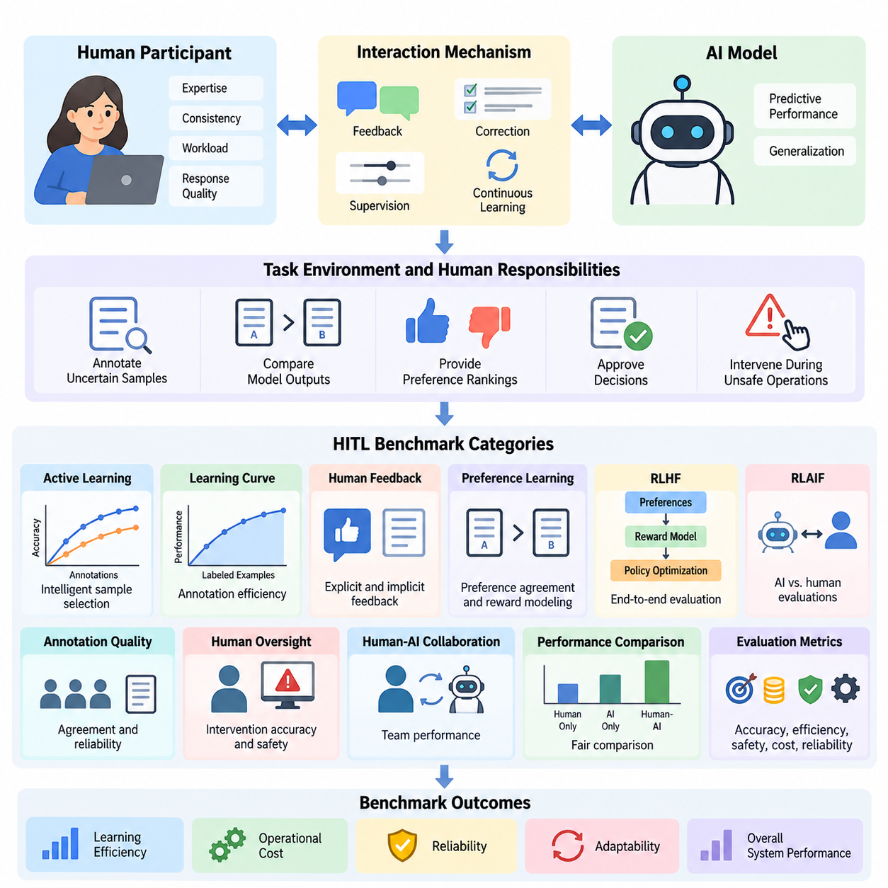
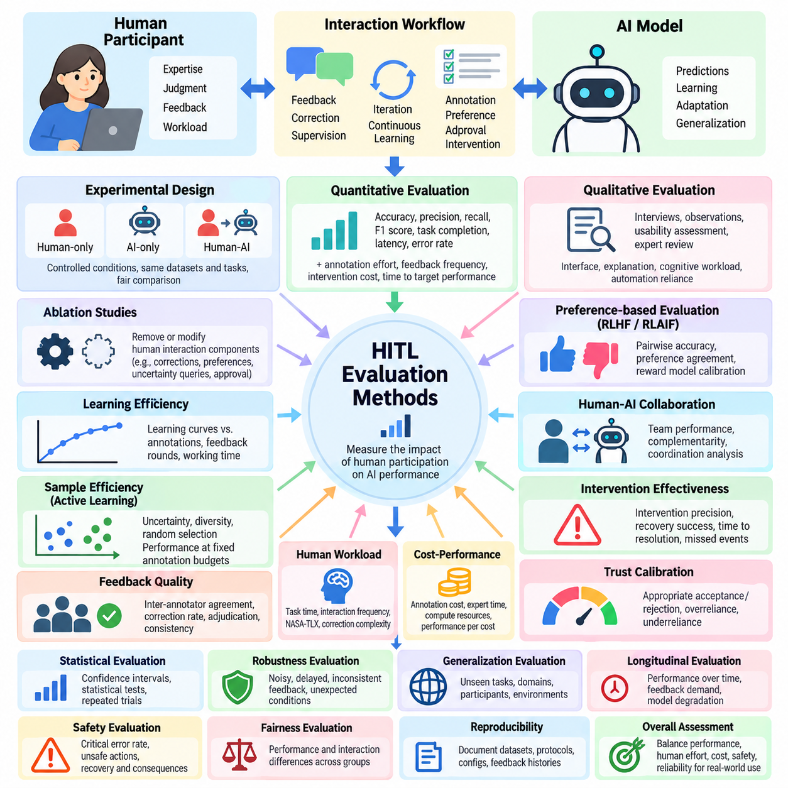
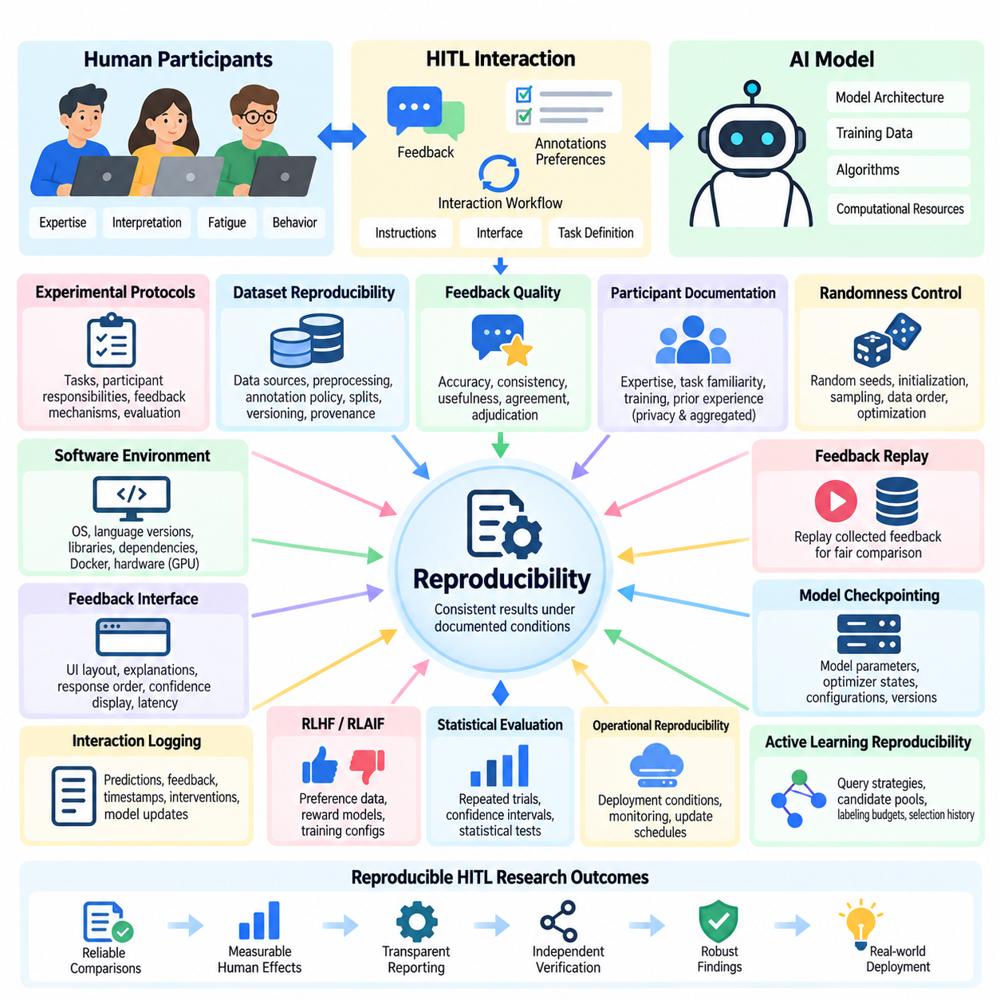
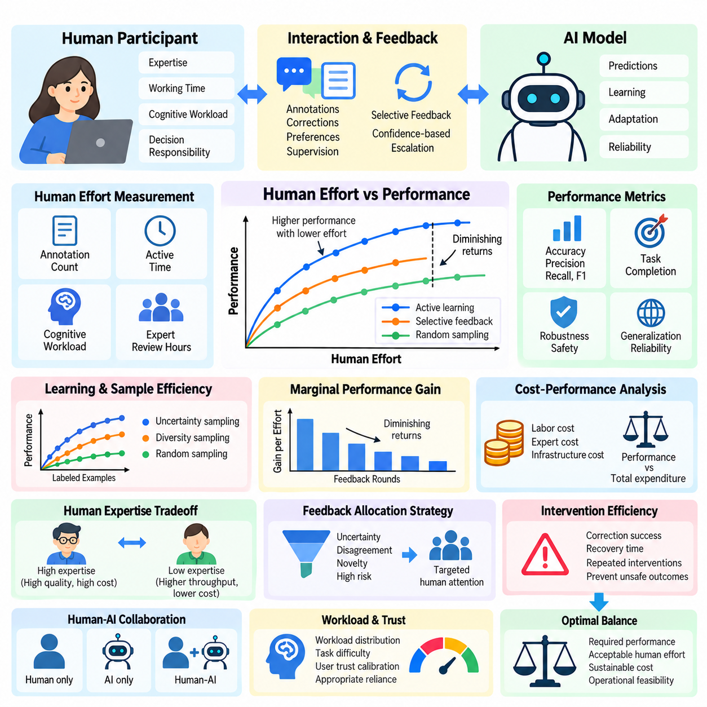
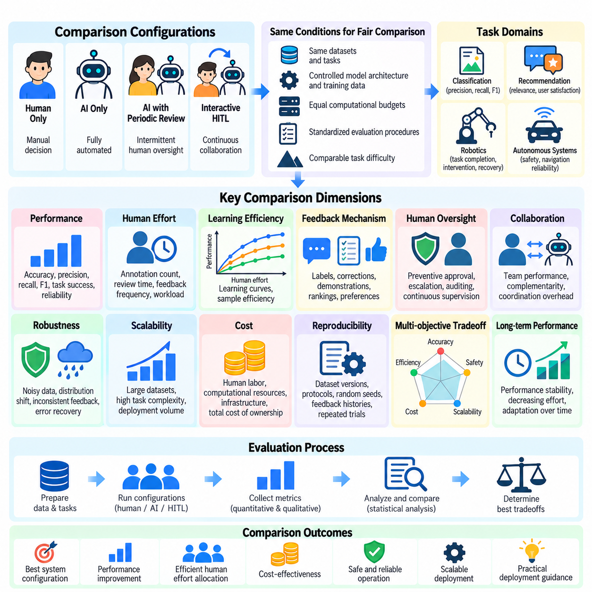

**Volume 41. Human in the Loop Learning**


# 09. Experiments and Benchmarks

## 09.01 HITL Benchmarks

{width="7.268055555555556in" height="7.268055555555556in"}

Human-in-the-Loop (HITL) benchmarks provide systematic methods for evaluating artificial intelligence systems that incorporate human judgment, feedback, correction, and supervision into learning and decision-making processes. Unlike conventional benchmarks that measure model accuracy independently, HITL benchmarks examine how human participation changes learning efficiency, reliability, adaptability, operational cost, and overall system performance.

The primary objective of HITL benchmarking is to quantify the contribution of human involvement under controlled experimental conditions. A benchmark must distinguish improvements produced by model architecture, training data, optimization methods, and human intervention. This distinction requires clearly defined baselines, consistent datasets, standardized interaction protocols, and measurable outcomes that support fair comparisons between different human-AI configurations.

A comprehensive HITL benchmark evaluates three interconnected components: the artificial intelligence model, the human participant, and the interaction mechanism connecting them. Model evaluation measures predictive performance and generalization, while human evaluation considers expertise, consistency, workload, and response quality. Interaction evaluation examines whether information exchange enables effective corrections, decisions, and continuous learning.

Benchmark design begins by defining the task environment and the responsibilities assigned to human participants. Humans may annotate uncertain samples, compare model outputs, provide preference rankings, approve decisions, or intervene during unsafe operations. Each interaction type requires a distinct evaluation protocol because annotation, preference modeling, supervisory approval, and direct control impose different cognitive demands and operational constraints.

Active learning benchmarks investigate whether strategically selected human annotations improve model performance more efficiently than randomly sampled training data. Experimental configurations typically compare uncertainty sampling, diversity sampling, query-by-committee, and expected model change. Performance is measured against annotation budgets, allowing researchers to determine whether intelligent sample selection reduces the human effort required to achieve a target accuracy.

A central measurement in active learning benchmarking is the learning curve, which describes model performance as additional labeled examples become available. Researchers compare accuracy, F1 score, or other task-specific metrics at equivalent annotation budgets. The area under the learning curve provides a useful summary of annotation efficiency, although interpretation must account for initial training conditions and differences in sample difficulty.

Human feedback benchmarks evaluate how effectively AI systems incorporate explicit ratings, implicit behavioral signals, and preference-based judgments. Explicit feedback may consist of numerical scores or corrective labels, while preference-based evaluation asks participants to compare alternative responses. Benchmark protocols must account for inconsistent judgments, ambiguous instructions, participant expertise, and systematic biases that influence feedback quality.

Preference learning benchmarks frequently measure agreement between predicted preferences and held-out human comparisons. Reward models can be evaluated using pairwise ranking accuracy, calibration, and robustness across different task categories. However, agreement with collected preferences does not automatically establish that a model produces beneficial behavior, making independent assessments of usefulness, safety, and generalization essential.

Reinforcement Learning from Human Feedback (RLHF) benchmarks examine the complete relationship between preference collection, reward modeling, policy optimization, and final behavior. Experimental comparisons may include supervised fine-tuning, reward-guided optimization, and policies trained without preference feedback. Evaluation should distinguish reward model scores from independent human judgments to detect reward exploitation and unintended optimization effects.

Reinforcement Learning from AI Feedback (RLAIF) introduces another benchmarking dimension by replacing or supplementing human evaluators with AI-generated assessments. Comparative experiments can measure agreement between AI and human judgments, evaluation costs, preference consistency, and downstream policy quality. Human reference evaluations remain important for identifying systematic errors shared by automated evaluators and the models being assessed.

Annotation quality benchmarks focus on the reliability of human-generated training labels. Inter-annotator agreement, adjudication accuracy, disagreement rates, and label correction frequency provide complementary indicators of dataset quality. Cohen\'s kappa, Fleiss\' kappa, and Krippendorff\'s alpha may be appropriate under different annotation conditions, but their interpretation depends on label distributions and the underlying measurement scale.

Human oversight benchmarks investigate whether supervisory mechanisms improve the safety and reliability of AI-assisted decisions. Experimental tasks may require participants to accept, reject, revise, or escalate model recommendations. Important measurements include intervention accuracy, missed critical events, false alarms, response latency, and the proportion of unsafe actions prevented through timely human participation.

Human-AI collaboration benchmarks should evaluate the combined team rather than treating human and model performance as independent quantities. A useful experimental design compares human-only, AI-only, and human-AI conditions using equivalent tasks and evaluation criteria. Such comparisons reveal whether collaboration produces measurable benefits or introduces coordination overhead, automation bias, excessive dependence, or unnecessary intervention.

Trust calibration represents an important dimension of collaborative benchmarking because effective human oversight depends on recognizing when model outputs deserve confidence. Participants may be exposed to predictions with different uncertainty estimates or explanation formats. Researchers can then examine whether users appropriately accept correct recommendations, reject incorrect ones, and adjust their reliance according to demonstrated system reliability.

Operational HITL benchmarks extend evaluation beyond isolated model predictions into complete production workflows. These experiments measure how feedback collection, annotation review, retraining, validation, and deployment interact over time. Workflow metrics include feedback processing latency, annotation throughput, model update frequency, error resolution time, and the proportion of collected feedback successfully incorporated into subsequent model improvements.

Continuous learning benchmarks examine how human feedback supports adaptation when operational data distributions change. Controlled experiments may introduce unfamiliar categories, changing environmental conditions, or evolving user preferences. Evaluation should measure adaptation speed, performance recovery, catastrophic forgetting, and the human effort required to restore acceptable behavior after distribution shifts or unexpected operational failures.

Robotics provides a particularly important environment for HITL benchmarking because human interventions can influence physical actions and safety-critical decisions. Representative tasks include navigation correction, manipulation assistance, trajectory approval, and recovery from failed operations. Relevant metrics include task completion rate, intervention frequency, recovery time, collision incidence, and successful autonomous operation between human interventions.

Industrial AI benchmarks can evaluate human participation in visual inspection, anomaly detection, predictive maintenance, and quality assurance. For example, a visual inspection system may request expert review when prediction confidence is insufficient. Benchmarking should determine whether selective escalation improves defect detection while reducing inspection workload, unnecessary manual reviews, and the operational consequences of missed defects.

Healthcare and other high-stakes applications require benchmarking protocols that distinguish decision support from independent automated decision-making. Human reviewers may evaluate diagnostic suggestions, risk estimates, or recommended actions within clearly defined authority boundaries. Experimental outcomes should include decision quality, escalation behavior, review time, uncertainty communication, and adherence to established safety requirements.

Human effort must be measured directly rather than approximated solely through the number of feedback interactions. Two annotation requests may require substantially different amounts of attention, expertise, and cognitive effort. Benchmark protocols should therefore record active working time, correction complexity, participant workload, and training requirements, enabling meaningful comparisons between systems with different interaction designs.

Cost-sensitive benchmarking combines model performance with the resources consumed by human participation. Total evaluation cost may include annotation labor, expert review, interface operation, computational processing, and repeated quality assurance. Comparing performance against both financial expenditure and human working time helps identify configurations that achieve practical efficiency rather than merely maximizing predictive accuracy.

Experimental reproducibility requires careful documentation of datasets, participant selection, task instructions, model configurations, annotation interfaces, and evaluation procedures. Random seeds and software versions should be recorded alongside interaction logs and feedback histories. Because human judgments contain natural variability, repeated trials and transparent reporting of participant characteristics are necessary for interpreting experimental results.

Statistical analysis should account for variability across participants, tasks, and experimental repetitions. Confidence intervals, paired comparisons, bootstrap estimation, and appropriate hierarchical statistical models can help quantify uncertainty. When multiple judgments originate from the same participant, treating them as independent observations may exaggerate statistical significance and produce misleading conclusions about benchmark performance.

Benchmark robustness can be examined by introducing ambiguous examples, noisy feedback, adversarial inputs, and disagreements among evaluators. A reliable HITL system should maintain acceptable behavior when human responses are delayed, inconsistent, or occasionally incorrect. Evaluation should therefore measure both the ability to benefit from high-quality feedback and resistance to harmful or misleading interventions.

Fairness and accessibility also influence benchmark validity because human participants differ in expertise, language proficiency, interaction preferences, and familiarity with AI systems. Evaluation protocols should investigate whether particular interface designs or feedback mechanisms systematically disadvantage certain participant groups. Appropriate reporting helps distinguish genuine algorithmic improvements from performance differences caused by participant composition.

A practical HITL benchmarking framework ultimately connects predictive performance, human effort, interaction quality, operational reliability, and safety into a unified evaluation process. No single metric can adequately represent these dimensions. Multi-objective analysis enables researchers and engineers to identify tradeoffs between autonomy, supervision, annotation cost, and system performance under realistic deployment constraints.

The long-term purpose of HITL benchmarking is to establish measurable evidence that human participation improves artificial intelligence systems in ways that justify its operational complexity. Well-designed benchmarks support transparent comparisons, reproducible experimentation, and informed deployment decisions. They also provide a foundation for developing adaptive human-AI systems that remain effective, accountable, and responsive to changing real-world requirements.

인간 참여형 학습 벤치마크(Human-in-the-Loop Benchmarks, HITL Benchmarks)는 인간의 판단(Human Judgment), 피드백(Feedback), 수정(Correction), 감독(Supervision)을 학습(Learning) 및 의사결정(Decision-Making) 과정에 통합하는 인공지능(Artificial Intelligence, AI) 시스템을 체계적으로 평가하는 방법을 제공한다. 기존 벤치마크가 모델의 정확도를 독립적으로 측정하는 것과 달리, HITL 벤치마크는 인간의 참여가 학습 효율성, 신뢰성, 적응성, 운영 비용 및 전체 시스템 성능에 미치는 영향을 평가한다.

HITL 벤치마킹(HITL Benchmarking)의 주요 목적은 통제된 실험 조건(Controlled Experimental Conditions)에서 인간의 개입(Human Involvement)이 기여하는 정도를 정량화하는 것이다. 벤치마크는 모델 아키텍처(Model Architecture), 학습 데이터(Training Data), 최적화 방법(Optimization Methods), 인간 개입(Human Intervention)에 의해 발생하는 성능 향상을 구분해야 한다. 이를 위해 명확하게 정의된 기준 모델(Baselines), 일관된 데이터셋(Datasets), 표준화된 상호작용 프로토콜(Interaction Protocols), 측정 가능한 결과가 필요하다.

포괄적인 HITL 벤치마크는 인공지능 모델(AI Model), 인간 참여자(Human Participant), 그리고 이들을 연결하는 상호작용 메커니즘(Interaction Mechanism)이라는 세 가지 구성 요소를 평가한다. 모델 평가는 예측 성능(Predictive Performance)과 일반화(Generalization)를 측정하며, 인간 평가는 전문성(Expertise), 일관성(Consistency), 작업 부담(Workload), 응답 품질(Response Quality)을 고려한다. 상호작용 평가는 정보 교환이 효과적인 수정, 의사결정 및 지속적 학습을 가능하게 하는지 분석한다.

벤치마크 설계(Benchmark Design)는 작업 환경(Task Environment)과 인간 참여자에게 할당되는 책임을 정의하는 것에서 시작한다. 인간은 불확실한 샘플(Uncertain Samples)에 주석을 작성하거나, 모델 출력을 비교하거나, 선호도 순위(Preference Rankings)를 제공하거나, 의사결정을 승인하거나, 위험한 작업에 개입할 수 있다. 각 상호작용 유형은 서로 다른 인지적 요구(Cognitive Demands)와 운영 제약(Operational Constraints)을 가지므로 별도의 평가 프로토콜이 필요하다.

능동 학습 벤치마크(Active Learning Benchmarks)는 전략적으로 선택된 인간 주석(Human Annotations)이 무작위로 선택된 학습 데이터보다 모델 성능을 효율적으로 향상시키는지 조사한다. 실험 구성에서는 일반적으로 불확실성 샘플링(Uncertainty Sampling), 위원회 기반 질의(Query-by-Committee), 다양성 샘플링(Diversity Sampling), 예상 모델 변화(Expected Model Change)를 비교한다. 성능은 주석 예산(Annotation Budget)을 기준으로 측정하여 지능적인 샘플 선택이 목표 정확도에 필요한 인간의 노력을 줄이는지 판단한다.

능동 학습 벤치마킹의 핵심 측정 지표는 추가적인 레이블 데이터(Labeled Data)가 확보됨에 따라 모델 성능이 어떻게 변화하는지 나타내는 학습 곡선(Learning Curve)이다. 연구자는 동일한 주석 예산에서 정확도(Accuracy), F1 점수(F1 Score), 기타 작업별 평가 지표를 비교한다. 학습 곡선 아래 면적(Area Under the Learning Curve)은 주석 효율성을 요약하는 유용한 지표이지만, 초기 학습 조건과 샘플 난이도의 차이를 고려하여 해석해야 한다.

인간 피드백 벤치마크(Human Feedback Benchmarks)는 AI 시스템이 명시적 평가(Explicit Ratings), 암묵적 행동 신호(Implicit Behavioral Signals), 선호도 기반 판단(Preference-Based Judgments)을 얼마나 효과적으로 반영하는지 평가한다. 명시적 피드백은 수치 점수나 수정된 레이블로 구성될 수 있으며, 선호도 기반 평가는 참여자가 대안 응답을 비교하도록 요구한다. 벤치마크 프로토콜은 판단의 불일치, 모호한 지침, 참여자의 전문성, 피드백 품질에 영향을 미치는 체계적 편향(Systematic Bias)을 고려해야 한다.

선호도 학습 벤치마크(Preference Learning Benchmarks)는 예측된 선호도와 평가용으로 분리된 인간 비교 데이터(Held-Out Human Comparisons) 사이의 일치도를 측정하는 경우가 많다. 보상 모델(Reward Model)은 쌍별 순위 정확도(Pairwise Ranking Accuracy), 보정(Calibration), 작업 범주별 강건성(Robustness)을 통해 평가할 수 있다. 그러나 수집된 선호도와의 일치가 반드시 유익한 행동을 보장하는 것은 아니므로 유용성, 안전성 및 일반화에 대한 독립적인 평가가 필수적이다.

인간 피드백 기반 강화학습(Reinforcement Learning from Human Feedback, RLHF) 벤치마크는 선호도 수집(Preference Collection), 보상 모델링(Reward Modeling), 정책 최적화(Policy Optimization), 최종 행동 사이의 전체 관계를 평가한다. 실험에서는 지도 미세조정(Supervised Fine-Tuning), 보상 기반 최적화(Reward-Guided Optimization), 선호도 피드백 없이 학습된 정책을 비교할 수 있다. 보상 악용(Reward Exploitation)과 의도하지 않은 최적화 효과를 탐지하기 위해 보상 모델 점수와 독립적인 인간 평가를 구분해야 한다.

AI 피드백 기반 강화학습(Reinforcement Learning from AI Feedback, RLAIF)은 인간 평가자를 AI가 생성한 평가로 대체하거나 보완함으로써 새로운 벤치마킹 차원을 제공한다. 비교 실험에서는 AI와 인간 판단 사이의 일치도, 평가 비용, 선호도 일관성, 후속 정책 품질(Downstream Policy Quality)을 측정할 수 있다. 자동화된 평가자와 평가 대상 모델이 공유하는 체계적 오류를 식별하기 위해서는 인간 기준 평가(Human Reference Evaluation)가 여전히 중요하다.

주석 품질 벤치마크(Annotation Quality Benchmarks)는 인간이 생성한 학습 레이블(Training Labels)의 신뢰성(Reliability)에 초점을 맞춘다. 주석자 간 일치도(Inter-Annotator Agreement), 판정 정확도(Adjudication Accuracy), 불일치율(Disagreement Rate), 레이블 수정 빈도(Label Correction Frequency)는 데이터셋 품질을 평가하는 상호보완적 지표이다. 코헨의 카파(Cohen\'s Kappa), 플라이스의 카파(Fleiss\' Kappa), 크리펜도르프의 알파(Krippendorff\'s Alpha)는 주석 조건에 따라 적용할 수 있지만, 해석 시 레이블 분포와 측정 척도를 고려해야 한다.

인간 감독 벤치마크(Human Oversight Benchmarks)는 감독 메커니즘(Supervisory Mechanisms)이 AI 지원 의사결정의 안전성과 신뢰성을 향상시키는지 조사한다. 실험 작업에서는 참여자가 모델 권고를 수락, 거부, 수정하거나 상위 검토 단계로 이관하도록 요구할 수 있다. 주요 측정 지표에는 개입 정확도(Intervention Accuracy), 중대한 사건의 미탐지(Missed Critical Events), 오경보(False Alarms), 응답 지연(Response Latency), 적절한 인간 개입으로 방지된 위험 행동의 비율이 포함된다.

인간-AI 협업 벤치마크(Human-AI Collaboration Benchmarks)는 인간과 모델의 성능을 독립적으로 평가하기보다 결합된 팀(Combined Team)을 평가해야 한다. 유용한 실험 설계는 동일한 작업과 평가 기준을 적용하여 인간 단독(Human-Only), AI 단독(AI-Only), 인간-AI 협업(Human-AI) 조건을 비교한다. 이러한 비교를 통해 협업의 실질적 이점뿐 아니라 조정 부담(Coordination Overhead), 자동화 편향(Automation Bias), 과도한 의존성(Excessive Dependence), 불필요한 개입을 파악할 수 있다.

신뢰 보정(Trust Calibration)은 효과적인 인간 감독이 모델 출력에 대한 적절한 신뢰 수준을 판단하는 능력에 의존하기 때문에 협업 벤치마킹에서 중요한 요소이다. 참여자에게 서로 다른 불확실성 추정(Uncertainty Estimates)이나 설명 형식(Explanation Formats)이 포함된 예측을 제시할 수 있다. 연구자는 사용자가 올바른 권고를 적절히 수용하고 잘못된 권고를 거부하며, 실제로 확인된 시스템 신뢰성에 따라 의존 수준을 조정하는지 분석할 수 있다.

운영형 HITL 벤치마크(Operational HITL Benchmarks)는 개별 모델 예측을 넘어 전체 운영 워크플로(Production Workflows)로 평가 범위를 확장한다. 이러한 실험은 피드백 수집, 주석 검토, 재학습(Retraining), 검증(Validation), 배포(Deployment)가 시간에 따라 어떻게 상호작용하는지 측정한다. 워크플로 지표에는 피드백 처리 지연, 주석 처리량(Annotation Throughput), 모델 업데이트 빈도, 오류 해결 시간, 후속 모델 개선에 성공적으로 반영된 피드백 비율이 포함된다.

지속 학습 벤치마크(Continuous Learning Benchmarks)는 운영 데이터 분포가 변화할 때 인간 피드백이 적응을 어떻게 지원하는지 평가한다. 통제된 실험에서는 익숙하지 않은 범주, 변화하는 환경 조건, 진화하는 사용자 선호도를 도입할 수 있다. 평가에서는 적응 속도(Adaptation Speed), 성능 회복(Performance Recovery), 파국적 망각(Catastrophic Forgetting), 분포 변화(Distribution Shift)나 예상하지 못한 운영 실패 이후 허용 가능한 성능을 회복하는 데 필요한 인간의 노력을 측정해야 한다.

로보틱스(Robotics)는 인간 개입이 물리적 행동과 안전 필수 의사결정(Safety-Critical Decisions)에 영향을 미칠 수 있기 때문에 HITL 벤치마킹에서 특히 중요한 환경이다. 대표적인 작업에는 내비게이션 수정(Navigation Correction), 조작 지원(Manipulation Assistance), 궤적 승인(Trajectory Approval), 실패한 작업의 복구가 포함된다. 관련 지표에는 작업 완료율(Task Completion Rate), 개입 빈도, 복구 시간, 충돌 발생률, 인간 개입 사이에 성공적으로 수행된 자율 운영 수준이 포함된다.

산업용 AI 벤치마크(Industrial AI Benchmarks)는 시각 검사(Visual Inspection), 이상 탐지(Anomaly Detection), 예지보전(Predictive Maintenance), 품질 보증(Quality Assurance)에서 인간의 참여를 평가할 수 있다. 예를 들어 시각 검사 시스템은 예측 신뢰도가 충분하지 않을 때 전문가 검토(Expert Review)를 요청할 수 있다. 벤치마킹은 선택적 검토 요청(Selective Escalation)이 결함 탐지 성능을 향상시키면서 검사 업무 부담, 불필요한 수동 검토, 결함 미탐지에 따른 운영상 영향을 줄이는지 판단해야 한다.

의료(Healthcare) 및 기타 고위험 응용 분야(High-Stakes Applications)에서는 의사결정 지원(Decision Support)과 독립적인 자동 의사결정(Automated Decision-Making)을 구분하는 벤치마킹 프로토콜이 필요하다. 인간 검토자는 명확하게 정의된 권한 범위 내에서 진단 제안, 위험 추정, 권장 조치를 평가할 수 있다. 실험 결과에는 의사결정 품질, 상위 단계 이관 행동(Escalation Behavior), 검토 시간, 불확실성 전달(Uncertainty Communication), 확립된 안전 요구사항 준수 여부가 포함되어야 한다.

인간의 노력(Human Effort)은 단순히 피드백 상호작용 횟수만으로 추정하지 않고 직접 측정해야 한다. 두 개의 주석 요청이라도 필요한 주의력, 전문성, 인지적 노력(Cognitive Effort)은 상당히 다를 수 있다. 따라서 벤치마크 프로토콜은 실제 작업 시간(Active Working Time), 수정 복잡도(Correction Complexity), 참여자 작업 부담, 교육 요구사항을 기록해야 하며, 이를 통해 서로 다른 상호작용 설계를 가진 시스템을 의미 있게 비교할 수 있다.

비용 민감형 벤치마킹(Cost-Sensitive Benchmarking)은 모델 성능과 인간 참여에 소비되는 자원을 결합하여 평가한다. 전체 평가 비용에는 주석 작업 인건비, 전문가 검토, 인터페이스 운영, 계산 처리, 반복적인 품질 보증이 포함될 수 있다. 재정적 지출(Financial Expenditure)과 인간 작업 시간을 기준으로 성능을 비교하면 단순히 예측 정확도를 극대화하는 구성이 아니라 실제 운영 효율성을 달성하는 구성을 식별할 수 있다.

실험 재현성(Experimental Reproducibility)을 확보하려면 데이터셋, 참여자 선정, 작업 지침, 모델 구성, 주석 인터페이스, 평가 절차를 체계적으로 문서화해야 한다. 난수 시드(Random Seeds)와 소프트웨어 버전(Software Versions)은 상호작용 로그(Interaction Logs) 및 피드백 이력(Feedback Histories)과 함께 기록해야 한다. 인간 판단에는 자연스러운 변동성이 존재하므로 실험 결과를 올바르게 해석하려면 반복 실험과 참여자 특성에 대한 투명한 보고가 필요하다.

통계 분석(Statistical Analysis)은 참여자, 작업, 실험 반복 사이에서 발생하는 변동성을 고려해야 한다. 신뢰구간(Confidence Intervals), 대응 비교(Paired Comparisons), 부트스트랩 추정(Bootstrap Estimation), 적절한 계층적 통계 모델(Hierarchical Statistical Models)은 불확실성을 정량화하는 데 도움이 된다. 동일한 참여자에게서 얻은 여러 판단을 독립적인 관측값으로 처리하면 통계적 유의성(Statistical Significance)이 과장되어 벤치마크 성능에 대한 잘못된 결론이 도출될 수 있다.

벤치마크 강건성(Benchmark Robustness)은 모호한 예제(Ambiguous Examples), 잡음이 포함된 피드백(Noisy Feedback), 적대적 입력(Adversarial Inputs), 평가자 간 불일치를 도입하여 검증할 수 있다. 신뢰할 수 있는 HITL 시스템은 인간 응답이 지연되거나 일관성이 부족하거나 때때로 잘못된 경우에도 허용 가능한 동작을 유지해야 한다. 따라서 평가는 고품질 피드백을 활용하는 능력뿐 아니라 유해하거나 오해를 유발하는 개입에 대한 저항성도 측정해야 한다.

공정성(Fairness)과 접근성(Accessibility) 역시 인간 참여자의 전문성, 언어 능력, 상호작용 선호도, AI 시스템에 대한 친숙도가 서로 다르기 때문에 벤치마크 타당성(Benchmark Validity)에 영향을 미친다. 평가 프로토콜은 특정 인터페이스 설계나 피드백 메커니즘이 일부 참여자 집단에 체계적으로 불리하게 작용하는지 조사해야 한다. 적절한 결과 보고는 실제 알고리즘 개선과 참여자 구성에 의해 발생한 성능 차이를 구분하는 데 도움이 된다.

실용적인 HITL 벤치마킹 프레임워크(HITL Benchmarking Framework)는 궁극적으로 예측 성능, 인간의 노력, 상호작용 품질, 운영 신뢰성, 안전성을 통합된 평가 프로세스(Unified Evaluation Process)로 연결한다. 단일 지표만으로는 이러한 차원을 충분히 표현할 수 없다. 다목적 분석(Multi-Objective Analysis)을 통해 연구자와 엔지니어는 실제 배포 제약(Deployment Constraints) 아래에서 자율성(Autonomy), 감독(Supervision), 주석 비용, 시스템 성능 사이의 상충관계(Tradeoffs)를 파악할 수 있다.

HITL 벤치마킹의 장기적인 목적은 인간의 참여가 운영 복잡성(Operational Complexity)을 정당화할 만큼 인공지능 시스템을 개선한다는 측정 가능한 근거(Measurable Evidence)를 확립하는 것이다. 잘 설계된 벤치마크는 투명한 비교(Transparent Comparisons), 재현 가능한 실험(Reproducible Experimentation), 근거 기반 배포 의사결정(Informed Deployment Decisions)을 지원한다. 또한 변화하는 실제 환경의 요구사항에 효과적이고 책임감 있게 대응하는 적응형 인간-AI 시스템(Adaptive Human-AI Systems)을 개발하기 위한 기반을 제공한다.

## 09.02 Evaluation Methods

{width="7.268055555555556in" height="7.268055555555556in"}

Evaluation methods for Human-in-the-Loop (HITL) learning provide systematic approaches for measuring how human participation influences artificial intelligence performance, learning efficiency, decision quality, and operational reliability. Unlike conventional evaluation, which primarily examines model outputs, HITL evaluation considers the combined behavior of human participants, learning algorithms, feedback mechanisms, and interaction workflows under controlled experimental conditions.

A fundamental principle of HITL evaluation is separating the contribution of human involvement from improvements attributable to model architecture, additional training data, or computational resources. Experimental designs should establish AI-only, human-only, and human-AI collaborative baselines whenever applicable. Consistent datasets, equivalent task difficulty, and standardized evaluation conditions enable meaningful comparisons across different interaction strategies.

Quantitative evaluation measures system behavior using numerical indicators that can be compared across experiments. Common metrics include accuracy, precision, recall, F1 score, task completion rate, response latency, and error frequency. In HITL environments, these indicators should be accompanied by measurements of annotation effort, feedback frequency, intervention cost, and the time required to achieve a specified performance threshold.

Qualitative evaluation examines aspects of human-AI interaction that numerical performance metrics cannot fully capture. Structured interviews, participant observations, usability assessments, and expert reviews can reveal problems involving unclear explanations, confusing interfaces, excessive cognitive workload, or inappropriate automation reliance. Qualitative findings help explain why particular HITL configurations succeed or fail under realistic operating conditions.

Human contribution can be evaluated through controlled ablation studies that remove or modify specific interaction components. Researchers may compare systems with and without expert corrections, preference feedback, uncertainty-based queries, or supervisory approval. By holding other experimental conditions constant, ablation studies identify which human interaction mechanisms contribute most strongly to model improvement and operational effectiveness.

Learning efficiency evaluation investigates how rapidly a model improves as human feedback becomes available. Learning curves describe performance against annotation count, feedback volume, interaction rounds, or accumulated human working time. Comparing these curves reveals whether a feedback strategy achieves higher accuracy with fewer interactions, although differences in annotation difficulty and participant expertise must be considered.

Sample efficiency is particularly important in active learning, where algorithms select informative examples for human annotation. Evaluation commonly compares uncertainty sampling, diversity sampling, and random selection under identical labeling budgets. Area under the learning curve and performance at fixed annotation budgets provide complementary measurements of how effectively each strategy converts limited human effort into predictive improvement.

Feedback quality evaluation measures the accuracy, consistency, and usefulness of information supplied by human participants. Inter-annotator agreement, correction rates, expert adjudication, and repeated judgment consistency provide evidence about feedback reliability. Evaluation should distinguish genuine task ambiguity from annotation mistakes because disagreement may reflect multiple defensible interpretations rather than insufficient participant competence.

Preference-based evaluation is essential for systems trained through Reinforcement Learning from Human Feedback (RLHF) or Reinforcement Learning from AI Feedback (RLAIF). Pairwise comparison accuracy, preference agreement, reward model calibration, and independent human ratings can measure alignment with evaluation criteria. Reward model scores should not be treated as definitive evidence of quality because optimized policies may exploit weaknesses in learned reward functions.

Human-AI collaboration effectiveness can be measured by comparing joint task outcomes with independent human and AI performance. Complementarity analysis examines whether the combined system resolves cases that either participant would handle incorrectly alone. Researchers should also evaluate coordination delays, conflicting recommendations, unnecessary interventions, and situations where AI assistance reduces rather than improves human decision quality.

Intervention effectiveness evaluation focuses on whether human corrections prevent errors or restore acceptable behavior. Relevant measurements include intervention precision, missed intervention opportunities, recovery success rate, and time to resolution. In autonomous systems, these metrics should be linked to operational consequences because a small number of missed safety-critical interventions may outweigh improvements in average task performance.

Trust calibration evaluation examines whether users appropriately adjust their reliance on AI recommendations according to actual system reliability. Experimental tasks may present predictions with confidence estimates, explanations, or uncertainty indicators. Researchers can measure appropriate acceptance, appropriate rejection, overreliance, and underreliance to determine whether interface design supports informed human decisions rather than unconditional automation acceptance.

Human workload evaluation considers the cognitive and physical demands imposed by HITL workflows. Task completion time, interaction frequency, subjective workload questionnaires, and observed correction complexity provide complementary indicators. The NASA Task Load Index may support subjective workload assessment, while direct behavioral measurements help identify situations where nominally efficient feedback mechanisms impose excessive operational burdens.

Cost-performance evaluation investigates the economic efficiency of human participation. Annotation expenses, expert review time, computational requirements, and workflow maintenance contribute to total operating cost. Performance can be compared against cumulative expenditure or human labor hours to determine whether additional feedback produces sufficient improvement to justify its cost, particularly in large-scale production environments.

Statistical evaluation is necessary because human judgments and learning outcomes vary across participants, datasets, and experimental repetitions. Confidence intervals, bootstrap procedures, paired statistical tests, and hierarchical models can quantify uncertainty. Experimental analysis should account for repeated observations from individual participants and avoid treating correlated feedback samples as independent evidence.

Robustness evaluation tests whether HITL systems remain reliable when feedback is noisy, delayed, inconsistent, or partially incorrect. Controlled experiments may introduce label corruption, conflicting preferences, missing responses, and unexpected operating conditions. A robust system should benefit from reliable human guidance while limiting the influence of misleading feedback and maintaining safe behavior when human assistance becomes unavailable.

Generalization evaluation determines whether improvements obtained through human interaction transfer beyond the examples used during feedback collection. Separate test datasets should include unfamiliar tasks, participants, environmental conditions, and data distributions. This distinction is essential because a model may improve substantially on repeatedly reviewed examples without developing capabilities that transfer to previously unseen situations.

Longitudinal evaluation examines how human-AI performance evolves across repeated learning and deployment cycles. Researchers may track adaptation speed, model degradation, feedback demand, and changing patterns of human intervention over time. Long-term studies can reveal whether continuous learning reduces dependence on supervision or creates new problems involving feedback accumulation, distribution drift, and inconsistent model behavior.

Safety evaluation requires metrics that reflect the severity and consequences of system failures rather than relying exclusively on average predictive accuracy. Critical error rates, unsafe action frequency, intervention latency, and successful recovery provide relevant evidence. In robotics and industrial automation, evaluations should distinguish simulation results from physical deployment outcomes and incorporate appropriate safety boundaries during experimentation.

Fairness evaluation investigates whether system performance and human interaction requirements differ systematically across participant groups or task categories. Researchers may examine disparities in prediction quality, annotation workload, intervention frequency, and access to effective explanations. Such evaluations help identify whether apparent improvements depend on particular participant populations or produce unequal operational outcomes.

Reproducibility requires documenting datasets, model configurations, participant instructions, feedback interfaces, random seeds, and evaluation procedures. Human-generated feedback histories should be versioned alongside training artifacts and experimental logs. Transparent reporting enables independent researchers to reconstruct evaluation conditions, examine sources of variability, and distinguish reproducible improvements from isolated experimental observations.

A comprehensive HITL evaluation framework integrates model performance, human contribution, interaction quality, operational efficiency, robustness, and safety into a multidimensional assessment. These dimensions should be reported separately before constructing composite indicators because aggregation can conceal important tradeoffs. Evaluation methods ultimately provide evidence for selecting human-AI configurations that balance autonomy, accountability, cost, and reliable performance in real-world applications.

인간 참여형 학습(Human-in-the-Loop Learning, HITL)의 평가 방법(Evaluation Methods)은 인간의 참여가 인공지능(Artificial Intelligence, AI)의 성능, 학습 효율성, 의사결정 품질 및 운영 신뢰성에 어떤 영향을 미치는지 측정하기 위한 체계적인 접근법을 제공한다. 주로 모델 출력(Model Outputs)을 평가하는 기존 방식과 달리, HITL 평가는 통제된 실험 조건(Controlled Experimental Conditions)에서 인간 참여자, 학습 알고리즘, 피드백 메커니즘 및 상호작용 워크플로의 결합된 동작을 고려한다.

HITL 평가의 기본 원칙은 인간 참여(Human Involvement)의 기여도를 모델 아키텍처(Model Architecture), 추가 학습 데이터(Additional Training Data), 계산 자원(Computational Resources)에 따른 성능 향상과 구분하는 것이다. 실험 설계(Experimental Design)에서는 적용 가능한 경우 AI 단독(AI-Only), 인간 단독(Human-Only), 인간-AI 협업(Human-AI Collaboration)의 기준 성능(Baselines)을 설정해야 한다. 일관된 데이터셋, 동등한 작업 난이도 및 표준화된 평가 조건은 서로 다른 상호작용 전략을 의미 있게 비교할 수 있도록 한다.

정량적 평가(Quantitative Evaluation)는 실험 간 비교가 가능한 수치 지표(Numerical Indicators)를 사용하여 시스템 동작을 측정한다. 일반적인 지표에는 정확도(Accuracy), 정밀도(Precision), 재현율(Recall), F1 점수(F1 Score), 작업 완료율(Task Completion Rate), 응답 지연(Response Latency), 오류 발생 빈도(Error Frequency)가 포함된다. HITL 환경에서는 이러한 지표와 함께 주석 작업량(Annotation Effort), 피드백 빈도(Feedback Frequency), 개입 비용(Intervention Cost), 목표 성능에 도달하는 데 필요한 시간을 측정해야 한다.

정성적 평가(Qualitative Evaluation)는 수치 기반 성능 지표만으로 충분히 파악할 수 없는 인간-AI 상호작용(Human-AI Interaction)의 특성을 분석한다. 구조화된 인터뷰(Structured Interviews), 참여자 관찰(Participant Observations), 사용성 평가(Usability Assessments), 전문가 검토(Expert Reviews)를 통해 불명확한 설명, 혼란스러운 인터페이스, 과도한 인지적 작업 부담(Cognitive Workload), 부적절한 자동화 의존(Automation Reliance)과 관련된 문제를 발견할 수 있다. 정성적 분석 결과는 실제 운영 조건에서 특정 HITL 구성이 성공하거나 실패하는 원인을 설명하는 데 도움이 된다.

인간 기여도(Human Contribution)는 특정 상호작용 구성 요소를 제거하거나 변경하는 통제된 제거 실험(Ablation Studies)을 통해 평가할 수 있다. 연구자는 전문가 수정(Expert Corrections), 선호도 피드백(Preference Feedback), 불확실성 기반 질의(Uncertainty-Based Queries), 감독 승인(Supervisory Approval)의 적용 여부에 따라 시스템을 비교할 수 있다. 다른 실험 조건을 일정하게 유지하면 어떤 인간 상호작용 메커니즘이 모델 개선과 운영 효과에 가장 크게 기여하는지 식별할 수 있다.

학습 효율성 평가(Learning Efficiency Evaluation)는 인간 피드백이 제공됨에 따라 모델이 얼마나 빠르게 개선되는지 조사한다. 학습 곡선(Learning Curves)은 주석 수(Annotation Count), 피드백 양(Feedback Volume), 상호작용 반복 횟수(Interaction Rounds), 누적 인간 작업 시간(Accumulated Human Working Time)에 따른 성능 변화를 나타낸다. 이러한 곡선을 비교하면 어떤 피드백 전략이 더 적은 상호작용으로 높은 정확도를 달성하는지 확인할 수 있지만, 주석 난이도와 참여자 전문성의 차이를 고려해야 한다.

샘플 효율성(Sample Efficiency)은 알고리즘이 인간에게 주석을 요청할 유익한 예제를 선택하는 능동 학습(Active Learning)에서 특히 중요하다. 평가에서는 일반적으로 동일한 레이블링 예산(Labeling Budgets) 아래에서 불확실성 샘플링(Uncertainty Sampling), 다양성 샘플링(Diversity Sampling), 무작위 선택(Random Selection)을 비교한다. 학습 곡선 아래 면적(Area Under the Learning Curve)과 고정된 주석 예산에서의 성능은 각 전략이 제한된 인간의 노력을 예측 성능 향상으로 얼마나 효과적으로 전환하는지 보여주는 상호보완적 지표이다.

피드백 품질 평가(Feedback Quality Evaluation)는 인간 참여자가 제공하는 정보의 정확성(Accuracy), 일관성(Consistency), 유용성(Usefulness)을 측정한다. 주석자 간 일치도(Inter-Annotator Agreement), 수정 비율(Correction Rates), 전문가 판정(Expert Adjudication), 반복 판단의 일관성(Repeated Judgment Consistency)은 피드백 신뢰성에 대한 근거를 제공한다. 평가는 실제 작업의 모호성(Task Ambiguity)과 주석 오류(Annotation Mistakes)를 구분해야 한다. 의견 불일치가 참여자의 역량 부족이 아니라 여러 가지 타당한 해석에서 발생할 수 있기 때문이다.

선호도 기반 평가(Preference-Based Evaluation)는 인간 피드백 기반 강화학습(Reinforcement Learning from Human Feedback, RLHF) 또는 AI 피드백 기반 강화학습(Reinforcement Learning from AI Feedback, RLAIF)으로 학습된 시스템에서 필수적이다. 쌍별 비교 정확도(Pairwise Comparison Accuracy), 선호도 일치도(Preference Agreement), 보상 모델 보정(Reward Model Calibration), 독립적인 인간 평가(Independent Human Ratings)를 통해 평가 기준과의 정렬(Alignment)을 측정할 수 있다. 최적화된 정책이 학습된 보상 함수의 약점을 악용할 수 있으므로 보상 모델 점수만을 품질에 대한 결정적인 근거로 간주해서는 안 된다.

인간-AI 협업 효과(Human-AI Collaboration Effectiveness)는 공동 작업 결과(Joint Task Outcomes)를 인간과 AI의 독립적인 성능과 비교하여 측정할 수 있다. 상호보완성 분석(Complementarity Analysis)은 결합된 시스템이 인간이나 AI가 단독으로 처리했을 때 실패할 수 있는 사례를 해결하는지 조사한다. 연구자는 조정 지연(Coordination Delays), 상충되는 권고(Conflicting Recommendations), 불필요한 개입(Unnecessary Interventions), AI 지원이 오히려 인간의 의사결정 품질을 저하시키는 상황도 평가해야 한다.

개입 효과 평가(Intervention Effectiveness Evaluation)는 인간의 수정이 오류를 방지하거나 허용 가능한 동작을 복구하는지에 초점을 맞춘다. 관련 지표에는 개입 정밀도(Intervention Precision), 놓친 개입 기회(Missed Intervention Opportunities), 복구 성공률(Recovery Success Rate), 문제 해결 시간(Time to Resolution)이 포함된다. 자율 시스템(Autonomous Systems)에서는 이러한 지표를 실제 운영 결과와 연결해야 한다. 소수의 안전 필수 개입(Safety-Critical Interventions)을 놓치는 것이 평균 작업 성능의 향상보다 훨씬 큰 영향을 미칠 수 있기 때문이다.

신뢰 보정 평가(Trust Calibration Evaluation)는 사용자가 실제 시스템 신뢰성에 따라 AI 권고에 대한 의존 수준을 적절히 조정하는지 조사한다. 실험 작업에서는 신뢰도 추정치(Confidence Estimates), 설명(Explanations), 불확실성 지표(Uncertainty Indicators)가 포함된 예측을 제시할 수 있다. 연구자는 적절한 수용(Appropriate Acceptance), 적절한 거부(Appropriate Rejection), 과도한 의존(Overreliance), 과소 의존(Underreliance)을 측정하여 인터페이스 설계가 무조건적인 자동화 수용이 아니라 정보에 근거한 인간의 의사결정을 지원하는지 판단할 수 있다.

인간 작업 부담 평가(Human Workload Evaluation)는 HITL 워크플로가 요구하는 인지적·신체적 부담(Cognitive and Physical Demands)을 고려한다. 작업 완료 시간(Task Completion Time), 상호작용 빈도(Interaction Frequency), 주관적 작업 부담 설문(Subjective Workload Questionnaires), 관찰된 수정 복잡도(Observed Correction Complexity)는 상호보완적인 지표를 제공한다. NASA 작업부하지수(NASA Task Load Index, NASA-TLX)는 주관적 작업 부담 평가에 활용할 수 있으며, 직접적인 행동 측정(Behavioral Measurements)은 겉으로 효율적으로 보이는 피드백 메커니즘이 실제로 과도한 운영 부담을 발생시키는 상황을 식별하는 데 도움이 된다.

비용 대비 성능 평가(Cost-Performance Evaluation)는 인간 참여의 경제적 효율성(Economic Efficiency)을 조사한다. 주석 비용(Annotation Expenses), 전문가 검토 시간(Expert Review Time), 계산 요구사항(Computational Requirements), 워크플로 유지관리(Workflow Maintenance)는 전체 운영 비용(Total Operating Cost)을 구성한다. 성능을 누적 지출(Cumulative Expenditure) 또는 인간 노동 시간(Human Labor Hours)과 비교하면 추가적인 피드백이 비용을 정당화할 만큼 충분한 개선을 제공하는지 판단할 수 있으며, 특히 대규모 운영 환경에서 중요하다.

통계적 평가(Statistical Evaluation)는 인간의 판단과 학습 결과가 참여자, 데이터셋, 실험 반복에 따라 달라지기 때문에 필요하다. 신뢰구간(Confidence Intervals), 부트스트랩 절차(Bootstrap Procedures), 대응 통계 검정(Paired Statistical Tests), 계층적 모델(Hierarchical Models)을 사용하여 불확실성을 정량화할 수 있다. 실험 분석에서는 개별 참여자로부터 반복적으로 수집된 관측값을 고려해야 하며, 상관관계가 있는 피드백 샘플을 독립적인 근거로 취급하지 않아야 한다.

강건성 평가(Robustness Evaluation)는 피드백에 잡음이 포함되거나, 지연되거나, 일관성이 부족하거나, 일부가 잘못된 상황에서도 HITL 시스템이 신뢰성을 유지하는지 검증한다. 통제된 실험에서는 레이블 오염(Label Corruption), 상충되는 선호도(Conflicting Preferences), 누락된 응답(Missing Responses), 예상하지 못한 운영 조건(Unexpected Operating Conditions)을 도입할 수 있다. 강건한 시스템은 신뢰할 수 있는 인간의 지침을 활용하면서 잘못된 피드백의 영향을 제한하고, 인간의 지원이 불가능해지는 경우에도 안전한 동작을 유지해야 한다.

일반화 평가(Generalization Evaluation)는 인간 상호작용을 통해 얻은 성능 향상이 피드백 수집에 사용된 예제를 넘어 다른 상황으로 전이되는지 판단한다. 별도의 테스트 데이터셋(Test Datasets)에는 익숙하지 않은 작업, 참여자, 환경 조건 및 데이터 분포(Data Distributions)가 포함되어야 한다. 모델이 반복적으로 검토된 예제에서는 크게 개선되더라도 이전에 경험하지 못한 상황으로 전이할 수 있는 능력을 개발하지 못할 수 있으므로 이러한 구분은 필수적이다.

종단적 평가(Longitudinal Evaluation)는 반복적인 학습 및 배포 주기(Learning and Deployment Cycles)에 걸쳐 인간-AI 성능이 어떻게 변화하는지 조사한다. 연구자는 시간에 따른 적응 속도(Adaptation Speed), 모델 성능 저하(Model Degradation), 피드백 요구량(Feedback Demand), 인간 개입 패턴(Human Intervention Patterns)의 변화를 추적할 수 있다. 장기 연구(Long-Term Studies)는 지속 학습(Continuous Learning)이 인간 감독에 대한 의존성을 줄이는지, 또는 피드백 누적(Feedback Accumulation), 분포 변화(Distribution Drift), 모델 동작의 불일치와 관련된 새로운 문제를 발생시키는지 밝혀낼 수 있다.

안전성 평가(Safety Evaluation)는 평균 예측 정확도에만 의존하지 않고 시스템 실패의 심각도(Severity)와 결과(Consequences)를 반영하는 지표를 필요로 한다. 중대한 오류 발생률(Critical Error Rates), 위험 행동 빈도(Unsafe Action Frequency), 개입 지연(Intervention Latency), 성공적인 복구(Successful Recovery)는 중요한 평가 근거를 제공한다. 로보틱스(Robotics)와 산업 자동화(Industrial Automation)에서는 시뮬레이션 결과와 실제 물리적 배포 결과를 구분하고, 실험 과정에 적절한 안전 경계(Safety Boundaries)를 적용해야 한다.

공정성 평가(Fairness Evaluation)는 참여자 집단(Participant Groups)이나 작업 범주(Task Categories)에 따라 시스템 성능과 인간 상호작용 요구사항이 체계적으로 달라지는지 조사한다. 연구자는 예측 품질(Prediction Quality), 주석 작업 부담(Annotation Workload), 개입 빈도(Intervention Frequency), 효과적인 설명에 대한 접근성(Access to Effective Explanations)의 차이를 분석할 수 있다. 이러한 평가는 겉으로 나타나는 성능 향상이 특정 참여자 집단에 의존하거나 불균등한 운영 결과를 발생시키는지 식별하는 데 도움이 된다.

재현성(Reproducibility)을 확보하려면 데이터셋, 모델 구성(Model Configurations), 참여자 지침(Participant Instructions), 피드백 인터페이스(Feedback Interfaces), 난수 시드(Random Seeds), 평가 절차(Evaluation Procedures)를 문서화해야 한다. 인간이 생성한 피드백 이력(Feedback Histories)은 학습 산출물(Training Artifacts) 및 실험 로그(Experimental Logs)와 함께 버전 관리(Versioning)되어야 한다. 투명한 보고(Transparent Reporting)는 독립적인 연구자가 평가 조건을 재구성하고 변동성의 원인을 조사하며, 재현 가능한 개선과 개별 실험에서만 관찰된 결과를 구분할 수 있도록 한다.

포괄적인 HITL 평가 프레임워크(Comprehensive HITL Evaluation Framework)는 모델 성능(Model Performance), 인간 기여도(Human Contribution), 상호작용 품질(Interaction Quality), 운영 효율성(Operational Efficiency), 강건성(Robustness), 안전성(Safety)을 다차원 평가(Multidimensional Assessment)로 통합한다. 이러한 차원은 종합 지표(Composite Indicators)를 구성하기 전에 개별적으로 보고해야 한다. 지표를 통합하는 과정에서 중요한 상충관계(Tradeoffs)가 가려질 수 있기 때문이다. 궁극적으로 HITL 평가 방법은 실제 응용 환경에서 자율성(Autonomy), 책임성(Accountability), 비용(Cost), 신뢰할 수 있는 성능(Reliable Performance) 사이의 균형을 달성하는 인간-AI 구성을 선택하기 위한 실증적 근거를 제공한다.

## 09.03 Reproducibility [w/Code]

{width="7.268055555555556in" height="7.268055555555556in"}

Reproducibility in Human-in-the-Loop (HITL) learning refers to the ability to obtain consistent experimental findings when human-AI learning procedures are repeated under documented conditions. Unlike conventional machine learning experiments, HITL systems involve human judgments, feedback timing, interaction behavior, and individual expertise. These factors introduce additional variability that must be controlled, measured, and reported to establish reliable scientific conclusions.

The fundamental challenge of HITL reproducibility arises from the interaction between deterministic computational procedures and variable human behavior. Even when identical datasets, algorithms, and random seeds are used, different participants may provide different annotations or preferences. Reproducible experiments therefore require explicit separation between computational randomness, participant variability, environmental changes, and interaction-dependent learning outcomes.

Experimental protocols establish the foundation for reproducible HITL research by specifying task definitions, participant responsibilities, feedback mechanisms, and evaluation procedures. Each experiment should document how participants receive instructions, observe model predictions, submit corrections, and respond to uncertainty. Standardized protocols reduce unintended differences between experimental sessions while preserving meaningful variation in human judgments.

Dataset reproducibility requires precise documentation of data sources, preprocessing operations, annotation policies, and partitioning strategies. Training, validation, and test datasets should be versioned independently, with stable identifiers for individual samples. Data provenance records must describe how examples were collected, modified, filtered, or excluded, ensuring that subsequent experiments can reconstruct the original learning conditions.

Human feedback introduces a distinct reproducibility challenge because annotations and preference judgments may depend on expertise, fatigue, interpretation, and contextual information. Researchers should record feedback categories, annotation instructions, confidence ratings, and disagreement resolution procedures. Repeated annotation experiments can estimate the stability of human judgments without assuming that every disagreement represents an annotation error.

Participant documentation is essential for understanding variation across HITL experiments. Relevant characteristics may include domain expertise, task familiarity, training duration, and prior experience with AI-assisted workflows. Such information should be collected only when necessary, handled with appropriate privacy protections, and reported in aggregated form whenever possible to avoid exposing identifiable participant information.

Randomness control supports computational reproducibility by establishing consistent initialization, sampling, data ordering, and optimization procedures. Experiments should record random seeds for Python, NumPy, machine learning frameworks, and environment simulators when applicable. However, fixed seeds do not guarantee identical results across hardware architectures, parallel execution schedules, or nondeterministic computational operations.

Software environment reproducibility requires recording operating systems, programming language versions, machine learning libraries, dependencies, and hardware configurations. Containerization technologies such as Docker can preserve many software dependencies, while environment specifications document installation requirements. GPU models, accelerator libraries, and numerical precision settings should also be reported because they can influence training behavior and experimental outcomes.

Feedback collection interfaces must be treated as experimental components rather than neutral presentation tools. Interface layout, explanation visibility, response ordering, confidence displays, and interaction latency can influence human decisions. Reproducible HITL studies should preserve interface versions, interaction instructions, and presentation conditions so that observed differences are not mistakenly attributed to learning algorithms.

Interaction logging provides a detailed record of how human feedback influences model behavior throughout an experiment. Logs should capture sample identifiers, model predictions, feedback categories, correction timestamps, intervention decisions, and model update events. These records enable researchers to reconstruct learning trajectories, investigate unexpected results, and distinguish model changes caused by human feedback from unrelated system modifications.

Feedback replay is a practical technique for improving experimental comparability. Previously collected human annotations or preferences can be replayed through alternative learning algorithms under controlled conditions. This approach reduces participant variability when comparing model training procedures, although replayed feedback cannot fully reproduce interactive situations where later human decisions depend on earlier model behavior.

Model checkpointing enables reproducible analysis of learning progress by preserving model parameters, optimizer states, training configurations, and feedback dataset versions. Checkpoints should correspond to identifiable interaction rounds or training milestones. Researchers can then resume experiments, compare intermediate policies, and investigate whether performance changes result from particular feedback batches or optimization decisions.

Active learning experiments require special attention because sample selection changes the data presented to human annotators. Reproducibility depends on documenting query strategies, acquisition functions, candidate pools, labeling budgets, and selection histories. When different algorithms request different samples, comparisons should account for annotation difficulty and ensure that test data remains independent of the adaptive selection process.

RLHF and RLAIF experiments introduce additional dependencies involving preference datasets, reward models, policy optimization, and evaluator configurations. Reproducible studies should preserve preference pairs, reward model checkpoints, training hyperparameters, and evaluation prompts. When AI-generated feedback is used, the evaluator model version and generation settings must also be recorded to support meaningful reconstruction of the training pipeline.

Statistical reproducibility requires repeated experiments across random seeds, datasets, and participant groups. Reporting only the best-performing run can conceal instability and exaggerate improvements. Researchers should provide central tendency measures, variability estimates, confidence intervals, and clearly defined experimental sample sizes. Statistical procedures must account for repeated observations from the same participants and correlated interaction histories.

Inter-annotator agreement contributes to reproducibility by measuring consistency among human evaluators. Cohen\'s kappa, Fleiss\' kappa, and Krippendorff\'s alpha can quantify agreement under appropriate annotation conditions. However, high agreement does not necessarily establish annotation correctness, while low agreement may reflect legitimate ambiguity. Agreement statistics should therefore be interpreted alongside task definitions and adjudication procedures.

Operational reproducibility extends beyond model training to include deployment conditions, feedback processing pipelines, monitoring configurations, and update schedules. Production HITL systems may change as user populations, data distributions, and operational requirements evolve. Versioned deployment artifacts and documented feedback policies help determine whether observed performance differences originate from model updates or changes in the surrounding workflow.

Robotics and physical AI systems require additional reproducibility controls because environmental conditions influence both autonomous behavior and human intervention. Sensor calibration, robot configuration, simulation parameters, task geometry, and environmental disturbances should be documented. Physical experiments should include repeated trials and safety procedures, recognizing that identical real-world conditions cannot always be reconstructed precisely.

Privacy and security requirements can limit the direct sharing of human interaction records. Reproducibility frameworks should therefore support de-identified datasets, controlled-access feedback archives, and documented data transformation procedures. When raw feedback cannot be released, researchers should provide sufficient metadata, aggregate statistics, and executable evaluation procedures to support independent verification without exposing sensitive information.

Automated experiment management improves reproducibility by connecting configuration files, dataset versions, training executions, evaluation results, and model artifacts. Tools such as MLflow, Weights & Biases, and Data Version Control can support experiment tracking and artifact management. Automated validation should detect missing configuration fields, inconsistent dataset versions, and incomplete feedback histories before results are accepted.

A reproducibility checklist should verify that experimental objectives, datasets, participant protocols, model configurations, feedback mechanisms, evaluation metrics, and statistical procedures are fully documented. Independent reproduction attempts should follow the published protocol without relying on undocumented assumptions. Discrepancies should be investigated systematically rather than immediately interpreted as evidence that the original findings were incorrect.

The ultimate goal of HITL reproducibility is not to eliminate natural differences in human behavior but to make their influence measurable, interpretable, and scientifically accountable. Reliable reproducibility practices enable fair comparisons between learning strategies, strengthen confidence in experimental conclusions, and support the transition from laboratory demonstrations to dependable human-AI systems operating under real-world conditions.

인간 참여형 학습(Human-in-the-Loop Learning, HITL)에서 재현성(Reproducibility)은 문서화된 조건에서 인간-AI 학습 절차를 반복했을 때 일관된 실험 결과를 얻을 수 있는 능력을 의미한다. 기존 기계학습(Machine Learning) 실험과 달리 HITL 시스템에는 인간의 판단(Human Judgments), 피드백 시점(Feedback Timing), 상호작용 행동(Interaction Behavior), 개인별 전문성(Individual Expertise)이 포함된다. 이러한 요소는 추가적인 변동성(Variability)을 발생시키므로 신뢰할 수 있는 과학적 결론을 확립하기 위해 통제하고 측정하며 보고해야 한다.

HITL 재현성의 근본적인 과제는 결정론적 계산 절차(Deterministic Computational Procedures)와 가변적인 인간 행동(Variable Human Behavior) 사이의 상호작용에서 발생한다. 동일한 데이터셋(Datasets), 알고리즘(Algorithms), 난수 시드(Random Seeds)를 사용하더라도 참여자에 따라 서로 다른 주석(Annotations)이나 선호도 판단(Preference Judgments)을 제공할 수 있다. 따라서 재현 가능한 실험에서는 계산 과정의 무작위성(Computational Randomness), 참여자 변동성(Participant Variability), 환경 변화(Environmental Changes), 상호작용에 따른 학습 결과(Interaction-Dependent Learning Outcomes)를 명확하게 구분해야 한다.

실험 프로토콜(Experimental Protocols)은 작업 정의(Task Definitions), 참여자 책임(Participant Responsibilities), 피드백 메커니즘(Feedback Mechanisms), 평가 절차(Evaluation Procedures)를 명시함으로써 재현 가능한 HITL 연구의 기반을 확립한다. 각 실험에서는 참여자가 지침을 전달받고, 모델 예측을 관찰하고, 수정 사항을 제출하고, 불확실성에 대응하는 방법을 문서화해야 한다. 표준화된 프로토콜(Standardized Protocols)은 인간 판단에서 발생하는 의미 있는 차이를 유지하면서 실험 세션 사이의 의도하지 않은 차이를 줄인다.

데이터셋 재현성(Dataset Reproducibility)을 확보하려면 데이터 출처(Data Sources), 전처리 작업(Preprocessing Operations), 주석 정책(Annotation Policies), 데이터 분할 전략(Partitioning Strategies)을 정확하게 문서화해야 한다. 학습, 검증, 테스트 데이터셋(Training, Validation, and Test Datasets)은 개별 샘플에 대한 안정적인 식별자(Stable Identifiers)를 사용하여 독립적으로 버전 관리(Versioning)해야 한다. 데이터 출처 추적 기록(Data Provenance Records)에는 예제가 수집, 수정, 필터링 또는 제외된 과정을 기술하여 후속 실험에서 원래의 학습 조건을 재구성할 수 있도록 해야 한다.

인간 피드백(Human Feedback)은 전문성(Expertise), 피로도(Fatigue), 해석(Interpretation), 맥락 정보(Contextual Information)에 따라 주석과 선호도 판단이 달라질 수 있으므로 별도의 재현성 문제를 발생시킨다. 연구자는 피드백 범주(Feedback Categories), 주석 지침(Annotation Instructions), 신뢰도 평가(Confidence Ratings), 의견 불일치 해결 절차(Disagreement Resolution Procedures)를 기록해야 한다. 반복 주석 실험(Repeated Annotation Experiments)을 통해 모든 불일치를 주석 오류로 가정하지 않고 인간 판단의 안정성을 추정할 수 있다.

참여자 정보 문서화(Participant Documentation)는 HITL 실험 간 변동성을 이해하는 데 필수적이다. 관련 특성에는 도메인 전문성(Domain Expertise), 작업 친숙도(Task Familiarity), 교육 시간(Training Duration), AI 지원 워크플로(AI-Assisted Workflows)에 대한 이전 경험이 포함될 수 있다. 이러한 정보는 필요한 경우에만 수집하고 적절한 개인정보 보호(Privacy Protection)를 적용해야 하며, 개인을 식별할 수 있는 참여자 정보가 노출되지 않도록 가능한 경우 집계된 형태(Aggregated Form)로 보고해야 한다.

무작위성 통제(Randomness Control)는 초기화(Initialization), 샘플링(Sampling), 데이터 순서(Data Ordering), 최적화 절차(Optimization Procedures)의 일관성을 확보하여 계산 재현성(Computational Reproducibility)을 지원한다. 실험에서는 적용 가능한 경우 파이썬(Python), 넘파이(NumPy), 기계학습 프레임워크(Machine Learning Frameworks), 환경 시뮬레이터(Environment Simulators)의 난수 시드를 기록해야 한다. 그러나 고정된 난수 시드가 서로 다른 하드웨어 아키텍처(Hardware Architectures), 병렬 실행 일정(Parallel Execution Schedules), 비결정론적 계산 연산(Nondeterministic Computational Operations)에서 동일한 결과를 보장하는 것은 아니다.

소프트웨어 환경 재현성(Software Environment Reproducibility)을 확보하려면 운영체제(Operating Systems), 프로그래밍 언어 버전(Programming Language Versions), 기계학습 라이브러리(Machine Learning Libraries), 의존성(Dependencies), 하드웨어 구성(Hardware Configurations)을 기록해야 한다. 도커(Docker)와 같은 컨테이너화 기술(Containerization Technologies)은 많은 소프트웨어 의존성을 보존할 수 있으며, 환경 명세(Environment Specifications)는 설치 요구사항을 문서화한다. GPU 모델, 가속기 라이브러리(Accelerator Libraries), 수치 정밀도 설정(Numerical Precision Settings)도 학습 동작과 실험 결과에 영향을 미칠 수 있으므로 함께 보고해야 한다.

피드백 수집 인터페이스(Feedback Collection Interfaces)는 단순한 정보 표시 도구가 아니라 실험 구성 요소(Experimental Components)로 취급해야 한다. 인터페이스 배치(Interface Layout), 설명 표시 여부(Explanation Visibility), 응답 순서(Response Ordering), 신뢰도 표시(Confidence Displays), 상호작용 지연(Interaction Latency)은 인간의 의사결정에 영향을 미칠 수 있다. 재현 가능한 HITL 연구에서는 관찰된 차이가 학습 알고리즘 때문이라고 잘못 판단하지 않도록 인터페이스 버전(Interface Versions), 상호작용 지침(Interaction Instructions), 정보 제시 조건(Presentation Conditions)을 보존해야 한다.

상호작용 로깅(Interaction Logging)은 실험 전반에서 인간 피드백이 모델 동작에 어떤 영향을 미치는지 상세하게 기록한다. 로그(Logs)에는 샘플 식별자(Sample Identifiers), 모델 예측(Model Predictions), 피드백 범주(Feedback Categories), 수정 타임스탬프(Correction Timestamps), 개입 결정(Intervention Decisions), 모델 업데이트 이벤트(Model Update Events)가 포함되어야 한다. 이러한 기록을 통해 연구자는 학습 궤적(Learning Trajectories)을 재구성하고 예상하지 못한 결과를 조사하며, 인간 피드백에 의한 모델 변화와 관련 없는 시스템 변경을 구분할 수 있다.

피드백 재생(Feedback Replay)은 실험의 비교 가능성(Experimental Comparability)을 높이기 위한 실용적인 기법이다. 이전에 수집된 인간 주석이나 선호도를 통제된 조건에서 다른 학습 알고리즘에 다시 적용할 수 있다. 이 접근법은 모델 학습 절차를 비교할 때 참여자 변동성을 줄이지만, 이후의 인간 판단이 이전 모델 동작에 영향을 받는 상호작용 상황(Interactive Situations)을 완전히 재현할 수는 없다.

모델 체크포인트 저장(Model Checkpointing)은 모델 매개변수(Model Parameters), 옵티마이저 상태(Optimizer States), 학습 구성(Training Configurations), 피드백 데이터셋 버전(Feedback Dataset Versions)을 보존하여 학습 진행 과정의 재현 가능한 분석을 지원한다. 체크포인트(Checkpoints)는 식별 가능한 상호작용 라운드(Interaction Rounds) 또는 학습 단계(Training Milestones)에 대응해야 한다. 이를 통해 연구자는 실험을 재개하고 중간 정책(Intermediate Policies)을 비교하며, 성능 변화가 특정 피드백 배치(Feedback Batches) 또는 최적화 결정(Optimization Decisions)에서 발생했는지 조사할 수 있다.

능동 학습(Active Learning) 실험에서는 샘플 선택(Sample Selection)이 인간 주석자에게 제시되는 데이터를 변경하므로 특별한 주의가 필요하다. 재현성은 질의 전략(Query Strategies), 획득 함수(Acquisition Functions), 후보 풀(Candidate Pools), 레이블링 예산(Labeling Budgets), 선택 이력(Selection Histories)을 문서화하는 데 달려 있다. 서로 다른 알고리즘이 서로 다른 샘플에 대한 주석을 요청하는 경우, 비교 과정에서 주석 난이도(Annotation Difficulty)를 고려하고 테스트 데이터가 적응형 선택 과정(Adaptive Selection Process)과 독립적으로 유지되도록 해야 한다.

인간 피드백 기반 강화학습(Reinforcement Learning from Human Feedback, RLHF)과 AI 피드백 기반 강화학습(Reinforcement Learning from AI Feedback, RLAIF) 실험에는 선호도 데이터셋(Preference Datasets), 보상 모델(Reward Models), 정책 최적화(Policy Optimization), 평가자 구성(Evaluator Configurations)과 관련된 추가적인 의존성이 존재한다. 재현 가능한 연구에서는 선호도 쌍(Preference Pairs), 보상 모델 체크포인트(Reward Model Checkpoints), 학습 하이퍼파라미터(Training Hyperparameters), 평가 프롬프트(Evaluation Prompts)를 보존해야 한다. AI 생성 피드백(AI-Generated Feedback)을 사용하는 경우 평가자 모델 버전(Evaluator Model Version)과 생성 설정(Generation Settings)도 기록해야 한다.

통계적 재현성(Statistical Reproducibility)을 확보하려면 다양한 난수 시드, 데이터셋, 참여자 집단에 걸쳐 실험을 반복해야 한다. 가장 높은 성능을 보인 실행 결과만 보고하면 불안정성이 감춰지고 성능 향상이 과장될 수 있다. 연구자는 중심 경향 측도(Central Tendency Measures), 변동성 추정치(Variability Estimates), 신뢰구간(Confidence Intervals), 명확하게 정의된 실험 표본 크기(Experimental Sample Sizes)를 제공해야 한다. 통계 절차에서는 동일한 참여자의 반복 관측값(Repeated Observations)과 상관관계가 있는 상호작용 이력(Correlated Interaction Histories)을 고려해야 한다.

주석자 간 일치도(Inter-Annotator Agreement)는 인간 평가자 사이의 일관성을 측정함으로써 재현성 확보에 기여한다. 코헨의 카파(Cohen\'s Kappa), 플라이스의 카파(Fleiss\' Kappa), 크리펜도르프의 알파(Krippendorff\'s Alpha)는 적절한 주석 조건에서 일치도를 정량화할 수 있다. 그러나 높은 일치도가 반드시 주석의 정확성을 의미하지는 않으며, 낮은 일치도는 정당한 모호성(Legitimate Ambiguity)을 반영할 수 있다. 따라서 일치도 통계(Agreement Statistics)는 작업 정의와 판정 절차(Adjudication Procedures)를 함께 고려하여 해석해야 한다.

운영 재현성(Operational Reproducibility)은 모델 학습을 넘어 배포 조건(Deployment Conditions), 피드백 처리 파이프라인(Feedback Processing Pipelines), 모니터링 구성(Monitoring Configurations), 업데이트 일정(Update Schedules)까지 포함한다. 실제 운영 중인 HITL 시스템은 사용자 집단(User Populations), 데이터 분포(Data Distributions), 운영 요구사항(Operational Requirements)의 변화에 따라 달라질 수 있다. 버전 관리된 배포 산출물(Versioned Deployment Artifacts)과 문서화된 피드백 정책(Feedback Policies)은 관찰된 성능 차이가 모델 업데이트 때문인지 주변 워크플로의 변화 때문인지 판단하는 데 도움이 된다.

로보틱스(Robotics)와 피지컬 AI(Physical AI) 시스템에서는 환경 조건(Environmental Conditions)이 자율 동작(Autonomous Behavior)과 인간 개입(Human Intervention)에 영향을 미치므로 추가적인 재현성 통제가 필요하다. 센서 보정(Sensor Calibration), 로봇 구성(Robot Configuration), 시뮬레이션 매개변수(Simulation Parameters), 작업 기하 구조(Task Geometry), 환경 교란(Environmental Disturbances)을 문서화해야 한다. 물리적 실험(Physical Experiments)에서는 동일한 실제 환경 조건을 항상 정확하게 재구성할 수 없다는 점을 고려하여 반복 시험(Repeated Trials)과 안전 절차(Safety Procedures)를 포함해야 한다.

개인정보 보호(Privacy)와 보안(Security) 요구사항은 인간 상호작용 기록(Human Interaction Records)의 직접적인 공유를 제한할 수 있다. 따라서 재현성 프레임워크(Reproducibility Frameworks)는 비식별화된 데이터셋(De-Identified Datasets), 접근이 통제된 피드백 저장소(Controlled-Access Feedback Archives), 문서화된 데이터 변환 절차(Data Transformation Procedures)를 지원해야 한다. 원본 피드백(Raw Feedback)을 공개할 수 없는 경우에도 연구자는 민감한 정보를 노출하지 않으면서 독립적인 검증(Independent Verification)을 지원할 수 있도록 충분한 메타데이터(Metadata), 집계 통계(Aggregate Statistics), 실행 가능한 평가 절차(Executable Evaluation Procedures)를 제공해야 한다.

자동화된 실험 관리(Automated Experiment Management)는 구성 파일(Configuration Files), 데이터셋 버전(Dataset Versions), 학습 실행(Training Executions), 평가 결과(Evaluation Results), 모델 산출물(Model Artifacts)을 연결하여 재현성을 향상시킨다. 엠엘플로우(MLflow), 웨이츠 앤 바이어시스(Weights & Biases), 데이터 버전 컨트롤(Data Version Control, DVC)과 같은 도구는 실험 추적(Experiment Tracking)과 산출물 관리(Artifact Management)를 지원할 수 있다. 자동 검증(Automated Validation)은 결과를 승인하기 전에 누락된 구성 항목, 일치하지 않는 데이터셋 버전, 불완전한 피드백 이력을 탐지해야 한다.

재현성 점검표(Reproducibility Checklist)는 실험 목표(Experimental Objectives), 데이터셋, 참여자 프로토콜(Participant Protocols), 모델 구성, 피드백 메커니즘, 평가 지표(Evaluation Metrics), 통계 절차(Statistical Procedures)가 충분히 문서화되었는지 확인해야 한다. 독립적인 재현 시도(Independent Reproduction Attempts)는 문서화되지 않은 가정(Undocumented Assumptions)에 의존하지 않고 공개된 프로토콜을 따라야 한다. 결과에 차이가 발생하면 원래의 연구 결과가 잘못되었다는 근거로 즉시 해석하기보다 그 원인을 체계적으로 조사해야 한다.

HITL 재현성의 궁극적인 목표는 인간 행동의 자연스러운 차이를 제거하는 것이 아니라, 그 영향을 측정 가능하고(Measurable), 해석 가능하며(Interpretable), 과학적으로 설명할 수 있도록(Scientifically Accountable) 만드는 것이다. 신뢰할 수 있는 재현성 관리 방식(Reliable Reproducibility Practices)은 학습 전략(Learning Strategies) 사이의 공정한 비교를 가능하게 하고, 실험 결론(Experimental Conclusions)에 대한 신뢰를 강화하며, 실험실 시연(Laboratory Demonstrations)에서 실제 환경에서 운영되는 신뢰할 수 있는 인간-AI 시스템(Dependable Human-AI Systems)으로의 전환을 지원한다.

## 09.04 Human Effort vs Performance

{width="7.268055555555556in" height="7.268055555555556in"}

Human effort versus performance is a central evaluation problem in Human-in-the-Loop (HITL) learning because improvements in artificial intelligence must be considered alongside the resources required from human participants. A system that achieves higher accuracy through extensive manual intervention may be less practical than one delivering slightly lower accuracy with substantially reduced human involvement. Evaluation must therefore examine performance gains relative to human effort.

Human effort includes more than the number of annotations or feedback interactions collected during training. It encompasses active working time, cognitive workload, domain expertise, correction complexity, decision responsibility, and supervisory attention. These dimensions vary across tasks and participants, making simple annotation counts insufficient for comparing the operational efficiency of different HITL strategies.

Performance in HITL systems should be defined according to the intended application rather than relying exclusively on predictive accuracy. Classification systems may use precision, recall, and F1 score, while robotic systems may measure task completion, intervention frequency, and recovery success. Evaluation should also consider robustness, safety, generalization, and operational reliability when determining whether additional human effort produces meaningful improvements.

The relationship between human effort and model performance is commonly represented through learning curves that plot evaluation results against cumulative annotations, feedback rounds, or human working hours. These curves reveal how quickly a system improves as additional human guidance becomes available. Comparing curves under consistent experimental conditions helps identify learning strategies that achieve equivalent performance with lower human effort.

Annotation efficiency measures how effectively human labeling activity contributes to model improvement. In active learning, uncertainty sampling, diversity sampling, and other query strategies attempt to select informative examples rather than labeling data randomly. Evaluation compares model performance under equal annotation budgets while considering differences in sample difficulty, annotation time, and the expertise required to produce reliable labels.

Marginal performance gain describes the additional improvement obtained from each unit of human effort. Early feedback may produce substantial benefits by correcting common model errors, while later feedback often yields progressively smaller improvements. Measuring marginal gains helps identify diminishing returns and determine when additional annotation or supervision becomes economically inefficient.

Human effort can be expressed through multiple complementary measurements, including annotation count, active labeling time, intervention duration, and expert review hours. Cognitive workload and task difficulty should be recorded separately because equal working times do not necessarily represent equal effort. Combining these measurements provides a more realistic understanding of the resources consumed by different feedback strategies.

Cost-performance analysis translates human effort into operational expenditure while preserving the distinction between labor time and financial cost. Expert annotations may require higher compensation than routine labeling, and complex corrections may involve additional verification. Comparing performance improvements against total feedback expenditure helps determine whether a learning strategy is sustainable at production scale.

Human expertise introduces an important tradeoff between feedback quality and collection cost. Highly trained specialists may produce more accurate annotations and resolve ambiguous cases efficiently, but their availability can be limited. Less experienced annotators may offer greater throughput at lower cost while requiring additional review. Evaluation should measure the combined effects of expertise, correction frequency, and quality assurance.

Feedback allocation strategies influence the balance between human effort and performance. Rather than requesting human input for every prediction, selective feedback systems identify cases involving uncertainty, disagreement, novelty, or elevated risk. Effective allocation concentrates human attention where it provides the greatest expected benefit, reducing unnecessary interventions while preserving sufficient oversight of critical decisions.

Confidence-based escalation is one practical method for controlling human workload. Predictions exceeding a validated confidence threshold may proceed automatically, while uncertain cases are routed to human reviewers. Evaluation must consider calibration quality, escalation frequency, and the consequences of incorrect automatic decisions because reduced review volume is beneficial only when reliability remains acceptable.

Human-AI collaboration can improve performance through complementary capabilities rather than simply increasing the number of human interventions. Humans may contribute contextual understanding, domain knowledge, and exception handling, while AI provides rapid processing and consistent routine predictions. Evaluation should compare human-only, AI-only, and collaborative configurations to determine whether coordination benefits exceed interaction overhead.

Intervention efficiency measures how effectively human actions correct failures or prevent undesirable outcomes. Relevant indicators include successful corrections per intervention, recovery time, and the number of repeated interventions required for similar errors. In robotics and autonomous systems, intervention quality must also account for physical safety, task continuity, and the consequences of delayed human responses.

Workload distribution becomes important when multiple human participants support a shared HITL system. Uneven assignment of difficult tasks may increase fatigue, reduce annotation consistency, and create operational bottlenecks. Evaluation should examine task allocation, reviewer utilization, waiting time, and differences in participant performance to determine whether human resources are distributed efficiently.

Automation bias can distort the apparent relationship between human effort and performance. Participants may accept incorrect AI recommendations without sufficient verification, producing shorter review times but lower decision quality. Conversely, excessive skepticism may generate unnecessary corrections. Reliable evaluation must distinguish genuinely efficient collaboration from reduced effort caused by inappropriate reliance or distrust.

Longitudinal evaluation examines whether human effort decreases as models improve through repeated feedback cycles. Successful continuous learning may reduce annotation demand, intervention frequency, and supervisory workload while maintaining performance. However, distribution shifts, new task requirements, and model degradation can increase feedback demand, making long-term effort measurements essential for realistic operational planning.

Multi-objective optimization provides a framework for balancing predictive performance, human workload, financial cost, and safety. Different HITL configurations may occupy different positions along a Pareto frontier, where improving one objective requires sacrificing another. Such analysis helps identify configurations appropriate for specific operational priorities rather than assuming that maximum accuracy is always the preferred outcome.

Statistical evaluation should quantify uncertainty in both performance measurements and human effort estimates. Differences in participant expertise, task difficulty, and feedback quality can produce substantial variation between experimental runs. Repeated trials, confidence intervals, and appropriate statistical models help determine whether observed efficiency improvements are reproducible rather than consequences of favorable experimental conditions.

Industrial AI applications illustrate the practical importance of effort-performance tradeoffs. In visual inspection, human reviewers may examine only uncertain defect predictions instead of inspecting every item. Evaluation should measure defect detection performance, missed defects, review time, and escalation workload to establish whether selective human involvement improves productivity without compromising required quality standards.

Robotics applications introduce additional constraints because human effort may involve remote supervision, trajectory correction, recovery assistance, or direct control. Reducing intervention frequency is desirable only when autonomous task completion and safety remain acceptable. Evaluation should distinguish routine supervisory attention from emergency interventions, since these activities differ substantially in cognitive demand and operational consequences.

The optimal balance between human effort and performance depends on task criticality, feedback quality, available expertise, and deployment constraints. Low-risk applications may prioritize reduced annotation cost, while safety-critical environments may require extensive verification despite higher workload. A rigorous HITL evaluation framework should therefore report performance, effort, cost, and risk separately before selecting an appropriate operating configuration.

Ultimately, human effort versus performance evaluation determines whether human participation creates sufficient measurable value to justify its operational requirements. Effective HITL systems do not simply minimize human involvement or maximize model accuracy. They allocate human intelligence strategically, preserve meaningful oversight, and achieve reliable performance improvements with sustainable demands on human attention, expertise, and organizational resources.

인간 노력 대비 성능(Human Effort versus Performance)은 인간 참여형 학습(Human-in-the-Loop Learning, HITL)의 핵심 평가 문제이다. 인공지능(Artificial Intelligence, AI)의 성능 향상은 인간 참여자가 제공해야 하는 자원과 함께 고려해야 하기 때문이다. 광범위한 수동 개입(Manual Intervention)을 통해 높은 정확도를 달성하는 시스템은 인간의 참여를 크게 줄이면서 약간 낮은 정확도를 제공하는 시스템보다 실용성이 떨어질 수 있다. 따라서 평가에서는 인간 노력(Human Effort)에 대한 상대적인 성능 향상(Performance Gains)을 분석해야 한다.

인간 노력(Human Effort)은 학습 과정에서 수집된 주석(Annotations)이나 피드백 상호작용(Feedback Interactions)의 수만을 의미하지 않는다. 여기에는 실제 작업 시간(Active Working Time), 인지적 작업 부담(Cognitive Workload), 도메인 전문성(Domain Expertise), 수정 복잡도(Correction Complexity), 의사결정 책임(Decision Responsibility), 감독 주의력(Supervisory Attention)이 포함된다. 이러한 요소는 작업과 참여자에 따라 달라지므로 단순한 주석 수만으로는 서로 다른 HITL 전략의 운영 효율성(Operational Efficiency)을 충분히 비교할 수 없다.

HITL 시스템의 성능(Performance)은 예측 정확도(Predictive Accuracy)에만 의존하지 않고 목표 응용 분야(Intended Application)에 따라 정의해야 한다. 분류 시스템(Classification Systems)은 정밀도(Precision), 재현율(Recall), F1 점수(F1 Score)를 사용할 수 있으며, 로봇 시스템(Robotic Systems)은 작업 완료율(Task Completion Rate), 개입 빈도(Intervention Frequency), 복구 성공률(Recovery Success Rate)을 측정할 수 있다. 추가적인 인간 노력이 의미 있는 개선을 제공하는지 판단할 때는 강건성(Robustness), 안전성(Safety), 일반화(Generalization), 운영 신뢰성(Operational Reliability)도 고려해야 한다.

인간 노력과 모델 성능 사이의 관계는 일반적으로 누적 주석(Cumulative Annotations), 피드백 반복 횟수(Feedback Rounds), 인간 작업 시간(Human Working Hours)에 대한 평가 결과를 나타내는 학습 곡선(Learning Curves)으로 표현한다. 이러한 곡선은 추가적인 인간 지침(Human Guidance)이 제공됨에 따라 시스템이 얼마나 빠르게 개선되는지 보여준다. 일관된 실험 조건에서 학습 곡선을 비교하면 더 적은 인간 노력으로 동일한 성능을 달성하는 학습 전략을 식별할 수 있다.

주석 효율성(Annotation Efficiency)은 인간의 레이블링 활동(Human Labeling Activity)이 모델 개선에 얼마나 효과적으로 기여하는지 측정한다. 능동 학습(Active Learning)에서는 불확실성 샘플링(Uncertainty Sampling), 다양성 샘플링(Diversity Sampling), 기타 질의 전략(Query Strategies)을 통해 데이터를 무작위로 레이블링하는 대신 정보량이 높은 예제를 선택한다. 평가에서는 동일한 주석 예산(Annotation Budgets) 아래에서 모델 성능을 비교하면서 샘플 난이도(Sample Difficulty), 주석 시간(Annotation Time), 신뢰할 수 있는 레이블 생성에 필요한 전문성(Expertise)의 차이를 고려한다.

한계 성능 향상(Marginal Performance Gain)은 인간 노력의 단위당 추가적으로 얻어지는 성능 개선을 의미한다. 초기 피드백(Early Feedback)은 일반적인 모델 오류를 수정하여 상당한 효과를 제공할 수 있지만, 이후의 피드백은 점차 작은 개선만을 가져오는 경우가 많다. 한계 성능 향상을 측정하면 수확 체감(Diminishing Returns)이 발생하는 시점을 식별하고, 추가적인 주석이나 감독(Supervision)이 경제적으로 비효율적이 되는 시점을 판단할 수 있다.

인간 노력(Human Effort)은 주석 수(Annotation Count), 실제 레이블링 시간(Active Labeling Time), 개입 지속 시간(Intervention Duration), 전문가 검토 시간(Expert Review Hours) 등 여러 상호보완적 측정값으로 표현할 수 있다. 동일한 작업 시간이 반드시 동일한 노력을 의미하지는 않으므로 인지적 작업 부담(Cognitive Workload)과 작업 난이도(Task Difficulty)는 별도로 기록해야 한다. 이러한 측정값을 결합하면 서로 다른 피드백 전략이 소비하는 자원을 더욱 현실적으로 이해할 수 있다.

비용 대비 성능 분석(Cost-Performance Analysis)은 노동 시간(Labor Time)과 재무적 비용(Financial Cost)의 차이를 유지하면서 인간 노력을 운영 지출(Operational Expenditure)로 환산한다. 전문가 주석(Expert Annotations)은 일반적인 레이블링보다 높은 보상을 요구할 수 있으며, 복잡한 수정 작업에는 추가적인 검증(Verification)이 필요할 수 있다. 전체 피드백 지출(Total Feedback Expenditure)에 대한 성능 향상을 비교하면 특정 학습 전략이 실제 운영 규모(Production Scale)에서 지속 가능한지 판단하는 데 도움이 된다.

인간 전문성(Human Expertise)은 피드백 품질(Feedback Quality)과 수집 비용(Collection Cost) 사이에 중요한 상충관계(Tradeoff)를 발생시킨다. 고도로 훈련된 전문가(Highly Trained Specialists)는 더 정확한 주석을 생성하고 모호한 사례(Ambiguous Cases)를 효율적으로 해결할 수 있지만, 활용 가능한 인원이 제한될 수 있다. 경험이 적은 주석자(Less Experienced Annotators)는 낮은 비용으로 높은 처리량(Throughput)을 제공할 수 있으나 추가적인 검토가 필요할 수 있다. 평가에서는 전문성, 수정 빈도(Correction Frequency), 품질 보증(Quality Assurance)의 결합된 영향을 측정해야 한다.

피드백 할당 전략(Feedback Allocation Strategies)은 인간 노력과 성능 사이의 균형에 영향을 미친다. 모든 예측에 인간의 입력을 요청하는 대신 선택적 피드백 시스템(Selective Feedback Systems)은 불확실성(Uncertainty), 의견 불일치(Disagreement), 신규성(Novelty), 높은 위험(Elevated Risk)이 포함된 사례를 식별한다. 효과적인 할당은 인간의 주의력(Human Attention)을 가장 큰 기대 효과(Expected Benefit)를 제공하는 영역에 집중시켜 불필요한 개입을 줄이면서 중요한 의사결정에 대한 충분한 감독(Oversight)을 유지한다.

신뢰도 기반 상위 검토 요청(Confidence-Based Escalation)은 인간 작업 부담(Human Workload)을 제어하는 실용적인 방법이다. 검증된 신뢰도 임계값(Validated Confidence Threshold)을 초과하는 예측은 자동으로 처리하고, 불확실한 사례는 인간 검토자(Human Reviewers)에게 전달할 수 있다. 평가에서는 신뢰도 보정 품질(Calibration Quality), 상위 검토 요청 빈도(Escalation Frequency), 잘못된 자동 의사결정(Incorrect Automatic Decisions)의 결과를 고려해야 한다. 검토량 감소는 신뢰성이 허용 가능한 수준으로 유지될 때만 유익하기 때문이다.

인간-AI 협업(Human-AI Collaboration)은 단순히 인간 개입의 횟수를 늘리는 것이 아니라 상호보완적 역량(Complementary Capabilities)을 통해 성능을 향상시킬 수 있다. 인간은 맥락 이해(Contextual Understanding), 도메인 지식(Domain Knowledge), 예외 처리(Exception Handling)에 기여하며, AI는 빠른 처리(Rapid Processing)와 일관된 일상적 예측(Consistent Routine Predictions)을 제공한다. 평가에서는 인간 단독(Human-Only), AI 단독(AI-Only), 협업 구성(Collaborative Configurations)을 비교하여 협업의 이점이 상호작용 오버헤드(Interaction Overhead)를 초과하는지 판단해야 한다.

개입 효율성(Intervention Efficiency)은 인간의 행동이 실패를 수정하거나 바람직하지 않은 결과를 방지하는 데 얼마나 효과적인지 측정한다. 관련 지표에는 개입당 성공적인 수정(Successful Corrections per Intervention), 복구 시간(Recovery Time), 유사한 오류에 필요한 반복 개입 횟수(Repeated Interventions)가 포함된다. 로보틱스(Robotics)와 자율 시스템(Autonomous Systems)에서는 개입 품질(Intervention Quality)을 평가할 때 물리적 안전(Physical Safety), 작업 연속성(Task Continuity), 인간의 대응 지연(Delayed Human Responses)에 따른 결과도 고려해야 한다.

작업 부담 분배(Workload Distribution)는 여러 인간 참여자가 하나의 HITL 시스템을 지원하는 경우 중요해진다. 어려운 작업이 불균등하게 할당되면 피로도(Fatigue)가 증가하고, 주석 일관성(Annotation Consistency)이 감소하며, 운영 병목현상(Operational Bottlenecks)이 발생할 수 있다. 평가에서는 작업 할당(Task Allocation), 검토자 활용률(Reviewer Utilization), 대기 시간(Waiting Time), 참여자별 성능 차이(Participant Performance Differences)를 분석하여 인간 자원이 효율적으로 분배되는지 판단해야 한다.

자동화 편향(Automation Bias)은 인간 노력과 성능 사이의 겉으로 나타나는 관계를 왜곡할 수 있다. 참여자는 충분한 검증 없이 잘못된 AI 권고를 수용할 수 있으며, 이 경우 검토 시간(Review Time)은 줄어들지만 의사결정 품질(Decision Quality)은 저하된다. 반대로 과도한 회의적 태도(Excessive Skepticism)는 불필요한 수정을 발생시킬 수 있다. 신뢰할 수 있는 평가에서는 진정으로 효율적인 협업과 부적절한 의존(Inappropriate Reliance) 또는 불신(Distrust)으로 인해 노력이 감소한 상황을 구분해야 한다.

종단적 평가(Longitudinal Evaluation)는 반복적인 피드백 주기(Feedback Cycles)를 통해 모델이 개선됨에 따라 인간 노력이 감소하는지 조사한다. 성공적인 지속 학습(Continuous Learning)은 성능을 유지하면서 주석 요구량(Annotation Demand), 개입 빈도(Intervention Frequency), 감독 작업 부담(Supervisory Workload)을 줄일 수 있다. 그러나 분포 변화(Distribution Shifts), 새로운 작업 요구사항(New Task Requirements), 모델 성능 저하(Model Degradation)는 피드백 요구량을 증가시킬 수 있으므로 현실적인 운영 계획(Operational Planning)을 위해 장기적인 노력 측정이 필수적이다.

다목적 최적화(Multi-Objective Optimization)는 예측 성능(Predictive Performance), 인간 작업 부담(Human Workload), 재무적 비용(Financial Cost), 안전성(Safety)의 균형을 조정하기 위한 프레임워크를 제공한다. 서로 다른 HITL 구성은 하나의 목표를 개선하려면 다른 목표를 희생해야 하는 파레토 프런티어(Pareto Frontier)의 서로 다른 위치에 존재할 수 있다. 이러한 분석은 최대 정확도가 항상 최선의 결과라고 가정하지 않고 특정 운영 우선순위(Operational Priorities)에 적합한 구성을 식별하는 데 도움이 된다.

통계적 평가(Statistical Evaluation)는 성능 측정(Performance Measurements)과 인간 노력 추정치(Human Effort Estimates)의 불확실성을 정량화해야 한다. 참여자 전문성(Participant Expertise), 작업 난이도(Task Difficulty), 피드백 품질(Feedback Quality)의 차이는 실험 실행 간 상당한 변동성을 발생시킬 수 있다. 반복 시험(Repeated Trials), 신뢰구간(Confidence Intervals), 적절한 통계 모델(Statistical Models)은 관찰된 효율성 향상이 유리한 실험 조건의 결과가 아니라 재현 가능한 개선인지 판단하는 데 도움이 된다.

산업용 AI(Industrial AI) 응용 분야는 인간 노력과 성능 사이의 상충관계가 실무적으로 얼마나 중요한지 보여준다. 시각 검사(Visual Inspection)에서는 인간 검토자가 모든 제품을 검사하는 대신 불확실한 결함 예측(Uncertain Defect Predictions)만을 검토할 수 있다. 평가에서는 결함 탐지 성능(Defect Detection Performance), 미탐지 결함(Missed Defects), 검토 시간(Review Time), 상위 검토 작업 부담(Escalation Workload)을 측정하여 선택적인 인간 참여가 요구되는 품질 기준(Quality Standards)을 저해하지 않으면서 생산성을 향상시키는지 확인해야 한다.

로보틱스(Robotics) 응용 분야에는 인간 노력이 원격 감독(Remote Supervision), 궤적 수정(Trajectory Correction), 복구 지원(Recovery Assistance), 직접 제어(Direct Control)를 포함할 수 있으므로 추가적인 제약이 존재한다. 개입 빈도를 줄이는 것은 자율 작업 완료(Autonomous Task Completion)와 안전성이 허용 가능한 수준으로 유지될 때만 바람직하다. 평가에서는 일상적인 감독 주의력(Routine Supervisory Attention)과 긴급 개입(Emergency Interventions)을 구분해야 한다. 이러한 활동은 인지적 요구(Cognitive Demand)와 운영 결과(Operational Consequences)에서 상당한 차이를 보이기 때문이다.

인간 노력과 성능 사이의 최적 균형(Optimal Balance)은 작업의 중요도(Task Criticality), 피드백 품질(Feedback Quality), 활용 가능한 전문성(Available Expertise), 배포 제약(Deployment Constraints)에 따라 달라진다. 위험도가 낮은 응용 분야(Low-Risk Applications)는 주석 비용 절감(Reduced Annotation Cost)을 우선시할 수 있지만, 안전 필수 환경(Safety-Critical Environments)에서는 높은 작업 부담에도 광범위한 검증(Extensive Verification)이 필요할 수 있다. 따라서 엄격한 HITL 평가 프레임워크(Rigorous HITL Evaluation Framework)는 적절한 운영 구성(Operating Configuration)을 선택하기 전에 성능, 노력, 비용, 위험을 각각 구분하여 보고해야 한다.

궁극적으로 인간 노력 대비 성능 평가(Human Effort versus Performance Evaluation)는 인간 참여가 운영 요구사항(Operational Requirements)을 정당화할 만큼 충분하고 측정 가능한 가치(Measurable Value)를 창출하는지 판단한다. 효과적인 HITL 시스템은 단순히 인간 참여를 최소화하거나 모델 정확도를 극대화하지 않는다. 인간 지능(Human Intelligence)을 전략적으로 배분하고, 의미 있는 감독(Meaningful Oversight)을 유지하며, 인간의 주의력(Attention), 전문성(Expertise), 조직 자원(Organizational Resources)에 지속 가능한 수준의 요구를 부과하면서 신뢰할 수 있는 성능 향상(Reliable Performance Improvements)을 달성한다.

## 09.05 System Comparison

{width="7.268055555555556in" height="7.268055555555556in"}

System comparison in Human-in-the-Loop (HITL) learning examines how different human-AI configurations perform under equivalent experimental and operational conditions. The objective is not simply to identify the model with the highest accuracy but to determine which combination of automation, human feedback, supervision, and adaptation provides the greatest practical value. Meaningful comparisons must consider predictive quality, human effort, safety, scalability, and long-term reliability.

A systematic comparison begins by defining reference configurations that represent different levels of human participation. Common baselines include human-only decision making, fully automated AI, AI with periodic human review, and continuously interactive HITL systems. These configurations should operate on comparable tasks and datasets so that performance differences can be attributed to interaction mechanisms rather than unrelated experimental conditions.

Fair comparison requires controlling model architecture, training data, computational budgets, evaluation procedures, and task difficulty whenever possible. If systems use different underlying models, their capabilities and resource requirements must be documented separately. Without such controls, improvements attributed to human feedback may actually result from larger models, additional training examples, or greater computational investment.

Performance comparison evaluates predictive accuracy alongside application-specific outcomes. Classification systems may emphasize precision, recall, and F1 score, while recommendation systems may examine relevance and user satisfaction. Robotics applications require task completion, navigation reliability, intervention frequency, and recovery success. No single metric adequately represents the operational quality of every HITL configuration.

Human effort comparison measures the resources required to achieve a given performance level. Annotation count, feedback frequency, active review time, expert involvement, and cognitive workload provide complementary indicators. Two systems may achieve similar accuracy while imposing substantially different demands on participants. Evaluating effort at fixed performance thresholds helps identify configurations that use human expertise efficiently.

Learning efficiency comparison investigates how quickly different systems improve as feedback becomes available. Performance curves can be plotted against annotation budgets, interaction rounds, or accumulated human working hours. Active learning strategies may outperform random sampling when informative examples are selected effectively. However, sample difficulty and annotation cost must be considered before concluding that one strategy is more efficient.

Feedback mechanism comparison examines whether labels, corrections, demonstrations, rankings, or preference judgments provide the most useful learning signals. Each feedback type has different requirements for participant expertise, interaction time, and model integration. Controlled experiments should compare these mechanisms under matched resource budgets while recognizing that some tasks naturally favor particular forms of human guidance.

Human oversight configurations can be compared according to when and how intervention occurs. Preventive approval, exception-based escalation, periodic auditing, and continuous supervision represent different operational approaches. Evaluation should measure missed errors, unnecessary interventions, response latency, and recovery outcomes. Safety-critical applications may favor stronger oversight even when it increases human workload.

Collaboration comparison investigates whether joint human-AI performance exceeds the capabilities of either participant operating independently. Complementarity is especially valuable when humans recognize contextual exceptions that models overlook and AI handles repetitive processing efficiently. Researchers should also measure coordination overhead, conflicting decisions, and automation bias because collaboration does not automatically produce superior outcomes.

Robustness comparison tests system behavior under noisy feedback, unfamiliar data, delayed responses, and changing environmental conditions. Controlled disturbances reveal whether performance depends excessively on ideal interaction assumptions. Systems should be evaluated for their ability to detect uncertainty, tolerate inconsistent feedback, and recover from errors without creating unsafe or unstable operating conditions.

Scalability comparison examines whether HITL performance remains sustainable as dataset size, task complexity, and deployment volume increase. A system requiring constant expert intervention may perform well in laboratory experiments but become impractical in production. Evaluation should consider reviewer throughput, queue delays, infrastructure utilization, and the ability to allocate human attention across many simultaneous tasks.

Cost comparison integrates human labor, computational resources, infrastructure, and maintenance requirements. Initial training expenses should be distinguished from recurring feedback and supervision costs. Total cost of ownership provides a broader perspective than annotation expenditure alone. Systems delivering similar performance may differ considerably in long-term financial sustainability and operational complexity.

Reproducibility is essential for interpreting system comparisons because human participation introduces variability across experiments. Researchers should preserve dataset versions, participant protocols, random seeds, feedback histories, and evaluation configurations. Repeated trials and confidence intervals help distinguish consistent performance differences from random variation or participant-specific effects.

Multi-objective comparison recognizes that accuracy, efficiency, safety, interpretability, and cost may conflict. Pareto analysis identifies configurations where improving one objective requires sacrificing another. Rather than combining all dimensions into an opaque score, evaluations should report individual metrics and explain their operational significance. Selection criteria must reflect the priorities and constraints of the intended deployment environment.

Longitudinal comparison investigates how systems evolve after repeated deployment and feedback cycles. Initially effective configurations may require increasing supervision as data distributions change, while adaptive systems may gradually reduce human workload. Evaluation should track performance stability, feedback demand, model degradation, and recovery from operational changes to determine whether observed advantages persist over time.

Industrial inspection provides a practical example of system comparison. A fully automated classifier can be compared with universal human inspection and selective review of uncertain predictions. Relevant outcomes include defect detection, missed defects, inspection throughput, and reviewer workload. The preferred configuration depends on whether productivity gains can be achieved while maintaining required quality and safety standards.

Robotics and physical AI introduce additional comparison dimensions involving physical risk, environmental uncertainty, and intervention timing. Autonomous navigation, supervised autonomy, and teleoperation may be evaluated under equivalent missions. Task success, human control time, safety events, and recovery effectiveness reveal how different autonomy levels influence operational capability and human responsibility.

A comprehensive system comparison framework should distinguish experimental superiority from deployment suitability. The highest-scoring laboratory system may require unavailable expertise, excessive infrastructure, or impractical supervision. Decision makers should therefore consider technical performance alongside organizational capacity, regulatory requirements, operational risk, and the availability of qualified human participants.

Ultimately, HITL system comparison supports evidence-based selection of human-AI architectures rather than universal rankings. The most effective configuration is the one that achieves required performance with acceptable human effort, cost, risk, and operational complexity. Rigorous comparison enables organizations to determine where automation should operate independently, where human expertise adds value, and how collaboration can remain reliable as systems evolve.

인간 참여형 학습(Human-in-the-Loop Learning, HITL)에서 시스템 비교(System Comparison)는 서로 다른 인간-AI 구성(Human-AI Configurations)이 동등한 실험 및 운영 조건에서 어떻게 작동하는지 분석한다. 그 목적은 단순히 가장 높은 정확도를 가진 모델을 식별하는 것이 아니라, 자동화(Automation), 인간 피드백(Human Feedback), 감독(Supervision), 적응(Adaptation)의 어떤 조합이 가장 높은 실용적 가치(Practical Value)를 제공하는지 판단하는 것이다. 의미 있는 비교를 위해서는 예측 품질(Predictive Quality), 인간 노력(Human Effort), 안전성(Safety), 확장성(Scalability), 장기적 신뢰성(Long-Term Reliability)을 고려해야 한다.

체계적인 비교(Systematic Comparison)는 인간 참여 수준(Human Participation Levels)이 서로 다른 기준 구성(Reference Configurations)을 정의하는 것에서 시작한다. 일반적인 기준 시스템(Baselines)에는 인간 단독 의사결정(Human-Only Decision Making), 완전 자동화 AI(Fully Automated AI), 주기적인 인간 검토를 포함하는 AI(AI with Periodic Human Review), 지속적으로 상호작용하는 HITL 시스템(Continuously Interactive HITL Systems)이 포함된다. 이러한 구성은 비교 가능한 작업과 데이터셋에서 운영되어야 하며, 이를 통해 성능 차이가 관련 없는 실험 조건이 아니라 상호작용 메커니즘(Interaction Mechanisms)에 기인하는지 판단할 수 있다.

공정한 비교(Fair Comparison)를 위해서는 가능한 경우 모델 아키텍처(Model Architecture), 학습 데이터(Training Data), 계산 예산(Computational Budgets), 평가 절차(Evaluation Procedures), 작업 난이도(Task Difficulty)를 통제해야 한다. 시스템이 서로 다른 기반 모델(Underlying Models)을 사용하는 경우에는 각 모델의 역량(Capabilities)과 자원 요구사항(Resource Requirements)을 별도로 문서화해야 한다. 이러한 통제가 없다면 인간 피드백에 따른 개선으로 판단한 결과가 실제로는 더 큰 모델, 추가 학습 예제 또는 더 많은 계산 자원 투자에서 발생했을 수 있다.

성능 비교(Performance Comparison)는 예측 정확도(Predictive Accuracy)와 함께 응용 분야별 결과(Application-Specific Outcomes)를 평가한다. 분류 시스템(Classification Systems)은 정밀도(Precision), 재현율(Recall), F1 점수(F1 Score)를 강조할 수 있으며, 추천 시스템(Recommendation Systems)은 관련성(Relevance)과 사용자 만족도(User Satisfaction)를 분석할 수 있다. 로보틱스(Robotics) 응용 분야에서는 작업 완료(Task Completion), 주행 신뢰성(Navigation Reliability), 개입 빈도(Intervention Frequency), 복구 성공률(Recovery Success)을 평가해야 한다. 단일 지표만으로 모든 HITL 구성의 운영 품질(Operational Quality)을 충분히 표현할 수는 없다.

인간 노력 비교(Human Effort Comparison)는 특정 성능 수준을 달성하는 데 필요한 자원을 측정한다. 주석 수(Annotation Count), 피드백 빈도(Feedback Frequency), 실제 검토 시간(Active Review Time), 전문가 참여(Expert Involvement), 인지적 작업 부담(Cognitive Workload)은 상호보완적인 지표를 제공한다. 두 시스템이 유사한 정확도를 달성하더라도 참여자에게 요구하는 부담은 상당히 다를 수 있다. 고정된 성능 임계값(Fixed Performance Thresholds)에서 인간 노력을 평가하면 인간 전문성을 효율적으로 활용하는 구성을 식별하는 데 도움이 된다.

학습 효율성 비교(Learning Efficiency Comparison)는 피드백이 제공됨에 따라 서로 다른 시스템이 얼마나 빠르게 개선되는지 조사한다. 성능 곡선(Performance Curves)은 주석 예산(Annotation Budgets), 상호작용 반복 횟수(Interaction Rounds), 누적 인간 작업 시간(Accumulated Human Working Hours)에 따라 표현할 수 있다. 능동 학습 전략(Active Learning Strategies)은 정보량이 높은 예제(Informative Examples)를 효과적으로 선택할 경우 무작위 샘플링(Random Sampling)보다 우수한 성능을 보일 수 있다. 그러나 샘플 난이도(Sample Difficulty)와 주석 비용(Annotation Cost)을 고려하지 않고 특정 전략이 더 효율적이라고 결론 내려서는 안 된다.

피드백 메커니즘 비교(Feedback Mechanism Comparison)는 레이블(Labels), 수정(Corrections), 시연(Demonstrations), 순위(Rankings), 선호도 판단(Preference Judgments) 중 어떤 방식이 가장 유용한 학습 신호(Learning Signals)를 제공하는지 조사한다. 각 피드백 유형은 참여자의 전문성, 상호작용 시간, 모델 통합(Model Integration)에 대해 서로 다른 요구사항을 가진다. 통제된 실험(Controlled Experiments)에서는 동일한 자원 예산(Matched Resource Budgets) 아래에서 이러한 메커니즘을 비교하되, 일부 작업이 특정 형태의 인간 지침(Human Guidance)에 본질적으로 더 적합할 수 있음을 인정해야 한다.

인간 감독 구성(Human Oversight Configurations)은 개입이 언제, 어떤 방식으로 발생하는지에 따라 비교할 수 있다. 사전 승인(Preventive Approval), 예외 기반 상위 검토 요청(Exception-Based Escalation), 주기적 감사(Periodic Auditing), 지속적 감독(Continuous Supervision)은 서로 다른 운영 접근법을 나타낸다. 평가에서는 미탐지 오류(Missed Errors), 불필요한 개입(Unnecessary Interventions), 응답 지연(Response Latency), 복구 결과(Recovery Outcomes)를 측정해야 한다. 안전 필수 응용 분야(Safety-Critical Applications)는 인간 작업 부담이 증가하더라도 더 강력한 감독을 선호할 수 있다.

협업 비교(Collaboration Comparison)는 인간-AI 공동 성능(Joint Human-AI Performance)이 인간 또는 AI가 독립적으로 수행할 때의 역량을 초과하는지 조사한다. 상호보완성(Complementarity)은 인간이 모델이 놓치는 맥락적 예외(Contextual Exceptions)를 인식하고 AI가 반복적인 처리를 효율적으로 수행할 때 특히 중요하다. 연구자는 조정 오버헤드(Coordination Overhead), 상충되는 의사결정(Conflicting Decisions), 자동화 편향(Automation Bias)도 측정해야 한다. 협업이 반드시 우수한 결과를 만들어 내는 것은 아니기 때문이다.

강건성 비교(Robustness Comparison)는 잡음이 포함된 피드백(Noisy Feedback), 익숙하지 않은 데이터(Unfamiliar Data), 지연된 응답(Delayed Responses), 변화하는 환경 조건(Changing Environmental Conditions)에서 시스템의 동작을 검증한다. 통제된 교란(Controlled Disturbances)은 성능이 이상적인 상호작용 가정(Ideal Interaction Assumptions)에 과도하게 의존하는지 보여준다. 시스템은 불확실성을 탐지하고, 일관성이 부족한 피드백을 견디며, 안전하지 않거나 불안정한 운영 조건을 발생시키지 않고 오류에서 복구할 수 있는 능력을 기준으로 평가해야 한다.

확장성 비교(Scalability Comparison)는 데이터셋 크기(Dataset Size), 작업 복잡도(Task Complexity), 배포 규모(Deployment Volume)가 증가하더라도 HITL 성능을 지속적으로 유지할 수 있는지 조사한다. 지속적인 전문가 개입(Constant Expert Intervention)이 필요한 시스템은 실험실 환경에서는 우수한 성능을 보일 수 있지만 실제 운영 환경에서는 비현실적일 수 있다. 평가에서는 검토자 처리량(Reviewer Throughput), 대기열 지연(Queue Delays), 인프라 활용률(Infrastructure Utilization), 다수의 동시 작업에 인간의 주의력을 배분하는 능력을 고려해야 한다.

비용 비교(Cost Comparison)는 인간 노동(Human Labor), 계산 자원(Computational Resources), 인프라(Infrastructure), 유지관리 요구사항(Maintenance Requirements)을 통합한다. 초기 학습 비용(Initial Training Expenses)은 반복적으로 발생하는 피드백 및 감독 비용(Recurring Feedback and Supervision Costs)과 구분해야 한다. 총소유비용(Total Cost of Ownership, TCO)은 주석 비용만을 고려하는 것보다 폭넓은 관점을 제공한다. 유사한 성능을 제공하는 시스템이라도 장기적인 재무적 지속 가능성(Financial Sustainability)과 운영 복잡도(Operational Complexity)에서는 상당한 차이를 보일 수 있다.

재현성(Reproducibility)은 인간 참여가 실험 간 변동성(Variability)을 발생시키기 때문에 시스템 비교 결과를 해석하는 데 필수적이다. 연구자는 데이터셋 버전(Dataset Versions), 참여자 프로토콜(Participant Protocols), 난수 시드(Random Seeds), 피드백 이력(Feedback Histories), 평가 구성(Evaluation Configurations)을 보존해야 한다. 반복 시험(Repeated Trials)과 신뢰구간(Confidence Intervals)은 일관된 성능 차이(Consistent Performance Differences)를 무작위 변동(Random Variation)이나 특정 참여자에 따른 효과(Participant-Specific Effects)와 구분하는 데 도움이 된다.

다목적 비교(Multi-Objective Comparison)는 정확도(Accuracy), 효율성(Efficiency), 안전성(Safety), 해석 가능성(Interpretability), 비용(Cost)이 서로 상충할 수 있음을 인정한다. 파레토 분석(Pareto Analysis)은 하나의 목표를 개선하기 위해 다른 목표를 희생해야 하는 구성을 식별한다. 모든 평가 차원을 불투명한 단일 점수(Opaque Score)로 통합하기보다는 개별 지표(Individual Metrics)를 보고하고 운영상 의미(Operational Significance)를 설명해야 한다. 선택 기준(Selection Criteria)은 목표 배포 환경(Intended Deployment Environment)의 우선순위와 제약조건을 반영해야 한다.

종단적 비교(Longitudinal Comparison)는 반복적인 배포 및 피드백 주기(Deployment and Feedback Cycles) 이후 시스템이 어떻게 변화하는지 조사한다. 초기에는 효과적이었던 구성이 데이터 분포(Data Distributions)의 변화에 따라 더 많은 감독을 요구할 수 있는 반면, 적응형 시스템(Adaptive Systems)은 인간 작업 부담을 점진적으로 줄일 수 있다. 평가에서는 성능 안정성(Performance Stability), 피드백 요구량(Feedback Demand), 모델 성능 저하(Model Degradation), 운영 변화로부터의 복구(Recovery from Operational Changes)를 추적하여 관찰된 이점이 장기간 유지되는지 판단해야 한다.

산업 검사(Industrial Inspection)는 시스템 비교의 실용적인 사례를 제공한다. 완전 자동화 분류기(Fully Automated Classifier)는 전체 인간 검사(Universal Human Inspection) 및 불확실한 예측에 대한 선택적 검토(Selective Review of Uncertain Predictions)와 비교할 수 있다. 관련 평가 결과에는 결함 탐지(Defect Detection), 미탐지 결함(Missed Defects), 검사 처리량(Inspection Throughput), 검토자 작업 부담(Reviewer Workload)이 포함된다. 선호되는 구성은 요구되는 품질 및 안전 기준(Quality and Safety Standards)을 유지하면서 생산성 향상(Productivity Gains)을 달성할 수 있는지에 따라 결정된다.

로보틱스(Robotics)와 피지컬 AI(Physical AI)는 물리적 위험(Physical Risk), 환경 불확실성(Environmental Uncertainty), 개입 시점(Intervention Timing)과 관련된 추가적인 비교 차원을 도입한다. 자율 주행(Autonomous Navigation), 감독형 자율성(Supervised Autonomy), 원격 조작(Teleoperation)은 동등한 임무(Equivalent Missions) 아래에서 평가할 수 있다. 작업 성공(Task Success), 인간 제어 시간(Human Control Time), 안전 사고(Safety Events), 복구 효과(Recovery Effectiveness)는 서로 다른 자율성 수준(Autonomy Levels)이 운영 역량(Operational Capability)과 인간 책임(Human Responsibility)에 어떤 영향을 미치는지 보여준다.

포괄적인 시스템 비교 프레임워크(Comprehensive System Comparison Framework)는 실험적 우수성(Experimental Superiority)과 배포 적합성(Deployment Suitability)을 구분해야 한다. 실험실에서 가장 높은 점수를 얻은 시스템이라도 확보하기 어려운 전문성, 과도한 인프라, 비현실적인 감독을 요구할 수 있다. 따라서 의사결정자(Decision Makers)는 기술적 성능(Technical Performance)과 함께 조직 역량(Organizational Capacity), 규제 요구사항(Regulatory Requirements), 운영 위험(Operational Risk), 자격을 갖춘 인간 참여자의 가용성(Availability of Qualified Human Participants)을 고려해야 한다.

궁극적으로 HITL 시스템 비교(HITL System Comparison)는 보편적인 순위(Universal Rankings)를 결정하기보다 실증적 근거에 기반한 인간-AI 아키텍처(Human-AI Architectures)의 선택을 지원한다. 가장 효과적인 구성은 허용 가능한 인간 노력(Human Effort), 비용(Cost), 위험(Risk), 운영 복잡도(Operational Complexity) 내에서 요구 성능(Required Performance)을 달성하는 시스템이다. 엄격한 비교(Rigorous Comparison)를 통해 조직은 자동화가 독립적으로 작동해야 하는 영역, 인간 전문성이 가치를 더하는 영역, 시스템이 발전하는 과정에서도 협업의 신뢰성을 유지할 수 있는 방법을 결정할 수 있다.
