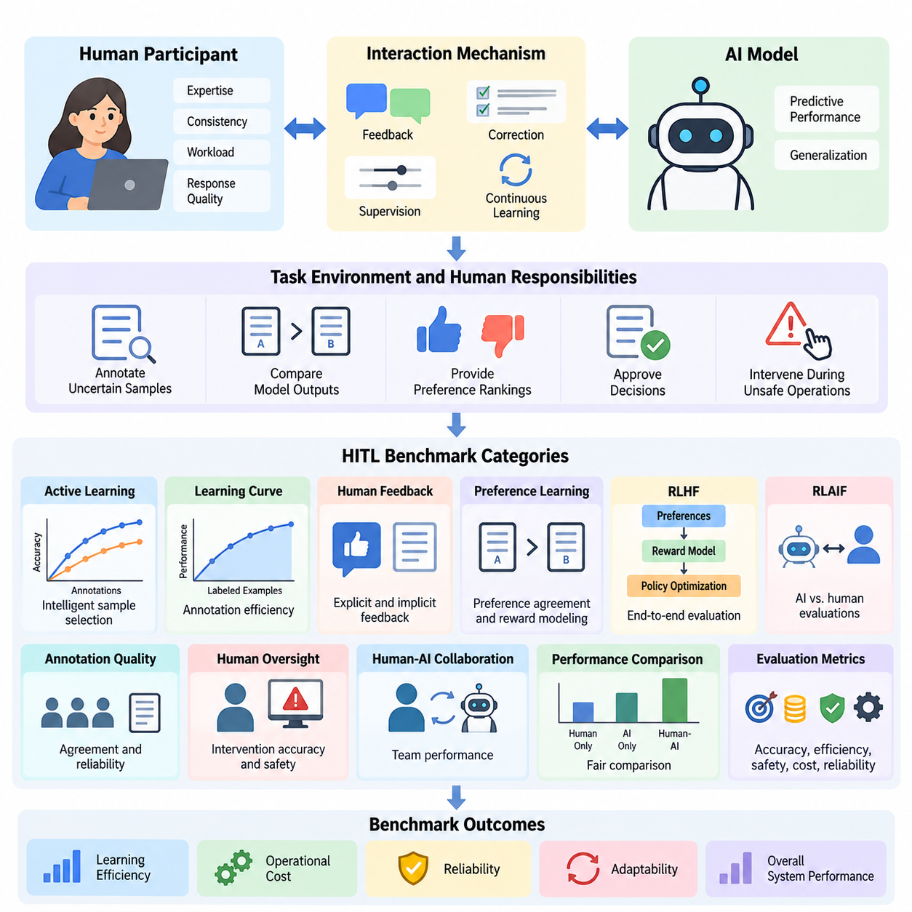
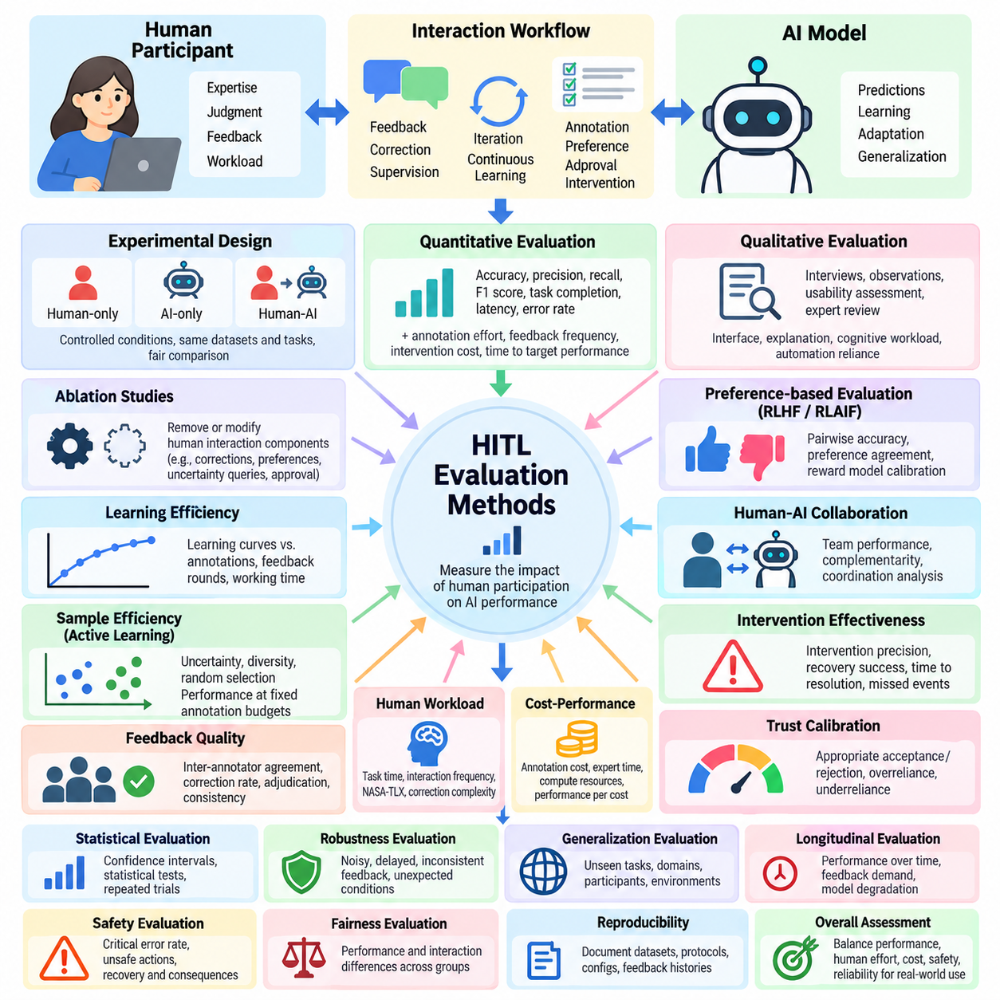
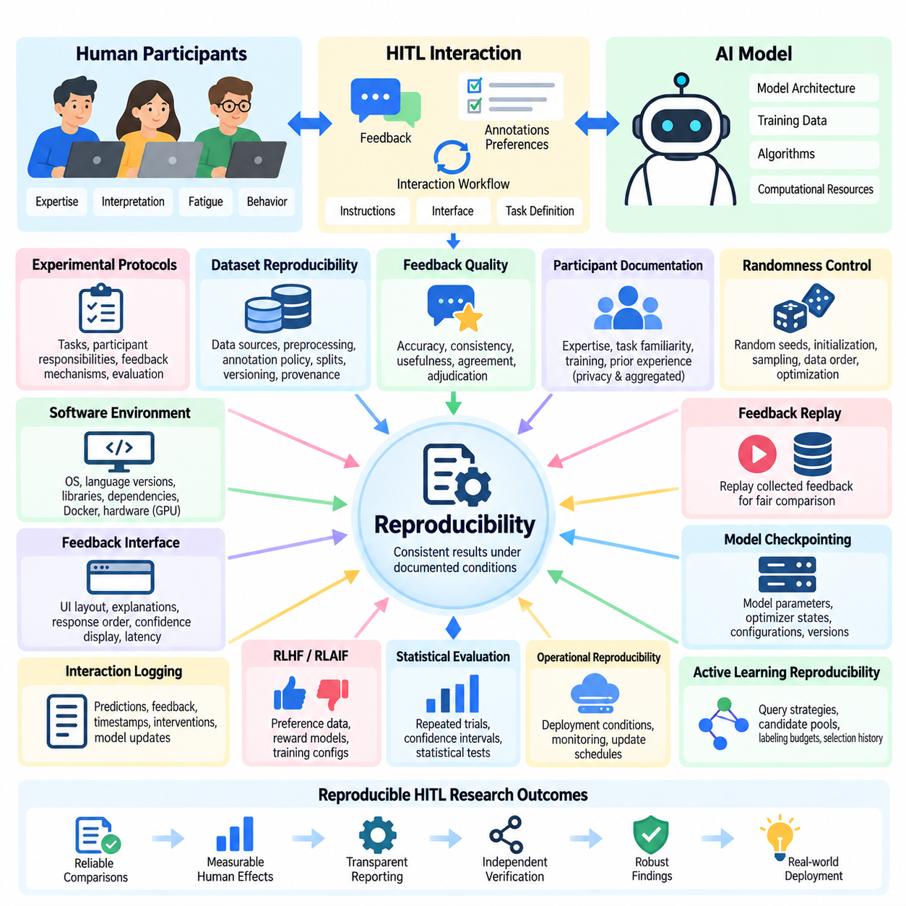
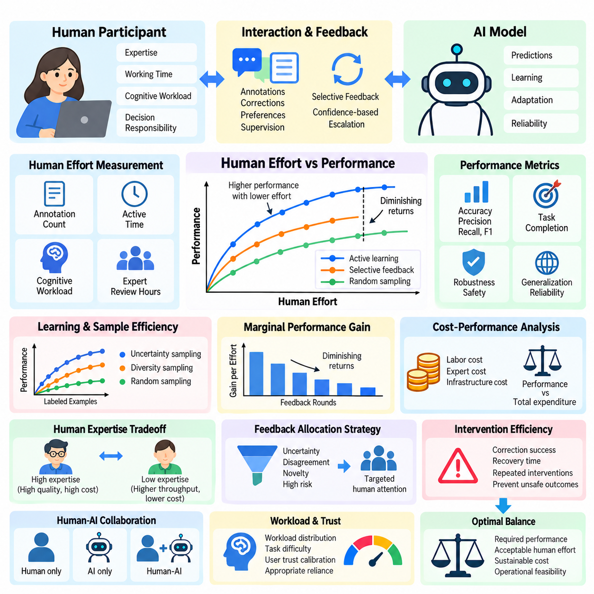
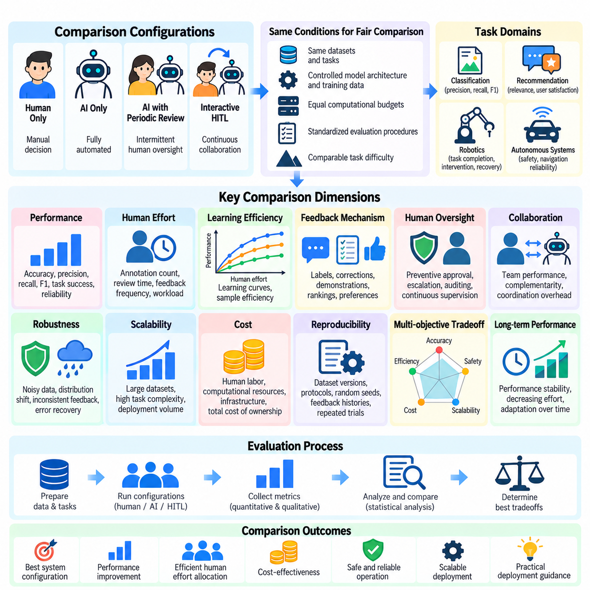

**Volume 41. Human in the Loop Learning**

# 09. Experiments and Benchmarks

## 09.01 HITL Benchmarks

{width="7.268055555555556in" height="7.268055555555556in"}

Human-in-the-Loop (HITL) benchmarks provide systematic methods for evaluating artificial intelligence systems that incorporate human judgment, feedback, correction, and supervision into learning and decision-making processes. Unlike conventional benchmarks that measure model accuracy independently, HITL benchmarks examine how human participation changes learning efficiency, reliability, adaptability, operational cost, and overall system performance.

The primary objective of HITL benchmarking is to quantify the contribution of human involvement under controlled experimental conditions. A benchmark must distinguish improvements produced by model architecture, training data, optimization methods, and human intervention. This distinction requires clearly defined baselines, consistent datasets, standardized interaction protocols, and measurable outcomes that support fair comparisons between different human-AI configurations.

A comprehensive HITL benchmark evaluates three interconnected components: the artificial intelligence model, the human participant, and the interaction mechanism connecting them. Model evaluation measures predictive performance and generalization, while human evaluation considers expertise, consistency, workload, and response quality. Interaction evaluation examines whether information exchange enables effective corrections, decisions, and continuous learning.

Benchmark design begins by defining the task environment and the responsibilities assigned to human participants. Humans may annotate uncertain samples, compare model outputs, provide preference rankings, approve decisions, or intervene during unsafe operations. Each interaction type requires a distinct evaluation protocol because annotation, preference modeling, supervisory approval, and direct control impose different cognitive demands and operational constraints.

Active learning benchmarks investigate whether strategically selected human annotations improve model performance more efficiently than randomly sampled training data. Experimental configurations typically compare uncertainty sampling, diversity sampling, query-by-committee, and expected model change. Performance is measured against annotation budgets, allowing researchers to determine whether intelligent sample selection reduces the human effort required to achieve a target accuracy.

A central measurement in active learning benchmarking is the learning curve, which describes model performance as additional labeled examples become available. Researchers compare accuracy, F1 score, or other task-specific metrics at equivalent annotation budgets. The area under the learning curve provides a useful summary of annotation efficiency, although interpretation must account for initial training conditions and differences in sample difficulty.

Human feedback benchmarks evaluate how effectively AI systems incorporate explicit ratings, implicit behavioral signals, and preference-based judgments. Explicit feedback may consist of numerical scores or corrective labels, while preference-based evaluation asks participants to compare alternative responses. Benchmark protocols must account for inconsistent judgments, ambiguous instructions, participant expertise, and systematic biases that influence feedback quality.

Preference learning benchmarks frequently measure agreement between predicted preferences and held-out human comparisons. Reward models can be evaluated using pairwise ranking accuracy, calibration, and robustness across different task categories. However, agreement with collected preferences does not automatically establish that a model produces beneficial behavior, making independent assessments of usefulness, safety, and generalization essential.

Reinforcement Learning from Human Feedback (RLHF) benchmarks examine the complete relationship between preference collection, reward modeling, policy optimization, and final behavior. Experimental comparisons may include supervised fine-tuning, reward-guided optimization, and policies trained without preference feedback. Evaluation should distinguish reward model scores from independent human judgments to detect reward exploitation and unintended optimization effects.

Reinforcement Learning from AI Feedback (RLAIF) introduces another benchmarking dimension by replacing or supplementing human evaluators with AI-generated assessments. Comparative experiments can measure agreement between AI and human judgments, evaluation costs, preference consistency, and downstream policy quality. Human reference evaluations remain important for identifying systematic errors shared by automated evaluators and the models being assessed.

Annotation quality benchmarks focus on the reliability of human-generated training labels. Inter-annotator agreement, adjudication accuracy, disagreement rates, and label correction frequency provide complementary indicators of dataset quality. Cohen\'s kappa, Fleiss\' kappa, and Krippendorff\'s alpha may be appropriate under different annotation conditions, but their interpretation depends on label distributions and the underlying measurement scale.

Human oversight benchmarks investigate whether supervisory mechanisms improve the safety and reliability of AI-assisted decisions. Experimental tasks may require participants to accept, reject, revise, or escalate model recommendations. Important measurements include intervention accuracy, missed critical events, false alarms, response latency, and the proportion of unsafe actions prevented through timely human participation.

Human-AI collaboration benchmarks should evaluate the combined team rather than treating human and model performance as independent quantities. A useful experimental design compares human-only, AI-only, and human-AI conditions using equivalent tasks and evaluation criteria. Such comparisons reveal whether collaboration produces measurable benefits or introduces coordination overhead, automation bias, excessive dependence, or unnecessary intervention.

Trust calibration represents an important dimension of collaborative benchmarking because effective human oversight depends on recognizing when model outputs deserve confidence. Participants may be exposed to predictions with different uncertainty estimates or explanation formats. Researchers can then examine whether users appropriately accept correct recommendations, reject incorrect ones, and adjust their reliance according to demonstrated system reliability.

Operational HITL benchmarks extend evaluation beyond isolated model predictions into complete production workflows. These experiments measure how feedback collection, annotation review, retraining, validation, and deployment interact over time. Workflow metrics include feedback processing latency, annotation throughput, model update frequency, error resolution time, and the proportion of collected feedback successfully incorporated into subsequent model improvements.

Continuous learning benchmarks examine how human feedback supports adaptation when operational data distributions change. Controlled experiments may introduce unfamiliar categories, changing environmental conditions, or evolving user preferences. Evaluation should measure adaptation speed, performance recovery, catastrophic forgetting, and the human effort required to restore acceptable behavior after distribution shifts or unexpected operational failures.

Robotics provides a particularly important environment for HITL benchmarking because human interventions can influence physical actions and safety-critical decisions. Representative tasks include navigation correction, manipulation assistance, trajectory approval, and recovery from failed operations. Relevant metrics include task completion rate, intervention frequency, recovery time, collision incidence, and successful autonomous operation between human interventions.

Industrial AI benchmarks can evaluate human participation in visual inspection, anomaly detection, predictive maintenance, and quality assurance. For example, a visual inspection system may request expert review when prediction confidence is insufficient. Benchmarking should determine whether selective escalation improves defect detection while reducing inspection workload, unnecessary manual reviews, and the operational consequences of missed defects.

Healthcare and other high-stakes applications require benchmarking protocols that distinguish decision support from independent automated decision-making. Human reviewers may evaluate diagnostic suggestions, risk estimates, or recommended actions within clearly defined authority boundaries. Experimental outcomes should include decision quality, escalation behavior, review time, uncertainty communication, and adherence to established safety requirements.

Human effort must be measured directly rather than approximated solely through the number of feedback interactions. Two annotation requests may require substantially different amounts of attention, expertise, and cognitive effort. Benchmark protocols should therefore record active working time, correction complexity, participant workload, and training requirements, enabling meaningful comparisons between systems with different interaction designs.

Cost-sensitive benchmarking combines model performance with the resources consumed by human participation. Total evaluation cost may include annotation labor, expert review, interface operation, computational processing, and repeated quality assurance. Comparing performance against both financial expenditure and human working time helps identify configurations that achieve practical efficiency rather than merely maximizing predictive accuracy.

Experimental reproducibility requires careful documentation of datasets, participant selection, task instructions, model configurations, annotation interfaces, and evaluation procedures. Random seeds and software versions should be recorded alongside interaction logs and feedback histories. Because human judgments contain natural variability, repeated trials and transparent reporting of participant characteristics are necessary for interpreting experimental results.

Statistical analysis should account for variability across participants, tasks, and experimental repetitions. Confidence intervals, paired comparisons, bootstrap estimation, and appropriate hierarchical statistical models can help quantify uncertainty. When multiple judgments originate from the same participant, treating them as independent observations may exaggerate statistical significance and produce misleading conclusions about benchmark performance.

Benchmark robustness can be examined by introducing ambiguous examples, noisy feedback, adversarial inputs, and disagreements among evaluators. A reliable HITL system should maintain acceptable behavior when human responses are delayed, inconsistent, or occasionally incorrect. Evaluation should therefore measure both the ability to benefit from high-quality feedback and resistance to harmful or misleading interventions.

Fairness and accessibility also influence benchmark validity because human participants differ in expertise, language proficiency, interaction preferences, and familiarity with AI systems. Evaluation protocols should investigate whether particular interface designs or feedback mechanisms systematically disadvantage certain participant groups. Appropriate reporting helps distinguish genuine algorithmic improvements from performance differences caused by participant composition.

A practical HITL benchmarking framework ultimately connects predictive performance, human effort, interaction quality, operational reliability, and safety into a unified evaluation process. No single metric can adequately represent these dimensions. Multi-objective analysis enables researchers and engineers to identify tradeoffs between autonomy, supervision, annotation cost, and system performance under realistic deployment constraints.

The long-term purpose of HITL benchmarking is to establish measurable evidence that human participation improves artificial intelligence systems in ways that justify its operational complexity. Well-designed benchmarks support transparent comparisons, reproducible experimentation, and informed deployment decisions. They also provide a foundation for developing adaptive human-AI systems that remain effective, accountable, and responsive to changing real-world requirements.

## 09.02 Evaluation Methods

{width="7.268055555555556in" height="7.268055555555556in"}

Evaluation methods for Human-in-the-Loop (HITL) learning provide systematic approaches for measuring how human participation influences artificial intelligence performance, learning efficiency, decision quality, and operational reliability. Unlike conventional evaluation, which primarily examines model outputs, HITL evaluation considers the combined behavior of human participants, learning algorithms, feedback mechanisms, and interaction workflows under controlled experimental conditions.

A fundamental principle of HITL evaluation is separating the contribution of human involvement from improvements attributable to model architecture, additional training data, or computational resources. Experimental designs should establish AI-only, human-only, and human-AI collaborative baselines whenever applicable. Consistent datasets, equivalent task difficulty, and standardized evaluation conditions enable meaningful comparisons across different interaction strategies.

Quantitative evaluation measures system behavior using numerical indicators that can be compared across experiments. Common metrics include accuracy, precision, recall, F1 score, task completion rate, response latency, and error frequency. In HITL environments, these indicators should be accompanied by measurements of annotation effort, feedback frequency, intervention cost, and the time required to achieve a specified performance threshold.

Qualitative evaluation examines aspects of human-AI interaction that numerical performance metrics cannot fully capture. Structured interviews, participant observations, usability assessments, and expert reviews can reveal problems involving unclear explanations, confusing interfaces, excessive cognitive workload, or inappropriate automation reliance. Qualitative findings help explain why particular HITL configurations succeed or fail under realistic operating conditions.

Human contribution can be evaluated through controlled ablation studies that remove or modify specific interaction components. Researchers may compare systems with and without expert corrections, preference feedback, uncertainty-based queries, or supervisory approval. By holding other experimental conditions constant, ablation studies identify which human interaction mechanisms contribute most strongly to model improvement and operational effectiveness.

Learning efficiency evaluation investigates how rapidly a model improves as human feedback becomes available. Learning curves describe performance against annotation count, feedback volume, interaction rounds, or accumulated human working time. Comparing these curves reveals whether a feedback strategy achieves higher accuracy with fewer interactions, although differences in annotation difficulty and participant expertise must be considered.

Sample efficiency is particularly important in active learning, where algorithms select informative examples for human annotation. Evaluation commonly compares uncertainty sampling, diversity sampling, and random selection under identical labeling budgets. Area under the learning curve and performance at fixed annotation budgets provide complementary measurements of how effectively each strategy converts limited human effort into predictive improvement.

Feedback quality evaluation measures the accuracy, consistency, and usefulness of information supplied by human participants. Inter-annotator agreement, correction rates, expert adjudication, and repeated judgment consistency provide evidence about feedback reliability. Evaluation should distinguish genuine task ambiguity from annotation mistakes because disagreement may reflect multiple defensible interpretations rather than insufficient participant competence.

Preference-based evaluation is essential for systems trained through Reinforcement Learning from Human Feedback (RLHF) or Reinforcement Learning from AI Feedback (RLAIF). Pairwise comparison accuracy, preference agreement, reward model calibration, and independent human ratings can measure alignment with evaluation criteria. Reward model scores should not be treated as definitive evidence of quality because optimized policies may exploit weaknesses in learned reward functions.

Human-AI collaboration effectiveness can be measured by comparing joint task outcomes with independent human and AI performance. Complementarity analysis examines whether the combined system resolves cases that either participant would handle incorrectly alone. Researchers should also evaluate coordination delays, conflicting recommendations, unnecessary interventions, and situations where AI assistance reduces rather than improves human decision quality.

Intervention effectiveness evaluation focuses on whether human corrections prevent errors or restore acceptable behavior. Relevant measurements include intervention precision, missed intervention opportunities, recovery success rate, and time to resolution. In autonomous systems, these metrics should be linked to operational consequences because a small number of missed safety-critical interventions may outweigh improvements in average task performance.

Trust calibration evaluation examines whether users appropriately adjust their reliance on AI recommendations according to actual system reliability. Experimental tasks may present predictions with confidence estimates, explanations, or uncertainty indicators. Researchers can measure appropriate acceptance, appropriate rejection, overreliance, and underreliance to determine whether interface design supports informed human decisions rather than unconditional automation acceptance.

Human workload evaluation considers the cognitive and physical demands imposed by HITL workflows. Task completion time, interaction frequency, subjective workload questionnaires, and observed correction complexity provide complementary indicators. The NASA Task Load Index may support subjective workload assessment, while direct behavioral measurements help identify situations where nominally efficient feedback mechanisms impose excessive operational burdens.

Cost-performance evaluation investigates the economic efficiency of human participation. Annotation expenses, expert review time, computational requirements, and workflow maintenance contribute to total operating cost. Performance can be compared against cumulative expenditure or human labor hours to determine whether additional feedback produces sufficient improvement to justify its cost, particularly in large-scale production environments.

Statistical evaluation is necessary because human judgments and learning outcomes vary across participants, datasets, and experimental repetitions. Confidence intervals, bootstrap procedures, paired statistical tests, and hierarchical models can quantify uncertainty. Experimental analysis should account for repeated observations from individual participants and avoid treating correlated feedback samples as independent evidence.

Robustness evaluation tests whether HITL systems remain reliable when feedback is noisy, delayed, inconsistent, or partially incorrect. Controlled experiments may introduce label corruption, conflicting preferences, missing responses, and unexpected operating conditions. A robust system should benefit from reliable human guidance while limiting the influence of misleading feedback and maintaining safe behavior when human assistance becomes unavailable.

Generalization evaluation determines whether improvements obtained through human interaction transfer beyond the examples used during feedback collection. Separate test datasets should include unfamiliar tasks, participants, environmental conditions, and data distributions. This distinction is essential because a model may improve substantially on repeatedly reviewed examples without developing capabilities that transfer to previously unseen situations.

Longitudinal evaluation examines how human-AI performance evolves across repeated learning and deployment cycles. Researchers may track adaptation speed, model degradation, feedback demand, and changing patterns of human intervention over time. Long-term studies can reveal whether continuous learning reduces dependence on supervision or creates new problems involving feedback accumulation, distribution drift, and inconsistent model behavior.

Safety evaluation requires metrics that reflect the severity and consequences of system failures rather than relying exclusively on average predictive accuracy. Critical error rates, unsafe action frequency, intervention latency, and successful recovery provide relevant evidence. In robotics and industrial automation, evaluations should distinguish simulation results from physical deployment outcomes and incorporate appropriate safety boundaries during experimentation.

Fairness evaluation investigates whether system performance and human interaction requirements differ systematically across participant groups or task categories. Researchers may examine disparities in prediction quality, annotation workload, intervention frequency, and access to effective explanations. Such evaluations help identify whether apparent improvements depend on particular participant populations or produce unequal operational outcomes.

Reproducibility requires documenting datasets, model configurations, participant instructions, feedback interfaces, random seeds, and evaluation procedures. Human-generated feedback histories should be versioned alongside training artifacts and experimental logs. Transparent reporting enables independent researchers to reconstruct evaluation conditions, examine sources of variability, and distinguish reproducible improvements from isolated experimental observations.

A comprehensive HITL evaluation framework integrates model performance, human contribution, interaction quality, operational efficiency, robustness, and safety into a multidimensional assessment. These dimensions should be reported separately before constructing composite indicators because aggregation can conceal important tradeoffs. Evaluation methods ultimately provide evidence for selecting human-AI configurations that balance autonomy, accountability, cost, and reliable performance in real-world applications.

## 09.03 Reproducibility [w/Code]

{width="7.268055555555556in" height="7.268055555555556in"}

Reproducibility in Human-in-the-Loop (HITL) learning refers to the ability to obtain consistent experimental findings when human-AI learning procedures are repeated under documented conditions. Unlike conventional machine learning experiments, HITL systems involve human judgments, feedback timing, interaction behavior, and individual expertise. These factors introduce additional variability that must be controlled, measured, and reported to establish reliable scientific conclusions.

The fundamental challenge of HITL reproducibility arises from the interaction between deterministic computational procedures and variable human behavior. Even when identical datasets, algorithms, and random seeds are used, different participants may provide different annotations or preferences. Reproducible experiments therefore require explicit separation between computational randomness, participant variability, environmental changes, and interaction-dependent learning outcomes.

Experimental protocols establish the foundation for reproducible HITL research by specifying task definitions, participant responsibilities, feedback mechanisms, and evaluation procedures. Each experiment should document how participants receive instructions, observe model predictions, submit corrections, and respond to uncertainty. Standardized protocols reduce unintended differences between experimental sessions while preserving meaningful variation in human judgments.

Dataset reproducibility requires precise documentation of data sources, preprocessing operations, annotation policies, and partitioning strategies. Training, validation, and test datasets should be versioned independently, with stable identifiers for individual samples. Data provenance records must describe how examples were collected, modified, filtered, or excluded, ensuring that subsequent experiments can reconstruct the original learning conditions.

Human feedback introduces a distinct reproducibility challenge because annotations and preference judgments may depend on expertise, fatigue, interpretation, and contextual information. Researchers should record feedback categories, annotation instructions, confidence ratings, and disagreement resolution procedures. Repeated annotation experiments can estimate the stability of human judgments without assuming that every disagreement represents an annotation error.

Participant documentation is essential for understanding variation across HITL experiments. Relevant characteristics may include domain expertise, task familiarity, training duration, and prior experience with AI-assisted workflows. Such information should be collected only when necessary, handled with appropriate privacy protections, and reported in aggregated form whenever possible to avoid exposing identifiable participant information.

Randomness control supports computational reproducibility by establishing consistent initialization, sampling, data ordering, and optimization procedures. Experiments should record random seeds for Python, NumPy, machine learning frameworks, and environment simulators when applicable. However, fixed seeds do not guarantee identical results across hardware architectures, parallel execution schedules, or nondeterministic computational operations.

Software environment reproducibility requires recording operating systems, programming language versions, machine learning libraries, dependencies, and hardware configurations. Containerization technologies such as Docker can preserve many software dependencies, while environment specifications document installation requirements. GPU models, accelerator libraries, and numerical precision settings should also be reported because they can influence training behavior and experimental outcomes.

Feedback collection interfaces must be treated as experimental components rather than neutral presentation tools. Interface layout, explanation visibility, response ordering, confidence displays, and interaction latency can influence human decisions. Reproducible HITL studies should preserve interface versions, interaction instructions, and presentation conditions so that observed differences are not mistakenly attributed to learning algorithms.

Interaction logging provides a detailed record of how human feedback influences model behavior throughout an experiment. Logs should capture sample identifiers, model predictions, feedback categories, correction timestamps, intervention decisions, and model update events. These records enable researchers to reconstruct learning trajectories, investigate unexpected results, and distinguish model changes caused by human feedback from unrelated system modifications.

Feedback replay is a practical technique for improving experimental comparability. Previously collected human annotations or preferences can be replayed through alternative learning algorithms under controlled conditions. This approach reduces participant variability when comparing model training procedures, although replayed feedback cannot fully reproduce interactive situations where later human decisions depend on earlier model behavior.

Model checkpointing enables reproducible analysis of learning progress by preserving model parameters, optimizer states, training configurations, and feedback dataset versions. Checkpoints should correspond to identifiable interaction rounds or training milestones. Researchers can then resume experiments, compare intermediate policies, and investigate whether performance changes result from particular feedback batches or optimization decisions.

Active learning experiments require special attention because sample selection changes the data presented to human annotators. Reproducibility depends on documenting query strategies, acquisition functions, candidate pools, labeling budgets, and selection histories. When different algorithms request different samples, comparisons should account for annotation difficulty and ensure that test data remains independent of the adaptive selection process.

RLHF and RLAIF experiments introduce additional dependencies involving preference datasets, reward models, policy optimization, and evaluator configurations. Reproducible studies should preserve preference pairs, reward model checkpoints, training hyperparameters, and evaluation prompts. When AI-generated feedback is used, the evaluator model version and generation settings must also be recorded to support meaningful reconstruction of the training pipeline.

Statistical reproducibility requires repeated experiments across random seeds, datasets, and participant groups. Reporting only the best-performing run can conceal instability and exaggerate improvements. Researchers should provide central tendency measures, variability estimates, confidence intervals, and clearly defined experimental sample sizes. Statistical procedures must account for repeated observations from the same participants and correlated interaction histories.

Inter-annotator agreement contributes to reproducibility by measuring consistency among human evaluators. Cohen\'s kappa, Fleiss\' kappa, and Krippendorff\'s alpha can quantify agreement under appropriate annotation conditions. However, high agreement does not necessarily establish annotation correctness, while low agreement may reflect legitimate ambiguity. Agreement statistics should therefore be interpreted alongside task definitions and adjudication procedures.

Operational reproducibility extends beyond model training to include deployment conditions, feedback processing pipelines, monitoring configurations, and update schedules. Production HITL systems may change as user populations, data distributions, and operational requirements evolve. Versioned deployment artifacts and documented feedback policies help determine whether observed performance differences originate from model updates or changes in the surrounding workflow.

Robotics and physical AI systems require additional reproducibility controls because environmental conditions influence both autonomous behavior and human intervention. Sensor calibration, robot configuration, simulation parameters, task geometry, and environmental disturbances should be documented. Physical experiments should include repeated trials and safety procedures, recognizing that identical real-world conditions cannot always be reconstructed precisely.

Privacy and security requirements can limit the direct sharing of human interaction records. Reproducibility frameworks should therefore support de-identified datasets, controlled-access feedback archives, and documented data transformation procedures. When raw feedback cannot be released, researchers should provide sufficient metadata, aggregate statistics, and executable evaluation procedures to support independent verification without exposing sensitive information.

Automated experiment management improves reproducibility by connecting configuration files, dataset versions, training executions, evaluation results, and model artifacts. Tools such as MLflow, Weights & Biases, and Data Version Control can support experiment tracking and artifact management. Automated validation should detect missing configuration fields, inconsistent dataset versions, and incomplete feedback histories before results are accepted.

A reproducibility checklist should verify that experimental objectives, datasets, participant protocols, model configurations, feedback mechanisms, evaluation metrics, and statistical procedures are fully documented. Independent reproduction attempts should follow the published protocol without relying on undocumented assumptions. Discrepancies should be investigated systematically rather than immediately interpreted as evidence that the original findings were incorrect.

The ultimate goal of HITL reproducibility is not to eliminate natural differences in human behavior but to make their influence measurable, interpretable, and scientifically accountable. Reliable reproducibility practices enable fair comparisons between learning strategies, strengthen confidence in experimental conclusions, and support the transition from laboratory demonstrations to dependable human-AI systems operating under real-world conditions.

## 09.04 Human Effort vs Performance

{width="7.268055555555556in" height="7.268055555555556in"}

Human effort versus performance is a central evaluation problem in Human-in-the-Loop (HITL) learning because improvements in artificial intelligence must be considered alongside the resources required from human participants. A system that achieves higher accuracy through extensive manual intervention may be less practical than one delivering slightly lower accuracy with substantially reduced human involvement. Evaluation must therefore examine performance gains relative to human effort.

Human effort includes more than the number of annotations or feedback interactions collected during training. It encompasses active working time, cognitive workload, domain expertise, correction complexity, decision responsibility, and supervisory attention. These dimensions vary across tasks and participants, making simple annotation counts insufficient for comparing the operational efficiency of different HITL strategies.

Performance in HITL systems should be defined according to the intended application rather than relying exclusively on predictive accuracy. Classification systems may use precision, recall, and F1 score, while robotic systems may measure task completion, intervention frequency, and recovery success. Evaluation should also consider robustness, safety, generalization, and operational reliability when determining whether additional human effort produces meaningful improvements.

The relationship between human effort and model performance is commonly represented through learning curves that plot evaluation results against cumulative annotations, feedback rounds, or human working hours. These curves reveal how quickly a system improves as additional human guidance becomes available. Comparing curves under consistent experimental conditions helps identify learning strategies that achieve equivalent performance with lower human effort.

Annotation efficiency measures how effectively human labeling activity contributes to model improvement. In active learning, uncertainty sampling, diversity sampling, and other query strategies attempt to select informative examples rather than labeling data randomly. Evaluation compares model performance under equal annotation budgets while considering differences in sample difficulty, annotation time, and the expertise required to produce reliable labels.

Marginal performance gain describes the additional improvement obtained from each unit of human effort. Early feedback may produce substantial benefits by correcting common model errors, while later feedback often yields progressively smaller improvements. Measuring marginal gains helps identify diminishing returns and determine when additional annotation or supervision becomes economically inefficient.

Human effort can be expressed through multiple complementary measurements, including annotation count, active labeling time, intervention duration, and expert review hours. Cognitive workload and task difficulty should be recorded separately because equal working times do not necessarily represent equal effort. Combining these measurements provides a more realistic understanding of the resources consumed by different feedback strategies.

Cost-performance analysis translates human effort into operational expenditure while preserving the distinction between labor time and financial cost. Expert annotations may require higher compensation than routine labeling, and complex corrections may involve additional verification. Comparing performance improvements against total feedback expenditure helps determine whether a learning strategy is sustainable at production scale.

Human expertise introduces an important tradeoff between feedback quality and collection cost. Highly trained specialists may produce more accurate annotations and resolve ambiguous cases efficiently, but their availability can be limited. Less experienced annotators may offer greater throughput at lower cost while requiring additional review. Evaluation should measure the combined effects of expertise, correction frequency, and quality assurance.

Feedback allocation strategies influence the balance between human effort and performance. Rather than requesting human input for every prediction, selective feedback systems identify cases involving uncertainty, disagreement, novelty, or elevated risk. Effective allocation concentrates human attention where it provides the greatest expected benefit, reducing unnecessary interventions while preserving sufficient oversight of critical decisions.

Confidence-based escalation is one practical method for controlling human workload. Predictions exceeding a validated confidence threshold may proceed automatically, while uncertain cases are routed to human reviewers. Evaluation must consider calibration quality, escalation frequency, and the consequences of incorrect automatic decisions because reduced review volume is beneficial only when reliability remains acceptable.

Human-AI collaboration can improve performance through complementary capabilities rather than simply increasing the number of human interventions. Humans may contribute contextual understanding, domain knowledge, and exception handling, while AI provides rapid processing and consistent routine predictions. Evaluation should compare human-only, AI-only, and collaborative configurations to determine whether coordination benefits exceed interaction overhead.

Intervention efficiency measures how effectively human actions correct failures or prevent undesirable outcomes. Relevant indicators include successful corrections per intervention, recovery time, and the number of repeated interventions required for similar errors. In robotics and autonomous systems, intervention quality must also account for physical safety, task continuity, and the consequences of delayed human responses.

Workload distribution becomes important when multiple human participants support a shared HITL system. Uneven assignment of difficult tasks may increase fatigue, reduce annotation consistency, and create operational bottlenecks. Evaluation should examine task allocation, reviewer utilization, waiting time, and differences in participant performance to determine whether human resources are distributed efficiently.

Automation bias can distort the apparent relationship between human effort and performance. Participants may accept incorrect AI recommendations without sufficient verification, producing shorter review times but lower decision quality. Conversely, excessive skepticism may generate unnecessary corrections. Reliable evaluation must distinguish genuinely efficient collaboration from reduced effort caused by inappropriate reliance or distrust.

Longitudinal evaluation examines whether human effort decreases as models improve through repeated feedback cycles. Successful continuous learning may reduce annotation demand, intervention frequency, and supervisory workload while maintaining performance. However, distribution shifts, new task requirements, and model degradation can increase feedback demand, making long-term effort measurements essential for realistic operational planning.

Multi-objective optimization provides a framework for balancing predictive performance, human workload, financial cost, and safety. Different HITL configurations may occupy different positions along a Pareto frontier, where improving one objective requires sacrificing another. Such analysis helps identify configurations appropriate for specific operational priorities rather than assuming that maximum accuracy is always the preferred outcome.

Statistical evaluation should quantify uncertainty in both performance measurements and human effort estimates. Differences in participant expertise, task difficulty, and feedback quality can produce substantial variation between experimental runs. Repeated trials, confidence intervals, and appropriate statistical models help determine whether observed efficiency improvements are reproducible rather than consequences of favorable experimental conditions.

Industrial AI applications illustrate the practical importance of effort-performance tradeoffs. In visual inspection, human reviewers may examine only uncertain defect predictions instead of inspecting every item. Evaluation should measure defect detection performance, missed defects, review time, and escalation workload to establish whether selective human involvement improves productivity without compromising required quality standards.

Robotics applications introduce additional constraints because human effort may involve remote supervision, trajectory correction, recovery assistance, or direct control. Reducing intervention frequency is desirable only when autonomous task completion and safety remain acceptable. Evaluation should distinguish routine supervisory attention from emergency interventions, since these activities differ substantially in cognitive demand and operational consequences.

The optimal balance between human effort and performance depends on task criticality, feedback quality, available expertise, and deployment constraints. Low-risk applications may prioritize reduced annotation cost, while safety-critical environments may require extensive verification despite higher workload. A rigorous HITL evaluation framework should therefore report performance, effort, cost, and risk separately before selecting an appropriate operating configuration.

Ultimately, human effort versus performance evaluation determines whether human participation creates sufficient measurable value to justify its operational requirements. Effective HITL systems do not simply minimize human involvement or maximize model accuracy. They allocate human intelligence strategically, preserve meaningful oversight, and achieve reliable performance improvements with sustainable demands on human attention, expertise, and organizational resources.

## 09.05 System Comparison

{width="7.268055555555556in" height="7.268055555555556in"}

System comparison in Human-in-the-Loop (HITL) learning examines how different human-AI configurations perform under equivalent experimental and operational conditions. The objective is not simply to identify the model with the highest accuracy but to determine which combination of automation, human feedback, supervision, and adaptation provides the greatest practical value. Meaningful comparisons must consider predictive quality, human effort, safety, scalability, and long-term reliability.

A systematic comparison begins by defining reference configurations that represent different levels of human participation. Common baselines include human-only decision making, fully automated AI, AI with periodic human review, and continuously interactive HITL systems. These configurations should operate on comparable tasks and datasets so that performance differences can be attributed to interaction mechanisms rather than unrelated experimental conditions.

Fair comparison requires controlling model architecture, training data, computational budgets, evaluation procedures, and task difficulty whenever possible. If systems use different underlying models, their capabilities and resource requirements must be documented separately. Without such controls, improvements attributed to human feedback may actually result from larger models, additional training examples, or greater computational investment.

Performance comparison evaluates predictive accuracy alongside application-specific outcomes. Classification systems may emphasize precision, recall, and F1 score, while recommendation systems may examine relevance and user satisfaction. Robotics applications require task completion, navigation reliability, intervention frequency, and recovery success. No single metric adequately represents the operational quality of every HITL configuration.

Human effort comparison measures the resources required to achieve a given performance level. Annotation count, feedback frequency, active review time, expert involvement, and cognitive workload provide complementary indicators. Two systems may achieve similar accuracy while imposing substantially different demands on participants. Evaluating effort at fixed performance thresholds helps identify configurations that use human expertise efficiently.

Learning efficiency comparison investigates how quickly different systems improve as feedback becomes available. Performance curves can be plotted against annotation budgets, interaction rounds, or accumulated human working hours. Active learning strategies may outperform random sampling when informative examples are selected effectively. However, sample difficulty and annotation cost must be considered before concluding that one strategy is more efficient.

Feedback mechanism comparison examines whether labels, corrections, demonstrations, rankings, or preference judgments provide the most useful learning signals. Each feedback type has different requirements for participant expertise, interaction time, and model integration. Controlled experiments should compare these mechanisms under matched resource budgets while recognizing that some tasks naturally favor particular forms of human guidance.

Human oversight configurations can be compared according to when and how intervention occurs. Preventive approval, exception-based escalation, periodic auditing, and continuous supervision represent different operational approaches. Evaluation should measure missed errors, unnecessary interventions, response latency, and recovery outcomes. Safety-critical applications may favor stronger oversight even when it increases human workload.

Collaboration comparison investigates whether joint human-AI performance exceeds the capabilities of either participant operating independently. Complementarity is especially valuable when humans recognize contextual exceptions that models overlook and AI handles repetitive processing efficiently. Researchers should also measure coordination overhead, conflicting decisions, and automation bias because collaboration does not automatically produce superior outcomes.

Robustness comparison tests system behavior under noisy feedback, unfamiliar data, delayed responses, and changing environmental conditions. Controlled disturbances reveal whether performance depends excessively on ideal interaction assumptions. Systems should be evaluated for their ability to detect uncertainty, tolerate inconsistent feedback, and recover from errors without creating unsafe or unstable operating conditions.

Scalability comparison examines whether HITL performance remains sustainable as dataset size, task complexity, and deployment volume increase. A system requiring constant expert intervention may perform well in laboratory experiments but become impractical in production. Evaluation should consider reviewer throughput, queue delays, infrastructure utilization, and the ability to allocate human attention across many simultaneous tasks.

Cost comparison integrates human labor, computational resources, infrastructure, and maintenance requirements. Initial training expenses should be distinguished from recurring feedback and supervision costs. Total cost of ownership provides a broader perspective than annotation expenditure alone. Systems delivering similar performance may differ considerably in long-term financial sustainability and operational complexity.

Reproducibility is essential for interpreting system comparisons because human participation introduces variability across experiments. Researchers should preserve dataset versions, participant protocols, random seeds, feedback histories, and evaluation configurations. Repeated trials and confidence intervals help distinguish consistent performance differences from random variation or participant-specific effects.

Multi-objective comparison recognizes that accuracy, efficiency, safety, interpretability, and cost may conflict. Pareto analysis identifies configurations where improving one objective requires sacrificing another. Rather than combining all dimensions into an opaque score, evaluations should report individual metrics and explain their operational significance. Selection criteria must reflect the priorities and constraints of the intended deployment environment.

Longitudinal comparison investigates how systems evolve after repeated deployment and feedback cycles. Initially effective configurations may require increasing supervision as data distributions change, while adaptive systems may gradually reduce human workload. Evaluation should track performance stability, feedback demand, model degradation, and recovery from operational changes to determine whether observed advantages persist over time.

Industrial inspection provides a practical example of system comparison. A fully automated classifier can be compared with universal human inspection and selective review of uncertain predictions. Relevant outcomes include defect detection, missed defects, inspection throughput, and reviewer workload. The preferred configuration depends on whether productivity gains can be achieved while maintaining required quality and safety standards.

Robotics and physical AI introduce additional comparison dimensions involving physical risk, environmental uncertainty, and intervention timing. Autonomous navigation, supervised autonomy, and teleoperation may be evaluated under equivalent missions. Task success, human control time, safety events, and recovery effectiveness reveal how different autonomy levels influence operational capability and human responsibility.

A comprehensive system comparison framework should distinguish experimental superiority from deployment suitability. The highest-scoring laboratory system may require unavailable expertise, excessive infrastructure, or impractical supervision. Decision makers should therefore consider technical performance alongside organizational capacity, regulatory requirements, operational risk, and the availability of qualified human participants.

Ultimately, HITL system comparison supports evidence-based selection of human-AI architectures rather than universal rankings. The most effective configuration is the one that achieves required performance with acceptable human effort, cost, risk, and operational complexity. Rigorous comparison enables organizations to determine where automation should operate independently, where human expertise adds value, and how collaboration can remain reliable as systems evolve.
